## Batch 구현

---

[이전에 Batch 설계](tistory-335.html)를 진행하면서 각 기능을 다양한 Flow로 계획했었다. Chunk Oriented Step에서 사용하는 **ItemReader**, **ItemWriter**를 살펴보고 실제 서비스 요구사항에 맞춰 구현해보겠다.

### Batch 이용 기간에 따른 만료

---

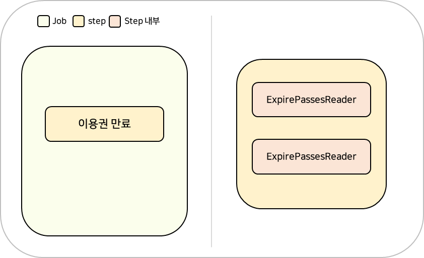

이용권 만료

구현할 기능은 **이용권을 만료하는 기능**으로 이용권을 각각 사용할 수 있는 기간이 **startedAt**, **endedAt**으로 명시되어 있다. 현재 시점에서 endedAt 이 지나있으면 만료되어있는 것으로 판단하고 Status를 만료 상태로 변경하도록 하겠다.

**Chunk 기반으로 동작하는 각 Step**은 **ItemReader**, **ItemProcessor**, **ItemWriter**로 구성된다.

#### **[ ItemReader ] DB 읽기**

**Spring Batch**는 개발자가 일일이 코드로 작성하지 않아도 거의 모든 유형, 즉 파일에서 읽거나 DB에서 읽은 Input을 처리할 수 있는 기능을 제공하는데 이를 **ItemReader**를 통해 사용할 수 있다.


**ItemReader** 인터페이스를 보면 **read** 메소드를 볼 수 있는데 **Spring Batch**가 **ItemReader**에 **read** 메소드를 호출하면 해당 메소드는 **Step** 내에서 처리한 **아이템** 1개를 반환한다. 

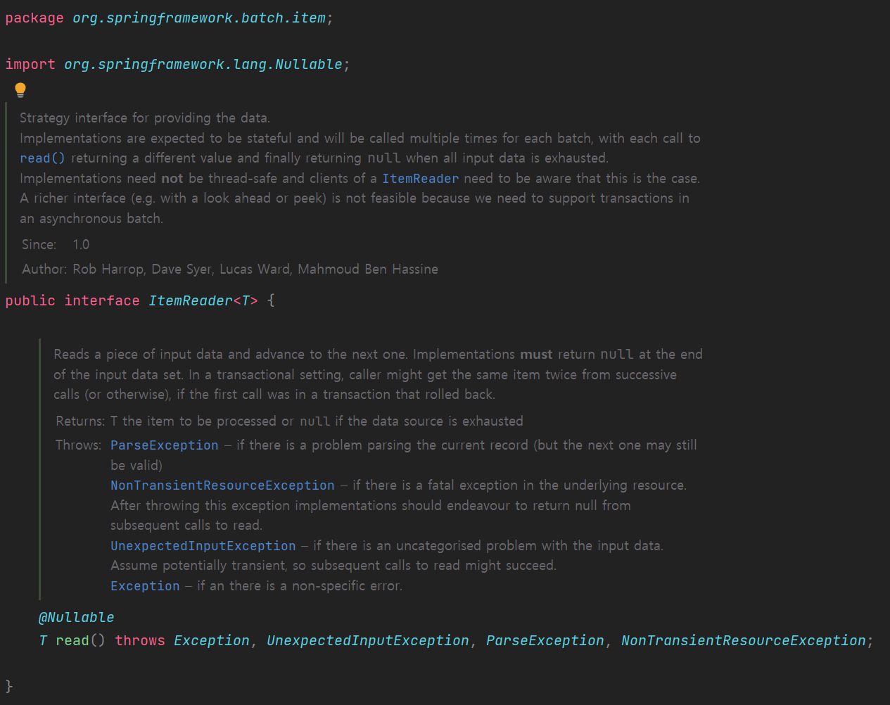

**Step**은 **ItemReader**를 사용하여 각 **Item**을 개별적으로 읽고 **ItemProcess**에게 전달해 필요한 처리를 수행한다.

이러한 작업을 **Chunk Size**가 될때까지 반복하고 **Chunk** 1개가 완성되면 목록을 **ItemWriter**로 전달한다.

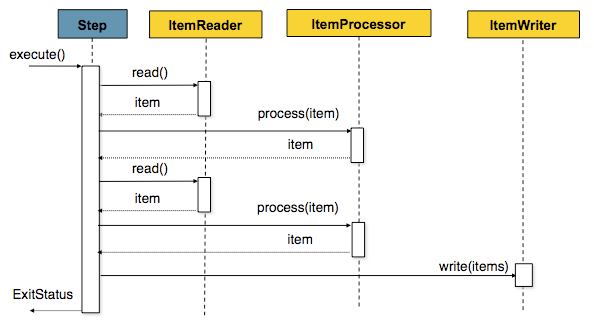

Spring Batch - Chunk 기반 Step 구조(출처: Spring Docs)

#### **[ ItemReader ] Cursor vs Paging**

Spring Batch에서는 처리할 Input 유형에 맞는 여러 구현체들을 제공하는데 그중 DB를 읽어올 예정이므로 DB와 관련된 구현체를 살펴보도록 하겠다. 

**Cursor**와 **Paging**은 **ItemReader**에서 데이터를 읽어오는 기법이다.

Batch에서 대용량 데이터를 다루는 일은 흔한 일이다. 그런데 전체 데이터를 한번에 조회하게 되면 당연히 문제가 발생할 수있다. 그래서 전체가 아닌 Cursor 또는 Paging 방법으로 처리할 수 있는 만큼에 데이터만 받아오는 것이다.

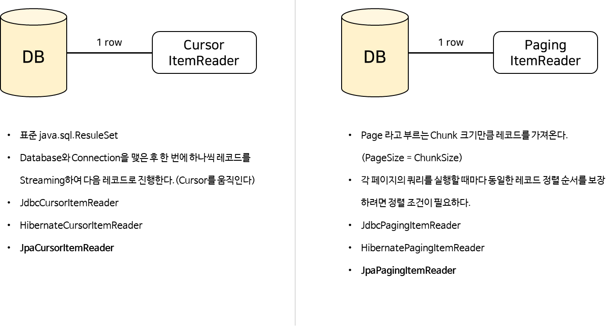

* **Cursor**는 하나의 **Connection**으로 가기 때문에 **Paging** 보다 성능이 빠를 수 있으나 수행 시간이 오래걸릴 경우 하나의 커넥션이 끊길 수 있다.
* **Paging**은 **Cursor** 보다 성능이 느릴 수 있으나 한 필드를 읽을 때마다 **Connection**을 맺고 끊기 때문에 보다 안정적이다.
* JPA를 지원하는 **JpaCursorItemReader, **Jpa**Paging**ItemReader**** 를 사용할 것이고 둘 중 어느 것을 사용할 것인지는 각 서비스 기능에 따라 결정할 것이다.

#### **[ ItemWriter ] DB 쓰기**

ItemWriter는 데이터 쓰기 기능을 담당하는데 **ItemReader**, **ItemProcessor**와 달리 **Item** 단위가 아닌 **Chunk** 단위로 수행한다. 


**ItemWriter** 인터페이스를 확인해보면 **write** 메소드 인자가 List 형태인 것을 확인할 수 있다. **ItemReader**와 마찬가지로 **ItemWriter**도 다양한 타입으로 구현체를 제공하고 있기 때문에 **JpaItemWriter**를 사용하려고 한다.

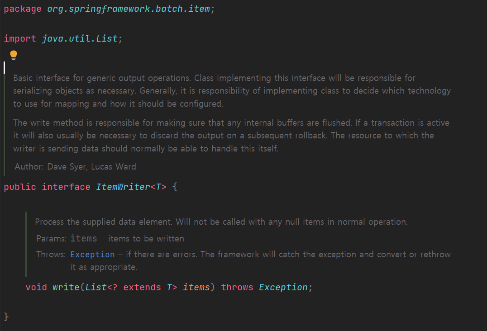

#### **이용권 만료 구현**

구현하기 전에 **pass** 데이터를 먼저 살펴보려고 한다. 

호출하는 시점이 **종료일시**(**ended\_at)**보다 나중일 경우 만료된 상태이므로 **상태**(**status**)를 만료 상태로 업데이트하는 것이다.

만약 상태로 업데이트할 때에는 **만료일시**(**expired\_at**)을 기록해주어야한다.

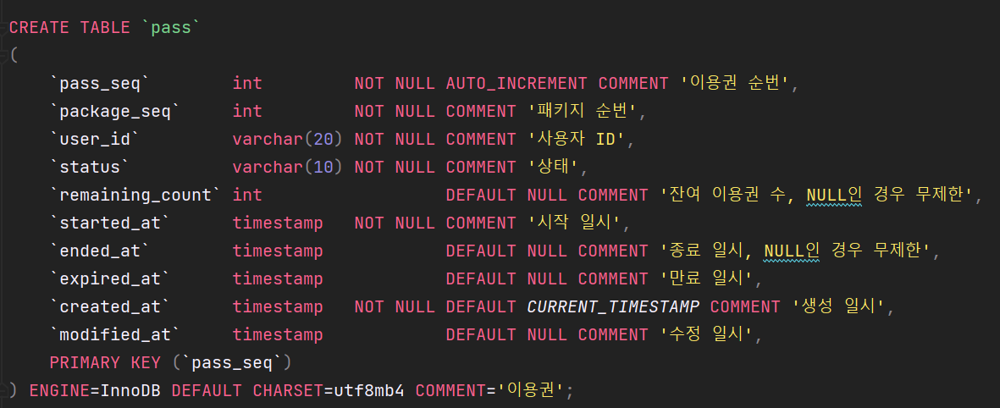

**ExpirePassesJobConfig**

**ExpirePassesJob** 이라는 이용권 만료 Job 을 생성할 때 **jobBuilderFactory**, **stepBuilderFactory**를 사용하여 각각에 Step을 정의할 것이다. **jobBuilder**와 ****stepBuilder****는 빈으로 등록하는 것이 아니라 **@EnableBatchProcessing**을 통해 제공되는 빈이다.

```java
@Configuration
public class ExpirePassesJobConfig {

    private final int CHUNK_SIZE = 5;

    private final JobBuilderFactory jobBuilderFactory;
    private final StepBuilderFactory stepBuilderFactory;
    private final EntityManagerFactory entityManagerFactory;

    public ExpirePassesJobConfig(JobBuilderFactory jobBuilderFactory, StepBuilderFactory stepBuilderFactory, EntityManagerFactory entityManagerFactory) {
        this.jobBuilderFactory = jobBuilderFactory;
        this.stepBuilderFactory = stepBuilderFactory;
        this.entityManagerFactory = entityManagerFactory;
    }

    @Bean
    public Job expirePassesJob() {
        return this.jobBuilderFactory.get("expirePassesJob")
                .start(expirePassesStep())
                .build();
    }

    @Bean
    public Step expirePassesStep() {
        return this.stepBuilderFactory.get("expirePassesStep")
                .<PassEntity, PassEntity>chunk(CHUNK_SIZE)
                .reader(expirePassesItemReader())
                .processor(expirePassesItemProcessor())
                .writer(expirePassesItemWriter())
                .build();
    }

    @Bean
    @StepScope
    public JpaCursorItemReader<PassEntity> expirePassesItemReader() {
        return new JpaCursorItemReaderBuilder<PassEntity>()
                .name("expirePassesItemReader")
                .entityManagerFactory(entityManagerFactory)
                .queryString("select p from PassEntity p where p.status = :status and p.endedAt <= :endedAt")
                .parameterValues(Map.of("status", PassStatus.IN_PROGRESS, "endedAt", LocalDateTime.now()))
                .build();
    }

    @Bean
    public ItemProcessor<PassEntity, PassEntity> expirePassesItemProcessor() {
        return passEntity -> {
            passEntity.setStatus(PassStatus.EXPIRED);
            passEntity.setExpiredAt(LocalDateTime.now());
            return passEntity;
        };
    }

    /**
     * JpaItemWriter: JPA의 영속성 관리를 위해 EntityManager를 필수로 설정해주어야 한다.
     * @return
     */
    @Bean
    public JpaItemWriter<PassEntity> expirePassesItemWriter() {
        return new JpaItemWriterBuilder<PassEntity>()
                .entityManagerFactory(entityManagerFactory)
                .build();
    }
}
```

* **Job**은 **JobBuilderFactory**을 이용하여 생성하고 **expirePassesStep**을 수행하도록 함.
* **Step**은 **StepBuilderFactory**을 이용하여 **Chunk 기반 Step**으로 **ItemReader**, **ItemProcess**, **ItemWriter**를 구성함.
  + **ItemReader**는 **JpaCursorItemReaderBuilder**를 이용하여 생성하고 직접 쿼리를 작성해주면 된다.  
    **Cursor 기법을 사용한 이유**는 Page를 조회하고 Status를 업데이트(**Processed to Expired**)하면 페이지 단위로 조회하기 때문에 데이터가 누락되는 문제가 발생할 수 있기 때문이다.  

    데이터를 읽어와서 Expired하게 되면 Progressed한 것을 가져올 때 누락이된 데이터가 생길 수 있기 때문에 데이터의 변경에 무관한 **무결성 조회가 가능한 Cursor 기법**을 사용하였다.  

    참고로 **JpaCursorItemReader는** 원래 지원하지 않았었는데 Spring 4.3에서 추가되었다.
  + **ItemProcessor**는 조회한 **passEntity**에 상태값과 만료일시를 업데이트해주면 된다.
  + **ItemWriter**는 **JpaItemWriterBuilder**를 이용하여 생성한다.  
    참고로 **JpaItemWriter**는 JPA의 영속성 관리를 위해 EntityManager를 필수로 설정해주어야한다.

#### 동작 검증을 위한 테스트

Pass 엔티티 10개를 생성하고 해당 값들을 만료시키는 작업이 정상적으로 진행되는지 확인한다.

```java
package com.example.job.pass;

@Slf4j
@SpringBatchTest
@SpringBootTest
@ActiveProfiles("test")
@ContextConfiguration(classes = {ExpirePassesJobConfig.class, TestBatchConfig.class})
class ExpirePassesJobConfigTest {

    @Autowired private JobLauncherTestUtils jobLauncherTestUtils;
    @Autowired private PassRepository passRepository;


    @Test
    void test_expirePassesStep() throws Exception {
        // Given
        addPassEntities(10);

        // When
        JobExecution jobExecution = jobLauncherTestUtils.launchJob();
        JobInstance jobInstance = jobExecution.getJobInstance();

        // Then
        assertEquals(ExitStatus.COMPLETED, jobExecution.getExitStatus());
        assertEquals("expirePassesJob", jobInstance.getJobName());
    }

    private void addPassEntities(int size) {
        final LocalDateTime now = LocalDateTime.now();
        final Random random = new Random();

        List<PassEntity> passEntities = new LinkedList<>();
        for(int i=0; i<size; i++){
            PassEntity passEntity = new PassEntity();
            passEntity.setPackageSeq(1);
            passEntity.setUserId("A" + 1000000 + i);
            passEntity.setStatus(PassStatus.PROGRESSED);
            passEntity.setRemainingCount(random.nextInt(11));
            passEntity.setStartedAt(now.minusDays(60));
            passEntity.setEndedAt(now.minusDays(1));
            passEntities.add(passEntity);
        }

        passRepository.saveAll(passEntities);
    }
}
```

**Step과 Job이 정상적으로 실행됨을 확인할 수 있다.**

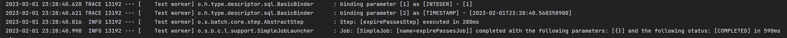

**Chunk 단위(5개)로 실행됨을 확인할 수 있다.**

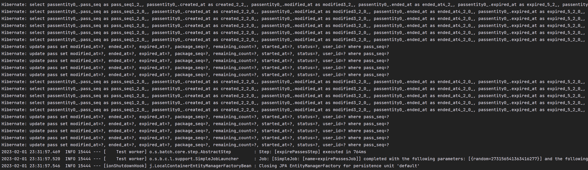

실제 데이터도 정상적으로 업데이트된 것을 확인할 수 있다. (**READY**(0), **PROGRESSED**(1), **EXPIRED**(2))

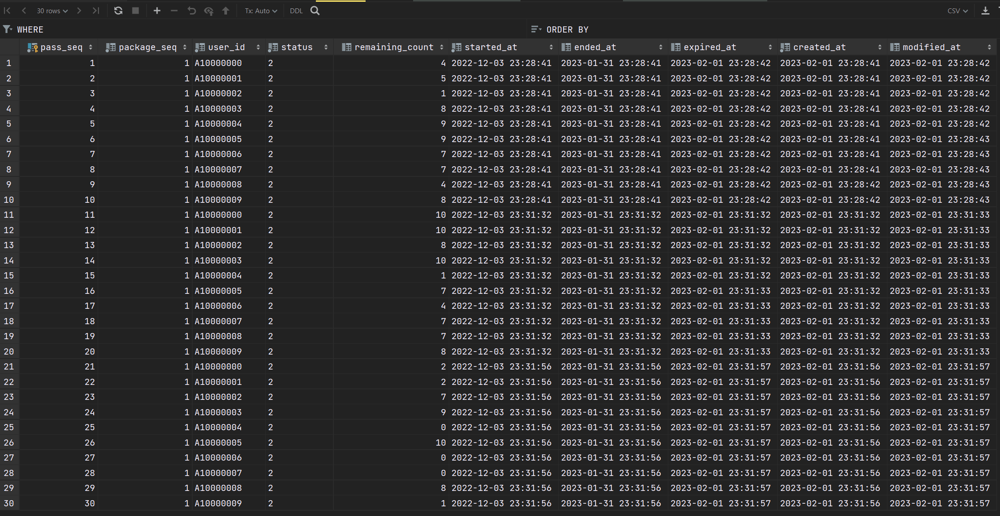

### Batch 이용권 일괄 지급

---

대량 이용권을 생성해서 일괄로 지급하는 로직을 구현하려고 한다.

#### **배치 구조 설계: 이용권 일괄 지급 Job**

이용권 일괄 지급 Job은 1개의 Tasklet Step으로 구성되어 있다.


#### Tables : 대량 이용권, 사용자 그룹 추가

이 기능을 위해서는 기존 데이터 구조에서 새로운 테이블이 필요합니다. 여러 사용자에게 보내기 위해서 사용자들을 묶을 단위를 **user\_group** 으로 하고, 여러 사용자에게 보낼 이용권 정보를 저장하기 위한 단위로 **bulk\_pass**를 정의하였다.

[원문에서 이미지 보기](https://to-be-a-artist.tistory.com/339)

#### Tasklet : execute() 구현

**Tasklet** 인터페이스에 **execute** 부분에 서비스 로직을 구현할 것이다. **execute** 메소드에 반환 타입이 **RepeatStatus** 인 것을 볼 수 있는데 **Tasklet** 인터페이스를 사용하여 **execute** 메소드가 **RepeatStatus.FINISHED** 를 반환할 때까지 트랜잭션 범위 내에서 반복적으로 실행되도록 구현할 수 있다.


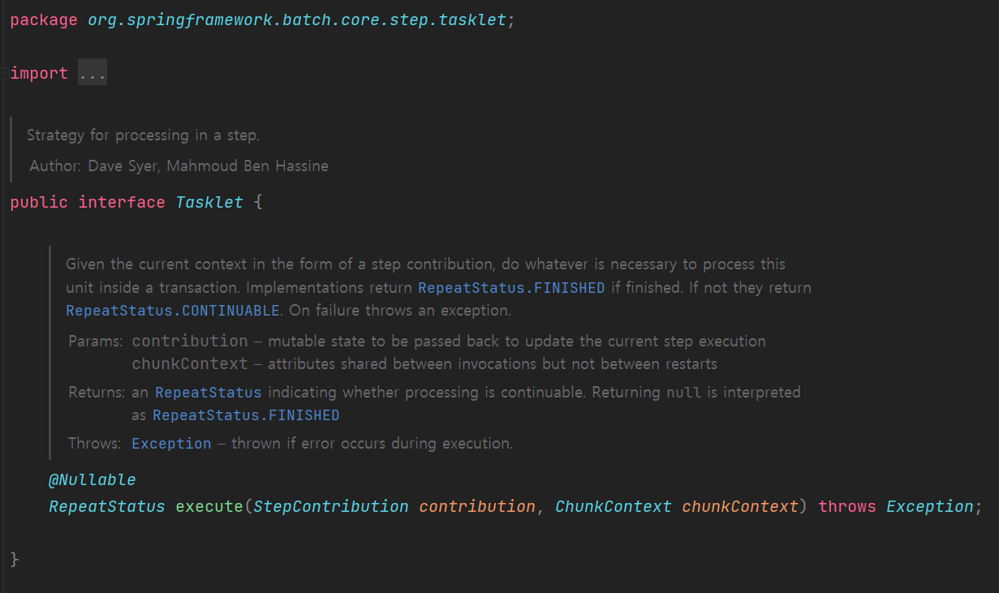

#### Tasklet: Repeat와 RepeatStatus

* **Spring Batch**는 **Step**과 그 하위 **Chunk**의 반복 작업이며 **Repeat** 정책을 따른다.  
  로직당 다시 실행해야한다면 **REPEATSTATUS.CONTINUALBE**, 처리가 완료되었다면 **REPEATSTATUS.FINISHED**를 반환하여 작업을 종료할 수 있다.


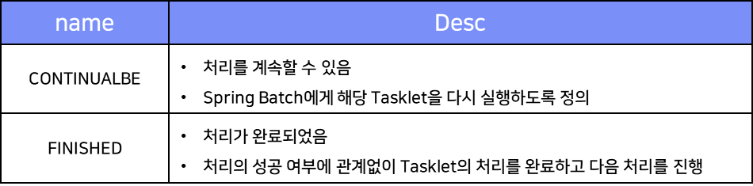

#### user\_group, bulk\_pass 테이블 생성

bulk\_pass 정보를 가져와서 user\_group\_id를 가지고 user\_group\_mapping 테이블을 조회하면 user\_id를 알수 있다.

user\_id를 알면 pass 를 만들 수 있다.

```sql
CREATE TABLE `bulk_pass`
(
    `bulk_pass_seq`   int         NOT NULL AUTO_INCREMENT COMMENT '대량 이용권 순번',
    `package_seq`     int         NOT NULL COMMENT '패키지 순번',
    `user_group_id`   varchar(20) NOT NULL COMMENT '사용자 그룹 ID',
    `status`          varchar(10) NOT NULL COMMENT '상태',
    `count`           int                  DEFAULT NULL COMMENT '이용권 수, NULL인 경우 무제한',
    `started_at`      timestamp   NOT NULL COMMENT '시작 일시',
    `ended_at`        timestamp            DEFAULT NULL COMMENT '종료 일시, NULL인 경우 무제한',
    `created_at`      timestamp   NOT NULL DEFAULT CURRENT_TIMESTAMP COMMENT '생성 일시',
    `modified_at`     timestamp            DEFAULT NULL COMMENT '수정 일시',
    PRIMARY KEY (`bulk_pass_seq`)
) ENGINE=InnoDB DEFAULT CHARSET=utf8mb4 COMMENT='대량 이용권, 다수의 이용자에게 이용권을 지급하기 위함';

CREATE TABLE `user_group_mapping`
(
    `user_group_id`     varchar(20) NOT NULL COMMENT '사용자 그룹 ID',
    `user_id`           varchar(20) NOT NULL COMMENT '사용자 ID',
    `user_group_name`   varchar(50) NOT NULL COMMENT '사용자 그룹 이름',
    `description`       varchar(50) NOT NULL COMMENT '설명',
    'created_at'        timestamp   NOT NULL DEFAULT CURRENT_TIMESTAMP COMMENT '생성 일시',
    `modified_at` timestamp            DEFAULT NULL COMMENT '수정 일시',
    PRIMARY KEY (`user_group_id`, `user_id`)
) ENGINE=InnoDB DEFAULT CHARSET=utf8mb4 COMMENT='사용자 그룹 매핑';

INSERT INTO user_group_mapping (user_group_id, user_id, user_group_name, description, created_at)
VALUES ('HANBADA', 'A1000000', '한바다', '한바다 임직원 그룹', '2022-08-01 00:00:00'),
       ('HANBADA', 'A1000001', '한바다', '한바다 임직원 그룹', '2022-08-01 00:00:00'),
       ('HANBADA', 'A1000002', '한바다', '한바다 임직원 그룹', '2022-08-01 00:00:00'),
       ('HANBADA', 'B1000010', '한바다', '한바다 임직원 그룹', '2022-08-01 00:00:00'),
       ('HANBADA', 'B2000000', '태산', '한바다 임직원 그룹', '2022-08-01 00:00:00'),
       ('TAESAN', 'B2000001', '태산', '태산 임직원 그룹', '2022-08-01 00:00:00');
```

#### 엔티티 생성

```java
@Getter
@Setter
@ToString
@Entity
@Table(name = "bulk_pass")
public class BulkPassEntity {
    @Id
    @GeneratedValue(strategy = GenerationType.IDENTITY)
    private Integer bulkPassSeq;
    private Integer packageSeq;
    private String userId;

    @Enumerated(EnumType.STRING)
    private BulkPassStatus status;
    private Integer count;

    private LocalDateTime startedAt;
    private LocalDateTime endedAt;
}
```

```java
@Getter
@Setter
@ToString
@Entity
@Table(name = "user_group_mapping")
@IdClass(UserGroupMappingId.class)
public class UserGroupMappingEntity extends BaseEntity {

    @Id private String userGroupId;
    @Id private String userId;

    private String userGroupName;
    private String description;
}
```

#### Job 구현

Tasklet은 클래스로 따로 분리하여 Bean 등록하였다.

```java
@Configuration
public class AddPassesJobConfig {

    private final JobBuilderFactory jobBuilderFactory;
    private final StepBuilderFactory stepBuilderFactory;
    private final AddPassesTasklet addPassesTasklet;

    public AddPassesJobConfig(JobBuilderFactory jobBuilderFactory, StepBuilderFactory stepBuilderFactory, AddPassesTasklet addPassesTasklet) {
        this.jobBuilderFactory = jobBuilderFactory;
        this.stepBuilderFactory = stepBuilderFactory;
        this.addPassesTasklet = addPassesTasklet;
    }

    @Bean
    public Job addPassesJob() {
        return this.jobBuilderFactory.get("addPassesJob")
                .start(addPassesStep())
                .build();
    }

    @Bean
    public Step addPassesStep() {
        return this.stepBuilderFactory.get("addPassesStep")
                .tasklet(addPassesTasklet)
                .build();
    }

}
```

```java
@Slf4j
@Configuration
public class AddPassesTasklet implements Tasklet {

    private final PassRepository passRepository;
    private final BulkPassRepository bulkPassRepository;
    private final UserGroupMappingRepository userGroupMappingRepository;

    public AddPassesTasklet(PassRepository passRepository, BulkPassRepository bulkPassRepository, UserGroupMappingRepository userGroupMappingRepository) {
        this.passRepository = passRepository;
        this.bulkPassRepository = bulkPassRepository;
        this.userGroupMappingRepository = userGroupMappingRepository;
    }

    @Override
    public RepeatStatus execute(StepContribution contribution, ChunkContext chunkContext) {
        // 이용권 시작 일시 1일 전 user group 내 각 사용자에게 이용권을 추가해준다.
        final LocalDateTime startedAt = LocalDateTime.now().minusDays(1);
        final List<BulkPassEntity> bulkPassEntities = bulkPassRepository.findByStatusAndStartedAtGreaterThan(BulkPassStatus.READY, startedAt);

        int count = 0;
        // 대량 이용권 정보를 돌면서 user group에 속한 userId를 조회하고 해당 userId로 이용권을 추가한다.
        for(BulkPassEntity bulkPassEntity : bulkPassEntities){
            final List<String> userIds = userGroupMappingRepository.findByUserGroupId(bulkPassEntity.getUserGroupId())
                    .stream().map(UserGroupMappingEntity::getUserId).toList();

            count += addPasses(bulkPassEntity, userIds);
        }

        log.info("AddPassesTasklet - execute: 이용권 {}건 추가 완료, startedAt={}", count, startedAt);

        return RepeatStatus.FINISHED;
    }

    // bulkPass의 정보로 pass 데이터를 생성
    private int addPasses(BulkPassEntity bulkPassEntity, List<String> userIds) {
        List<PassEntity> passEntities = new ArrayList<>();
        for(String userId: userIds){
            PassEntity passEntity = PassModelMapper.INSTANCE.toPassEntity(bulkPassEntity, userId);
            passEntities.add(passEntity);
        }

        return passRepository.saveAll(passEntities).size();
    }
}
```

#### Tasklet 테스트

단순히 서비스 로직을 검증하기 위해 Mock을 사용하여 테스트를 진행하였다.

```java
@Slf4j
@ExtendWith(MockitoExtension.class)
class AddPassesTaskletTest {

    @Mock
    private StepContribution stepContribution;
    @Mock
    private ChunkContext chunkContext;
    @Mock
    private PassRepository passRepository;
    @Mock
    private BulkPassRepository bulkPassRepository;
    @Mock
    private UserGroupMappingRepository userGroupMappingRepository;

    // @InjectMocks 클래스의 인스턴스를 생성하고 @Mock으로 생성된 객체를 주입한다.
    @InjectMocks
    AddPassesTasklet addPassesTasklet;

    @Test
    void test_execute() {
        // given
        final String userGroupId = "GROUP";
        final String userId = "A1000000";
        final Integer packageSeq = 1;
        final Integer count = 10;

        final LocalDateTime now = LocalDateTime.now();

        final BulkPassEntity bulkPassEntity = new BulkPassEntity();
        bulkPassEntity.setPackageSeq(packageSeq);
        bulkPassEntity.setUserGroupId(userGroupId);
        bulkPassEntity.setStatus(BulkPassStatus.READY);
        bulkPassEntity.setCount(count);
        bulkPassEntity.setStartedAt(now);
        bulkPassEntity.setEndedAt(now.plusDays(60));

        final UserGroupMappingEntity userGroupMappingEntity = new UserGroupMappingEntity();
        userGroupMappingEntity.setUserGroupId(userGroupId);
        userGroupMappingEntity.setUserId(userId);

        // when
        when(bulkPassRepository.findByStatusAndStartedAtGreaterThan(eq(BulkPassStatus.READY), any())).thenReturn(List.of(bulkPassEntity));
        when(userGroupMappingRepository.findByUserGroupId(eq("GROUP"))).thenReturn(List.of(userGroupMappingEntity));

        RepeatStatus repeatStatus = addPassesTasklet.execute(stepContribution, chunkContext);

        // then
        // execute의 return 값인 RepeatStatus 값을 확인합니다.
        assertEquals(RepeatStatus.FINISHED, repeatStatus);

        // 추가된 PassEntity 값을 확인합니다.
        ArgumentCaptor<List> passEntitiesCaptor = ArgumentCaptor.forClass(List.class);
        verify(passRepository, times(1)).saveAll(passEntitiesCaptor.capture());
        final List<PassEntity> passEntities = passEntitiesCaptor.getValue();

        assertEquals(1, passEntities.size());
        final PassEntity passEntity = passEntities.get(0);
        assertEquals(packageSeq, passEntity.getPackageSeq());
        assertEquals(userId, passEntity.getUserId());
        assertEquals(PassStatus.READY, passEntity.getStatus());
        assertEquals(count, passEntity.getRemainingCount());
    }
}
```

### Batch 예약된 수업 전 알람(외부 채널 알람 연동)

---

Job을 확장하는 방법들을 구현해볼 것이다. 서비스 운영을 하면서 데이터는 점점 많아지게 되면 확장성을 고려해볼 필요가 있다. 기본적인 Flow를 넘어서 **Multi-threaded Step** 으로 Job을 확장해보려고 한다.

#### **배치 구조 설계 - 예약 수업 전 알람**

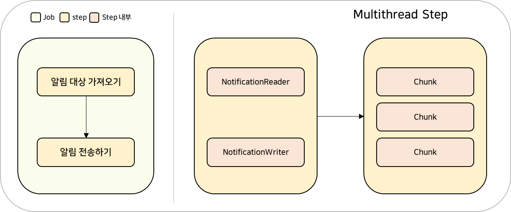

**Step** 은 기본적으로 **단일** **Thread**로 처리된다. **Multi-threaded Step** 은 Spring의 **TaskExecutor**를 이용해서 각 Thread가 Chunk 단위로 실행되게 하는 방식이다. 꼭 배치가 아니더라도 멀티 쓰레드 환경은 항상 조심을 해야하는 부분이 있다. 

이때 Chunk에 Reader와 Writer가 **Thread Safe** 한지를 확인해주어야 한다.

**첫 번째 Step**에서는 Notification 데이터를 채워줄 것이고 예약 수업 전 알람이기 때문에 예약 수업에 대한 정보가 담겨있는 Booking 테이블에 있는 데이터를 가지고 Notification 데이터를 추가할 것이다.

**두 번째 Step**에서는 Notification 데이터를 기반으로 사용자에게 알람을 보내는 작업을 진행할 것이다.

#### **테이블 연관관계**

[원문에서 이미지 보기](https://to-be-a-artist.tistory.com/339)

알람 기능을 위해서 Notification 테이블을 추가하였다. 카카오톡 알림 발송을 위해 필요한 **유효 ID**는 **user 테이블**에 meta 필드로 추가하였다. 

#### **카카오톡 메시지 보내기**

알람 메시지는 메일이나 메신저 등 여러 수단이 있어 선택적으로 사용하면 되는데 그중에서 **Kakao 메시지 API**를 사용하려고 한다. 필자가 사용한 것은 미리 연결해둔 제한된 친구에게만 보내는 API라는 점을 참고부탁드립니다.

**Kakao Developers**에서 메시지 API 부분을 보면 카카오톡 친구 목록을 가져오는 기능이 있는데 이 API를 통해서 친구의 **유효 ID**를 조회할 수 있다. 해당 유효 ID를 사용해서 **친구에게 기본 템플릿으로 메시지 보내기 API**를 호출 할 수 있다.

#### 

#### **테이블 추가**

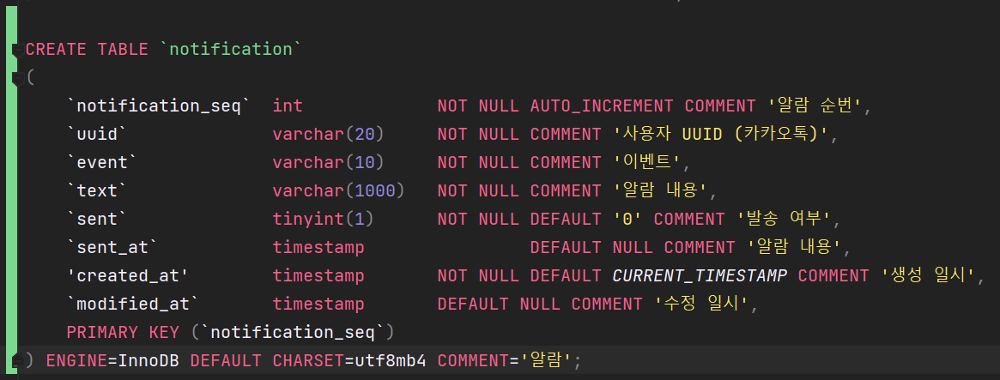

* 다른 곳에서는 user\_id를 사용하였지만, 카카오톡 메시지 API를 보낼 때 UUID를 사용해야하기 때문에 직접적으로 uuid라고 표현을 하였고 uuid는 user 테이블 meta에 JSON 형태로 저장되어 있다.

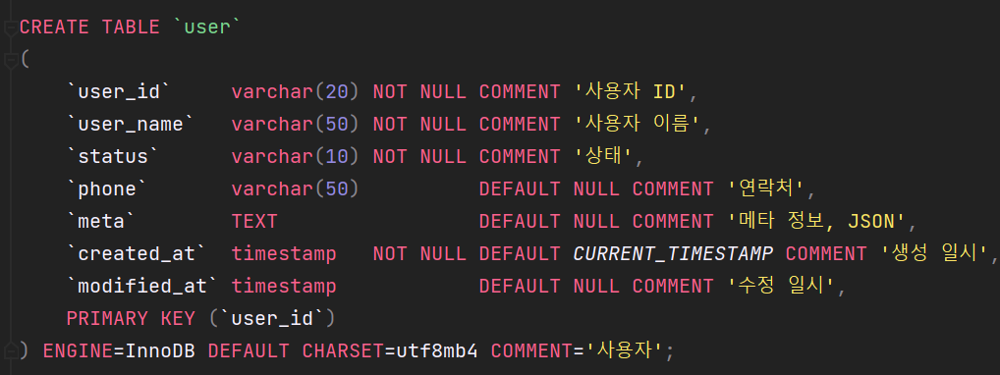

* 이벤트는 이 이벤트가 있어서 알람이 있었다는 정보를 표시해주기 위해서 추가하였고, 현재 등록되어 있는 것은 **before class, 수업 전** 이라는 데이터 밖에 없다.
* **text** 는 알람 내용
* **sent** 는 발송 여부
* **sent\_at** 는 발송 일시
* **created\_at**과 **modified\_at** 은 생성일시와 수정일시

#### **엔티티 생성**

추가된 테이블에 따라서 엔티티를 추가해주었다.

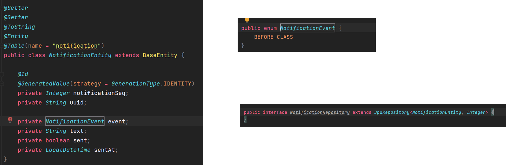

#### **Job 구현**

이전과 다르게 Step을 2개인 Job를 다루게 된다.

* sendNotificationBeforeClassJob
  + addNotificationStep : **Notification 데이터를 생성하는 Step(Chunk 기반 Step)**
  + sendNotificationStep : **실제 알람을 전송하는 Step (멀티 쓰레드)**

**addNotificationStep** 에 Reader는 조회하는 데이터에 업데이트가 발생하지 않아 Cursor를 사용하지 않기 때문에 **JpaPagingItemReader**를 사용한다. 

```java
package com.example.job.notification;

@Configuration
public class SendNotificationBeforeClassJobConfig {
    private final int CHUNK_SIZE = 10;

    private final JobBuilderFactory jobBuilderFactory;
    private final StepBuilderFactory stepBuilderFactory;
    private final EntityManagerFactory entityManagerFactory;
    private final SendNotificationItemWriter sendNotificationItemWriter;

    public SendNotificationBeforeClassJobConfig(JobBuilderFactory jobBuilderFactory, StepBuilderFactory stepBuilderFactory, EntityManagerFactory entityManagerFactory, SendNotificationItemWriter sendNotificationItemWriter) {
        this.jobBuilderFactory = jobBuilderFactory;
        this.stepBuilderFactory = stepBuilderFactory;
        this.entityManagerFactory = entityManagerFactory;
        this.sendNotificationItemWriter = sendNotificationItemWriter;
    }

    @Bean
    public Job sendNotificationBeforeClassJob() {
        return this.jobBuilderFactory.get("sendNotificationBeforeClassJob")
                .start(addNotificationStep())
                .next(sendNotificationStep())
                .build();
    }

    @Bean
    public Step addNotificationStep() {
        return this.stepBuilderFactory.get("addNotificationStep")
                .<BookingEntity, NotificationEntity>chunk(CHUNK_SIZE)
                .reader(addNotificationItemReader())
                .processor(addNotificationItemProcessor())
                .writer(addNotificationItemWriter())
                .build();
    }

    /**
     * JpaPagingItemReader: JPA에서 사용하는 페이징 기법
     * 쿼리 당 pageSize만큼 가져오며 다른 PagingItemReader와 마찬가지로 Thread-safe 하다.
     */
    @Bean
    public JpaPagingItemReader<BookingEntity> addNotificationItemReader() {
        // 상태(status)가 준비중이며, 시작일시(startedAt)이 10분 후 시작하는 예약이 알림 대상이 된다.
        return new JpaPagingItemReaderBuilder<BookingEntity>()
                .name("addNotificationItemReader")
                .entityManagerFactory(entityManagerFactory)
                .pageSize(CHUNK_SIZE)
                .queryString("select b from BookingEntity b join fetch b.userEntity where b.status = :status and b.startedAt <= :startedAt order by b.bookingSeq")
                .build();
    }

    @Bean
    public ItemProcessor<BookingEntity, NotificationEntity> addNotificationItemProcessor() {
        return bookingEntity -> NotificationModelMapper.INSTANCE.toNotificationEntity(bookingEntity, NotificationEvent.BEFORE_CLASS);
    }

    @Bean
    public JpaItemWriter<NotificationEntity> addNotificationItemWriter() {
        return new JpaItemWriterBuilder<NotificationEntity>()
                .entityManagerFactory(entityManagerFactory)
                .build();
    }

    @Bean
    public Step sendNotificationStep() {
        return this.stepBuilderFactory.get("sendNotificationStep")
                .<NotificationEntity, NotificationEntity> chunk(CHUNK_SIZE)
                .reader(sendNotificationItemReader())
                .writer(sendNotificationItemWriter)
                .taskExecutor(new SimpleAsyncTaskExecutor())
                .build();
    }

    @Bean
    public SynchronizedItemStreamReader<NotificationEntity> sendNotificationItemReader() {
        // 이벤트(evnet)가 수업 전이며, 발송 여부(sent)가 미발송된 알람이 조회 대상이 된다.
        JpaCursorItemReader<NotificationEntity> itemReader = new JpaCursorItemReaderBuilder<NotificationEntity>()
                .name("sendNotificationItemReader")
                .entityManagerFactory(entityManagerFactory)
                .queryString("select n from NotificationEntity n where n.event = :event and n.sent = :sent")
                .parameterValues(Map.of("event", NotificationEvent.BEFORE_CLASS, "sent", false))
                .build();

        return new SynchronizedItemStreamReaderBuilder<NotificationEntity>()
                .delegate(itemReader)
                .build();
    }

}
```

* **sendNotificationItemWriter**는 내부에서 외부 API를 호출하는 부분이 있어 클래스로 분리하였다.
* 멀티 스레드 환경에서 Thread-safe한지 확인해주어야 한다고 했었는데 Cursor 기반에 방식은 Thread-safe하지 않다. Thread-safe해야하는 경우에는 Paging 기법을 주로 사용한다. 이 기능 같은 경우에는 Notification 내에 있는 sent를 보고 sent를 업데이트해주어야 한다. 그래서 Paigng으로 하게 되면 데이터가 누락이 될 수 있는 문제가 있어 Cursor로 해야하는데 Thread-safe하지 않아 **SynchronizedItemStreamReader** 를 사용하여 Synchronized하게 반환해면 된다.  

  **SynchronizedItemStreamReader** 를 사용하게 되면서 **Reader** 부분은 순차적으로 실행되게 되고 대신 **Processor**, **Writer** 부분은 멀티 쓰레드로 진행되게 된다. 보통은 Write하는 부분이 Cost가 많이 들기 때문에 유의미한 처리로 볼 수 있다.

```java
@Slf4j
@Component
public class SendNotificationItemWriter implements ItemWriter<NotificationEntity> {

    private final NotificationRepository notificationRepository;
    private final KakaoTalkMessageAdapter kakaoTalkMessageAdapter;

    public SendNotificationItemWriter(NotificationRepository notificationRepository, KakaoTalkMessageAdapter kakaoTalkMessageAdapter) {
        this.notificationRepository = notificationRepository;
        this.kakaoTalkMessageAdapter = kakaoTalkMessageAdapter;
    }


    @Override
    public void write(List<? extends NotificationEntity> notificationEntities) throws Exception {
        int count = 0;

        for (NotificationEntity notificationEntity : notificationEntities) {
            boolean successful = kakaoTalkMessageAdapter.sendKakaoTalkMessage(notificationEntity.getUuid(), notificationEntity.getText());

            if (successful) {
                notificationEntity.setSent(true);
                notificationEntity.setSentAt(LocalDateTime.now());
                notificationRepository.save(notificationEntity);

                count++;
            }

        }

        log.info("SendNotificationItemWriter - write : 수업전알람 {}/{} 건 전송 성공", count, notificationEntities.size());
    }
}
```

부가적인 Kakao API 호출 부분은 [코드](https://github.com/bang-star/pass-batch/tree/develop)를 통해 참고해주세요.

[GitHub - bang-star/pass-batch: PT 이용권 관리 서비스

PT 이용권 관리 서비스. Contribute to bang-star/pass-batch development by creating an account on GitHub.

github.com](https://github.com/bang-star/pass-batch/tree/develop)

### Batch 수업 종료 후 이용권 차감

---

[참고] 아래 내용부터는 Spring Boot 3.3으로 변경된 내용이 적용됩니다.

수업 종료 후 이용권을 차감하는 기능인데 수업이 종료된 데이터, 즉 북킹과 북킹에 등록된 패스 데이터를 보고 패스 내에 있는 남아있는 카운트를 업데이트 업데이트하는 것입니다.

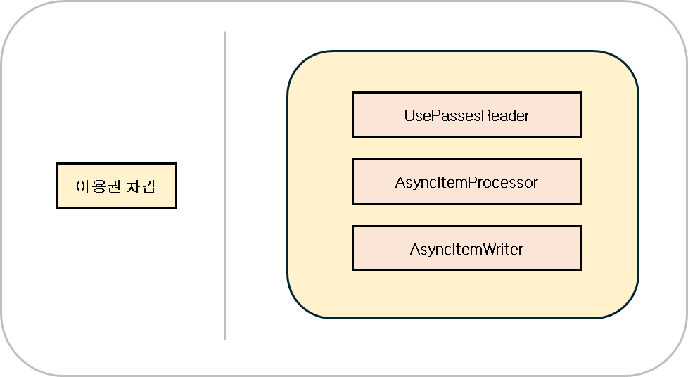

AsyncItemProcssor는 ItemProcessor에게 별도의 스레드를 할당해서 작업을 처리하는 방식입니다.

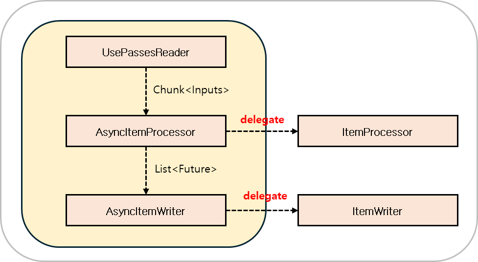

어떤 Batch는 복잡한 계산 등을 이유로 ItemProcessor 부분이 시간이 오래 걸리는 경우가 있습니다. 이때 **AsyncItemProcessor**, **AsyncItemWriter**를 사용하게 되면 성능을 향상시킬 수 있습니다.

동작 방식은 다음과 같습니다.

어떤 아이템이 **AsyncItemProcessor**에 전달될 때 Delegate 호출은 쓰레드에서 실행됩니다. ItemProcessor의 결과로 반환된 Future는 **AsyncItemWriter**로 전달됩니다. **AsyncItemWriter** 에서는 Future를 처리해서 결과로 ItemWriter에 전달합니다. ItemWriter는 Future 안에 있는 아이템들을 꺼내서 일괄 처리하게 되는데 이때 프로세서에서 작업 중인 비동기 실행의 결과 값들을 모두 받아올 때까지 대기합니다. 이때 AsyncItemProcessor와 AsyncItemWriter를 같이 써야 Future를 처리해줄 수 있습니다.

정리하면 AsyncItemProcessor가 새 스레드 위에서 ItemProcessor를 돌려 멀티스레드로 동작한다.

#### 변경사항

Booking 엔티티의 변경사항이 있습니다. 기능을 실행하기 위해서는 Booking에 있는 패스 정보를 알아야 되기 때문에 패스를 조인으로 가져올 수 있도록 추가해주었습니다.

```java
@Getter
@Setter
@ToString
@Entity
@Table(name = "booking")
public class BookingEntity extends BaseEntity {

    @Id
    @GeneratedValue(strategy = GenerationType.IDENTITY) // 기본 키 생성을 DB에 위임합니다. (AUTO_INCREMENT)
    private Integer bookingSeq;
    private Integer passSeq;
    private String userId;

    @Enumerated(EnumType.STRING)
    private BookingStatus status;
    private boolean usedPass;
    private boolean attended;

    private LocalDateTime startedAt;
    private LocalDateTime endedAt;
    private LocalDateTime cancelledAt;

    @ManyToOne(fetch = FetchType.LAZY)
    @JoinColumn(name = "userId", insertable = false, updatable = false)
    private UserEntity userEntity;

    @ManyToOne(fetch = FetchType.LAZY)
    @JoinColumn(name = "passSeq", insertable = false, updatable = false)
    private PassEntity passEntity;

}
```

#### Batch 수업 종료 후 이용권 차감 Job

```java
@Configuration
public class UsePassesJobConfig {
    private final int CHUNK_SIZE = 10;

    private final EntityManagerFactory entityManagerFactory;
    private final PassRepository passRepository;
    private final BookingRepository bookingRepository;

    public UsePassesJobConfig(EntityManagerFactory entityManagerFactory, PassRepository passRepository, BookingRepository bookingRepository) {
        this.entityManagerFactory = entityManagerFactory;
        this.passRepository = passRepository;
        this.bookingRepository = bookingRepository;
    }

    @Bean
    public Job usePassesJob(JobRepository jobRepository, Step usePassesStep) {
        return new JobBuilder("usePassesJob", jobRepository)
                .start(usePassesStep)
                .build();
    }

    @Bean
    public Step usePassesStep(JobRepository jobRepository, PlatformTransactionManager transactionManager) {
        return new StepBuilder("usePassesStep", jobRepository)
                .<BookingEntity, Future<BookingEntity>>chunk(CHUNK_SIZE, transactionManager)
                .reader(usePassesItemReader())
                .processor(usePassesAsyncItemProcessor())
                .writer(usePassesAsyncItemWriter())
                .build();

    }

    @Bean
    public JpaCursorItemReader<BookingEntity> usePassesItemReader() {
        return new JpaCursorItemReaderBuilder<BookingEntity>()
                .name("usePassesItemReader")
                .entityManagerFactory(entityManagerFactory)
                // 상태(status)가 완료이며, 종료 일시(endedAt)이 과거인 예약이 이용권 차감 대상이 됩니다.
                .queryString("select b from BookingEntity b join fetch b.passEntity where b.status = :status and b.usedPass = false and b.endedAt < :endedAt")
                .parameterValues(Map.of("status", BookingStatus.COMPLETED, "endedAt", LocalDateTime.now()))
                .build();
    }

    // 이 프로젝트에서는 적합하지 않지만, ItemProcessor의 수행이 오래걸려 병목이 생기는 경우에 AsyncItemProcessor, AsyncItemWriter를 사용하면 성능을 향상시킬 수 있습니다.
    @Bean
    public AsyncItemProcessor<BookingEntity, BookingEntity> usePassesAsyncItemProcessor() {
        AsyncItemProcessor<BookingEntity, BookingEntity> asyncItemProcessor = new AsyncItemProcessor<>();
        asyncItemProcessor.setDelegate(usePassesItemProcessor()); // usePassesItemProcessor로 위임하고 결과를 Future에 저장합니다.
        asyncItemProcessor.setTaskExecutor(new SimpleAsyncTaskExecutor());
        return asyncItemProcessor;

    }

    @Bean
    public ItemProcessor<BookingEntity, BookingEntity> usePassesItemProcessor() {
        return bookingEntity -> {
            // 이용권 잔여 횟수는 차감합니다.
            PassEntity passEntity = bookingEntity.getPassEntity();
            passEntity.setRemainingCount(passEntity.getRemainingCount() - 1);
            bookingEntity.setPassEntity(passEntity);

            // 이용권 사용 여부를 업데이트합니다.
            bookingEntity.setUsedPass(true);
            return bookingEntity;

        };
    }

    @Bean
    public AsyncItemWriter<BookingEntity> usePassesAsyncItemWriter() {
        AsyncItemWriter<BookingEntity> asyncItemWriter = new AsyncItemWriter<>();
        asyncItemWriter.setDelegate(usePassesItemWriter()); // usePassesItemWriter 최종 결과값을 넘겨주고 작업을 위임합니다.
        return asyncItemWriter;
    }

    @Bean
    public ItemWriter<BookingEntity> usePassesItemWriter() {
        return bookingEntities -> {
            for (BookingEntity bookingEntity : bookingEntities) {
                // 잔여 횟수를 업데이트 합니다.
                int updatedCount = passRepository.updateRemainingCount(bookingEntity.getPassSeq(), bookingEntity.getPassEntity().getRemainingCount());
                // 잔여 횟수가 업데이트 완료되면, 이용권 사용 여부를 업데이트합니다.
                if (updatedCount > 0) {
                    bookingRepository.updateUsedPass(bookingEntity.getPassSeq(), bookingEntity.isUsedPass());
                }
            }
        };
    }
}
```

> Step에서 Processor와 Writer에 AsyncItemProcessor, AsyncItemWriter가 사용되었다.  
>   
> - AsyncItemProcessor는 내부에서 Deletegate로 ItemProcessor를 선언해주면 데이터가 들어왔을 때 새로운 쓰레드을 띄워서 ItemProcessor에게 위임을 하는 동작 방식을 가지고 있다.  
>   
> - AsyncItemWriter는 내부에서 Delegate로 ItemWriter를 선언해주면 나중에 Future로 받아서 그 내용들을 결과값들을 ItemWriter에 위임을 하는 동작 방식을 가지고 있다.  
>   
> 이를 통해 ItemProcessor에 병목현상이 있는 경우, 멀티스레드로 수행을 할 수 있어서 성능의 효과를 볼 수 있다.

### Batch 통계 데이터 생성

---

통계 데이터를 만드는 Job은 Parallel step으로 구현하려고 합니다. 멀티 스레드 스탭은 각 스탭 내에서 아이템 Chunk를 병렬로 처리했다면, Parallel step은 스텝 자체를 병렬로 실행하는 것을 말합니다.

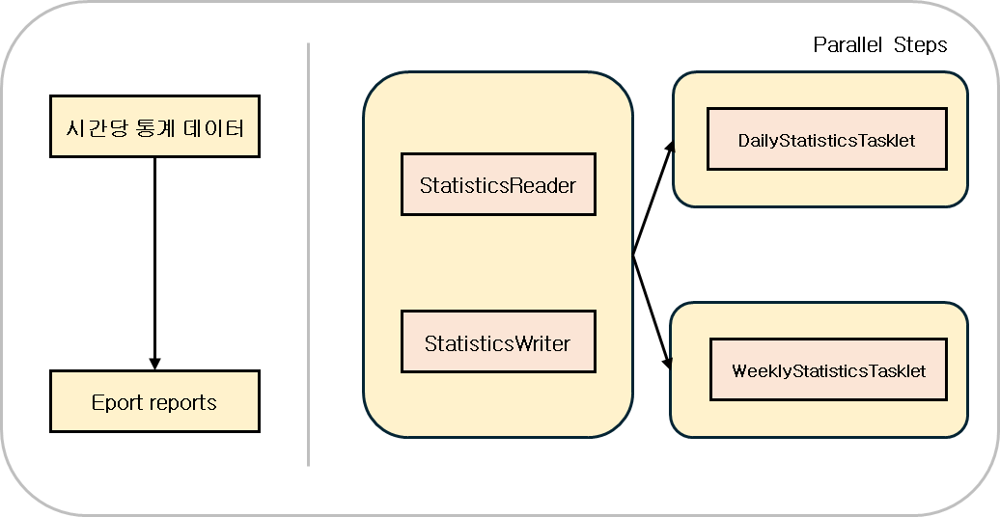

통계 데이터 생성은 첫 번째 스텝에서 예약 정보를 보고 통계 데이터를 생성한다. 두 번째 스텝에서 각각 일간 통계, 주간 통계 데이터를 생성할 것입니다. 두 번째 스텝에서 일간 통계, 주간 통계 파일을 쓰는 것은 전혀 관계가 없는 동작으로 굳이 순차적으로 진행할 필요가 없습니다. 이렇게 관계가 없는 동작들을 동시에 실행하면 전반적인 처리량을 늘릴 수 있습니다.

통계 데이터를 저장하기 위해서 Statistics라는 테이블을 추가하였고, 통계 지표로는 출석 횟수, 취소 횟수를 예로 들었습니다.

위 기능을 구현할 때 Bean Scope가 사용되게 되는데, 먼저 알아보도록 하겠습니다.

BeanScope @JobScope, @StepScope

* Spring Bean의 기본 Scope는 싱글톤
* Bean의 생성 시점을 지정된 Scope가 명시된 method가 실행되는 시점으로 지연
  + JobScope : Job이 실행될 때 생성되고 끝날 때 삭제
  + StepScope : Step이 실행될 때 생성되고 끝날 때 삭제

> Q. 위 기능에서 BeanScope을 만드는 게 중요한 이유는 ?  
>    
> 1. JobParameter를 method 실행하는 시점까지 지연시켜 할당할 수 있다.  
> 2. 동일한 컴포넌트를 병렬로 처리할 때 안전할 수 있다

> JobParameter   
> - Spring Batch 외부 혹은 내부에서 받아서 배치 컴포넌트에서 사용할 수 있는 파라미터  
> - 스코프 빈을 생성할 때만 사용 가능하다.  
>   
> [참고] [Spring 공식문서](https://docs.spring.io/spring-batch/docs/current/api/org/springframework/batch/core/JobParameter.html)

#### 통계 테이블 구조

```sql
CREATE TABLE `statistics`
(
    `statistics_seq`      int       NOT NULL AUTO_INCREMENT COMMENT '통계 순번',
    `statistics_at`       timestamp NOT NULL COMMENT '통계 일시',
    `all_count`           int       NOT NULL DEFAULT 0 COMMENT '전체 횟수',
    `attended_count`      int       NOT NULL DEFAULT 0 COMMENT '출석 횟수',
    `cancelled_count`     int       NOT NULL DEFAULT 0 COMMENT '취소 횟수',
    PRIMARY KEY (`statistics_seq`),
    INDEX idx_statistics_at (`statistics_at`)
) ENGINE=InnoDB DEFAULT CHARSET=utf8mb4 COMMENT='통계';
```

기본적으로 기준은 statisticsAt을 기준으로 하고 있고 인덱스도 추가 하였습니다. statisticsAt은 일관으로 관리하려 합니다. 예를 들어서 여러가지 데이터가 있었을 때 1월 1일이라고 하면 1월 1일 00시 00분 00초로 1월 1일 전체에 데이터를 관리하려고 합니다. 그렇게 되면 daily statistics 파일을 쓸 때는 그대로 조회해서 출력해주면 되고 이 데이터를 기반으로 주차의 넘버를 뽑아서 weekly statistics 파일도 쓸 수가 있습니다.

```java
@Getter @Setter
@ToString
@Entity
@Table(name = "statistics")
public class StatisticsEntity extends BaseEntity {

    @Id
    @GeneratedValue(strategy = GenerationType.IDENTITY)
    private Integer statisticsSeq;

    private LocalDateTime statisticsAt;

    private int allCount;
    private int attendedCount;
    private int cancelledCount;

    public static StatisticsEntity create(final BookingEntity bookingEntity) {
        StatisticsEntity statisticsEntity = new StatisticsEntity();
        statisticsEntity.setStatisticsAt(bookingEntity.getStatisticsAt());
        statisticsEntity.setAllCount(1);
        if (bookingEntity.isAttended()) {
            statisticsEntity.setAttendedCount(1);

        }
        if (BookingStatus.CANCELLED.equals(bookingEntity.getStatus())) {
            statisticsEntity.setCancelledCount(1);

        }
        return statisticsEntity;

    }

    public void add(final BookingEntity bookingEntity) {
        this.allCount++;

        if (bookingEntity.isAttended()) {
            this.attendedCount++;

        }
        if (BookingStatus.CANCELLED.equals(bookingEntity.getStatus())) {
            this.cancelledCount++;

        }

    }
}
```

```java
public interface StatisticsRepository extends JpaRepository<StatisticsEntity, Integer> {

    @Query(value = "SELECT new org.example.passbatch.repository.statistics.AggregatedStatistics(s.statisticsAt, SUM(s.allCount), SUM(s.attendedCount), SUM(s.cancelledCount)) " +
            "         FROM StatisticsEntity s " +
            "        WHERE s.statisticsAt BETWEEN :from AND :to " +
            "     GROUP BY s.statisticsAt")
    List<AggregatedStatistics> findByStatisticsAtBetweenAndGroupBy(@Param("from") LocalDateTime from, @Param("to") LocalDateTime to);

}
```

```java
@Getter
@Setter
@ToString
@AllArgsConstructor
public class AggregatedStatistics {
    private LocalDateTime statisticsAt; // 일 단위
    private long allCount;
    private long attendedCount;
    private long cancelledCount;

    public void merge(final AggregatedStatistics statistics) {
        this.allCount += statistics.getAllCount();
        this.attendedCount += statistics.getAttendedCount();
        this.cancelledCount += statistics.getCancelledCount();

    }
}
```

테이블에 맞춰서 Statistics엔티티, Statistics repository를 생성하였고 Statistics를 더하는 로직들이 있어서 AggregatedStatistics라는 클래스를 만들어서 Merge 메서드를 선언해 주었습니다.

```java
@Slf4j
@Configuration
public class MakeStatisticsJobConfig {
    private final int CHUNK_SIZE = 10;

    private final EntityManagerFactory entityManagerFactory;
    private final StatisticsRepository statisticsRepository;
    private final MakeDailyStatisticsTasklet makeDailyStatisticsTasklet;
    private final MakeWeeklyStatisticsTasklet makeWeeklyStatisticsTasklet;

    public MakeStatisticsJobConfig(EntityManagerFactory entityManagerFactory, StatisticsRepository statisticsRepository, MakeDailyStatisticsTasklet makeDailyStatisticsTasklet, MakeWeeklyStatisticsTasklet makeWeeklyStatisticsTasklet) {
        this.entityManagerFactory = entityManagerFactory;
        this.statisticsRepository = statisticsRepository;
        this.makeDailyStatisticsTasklet = makeDailyStatisticsTasklet;
        this.makeWeeklyStatisticsTasklet = makeWeeklyStatisticsTasklet;
    }

    @Bean
    public Job makeStatisticsJob(JobRepository jobRepository, Step addStatisticsStep, Step makeDailyStatisticsStep, Step makeWeeklyStatisticsStep) {
        Flow addStatisticsFlow = new FlowBuilder<Flow>("addStatisticsFlow")
                .start(addStatisticsStep)
                .build();

        Flow makeDailyStatisticsFlow = new FlowBuilder<Flow>("makeDailyStatisticsFlow")
                .start(makeDailyStatisticsStep)
                .build();

        Flow makeWeeklyStatisticsFlow = new FlowBuilder<Flow>("makeWeeklyStatisticsFlow")
                .start(makeWeeklyStatisticsStep)
                .build();

        Flow parallelMakeStatisticsFlow = new FlowBuilder<Flow>("parallelMakeStatisticsFlow")
                .split(new SimpleAsyncTaskExecutor())
                .add(makeDailyStatisticsFlow, makeWeeklyStatisticsFlow)
                .build();

        return new JobBuilder("makeStatisticsJob", jobRepository)
                .start(addStatisticsFlow)
                .next(parallelMakeStatisticsFlow)
                .build()
                .build();
    }

    @Bean
    public Step addStatisticsStep(JobRepository jobRepository, PlatformTransactionManager transactionManager) {
        return new StepBuilder("addStatisticsStep", jobRepository)
                .<BookingEntity, BookingEntity>chunk(CHUNK_SIZE, transactionManager)
                .reader(addStatisticsItemReader(null, null))
                .writer(addStatisticsItemWriter())
                .build();
    }

    @Bean
    @StepScope
    public JpaCursorItemReader<BookingEntity> addStatisticsItemReader(@Value("#{jobParameters[from]}") String fromString, @Value("#{jobParameters[to]}") String toString) {
        final LocalDateTime from = LocalDateTimeUtils.parse(fromString);
        final LocalDateTime to = LocalDateTimeUtils.parse(toString);

        return new JpaCursorItemReaderBuilder<BookingEntity>()
                .name("usePassesItemReader")
                .entityManagerFactory(entityManagerFactory)
                // JobParameter를 받아 종료 일시(endedAt) 기준으로 통계 대상 예약(Booking)을 조회합니다.
                .queryString("select b from BookingEntity b where b.endedAt between :from and :to")
                .parameterValues(Map.of("from", from, "to", to))
                .build();
    }

    @Bean
    public ItemWriter<BookingEntity> addStatisticsItemWriter() {
        return bookingEntities -> {
            Map<LocalDateTime, StatisticsEntity> statisticsEntityMap = new LinkedHashMap<>();

            for (BookingEntity bookingEntity : bookingEntities) {
                final LocalDateTime statisticsAt = bookingEntity.getStatisticsAt();
                StatisticsEntity statisticsEntity = statisticsEntityMap.get(statisticsAt);

                if (statisticsEntity == null) {
                    statisticsEntityMap.put(statisticsAt, StatisticsEntity.create(bookingEntity));

                } else {
                    statisticsEntity.add(bookingEntity);

                }

            }
            final List<StatisticsEntity> statisticsEntities = new ArrayList<>(statisticsEntityMap.values());
            statisticsRepository.saveAll(statisticsEntities);
            log.info("### addStatisticsStep 종료");

        };
    }

    @Bean
    public Step makeDailyStatisticsStep(JobRepository jobRepository, PlatformTransactionManager transactionManager) {
        return new StepBuilder("makeDailyStatisticsStep", jobRepository)
                .tasklet(makeDailyStatisticsTasklet, transactionManager)
                .build();
    }

    @Bean
    public Step makeWeeklyStatisticsStep(JobRepository jobRepository, PlatformTransactionManager transactionManager) {
        return new StepBuilder("makeWeeklyStatisticsStep", jobRepository)
                .tasklet(makeWeeklyStatisticsTasklet, transactionManager)
                .build();
    }

}
```

```java
@Slf4j
@Component
@StepScope
public class MakeDailyStatisticsTasklet implements Tasklet {

    @Value("#{jobParameters[from]}")
    private String fromString;
    @Value("#{jobParameters[to]}")
    private String toString;
    private final StatisticsRepository statisticsRepository;

    public MakeDailyStatisticsTasklet(StatisticsRepository statisticsRepository) {
        this.statisticsRepository = statisticsRepository;
    }

    @Override
    public RepeatStatus execute(StepContribution contribution, ChunkContext chunkContext) throws Exception {
        final LocalDateTime from = LocalDateTimeUtils.parse(fromString);
        final LocalDateTime to = LocalDateTimeUtils.parse(toString);

        final List<AggregatedStatistics> statisticsList = statisticsRepository.findByStatisticsAtBetweenAndGroupBy(from, to);

        List<String[]> data = new ArrayList<>();
        data.add(new String[]{"statisticsAt", "allCount", "attendedCount", "cancelledCount"});
        for (AggregatedStatistics statistics : statisticsList) {
            data.add(new String[]{
                    LocalDateTimeUtils.format(statistics.getStatisticsAt()),
                    String.valueOf(statistics.getAllCount()),
                    String.valueOf(statistics.getAttendedCount()),
                    String.valueOf(statistics.getCancelledCount())
            });
        }
        CustomCSVWriter.write("daily_statistics_" + LocalDateTimeUtils.format(from, LocalDateTimeUtils.YYYY_MM_DD) + ".csv", data);
        return RepeatStatus.FINISHED;

    }
}
```

```java
@Slf4j
@Component
@StepScope
public class MakeWeeklyStatisticsTasklet implements Tasklet {
    @Value("#{jobParameters[from]}")
    private String fromString;
    @Value("#{jobParameters[to]}")
    private String toString;

    private final StatisticsRepository statisticsRepository;

    public MakeWeeklyStatisticsTasklet(StatisticsRepository statisticsRepository) {
        this.statisticsRepository = statisticsRepository;
    }

    @Override
    public RepeatStatus execute(StepContribution contribution, ChunkContext chunkContext) throws Exception {
        final LocalDateTime from = LocalDateTimeUtils.parse(fromString);
        final LocalDateTime to = LocalDateTimeUtils.parse(toString);

        final List<AggregatedStatistics> statisticsList = statisticsRepository.findByStatisticsAtBetweenAndGroupBy(from, to);
        Map<Integer, AggregatedStatistics> weeklyStatisticsEntityMap = new LinkedHashMap<>();

        for (AggregatedStatistics statistics : statisticsList) {
            int week = LocalDateTimeUtils.getWeekOfYear(statistics.getStatisticsAt());
            AggregatedStatistics savedStatisticsEntity = weeklyStatisticsEntityMap.get(week);

            if (savedStatisticsEntity == null) {
                weeklyStatisticsEntityMap.put(week, statistics);

            } else {
                savedStatisticsEntity.merge(statistics);

            }

        }

        List<String[]> data = new ArrayList<>();
        data.add(new String[]{"week", "allCount", "attendedCount", "cancelledCount"});
        weeklyStatisticsEntityMap.forEach((week, statistics) -> {
            data.add(new String[]{
                    "Week " + week,
                    String.valueOf(statistics.getAllCount()),
                    String.valueOf(statistics.getAttendedCount()),
                    String.valueOf(statistics.getCancelledCount())
            });

        });
        CustomCSVWriter.write("weekly_statistics_" + LocalDateTimeUtils.format(from, LocalDateTimeUtils.YYYY_MM_DD) + ".csv", data);
        return RepeatStatus.FINISHED;

    }
```
