오늘은 웹개발 종합반 4,5주차를 마무리 해버렸다...

이로써 등수가 167명 중 ..

**96 -> 47** 등으로 급상승하게 되었습니다.

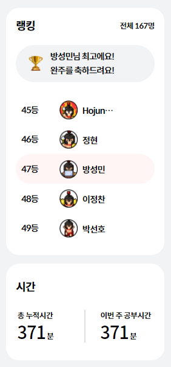

4, 5주차 완강후 순위

---

#### **과목 : 웹개발 종합반 (4주차)**

**[수업 목표]**

**1. Flask 프레임워크를 활용해서 API를 만들 수 있다.**

**2. '화성에 땅사기' API를 만들고 클라이언트에 연결한다.**

**3. '스파르타피디아' API를 만들고 클라이언트와 연결한다.**

**[목차]**

**4-1. 4주차 오늘 배울 것**

**4-2. Flask 시작하기 - 서버만들기**

**4-3. Flask 시작하기 - HTML파일 주기**

**4-4. Flask 시작하기 - 본격 API 만들기**

**4-5. [화성땅 공동구매] - 프로젝트 세팅**

**4-6. [화성땅 공동구매] - 뼈대 준비하기**

**4-7. [화성땅 공동구매] - POST 연습(주문 저장)**

**4-8. [화성땅 공동구매] - GET 연습(주문 보여주기)**

**4-9. [스파르타피디아] - 프로젝트 세팅**

**4-10. [스파르타피디아] - 조각 기능 구현해보기**

**4-11. [스파르타피디아] - 뼈대 준비하기**

**4-12. [스파르타피디아] - POST 연습(포스팅하기)**

**4-13. [스파르타피디아] - GET 연습(보여주기)**

**4-14. 4주차 끝 & 숙제 설명**

---

#### **01. 4주차 오늘 배울 것**

**1) 오늘 배울 것 이야기**

**(1) 화성땅 공동구매**

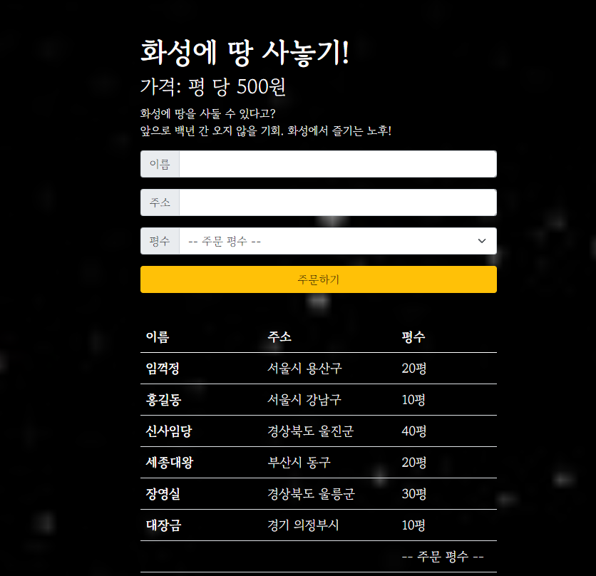

1-1. 화성땅 공동구매 결과물(미리보기)

**(2) 스파르타피디아**

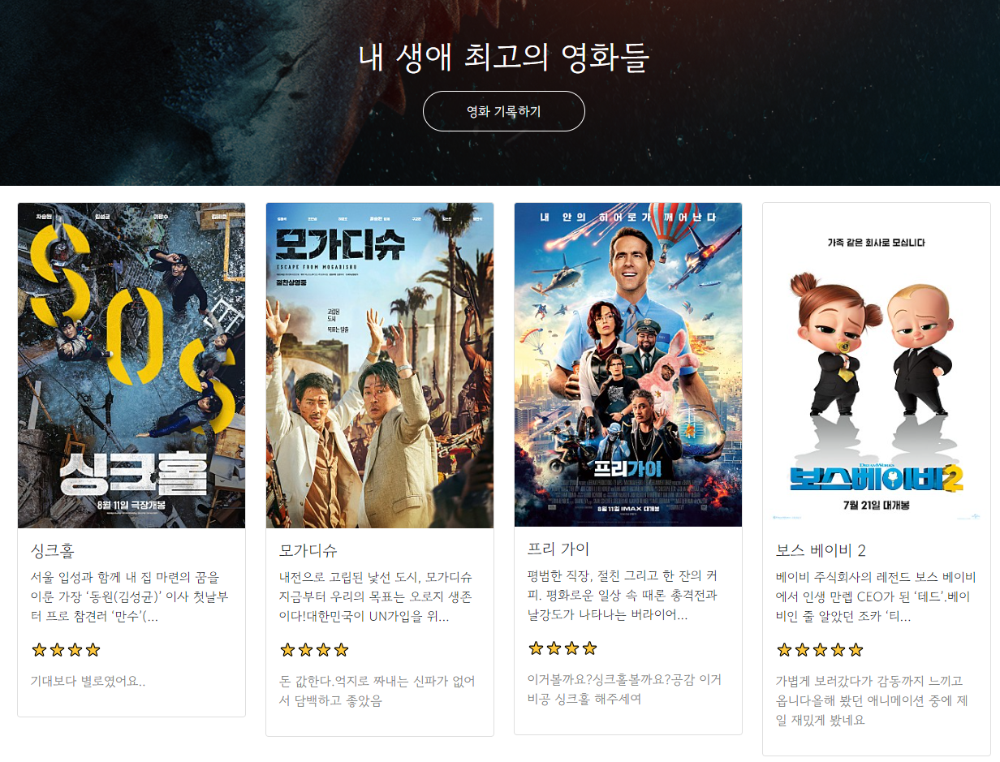

1-2. 스파르타피디아 결과물(미리보기)

> 4주차는 HTML과 mongoDB까지 연동해서 서버를 만드는 작업을 합니다.

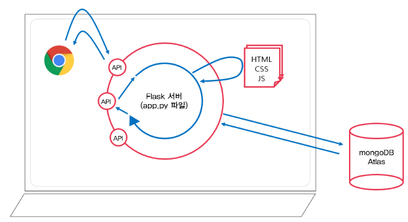

1-3 서버 설계도

**2) 4주차 폴더 구조**

**[상위] sparta 폴더 → projects 폴더 내**

**(2) prac : "flask 폴더 코드를 작성합니다"                                (4주차)**

**(3) mars : "화상땅공동구매" 관련 코드를 작성합니다.              (4주차)**

**(4) **movie**: **"스파르타피디아" 관련 코드를 작성합니다.            (4주차)****

**(5) homework : "팬명록" 관련 코드를 작성합니다.                 (4주차 - 과제)**

**(6) bucket : "버킷리스트" 관련 코드를 작성합니다.                 (5주차)**

---

#### **02.  Flask 시작하기 - 서버만들기**

**1) new project → prac 폴더를 선택하고 create 를 클릭합니다.**

**2**) 설치 패키지 - flask****

**3**) Flask 기초 : 기본 실행****

**ㆍFlask 프레임워크 : 서버를 구동시켜주는 편한 코드 모음. 서버를 구동하려면 필요한 복잡한 일들을 쉽게**

**가져다 쓸수 있습니다.**

**ㆍapp.py 파일 생성**

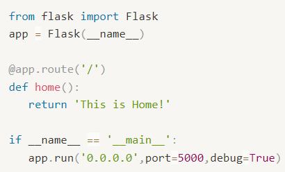

2-1 Flask 서버 기본 골격 코드

**4**) Flask 기초 : URL 나눠보기****

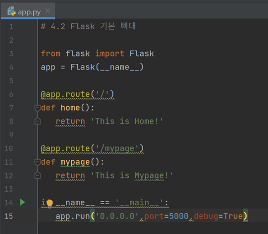

2-2. Flask 서버 URL 나눠보기 코드

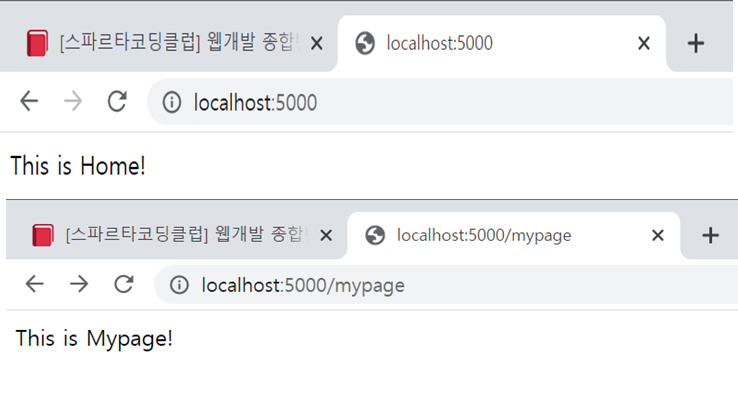

2-3. Flask 서버 URL 나눈 결과

---

#### **03.  Flask 시작하기 - HTML파일 주기**

**1) Flask 기초 : 기본 폴더구조 - 항상 이렇게 세팅하고 시작!**

**ㆍ프로젝트 폴더 / static 폴더(이미지, css파일)**

**ㆍ프로젝트 폴더 / template 폴더(html 파일)**

**ㆍ프로젝트 폴더 / app.py**

**2) Flask 기초 : HTML 파일 불러오기**

**(1) templates 폴더에 index.html 파일 생성**

**(2) html 파일 불러오기( flask패키지에 render\_template 이용 )**

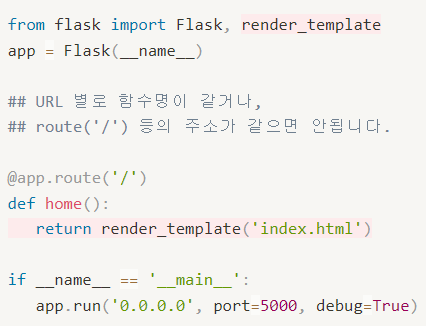

3-1. app.py에서 html파일 render

---

> 이전 주차에서도 HTTP 메소드를 설명하였기 때문에 이번주차에서는 간단하게 하게 설명한다.

#### **04.  Flask 시작하기 - 본격 API 만들기**

**1) GET, POST 요청타입**

**(1) 클라이언트가 요청 할때에도, "방식"이 존재**

**ㆍ HTTP 라는 통신 규약을 따른다.**

**ㆍ 클라이언트는 요청할 때 HTTP request method를 통해, 어떤 요청 종류인지 응답하는 서버 쪽에**

**정보를 알려준다.**

**(2) GET, POST 방식**

**ㆍ GET - 통상적으로 데이터 조회를 요청할 때**

**(예) 영화 목록 조회**

**ㆍ POST - 통상적으로 데이터 생성(Create), 변경(Update), 삭제(Delete) 요청 할 때**

**(예) 회원가입, 회원탈퇴, 회원수정**

**2) GET, POST 요청에서 클라이언트의 데이터를 받는 방법**

**(1 단계) JQuery import**

**(2 단계) GET 요청 API 코드**

**- import : request, jsonify**

**/\* '/test'를 접속하여 GET 메소드로 title\_give라는 이름으로 데이터를 받아 변수에 저장하고**

**데이터를 출력한다. 그리고 응답 값을 리턴해준다고 강사님께서 설명해주셨습니다. \*/**

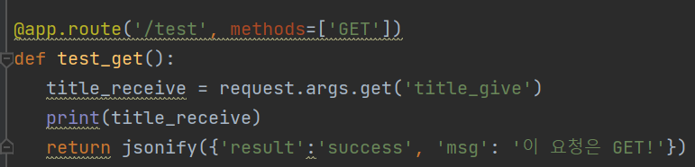

4-1. GET 요청 API 코드 (Flask 서버)

**(3 단계) GET 요청 확인 Ajax 코드**

**/\* 'test' 창구에 가서 title\_give에 '봄날은 간다'라는 데이터를 내가 갖고 갈게 라는 의미라고** **강사님께서 설명해주셨습니다. \*/**

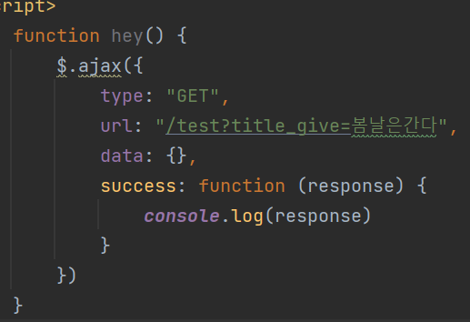

4-2. GET 요청 확인 Ajax 코드 (클라이언트)

**(4 단계) **POST 요청 API 코드****

**/\* 'title\_give'라는 이름으로 데이터를 받아 변수에 저장하고 그 데이터를 출력한다.**

**그리고 리턴 응답 값을 리턴해준다**고 강사님께서 설명해주셨습니다**  \*/**

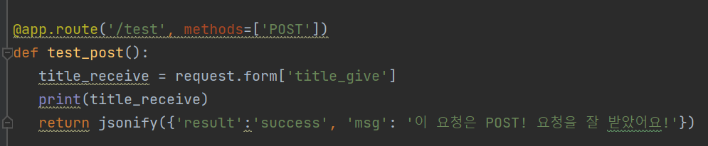

4-3. POST 요청 API 코드 (Flask 서버)

**(5 단계) POST 요청 확인 Ajax 코드**

**/\* 'test' 창구에 가서 POST요청으로 봄날은 간다라는 데이터를 가져간다라는 의미라고**

**강사님께서 설명해주셨습니다. \*/**

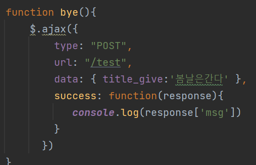

4-4. POST 요청 확인 Ajax 코드 (클라이언트)

---

#### **05.  [화성땅 공동구매] - 프로젝트 세팅**

**1) 문제 분석 - "무엇이 어떻게 되는지"를 생각하기**

**2) 프로젝트 설정 - flask 폴더 구조 만들기(03-1과 동일)**

**3) 패키지 설치 : flask(flask), **dnspython(flask),** pymongo(MongoDB)**

---

#### **06.  [화성땅 공동구매] - 뼈대 준비하기**

**1) 프로젝트 준비 - app.py 준비하기**

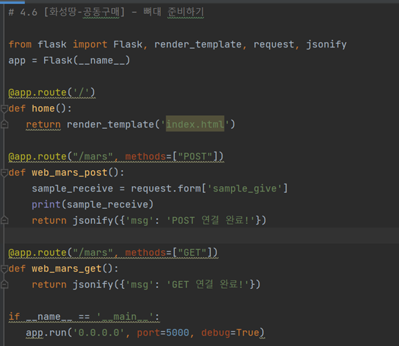

6-1. app.py flask 서버 코드

****2**) 프로젝트 준비 - index.html 준비하기**

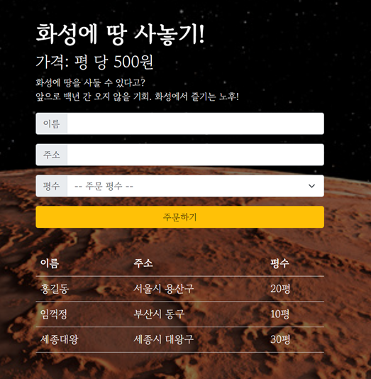

6-2. index.html 클라이언트 코드

---

#### **07.  [화성땅 공동구매] - POST 연습(주문 저장)**

**1) API 만들고 사용하기 - 이름, 주소, 평수 저장하기(Create -> POST)**

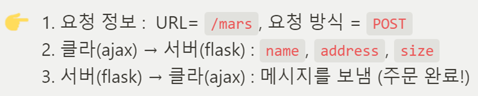

7-1. API 설계 내용

**(1) 클라이언트와 서버 연결 확인**

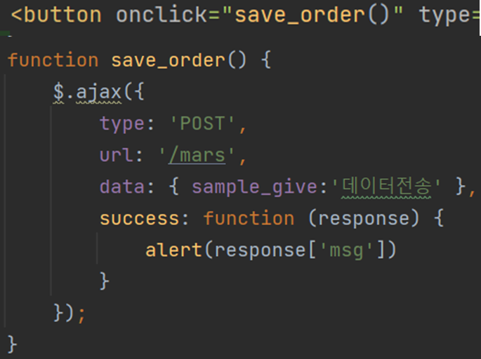

7-2. 클라이언트와 서버 연결 확인 - 클라이언트 코드

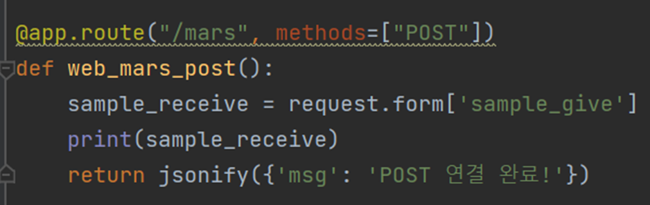

7-3. 클라이언트와 서버 연결확인 - 서버 코드

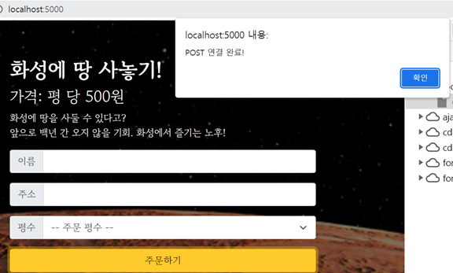

7-4. 클라이언트와 서버 연결확인 - 테스트 결과

**(2) 서버 만들기**

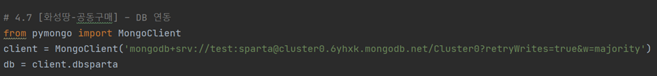

7-5. 서버 mongoDB 연결

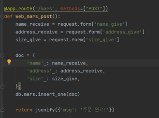

7-6. 서버 POST 연결 코드

**(3) 클라이언트 만들기**

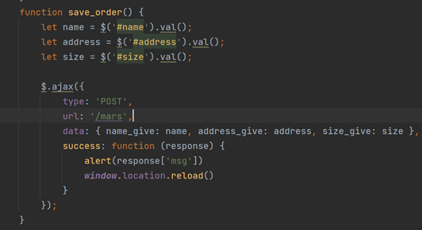

7-7. POST 연결 클라이언트 코드

**(4) 완성하기**

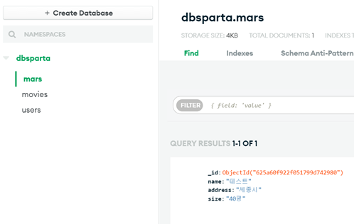

7-8. 테스트 수행결과

---

**\* 단계는 POST와 동일하므로 생략하도록 하겠습니다.**

#### **08.  [화성땅 공동구매] - GET 연습(주문 보여주기)**

**1) API 만들고 사용하기 - 저장된 주문을 화면에 보여주기(Read → GET)**

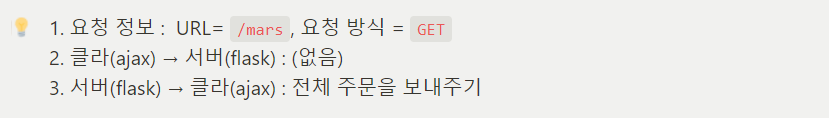

8-1. API 설계 내용

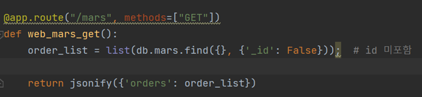

8-2. 서버 코드

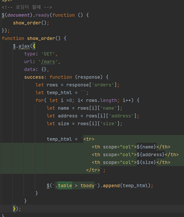

8-3. 클라이언트 코드

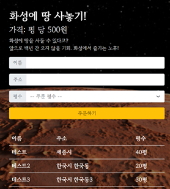

8-4. 클라이언트 테스트 결과

---

#### **09.  [스파르타피디아] - 프로젝트 세팅**

**1) 문제분석**

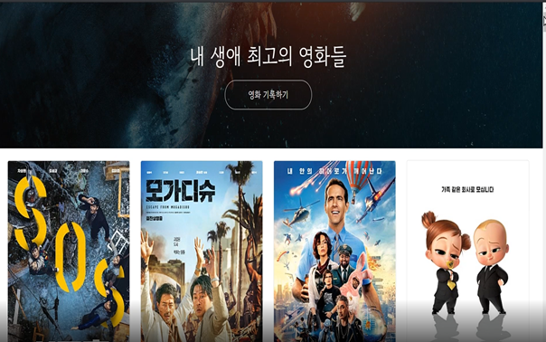

09-1. 스파르타피디아 - 프로젝트 미리보기

**(1) 영화 기록하기 버튼을 클릭한다.**

**(2) 영화URL, 별점, 코멘트를 입력하고 기록하기를 누른다.**

****(3) 기록된 영화는 데이터베이스 저장된다.****

****(4) 페이지가 새로고침되면 자동으로 코멘트 정보가 불러와진다.****

**2) 프로젝트 준비 - 폴더 구조화**

**3) 패키지 설치 : flask, pymongo, dnspython, bs4**(스크래핑)**, requests(스크래핑)**

---

#### **10.  [스파르타피디아] - 조각 기능 구현**

**1) 프로젝트 준비 - URL에서 페이지 정보 가져오기 (meta태그 - 스크래핑)**

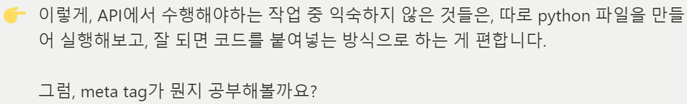

**2) 메타 태그에 대해 알아보기**

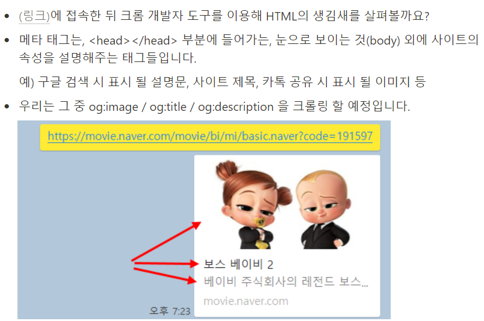

10-1. 메타태그에 대한 설명

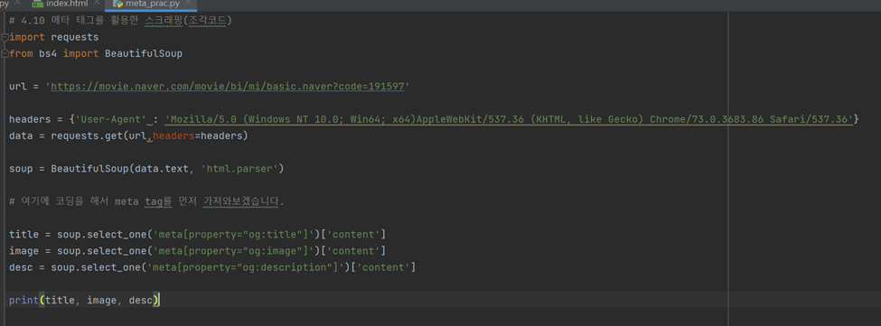

10-2. 메타태그 스크래핑(서버 코드)

---

****\* 이전과 동일하므로 생략함.****

#### **11.  [스파르타피디아] - 뼈대 준비하기**

---

#### **12.  [스파르타피디아] - POST 연습 (포스팅하기)**

****1) API 만들고 사용하기 - 포스팅API(Create → POST)****

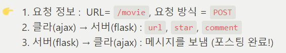

12-1. API 설계서

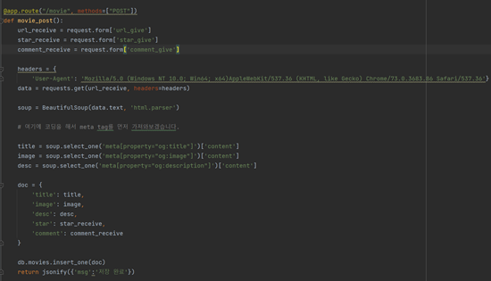

12-2. POST 서버 코드

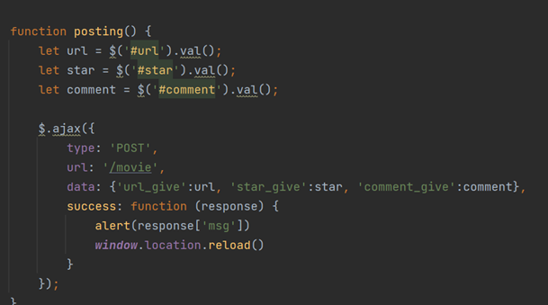

12-3. POST 클라이언트 코드

---

#### **13.  [스파르타피디아] - GET 연습 (보여주기)**

****1) API 만들고 사용하기 - 보여주기API(Read → GET)****

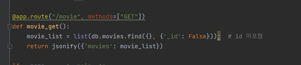

13-1. 서버 코드

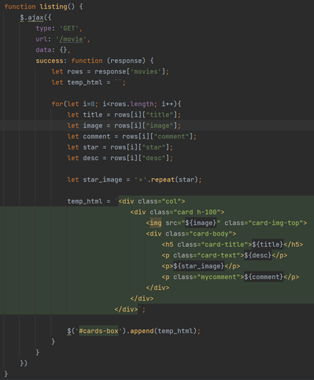

13-2. 클라이언트 코드

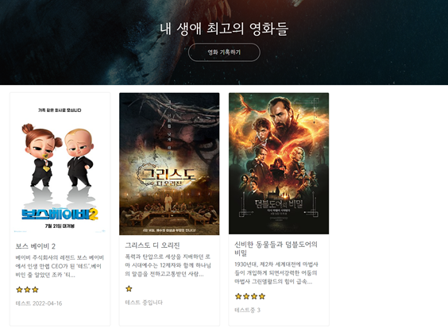

13-3. 실행 결과

---

#### 

#### **14.  4주차 끝 & 숙제 설명**

****1) 1주차에 완성한 팬명록 완성****

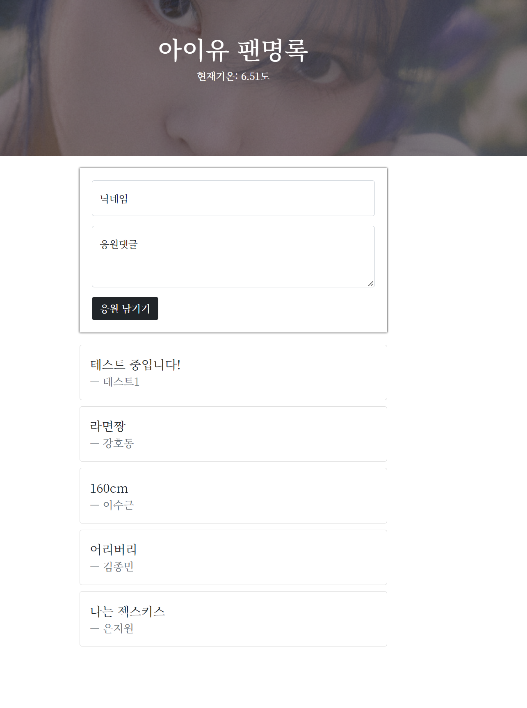

14-1 숙제

---

#### 

**정리**

**어제는 개인적인 문제로 수강하지 못했다.****그래서 어제꺼 포함해서 오늘 4,5 주차를 수강했지만..****내일 일정을 위해 일찍 자야할 것 같다...**

**5주차가 궁금하다면****>> <http://artist-bang.shop/> 를 참고해주세요**

[아이유 팬명록

응원한마디 남기고 가세요!

artist-bang.shop](http://artist-bang.shop/)
