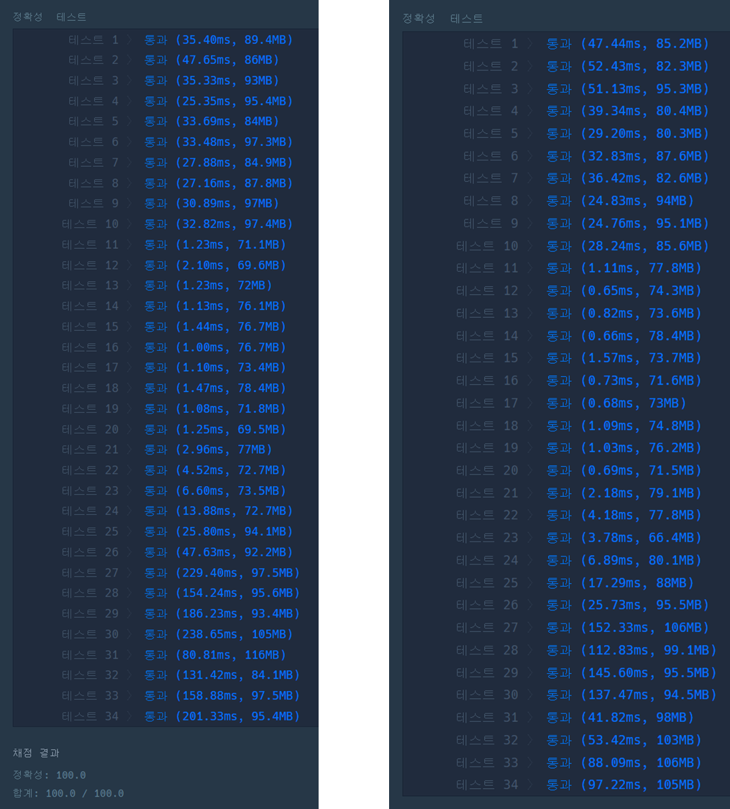

[](https://school.programmers.co.kr/learn/courses/30/lessons/138476?language=java)

## 귤 고르기

---

### 문제 설명

경화는 과수원에서 귤을 수확했습니다. 경화는 수확한 귤 중 'k'개를 골라 상자 하나에 담아 판매하려고 합니다. 그런데 수확한 귤의 크기가 일정하지 않아 보기에 좋지 않다고 생각한 경화는 귤을 크기별로 분류했을 때 서로 다른 종류의 수를 최소화하고 싶습니다.   

예를 들어, 경화가 수확한 귤 8개의 크기가 [1, 3, 2, 5, 4, 5, 2, 3] 이라고 합시다. 경화가 귤 6개를 판매하고 싶다면, 크기가 1, 4인 귤을 제외한 여섯 개의 귤을 상자에 담으면, 귤의 크기의 종류가 2, 3, 5로 총 3가지가 되며 이때가 서로 다른 종류가 최소일 때입니다.   

경화가 한 상자에 담으려는 귤의 개수**k**와 귤의 크기를 담은 배열 **tangerine**이 매개변수로 주어집니다. 경화가 귤 k개를 고를 때 크기가 서로 다른 종류의 수의 최솟값을 return 하도록 solution 함수를 작성해주세요.

### 제한 사항

* 1 ≤ k ≤ tangerine의 길이 ≤ 100,000
* 1 ≤ tangerine의 원소 ≤ 10,000,000

### 알고리즘

이 문제는 서로 다른 크기를 가진 귤을 최소화하면 되기 때문에 크기는 상관하지 않고 가장 많이 중복된 크기를 가진 귤부터 상자에 담으면 정답이 된다. 

### 문제 풀이

#### 풀이 1

객체를 이용한 풀이로 가독성을 높일 수 있다는 장점이 있다.

```java
import java.util.*;

class Solution {
    public int solution(int k, int[] tangerine) {
        int answer = 0;

        Map<Integer, Tangerine> map = new TreeMap<>();

        for (int t : tangerine) {
            Tangerine tanger = map.getOrDefault(t, new Tangerine(t, 0));
            tanger.count++;
            map.put(t, tanger);
        }

        List<Tangerine> tangerines = new ArrayList<>(map.values());

        tangerines.sort((o1, o2) -> o2.count - o1.count);

        int count = 0;

        for (Tangerine cur : tangerines) {
            int temp = cur.count;

            count += temp;
            answer++;

            if (count >= k) {
                break;
            }
        }

        return answer;
    }

    class Tangerine implements Comparable<Tangerine> {
        int grade;
        int count;

        public Tangerine(int grade, int count) {
            this.grade = grade;
            this.count = count;
        }

        @Override
        public int compareTo(Tangerine o) {
            return -Integer.compare(this.count, o.count);
        }
    }
}
```

#### 풀이 2

객체를 이용하지 않고 코드를 간결하게 풀이할 수 있다는 장점을 갖는다.

```java
import java.util.*;

class Solution {
    public int solution(int k, int[] tangerine) {
        int answer = 0;

        Map<Integer, Integer> map = new TreeMap<>();

        for (int t : tangerine) {
            if (map.containsKey(t)) {
                map.put(t, map.get(t) + 1);
            } else {
                map.put(t, 1);
            }
        }

        List<Map.Entry<Integer, Integer>> keys = new ArrayList<>(map.entrySet());
        keys.sort(((o1, o2) -> o2.getValue().compareTo(o1.getValue())));

        for (Map.Entry<Integer, Integer> entry : keys) {
            if(k <= 0)
                break;
            else{
                answer++;
                k -= entry.getValue();
            }
        }

        return answer;
    }
}
```

### 실행 결과

풀이1과 풀이 2를 비교했을 때  풀이 2가 성능적으로 우수하다.



(좌) 풀이1, (우) 풀이2
