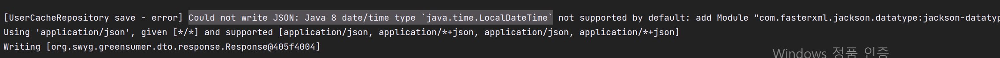
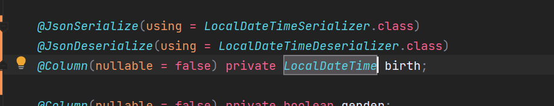

## Java 8 date/time type java.time.LocalDateTime not supported by default

---

### When?



로그인 시 사용자 정보의 일부를 Redis에 캐싱하는 과정에서 LocalDate 타입을 직렬화할 수 없다는 에러가 발생하였다.

이전에 이와 동일한 문제가 발생했을 때는 LocalDateTime이 아닌 Timestamp을 사용하여 해당 에러를 방지하였다.

Timestamp 타입을 사용한 이유는 LocalDateTime을 직렬화 하기 위해 어노테이션을 추가할 경우 코드의 길이가 길어지고 보기 불편하다고 느꼈기 때문이다.

### How to solve?

해결 방법은 간단하다.

직렬화를 도와주는 라이브러리를 추가해주면 쉽게 해결할 수 있다.

```java
//자바 역직렬화 문제 해결 패키지
implementation 'com.fasterxml.jackson.datatype:jackson-datatype-jsr310'
implementation 'com.fasterxml.jackson.core:jackson-databind'
```

이와 같이 코드를 어노테이션을 붙여주기만 하면 쉽게 해결가능하다.


