#### 

**몇 일전 올리지 못했던 것을 올리러 왔습니다..**

**늦었지만 얼른 시작해보겠습니다!!**

**오늘은 웹개발 종합반 5주차인데**

**내용은 4주차와 유사한 부분이 많아서**

**생략되는 부분이 많을 것이라 생각된다.**

---

#### 

### 과목 : 웹개발 종합반 (5주차)

#### [ 수업 목표 ]

       1. Flask 프레임워크를 활용해서 API를 만들 수 있다.

       2. '버킷리스트'를 완성합니다.

       3. EC2에 내 프로젝트를 올리고, 자랑한다!

#### [ 목차 ]

**5-1. 5주차 오늘 배울 것 & 설치**

**5-2. [버킷리스트] - 프로젝트 세팅**

**5-3. [버킷리스트] - 뼈대 준비하기**

**5-4. [버킷리스트] - POST 연습(기록하기)**

**5-5. [버킷리스트] - GET 연습(보여하기)**

**5-6. [버킷리스트] - POST 연습(완료하기)**

**5-7. 내 프로젝트를 서버에 올리기**

**5-8. AWS 서버 구매하기**

**5-9. 서버 세팅하기**

**5-10. Flask 서버를 실행해보기**

**5-11. nohup 설정하기**

**5-12. 도메인 연결하기**

**5-13. og태그**

**5-14. 5주차 끝 & 숙제 설명**

---

#### 01. 5주차 오늘 배울 것 & 설치

       1) 오늘 배울 것 이야기 - 5주차 : 미니프로젝트3

          - 4 주차 학습 내용이 익숙해질 수 있도록 버킷리스트라는 주제로 새로운 프로젝트로 한번더 복습하는 과정을 진행합니다.

       2) 이번 주 수업을 위해 설치할 것들!

          (1) [Filezilla](https://ko.wikipedia.org/wiki/%ED%8C%8C%EC%9D%BC%EC%A7%88%EB%9D%BC)

             - 파일질라는 오픈 소스 크로스 플랫폼의 자유 소프트웨어인 FTP 소프트웨어이며 파일질라 클라이언트와 파일질라 서버로

               이루어져 있다. 이진 파일은 윈도우, MacOS, 리눅스용으로 이용할 수 있다. FTP, SFTP, FTP(SSL/TLS 위의 FTP)를 지원한다.

               2020년 9월 4일 기준으로 파일질라 클라이언트는 소스포지에서 6번째로 가장 많이 내려받은 인기 있는 소프트웨어가 되었다.

                                                                                                                                                                                  (참조 : 위키백과)

          (2) [가비아](https://ko.wikipedia.org/wiki/%EA%B0%80%EB%B9%84%EC%95%84)

             - 가비아(Gabia)는 laaS형 클라우드 서비스와 PaaS, 그리고 SaaS형 그룹웨어 솔루션 등 비즈니스 IT에 필요한 서비스 전반을

               제공하는 클라우드 기업이다.

                                                                                                                                                                                  (참조 : 위키백과)

 (정리)

       - Filezilla는 서버에 파일을 업로드하기 위한 용도로 사용하고 있습니다. (처음 사용해보는 입장에서 간단하게 파일 업로드 할 수 있었다)

       - 가비아는 도메인을 구입하기 위한 용도로 사용하고 있습니다.              (550원에 1년 동안 무료로 사용할 수 있다는 장점!!)

---

#### 02. [버킷리스트] - 프로젝트 세팅

       (준비운동 : bucket 폴더를 생성하여 pycharm을 통해 프로젝트를 생성)

       1) 문제 분석 - 완성작부터 보기!

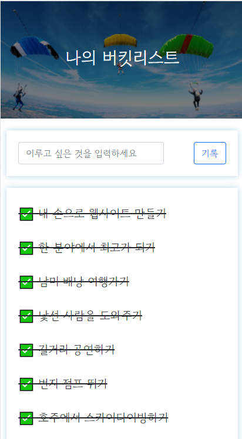

2-1. 버킷리스트 구현 미리 보기

       2) 프로젝트 설정 - flask 폴더 구조

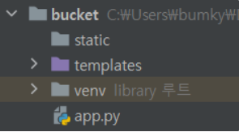

2-2. 프로젝트 폴더 구조화

       3) 패키지 설치

          (설치 패키지) flask, pymongo, dnspython

          (정리)

          - 위 과정은 4주차에서도 반복되었기 때문에 설명은 생략함

---

#### 03. [버킷리스트] - 뼈대 준비하기

      (정리 : 4주차와 동일하므로 설명 생략)

       1) 프로젝트 준비 - index.html, app.py 준비

       2) 프로젝트 준비 - mongoDB Atlas 창 띄워주기

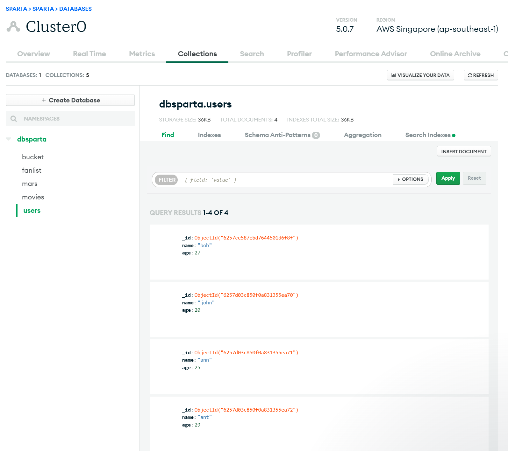

3-1. mongoDB Atlas 창

---

#### 04. [버킷리스트] - POST연습(기록하기)

       1) API 만들고 사용하기 - 버킷리스트 기록 API (Create → **POST**)

          (준비운동 : API 설계 요구서)

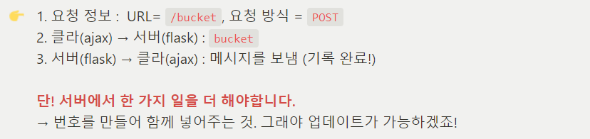

4-1. API 설계 요구서

          (1) 클라이언트와 서버 연결 확인

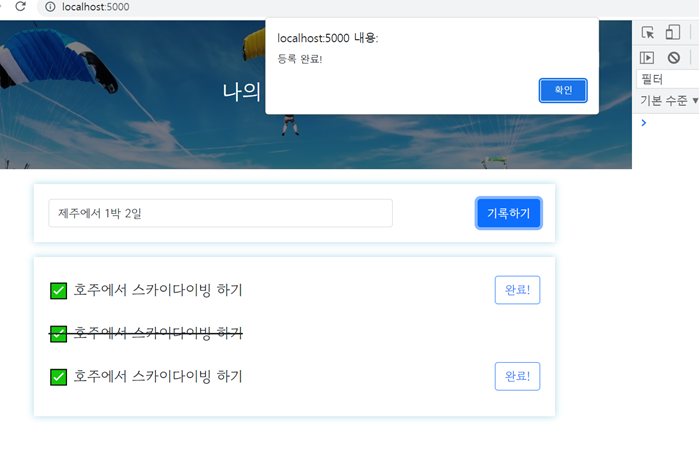

4-2. 클라이언트와 서버 연결 확인

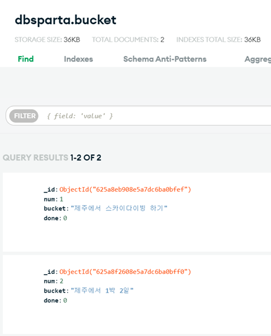

4-3. 데이터베이스 테스트 확인

        (2) 서버부터 만들기

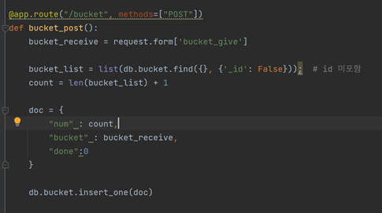

4-4. 서버 만들기

        (3) 클라이언트 만들기

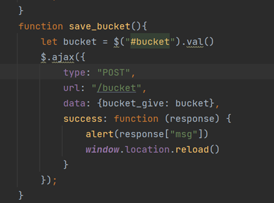

4-5. 클라이언트 만들기

---

#### 05. [버킷리스트] - GET연습(보여주기)

       1) API 만들고 사용하기 - 버킷리스트 조회 API (Read → **GET**)

        (준비운동 : API 설계 요구서)

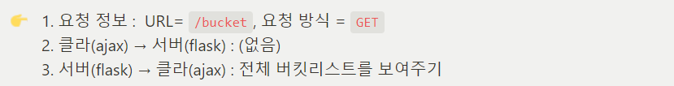

5-1. API 설계 요구서

          (1) 클라이언트와 서버 연결 확인

5-2. 클라이언트와 서버 연결 확인

          (2) 서버부터 만들기

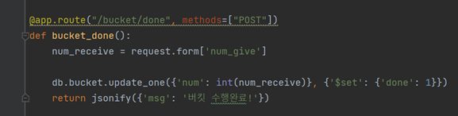

5-3. 서버 만들기

          (3) 클라이언트 만들기

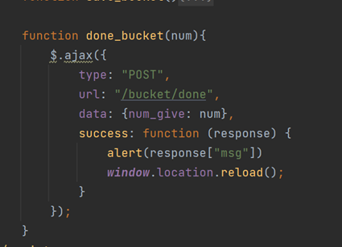

5-4. 클라이언트 만들기

---

#### 

#### 

#### 06. [버킷리스트] - POST연습(완료히기)

       1) API 만들고 사용하기 - 버킷리스트 완료 API (Update → **POST**)

          (1) 클라이언트와 서버 연결 확인

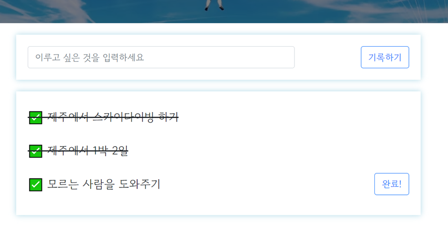

6-1. 클라이언트와 서버 연결 확인

        (2) 서버부터 만들기

6-2. 서버 만들기

        (3) 클라이언트 만들기

6-3. 클라이언트 만들기

---

#### 

#### 07. 내 프로젝트를 서버에 올리기

      1) "웹 서비스 런칭"에 필요한 개념 소개

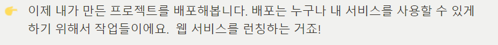

7-1. 배포의 의미

       • 웹 서비스를 런칭하기 위해 클라이언트의 요청에 항상 응답해줄 수 있는 서버에 프로젝트를 실행시켜줘야 한다.

       • 언제나 요청에 응답하려면,

             1) 컴퓨터가 **항상** 켜져있고 프로그램이 실행되어 있어야하고

             2) 모두가 접근할 수 있는 공개 주소인 공개 IP 주소(Public IP Address)로 나의 웹 서비스에 **접근할 수 있도록** 해야해요.

       • 외부 접속이 가능하게 설정한 다음에 내 컴퓨터를 서버로 사용할 수도 있다. (공개 IP를 사용한 포트포워딩)

       • AWS라는 클라우드 서비스에서 서버 관리하기 위해 항상 켜 놓을 수 있는 컴퓨터인 EC 사용권을 구입해 서버로 사용할 겁니다.

             **└ 내 컴퓨터를 24시간 켜둘 수 없기 때문에 AWS의 컴퓨터를 사용하여 나의 서버를 돌릴 수 있게 하는 것이다.**

---

#### 08. AWS 서버 구매하기

       1) EC2 서버 구매하기

       • AWS EC2로 리눅스 Ubuntu 서버를 만들 것이다.

       2) EC2 서버 종료하는 방법

       • 인스턴스 중지 : EC2 컴퓨터를 종료하는 방법

      • 인스턴스 종료 :EC2 컴퓨터를 삭제하는 방법

       3) EC2에 접속하기

       (1) git bash를 실행한다.

       (2) ssh -i (키패어) ubuntu@(AWS 주소) 를 입력하고 엔터를 치면 된다.

       4) 간단한 리눅스 명령어(자주 사용하는 명령어 기준)

       • pwd(print working directory) : 현재 작업중인 디렉토리 정보 출력

       • cd(change directory) : 경로 이동(절대 경로 또는 상대 경로로 이동 가능)

       • ls(list) +옵션(-l, -a, -al) : 디렉토리 목록 확인

       • cp(copy) : 파일 혹은 디렉토리를 복사(디렉토리를 복사할때는 -r 옵션 필요)

       • mv(move) : 파일 혹은 디렉토리 이동(실제로 위치 이동할때도 사용하지만, 이름을 변경하는 용도로도 사용)

       • mkdir(make directory) : 디렉토리 생성(-p 옵션을 주면 하위 디렉토리까지 한번에 생성 가능)

       • rm(remove) : 파일이나 디렉토리를 삭제(디렉토리 삭제 시 -r옵션 필요, -f옵션 사용시 삭제 여부를 묻지않고 강제 삭제)

       • touch : 파일이나 디렉토리의 최근 업데이트 일자를 현재 시간으로 변경한다.

       • cat(concatenate) : 단순히 파일의 내용을 출력할 수 있고, 파일 여러개를 합쳐서 하나의 파일로 만들 수 있고,

                                          새로운 파일을 만들때에도 사용된다.

       •find : 특정 파일이나 디렉토리를 검색한다. Ex) find [검색 경로] -name [파일명]

      • vi : 윈도우의 메모장과 같은 텍스트 에디터 실행 (자세한 내용은 생략)

---

#### 09. 서버 세팅하기

       1) 서버 환경 통일하기

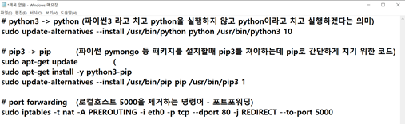

9-1. 서버 환경 통일

       2) filezilla를 이용해서, 간단한 python 파일 테스트

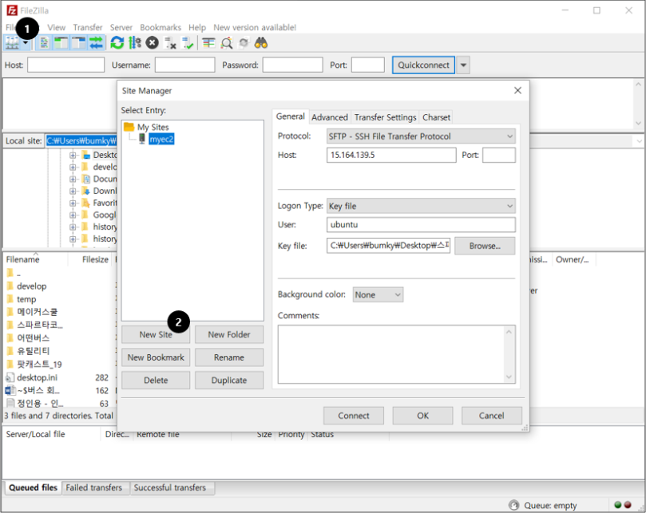

9-2. filezilla - 서버 연결

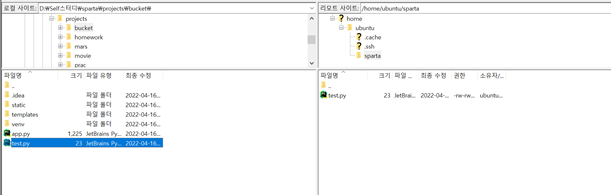

9-3. filezilla - 파일 업로드(좌 - 내 PC /우 - 서버 PC)

       3) 파이썬 파일을 실행해보기

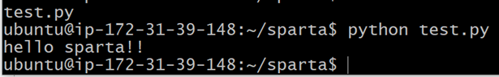

9-4. filezilla - 업로드된 파일 테스트

---

#### 

#### 10. Flask 서버를 실행해보기

       1) 팬명록 완성본을 filezilla EC2에 업로드

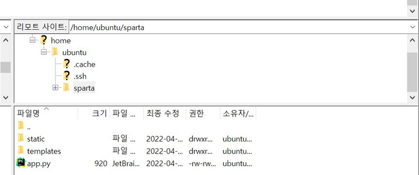

10-1. 팬명록 프로젝트 파일들을 filezilla에 업로드

       2) pip로 패키지 설치

       •내가 설치한 패키지는 현재 프로젝트의 venv에 저장되어 있는 것이다. 그러므로 EC2 PC에도 설치할 필요가 있다.

        (예시 - 우리 집에 있는 반찬이 친구의 집에 냉장고에는 없다)

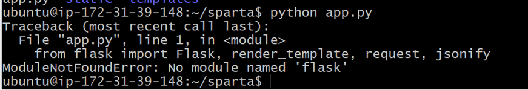

10-2. 패키지 설치가 필요한 이유

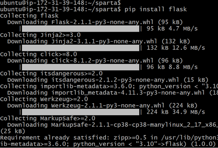

10-3. 패키지 설치(flask)

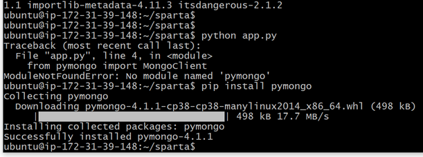

10-4. 패키지 설치(pymongo)

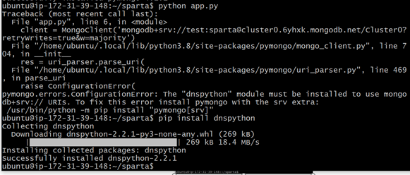

10-5. 패키지 설치(dnspython)

       3) flask 서버 실행하기

       •현재 서버를 실행하여도 화면에는 아무것도 뜨지 않는다. 이유는 EC2 PC에 포트포워딩을 설정하지 않았기 때문이다.

          (포트 : 약속한 만남의 장소)

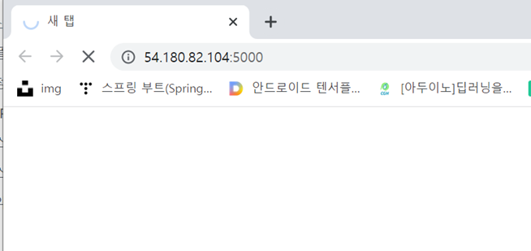

10-6. EC2 서버에서 flask 서버 실행 화면

       4) aws에서 포트포워딩

       (1 단계) AWS EC2 관리콘솔 접속

       (2 단계) 보안 그룹에 launch-wizard-1 클릭

       (3 단계) 해당 보안 그룹 클릭

       (4 단계) 인바운드 그룹 편집

       (5 단계) 규칙 추가

                    - 사용자 지정 TCP -  5000 - Anywhere IP4 - 0.0.0.0/0

                    - 사용자 지정 TCP -  80 - Anywhere IP4 - 0.0.0.0/0

       (6 단계) 규칙 저장 

       5) 포트 번호 없애기 - 기본개념

         •지금은 5000포트에서 웹 서비스가 실행되고 있습니다. http 요청에서 80포트가 기본이기 때문에, 굳이 :80을 붙이지 않아도

            자동으로 연결이 됩니다.

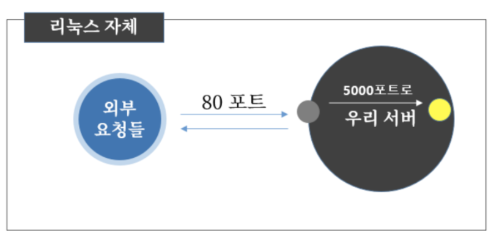

10-7. 포트포워딩

---

#### 

#### 11. nohup 설정

       1) SSH 접속을 끊어도 서버가 계속 돌게 하기

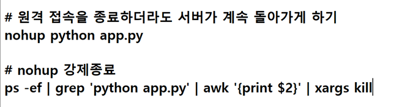

11-1. nohup 설정방법

       2) SSH 접속을 종료한 뒤, 접속

---

#### 

#### 12. 도메인 연결

       1) 도메인 구입/연결

       •도메인은 가비아를 통해서 이미 구입

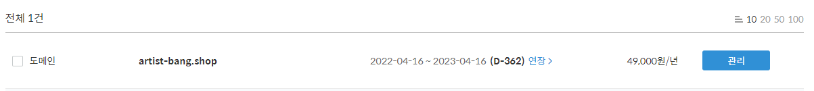

12-1. 가비아를 통해 구매한 도메인

---

#### 

#### 13. og 태그

       1) og 태그 만들기

       • og:url : URL입니다. 링크될 URL을 지정하시면 됩니다.

       • og:type : 타입을 지정합니다. 웹인지 앱인지 등

       • og:title : 해당 링크의 제목 입니다.

       • og:description : 설명입니다. 제목 아래 설명글씨로 주저리 담긴다.

       • og:image : 썸네일 이미지입니다. http://부터 시작하는 절대 주소로 남기셔야 합니다.

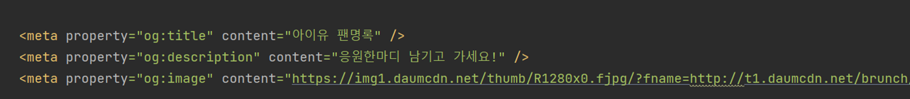

13-1. og태그 사용방법

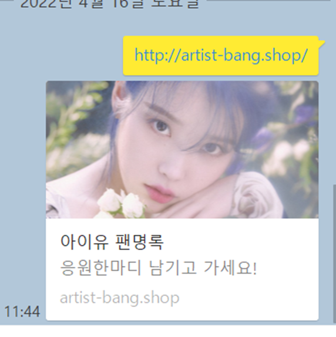

13-2. og태그 사용

---

#### 

#### 14. 5주차 끝 & 숙제 설명

       1) 5주차 숙제 

          - 5주차 과제는 과제로 수행했던 팬명록을 filezilla에 업로드하여 배포하기(아래 사이트를 통해 접속하여 확인가능)

            <http://artist-bang.shop/>

[아이유 팬명록

응원한마디 남기고 가세요!

artist-bang.shop](http://artist-bang.shop/)

---

#### 

#### 정리

어제 오늘 개인적인 사정으로.. 학습하지 못했다...그래서 오늘은 이전에 업로드하지 못했던 웹종합 5주차를 업로드했다..

내일부터는 다시 일상적으로 돌아갈 예정...

꼭 꼭 꼭 약속해요~!!
