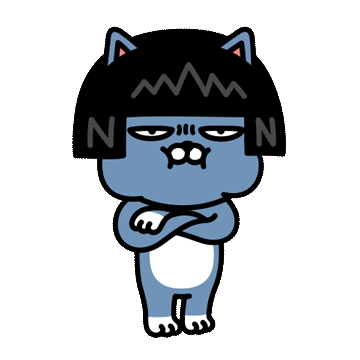

## 적응기...

---

이번 주차에도 동일한 작업을 계속 진행하였다...  한 페이지를 구현하는데 필요한 기능이 무수히 많았다...

개발을 하면서 많은 것을 경험하고 배워간 한 주였다...

백엔드 개발을 하면서 프론트 개발을 함께 진행하는데 퍼블리싱은 하지 않는다.

프론트 개발을 하면서 가장 큰 어려움은 2가지다.

### 피그마 분석

피그마를 보고 작업을 하는데 서비스의 로직을 파악하지 않고 개발을 진행하다보니 어려움을 겪었다.

서비스의 로직을 파악하려고 하지 않고 피그마를 보고 A, B, C를 진행하다보니 너무 막히는 것이 많았다...

JS에 대한 지식이 부족한 점도 큰 역할을 하였다... 무엇을 하려고 하면 어떻게 해야하는지 막혀버려서... 기능을 구현하다가 검색하는 시간이 너무 많았다...

피그마를 이해하는데 걸리는 시간이 길어서 아직 적응하기 힘들었다... 그래서 개발하면서 빼먹는 것도 많았다...

> 조금더 집중해서 잘하자..  
> 

### 원인 파악

개인 프로젝트에서 간단하게 프론트를 건드려보았지만, 실제 실무에서 프론트를 작업하는 것은 생각보다 어려웠다.

기능 구현에 신경을 쓰면서도 기존 컨벤션을 지켜가면서 해야하기 때문에 많은 것을 찾아보면서 해야했다...

그중에서도 가장 어려운 것은 **퍼블리싱**은 퍼블리셔 분께서 해주시는데 기능을 개발하면서 디자인이 변경되면 코드에 잘못이 있는지 디자인이 변경되어야하는것인지 판별이 되지 않아... 시간이 오래걸린다.

구현을 해보고 다시 Stash하였다가 돌려서 기능에 문제가 있는지 점검하고 또 점검하고 나서 디자인의 수정이 필요하다고 느껴질 때 디자인의 변경을 요청하였다...

아직 이러한 부분에 미숙하기 때문에 적응하기가 쉽지 않았다....

> 오늘의 나보다 더 빛나는 내일의 나  
>   
> 
