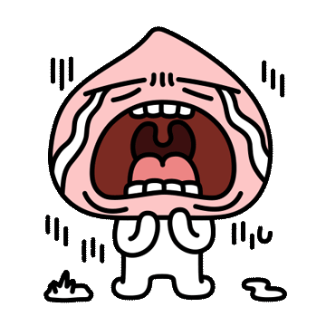
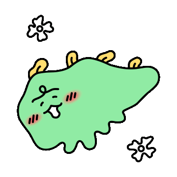
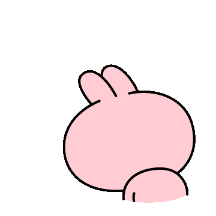
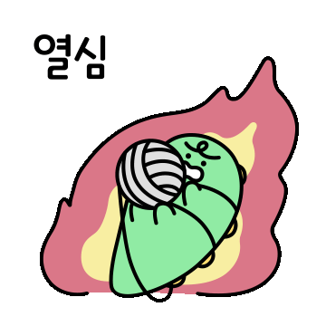
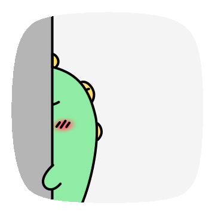
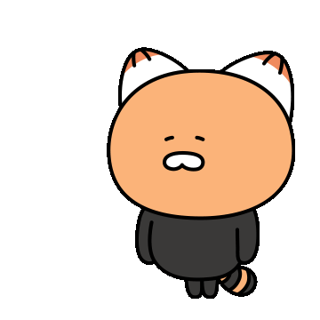

## Trade Off

이번 주에는 많은 작업을 진행하면서 다양한 경험을 쌓을 수 있었다.

무엇하나 중요하지 않은 것은 없다는 것을 다시 한번 느낄 수 있는 한주 였다.

### **LifeCycle**

정보를 입력하고 백엔드에 데이터를 보낸 후 데이터를 초기화하도록 로직을 구현하였다.

초기화 코드를 넣기 전, 데이터가 정상적으로 백엔드로 전달되었기 때문에 문제 없을 것이라고 판단하고 초기화 코드를 삽입하고 다른 기능을 작업을 시작하였습니다.

그런데 **다른 기능(B)**을 구현하다가 테스트를 하는 과정에서 DB에 데이터가 저장되지 않는 현상을 발견하였다...

**다른 기능(B)**에서 잘못되었을 것이라는 판단을 하고 계속 수정을 하는데 문제가 없었고 무엇이 문제인지 찾다가 초기화 코드에서 데이터가 전달되지 않는 현상을 확인할 수 있었다.

A → B → C 순서로 작업이 진행될 것이라 단순하게 생각했지만 생각해보면 A, B는 비동기로 처리되도록 하였는데 코드를 실행하면 C →  A → B 순서로 호출되고 있었다....

조금만 더 집중했더라면 시간을 허비하지 않았을 것 같은데 너무 큰 실수로 해버렸던 것 같다...

> 코드를 작성하는 것보다 중요한 것은 이해하는 것인데..  
>   
> 코드를 작성하는 것만 집중해버렸던 나의 자신이 한심하다...  
> 

---

### Event Capturing

프론트 작업 중 발생한 상황이었다... 분명 자식에게 전달되지 않는데 왜? 이벤트가 발생하지??...

A라는 데이터를 바꿨는데 저 멀리 있는 B`라는 놈이 바로 발생하는 것일까??... 라는 생각을 하면서 어떻게 하면 끊어줄 수 있지? 어떻게 하면 막을 수 있지라는 생각으로 계속해서 검색을 했다...

그런데 막상 어떻게 검색해야할지 몰랐다... 이러한 문제를 어떻게 표현해야할지 알지 못했다...

그래서 이것 저것 다 검색했었다... 이전에 만났던 `**이벤트 버블링**`을 검색하면 click 관련 이벤트를 막는 글이 대부분이였다...

그러다가 **이벤트 버블링**이 무엇인지 개념을 더 정확하게 이해하기 위해서 찾다가 **이벤트 캡처링**이라는 것을 알게 되었다.

현재 필자의 코드에서 발생한 문제가 `이벤트 캡처링`이라는 것을 알게 되었다.

A라는 이벤트가 발생했을 때 값을 변경하여 `**이벤트 캡처링**`이 발생했던 것이었다.

이를 막을 수 있는 가장 쉬운 해결 방법은 `**stopPropagation**`이 있어 바로 작성하여 코드에 넣었더니 바로 해결되었다...

**stopPropagation** 은 현재 발생한 이벤트로 다른 곳에 영향을 주지마! 라고 외치는 것과 동일하다는 것을 배울 수 있었다.

책으로 배웠다면 금방 까먹었겠지만 실제 경험을 하면서 다양한 것을 배울 수 있었다.

> 개발 영역에서 가장 중요한 것은 `기초 지식`이라고 생각된다.  
>   
> 이벤트가 발생하면 이벤트 캡처링 -> 타겟 -> 이벤트 버블링 순서로 발생한다는 것을  
>  이번에 처음 알게 되었다...  
>   
> 현재 Vue 에 대해 공부를 하고 있지만 JS 에 대한 기초 지식 부족이  
> 매번 나의 다리를 붙잡는 것 같다...   
>   
> JS를 먼저 해야할까?   
> Vue를 먼저 끝내고 할까?? Vue에서 JS에 대해 조금은 설명을 하는데..?   
> 아니 그래도 JS가 먼저이지 않을까?? ... 

---

### 어제보다 오늘이 강한 나

이전에 작업을 하면서 기능을 확장한 새로운 기능을 구현할 때 기존의 기능을 사용하는 것이 맞는지 것인지 새로운 기능을 위한 코드를 구현하는게 좋을지 고민했던 적이 있다.

프론트의 로직과 백엔드의 로직을 모두 개발하기 때문에 느낄 수 있는 점이라 생각된다.

백엔드만 개발했다면 새로운 기능을 바로 만들었을 것이라고 생각된다.

이전 기능과 비교해보면 **공통 기능** 1개, **불필요한 기능** 1개, **중복된 기능** 1개가 있다.

만약 새로운 기능에서는 공통 기능만 구현하면 되는 것이다.

그렇다면 새로운 코드를 만들어 새로운 API를 통해 사용하는 것이 맞을까?

필자는 새로운 API를 개발하는 것보다 기존 기능을 개선하는 것이 더 좋은 판단이라고 생각된다.

기존 로직을 사용하고 있는 곳에 영향을 주지 않으면서도 새로운 기능을 구현할 수 있느냐 는 어려운 것일 수 있지만 생각해보면 간단할 수 도 있다.

필자는 Dto에 Flag 값을 설정하여 기존 기능과 새로운 기능을 둘다 1개의 코드로 동작할 수 있도록 변경하였다.

이를 통해 프론트와 백엔드 코드의 코드의 변화가 거의 발생하지 않게 되었다.

> 이전에 풀스택 개발자를 선호하지 않았었다.  
>   
> 신입 때 1개를 잘하기도 어려운 데   
> 2가지 기술 스택을 사용한다는 것은 어려운 일이기 때문이였다.  
>   
> 2개를 잘하는 것보다 1개를 깊숙히 잘아는 것이 더 좋은 것은 맞지만  
> 2개를 하면서 1개를 더 잘하는 것이 더 좋을 것이라고 생각된다.  
>   
> 현재 프론트의 영역을 개발하는데 시간이 많이 소요되기는 하지만  
> 앞으로 시간을 줄여나가면서 더 노력하면 언제가 빛을 보게 될 것이다.  
>   
> 
>   
>
> ---

### UPDATE OR DELETE AND INSERT

기능을 구현하면서 지속적으로 변경되고 연관관계가 복잡한 기능을 구현하면서 생각이 복잡했었다... 

A라는 기능을 수정하면 변경되는 정보가 엄청나게 많다... A를 수정할 때마다 모든 데이터를 수정해주어야 한다.

필자는 다양한 프로젝트를 하면서 수정 기능을 구현해본 경험이 적지 않다.

그런데 해당 기능은 엄청 복잡하다... 복잡해도 너무 복잡하다....

이러한 구조를 갖는 기능이였다...

데이터를 프론트 작업도 복잡하지만 백엔드 작업도 생각도 엄청 복잡했다... (**실력이 부족해서....**)

그래서 백엔드에서 코드를 구현할 때 고민이 되었다... 

**업데이트 로직** : 조회 → 동일 여부 판단(복잡) → 업데이트(복잡)

**삭제 이후 삽입 로직** : 조회 → 연관관계 삭제 → 삭제 → 삽입

관련된 데이터를 모두 삭제해버리고 삽입하는 코드를 만들면 조금 더 간단하게 구현할 수 있다.

반대로 해당 데이터를 모두 업데이트 해버리면 복잡하고 구현 코드도 복잡해지고.. 유지보수가 어려워질 수 있다...

그래서 고민했다... 

어떤 것이 정답일까?? 해당 기능에 더 많은 로직이 추가될 수 있는데....

그때마다 변경하는 것이 맞을까? 아니면 삭제해서 새로 넣는 것이 맞을까??....

필자의 선택은 변경하는 길을 선택했다...

쉬운 길만 선택하면 성장할 수 있을까?? 정답은 X.

복잡해질 때마다 삭제 후 삽입하는 구조로 해버린다면 데이터베이스의 idx는 띄엄띄엄띄엄... 빈 값이 넘쳐나게 될것이다.

불필요한 히스토리 많이 남게 될 것이다.

어떠한 것을 선택해도 장단점이 있기 때문에 필자는 업데이트하는 쪽으로 선택하였다.

> 어떤 선택을 하든 쉬운 것만 선택할 수는 없다.  
>   
> A의 장점과 B의 장점을 비교해서는 정답을 찾을 수 없을지도 모른다.  
>   
> 그럴 때는 A의 단점과 B의 단점을 보고 판단하는 것이 좋을 것이다.  
>   
> 어떤 단점이 덜 치명적일지 판단하는 것이 좋을 것이라 생각된다.  
>   
> 

---

### **Review**

> 이번 주에도 많은 것을 배우면서 많은 것을 느낄 수 있었다.  
>   
> 어떠한 기능을 개발할 때마다 선택의 갈림길에 놓이게 된다.  
>   
> 그때마다 무엇이 좋을지 판단하는 것은 어려운 일이다.  
>   
> 또한 맛보지 않으면 무엇이 좋은지 알 수 없다.  
>   
> 그때마다 새로운 생각과 도전 정신을 갖고 다양한 경험을 쌓으면  
> 무엇이 좋은지 나중에는 알게 될 것이다.
