```java
package com.example.projectboardadmin.domain.constant;

import lombok.Getter;
import lombok.RequiredArgsConstructor;

@RequiredArgsConstructor
public enum RoleType {
    USER("ROLE_USER"),
    MANAGER("ROLE_MANAGER"),
    DEVELOPER("ROLE_DEVELOPER"),
    ADMIN("ROLE_ADMIN");

    @Getter private final String name;

}
```

## 기본 기능 개발

---

### Spring Boot 프로젝트 시작하기

기존에 다른 프로젝트는 단일 프로젝트(Spring Boot  1개)로 구현하였었다. 

어드민 서비스는 게시판 서비스가 동작하는 상황에서 사용할 수 있습니다. 

게시판 웹 서비스가 동작하고 있어야 어드민 서비스가 동작할 수 있는데

정리하면 어드민 서비스는 게시판 웹 서비스에 의존적이다.

단일 프로젝트로 2개의 서비스를 띄워도 되지만 한 화면에서 볼 수 있으면 관리하기 더 편하기 때문에 멀티 모듈 프로젝트를 구성해보려고 한다. 

#### **새 프로젝트 생성**

프로젝트 생성 버튼을 클릭해줍니다.

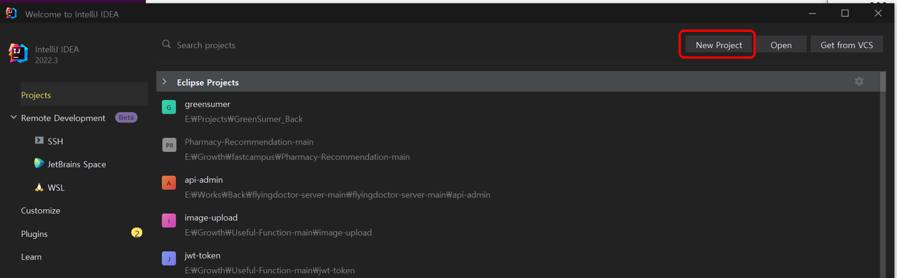

코드가 전혀 없는 빈 프로젝트를 생성해줍니다.

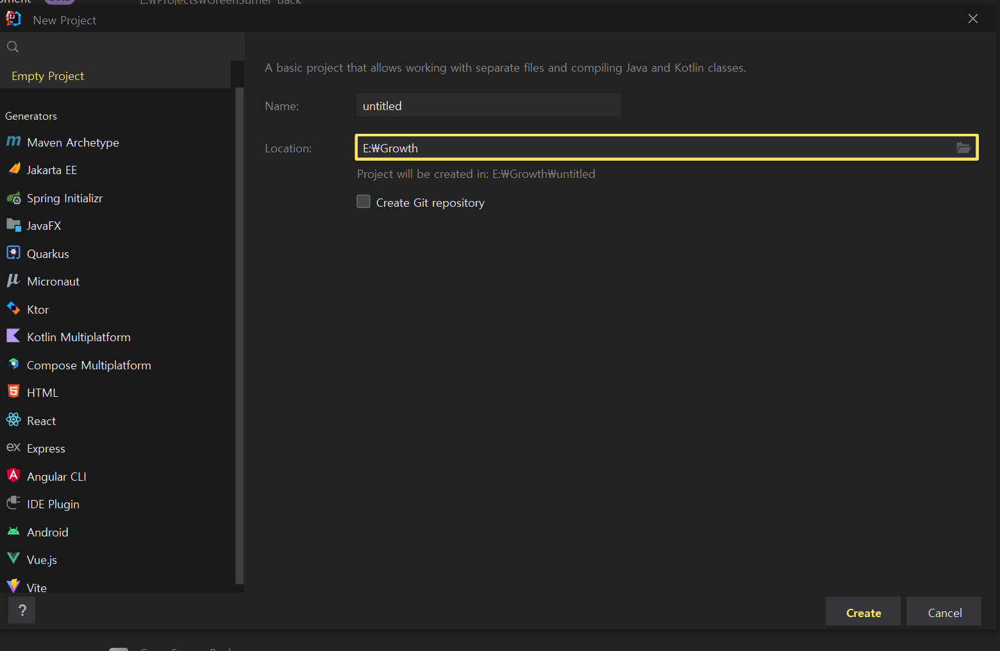

별다른 설정을 하지 않았기 때문에 빈 프로젝트가 빠르게 실행됩니다.

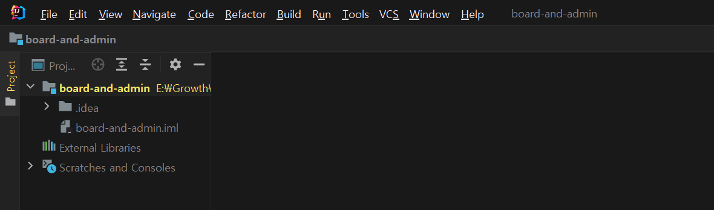

해당 프로젝트 내에 게시판 프로젝트와 어드민 프로젝트를 모듈로 넣어 멀티 모듈 프로젝트를 조성하면 된다.

빈 프로젝트는 Spring Boot Initializr나 Gradle 등으로 프로젝트를 시작하지 않았기 때문에 기본적인 정보가 담겨있지 않다.

**1. JDK 버전 설정**

File > Project Structure > Project Settings > Product 에서 SDK 버전을 설정해주면 된다.

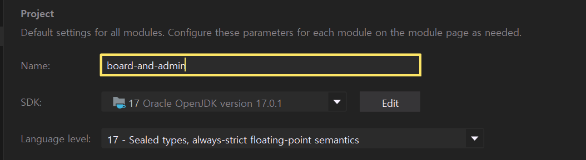

**2. 프로젝트 모듈 넣기**

이미 구현되어 있는 게시판 서비스 부터 넣어보려고 한다.

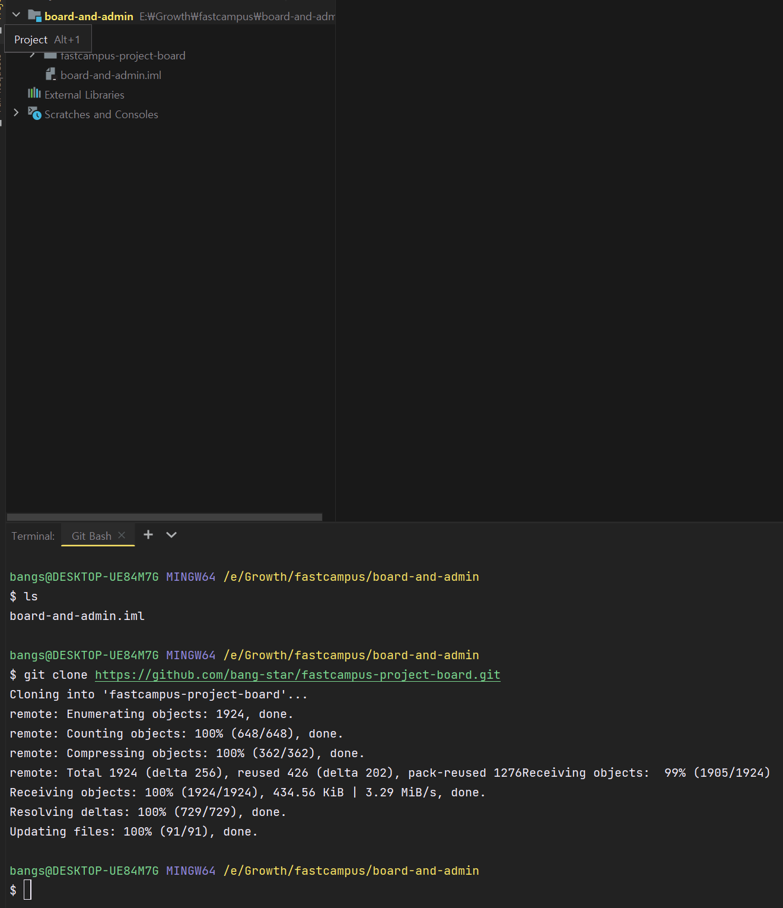

**3. Gradle 적용**

현재 Gradle이 설정되어 있지 않아 build.gradle이 정상적으로 동작하지 않고 있기 때문에 Link Gradle Project를 클릭하여 활성화시켜준다.

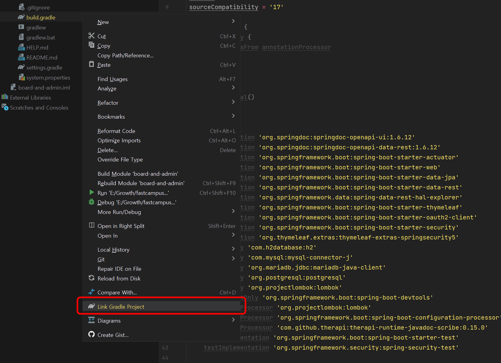

**4. 환경변수 설정**

설정한 환경 변수와 일치하는 값을 셋팅하고 프로젝트를 실행하면 정상적으로 실행됨을 확인할 수 있다.

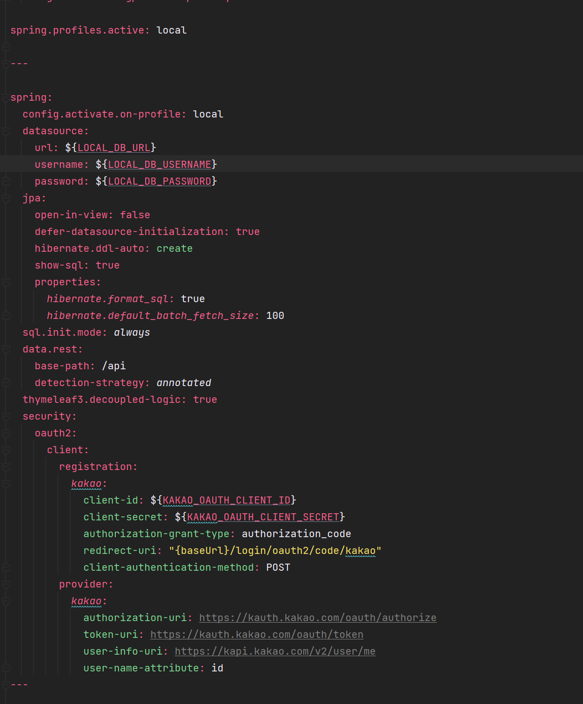
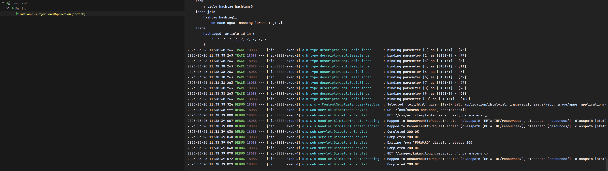

#### **어드민 서비스 생성**

**1. 모듈 생성**

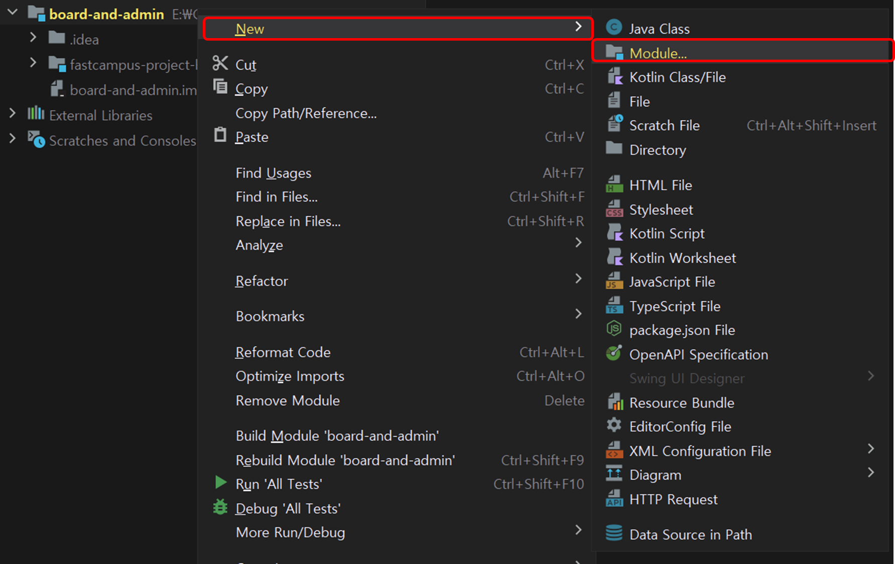

**2. Spring Initializr 선택 후 셋팅**

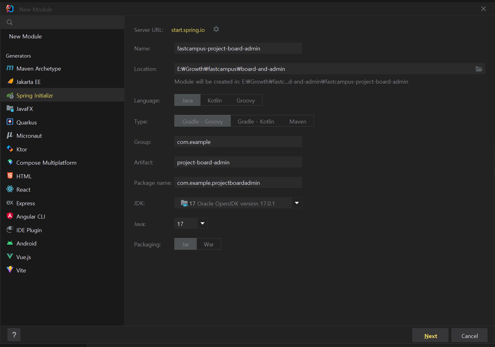

**3. Spring Boot 버전 선택 및 의존성 추가**

작성일 기준으로 선택 가능한 2.7 버전은 Spring Boot 버전은 2.7.10인데 Build.gradle에서 버전 변경이 가능하다.

서비스 개발 초기에 필요한 기능만 의존성을 추가한 상태이다.

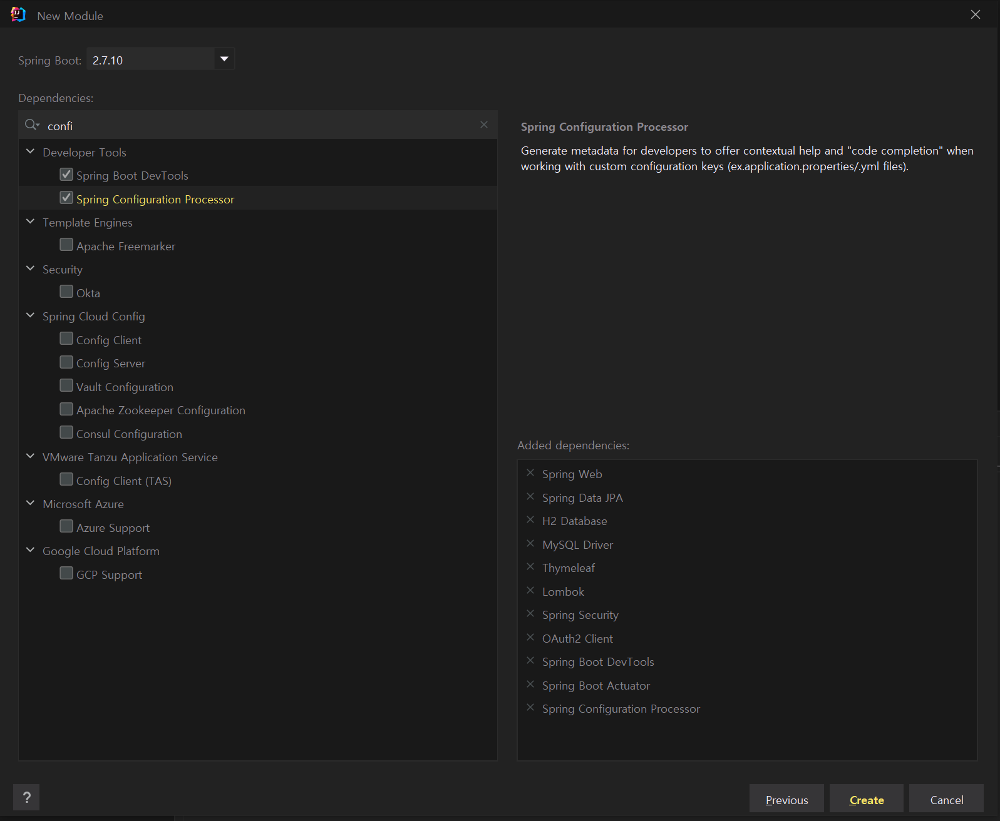

프로젝트를 구성하면 다음과 같이 모듈 프로젝트 환경이 조성되게 됩니다.

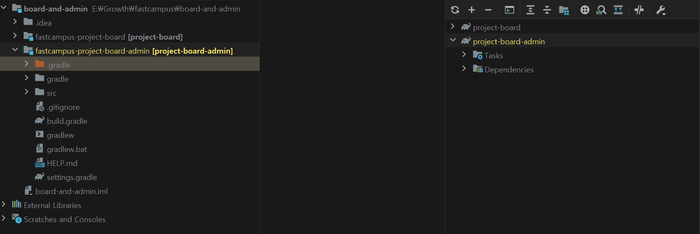

추가적으로  .gitignore, spring boot 버전 등을 변경해주시면 됩니다.

#### **유의할 점**

> **모듈 프로젝트 환경을 조성하게 될 때 문제가 될 수 있는 부분이 동일한 일을 하는 외부 라이브러리가 발생할 수 있기 떄문에 통일된 버전 관리가 중요할 수 있습니다.**

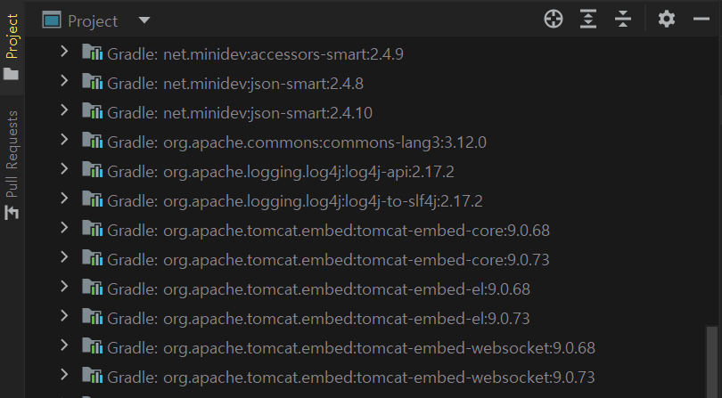

현재 루트 디렉토리는 별다른 기능을 하지 않고 있는데 Gradle 프로젝트를 루트에 적용시켜 멀티 Gradle 프로젝트를 만들 수도 있다. 

독립적으로 운영하여 버전이 통일되지 않는 문제가 발생할 수 있지만 하나의 서비스 프로젝트를 개발하면서 버전 업을 하고자 할때는 버전 업이 다른 프로젝트에 영향을 미치지 않는다는 반대의 장점도 있습니다.

어떠한 선택을 하든지 장단점이 발생할 수 있습니다.

보통은 비슷한 서비스를 멀티 모듈로 묶어서 구성할 때는 루트에도 Gradle 프로젝트를 조성하여 루트에서 일관되게 한번에 영향을 주는 환경을 조성하기도 한다.

독립적인 서비스를 멀티 모듈로 조성할 때는 각각 관리하는 것도 괜찮다.

#### [TIP] ISO-8859-1

다른 프로젝트 파일과는 다르게 **application.properties** 는 **ISO-8859-1**로 되어있습니다. 인코딩 방식이 다른 것인데 

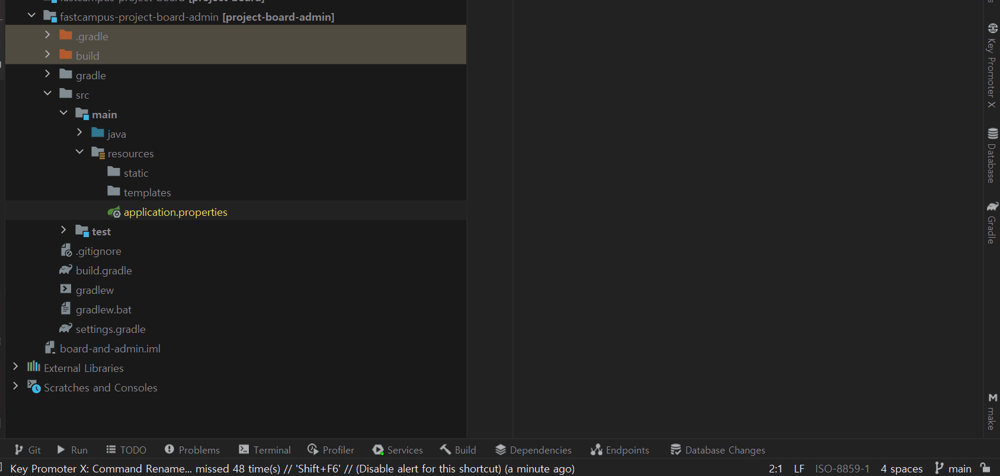

> **ISO-8859-1**  
>   
> ISO/IEC 8859-1:1998(별칭: Information technology - 8-bit single-byte coded graphic character sets - Part 1: Latin alphabet No. 1)[1]은 ISO/IEC 8859의 일부인 문자 집합으로, 약칭 라틴-1(Latin-1)로 불린다.  
> IANA에서 정의한 MIME 이름은 ISO/IEC 6429의 C0과 C1 제어 문자를 포함하여 ISO-8859-1로 되어 있고, 별칭은 iso-ir-100, ISO\_8859-1, latin1, l1, IBM819, CP819로 정의되어 있다.[2] Windows-1252가 ISO-8859-1과 통하는 것으로 알려져 있으나, Windows-1252는 ISO-8859-1에서 C1 제어 문자가 있던 0x80~0x9F의 범위에 ISO 8859-15를 대신 넣은 것으로 완벽히 일치하지는 않는다.  
>   
> [참고 - [위키백과](https://ko.wikipedia.org/wiki/ISO/IEC_8859-1)]

**ISO-8859-1** 은 문자열 인코딩 방식 중 하나인데 영문자를 포함하는 몇가지 나라의 언어를 표현할 수 있습니다. (안타깝게도... 한글은 빠져있습니다.)

현재는 국제적으로 널리 유니코드와 유니코드를 지원하는 **UTF-8 인코딩**이 널리 보급되고 있는 상태이다. 한글을 원활하게 사용하고 싶다면 UTF-8를 사용하는 것이 좋을 것이다. 

파일 속성을 직접적으로 바꿔도 상관없지만 삭제하고 직접 생성하는 방법도 있다. 

새로 만든 파일은 기본 파일 시스템을 따르므로  **UTF-8 인코딩** 이 자동 적용됩니다.

#### application.yaml 설정

application.yaml 설정은 기존 게시판 서비스와 유사하게 가고 있기 때문에 값은 다르겠지만 가져와 재사용할 수 있다. 

현재 필요하지 않은 멀티 도큐먼트는 삭제해도 현재 사용할 것들에 대해서만 간결하게 작성하는 것이 좋습니다.

```java
debug: false
management.endpoints.web.exposure.include: "*"

logging:
  level:
    com.example.projectboardadmin: debug
    org.springframework.web.servlet: debug
    org.hibernate.type.descriptor.sql.BasicBinder: trace

---

spring:
  config.activate.on-profile: local
  datasource:
    url: ${LOCAL_DB_URL}
    username: ${LOCAL_DB_USERNAME}
    password: ${LOCAL_DB_PASSWORD}
  jpa:
    open-in-view: false
    defer-datasource-initialization: true
    hibernate.ddl-auto: create
    show-sql: true
    properties:
      hibernate.format_sql: true
      hibernate.default_batch_fetch_size: 100
  sql.init.mode: always
  thymeleaf3.decoupled-logic: true
  security:
    oauth2:
      client:
        registration:
          kakao:
            client-id: ${KAKAO_OAUTH_CLIENT_ID}
            client-secret: ${KAKAO_OAUTH_CLIENT_SECRET}
            authorization-grant-type: authorization_code
            redirect-uri: "{baseUrl}/login/oauth2/code/kakao"
            client-authentication-method: POST
        provider:
          kakao:
            authorization-uri: https://kauth.kakao.com/oauth/authorize
            token-uri: https://kauth.kakao.com/oauth/token
            user-info-uri: https://kapi.kakao.com/v2/user/me
            user-name-attribute: id
```

이와 같이 설정하고 테스트를 위해 게시판 서비스의 환경변수를 복사하여 어드민 서비스를 실행해보면 다음과 같이 정상적으로 작동함을 확인할 수 있습니다.

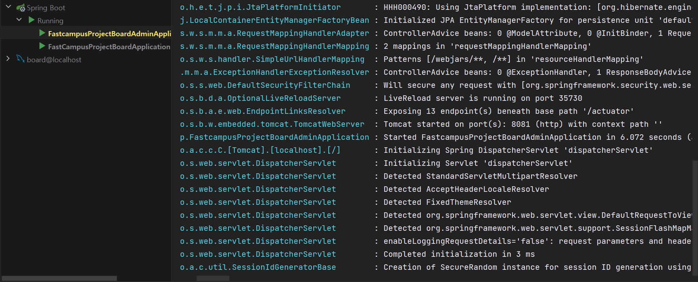

#### Config 설정

현재 Security가 적용되고 있고, Thymeleaf.decoupled.logic이 적용되고 있는데 게시판 서비스에서 사용했던 코드를 재사용하고 쉽게 설정할 수 있습니다.

**Security 설정**

```java
package com.example.projectboardadmin.config;

@Configuration
public class SecurityConfig {

    @Bean
    public SecurityFilterChain securityFilterChain(HttpSecurity http) throws Exception {

        return http
                .authorizeHttpRequests(auth -> auth
                        .requestMatchers(PathRequest.toStaticResources().atCommonLocations()).permitAll()
                        .anyRequest().permitAll()
                )
                .formLogin(withDefaults())
                .logout(logout -> logout.logoutSuccessUrl("/"))
                .build();
    }

}
```

**Thymeleaf 설정**

```java
package com.example.projectboardadmin.config;

@Configuration
public class ThymeleafConfig {

    @Bean
    public SpringResourceTemplateResolver thymeleafTemplateResolver(
            SpringResourceTemplateResolver defaultTemplateResolver,
            Thymeleaf3Properties thymeleaf3Properties
    ) {
        defaultTemplateResolver.setUseDecoupledLogic(thymeleaf3Properties.isDecoupledLogic());

        return defaultTemplateResolver;
    }


    @RequiredArgsConstructor
    @Getter
    @ConstructorBinding
    @ConfigurationProperties("spring.thymeleaf3")
    public static class Thymeleaf3Properties {
        /**
         * Use Thymeleaf 3 Decoupled Logic
         */
        private final boolean decoupledLogic;
    }

}
```

@**ConfigurationProperties**("spring.thymeleaf3")가 작동할 수 있도록 다음과 같이 SpringApplication에 @**ConfigurationPropertiesScan**을 추가해야 합니다.

```java
@ConfigurationPropertiesScan
@SpringBootApplication
public class FastcampusProjectBoardAdminApplication {

	public static void main(String[] args) {
		SpringApplication.run(FastcampusProjectBoardAdminApplication.class, args);
	}

}
```

추가적으로 이전에 작업한 Decoupled 로직에 대한 Config은 코드를 개선할 수 있습니다.

[Spring Boot 2.6 Release Note](https://github.com/spring-projects/spring-boot/wiki/Spring-Boot-2.6-Release-Notes)를 참고하면 **@ConstructorBinding** 을 조금 더 간편하게 만들 수 있는 방법이 있다.

현재는 생성자 방식을 이용해서 Configuration 프로퍼티를 사용하고 있는 모던한 스타일인데 **Java Record 기능**을 이용해서 동일한 Configuration 프로터를 만들 수 있게 되었다.

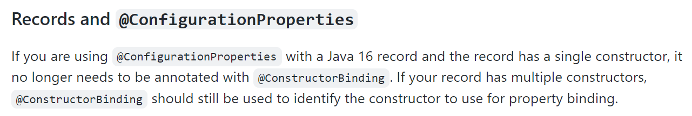

**적용 전**

스켈레톤 코드가 정상적으로 동작함을 확인

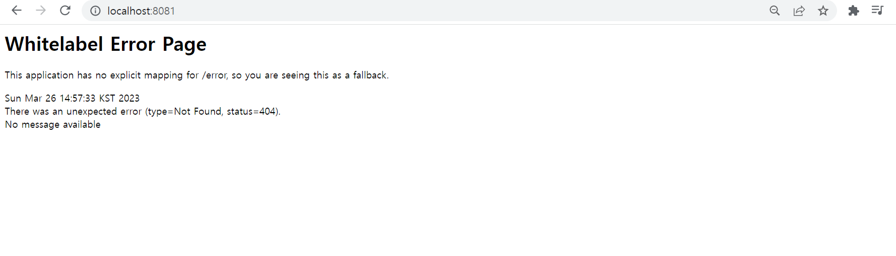

actuator를 통해 decoupled-logic이 정상작동함을 확인할 수 있다.

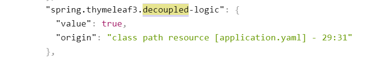

**적용 후**

Thymeleaf Config는 Lombok 설정을 전혀 하지 않은 깔끔한 형태가 되었다.

```java
package com.example.projectboardadmin.config;

import org.springframework.boot.context.properties.ConfigurationProperties;
import org.springframework.context.annotation.Bean;
import org.springframework.context.annotation.Configuration;
import org.thymeleaf.spring5.templateresolver.SpringResourceTemplateResolver;

@Configuration
public class ThymeleafConfig {

    @Bean
    public SpringResourceTemplateResolver thymeleafTemplateResolver(
            SpringResourceTemplateResolver defaultTemplateResolver,
            Thymeleaf3Properties thymeleaf3Properties
    ) {
        defaultTemplateResolver.setUseDecoupledLogic(thymeleaf3Properties.decoupledLogic);

        return defaultTemplateResolver;
    }


    /**
     * Use Thymeleaf 3 Decoupled Logic
     */
    @ConfigurationProperties("spring.thymeleaf3")
    public record Thymeleaf3Properties(boolean decoupledLogic) {}

}
```

변경 후에도 Decoupled-logic이 정상작동함을 확인할 수 있다.

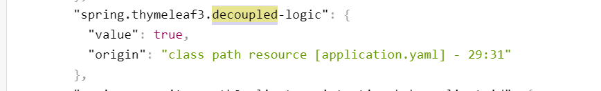

---

### 도메인 설계

---

회원 서비스를 구현해야하는데 이전에 게시판 서비스에서 회원 서비스를 구현한 레거시 코드(참고할 수 있는 코드)가 존재하기 때문에 개발 속도를 향상시킬 수 있다(모듈 프로젝트의 장점). 

참고하고 어드민 서비스에 맞게 변경만 해주면 된다.

이전에 게시판 서비스에서는 권한에 따른 분류가 없었기 때문에 권한 정보를 이용하지 않았다. 

어드민 서비스에서는 권한 분류가 필요하기 때문에 권한 분류를 적용해보려고 한다.

권한 정보를 사용한다는 것은 스프링의 인증 기술을 사용한다는 의미이므로 게시판 서비스에서 사용한 Principal을 사용하여 권한 분류를 적용할 수 있다.

#### **권한 분류**

```java
package com.example.projectboardadmin.domain.constant;

@RequiredArgsConstructor
public enum RoleType {
    USER("ROLE_USER"),
    MANAGER("ROLE_MANAGER"),
    DEVELOPER("ROLE_DEVELOPER"),
    ADMIN("ROLE_ADMIN");

    @Getter private final String roleName;

}
```
