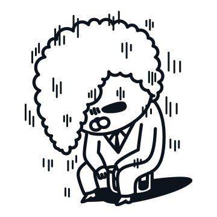

## No  pain, No gain

---

### Look Wide

---

기능을 구현하고 해당 정보를 데이터베이스 저장하면서 많은 생각이 들었다.

A라는 정보는 날짜마다 A를 개별적으로 관리할 수 있고,

A라는 정보는 그룹으로 포함될 수 있다.

그런데 해당 정보는 A라는 정보와 그룹에 A는 개별적으로 판단된다.

해당 정보를 사용할 때 정보를 어떻게 저장해두는 것이 좋을까? 라는 고민을 했었다....

기존의 생성된 테이블 한 곳에 컬럼만 추가하여 저장하여 관리하려고 했었다..

그럴 때마다 구현하는 코드가 너무 복잡해지는 것을 느낄 수 있었다.

A를 개별적으로도 저장하고 그룹으로도 저장하고 사용유무를 관리하는 것이 생각보다 너무 복잡했다...

어떻게 하는 것이 좋을까 라는 생각을 하다가... 

동료가 "굳이 1곳에 관리하는 이유는 뭐에요?"라는 질문을 해주었다.

그러고 보니 굳이 1곳에 관리할 이유도 없었고... 1곳에 관리하면 쿼리까지 복잡해지고 생성과 업데이트 및 관리하는 코드까지도 복잡해질텐데 왜 1곳에서 관리하려고 했을까? 

그룹이라는 정보는 기존의 없던 것이고 사용에 대한 History를 남기기 위한 테이블이면서 데이터가 늘어날 수록 성능에도 큰 영향을 줄 수 있을텐데 왜 1곳에 저장하려고 했었는지가 궁금했었다.

> 구현하기 전 조금 더 생각하고  
>   
> 구현을 시작했다면  
>   
> 시간을 줄일 수 있었을텐데...  
>   
> 이번 기회를 통해 구현하기 전  
> 설계의 중요성을 한 번더 깨달을 수 있었다.  
> 

### If you can't beat them, join them

Vue.js를 하면서 많은 어려움을 만나게 되게 되었다.

분명 필자는 A를 수정하였는데 해당 정보는 B에 영향을 주고 있었다...

모든 코드가 연관되어 있어 수정하는 것보다 어떤 곳에 영향을 주고 있는지를 더 걱정하게 되었다...

걱정을 하다보면 시간을 지체시키고 생각이 또 다른 생각을 만들게 되었다...

기능을 구현하면서 많은 변경점이 발생할 수 있는데 이러한 부분을 쉽게 확인할 수 있는 방법이 필요하다는 생각이 들었다

Spring 을 하다보면 테스트 코드를 통해 기능에 영향을 주었는지 쉽게 확인할 수 있었는데

Vue.js에는 그러한 기능이 없을까 라는 생각이 들었다. 

그러다가 만난 친구들이 두 친구가 있었다. 

1. **Jest**
2. **Mocha**

이 두 친구를 공부해서 현재 발생하고 있는 문제를 해결할 수 있을 것이라는 생각이 들었다....

프론트 코드를 수정하고 버그를 해결하면서 또 다른 버그를 만나고 또 다른 버그가 생기고.... 참 어렵다 어려워...

* **Reference**
  + [Vue.Js를 위한 테스팅 도구 : Jest, Mocha etc](https://www.blog.duomly.com/mocha-vs-jest/)

[Mocha vs Jest Comparison of Testing Tools in 2022

This article will compare two of the most popular options Mocha and Jest.

www.blog.duomly.com](https://www.blog.duomly.com/mocha-vs-jest/)
> 기능을 구현하거나 수정하고  
> 분명 다양한 상황를 가정하고 테스트를 진행하는데..  
>   
> 왜 필자에게는 보이지 않는 버그가 나타날까??  
>   
> 반복된 작업을 하면서 느낀 것은 성공하는 사례로만   
> 접근하는 습관이 생긴게 아닐까 라는생각이 들었다.  
>   
> 이러한 습관이 잘못된 버릇이 될 수 있기 때문에  
> 구현 후 필자의 코드가 아니라는 생각을 갖고  
> 테스트를 하면서 버그를 찾으려고 노력하면  
> 더 좋은 개발자가 되지 않을까라는 생각을 하게 되었다.  
>   
> 배포일에 버그가 생기지 않게 간절하게 지켜보았던 모습이  
> 모든 동료들에게 느껴졌다고 한다....  
>   
> 

### At The Moment of Crisis

많은 버그를 해결하고 추가적인 테스트를 진행하고 나서 Stage에 코드를 반영하고

`추가적인 버그가 생기지 않겠지?` 라는 생각을 갖고 퇴근하였다.

퇴근하면서 추가적인 이슈가 생기지 않아 이번에는 성공했다 라는 생각을 가지면서 출근했다

오전 10시 30분... 쯤

이슈가 슝 슝 슝 슝 슝 슝.... 메시지가 지속적으로 발생하는 경험을 겪었다....

이슈가 몇개였는지 정확이 개수를 파악하지는 않았지만 모든 기능이 동작하지 않는 문제가 발생하였다....

뭐지? 무슨 잘못을 했었나?? 라는 생각을 갖고 로컬에서 테스트를 진행하였다...

이슈에서 발견된 버그들을 로컬에서 작업을 진행해보았다

그런데 모든 이슈의 버그들이 정상적으로 동작함을 확인하였다

#### 데이터베이스 테이블이 반영되지 않았는가?

첫 번째로 확인한 것은 추가된 데이터베이스 테이블이 반영되지 않았는지 확인하였다.

그런데 다른 기능에서는 해당 코드를 사용하지 않았는데 그 기능에서도 동작하지 않았기 때문에 해당 코드 문제가 아니였다.

#### Stage DB로 설정하여 테스트

로컬에서 DB의 설정을 Stage DB로 변경하여 테스트를 진행하였다.

Stage DB로 변경하여 테스트를 진행해보니 이슈로 기록된 버그들이 모두 발견되는 현상을 발견할 수 있었다.

DB에 문제가 있음을 확인한 후 서버의 로그를 천천히 살펴보았다.

그런데 이상하게 테이블의 어떤 필드 값이 존재하지 않는다는 것을 확인할 수 있었다.

뭐지??... 뭐지??.. 그러한 코드를 넣은 적이 없었는데...

백엔드 코드의 커밋 히스토리를 살펴보면서 필자가 바꾼 것이 있는지 확인하였는데 필자가 넣는 코드가 아니였다.

그래서 다른 동료들의 코드를 하나씩 하나씩 살펴보면서 문제의 원인을 발견할 수 있었다....

동료가 기능 구현을 마무리하지 않은 것까지 Push를 했던 문제와 해당 코드로 인해 발생한 추가 컬럼을 Stage에 반영하지 않았기 때문 발생한 문제였다...

> 갑작스럽게 발생한 버그를 해결하기 위해  
>   
> 작성한 내용 외에도 많은 것을 확인하면서  
>   
> 코드를 바로 최신화하는 것도 좋지만  
>   
> 구현할 대상과 연관된 코드에 변경점이 있는지   
> 확인하는 습관을 갖는 것이 좋을 것이라는 생각이 들었다.  
>   
> 연관된 기능이 아니더라도 동일한 엔티티를 사용할 경우에라도  
> 동료들의 코드를 확인하는 습관이 중요할 것 같다.  
>   
> 추가적으로 커밋의 중요성도 깨달을 수 있었다.   
>   
> 이슈의 번호만 작성해서는 해당 기능이 무엇인지 본인이 아니면 파악하기 힘들다.  
>   
> 이슈에 어떠한 작업을 했는지 상세하게 작성하는 습관이 중요한 것 같다.

> #1 - 저녁메뉴는 한식  
>   
> 월요일에 치킨을 먹음.  
> 화요일에 자장면을 먹음  
> 오늘은 한식을 먹는 것이 좋을것으로 판단됨.

### 정리

> 이번 주에도 많은 것을 경험했던 것 같다.  
>   
> A로 인해 B, C, D, E, F 등에게 영향을 줄 수 있기 때문에  
>   
> 수정할 때 신중하게 변경해야하고  
>   
> `다른 사람의 코드이고 버그를 찾아야한다`라는   
> 마인드 컨트롤을 통해 다양한 상황에 대한   
> 접근 능력을 향상시켜야될 것 같다.  
>   
> **No Pain, No Gain**
