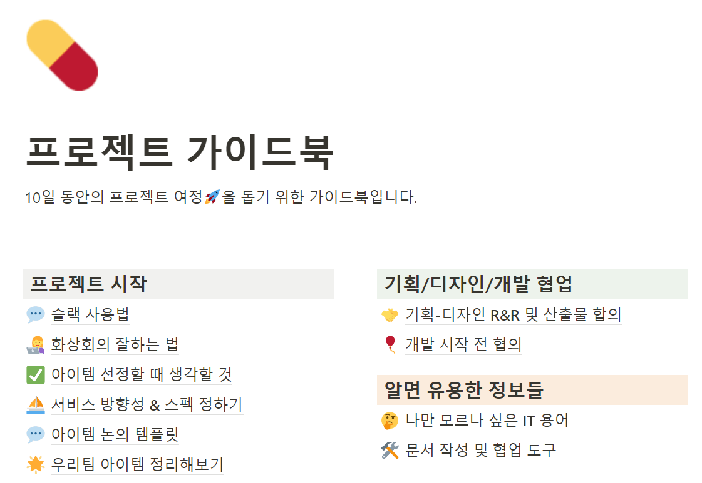

## 포텐데이 Review

---

### 포텐데이란?

---

포텐데이는 `비사이드`에서 진행한 10일동안 진행하는 `사이드 프로젝트`입니다.

기획자, 디자이너, 개발자(FE, BE, App etc)으로 구성된 사람들이 모여 4명이 한팀이 되어 프로젝트를 진행하는 것입니다.

처음 시작할 때 10일이라는 기간동안 무엇을 할 수 있을까라는 생각이 많이 들었다.

다른 사이드 프로젝트를 하다보면 중간에 아이템이 바뀌고 변경되고 하고.. 하다보면 2주 이상을 걸렸던 것을 생각해보면 어떤 결과를 낼 수 있을지 궁금해서 도전해보게 되었다.

### 포텐데이 장점

---

`포텐데이`는 다양한 장점이 있습니다.

#### **🎁 웰컴 키트**

포텐데이 에서는 2 가지의 웰컴 키트를 제공해주고 있습니다.

**비사이드 Github 에 프로젝트 등록**

`비사이드` 그룹에 프로젝트를 등록할 수 있습니다.

다양한 사람들에게 자신의 개발 능력을 뽐낼 수 있고, 다른 기수 사람들에게도 프로젝트를 공유할 수 있다는 장점이 있습니다.

**네이버 클라우드 플랫폼 (100만원 지원)**

네이버 클라우드 플랫폼을 이용하여 서비스를 배포하고 관리할 수 있도록 100만원 상당의 크레딧을 지원해주고 있습니다.

네이버 클라우드 플랫폼에서 지원하는 다양한 기능을 사용해볼 수 있는 절호의 기회!! 가 될 수 있습니다.

네이버 클라우드 플랫폼에서 신규 회원에게 제공하는 **micro** 서버보다 좋은 서버를 구축하여 프로젝트를 진행할 수 있습니다!

#### **가이드북**

다양한 사이드 프로젝트를 하다보면 경험이 부족한 사람들이 한 팀이 될 경우 이러지도 저러지도 못하는 상황이 발생할 수 있습니다...

시간만 흘러가고 아무것도 못하는 시나리오가 발생할 수 있는데 **꼼꼼하게 작성된 가이드북**을 제공해주고 있습니다.

기획 / 디자인/ 개발 협업을 위한 정보뿐만 아니라 평소에 잘몰랐던 협업 도구들과 오픈 Open API 정보를 공유해주고 있습니다. 가이드 라인을 제공해줌으로써 10일 안에 구현이 가능하도록 지원해주고 있었습니다.

#### **포텐데이 체크인**

매일 오후 10시마다 작업한 시간과 작업한 것을 간단하게 요약하여 작성하도록 하고 있습니다.

2일 이상 작성하지 않을 경우... 자진 하차로 판단하신다고 하셔서 매일 열심히 하게 만들어 주는 동기가 됩니다

좋았던 것은 동료에게 감사 & 칭찬을 표현하는 것입니다.

익명으로 전달되기 때문에 누가 누구에게 보냈는지 알수는 없지만

응원 메시지가 전달되면 저녁 늦게 퇴근하더라도 작업을 할 수 있는 힘이 되게 됩니다!

이러한 장점들이 10일안에 끝낼 수 있는 힘이 되는 것 같습니다

### 후기

> 새로운 사람들과 만나 다양한 이야기를 하면서  
> 다양한 것을 경험할 수 있었습니다.  
>   
> 이야기를 듣다보면 각자의 직무마다에 특성을 발견할 수 있었고  
> 서로를 배려해주려고 하는 노력들을 느낄 수 있었습니다.  
>   
> 10일 동안 매일 저녁마다 퇴근하고   
> 서로를 응원하면서 진행하면서 재미있는 경험을 쌓을 수 있었습니다.  
>   
> 다음에도 기회가 있다면 도전해보고 싶네요
