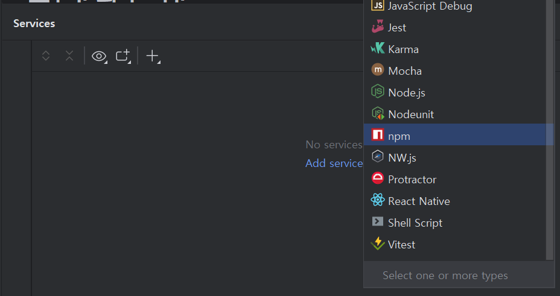
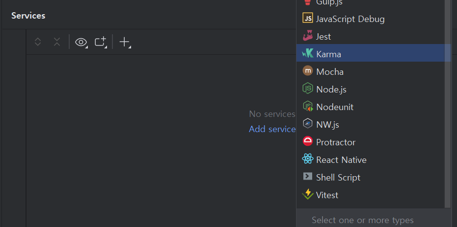
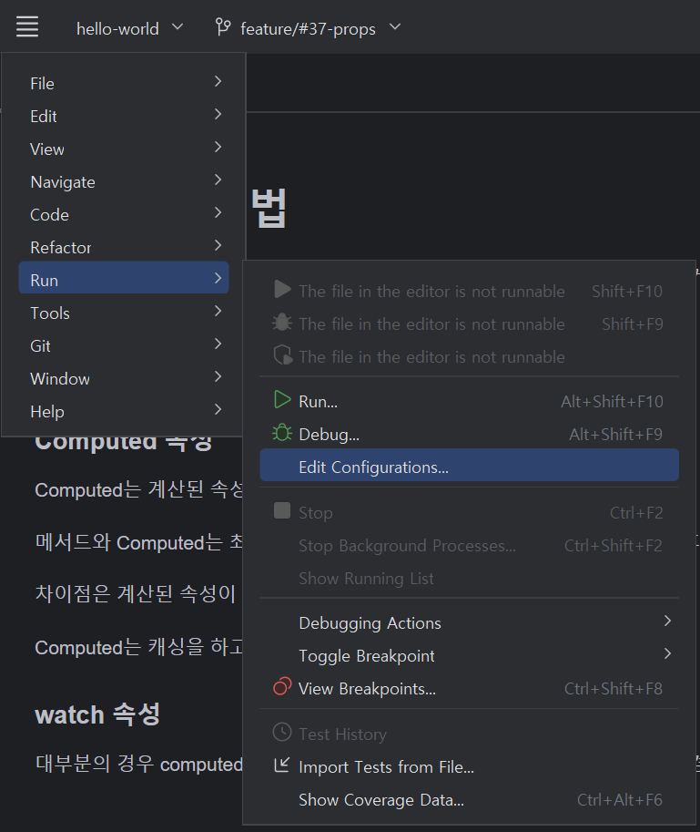
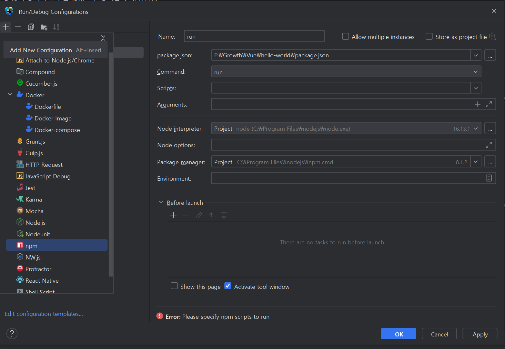
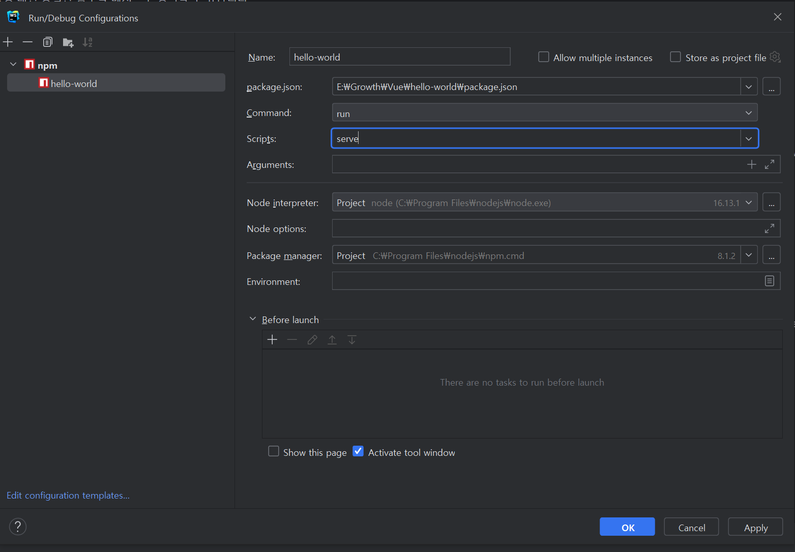
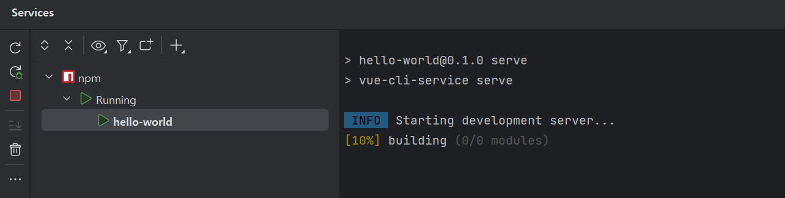
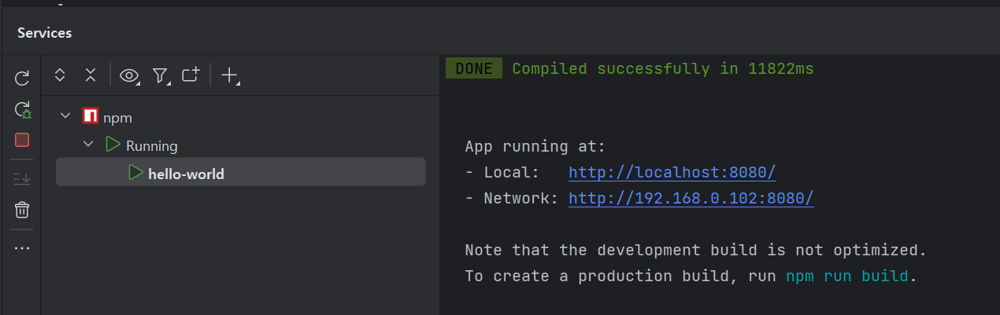

## The die is cast

---

### 🌟 Web Storm Service 탭 활성화

Vue.js를 개발할 때 프로젝트를 여러 개 돌리다보면 멈출때가 있다...   

그럴 때마다 WebStorm을 종료했다가 다시 실행하여 터미널에서 서비스 실행 명령어를 반복해서 작성해주어야 한다...

```shell
npm run serve
```

그때마다 너무 귀찮음을 느꼈다...   

Intellij 는 매번 서비스를 통해 실행해서 편하게 한번에 실행할 수 있는데...   

같은 회사에 서비스인 WebStorm은 그러한 기능이 없을까? 라는 생각을 했다.


서비스 탭을 뒤져보다가 npm 이라는 친구를 발견했다!!



행복해하면서 추가해주었다!! 그런데 뚜둥... 아무것도 뜨지 않는다...



나는 분명 추가해주었는데.. 왜 안뜨지??... 흠... 이녀석이 나를 싫어하나??  

매번 터미널을 통해 관리하는 건 힘들고 불편한데..... 하면서 고민을 하다가 이거저것 다 뒤져보았다  

그러다가 찾은 친구 **Edit Configuration** 이라는 녀석이다.



Intellij에서도 해당 녀석을 통해 서비스에 환경 변수 또는 프로파일 설정 등 다양한 것을 할 수 있었던 녀석이다.

#### Edit Configuration > `+` > npm 추가



#### **설정 정보 입력**

서비스 명(name)과 실행 명령어(Command, Scrpit)을 입력해주면 됩니다.



#### **서비스 탭 실행**

**정상적으로 서비스가 실행됨을 확인할 수 있다.**


> 진작 알았다면... 행복했을 텐데...  
>   
> 참고로 새로운 WebStorm New UI가 엄청 이뻐요~!!  
>
> 
>
> 누군가에 불편함을 해소하기 위해  
> 일하고 있는 우리가 불편하면 안되자나요?  
>   
> 모르셨던 분들은 따라해보세요~!

### Mistake

어떤 기능을 구현하기 위해 임시로 작성했던 코드를 그대로 Merge 해버렸다...  

다양한 기능을 구현하면서 Vue 컴포넌트의 코드 라인 수가 길어서 눈에 잘 띄지 않았고...  

다른 컴포넌트에서 사용되고 있는 유사한 기능을 복사하면서 발생한 일이였다...  

변명일뿐...


그렇게 Merge 하면서 서비스에서 테스트하면서 잘못된 정보가 전달되고 있음을 확인하였다.  

코드 라인 수가 증가하다보니까 주석을 최대한 줄이려고 했었다.  

이로인해 오히려 실수가 더 생기는 것 같다....

> 코드 라인 수는 줄일 수 있지만, 실수는 습관이 된다.  
>   
> 코드 라인 수가 증가하더라도  
> 가독성과 유지보수를 위해 좋은 습관을 갖도록 하자.

### Divide And Conquer

공통된 기능을 가진 코드가 3개 컴포넌트에 동일하게 사용되고 있다.   

매번 오류를 수정할 때마다 3곳에서 다 수정해야하는 문제가 있었다...  

이를 수정하면서 많은 것을 배울 수 있을 것이고 유지보수에 도움이 될 것이라는 생각이들어 먼저 작업하기로 했다.


해당 기능을 모두 구현한 후에 유지 보수를 위해 컴포넌트화 하는 것이 멍청해보일 수 있다.  

Vue.js를 공부하고 있지만 아직 미숙해서 많은 실수를 통해 성장하고 있다. 그렇기 때문에 분리하는 것은 더더욱 시간이 걸리기 때문에 생산성이 떨어질 수 있어 개별적으로 관리했었다.  

현재는 리팩토링을 통해 코드 라인 수를 줄이고 중복된 코드를 제거하면서 성능을 향상시킬 수 있었다.  

그런데 이러한 작업을 하면서 배운 것들이 많았다.

#### [Computed](https://v2.ko.vuejs.org/v2/guide/computed.html) 활성화 조건

자신의 컴포넌트에서 데이터를 변경하면 정상적으로 Computed에서 데이터의 변경을 확인하고 다시 데이터를 연산하여 캐싱하여 새로운 데이터를 저장하여 사용할 수 있게 해주는 유용한 기능이다.  

리팩토링을 진행하면서 재미있는 일을 발견할 수 있었다.  

v-model을 통해 자식 컴포넌트에게 props로 전달하여 데이터를 변경하여 change 이벤트에 emit하여 부모 컴포넌트에 전달해주고 데이터가 변경되었는데 Computed 메소드는 활성화되지 않았다....  

데이터의 변경되는 것을 console.log를 통해 확인도 하였다. 그런데 Computed는 활성화되지 않았다...  

뭐지? 뭐지? 뭐지? 하면서 계속 고민하고 검색하면서 많은 것을 배울 수 있었다. 

> 자식스크립트의 객체와 배열은 참조로 전달되므로 prop가 배열이나 객체인 경우 하위 객체 또는 배열 자체를 부모 상태로 변경하면 부모 상태에 영향을 줍니다.

객체와 배열은 참조로 전달되기 때문에 해당 참조값이 변경되지 않는 이상은 Computed 속성에서 값이 변경되는 것을 인식하지 않는나는 것 같다. 부모 컴포넌트에서 값이 변경될 때는 기존의 Object에 값을 추가하는 형식으로 데이터를 변경시켰기 때문에 참조값은 동일했을 것이다.   


#### Depth의 중요성

위 문제를 해결해보기 위해 다음과 같은 방법을 사용했다.  

**첫번째, 얇은 복사 대신 깊은 복사**  

C 언어에 **Call By Value**, **Call By Reference**와 동일한 것 같다. 값만 복사는 방법과 참조 값까지 복사하는 차이다.

> **얕은 복사(Shallow Copy)**참조 타입 데이터가 저장한 '메모리 주소 값'을 복사하는 것을 의미한다.  
>   
> **깊은 복사(Deep Copy)**새로운 메모리 공간을 확보해 완전히 복사하는 것을 의미한다.

객체에 값이 추가되거나 삭제될 때마다 객체의 얕은 복사를 통해 참조값 자체를 바꿔주어 자식 컴포넌트의 Computed 속성에서 데이터가 계속 변경되었다고 인식하도록 할 수 있었다.  


> JS에 대한 개념이 부족한 상태에서 Vue를 개발하다보니  
>   
> 벽에 계속해서 부딪히는 것 같다...  
>   
> 얼른 JS도 공부해야겠다

### 정리

> 이번 주도 새로운 것을 도전하면서  
>   
> 많은 것을 경험하고 
>   
>   
> 많은 것을 배울 수 있는 시간이었다.
>   
>   
> 도전하지 않고 주저한다면
>   
>   
> 제자리 걸음이 될 뿐이다.
>   
>   
>
> 
