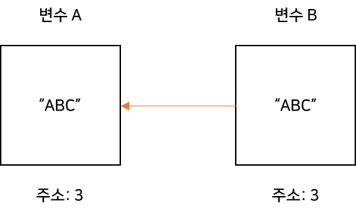

자바스크립트 코드를 작성하면서 **객체의 얕은 복사**와 **깊은 복사**의 차이를 이해하고 구현하는 것의 중요성을 많이 느껴 작성하게 되었다.

## 객체의 얕은 복사 VS 깊은 복사

---

### 얕은 복사(Shallow Copy)

---

> **A shallow copy** of an object is a copy whose properties share the same **references** (point to the same underlying values) as those of the source object from which the copy was made. As a result, when you change either the source or the copy, you may also cause the other object to change too — and so, you may end up unintentionally causing changes to the source or copy that you don't expect. That behavior contrasts with the behavior of **a deep copy** , in which the source and copy are **completely independent.****[출처 -** [**MDN**](https://developer.mozilla.org/en-US/docs/Glossary/Shallow_copy)**]**

MDN에 내용을 요약하면 **얕은 복사**는 **동일한 곳을 바라보는 것**이다.  


**그림을 통한 설명**



**코드를 통한 설명**

**ingredients\_list** 를 만들고 **ingredients\_list\_copy**에 ingredients\_list 를 복사하였습니다.  

**ingredients\_list\_copy** 의 데이터를 변경하면 동일한 데이터를 참조하기 때문에 두 곳에 모두 변경됩니다.

```javascript
let ingredients_list = ["noodles", { list: ["eggs", "flour", "water"] }];

let ingredients_list_copy = Array.from(ingredients_list);
console.log(JSON.stringify(ingredients_list_copy));
// ["noodles",{"list":["eggs","flour","water"]}]


ingredients_list_copy[1].list = ["rice flour", "water"];
console.log(ingredients_list[1].list);
// Array [ "rice flour", "water" ]
console.log(JSON.stringify(ingredients_list));
// ["noodles",{"list":["rice flour","water"]}]


ingredients_list_copy[0] = "rice noodles";
console.log(ingredients_list[0]);
// noodles
console.log(JSON.stringify(ingredients_list_copy));
// ["rice noodles",{"list":["rice flour","water"]}]
console.log(JSON.stringify(ingredients_list));
// ["noodles",{"list":["rice flour","water"]}]
```

**장점**

* 같은 객체를 공유하므로 **메모리를 아낄 수  있고 성능적으로 빠르다**는 장점이 존재합니다.

**단점**

* 두개 이상의 객체가 같은 대상을 가리키고 있기 때문에, 의도치 않게 여러 개의 객체가 동시에 수정될 수 있다는 단점이 있습니다.

### 깊은 복사(Deep Copy)

---

> **A deep copy** of an object is a copy whose properties do not share the same references (point to the same underlying values) as those of the source object from which the copy was made. As a result, when you change either the source or the copy, you can be assured you're not causing the other object to change too; that is, you won't unintentionally be causing changes to the source or copy that you don't expect. That behavior contrasts with the behavior of a   
> shallow copy , in which changes to either the source or the copy may also cause the other object to change too (because the two objects share the same references).  
>   
> In JavaScript, standard built-in object-copy operations (spread syntax, Array.prototype.concat() , Array.prototype.slice(), Array.from(), Object.assign(), and Object.create()) do not create deep copies (instead, they create shallow copies).  
>   
> [출처 - [MDN](https://developer.mozilla.org/en-US/docs/Glossary/Deep_copy)]

요약하면 Deep Copy는 Shallow Copy와는 반대로 값만 복사하는 것이다.  

깊은 복사를 하는 방법은 여러 가지가 있다.

#### Spread 연산자를 이용한 방법

```javascript
const obj1 = { a:1, b:2 };
const obj2 = { ...obj };

obj2.a = 100;

console.log( obj1 === obj2 ) // false
console.log( obj1.a ) // 1
```

Spread 연산자를 통해 **Deep copy**를 할 수 있습니다.(단, Depth 1까지만 가능)  


### [Object.assign()](https://developer.mozilla.org/ko/docs/Web/JavaScript/Reference/Global_Objects/Object/assign) 메소드를 이용한 방법

```javascript
const obj1 = { a:1, b:2 };
const obj2 = Object.assign({}, obj1);

obj2.a = 100;

console.log( obj1 === obj2 ) // false
console.log( obj1.a ) // 1
```

Object.assign 메소드도 동일하게 **Deep copy**를 할 수 있습니다.(단, Depth 1까지만 가능)

> 추가적으로 Object.assign 메소드는 목표 객체의 속성 중 출처 객체와 동일한 [키](https://developer.mozilla.org/ko/docs/Web/JavaScript/Reference/Global_Objects/Object/keys)를 갖는 속성의 경우, 그 속성 값은 출처 객체의 속성 값으로 덮어씁니다. 출처 객체들의 속성 중에서도 키가 겹칠 경우 뒤쪽 객체의 속성 값이 앞쪽 객체의 속성 값보다 우선합니다.  
>   
> Object.assign() 메서드는 출처 객체의 '열거 가능한 자체 속성'만 목표 객체로 복사합니다. 출처 객체에서 속성 값을 가져올 땐 [[Get]], 목표 객체에 속성 값을 지정할 땐 [[Set]]을 사용하므로 각각 접근자와 설정자를 호출합니다.  
>   
> 그러므로 Object.assign()은 속성을 단순히 복사하거나 새로 정의하는 것이 아니라, 할당(assign)하는 것입니다. 따라서 출처 객체가 접근자를 포함하는 경우, 프로토타입에 새로운 속성을 추가하는 용도로는 적합하지 않을 수도 있습니다.  
>   
> [출처 - [MDN](https://developer.mozilla.org/ko/docs/Web/JavaScript/Reference/Global_Objects/Object/assign)]

#### 주의, 깊은 복사의 함정

**MDN의 전개구문**

> 참고: Spread 문법은 배열을 복사할 때 1 레벨 깊이에서 효과적으로 동작합니다. 그러므로, 다음 예제와 같이 다차원 배열을 복사하는것에는 적합하지 않을 수 있습니다. (Object.assign() 과 전개 구문이 동일합니다)

결론적으로는 Object.assign()과 Spread 문법은 Deep copy가 되지 않습니다.   

사실 **Spread** 연산자를 이용하여 Depth  2까지 복사는 가능은 합니다...

```javascript
const obj1 = { a: { b:1, c:1 }, d: 2};
const obj2 = { ...obj1, a:{ ...obj1.a } };

obj1.a.b = 100;

console.log(obj1 === obj2) // false
console.log(obj2.a.b) // 1
```

### **완벽한 Deep copy를 위한 방법**

---

#### **재귀적으로 깊은 복사를 수행**

재귀로 내부가 객체라면 내용을 반복해서 복사하는 방법

```javascript
var copyObjectDeep = function (target){
  var result = {};
  if(typeof target === 'object' && target !== null){
  	for( var prop in target){
    	result[prop] = copyObjectDeep(target[prop]);
  	}
  }
  else{
  	result = target
  }
  return result;
};
```

#### **Lodash의 cloneDeep 함수 사용**

```javascript
const obj = { a: 1, b: { c: 2 }};

const copiedObj = _.cloneDeep(obj);

copiedObj.b.c = 3

obj.b.c === copiedObj.b.c //false
```

#### **JSON.parse() 와 JSON.stringfy() 함수 이용한 방법**

* **원리 :**객체를 JSON문법으로 표현된 문자열로 전환 → JSON 객체로 전환
* 활용하기 좋은 경우
  + ex. httpRequest로 받은 데이터를 저장한 객체를 복사할 때
  + 순수한 정보만 다룰 때
* 단점
  + 무시하는 경우
    - 메서드(함수)
    - 숨겨진 프로퍼티 (\_\_proto\_\_)
    - JSON으로 변경 불가한 프로퍼티들 (getter/setter)
  + 아주 느리다고 알려짐 (다른 방법에 비해)

```javascript
var copyObjectViaJson = function (target){
  return JSON.parse(JSON.stringify(target));
}
```

#### **hasOwnProperty**

> **프로토타입 체이닝을 통해 상속된 프로퍼티 복사 x**

* **ES5의 getter/setter 복사 방법**
* **ES6의 Object.getOwnPropertyDescriptor 또는 ES2017의 Object.getOwnPropertyDescriptors외 마땅한 방법 無**


### 참고

* [MDN](https://developer.mozilla.org/en-US/docs/Glossary/Deep_copy)
* [[Javascript] 얕은 복사, 깊은 복사](https://velog.io/@th0566/Javascript-%EC%96%95%EC%9D%80-%EB%B3%B5%EC%82%AC-%EA%B9%8A%EC%9D%80-%EB%B3%B5%EC%82%AC#%EC%9B%90%EC%8B%9C%EA%B0%92)
