**오늘은 6일차 (빠밤!!)** **Java를 식사하러 왔다**

**Java 문법을 공부한 것은 오래되었다...**

**면접 때 백엔드 질문을 위해서 암기를 했었지만..**

**그것도 몇시간 이내에 사라지는 경우가 많았기 때문에**

**익숙하지만 기억이 가물가물한 맛이다..**

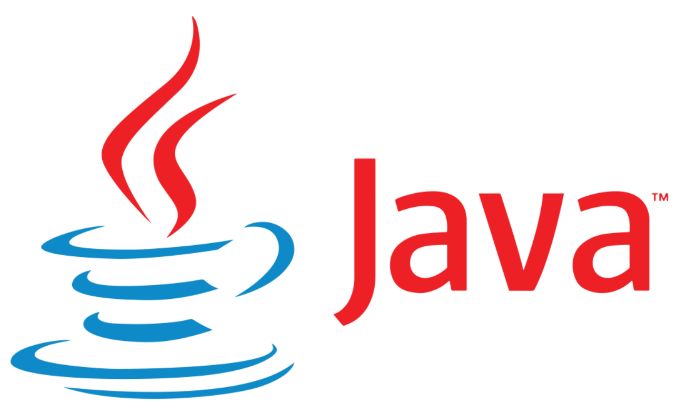

**오늘의 식사 메뉴 : Java**

**놀라운 것은... 자바 메뉴는 603명이 대기하고 있다...****진짜 맛집은 맛집인 것 같다!!****웹개발 종합반은 167명이였는데??? 자바는 603명.. 대박!!****맛집 탐방러인 나는 오늘 밥집으로 이 곳을 선택했다.**

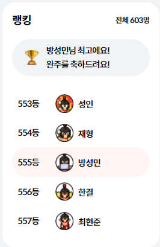

자바 메뉴 대기 줄

---

#### **과목 : Java 문법 뽀개기 1주차**

**[ 수업 목표 ]**

  **1. 자바 기초 문법에 익숙해집니다.**

**2. 퀴즈를 통해 배운 것들을 빠르게 복습합니다.**

**3. 프로그래밍에 대한 두려움을 없앱니다.**

**[ 목차 ]**

   **1-1. 자바 문법 뽀개기 - Intro**

**1-2. Java 시작하기**

**1-3. 변수와 상수**

**1-4. 자료형 - 기본 자료형**

**1-5. 자료형 - 참조 자료형, 배열, 코딩 실력 향상 꿀팁**

**1-6. 자료형 퀴즈**

**1-7. 연산자**

**1-8. 조건문**

**1-9. 조건문 퀴즈**

**1-10. 반복문**

**1-11. 반복문 퀴즈**

**1-12. 객체지향 언어(1) - 클래스, 인스턴스, 메소드**

**1-13. 객체지향 언어(2) - 생성자**

**1-14. 객체지향 언어(3) - 상속**

**1-15. 객체지향 언어(4) - 접근제어자**

**1-16. 객체지향 언어(5) - 추상클래스, 인터페이스**

**1-17. 객체지향 퀴즈**

**1-18. 예외, 에러 처리**

**1-19. 예외, 에러 처리 퀴즈**

---

#### **01. 자바 문법 뽀개기 - Intro**

**1) 수업의 목적**

      - 본 강의의 목적은 Java 문법을 보다 체계적으로 이해할 수 있도록, 빠르게 이론을 습득하고 퀴즈로 숙달하게 만드는데

      있습니다. 또, 향후 마주칠 난이도 있는 문법들을 눈으로, 손으로 먼저 경해보겠습니다. 🔥

      • 시중에 있는 서적과 같이 방대한 분량을 다루기 보다는, 쉽고 바로바로 쓸수 있는 지금 필요한 문법들 위주로 배우는데

        집중을 하고 있다. 이론적인 설명을 장황하고 길게 하기 보다는 바로 코드를 치면서 코드의 결과를 눈으로 확인해서

        몸으로 문법을 익히는데 주안점을 두고 있습니다.

     **→ 눈으로 맛보고, 손으로 맛본다! 중요한 것은 퀴즈를 풀면서 직접 생각하는 것이다!**

     **→ 맛만 본다고 생각할수도 있겠지만, 실무에서 쓰이는 패턴들 위주로 수업 내용이 구성 될 것이다.**

**2) 자바문법 뽀개기 수업마의 특징**

      1. IDE를 잘 사용하는 방법

      - IDE를 어떻게 하면 잘 사용하는지와 코드를 빠르고 더 예쁘고 더 쉽게 짤 수 있는 방법을 알려주신다.

      2. 문법을 위한 문법을 배우지 않습니다. 

      - 문법을 배우면서도 최대한 실무에서 활용하는 코드들로 구성된 예제들이기 때문에 시중에 있는 대중 서적들과는

        조금 다른 예제, 다른 코드를 볼 수 있다. 

**3) Java 언어의 특징**

      1. Write Once, Run Anywhere

      - 자바로 개발된 프로그램은 자바 실행 환경 JRE가 설치된 모든 환경에서 실행이 가능다는 것

      2. 안전성

      - 1995년 탄생한 이후 꾸준히 축적된 노하우로 안전성이 좋아 꾸준히 기업용 소프트웨어에서 기본 언어 및 환경으로 채택되고 있다.

      3. 오픈소스 라이브러리

      - 오랜기간 개발된 오픈소스 라이브러리가 많아 개발 시간을 단축할 수 있으며 안정적으로 프로그램을 만들 수 있다.

**4). Java를 사용하는 곳**

      1. 백엔드 서버 개발

      2. 데이터 엔지니어링

      3. 하드웨어 실행환경에 구애받고 싶지 않은 모든 곳

**5) Java의 한계**

      - 정해진 Java의 문법 때문에, 더 유연하고 견고한 코드를 만들기 어렵다

      → 전세계의 많은 개발자들이 자바를 대체하는 새로운 언어를 사용하는 이유이다. Ex) Kotlin, GoLang 등

**6) 그럼에도 불구하고**

      1. 레퍼런스가 많아 배우기 가장 쉬운 객체지향 언어이다.

      2. 언어가 다르더라도 실행환경은 자바의 구동환경인 JVM에서 동작하는 언어들이 많다. 대표적으로 Scala, Kotlin

      3. 안전성이 중요한 기업용 소프트웨어, 대용량 데이터를 다루기 위한 도구들은 대부분 JVM, Java기반으로 만들어졌다.

      4. 안전성이 중요한 기업용 소프트웨어는 Java, JVM을 기반으로 하는 것이 많기 때문에 취업시장에서도 수요가 많다.

---

#### **02. Java 시작하기**

**1) 기본 프로그램 세팅하기**

      1. Java 

      : 본 수업은 Java 8(LTS)을 사용하여 수업을 진행하였다.

      (속닥속닥... Java 11버전 이상을 사용해왔는데, Java8은 몇번 사용해본 경험이 없다.)

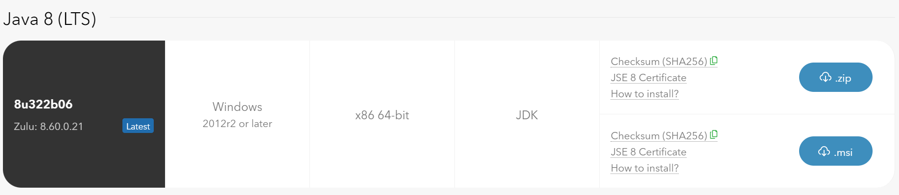

2-1. Java 설치 화면

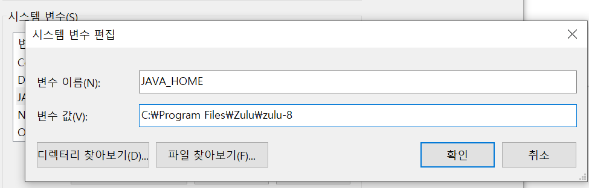

2-2. Java 환경 변수 설정(1)

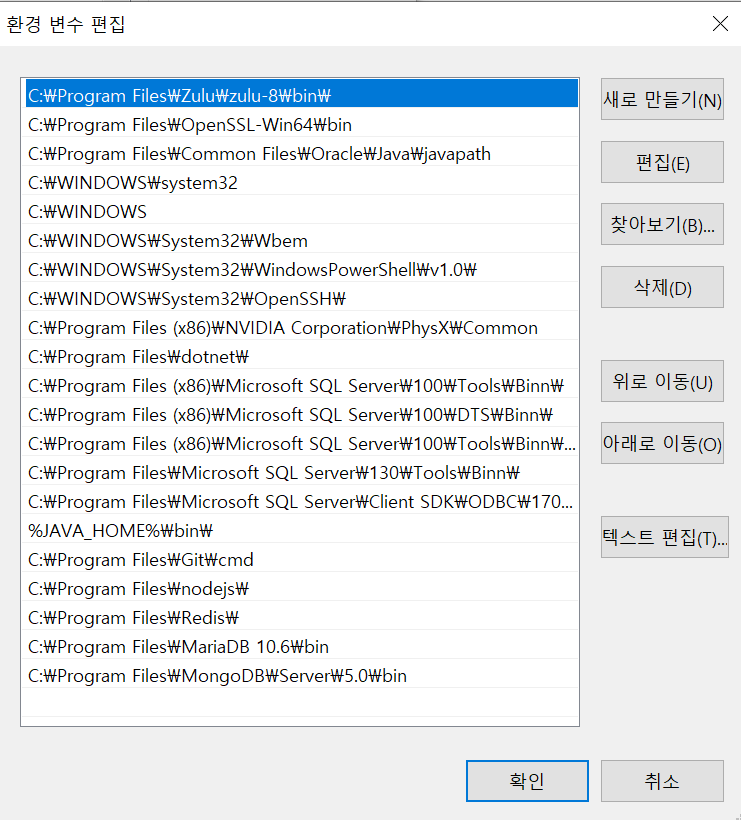

2-3. Java 환경 변수 설정(2)

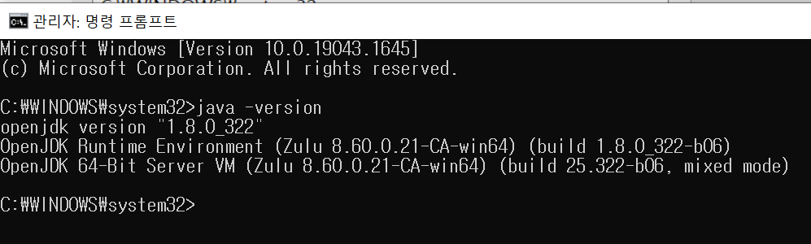

2-4. Java 환경변수 세팅 확인

      2. Intellij IDEA Community

      (1) 설치

         (이전에 이미 Ultimate 버전 설치하여 생략)

      (2) 프로젝트 생성

         - Gradle을 선택, Java SDK 버전을 확인하고 원하는 버전을 선택한다. (강의와 동일하게 하기 위해 8버전 선택)

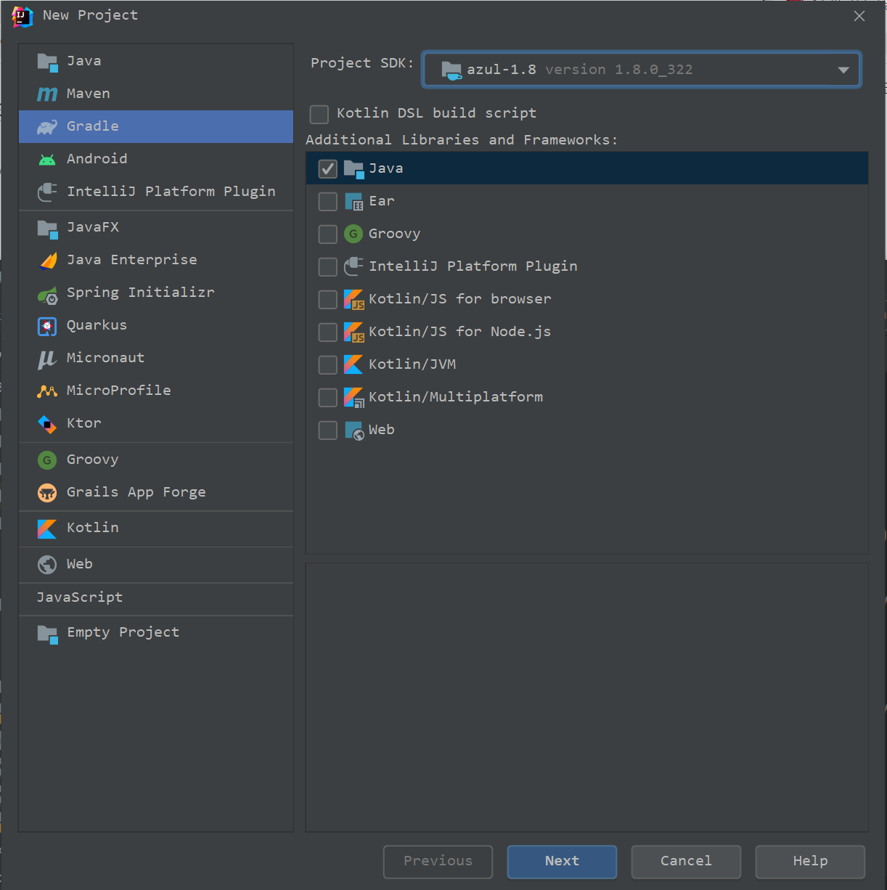

2-5. Intellij 프로젝트 생성(1)

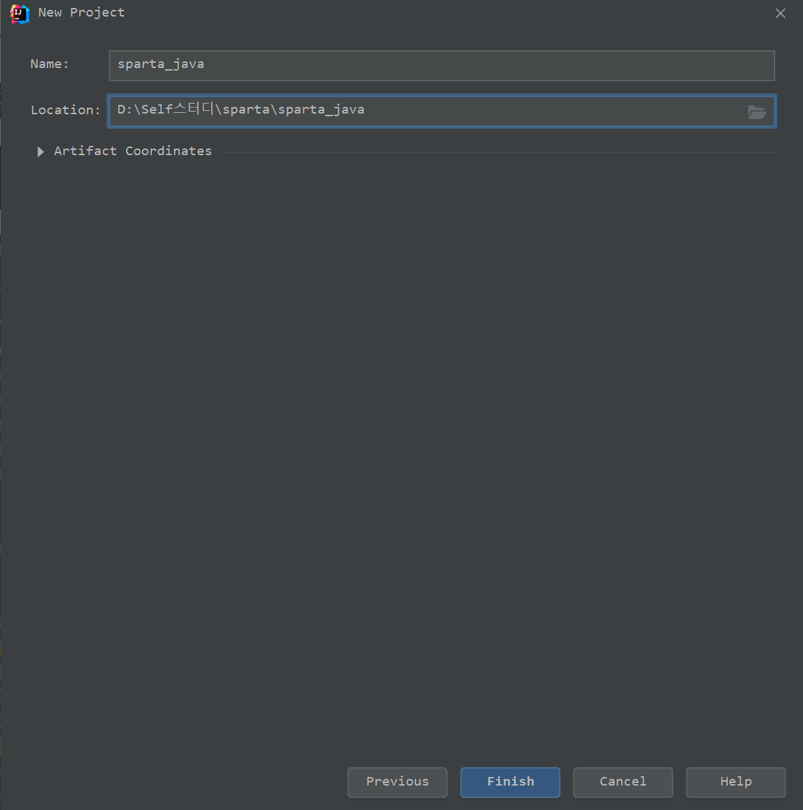

2-6. Intellij 프로젝트 생성(2)

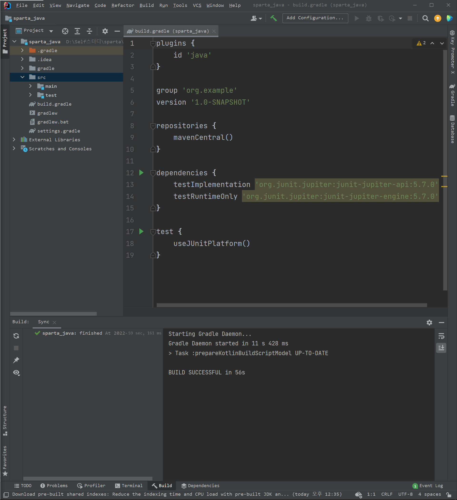

2-7. 프로젝트 기본 세팅 완료

**2) 인텔리제이에서 Java 출력해보기**

      - System 클래스를 이용하여 "Hello World"출력(테스트를 위한 정석)

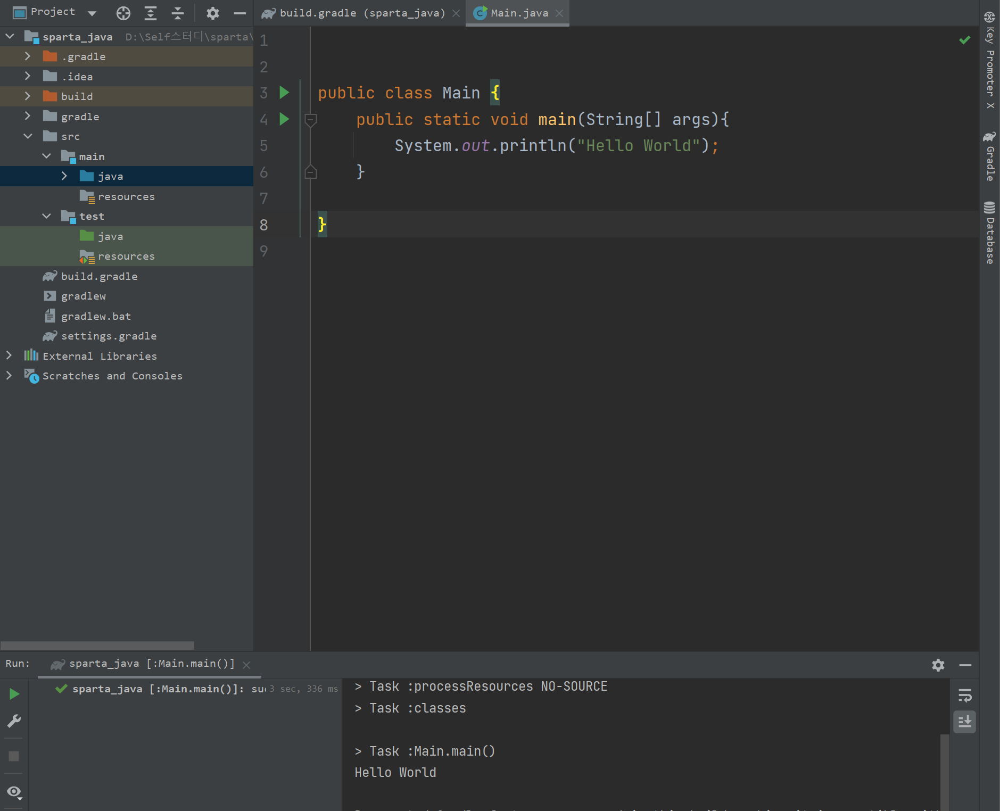

2-8. Java코드 실행

---

#### **03. 변수와 상수**

> 변수와 상수를 선언하는 방법 및 어떤 의미를 가지는지 알아야한다.

**1) 변수와 상수**

      •**변수** : 어떠한 데이터를 저장하기 위한 메모리 공간의이름. 지속적으로 변수의 값을 변경할 수 있다.

          → 컴퓨터 내부적으로는 데이터는 메모리에 저장이 되고, 그 메모리를 가리키는 이름을 지어주는게 변수이다.

      •**상수**  : 중간에 값이 변할 수 없으며 초기값을 끝까지 사용해야 합니다.

       \* final 과 같은 키워드를 접근제어자라고 부르며, 있을 수 있고 생략할 수도 있다.

       \* Java는 **캐멀케이스**라고 해서 낙타의 등 모양을 한다라는 그런 의미로 첫 글자는 무조건 소문자가 오고 그 뒤에

       단어의 의미 미다 첫글자를 대문자로 사용한다.(Java언어의 Convention)

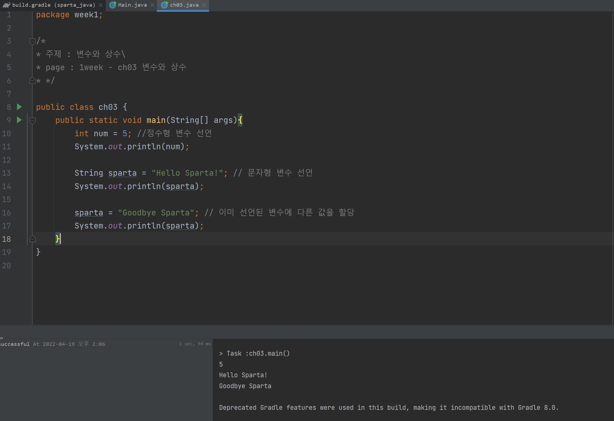

3-1. 변수 값 할당 코드

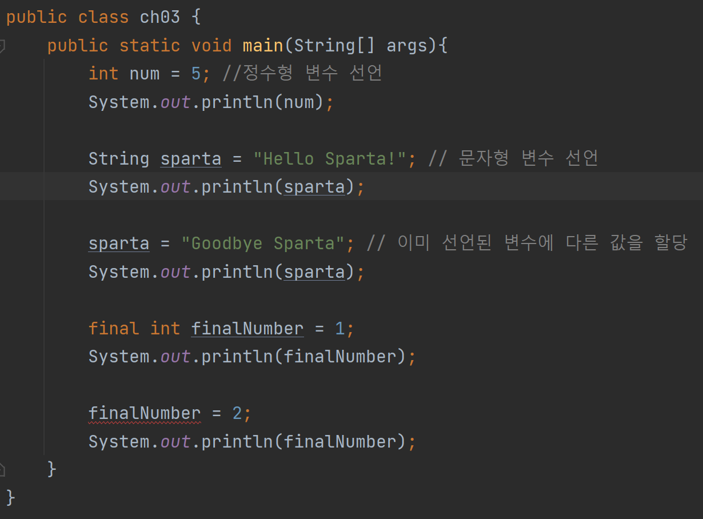

3-2. 상수 값 할당 코드

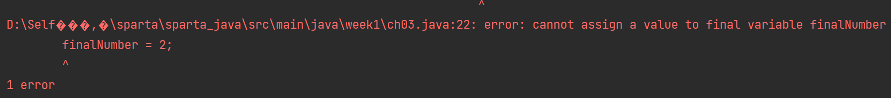

3-3. 상수 값 할당시 발생한 에러 코드

(예시) "사과는 맛있어! 나는 그것에 알레그기가 있어 너는 그것을 좋아하니" 라는 문장에서 사과 사과 사과라고 이야기하지 않고

        그거 이거와 같이 우리가 대명사를 이요해서 표현할 수 있는 것처럼 **변수**는 프로그래밍 언어에서 **대명사**의 역할을 수행한다.

---

#### **04. 자료형 - 기본 자료형**

> 데이터의 자료형에는 무엇이 있고, 어떠한 의미를 가지고 있는지 알아야한다.

**1) Primary Type(기본 자료형)**

      •**숫자** : 정수형(short, int, long), 실수형(float, double)

          - short(2byte로 표현할 수 있는 정수형) :  구간은 -32,768 ~ 32,767까지 표현 가능

         - int(4byte로 표현할 수 있는 정수형) :  구간은 약 -21억 ~ 21억까지 표현 가능

          - long(8byte로 표현할 수 있는 정수형)

          - float(4byte로 표현할 수 있는 실수형) : flaot 실수형을 표현할 때는 뒤에 f를 붙여줘야 하고, 유효자릿수는 7자리          - double(8byte로 표현할 수 있는 실수형) : 유효자릿수는 16자리

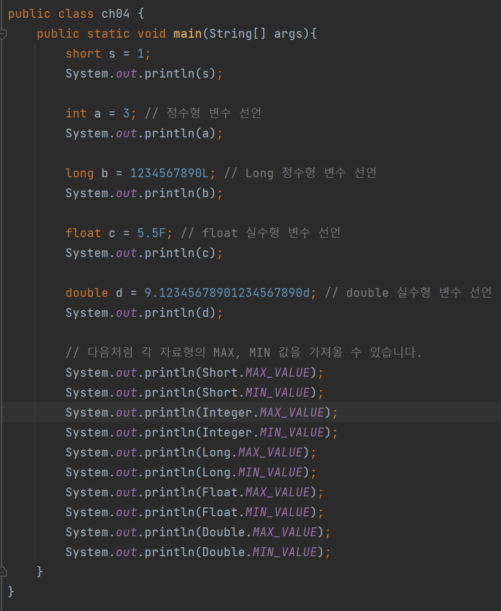

4-1. 기본 자료형 테스트 코드

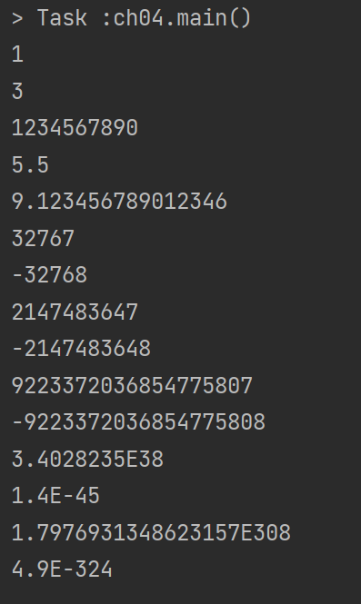

4-2. 기본자료형 테스트 코드 출력

      •**문자** : 문자형(char)

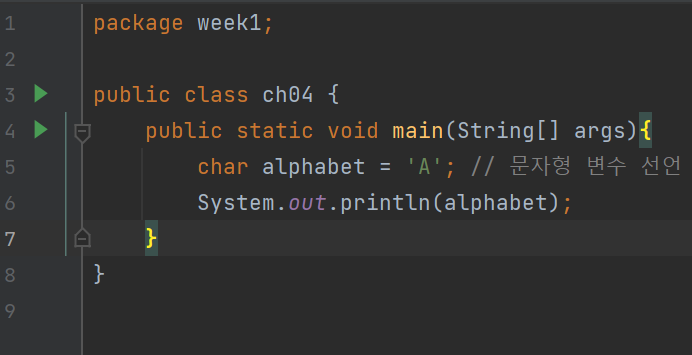

4-3. 문자형 테스트 코드

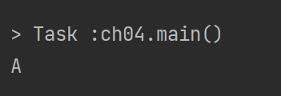

4-4. 문자형 테스트 코드 출력

      • **논리**: 논리형(boolean)

      • **바이트**(byte) : 모든 데이터를 byte로 표현할 수 있고, 문자 같은 경우 아스키코드 값으로 출력한다.

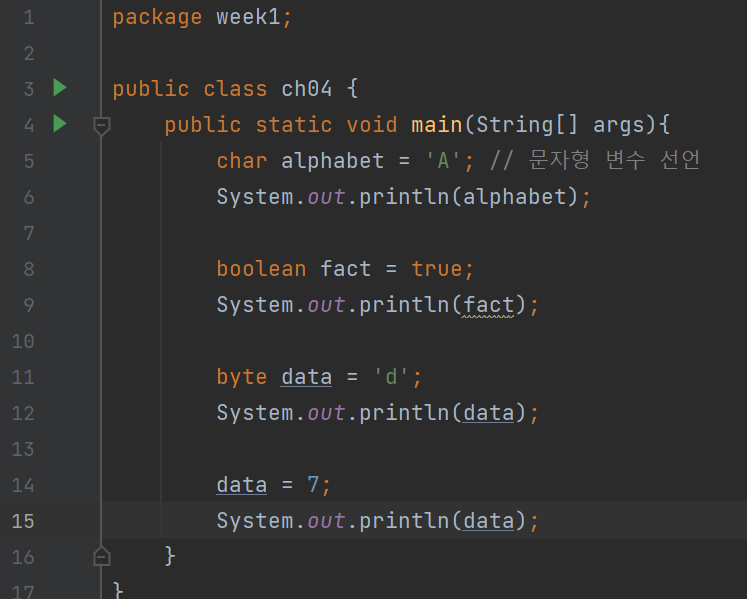

4-5. 논리 및 바이트형 테스트 코드

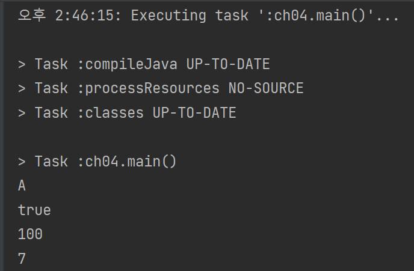

4-6. 논리 및 바이트형 테스트 코드 출력

---

#### **05. 자료형 - 참조 자료형**

**1) Reference Type(참조 자료형)**

      •자바에서 참조 자료형은 기본 자료형이 아닌 모든 것을 참조 자료형이라고 합니다. 더 정확히는 참조자료형이란 자바의

         인스턴스를 가리킬 수 있는 자료형입니다. 

      •자바에서 참조 자료형은 클래스로 정의된 타입을 쓸 때는 다 참조자료형이다. 

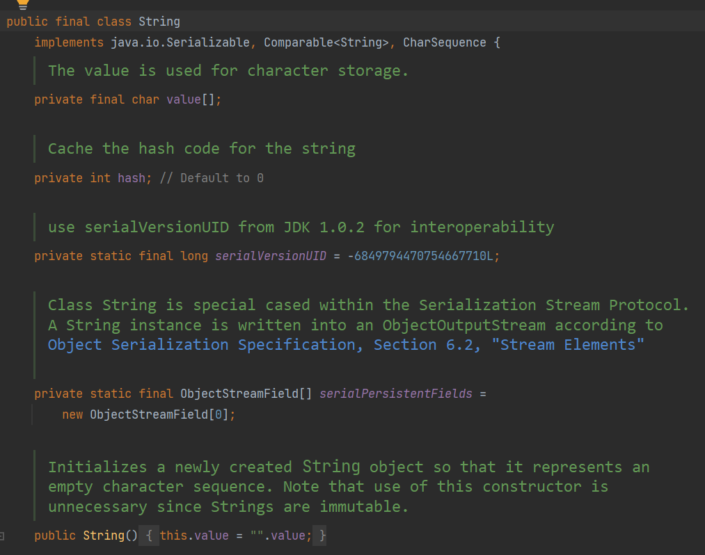

5-1. String 클래스 내부

      •**클래스와 배열**

**- 배열 : 같은 타입의 변수들로 이루어진 유한 집합, 즉 동일한 자료형의 데이터를 연속된 공간에 저장하기 위한 자료 구조**

**- 클래스 : 객체를 정의하는 틀 또는 설계도와 같은 의미로 객체의 상태를 나타내는 필드와 행동을 나타내는 메소드로 구성**

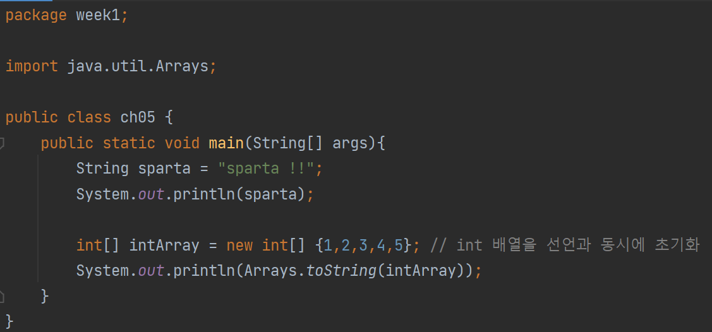

5-2. String과 배열 테스트 코드

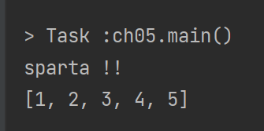

5-3 String과 배열 테스트 코드 출력 화면

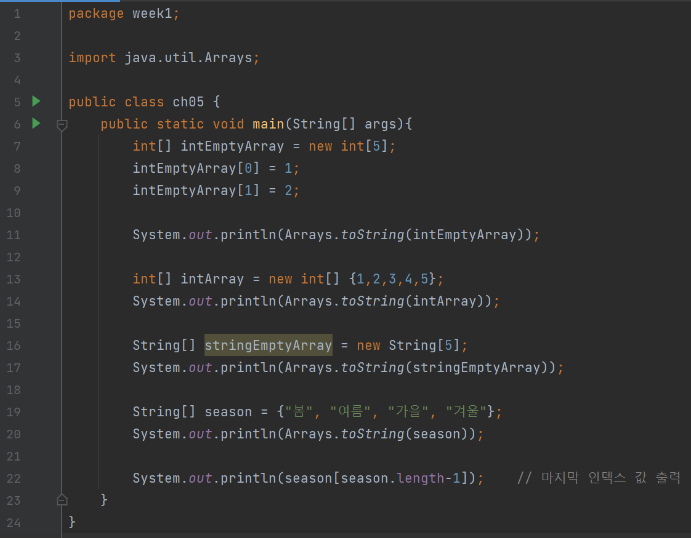

5-4. 배열의 사용 예제 코드

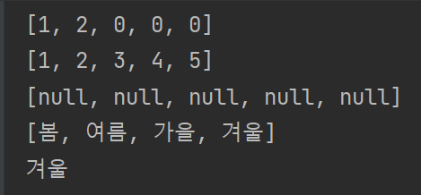

5-5. 배열의 사용 예제 코드 출력

**•정리**

**- 배열을 초기화 하지 않을 경우, 해당 타입의 디폴트값으로 초기화 된다.**

**- 한글 출력을 위해서는 추가적인 작업이 필요하다(현재.. File-encoing과 help-vm option을 했는데 해결되지 않은 상태)**

**- 노란줄로 표시되는 warnings을 처리하면 더 좋은 코드가 될 수 있다(꿀팁)**

---

#### 

#### 

#### **06. 자료형 퀴즈**

**1) 자료형 - 퀴즈 1 :**

**•문제 : **문자 변수 'S', 정수형 변수 10를 선언 및 출력****

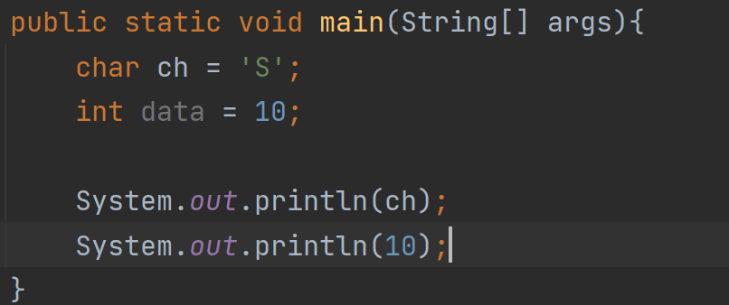

6-1. 퀴즈1 풀이

**2) 자료형 - 퀴즈 2 :**

**•문제 : **크기가 3인 정수형 배열을 선언 및 주어진 숫자 3개****(10,20,30)****를 할당하고, 배열의 마지막 값을 출력****

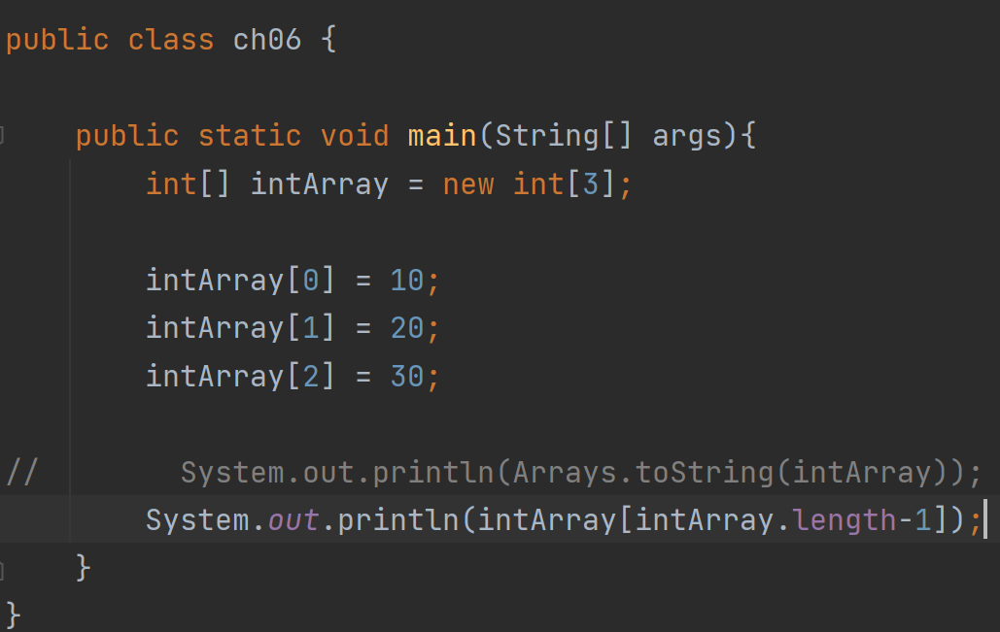

6-2. 퀴즈2 풀이

---

#### **07. 연산자**

> Java에는 다양한 연산자가 있다. 연산자의 종류를 알아보고 하나씩 실습하여 알아두어야 한다.

**1) 연산자란?(다른 프로그래밍 언어와 동일)**

**•연산자는 여러 변수들간의 게산 및 비교를 위하여 사용된다.**

****•연산자는 산술 연산자, 대입연산자, 논리연산자, 관계연산자 등이 있다.****

**2) 산술 연산자**

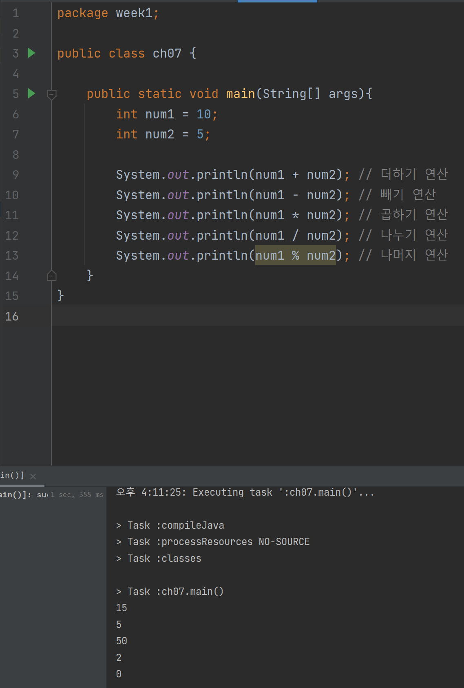

7-1. 산술 연산자 사용 예제

**3) 대입 연산자**

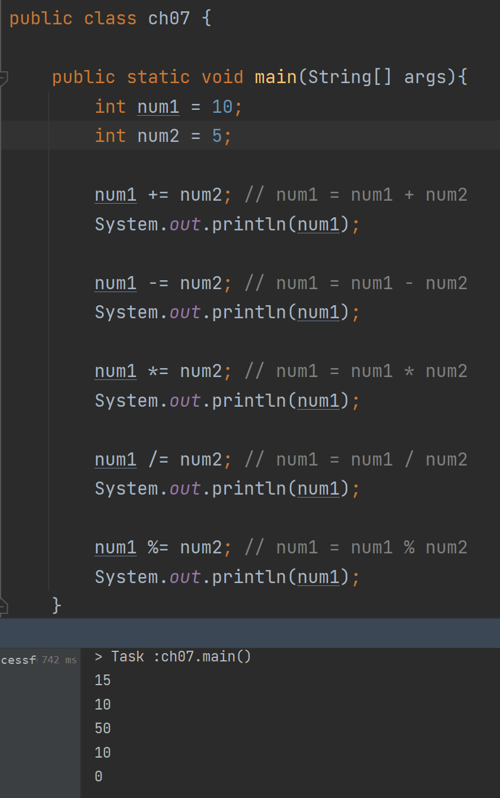

7-2. 대입 연산자 사용 예제

**4) 관계 연산자**

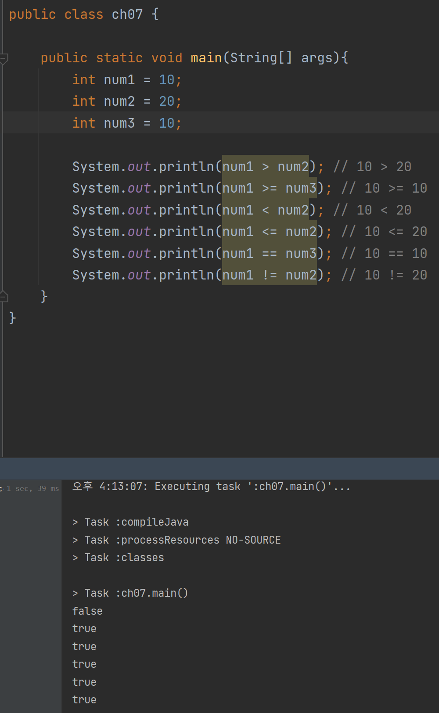

7-3. 관계연산자 사용 예제

**5) 논리 연산자**

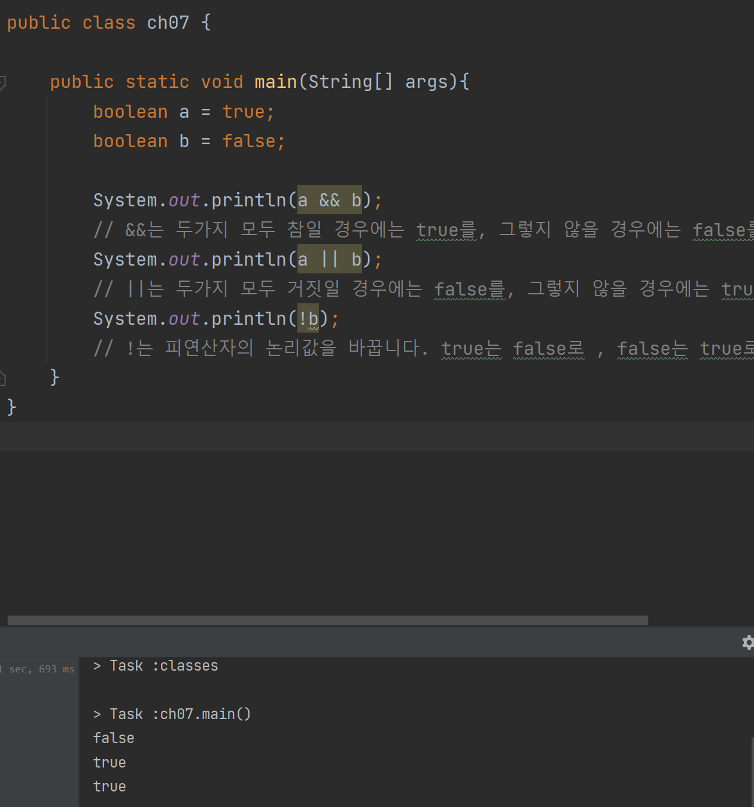

7-4. 논리연산자 사용 예제

**6) 비트 연산자**

      • X << Y : 정수 X의 각 비트를 Y만큼 왼쪽으로 이동시킵니다.(빈자리는 0으로 채워짐)

      • X >> Y : 정수 X의 각 비트를 Y만큼 오른쪽으로 이동시킵니다.(빈자리는 정수 X의 최상위 부호비트와 같은 값으로 채워짐)

      • X >>> Y : 정수 X의 각 비트를 Y만큼 오른쪽으로 이동시킵니다.(빈자리는 0으로 채워짐)

      (예시) 2 << 3 : 0000, 00**1**0 → 000**1**, 0000 (이동되면 빈자리는 0)

      (예시) 16 >> 3 : (0)000**1**, 0000 → (0)0000, 00**1**0 

      (예시) -16 >> 3 : (1)1111, 0000 → (1) 1111, 1110 (맨 왼쪽에는 최상위 부호비트부호와 동일한 값으로 채워진다)

      (예시) -16 >>> 3 : **1**111,1111 1111,1111 1111,1111 1111, 0000 // -16

                               → **000**1,1111 1111,1111 1111,1111 1111,1110 // 536870910 (자바에만 있는 연산이며 빈자리 0)

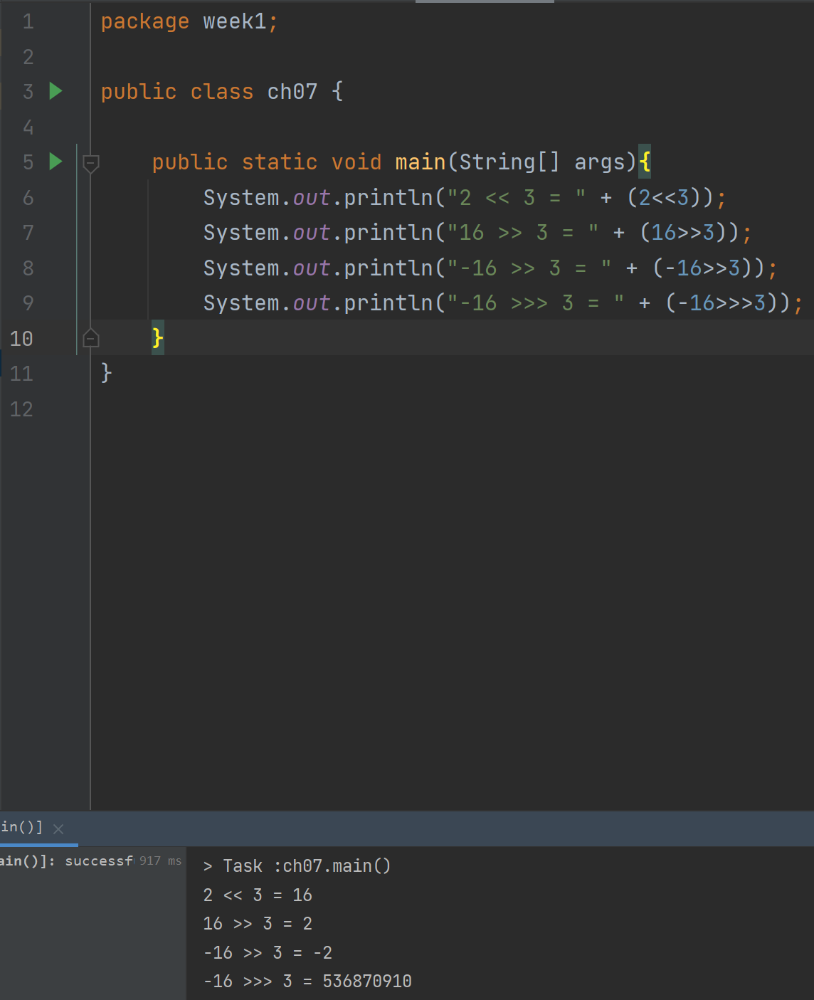

7-5. 비트연산자 사용 예제

**7) 연산자 - 퀴즈 1: 주어진 코드를 보고 출력 결과를 생각해보세요.**

      • num1, num2 출력은 대입연산자를 생각해야 하고, 3번째 결과물은 논리연산자이다.

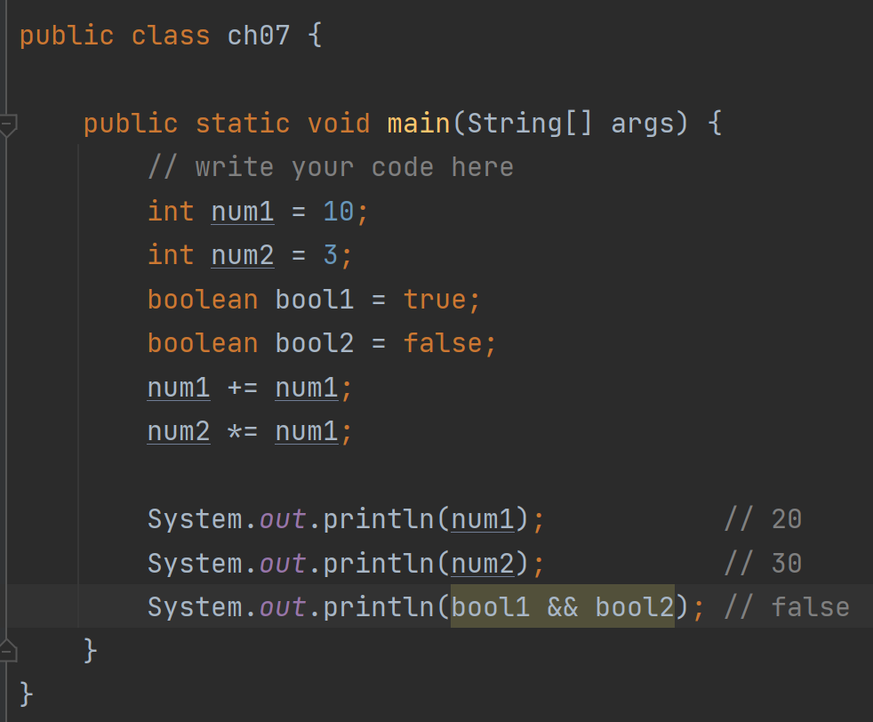

7-6. 퀴즈1 풀이

---

#### **08. 조건문**

> 조건문과 반복문은 정말 유용하게 쓰이는 제어문이다. 충분한 이해와 연습이 필요

**1) 조건문**

**•만약 어떠한 특정 조건에 따라 프로그램이 실행되기를 바라는 경우에 사용된다.**

****•조건문은**** if****,** switch**, 삼항연산자가 있다.****

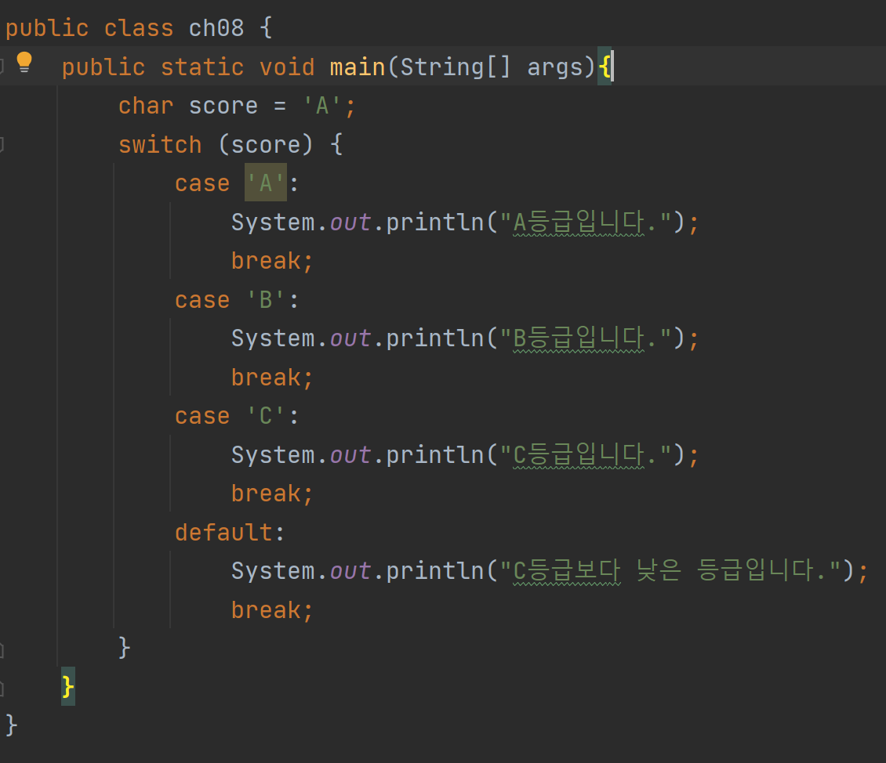

8-1. Switch문 사용 예제

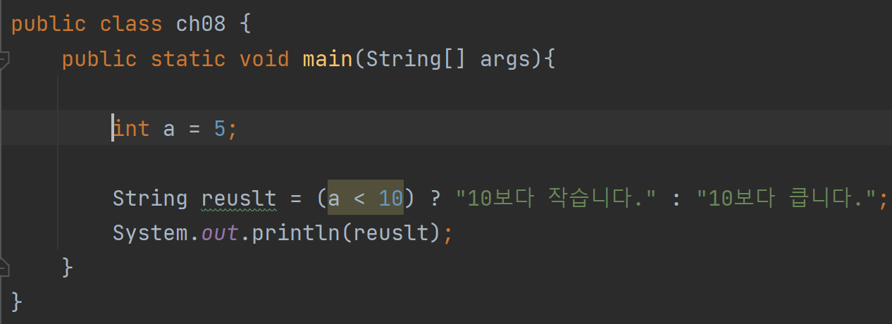

8-2. 삼항연산자 사용 예제

---

#### 

#### 

#### **09. 조건문 퀴즈**

> 퀴즈 풀이는 해설을 참조하지 않기 때문에 결과가 다를 수 있음을 알려드립니다.

**1) 조건문 퀴즈1**

**•입력받은 점수가 무슨 등급이지 출력해보세요.**

**(100~91점 : A등급, 90~81점 : B등급, 80~71점 : C등급, 그 외 점수 : F등급)**

**- 현재 문제를 풀기 전, 입력을 받는 방법을 배우지 않은 상태다. 하지만 추후 배울 예정이므로 변수의 값을 넣어 확인하는 코드보다는**

**값을 입력받는 형태로 풀이를 하였다. Scanner클래스를 이용하는 방법은 성능 상에 문제가 발생할 수 있기 때문에 BufferedReader를**

**선택하여 풀이를 하였습니다.**

**- 입력받은 점수가 90, 80 점수 일때, 상위 등급에 점수를 받을 수 있기 때문에 10으로 나눴을때 나머지가 0인 경우 -1을 하여**

**상위 등급에 점수가 아닌 본인 등급에 맞는 등급을 얻을 수 있게 구현하였습니다.**

**- 입력받은 점수가 100점보다 클 경우, "잘못된 점수입니다"라는 문자를 출력하고 종료하게 설정하였습니다.**

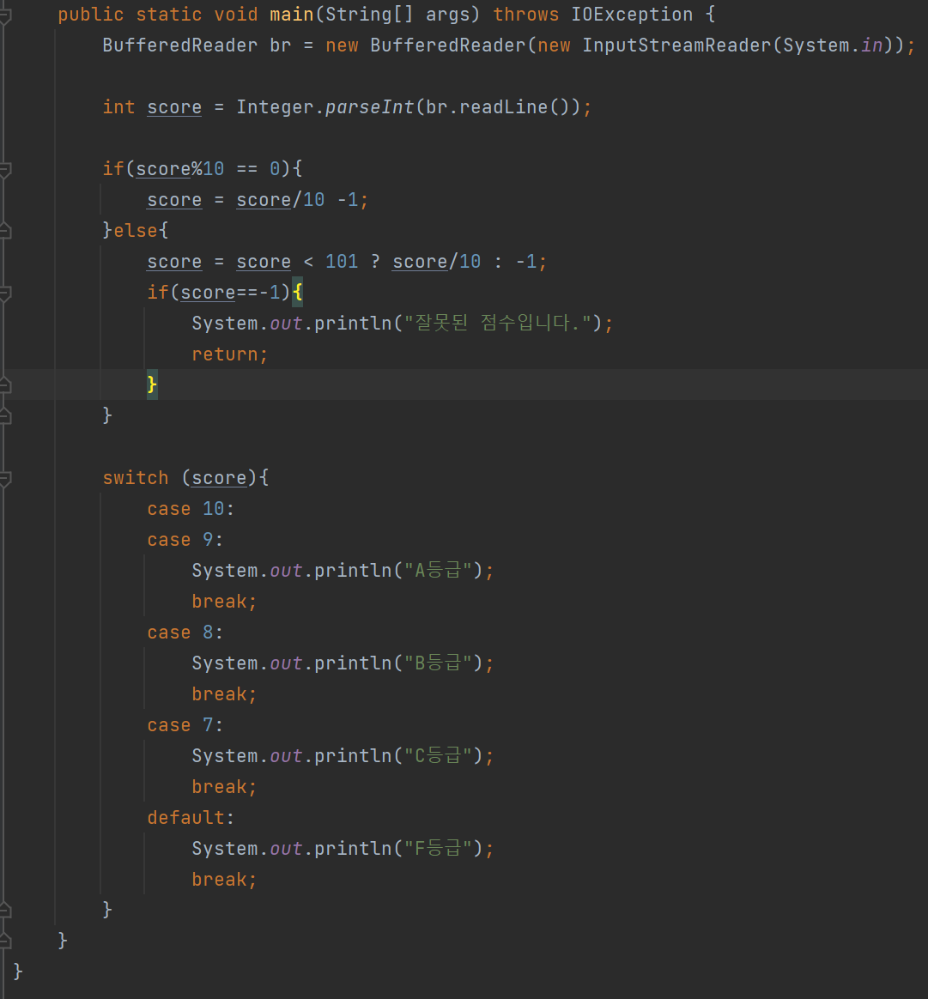

9-1. 퀴즈1 풀이 코드

---

#### **10.  반복문**

**1) 반복문**

**•단순, 반복의 과정이 필요한 경우에 사용됩니다.**

****•반복문은 for문, for-each문, while문, do-while문이 있다.****

**2) for문**

**•**for문은 명시적으로 반복횟수를 지정할때 사용하는 것이 유용하다.****

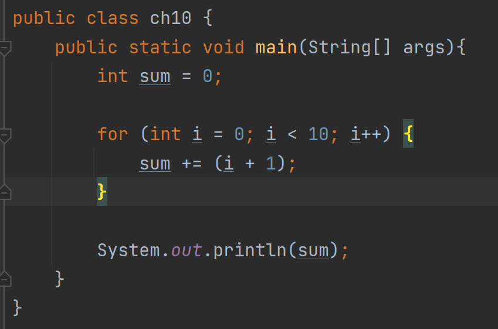

10-1. for문 사용 예제

**2) for-each문**

**•for-each문은 배열, collection 등 어떤 것의 나열들이 있는 변수가 있을 때 사용하는 것이 유용하다.**

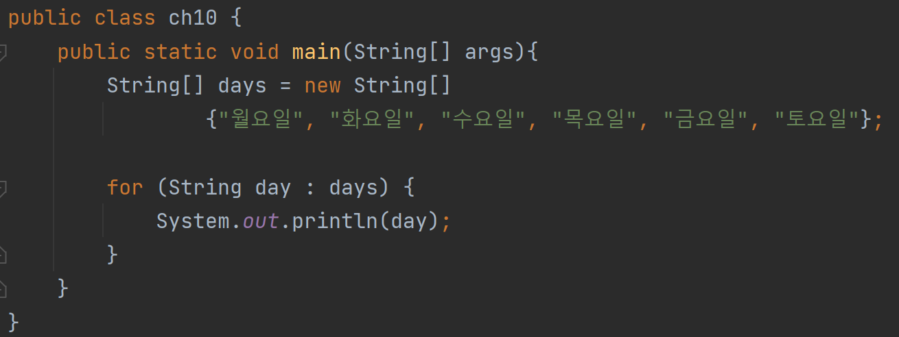

10-2. for-each문 사용 예제

**3) while문**

**•**while문은****무한 루프****를 유의하여야 하고, 반복 횟수를 모를 때 사용하는 것이 유용하다.****

**•while문은 조건에 따라 한번도 실행되지 않을 수 있다.**

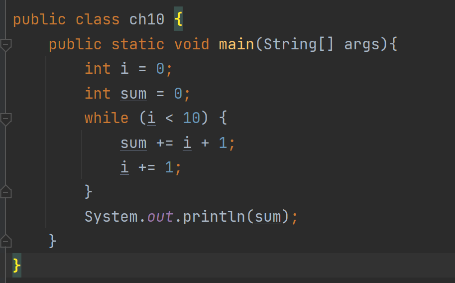

10-3. while문 사용 예제

**4) do-while문**

**•do-**while문은****무한 루프****를 유의하여야 하고, 무조건 코********드 블록을 한번 실행한다는 것이 while문과 다른 점이다.****

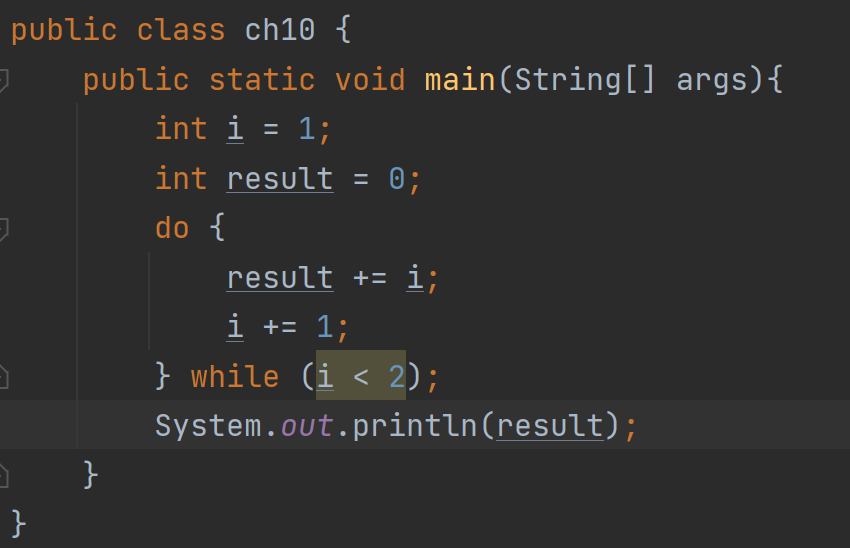

10-4. do-while문 사용 예제

---

#### **11.  반복문 퀴즈**

> 퀴즈 풀이는 해설을 참조하지 않기 때문에 결과가 다를 수 있음을 알려드립니다.

**1) 반복문 퀴즈1**

**•1부터 100까지의 합을 구하는 반복문 코드를 작성하세요.**

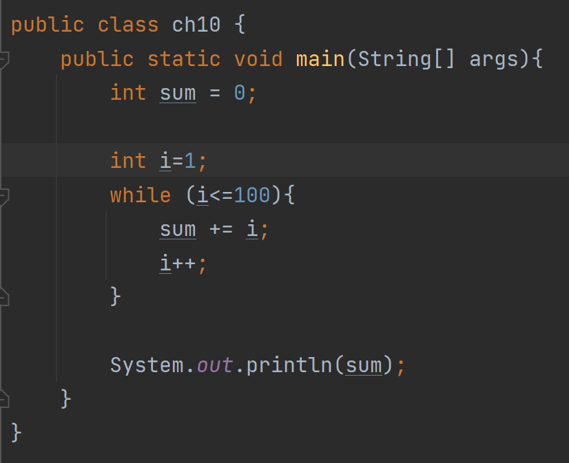

11-1. 반복문 퀴즈1 풀이 코드

**2) 반복문 퀴즈2**

**•5초부터 시작하는 카운트다운을 반복문을 사용하여 만들어보세요.**

       - 실제 1초마다 감소시키기 위해 Thread.sleep()을 사용하여 1초마다 감소하도록 설정하였습니다.

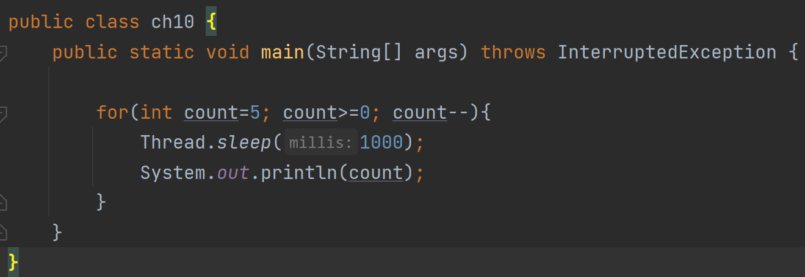

11-2. 반복문 퀴즈2 풀이코드

**3) 반복문 퀴즈3**

**•조건문 & 반복문 퀴즈로 1부터 30까지 홀수의 합과 짝수의 합을 구하고 각각 출력하는 프로그램을 만들어보세요.**

      - 짝수의 합과 홀수의 합을 위한 변수를 따로 만들어 i값이 2로 나누었을 때

        나머지값이 0이면 짝수, 1이면 홀수로 분리하여 합을 계산하였다.

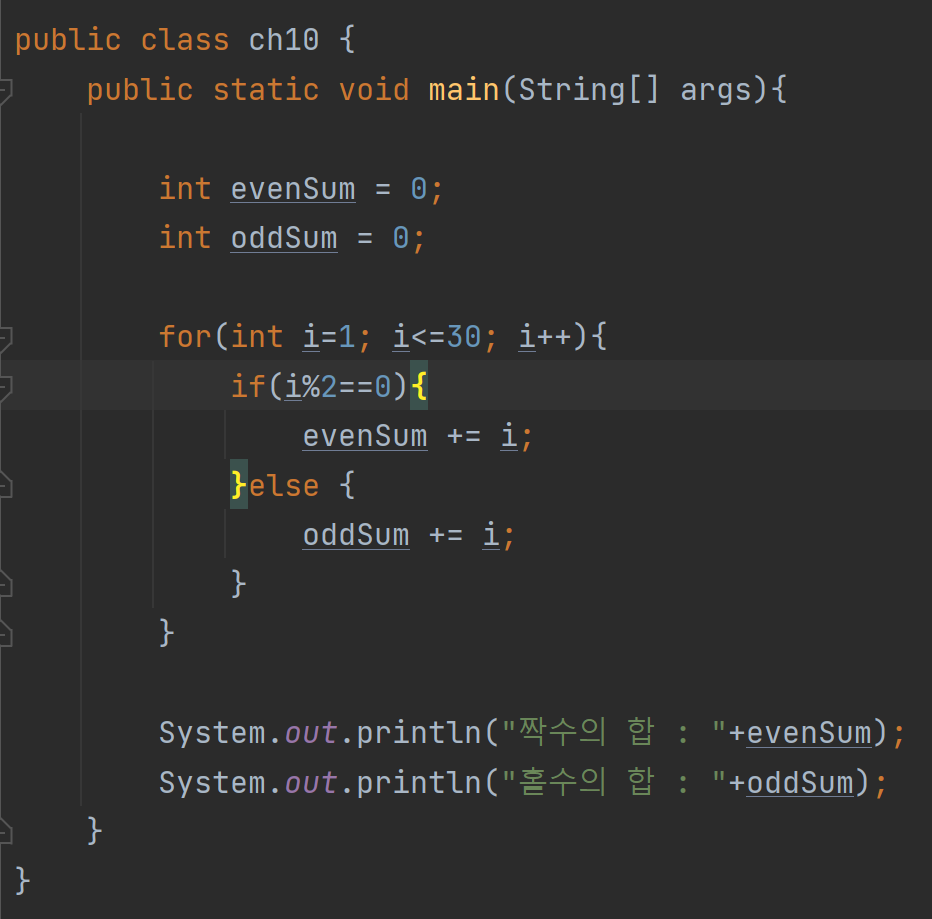

11-3. 반복문 퀴즈3 풀이코드

---

#### **12.  객체지향언어 (1) 클래스, 인스턴스, 메소드**

> Java는 객체지향언어로써 코드간에 관계를 맺어 줌으로써 보다 유기적인 프로그램을 구성할 수 있습니다.

**1) 클래스(Class)**

**•클래스는 표현하고자 하는 대상의 공통 속성을 한 군데에 정의해 놓은 것으로****즉, 클래스는 객체의 속성을 정의해 놓은 것이다.**

       - 클래스 내부의 정보를 멤버라고 한다. 멤버에는 멤버 변수(객체의 상태), 멤버 함수(객체의 행동)가 있다.

**•인스턴스는 어떠한 클래스로부터 만들어진 객체를 그 클래스의 인스턴스라고 한다.**

**즉, 클래스는 객체의 속성을 정의해 놓은 것이다.**

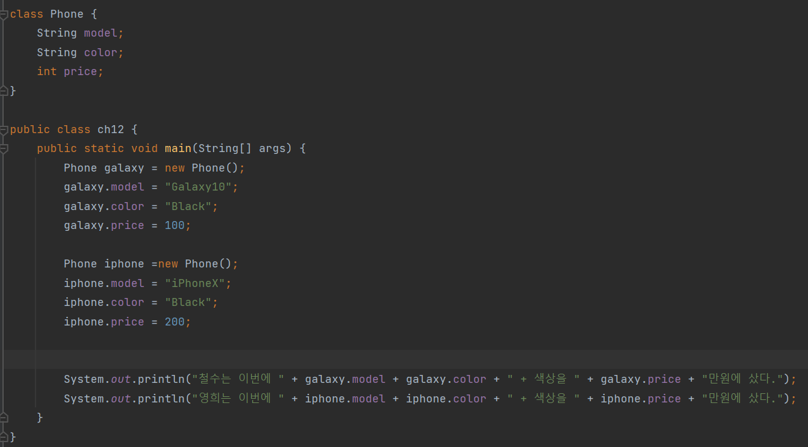

12-1. 클래스, 인스턴스 예제 코드

**2) 메소드(method)**

**•메소드 convention**

         1. 동사로 시작을 해야한다. 

         2. 변수와 동일하게 camel case로 작성하는 것이 좋다.

**•메소드는 어떠한 작업을 수행하는 코드를 하나로 묶어 놓는 것**

**•메소드가 필요한 이유**

         1. 재사용성

         - 메소드를 만들어 놓으면 이후 반복적으로 재사용이 가능하다.

         2. 중복된 코드 제거

         - 프로그램을 작석성하다보면 같은 코드가 여러번 작성되곤 하는데, 메소드를 활요하면 중복된 부분을 없애므로

           효율적인 코드를 만들 수 있다.

         3. 프로그램 구조화

         - 어떠한 작업을 하느냐에 따라 구분이 되어 구조화를 시킬 수 있다. 

         - 메소드 안에서 동작하는 내용을 잘 표현할 수 있도록 메소드를 이름을 지정하여 가독성을 높일 수 있다.

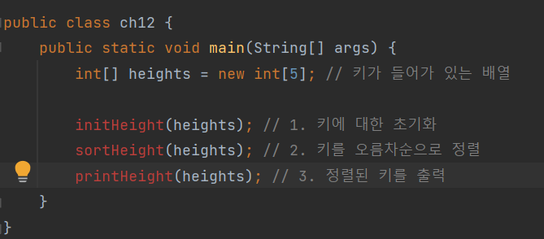

12-2. 메소드 사용 예제 코드(구현 X)

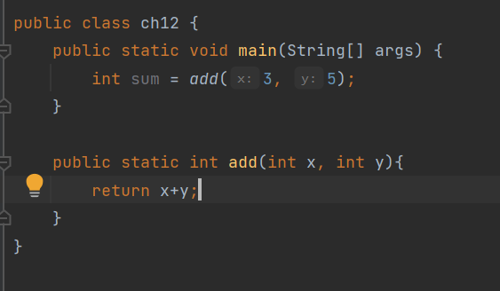

12-3. 간단한 메소드 사용 예제

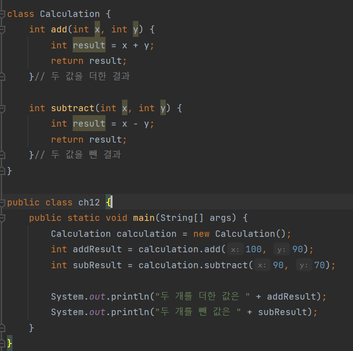

12-4. 간단한 클래스내 멤버 함수 사용 예제

---

#### **13.  객체지향언어 (2) 생성자**

**1) 생성자(Constructor)**

**•생성자는 인스턴스가 생성될 때 사용되는 '인스턴스 초기화 메소드'입니다.**

**즉 new 와 같은 키워드로 해당 클래스의 인스턴스가 새로 생성될 때, 자동으로 호출되는 메소드입니다.**

**•생성자를 작성하지 않을 경우 Java compiler는 default 생성자를 만들어준다.**

**•생성자를 통해 초기화 하지 값들은 모두 0으로 초기화 되고, byte는 0 이 아닌 8bit가 모두 false를 뜻하는 0으로 세팅되어 있고**

**String은 null이라는 빈 값을 가지고 있다.**

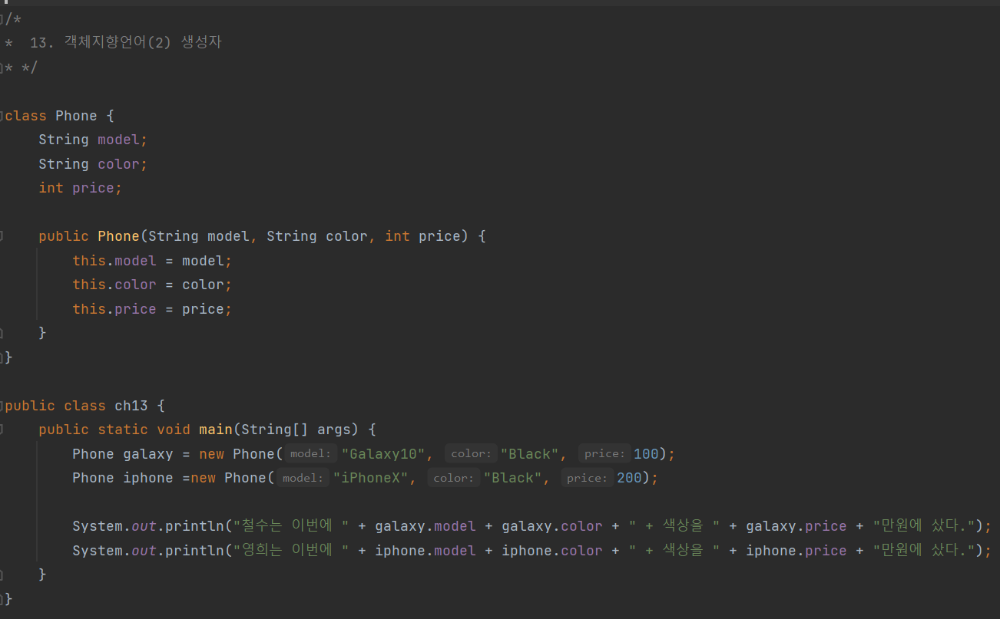

13-1. 생성자를 통한 초기화 사용 코드

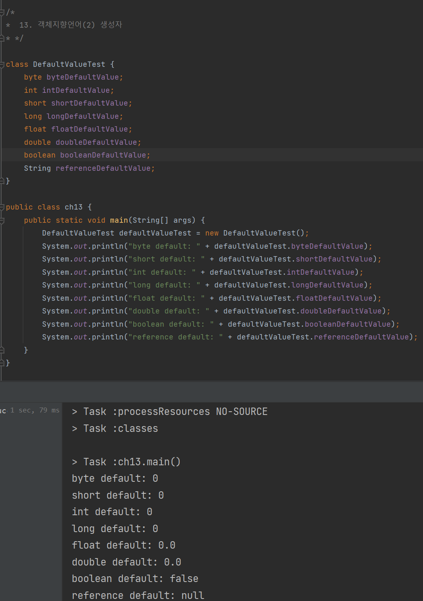

13-2. 멤버 변수 초기값 출력 코드

---

#### **14.  객체지향언어 (3) 상속**

**1) 상속(inheritance)**

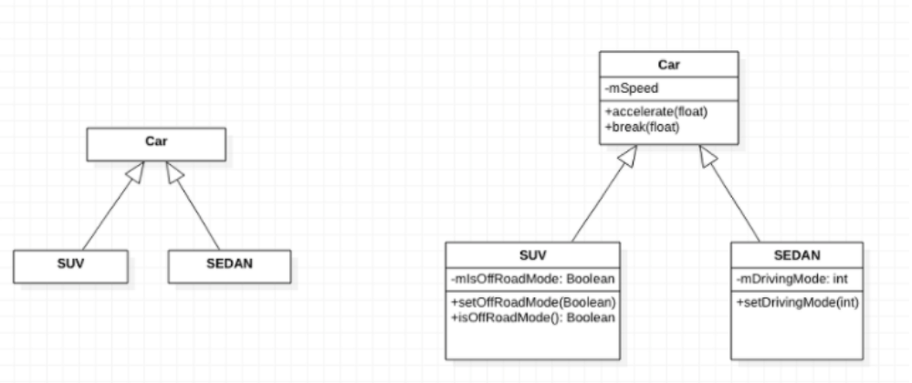

14-1. 클래스의 상속 구조

**•상속은 기존의 클래스를재사용하는 방식 중의 하나입니다. 한 번 작성한 코드가 재사용이 필요하다면, 변경사항만 코드로 작성하므로**

**상대적으로 적은 양의 코드를 작성할 수 있게 됩니다. 이렇게 코드를 재사용하면, 코드와 클래스가 많아질수록 관리하기 용이하다.**

**•상속을 통해 클래스간의 계층구조를 만들게 됩니다.**

**• 상속의 특징**

         1. 부모 클래스에서 정의된 필드와 메소드를 물려 받는다.

         2. 새로운 필드와 메소드를 추가할 수 있다.

         3. 부모 클래스에서 물려받은 메소드를 수정할 수 있다.

**2) 상속의 형식**

**•상속은 extends를 이용하여 사용할 수 있다.**

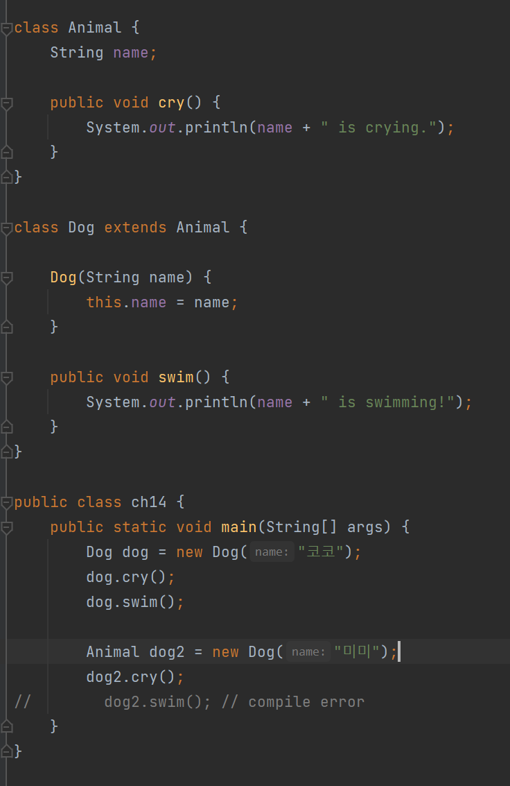

14-2. 상속 예제 코드

**3) 오버로딩(overloading) vs 오버라이딩(overriding)**

**•**오버로딩은 한 클래스 내에서 동일한 이름의 method를 여러 개 갖는 것을 의미한다.****

         1. method 이름이 동일해야한다.

         2. 매개 변수의 개수나 혹은 type이 달라야한다.

14-1. 오버로딩 예제(매개변수의 개수가 다른경우)

14-2. 오버로딩 예제(매개변수의 타입이 다른경우)

         3. 반환 값은 오버로딩과 무관하다.

14-3. 오버로딩 예제(반환값만 다른 경우)

**•**오버라이딩은 부모 클래스에 있는 method를 똑같이 자식 클래스에서 재정의하는 것****

14-4. 오버라이딩 예제

---

#### **15.  객체지향언어 (4) 접근제어자**

**1) 접근제어자 (access modifier)**

**•접근 제어자는 멤버 변수/함수 혹은 클래스에 사용되며 외부에서의 접근을 제한하는 역할을 한다.**

         1. private : 같은 클래스 내에서만 접근 가능

         2. default(nothing) : 같은 패키지 내에서만 접근 가능

         3. protected : 같은 패키지 내에서, 그리고 다른 패키지의 자손 클래스에서 접근이 가능

         4. public : 접근 제한이 전혀 없음

15-1. 접근제어자 표

15-2. 접근지정자 테스트를 위한 구조

15-3. 접근지정자 테스트를 위한 코드(1)

15-4. 접근지정자 - private 에러

15-5. 접근지정자 - protected 에러

15-6. 접근지정자 - protected(자식클래스에서 호출)

15-7. 접근지정자 - default

15-8. 접근지정자 - default 호출 에러

      • 정리

         1. 다른 패키지의 클래스를 참조할 때, "import 패키지.클래스"를 사용하여 해당 클래스를 사용할 수 있다.

         2. 자바가 클래스를 인식할 때는 패키지 이름까지 포함한 클래스 이름으로 인식한다.

         3. 객체지향 프로그래밍이란 객체들 간의 상호 작요을 코드로 표현한 것이다. 객체들간에 관계가 생길 때 접근할 수 있는 것과

            아닌 것의 권한을 구분할 필요가 생기게 된다. 클래스의 내부에 선언된 데이터의 부적절한 사용으로부터 보호해 주는게

            접근 제어자가 하는 역할이다.(캡슐화)

---

#### **16.  객체지향언어 (5) 추상클래스, 인터페이스**

**1) 추상클래스 **Ex) Animal이 추상클래스라면 new Animal(X), new Dog(O)****

**•추상클래스는 추상메소드를 선언할 수 있는 클래스를 의미한다.**

**•추상클래스는 클래스와 다르게 상속받는 자식 클래스 없이 그 자체로 인스턴스를 생성할 수 없다.**

         1. 추상메소드는 설계만 되어있으며 수행되는 코드에 대해서는 작성이 안된 메소드

         2. 미완성으로 남겨두는 이유는 상속받는 클래스 마다 반드시 동작이 달라지는 경우에 상속받는 클래스 작성자가

             반드시 작성하도록하기 위함입니다.

16-1. Abstract 클래스와 메소드 예제 코드

16-2. abstract 메소드 실행결과

**2) 인터페이스**

**•인터페이스는 객체의 특정 행동의 특징을 정의하는 간단한 문법**

**•인터페이스는 함수의 특징인 접근제어자, 리턴타입, 메소드 이름만을 정의합니다.**

**•인터페이스는 함수의 내용은 없다.**

****•**인터페이스를 구현하는 클래스는 인터페이스에 존재하는 함수의 내용을 반드시 구현해야한다.**

16-3. 인터페이스 사용 예제

**3) 인터페이스 vs 추상클래스**

**•인터페이스**

         1. 구현하려는 객체의 동작의 명세

         2. 다중 상속 가능

         3. implements를 이용하여 구현

         4. 메소드 시그니처(이름, 파라미터, 리턴 타입)에 대한 선언만 가능

**•추상클래스**

         1. 클래스를 상속받아 이용 및 확장을 위함

         2. 다중 상속 불가능, 단일 상속

         3. extends를 이용하여 구현

         4. 추상메소드에 대한 구현 가능

**• 정리**

         1. 추상 클래스에 추상 메소드는 구현체가 없는데도 불구하고 추상클래스 내부에서 진짜 함수처럼 사용이 됩니다.

            그런데 이 내용은 자식에 가서 구현이 되어있습니다. 실제로 자식 객체로 인스턴스가 생성이 된 다음에는

            추상 클래스에 fly() 메소드가 하나의 코드처럼 실행되는 것을 볼 수 있다.

         2. 자바가 클래스를 인식할 때는 패키지 이름까지 포함한 클래스 이름으로 인식한다.

         3. 객체지향 프로그래밍이란 객체들 간의 상호 작요을 코드로 표현한 것이다. 객체들간에 관계가 생길 때 접근할 수 있는 것과

            아닌 것의 권한을 구분할 필요가 생기게 된다. 클래스의 내부에 선언된 데이터의 부적절한 사용으로부터 보호해 주는게

            접근 제어자가 하는 역할이다.(캡슐화)

---

#### **17.  객체지향 퀴즈**

**1) 퀴즈: 객체지향**

**•객체지향에서 배운 개념과 문법을 이용해서 다음 요구조건을 만족하는 클래스를 작성하시오.**

17.1 퀴즈 요구사항

17-2. 퀴즈 풀이 코드

---

#### **18.  예외, 에러 처리**

> 에러를 처리하는 방법에 대해 알게 될 것이다.

**1) 에러처리란(Exception, Error Handling)**

**•다양한 예외 상황에 대응하기 위해서 예외 처리 코드가 필요합니다.**

**•예외처리 목적**

         1. 예외의 발생으로 인한 실행 중인프로그램의 비정상 종료를 막기 위해서

         2. 개발자에게 알려서 코드를 보완할 수 있도록 하기 위해

**•자바에서는 상속을 이용해서 모든 예외를 표현합니다. 모든 예외 클래스는 Throwable의 자손 클래스입니다.**

**•Throwable에는 크게 두 종류의 자식 클래스가 있다.**

         1. Error 는 프로그램이 종료되어야 하는 심각한 문제를표현 합니다. 대부분 컴퓨터나 JVM이 시스템적으로 동작할 수 없는 상황을 표현

         2. Exception 은 프로그램이 종료되지는 않지만 예외나 문제상황을 표현하기 위해 사용

(예시) Java는 JVM내에 힙이라는 메모리 공간을 운영체제로부터 할당받아서 사용합니다. 그래서 할당받을 수 있는 최대 메모리 이상을 사용하면 JVM 죽어버릴 수 밖에 없습니다. 이 경우 **OutOfMemoryError**가 발생하고 프로그램이 종료됩니다. 이는 자바의 대표적인 에러 상황으로 실무자들이 줄여서 OOM이라고 부르기도 합니다. 에러가 아닌 모든 것들은 사실 Exception입니다.

18-1. 예외 클래스의 상속 관계

**•우리가 표현하려는 예외 상황은 대부분 Exception 종류일 것이다.**

**•실행도중 발생하는 Exception은 RuntimeException을 상속받아서 정의**

**•파일을 읽고 쓰거나, 원격에 있는 저장소로부터 데이터를 읽고 쓸때 나는 에러를 표현하려면 IOException를 상속받아서 정의**

     - RuntimeException은 실행 중에 발생할 수 있는 에러를 표현할 때 사용

     - IOException은 실행 중 파일을 읽고 쓰거나 네트워크의 데이터를 읽고 쓸 때 발생하는 Exception을 표현할 때 사용

**2) try-catch(-finally)형식**

18-2. try-catch 구조

**•만약 예외가 발생하면 해당 예외에 catch문에 코드를 수행하게 되고, 예외가 발생하지 않는다면 try → finally 순으로 실행된다.**

**•예외는 중복 catch 블럭을 사용하여 다양한 예외처리를 수행할 수 있다. 중복 catch 블록을 사용할 떄는 먼저 선언된**

**catch블럭부터 확인합니다. 앞의 catch 블럭에서 잡혔다면, 뒤의 catch블럭은 무시됩니다. 좋은 범위의 예외부터 앞에**

**선언하는 것이 좋습니다. 여기서 좁은 범위란 상속관계에서 자식 클래스에 위치 할수록 좋은 범위입니다.**

**(예를들면) IOException이 발생할 것 같아 예외처리를 하고, 그 외의 예외도 처리를 하고 싶다면 IOException을**

**catch하는 구문을 먼저, Exception을 catch하는 그문을 그 뒤에 작성합니다.**

18-3. try-catch문을 통한 예외 발생 예제

**3) try-with-resource 형식(입출력)**

**•입출력과 함께 자주 쓰이는 구문입니다. 일반적으로 사용되었던 자원을 끝난 후에 닫아줘야 하는 것들이 존재하는데 여기서**

**try-catch-finally구문 보다 편리한 것이 try-witch-resource문입니다.**

**•기존의 try-catch(-finally)문은 자원을 닫을 때 close()를 사용해야 합니다.**

**•try-with-resource문은 try문을 벗어나는 순간 자동적으로 close()가 호출됩니다.**

**•try()안의 입출력 스트림을 생성하는 로직을 작성할 때 해당 객체가 AutoClosable 인터페이스를 구현한 객체여야합니다.**

18-4. try-with문을 통한 예외 발생 예제

**•이처럼 형식은 try-catch문과 비슷하지만, try()안에 AutoClosable 인터페이스를 구현한 객체를 선언하면 사용할 수 있다.**

18-5. AutoClosable 인터페이스

**•만약에 try-with-resource가 아니라 일반 try-catch문을 사용했다면 코드가 길어질 뿐만 아니라 FileOutputStream을 열고**

**닫을때 생기는 Exception까지 그 상위에서 catch를 하거나 throws로 감싸줘야합니다.**

18-6. try-catch문으로 사용할 경우

**4) 메소드에서의 예외 선언**

**•catch문을 이용해서 예외처리를 하지 않은 경우, 메소드에 throws로 예외가 발생할 수 있다는 것을 알려주어야 한다.**

**throws 키워드가 있는 함수를 호출한다면, caller쪽에서 catch와 관련된 코드를 작성해주어야 합니다.**

---

#### **19.  예외, 에러 처리 퀴즈**

19-1. 예외, 에러처리 퀴즈

19-2. 예외, 에러처리 퀴즈 풀이

---

#### **정리**

**자바 문법을 또 한번 배웠는데 매번 새로운 내용이 있어 흥미롭습니다**

**try-with는 사용해본적이 없었는데, 문법을 배우면서 익숙한 부분을 건너뛰어서 그런 것 같다...**

**이번에 항해99를 통해서 새롭게 배운 것으로 유익한 정보라 생각된다!!****항해99 개강이 얼마 남지 않았다.. 일단 개강 전에 끝내야 할 것이 많아..****그것부터 끝내고 이어서 수강하려고 한다..**

**오늘은 여기서 안녕!!**

