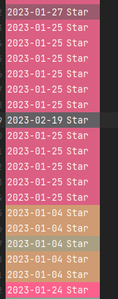

## Be Brave!

---

### Making mistakes is better than faking perfections.

---

[**완벽을 가장 하는 것보다는 실수를 하는 것이 낫다**]

A라는 기능을 구현하면서 기존 기능에서 달라진 부분에 대해서만 확인하게 되었다. 

이 과정에서 A라는 기능의 핵심만 구현하고 부가적인 부분에 대해서는 고민하지 않았다.

아니 신경을 쓰지 않았던 것 같다.

A라는 기능에는 (A1, B1)이라는 기능이 합쳐진 기능이라고 할 수 있는데, B1이라는 기능은 기존에 구현이 되어있다는 생각에 A1을 개선하여 A2를 만들고 B1은 그대로 사용했었다.

그런데 그 누구도 알지 못했었다. B1이 개선이 필요했었다는 사실을...

A라는 기능을 구현하면서 많은 부분이 어려웠고 그러면서 많은 버그들이 발생해서 자신감을 잃고 버그들을 숨기고 싶었을 때가 있었다...

그럴 때마다 심각한 버그가 아니면 그냥 넘길까? 아니면 그래도 해결하는 것이 맞을까? 라는 악마의 유혹이 생길 때가 있었다.

그럴 때마다 나의 선택은 그래도 해결하는 것이 맞다는 결론을 갖고 개발했었다.

이번에도 B1의 기능이 정상적으로 이루어지지 않는 것이므로 이슈를 남겨 설명하고 해당 기능을 구현하였다.

> 완벽을 가장하는 것보다  
>   
> 실수를 인정하는 것이 더 완벽한 길로 가능 방법이다.  
>   
> 계속된 실수로 자신감을 잃게 된다면  
>   
> 실수를 찾은 자신에게 칭찬하여 자신감을 높이자.

### **Look before you leap**

---

뛰어보기 전에 한번 살펴라.

회사를 다니면서 기존 사이드 프로젝트와 다르게 회사의 서비스 규모는 작지 않기 때문에 비즈니스 로직에 대한 이해도가 더 많이 필요하다고 느껴졌다. A라는 조회 로직이 적으면 1곳, 많으면 10 곳에서 동일한 API를 호출하기 때문이다.

그렇기 때문에 필자는 기능을 구현하기 전, 기존 로직을 사용하는 곳에서 어떻게 사용되고 있는지 확인하는 습관이 생기게 되었다.

**1. 사용 범위**

백엔드 코드에서는 알 수 있는 방법이 적다.

해당 기능을 수행하는 곳을 알기 위해서는 프론트 코드에 `**Router**`를 중점적으로 살펴보아야 한다. 기존 코드가 어디서 어떻게 사용되고 있는지 파악해야 한다.

이를 통해 **변경하면 안되는 부분**을 파악할 수 있게 된다.

**2. 영향도 분석**

기존 코드에서 달라져야 하는 것이 무엇인지 살펴보고 기존 로직에 변화가 얼마나 클지 생각해 보야한다.

단순히 테이블에 필드를 추가한다면 문제가 되지 않지만, 쿼리에 조건이 추가되는 것이라면 동적 쿼리를 적절하게 사용하고 있는지 기존 로직에 영향을 주지 않고 있는지 확인해 보야한다.

무작정 수정을 한다면 기존 로직의 범위가 어디까지인지 모르고 개발하게 된다면 자신이 얼마나 큰 일을 벌이고 있는지 알지 못하게 된다.

> 무작정 밖에 나가 러닝을 하기 전에  
>   
> 날씨를 보고  
> 운동복을 고르고  
> 준비를 운동을 하는 등에  
>   
> 많은 사항을 고려하는 것처럼  
>   
> 개발을 시작하기 전에도  
>   
> 사용되고 있는 범위, 영향도 분석 등을  
> 진행한다면 오늘보다 내일이 멋진  
> 개발자가 되지 않을까라는 생각이 든다.

### **Empathy**

---

담당하고 있는 서비스 중에 문자 발송 기능이 있다. 현재 작업 중인 코드를 Stage에 반영하지 않은 상태인데 문자가 2번씩 발송되고 있다는 사실을 듣게 되었다.....


상황을 정리해 보면

> **1. 현재 작업 중인 브랜치 코드는 Stag에 반영되지 않았다.  
> 2. 지난주 배포에 들어간 기능에서 문자 발송 기능과 연관된 작업이 있다.  
> 3. 해당 기능 브랜치에서 메시지 발송 시 1회만 전송되는 것이 확인되었다.**

그렇다면 원인은 무엇이고 어떻게 접근하는 게 좋을까?

#### **프런트 엔드 코드 분석**

해당 원인이 발생하고 있는 페이지에 코드를 분석해 보았다.

최근 다른 동료가 작업한 이력이 있는지 Commit History를 통해 확인하였다.

작업한 동료는 없어서 **문자를 발송하는 API** 호출 횟수를 파악해 보았다.

해당 기능에서는 **문자를 발송하는 API는 1회만 호출**한다.

#### **Batch 코드**

지난주에 예약 관련 Batch 코드를 수정한 작업이 있어 이 부분이 가장 의심되었다.

예약 관련 데이터를 확인하고 Batch 스케줄을 조정하여 실제 작업이 이루어지는 것을 확인하였다.

데이터 베이스에서 조회한 리스트를 2회 발송하고 있다. Batch에서는 정상적으로 작동하고 있었고 문자를 발송하는 코드인 백엔드에서 문제가 있음을 확인하였다.

#### **백엔드 코드**

**문자를 발송하는 API는 1회**만 호출되고 이후에 Batch로 작업되는 메시지 발송에서도 2회가 발생한다.

Intellij에 좋은 기능 중 하나인 **Git Blame**을 통해 최근 작업한 코드를 찾아보았다.

> **Git Blame :** 해당 코드 라인이 언제 누가 수정했는지를 나타내주는 기능



해당 이미지는 개인 프로젝트의 Git Blame

Git Blame 통해 최근에 필자가 작업한 코드를 분석해 보았는데 지지난 주에 적용한 코드 이외에는 새로운 코드가 없었다... 

최근에 추가한 동료의 코드를 분석해 보았다. A 동료의 코드에서 메시지를 발송하는 코드가 추가되어 있었다. 

해당 기능에 대한 수정이 어떤 이유로 발생한 것인지 확인하기 어렵기 때문에 커밋을 남겨두고 출근해서 동료와 이야기를 통해 어떤 이유로 작성했는지 이야기를 마친 후 둘 중 하나만 사용되도록 코드를 변경하였다.

해당 작업을 진행하면서 중요하게 느낀 것 중 하나는 `커밋 메시지의 중요성`이었다. 

현재 이슈 번호와 브랜치 제목을 작성하는 것이 일반적인데 커밋 메시지를 통해 조금 더 상세하게 작성하였다면 조금 더 빠르게 해결할 수 있지 않을까 하는 아쉬움이 생겼다.

> Commit 컨벤션에 대해 신중하게 고민했던 친구가 있었다  
>   
> 친구가 커밋 컨벤션을 어떻게 하면  
> 다른 사람들과 원활하게 코드를 통해   
> 소통할 수 있을까라는 질문을 했을 때  
>   
> 커밋 메시지는 간결하고 의도만 작성하면 되지 않을까?라는  
> 의견을 표시했었는데 그 의도를 표현한다는 것이  
> 어떤 작업을 어떻게 했는지를 알기 어렵다는 사실을 알 수 있었다.  
>   
> 커밋을 짧은 단위로 하는 것이 좋지만...  
> 작업을 진행하다 보면 연관된 코드로 인해 코드량이 많아져   
> 무엇을 했는지 확인하기 어려울 때가 있었다.  
>   
> 에러가 나지 않게 하나의 커밋을 관리하는 것을  
> 지향하고 있는데 어떻게 하는 것이 좋은 것인지  
> 그 친구의 고민을  공감하게 되었다.

### Go Back To Basics

---

동일한 기능을 하고 있는 Modal을 분리하는 작업을 진행하면서 느낀 것을 처음에 해당 기능을 각각에 구현할 때 발생했던 문제가 분리하면서 동일하게 발생하고 있었다.

현상은 같지만 원인도 같은지 알 수가 없었다. 무엇 때문에 안 되는 것인지 알 수가 없었다...

부모의 컴포넌트에서 자식의 컴포넌트로 v-model을 통해 데이터를 전달할 때 자식 컴포넌트에서 데이터를 수정하고 emit을 통해 부모에게 전달하면 정상적으로 업데이트가 이뤄진다.

까지는 많이 사용해서 알고 있다. 그런데 v-model에 전달될 데이터를 부모 컴포넌트에 변경해도 자식 컴포넌트에 전달되는 데이터는 변경되지 않고 있었다.... 그래서 어떻게 해야 하는지 현재 공부하고 있는 Vue 정리 노트도 보고 구글링도 하고 막 했다.... 

#### **해결 방법**

**1. 부모 컴포넌트에서 computed 속성을 통해 v-model 데이터를 전달하는 방법**

computed 속성을 통해 데이터를 전달하면 부모 컴포넌트에서 전달되는 v-model에 값이 변경되어 전달된다고 하여 시도해 보았지만.. 부모 컴포넌트에서는 변경되지만 v-model로 전달된 자식 컴포넌트에서는 변경 전 데이터가 들어가고 있다.

**아쉽게도 탈락!**

**2. 부모 컴포넌트에서 vue.$set을 이용한 방법**

Vue.js의 가장 큰 특징 중 하나인 양방향 바인딩의 특징이 객체 데이터나 배열 데이터를 사용하게 되면 새로운 속성 및 데이터가 추가되거나 삭제되는 것을 감지하지 못하는 경우가 자주 발생한다.

이러한 이유로 안 되는 것이지 않을까라는 생각이 들어 시도해 보았다...

**두둥.. 탁! 아쉽게도 탈락!**

**3. 부모 컴포넌트에서 변경된 데이터를 자식 컴포넌트에 전달하여 변경하는 방법**

```javascript
// 부모 컴포넌트에서 호출
onClickFromParent(item) {
   this.$refs.childModal.changeItem(item);
},

// 자식 컴포넌트에서 처리
changeItem(item) {
   this.tiem = item;
},
```

신기하게도 이 방식을 통해 문제를 해결할 수 있었다. 

### 정리

> 이번 주에도 참 많은 일이 있었다.  
>   
> 웃을 때도 있었고 힘들 때도 있었다.  
>   
> 다 생각해 보면 너무 재미있었다.  
>   
> 무엇인가 집중하며 문제를 풀고 해결해 나가는 재미가  
>   
> 개발자의 행복함이 아닐까 싶다.  
>   
> 
>   
> 다음 주부터는 하루에 하나로 작성할까...  
> 일주일 단위로 쓰다 보니 기억이 안 나는 게 많아지는 것 같기도 하고.....
