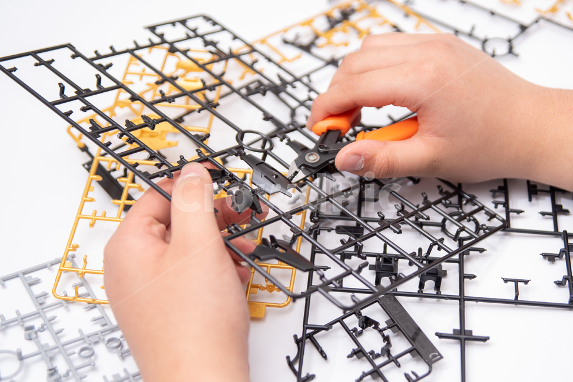

## Feel the futility

---

### Believe in yourself

---

3 개에 컴포넌트에서 동일하게 사용되는 모달을 컴포넌트로 관리하기 위해서 많은 노력하고 있다.

약 2달 동안 쌓은 짬밥으로 열심히 조립하구 만들었다.

처음에는 중복된 코드를 수정하는게 너무 힘들어서...  컴포넌트로 관리하면 좋을텐데.. 좋을텐데.. 라는 생각만 갖고 있었다.

처음에는 컴포넌트를 직접 만들어보는게 처음이라... 얼마나 시간이 걸릴지 알수가 없었고... 이로인해 다른 기능에 투자해야할 시간이 없어질까봐 많은 고민을 하고 시작했다.

이러면서 배운 것은 

1. [**Deep Copy** VS **Shallow Copy**](tistory-359.html)
2. [**Computed 활성화 조건**](tistory-358.html#toc-Computed%20%ED%99%9C%EC%84%B1%ED%99%94%20%EC%A1%B0%EA%B1%B4)

이외에도 많은 것을 배울 수 있었는데 이보다 더 좋은 경험을 만들 수 없었을 것 같다.

컴포넌트를 만들면서 마지막에 왜 부모 컴포넌트에 v-model 데이터가 들어가지 않지?? 하면서 고민을 하며 계속 수정했는데.. 알고보니 작은 실수로 인해 발생한 문제였다....

너무 허무하지만.. 너무 행복했다.

### Love What you do

---

기능을 구현하면서 사용자들에게 많은 피드백을 받으면서 기능을 수정하고 수정하고 수정했다. 사용자들에게 많은 피드백을 받으면서 어떻게 하면 더 효율적으로 코드를 관리할 수 있을까 라는 생각을 하며 개발하는 성장하는 본인의 모습을 느낄 수 있어 행복하다.

그런데 중복된 코드를 컴포넌트로 관리하지 않아 작업이 시간이 배로 필요했다... 버그는 일부분만 수정하면 되지만, 기능이 보완되거나 수정할 때는 3곳을 수정하다보니 시간이 너무 많이 필요했다...

이 중에서도 손이 많이 가는 두 곳은 코드를 가독성 있게 수정하면서 주석도 넣고 이쁨을 주었다. 반면 수정이 적게 필요한 코드는 통일하기 위한 작업을 진행하면서 해당 코드에 무신경했던 필자의 모습을 느낄 수 있었다.

코드에게도 관심이 필요하다는 것을 느낄 수 있는 기회가 되었다.

내시키 내시키 내가 이쁘게 키워줄게!
