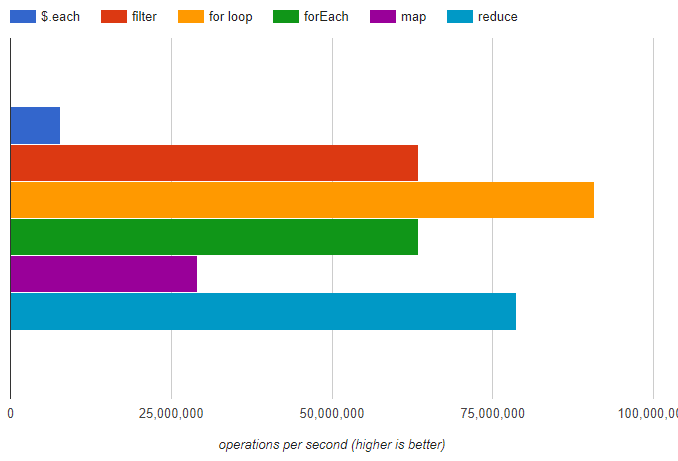

## for-loop, for-each, map, reduce, filter에 대해 이해하기

---

### for loop

---

```javascript
for (let i = 0; i < 10; i++) {
  console.log(arr[i]);
};
```

* 가장 빠르고 단순하고 효율적이다.
* 모든 자료형에 대해 사용이 가능하다.
* 중간에 loop 건너뛰기나 종료가 가능하다. (**continue** or **break**)
* 반복범위 컨트롤이 가능하다. (i++, i–, i+=2\*i 등)

### for Each

---

```javascript
arr.forEach(function(v, i, arr) {
  console.log(v);
});
```

* 빠르고 가독성이 좋다.
* Array 객체에서 사용이 가능하다.
* 일반 for문보다 가독성이 좋고, 객체형을 다루기가 쉽다.
* for 문과 다르게 중간에 종료할 수 있는 방법이 없다.
* return 값을 받지 못한다.

```javascript
let arr = [1,2,3,4,5];
let result = arr.forEach(function(e, i) {
  return e;
});

console.log(result); // undefined
```

### filter

---

```javascript
let newArr = arr.filter((n) -> return n % 2 == 0);
```

filter의 가장 큰 특징은 boolean 형태의 값을 반환한다. return 값이 true인 경우에 대해서만 반환한다.

* 빠르고 체이닝이 가능하다.
* Array 객체에서 사용이 가능하다.
* 빈 배열 요소를 반환하지 않는다.
* 대용량 배열 처리시 메모리 overflow가 발생할 수 있다.
* return값은 true/false이며, 요소를 반환한다.

### map

---

```javascript
let result = arr.map(function(v, i, arr) {
  return condition;
});
```

**filter**와 다른 점은 filter는 return 값으로 true/false만 사용할 수 있고 요소를 반환하지만

**map**의 경우 요소가 새로운 값을 만들어서 반환한다.

```javascript
let arr = [1, 2, 3, 4, 5];
let result = arr.map(function(v, i, arr) {	// 2, 3, 4, 5, 6
  return v + 1;
});
```

* 빠르고 체이닝이 가능하다.
* Array 객체에서 사용이 가능하다.
* 대용량 배열 처리시 메모리 overflow가 발생할 수 있다.
* return 값 자체를 반환한다.

### reduce

---

```javascript
let arr = [1, 2, 3, 4, 5];
let result = arr.reduce(function(acc, v, i, arr) { // 15
  return acc + v; 
});
```

* **accumulator** 는 반환 값을 누적하는데, 계속해서 전달받아서 사용할 수 있다.
* accumulator 의 초기값을 설정할 수있다.

```javascript
let arr = [1,2,3,4,5]
let newArr = arr.reduce(function(acc, v, i, arr) {  // 115
  return acc + v;
}, 100);
```

reduce는 강력하고 확장성이 높다. accumulator의 값은 배열이 될수도 있고, object가 될수도 있다.

### 성능 비교

---



어떤 것을 사용하든 동일한 결과를 만들 수 있다. 성능적으로는 for loop이 가장 좋지만,

큰 차이가 없다면 가독성이 있는 for-each 또는 map, filter, reduce 등으로 때에 따라서 적절하게 사용하는 것이 좋은 것 같다.
