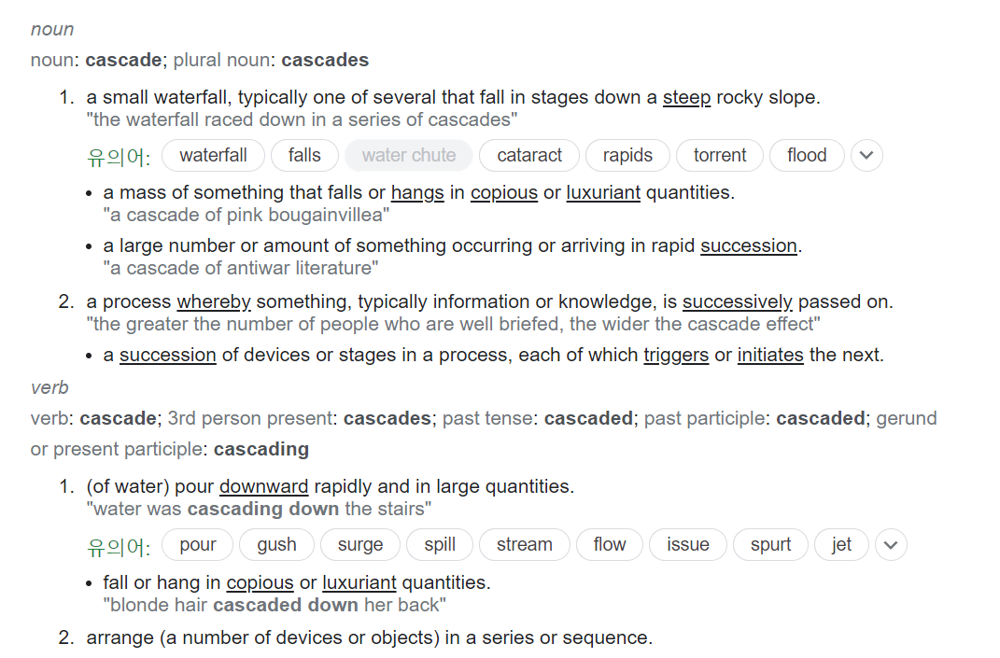
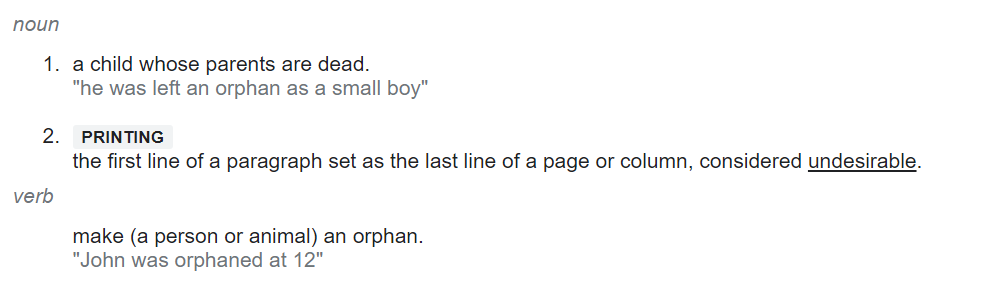

## Cascase.REMOVE vs orphanRemoval

---

**백기선**님의 코드 리뷰를 보면서 **Cascase**의 지식이 얕다고 판단되어 Cascase를 재정리하면서 Cascase에 대한 이해를 높이고 **orphanRemoval**를 사용하는 이유를 명확히 알고 사용하기 위해 포스팅을 작성하게 되었다.

## What is Cascase?

---

#### **Cascase**에 의미



출처 : Oxford Languages

번역해보면 Cascade는 다음과 같은 정의를 갖고 있습니다.

* 명사
  1. 종속
  2. 작은 폭포
* 동사
  + 폭포가 되어 떨어지다.
  + 폭포처럼 떨어뜨리다.

**Spring Data JPA**에서 **엔티티 간**에 관계를 표현할 때 Cascade 라는 옵션을 사용합니다.

위에 정의와 동일하게 작성한 엔티티의 상태 변화를 해당 엔티티에게 전파시키는 범위를 설정해주는 옵션입니다.

옵션의 종류는 **ALL, PERSIST, MERGE, REMOVE, REFRESH, DETACH** 등이 있습니다.

이해를 돕기 위해 [Baeldung](https://www.baeldung.com/jpa-cascade-types)에서 사용한 예제를 함께 보자.

#### **CASCADE.ALL**

> **CascadeType.ALL propagates all operations** — **including Hibernate-specific ones — from a parent to a child entity.**  
> **출처: Baeldung**

* 상위 엔터티에서 하위 엔터티로 모든 영향**(PERSIST, MERGE, REMOVE, REFRESH, DETACH 등**) 을 전파시키는 것

```java
@Entity
public class Person {
    @Id
    @GeneratedValue(strategy = GenerationType.AUTO)
    private int id;
    private String name;
    @OneToMany(mappedBy = "person", cascade = CascadeType.ALL)
    private List<Address> addresses;
}
```

```java
@Entity
public class Address {
    @Id
    @GeneratedValue(strategy = GenerationType.AUTO)
    private int id;
    private String street;
    private int houseNumber;
    private String city;
    private int zipCode;
    @ManyToOne(fetch = FetchType.LAZY)
    private Person person;
}
```

#### **CASCADE.PERSIST**

> The persist operation makes a transient instance persistent. **CascadeType PERSIST** **propagates the persist operation from a parent to a child entity**.  When we save the person entity, the address entity will also get saved.  
> **출처: Baeldung**

* 상위 엔티티에서 하위 엔티티까지 영속성 전달  
  => 상위 엔티티를 저장하면 하위 엔티티도 저장된다.

```java
@Test
public void whenParentSavedThenChildSaved() {
    Person person = new Person();
    Address address = new Address();
    address.setPerson(person);
    person.setAddresses(Arrays.asList(address));
    session.persist(person);
    session.flush();
    session.clear();
}
```

실행 결과 다음과 같은 쿼리가 발생한다.

```sql
Hibernate: insert into Person (name, id) values (?, ?)
Hibernate: insert into Address (city, houseNumber, person_id, street, zipCode, id) values (?, ?, ?, ?, ?, ?)
```

#### **CASCADE.MERGE**

> The merge operation copies the state of the given object onto the persistent object with the same identifier.   
> **CascadeType.MERGE** **propagates the merge operation from a parent to a child entity.**  
> **출처: Baeldung**

* 상위 엔티티에서 하위 엔티티까지 병합 작업을 지속  
  => 상위 엔티티와 하위 엔티티를 조회하여 업데이트해준다.

```java
@Test
public void whenParentSavedThenMerged() {
    int addressId;
    Person person = buildPerson("devender");
    Address address = buildAddress(person);
    person.setAddresses(Arrays.asList(address));
    session.persist(person);
    session.flush();
    addressId = address.getId();
    session.clear();

    Address savedAddressEntity = session.find(Address.class, addressId);
    Person savedPersonEntity = savedAddressEntity.getPerson();
    savedPersonEntity.setName("devender kumar");
    savedAddressEntity.setHouseNumber(24);
    session.merge(savedPersonEntity);
    session.flush();
}
```

실행 결과 다음과 같은 쿼리가 발생한다.

```sql
Hibernate: select address0_.id as id1_0_0_, address0_.city as city2_0_0_, address0_.houseNumber as houseNum3_0_0_, address0_.person_id as person_i6_0_0_, address0_.street as street4_0_0_, address0_.zipCode as zipCode5_0_0_ from Address address0_ where address0_.id=?
Hibernate: select person0_.id as id1_1_0_, person0_.name as name2_1_0_ from Person person0_ where person0_.id=?
Hibernate: update Address set city=?, houseNumber=?, person_id=?, street=?, zipCode=? where id=?
Hibernate: update Person set name=? where id=?
```

쿼리를 통해 알 수 있듯이 **Cascade.Merge** 는 상위 엔티티와 하위 엔티티를 모두 조회한 후 데이터를 모두 업데이트 시켜준다.

#### **CASCADE.REMOVE**

> As the name suggests, the remove operation removes the row corresponding to the entity from the database and also from the persistent context.  
> **CascadeType.REMOVE propagates the remove operation from parent to child entity**. Similar to JPA's **CascadeType.REMOVE, we have CascadeType.DELETE, which is specific to Hibernate.** There is no difference between the two.  
> **출처: Baeldung**

* 상위 엔티티를 삭제하면 하위 엔티티까지 제거  
  => 연결된 하위 엔티티까지 엔티티를 제거해준다.

```java
@Test
public void whenParentRemovedThenChildRemoved() {
    int personId;
    Person person = buildPerson("devender");
    Address address = buildAddress(person);
    person.setAddresses(Arrays.asList(address));
    session.persist(person);
    session.flush();
    personId = person.getId();
    session.clear();

    Person savedPersonEntity = session.find(Person.class, personId);
    session.remove(savedPersonEntity);
    session.flush();
}
```

실행 결과 다음과 같은 쿼리가 발생한다.

```sql
Hibernate: delete from Address where id=?
Hibernate: delete from Person where id=?
```

#### **CASCADE.REFRESH**

> Refresh operations **reread the value of a given instance from the database**. In some cases, we may change an instance after persisting in the database, but later we need to undo those changes.  
> In that kind of scenario, this may be useful.**When we use this operation with Cascade Type REFRESH, the child entity also gets reloaded from the database whenever the parent entity is refreshed.  
> **출처: Baeldung****

* 데이터베이스로부터 상위 엔티티를 갱신할 때마다 하위 엔티티까지 갱신  
  => 연결된 하위 엔티티까지 인스턴스 값을 갱신해준다.

```java
@Test
public void whenParentRefreshedThenChildRefreshed() {
    Person person = buildPerson("devender");
    Address address = buildAddress(person);
    person.setAddresses(Arrays.asList(address));
    session.persist(person);
    session.flush();
    person.setName("Devender Kumar");
    address.setHouseNumber(24);
    session.refresh(person);

    assertThat(person.getName()).isEqualTo("devender");
    assertThat(address.getHouseNumber()).isEqualTo(23);
}
```

#### **CASCADE.DETACH**

> The detach operation removes the entity from the persistent context. **When we use CascadeType.DETACH, the child entity will also get removed from the persistent context.  
> **출처: Baeldung****

* 영속성 컨텍스트에서 엔티티를 제거  
  => 상위 엔티티의 인스턴스 뿐만 아니라 연결된 하위 엔티티 인스턴스의 영속성을 제거해준다.

```java
@Test
public void whenParentDetachedThenChildDetached() {
    Person person = buildPerson("devender");
    Address address = buildAddress(person);
    person.setAddresses(Arrays.asList(address));
    session.persist(person);
    session.flush();

    assertThat(session.contains(person)).isTrue();
    assertThat(session.contains(address)).isTrue();

    session.detach(person);
    assertThat(session.contains(person)).isFalse();
    assertThat(session.contains(address)).isFalse();
}
```

#### **CASCADE.LOCK**

> **Unintuitively, CascadeType.LOCK reattaches the entity and its associated child entity with the persistent context again.  
> **출처: Baeldung****

* 엔티티 및 연결된 하위 엔티티를 영속성에 저장  
  => 영속성  컨텍스트에서 삭제된 경우 영속성 컨텍스트에 상위 엔티티부터 하위 엔티티까지 다시 저장된다.

```java
@Test
public void whenDetachedAndLockedThenBothReattached() {
    Person person = buildPerson("devender");
    Address address = buildAddress(person);
    person.setAddresses(Arrays.asList(address));
    session.persist(person);
    session.flush();

    assertThat(session.contains(person)).isTrue();
    assertThat(session.contains(address)).isTrue();

    session.detach(person);
    assertThat(session.contains(person)).isFalse();
    assertThat(session.contains(address)).isFalse();
    session.unwrap(Session.class)
      .buildLockRequest(new LockOptions(LockMode.NONE))
      .lock(person);

    assertThat(session.contains(person)).isTrue();
    assertThat(session.contains(address)).isTrue();
}
```

#### **CASCADE.REPLICATE**

> **The replicate operation is used when we have more than one data source and we want the data in sync.** With CascadeType.REPLICATE, a sync operation also propagates to child entities whenever performed on the parent entity.  
> **출처: Baeldung**

* 하나 이상의 인스턴스를 사용하고, 데이터를 동기화할 때 사용  
  => 동기화 연산자가 상위 엔티티에서 동작할 때, 하위 엔티티까지 전파된다.

```java
@Test
public void whenParentReplicatedThenChildReplicated() {
    Person person = buildPerson("devender");
    person.setId(2);
    Address address = buildAddress(person);
    address.setId(2);
    person.setAddresses(Arrays.asList(address));
    session.unwrap(Session.class).replicate(person, ReplicationMode.OVERWRITE);
    session.flush();

    assertThat(person.getId()).isEqualTo(2);
    assertThat(address.getId()).isEqualTo(2);
}
```

#### **CASCADE.UPDATE**

> **CascadeType.SAVE\_UPDATE**  **propagates the same operation to the associated child entity**. It's useful when we use Hibernate-specific operations like save, update and saveOrUpdate.   
> **출처: Baeldung**

* 상위 엔티티와 연관된 자식 엔티티에 같은 연산이 작동되도록 한다.

```java
@Test
public void whenParentSavedThenChildSaved() {
    Person person = buildPerson("devender");
    Address address = buildAddress(person);
    person.setAddresses(Arrays.asList(address));
    session.saveOrUpdate(person);
    session.flush();
}
```

실행 결과 다음과 같은 쿼리가 발생한다.

```sql
Hibernate: insert into Person (name, id) values (?, ?)
Hibernate: insert into Address (city, houseNumber, person_id, street, zipCode, id) values (?, ?, ?, ?, ?, ?)
```

### What is OrphanRemoval?

---

#### **Orphan의 정의**



출처: Oxford Languages

다음과 같이 번역할 수 있다.

* **명사**
  + 고아
  + 바람직하지 않은 것으로 간주되는 페이지 또는 열의 마지막 줄로 설정된 단락의 첫 줄.
* **동사**
  + **(사람이나 동물이) 고아가 되다.**

#### **orphanRemoval in Spring Data JPA**

> As stated earlier, **its usage is to delete orphaned entities from the database**. An entity that is no longer attached to its parent is the definition of being an orphan.   
> In our case, an OrderRequest has a collection of LineItem objects where we use the @OneToMany annotation to identify the relationship. This is where we also set the orphanRemoval attribute to true. To detach a LineItem from an OrderRequest, we can use the removeLineItem method that we previously created.  
>   
> With everything in place, once we use the removeLineItem method and save the OrderRequest, the deletion of the orphaned LineItem from the database should happen.  
>  **출처: Baeldung**

**Spring Data JPA**에서도 **orphanRemoval**은 부모가 없는 데이터를 삭제할 것인지 여부를 설정하는 옵션이다.

한 마디로 상위 엔티티와 연결되어 있지 않은 하위 엔티티의 데이터를 삭제한다는 의미이다.

### **Compare CascadeType.REMOVE with orphanRemoval**

---

**CascadeType.REMOVE** 와 **orphanRemoval** 의 차이를 구분하기 위해 테스트 코드를 작성해보자.

온라인 상점을 가정하고 도메인을 구성해보자.

주문 요청서(**OrderRequest**) 에는 배송 정보(**ShipmentInfo**), 주문상품(**LineItem**)이 들어간다.

* 주문 요청에서 배송 정보를 삭제할 때는 **CascadeType.REMOVE**
* 주문 요청에서 제품을 삭제할 때는 **orphanRemoval**

두 가지를 분리하여 사용해보려고 한다.

```java
@Entity
public class ShipmentInfo {

    @Id
    @GeneratedValue(strategy = GenerationType.AUTO)
    private Long id;

    private String name;

    // constructors
}

@Entity
public class LineItem {

    @Id
    @GeneratedValue(strategy = GenerationType.AUTO)
    private Long id;

    private String name;

    @ManyToOne
    private OrderRequest orderRequest;

    // constructors, equals, hashCode
}

@Entity
public class OrderRequest {

    @Id
    @GeneratedValue(strategy = GenerationType.AUTO)
    private Long id;

    @OneToOne(cascade = { CascadeType.REMOVE, CascadeType.PERSIST })
    private ShipmentInfo shipmentInfo;

    @OneToMany(orphanRemoval = true, cascade = CascadeType.PERSIST, mappedBy = "orderRequest")
    private List<LineItem> lineItems;

    // constructors

    public void removeLineItem(LineItem lineItem) {
        lineItems.remove(lineItem);
    }
}
```

위에서 작성한 엔티티를 바탕으로 CasCaseType.REMOVE와  테스트 코드를 작성해보자.

#### **CascaseType.REMOVE**

> marking a reference field with CascadeType.REMOVE is a way to **delete a child entity or entities whenever the deletion of its parent happens.**

상위 엔티티가 삭제될때마다 자식 엔티티까지 전파되어 삭제된다.

```java
@Test
public void whenOrderRequestIsDeleted_thenDeleteShipmentInfo() {
    createOrderRequestWithShipmentInfo();

    OrderRequest orderRequest = entityManager.find(OrderRequest.class, 1L);

    entityManager.getTransaction().begin();
    entityManager.remove(orderRequest);
    entityManager.getTransaction().commit();

    Assert.assertEquals(0, findAllOrderRequest().size());
    Assert.assertEquals(0, findAllShipmentInfo().size());
}

private void createOrderRequestWithShipmentInfo() {
    ShipmentInfo shipmentInfo = new ShipmentInfo("name");
    OrderRequest orderRequest = new OrderRequest(shipmentInfo);

    entityManager.getTransaction().begin();
    entityManager.persist(orderRequest);
    entityManager.getTransaction().commit();

    Assert.assertEquals(1, findAllOrderRequest().size());
    Assert.assertEquals(1, findAllShipmentInfo().size());
}
```

#### **orphanRemoval**

> As stated earlier, **its usage is to delete orphaned entities from the database**. An entity that is no longer attached to its parent is the definition of being an orphan.   
>   
> In our case, an OrderRequest has a collection of LineItem objects where we use the @OneToMany annotation to identify the relationship. This is where we also set the orphanRemoval attribute to true. To detach a LineItem from an OrderRequest, we can use the removeLineItem method that we previously created.  
>   
> With everything in place, once we use the removeLineItem method and save the OrderRequest, the deletion of the orphaned LineItem from the database should happen.

orphanRemoval은 데이터베이스에서 분리된 엔티티(고아)를 삭제하는 것입니다. 부모에 더 이상 연결되지 않은 개체를 orpha(고아)로 취급합니다.

현재 OrderRequest에는 @OneToMany을 사용하여 관계를 식별하는 LineItem 개체 컬렉션이 있습니다. 여기에서 orphanRemoval 특성을 true로 설정하였고 LineItem을 분리하려면 이전에 생성한 removeLineItem 메서드를 사용해야합니다. 아래 테스트와 같이 자체적으로 고아를 만들어주는 것입니다.

```java
@Test
public void whenLineItemIsRemovedFromOrderRequest_thenDeleteOrphanedLineItem() {
    createOrderRequestWithLineItems();

    OrderRequest orderRequest = entityManager.find(OrderRequest.class, 1L);
    LineItem lineItem = entityManager.find(LineItem.class, 2L);
    orderRequest.removeLineItem(lineItem);		// make orphan

    entityManager.getTransaction().begin();
    entityManager.merge(orderRequest);
    entityManager.getTransaction().commit();

    Assert.assertEquals(1, findAllOrderRequest().size());
    Assert.assertEquals(2, findAllLineItem().size());
}

private void createOrderRequestWithLineItems() {
    List<LineItem> lineItems = new ArrayList<>();
    lineItems.add(new LineItem("line item 1"));
    lineItems.add(new LineItem("line item 2"));
    lineItems.add(new LineItem("line item 3"));

    OrderRequest orderRequest = new OrderRequest(lineItems);

    entityManager.getTransaction().begin();
    entityManager.persist(orderRequest);
    entityManager.getTransaction().commit();

    Assert.assertEquals(1, findAllOrderRequest().size());
    Assert.assertEquals(3, findAllLineItem().size());
}
```

removeLineItem 메서드는 값을 재할당하는 대신 LineItem 목록을 수정한다는 점을 언급할 가치가 있습니다. 아래와 같이 테스트를 수행하면 PersistenceException이 발생합니다.

```java
@Test(expected = PersistenceException.class)
public void whenLineItemsIsReassigned_thenThrowAnException() {
    createOrderRequestWithLineItems();

    OrderRequest orderRequest = entityManager.find(OrderRequest.class, 1L);
    orderRequest.setLineItems(new ArrayList<>());

    entityManager.getTransaction().begin();
    entityManager.merge(orderRequest);
    entityManager.getTransaction().commit();
}
```

### **정리**

> JPA를 처음 사용할 때 두 가지를 모두 작성하는 경우가 있다.  
>   
> 그런데 정작 어떤 의미인지 모르고 사용하는 경우가 많다.  
>   
> 어떤 의미인지 모르고 무작정 사용하고   
> 코드를 통해 개발을 배우다보면   
> 발생할 수 있을 만한 문제라고 생각된다.  
>   
> 코드의 사용법을 배우지 말고  
> 코드를 사용하는 이유를 배우자!
