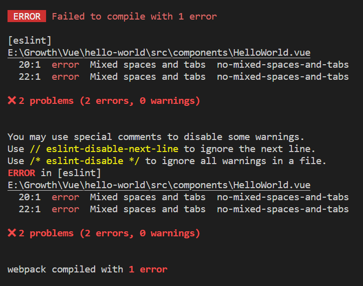

## Mixed spaces and tabs  no-mixed-spaces-and-tabs

---

 VS code를 통해 Vue를 공부하다가 기존 코드 간격인 4에서 2로 변경한 후 다음과 같은 에러가 발생하였다.

### 원인

---

로그에 기록된 설명을 보면 스페이스 바와 탭을 섞어서 사용해서 발생한 에러이다.



### 해결방법

---

해결 방법은 여러가지가 있을 수 있다.

#### 통일

space 또는 tab으로 통일시키는 방법이 있다. 현재 코드에서 탭과 스페이스바의 차이를 확인하기 어렵지만 로그를 통해 보여지는 20, 22번째 라인을 수정해보면 현재 어떻게 사용하고 있는지 확인할 수 있다.

#### 혼용 사용 허용

package.json에 eslintConfig - rules 에 다음과 옵션을 추가해주면 된다.

```java
"parserOptions": {
  "parser": "@babel/eslint-parser"
},
"rules": {"no-mixed-spaces-and-tabs": 0 }
```

### 정리

---

> Space와 Tab 중 어느 것을 사용하는 것은 컨벤션에 따라 다를 수 있다.  
> 일반적으로 Space로 통일성 있게 사용한다.  
>   
> 그렇다면 왜 "Tab과 Space 를 구분하는 것일까?" 라는  
> 궁금증이 생기실 수 있습니다.  
>   
> 이러한 고민은 [**Space와 Tab 의 차이**](tistory-368.html)를 통해 알 수 있습니다.
