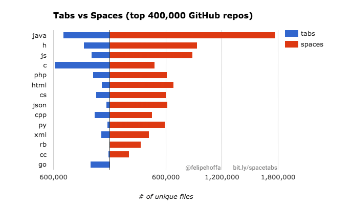

## Space 와 Tab의 차이

---

들여쓰기를 할 때 왜 **Tab** 보다 **Space** 를 사용하는 것을 권장하고 **Space**를 더 많이 사용하는 이유가 무엇일까? 를 알아보고자 한다.

※ 참고: Space와 Tab 을 사용하는 것은 코드 컨벤션에 따라 다를 수 있습니다.

### **Which better?**

들여쓰기를 할 때, Space와 Tab 중 어느 것이 낫다는 논쟁은 오래된 논쟁 중 하나입니다...

특히나 코드 컨벤션은 자신이 편한 것인 무엇인지에 따라 다르기 때문에 더더욱 맞는 정답이 없습니다...

#### **Why use Tabs.**

**1. Capacity Saving(용량 절약)**

**Tab**과 **Space**는 모두 1회당 1byte의 용량을 차지한다. 보통 프로그램에서 간격은 2칸 또는 4칸을 사용한다. 들여쓰기를 위해서 tab은 한 번만 치면 되지만, space는 여러번 쳐야하므로 tab을 이용하는 것이 용량이 더 절약된다는 장점을 갖는다.

**2. Convenience(편의성)**

개발을 하는 이유는 조금 더 편한 서비스를 제공하기 위해서이고 개발의 효율을 위해서도 많은 노력을 하고 있는데 tab을 사용하면 1번으로 끝나지만, space는 들여쓰기 기준에 따라 2칸이면 2번, 4칸이면 4번, 8칸이면 8번을 쳐야하는 불편함이 있다.

또한 줄 간격을 변경할 경우 한번에 IDE를 통해 편집할 수 있다는 장점이 있다.

**3. Tab is Tab**

**Space**는 단어 사이를 분리하기 위해 만들어진 키이고, Tab은 들여쓰기를 하기 위해 만들어진 키이므로

따라서 들여쓰기를 할 때에는 **Tab**을 이용해야 한다.

#### **Why use Spaces**

**1. IDE Independent**

tab을 이용하면 에디터마다 설정값대로 임의로 들여쓰기가 되는 반면, space로 들여쓰기를 하게 되면 에디터가 달라도 코드는 같은 형식으로 보입니다. 따라서 에디터 환경이 다르더라도 들여쓰기 형식을 따로 신경쓰지 않아도 된다는 장점이 있습니다.

**2. Usage**

대부분에 언어에서 Tabs 보다 Spaces를 더 선호하고 많이 사용하고 있기 때문이다. 프로그래밍은 협업하는 경우가 많으므로, 결국 spaces 를 이용하는 것이 코드의 일관성을 유지하기 좋습니다.

### **정리**

> 프로그래밍 하는 것은 협업을 하는 것이다.  
>   
> 어떤 일을 하든지 서로가 원하는게 다를 수 있다.  
> 다른 것은 틀린게 아니라 다른 것 뿐이다.  
>   
> 서로가 서로의 의견을 존중하고 맞춰가면  
> 더 좋은 시너지가 나올 것이다.  
>   
> 결론 Tab과 Space 중 어느 것을 사용하든  
> 맞춰서 통일해서 사용하면 된다.
