오랜만에 다시 수강하러 왔다..

최근에 바쁜일이 조금 많았다..

바쁜 일들을 얼른 끝내고 싶다..

(서론이 너무 길었고..)

오늘은 Java 문법 뽀개기 2주차를 이어나가려 한다.

---

#### **과목 : Java 문법 뽀개기 1주차**

**[ 목차 ]**

**1-20. 날짜와 시간 다루기**

**1-21. 컬렉션 - 개념설명**

**1-22. 컬렉션 - 리스트, 셋, 맵**

**1-23. 컬렉션 - 스택, 큐, ArrayDeque**

**1-24. 제네릭스**

**1-25. 람다**

**1-26. 스트림**

**1-27. 스트림 퀴즈**

**1-28. 네트워킹 - Retrofit, OpenAPI**

---

#### **1. 날짜와 시간 다루기**

> **기본적인 날짜와 시간을 출력 및 데이터를 가공하는 방법에 대해서 배울 수 있다.**

     1) Java에서의 날짜와 시간

      - java.time 패키지 : 날짜와 시간을 사용할 때 자주 사용되는 패키지이다.

> **Package**- 간단하게는 클래스의 묶음이라고 할 수 있습니다. 패키지에는 클래스 혹은 인터페이스를 포함시킬 수 있으며 관련된 클래스끼리 묶어 놓음으로써 클래스를 효율적으로 관리할 수 있습니다.

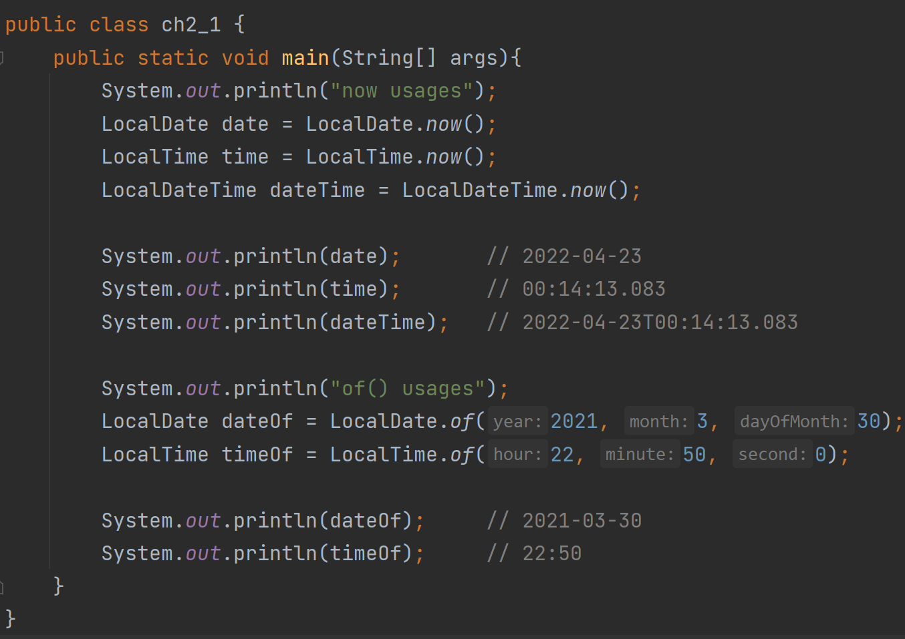

1-1. 현재 날짜와 시간 또는 지정된 날짜와 시간을 출력하는 방법

     2) 날짜와 시간의 형식 수정

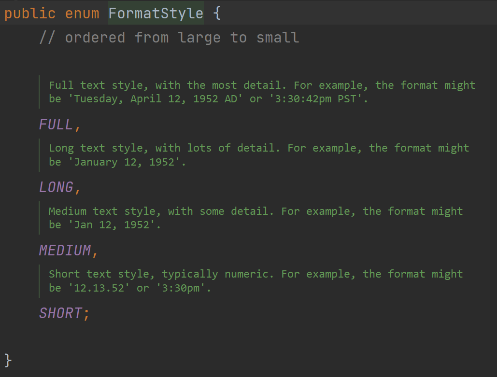

1-2. FormatStyle enum 클래스 내부

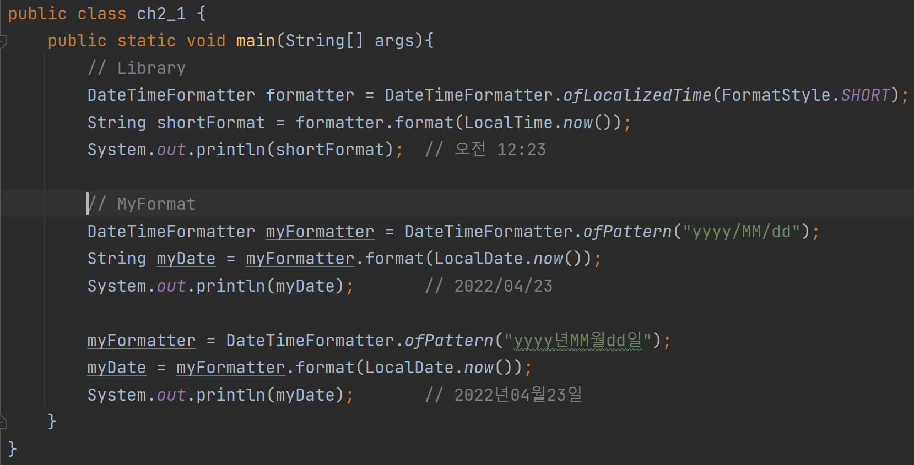

1-3. Formatting 테스트 코드

     3) 날짜와 시간의 차이 계산

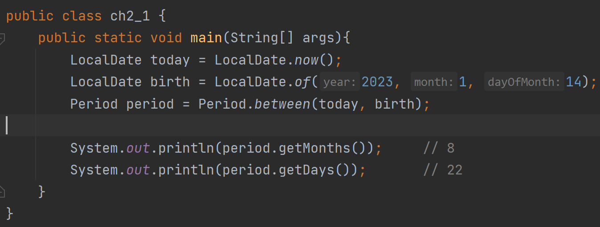

1-4. 날짜와 시간 계산하는 예제 코드

     4) 퀴즈

      - 방법 1 : DateTimeFormatter를 통해 연도/월/일을 얻고, LocalTime을 통해 시간을 받는 방법

      - 방법 2 : DateTimeFormatter을 통해 연도/월/일/시/분을 얻어 출력하는 방법

      => 방법1은 이전에 배운 내용을 참고한 내용이라면, 방법2는 배운 내용을 활용하여 풀이한 것이라고 할 수 있다.

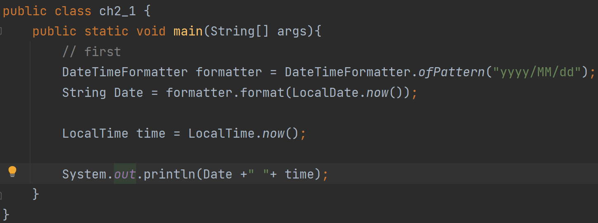

1-5. 퀴즈 풀이 방법 1

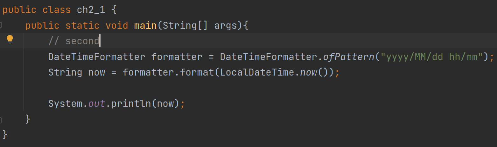

1-6. 퀴즈 풀이 방법 2

---

#### **2. 컬렉션 - 개념 설명**

**※ 학습 목표**

> 1. 자바의 자료구조를 표현하는 인터페이스인 컬렉션(Collection), 그리고 구체적인 자료구조의 종류인  
>    리스트, 스택, Set, Map의 개념과 예제 코드를 배울 것이다.  
> 2. 컬렉션의 개념과 클래스는 코딩을 하면서 숨쉬는 것처럼 계속 사용할 줄 알아야 한다.

**1) 컬렉션 프레임워크**

**- 다수의 데이터를 다루기 위한 자료구조를 표현하고 사용하는 클래스의 집합**

**- 데이터를 다루는데 필요한 풍부하고 다양한 클래스와 기본함수를 제공하기 때문에 많이 유용하다.**

**2) 컬렉션 인터페이스와 자료구조**

> **Collection  
> -** 모든 자료구조가 구현(Implement)하는 인터페이스입니다. 모든 자료구조에 해당하는 클래스,   
>   인터페이스는 언제나 Collection 인터페이스를 구현하고 있습니다.

(1) List : 순서가 있는 데이터의 집합이며, 데이터의 중복을 허용

→ ArrayList, LinkedList, Stack 등

(2) Set : 순서를 유지하지 않는 데이터의 집합이며, 데이터의 중복을 허용하지 않는다.

→ HashSet, TreeSet 등

(3) Map : 키(key)와 값(Value)의 쌍으로 이루어진 데이터의 집합이며, 순서는 유지되지 않으며

     키는 중복을 허용되지 않고 값은 중복을 허용합니다.

→ HashMap, TreeMap 등

(4) Stack : 마지막에 넣은 데이터를 먼저 꺼내는 자료구조(LIFO)

→ Stack, ArrayDeque 등

(5) Queue : 먼저 넣은 데이터를 먼저 꺼내는 자료구조입니다. (FIFO)

→ Queue, ArrayDeque 등

 • 컬렉션 인터페이스에는 컬렉션 클래스에 저장된 데이터를 읽고, 추가하고 삭제하는 등 데이터를

         다루는데 기본적인 메소드들을 정의하고 있다.

---

#### **3. 컬렉션 - 리스트, 셋, 맵**

1) List

- ArrayList는 배열을 이용하여 데이터를 저장하는 List 인터페이스입니다.

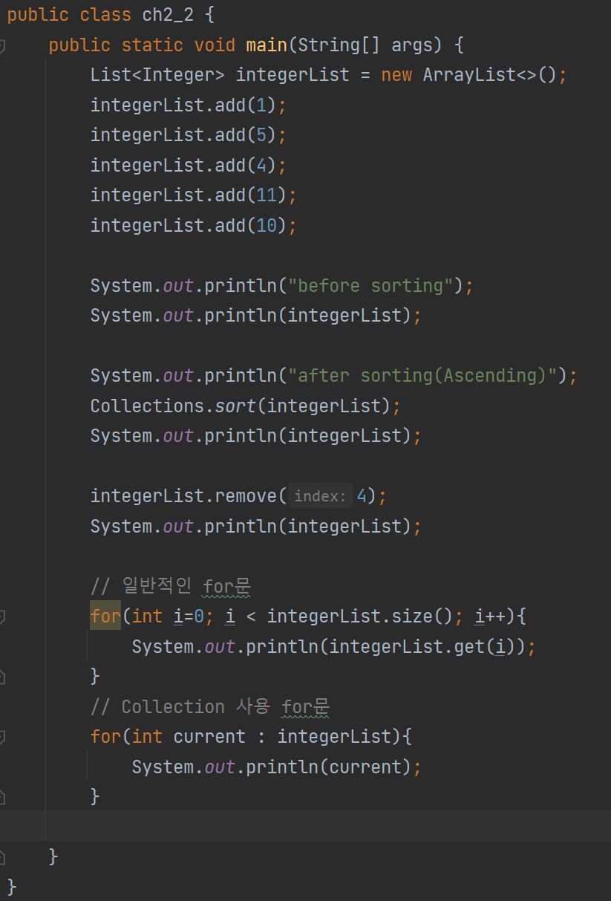

3-1. List 사용 예제 코드

2) Set

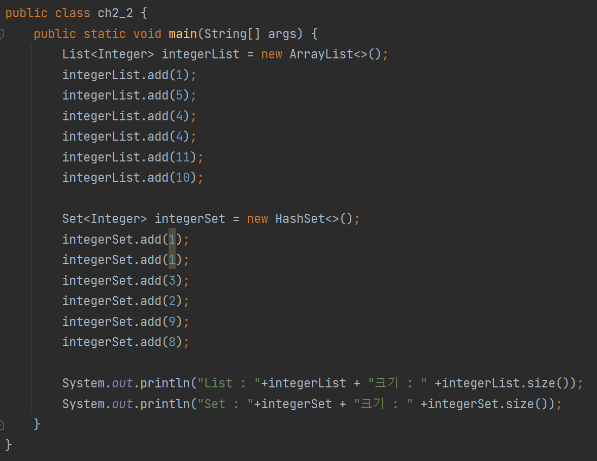

3-2. List와 Set 비교 예제 코드

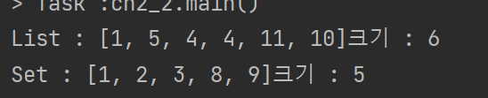

3-3. List와 Set 비교 예제 실행결과

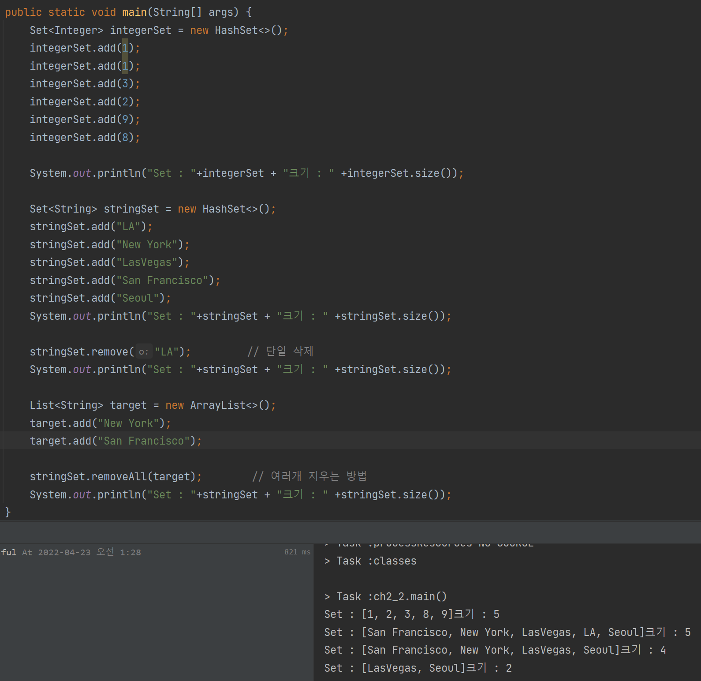

3-4. Set 자료구조에 활용 예제 코드

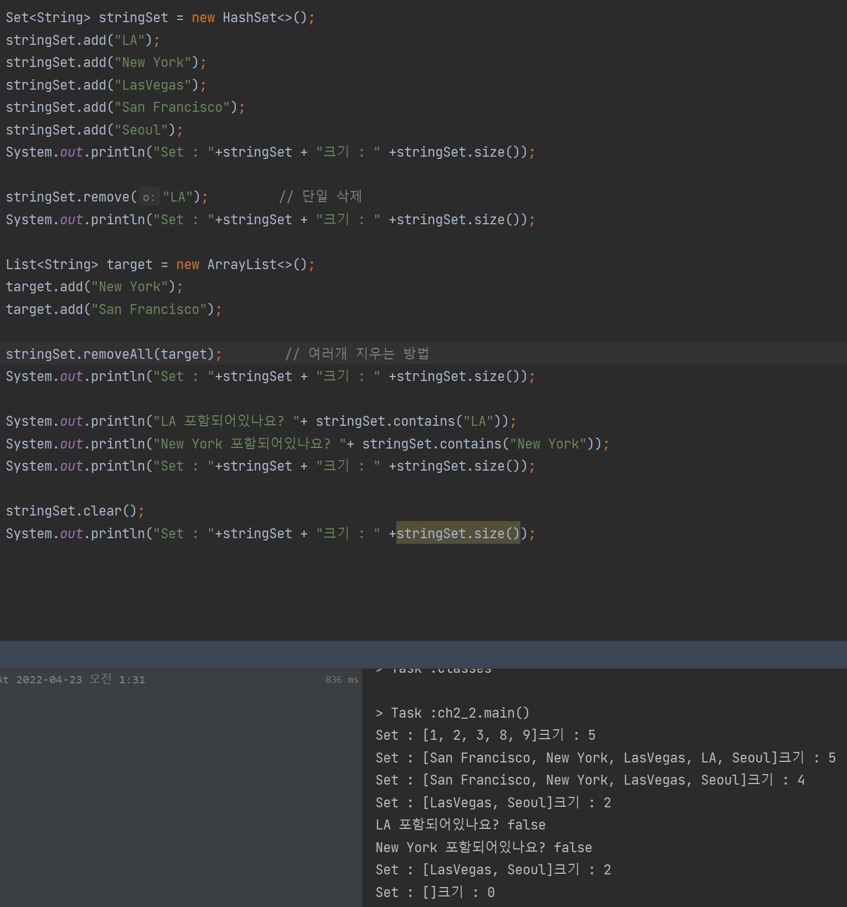

3-5. Set 자료구조 활용 예제 코드(2)

3) Map

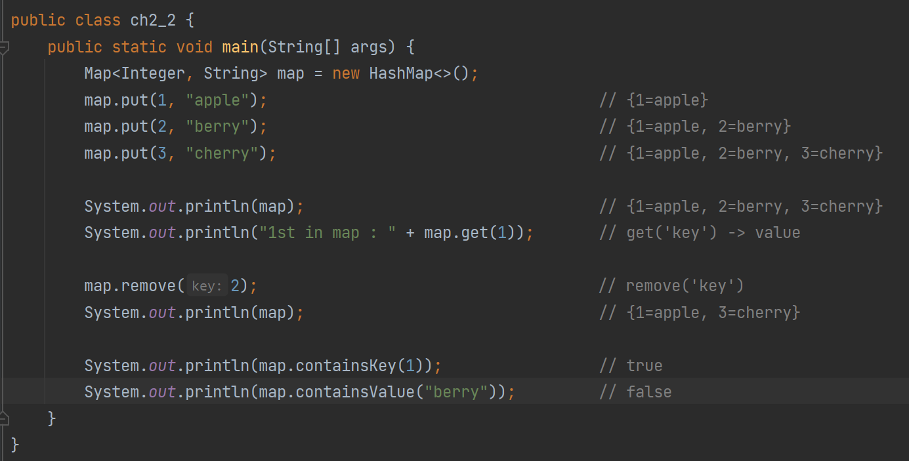

3-6. Map 자료구조 활용 예제 코드

---

#### 

#### **4. 컬렉션 - Stack, Queue, ArrayDeque**

**1) Stack**

 • Stack : 마지막에 저장한 데이터를 가장 먼저 꺼내는 자료구조, 즉 LIFO(Last In First Out)

 • 사용 예 : 웹 브라우저의 앞페이지 이동 뒤페이지 이동 / 그릇 쌓기

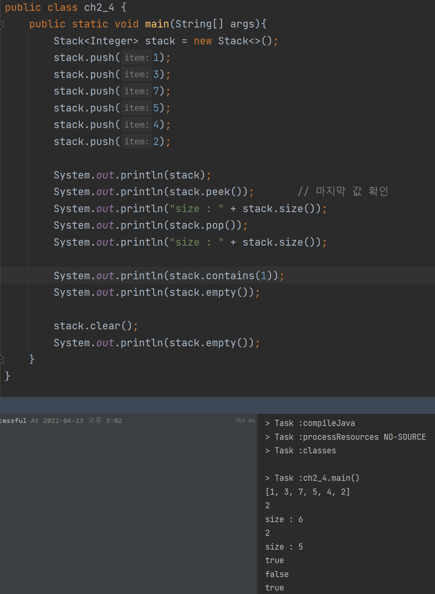

4-1. Stack 사용 예제 코드

    **2) Queue**

 • Queue : 처음에 저장한 데이터를 가장 먼저 꺼내는 자료구조. 즉, FIFO(First In First Out)

 • 사용 예 : 은행 창구 줄서기 / 인쇄작업 대기목록

 • 종류 : 우선순위 큐, 원형 우선순위 큐, 원형 큐 등

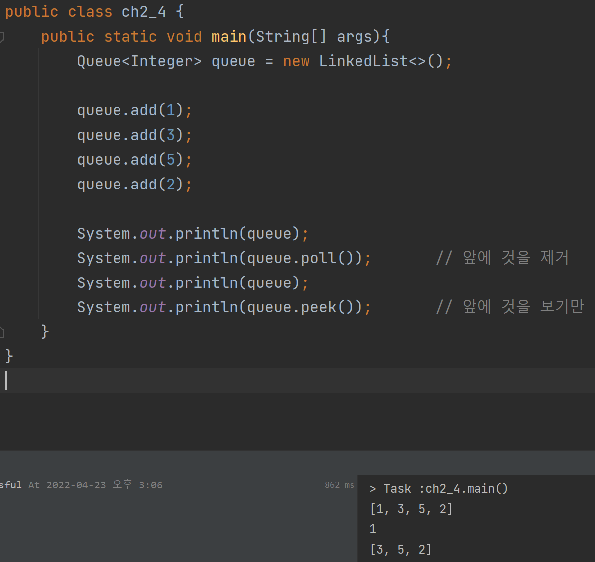

4-2. 연결리스트로 구현한 큐의 사용 예제

**3) ArrayDeque**

 • Deque : 양 끝에서 삽입과 반환이 가능한 자료구조

          - 실무에서는 Stack, Queue 클래스 대신에 ArrayDeque를 사용한다. Stack, Queue의 기능을 모두 포함하면서도

             성능이 좋기 때문이다.

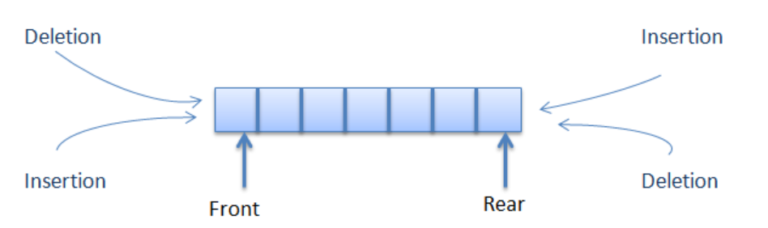

4-3. Deque의 구조 시각화

 • addFirst와 offerFirst의 차이

        - offerFirst는 addFirst와 유사하지만, 큐의 문제가 생길 때 offerFirst는 false라는 리턴 값을 리턴하고, addFirst는 exception이 난다.

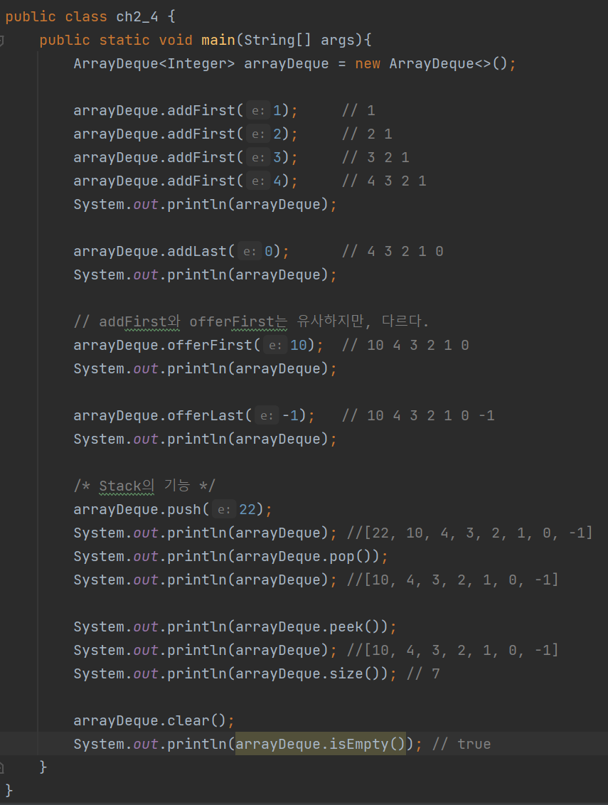

4-4. ArrayDeque의 사용 예제 코드

---

#### **5. 제네릭스**

**1) Generics란?**

 • 다양한 타입의 객체들을 다루는 메소드나 컬렉션 클래스에 컴파일 시의 타입 체크를 해주는 기능을 의미

 • 제네릭스를 왜 사용해야할까?

      - 객체의 타입을 컴파일 시에 체크하기 때문에 안정성이 높아집니다.

      (의도하지 않은 타입의 객체가 저장되는 것을 막고 잘못된 형변환을 막을 수 있기 때문입니다!)

**2) Generics 형식과 약어**

 • **Generics** 형식

> public class 클래스명<T> {...}   
> public interface 인터페이스명<T> {...}

 • **Generics 자주 사용되는 타입인자 약어**

 - <T> == Type

 - <E> == Element

 - <K> == Key

 - <V> == Value

 - <N> == Number

 - <R> == Result

    • 예시 

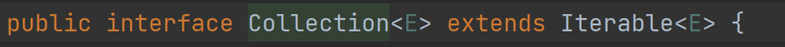

5-1. 콜렉션 인터페이스 구조

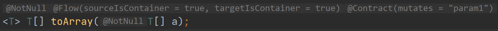

5-2. 콜렉션 인터페이스 내<T>에 대한 설명

      - 클래스에서 선언한 타입이 아닌 경우에 이 메소드에서만 쓰이는 어떤 제네릭스를 표현할 때 라고 선언하는 것은 우리가

        클래스에서 라고 선언한 것처럼 이제 어떤 타입을 T라고 표현하고 T라는 제네릭스를 이 메소드에서만 사용할 거야라는 표현이다. 

     - toArray는 어떤 타입을 배열로 받아서 배열을 리턴하는 함수로 사용은 앞에서 먼저 꺽쇠로 새로운 알파벳을 선언 해주고

        이 안에서 타입처럼 사용한다 라고 이해하시면 될 것 같다.

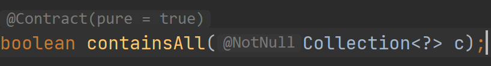

5-3. 콜렉션 인터페이스 내 Collection<?>에 대한 설명

      - 물음표는 내가 위에서 선언했던 E가 아니어도 돼라는 의미이다.

      - 컬렉션 인터페이스는 어쩃든 필수적으로 제네릭스를 받는데, 이 제네릭스 자리에 아무 것이나 와도 되는 켈렉션을 아무거나

        받겠다라는 의미이다.

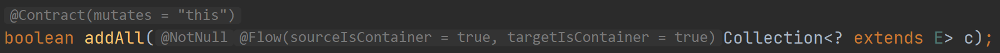

5-4. 콜렉션 인터페이스 내 Collection<? extends E>에 대한 설명

      - 이 콜렉션에 어떤 것들을 추가 할 때는 다른 콜렉션을 넣어서 여러 개를 추가할 수 있다. 대신에 그 콜렉션은 어떤 타입을 받는

        콜렉션이냐 하냐면 E라는 extend한 즉, E라는 그 타입이거나 그 타입을 상속받은 자식 클래스를 가진 콜렉션에 한정해서만

       내가 addAll을 받아줄게 라는 말입니다. 

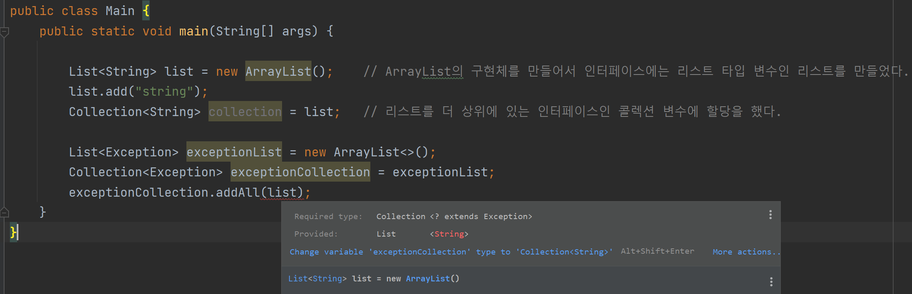

5-5. Collection 인터페이스 addAll 함수에 대한 예제

      - required type는 콜렉션인데, 너는 너는 스트링 타입으로 받는 리스트를 썻어 라는 말입니다. 

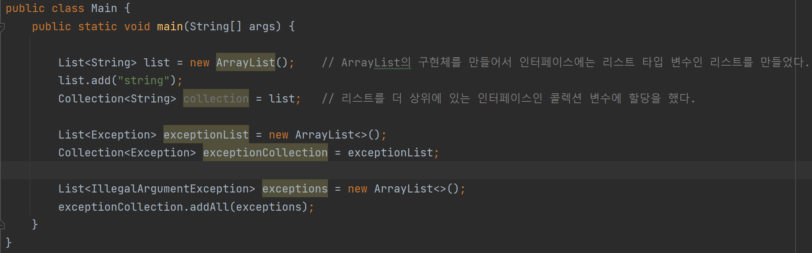

5-6. Collection 인터페이스 addAll 메서드의 옳은 사용 예제

      - exceptionCollection는 exception의 타입에 대한 콜렉션인데 여기에 addAll하는 친구는 리스트 콜렉션 중에 하나이다.

        IllegalArgumentException은 이 exception의 자식 클래스 중에 하나이므로 이런 함수의 명세에 의해서 **? extends E** 라는

       함수의 명세에 의해서 가능해지는 것입니다.

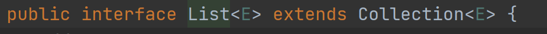

5-7. List 인터페이스

      - 리스트를 보면 extends Collection으로 되어 있다. 즉, 콜렉션에 있는 인터페이스 함수들을 다 받으면서도 자기만의 함수들이

        추가로 더 있는 인터페이스라는 것입니다.

      - 콜렉션에 사용되었던 E랑 같은 타입의 제네릭스를 받는 라는 것입니다.

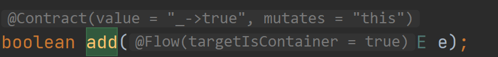

5-8. List 인터페이스 내 add 메소드

      - add 메소드는 리스트에만 있는 메소드이고, element타입을 받는다.

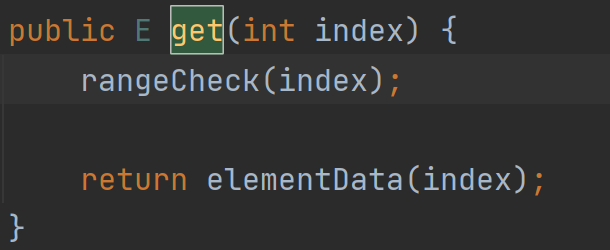

5-9. ArrayList 구현체 내 get 메소드

      - get은 rangeCheck를 한 다음에 elementData에다가 idndex를 해서 함수로 호출해서 리턴하는 구조이다.

      - 이전 인터페이스에는 함수의 바디가 없었지만, 현재 메소드는 바디가 존재한다. 

> (요약) 제네릭스를 확인하면 동작은 같지만, 클래스 타입만 바뀌어야 하는 경우를 쉽게 다룰 수 있습니다.   
> 이런 경우에 컴파일 언어의 타입 안전성까지 보장하면서도 유연한 프로그램을 작성할 수 있는 장점이 있다.

---

#### **6. 람다**

**1) 람다식(Lambda expression)**

 • "식별자 없이 실행 가능한 함수"라고 말할 수 있습니다. 즉, 함수의 이름을 따로 정의하지 않아도 곧바로 함수처럼

         사용할 수 있는 것입니다. 문법이 간결하여 보다 편리한 방식입니다. (익명 함수라고도 부릅니다.)

 • 람다식이 코드를 보다 간결하게 만들어주는 역할을 하지만 그렇다고 무조건 좋다고만 이야기 할 수는 없습니다.

      - 람다를 사용하여서 만든 익명 함수는 재사용이 불가능합니다.

      - 람다만을 사용할 경우 비슷한 메소드를 중복되게 생성할 가능성이 있으므로 지저분해질 수 있습니다.

**2) 람다식의 형식**

 • '→'의 의미는 매개변수를 활용하여 {}안에 있는 코드를 실행한다는 것입니다.

> [기존의 메소드 형식] - 반환타입 메소드이름 (매개변수 선언) { 수행 코드 블록 }  
> [람다식의 형식] - ~~반환타입 메소드이름~~ (매개변수 선언) -> { 수행 코드 블록 }

**3) 이중 콜론 연산자**

 •이중 콜론 연산자는 매개변수를 중복해서 사용하고 싶지 않을 때 사용하곤 합니다. 출력결과를 보시면 cities의

        요소들이 하나씩 출력 될 것입니다. 즉, cities.forEach(x -> System.out.println(x)); 와 똑같은 의미인 것이죠!

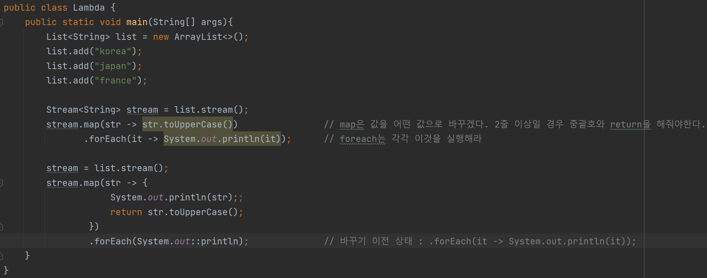

6-1. 간단한 람다식 사용 예제코드

---

#### **7. 스트림**

> 스트림은 람다를 활용할 수 있는 기술 중 하나입니다.   
> 람다를 충분히 익힌 후, 스트림을 배운다면 보다 효율적인 코드를 작성할 수 있다.

**1) 스트림**

 • 스트림은 곧 '데이터의 흐름'입니다.

 • 컬렉션의 저장 요소를 하나씩 참조해서 람다식으로 처리할 수 있도록 해주는 반복자입니다.

 • 스트림을 활용해서 필터링,데이터 변경, 다른 타입이나 자료구조로 변환 등을 할 수 있습니다.

**2) 스트림 특징**

 • 스트림은 데이터 소스를 변경하지 않습니다.

 • 스트림은 작업을 내부적으로 반복 처리합니다.

 • 스트림은 컬렉션의 요소를 모두 읽고 나면 닫혀서 재사용이 불가능합니다. 그러므로 필요할 경우 재생성을 해야합니다.

**3) 스트림 구조**

   1. 스트림 생성

   - 스트림을 이용하기 위해 먼저 스트림을 생성해야합니다.

   - Stream<T> Collection.stream() 을 이용하여 해당하는 컬렉션을 기반으로하는 스트림을 생성할 수있습니다.

   2. 중간 연산

 - 중간 단계로써 데이터의 형변환 혹은 필터링, 정렬 등 스트림에 대한 가공을 해줍니다.

   - map(변환) / sorted(정렬) / skip(스트림 자르기) / limit(스트림 자르기) 등이 있습니다.

   3. 최종 연산

 - 스트림의 요소를 소모해서 결과를 반환하는 단계입니다. 최종 연산 이후에는 스트림이 닫히게 되고 더 이상 사용할 수 없습니다. 

   - 최종 연산의 결과값은 단일 값일 수도 있으며 배열 혹은 컬렉션일 수도 있습니다.

 - collect()를 이용해서 다른 콜렉션으로 바꾸는 것, reduce를 이용해서 incremental calculation하는 것도 가장 많이 쓰이는 패턴

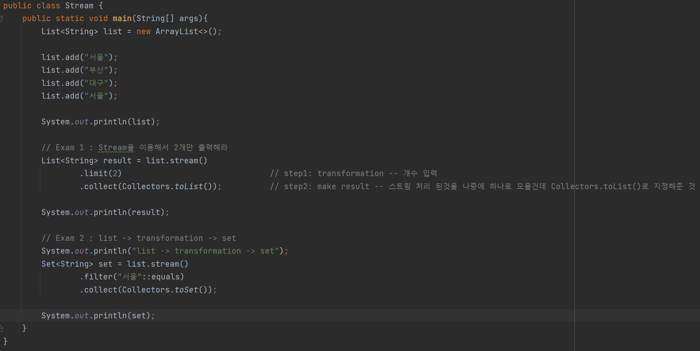

7-1. 간단한 Stream 예제코드

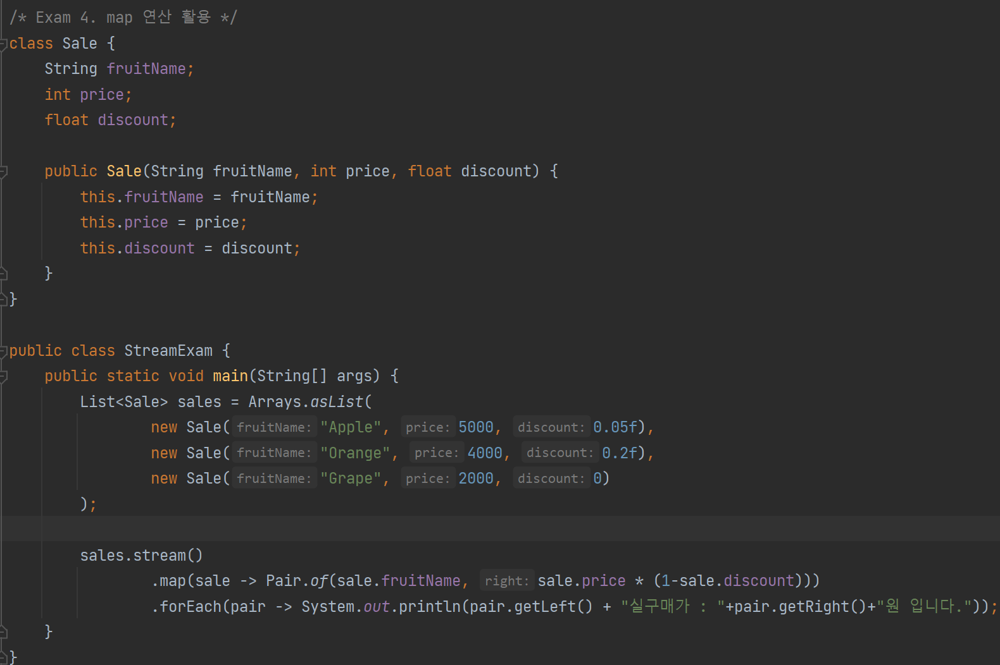

7-2. 스트림 map 활용 예제 코드

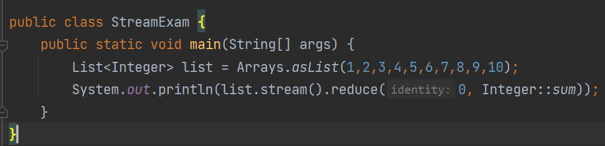

7-3. 스트림 reduce 활용 예제 코드

---

#### **8. 스트림 퀴즈**

> '이'씨 성을 가진 사람들의 수를 세볼려고 합니다. 스트림을 활용해서 코드를 만들어보세요! 이름 : ["김정우", "김호정", "이하늘", "이정희", "박정우", "박지현", "정우석", "이지수"]

- 방법 1 : contains메소드 활용 

- 방법 2 : startsWith메소드 활용

- 방법 3 : substring으로 성의 인덱스 값을 활용

=> 방법 1을 사용할 경우, 이름에 "이"가 들어갈 경우에도 포함되어 출력되므로 오답

     방법 2을 사용할 경우, 이름에 성이 "이"인 사람의 이름만 출력되는 것을 확인할 수 있다.

     방법 3을 사용할 경우, 이름에 성의 인덱스가 0이라는 가정하에 풀이되는 것이다.

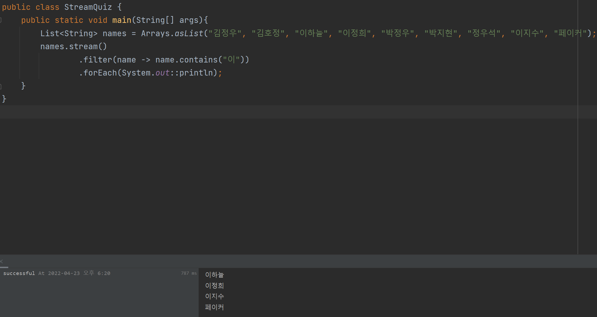

8-1. 스트림 퀴즈 풀이(방법 1)

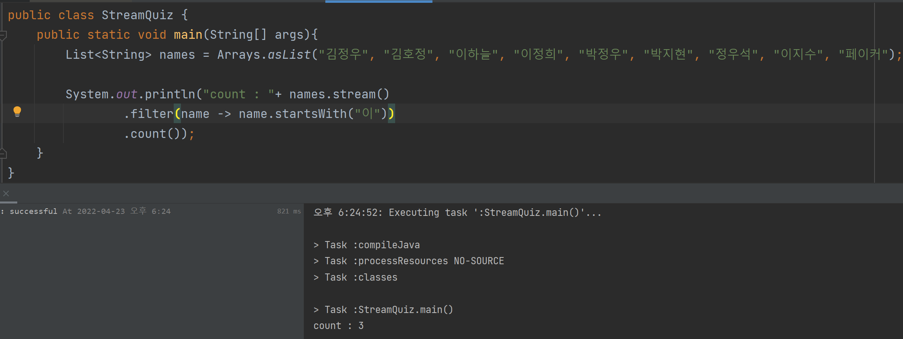

8-2. 스트림 퀴즈 풀이(방법 2)

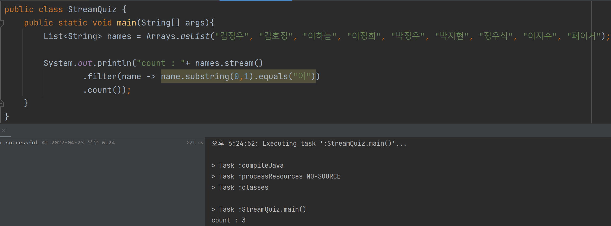

8-3. 스트림 퀴즈 풀이(방법 3)

---

#### **9. 네트워킹 - Retrofit, OpenAPI**

> 1) 네트워크 개념과 Open API를 활용하는것에 대해 공부해보겠습니다!  
> 2) 공공 데이터 API를 어떻게 활용하는지 알아보겠습니다!

​ **1) 네트워킹(Networking)**

• 두 대이상의 컴퓨터를 케이블 또는 인터넷으로 연결하여 네트워크를 구성하는 것을 말합니다.

​**2) 네트워킹의 기본적인 개념**

 • 클라이언트(Client) / 서버(Server) (컴퓨터간의 관계를 역할로 구분)

   - 서버 : 서비스를 제공하는 컴퓨터, 요청에 응답하는 컴퓨터

   - 클라이언트 : 서비스를 사용하게 되는 컴퓨터, 요청을 하는 컴퓨터

• IP 주소

   - 컴퓨터를 구별하는데 사용된느 고유한 값으로 인터넷에 연결이 되어있는 모든 컴퓨터는 IP 주소를 갖습니다.

• URL(Uniform Resource Locator)

   - URL은 인터넷에 존재하는 여러 서버들이 제공하는 자원에 접근할 수 있는 주소를 표현하기 위한 것입니다!

         (우리가 네이버, 구글을 검색할 때도 URL을 이용하여 접근을 하는 것이죠!)

   - URL의 형식 '프로토콜://호스트명:포트번호/경로명/파일명?쿼리스트링#참조' 의 형식을 띄고 있습니다.

        → 프로토콜은 복수의 컴퓨터 사이에서 데이터 통신을 원활하게 하기 위해 필요한 통신 규약을 의미합니다!

            대표적인 예시로는 Http가 있죠!

   - **포트번호** : 통신에 사용되는 서버의 포트번호입니다

   - 포트(port)는 보통 항구나 공항을 의미하는 것이죠? 컴퓨터에서도 포트는 비슷한 역할을 지닙니다.

          외부의 다른 장비와 접촉하기 위한 플러그 역할을 하는 것이죠. 포트번호는 어떤 프로그램에 접속 할 것인지를

          식별하는 역할을 하는 것이죠! 아무것도 입력하지 않으면 기본값은 http는 80번, https는 443 포트입니다.

> API(Application Programming Interface)  
> 응용 프로그램에서 사용할 수 있도록 운영체제나 프로그래밍 언어가 제공하는 기능을 제어 할 수 있게 해주는 인터페이스를 의미합니다. client-server 관점에서 API는 요청과 응답의 형식에 대한 약속입니다.

​**3) Retrofit 라이브러리를 활용하여 API 호출하기**

 • 왜 Retrofit을 사용해야할까?

   - Retrofit을 사용하지 않고 원시적인 방법으로 구현을 하려면, JSON 파싱, 캐싱 등 구현해야할 부분이 너무나 많습니다. 

   - Retrofit 라이브러리를 사용하게 될 경우 복잡한 구현들을 감소시켜줍니다. 즉, API에 대한 접근을 보다 쉽게 만들어주죠. 

- 각종 에러처리를 쉽게 해결할 수 있으며 원시적인 방법에 비해 가독성도 훌륭합니다.

 - 실제로 프로젝트나 프로그램을 만들 때 공공 데이터 API를 많이 활용하곤 합니다.

​**4) TCP와 UDP**

**- TCP/IP 프로토콜은 시스템간의 통신을 위한 표준 프로토콜로, 프로토콜의 집합을 의미합니다.**

**TCP와 UDP 역시 이 TCP/IP 프로토콜에 포함되어 있으며 OSI 7계층의 전송계층에 해당합니다.**

 • TCP :  전화와 유사하다고 생각하시면 됩니다. 데이터를 전송하기 전에 상대 컴퓨터와 연결을 한 후,

          데이터를 전송합니다. 이후 결과를 확인하며 만약 수신이 제대로 되지 않았을 경우 재전송을 실시합니다.

• UDP : UDP는 상대편과 연결하지 않고 데이터를 전송합니다. 또한 데이터가 제대로 수신되었는지를

          확인하지 않기 때문에 신뢰성이 형성되지 않습니다.

 • 스트림을 활용해서 필터링,데이터 변경, 다른 타입이나 자료구조로 변환 등을 할 수 있습니다.

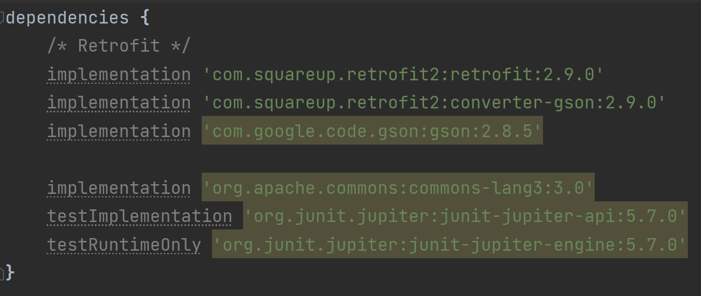

9-1. build.gradle에 Retrofit dependency 추가

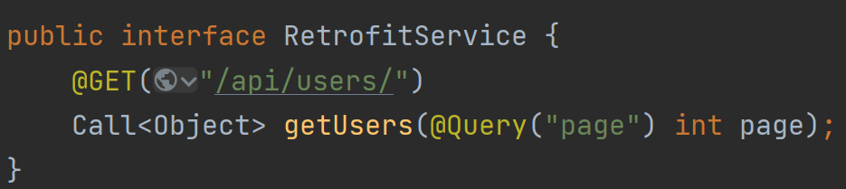

9-2. RetrofitService Interface 코드

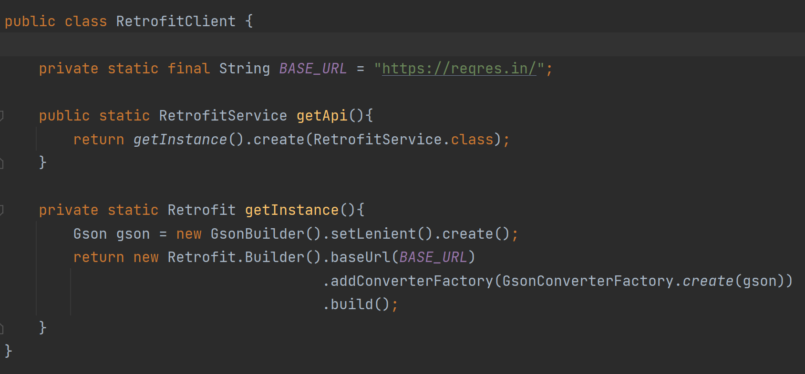

9-3. RetrofitClient Class 코드

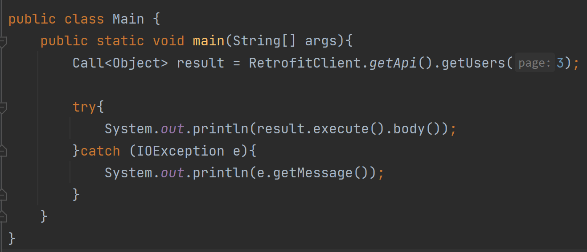

9-4. Main 클래스 코드

---

#### **정리**

와... 자바 문법 1주차 강의를 한번에 들을려고 했던

나의 생각은 저멀리 날아가버렸다...

생각보다 내용이 많고 난이도도 있는 내용도 있어서 재미있었다.

Retrofit을 들어만 봤는데, 실제 사용하였는데 생각보다 쉽지 않아보였다...

더 열심히 공부해서 더 잘할 수 있도록 화이팅!!
