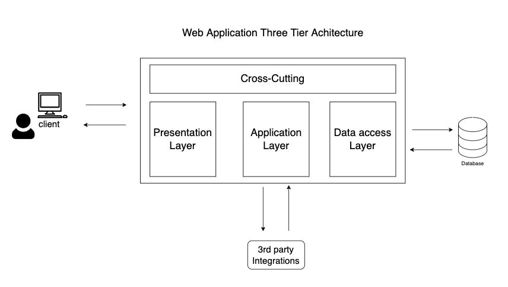
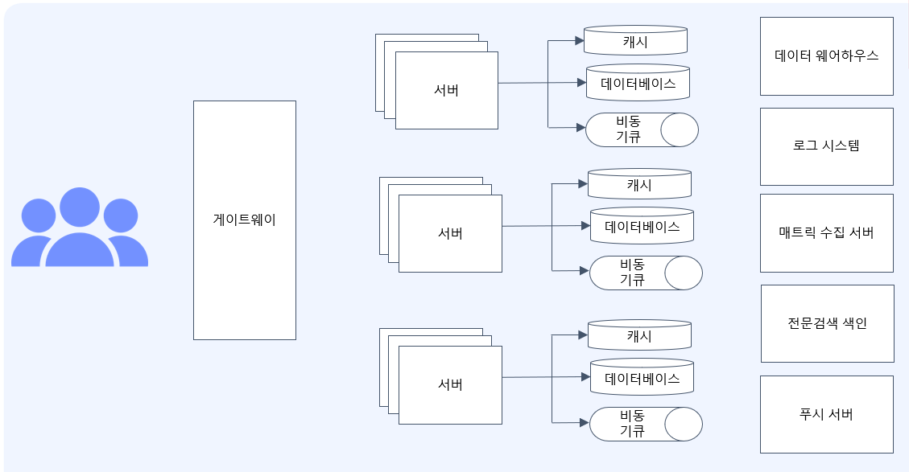
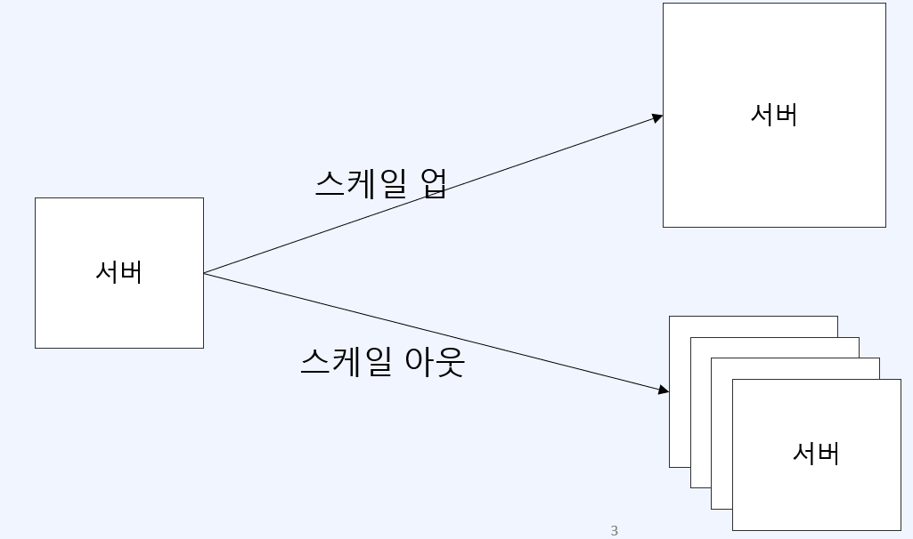
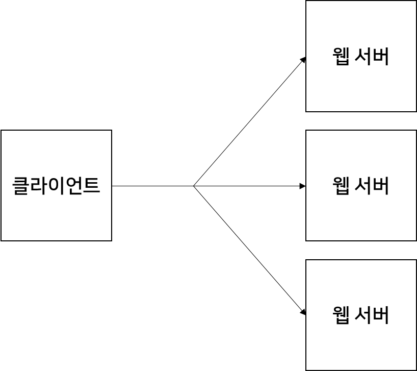
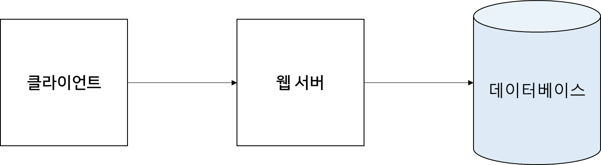
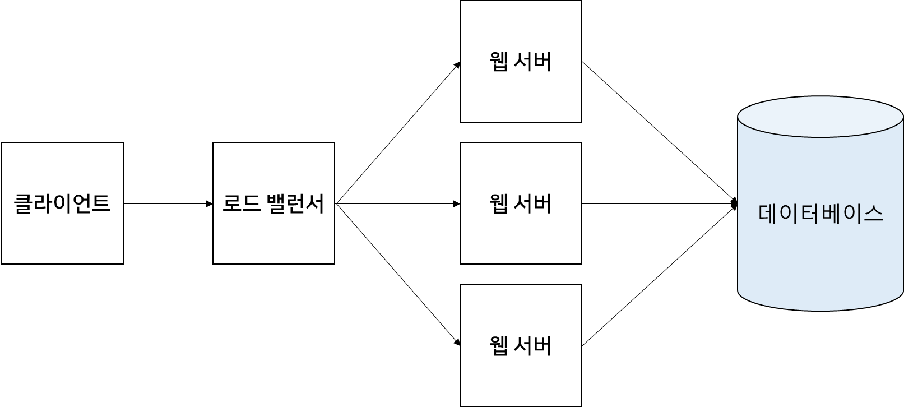
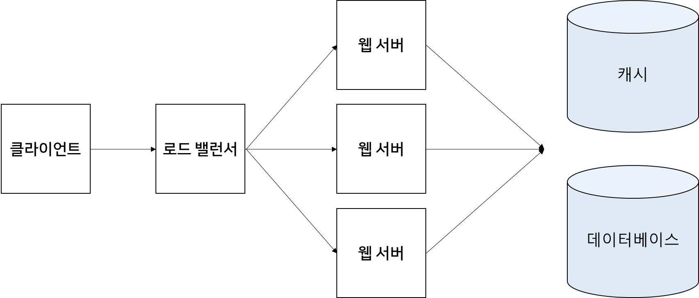
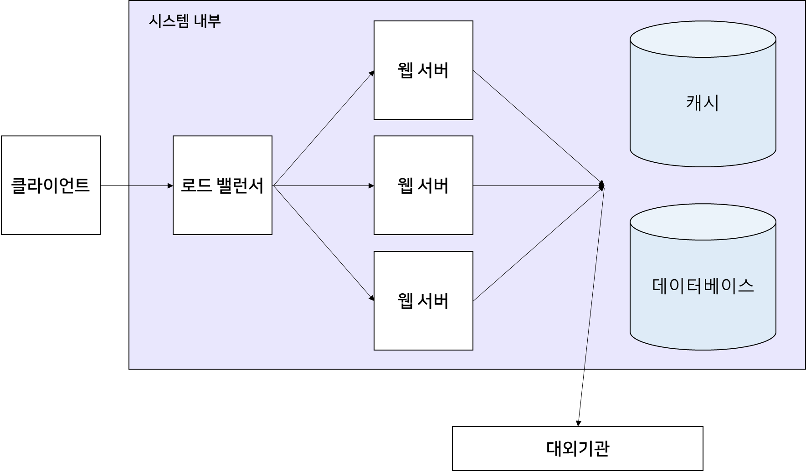
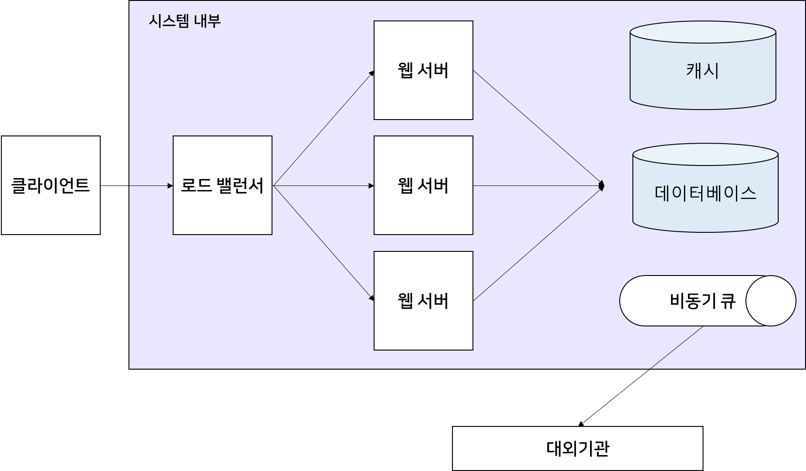
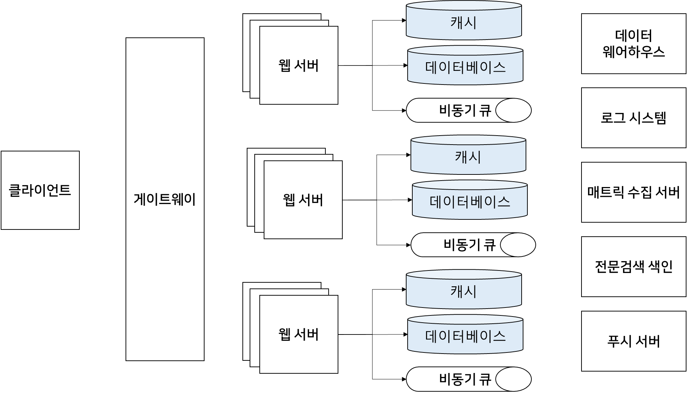

## 웹의 기본 아키텍처

---

### **웹 애플리케이션 3단계 계층 구조(Web Application Three Tier Architecture)**

---

#### **기본 구조**

가장 기본적인 웹의 구조로 클라이언트, 서버, 데이터베이스로 이루어진 구조입니다.

하지만 웹의 요구사항이 점점 복잡해짐에 따라서 하나였던 서버 Layer가 웹 서버, 웹 애플리케이션 서버 Layer로 분리되는 방식으로 발전해 왔습니다.

* **웹 서버**HTML, CSS, Javascript 와 같이 정적인 데이터를 제공
* **웹 애플리케이션 서버**데이터베이스에 저장된 데이터처럼 동적으로 변하는 데이터를 처리

#### **웹 서버,  웹 어플리케이션 서버는 왜 나누어져 있을까?**

과거에는 웹서버만 있는 형태에서 웹의 복잡도가 증가함에 따라 웹 서버와 웹 어플리케이션 서버로 분리되는 형태로 발전해 왔습니다.

핵심은 **관심사의 분리** / **관측가능한 시스템** / **효율적인 리소스 사용이라는** 측면이다.

1. **관심사의 분리**
2. **관측가능한 시스템**
3. **효율적인 리소스 사용**

각 컴포넌트들을 관심사나 역할에 맞게 잘게 분리하면 역할에 맞는 자유로운 최적화 기법들을 자유롭게 사용할 수 있으며 문제의 범위를 좁힐 수 있다.  

예시) 웹의 버튼이 잘못 노출되었을 경우, 이것은 명백히 웹 서버의 문제로 볼 수 있다.   

Layer 가 많아질수록 복잡도가 늘어나 관리하기 힘들다는 단점이 있다.

#### **[참고] 3 Tier Architecture**

* **Presentation Layer**유저와 브라우저 등을 이용해 직접적으로 접촉을 하는 계층으로 웹 서버와 유저 인터페이스 요소들이 이 영역에 포함된다.
* **Application Layer**  
  비즈니스 계층, 비즈니스 로직 또는 도메인 로직이라고도 불리며 유저의 요청을 브라우저로부터 받아서 처리하는 계층이다. 애플리케이션 서버가 이 계층에 포함되며, 데이터 접근을 위한 경로를 규격화하는 등의 과정이 작성된다.
* **Data access Layer**Persistence Layer라고도 불리며 애플리케이션의 데이터 저장소에 접근하여 데이터를 불러오거나 저장을 담당하는 계층이다. Application Layer는 이 계층과 밀접한 연관을 가지고 있다. Application Layer의 로직들은 어느 데이터베이스에 접근해서 데이터를 회수하고 저장할지를 최적화할 수 있다.
* **Cross-cutting**주로 보안, 통신, 운영 관리 등을 위한 요소들이다. Spring 프레임워크의 AOP 개념과 밀접한 연관이 있다.
* **Third-party integrations**제3의 API 서비스를 이용하는 것을 의미한다. 예를 들면, OAuth 2.0을 이용한 소셜 로그인 API, PG 사를 이용한 결제 API 등이 속한다.

클라이언트는 서비스가 잘됨에 따라 무한정 증가할 수 있는 구조이다. 

서비스가 잘되면 사용자가 늘어날 것이고 사용자는 클라이언트이므로 클라이언트는 무한정 증가하게 될 것이다. 

그렇다면 웹 서버, 웹 애플리케이션 서버, 데이터베이스도 무한정 늘어날 수 있을까?

아쉽게도 자원은 유한하기 때문에 3 Layer는 무한정 늘릴 수 없다. 

대용량 시스템에서는 이러한 제약을 극복하기 위해서 **캐시, 비동기 큐** 등을 활용하게 됩니다.

### **데이터베이스가 병목인 이유**

---

데이터베이스가 병목인 이유를 이해하기 위해서는 알아야 하는 개념이 있다.

#### **스케일 업과 스케일 아웃**

**스케일 업**

1개의 서버의 사용을 높여 더 많은 요청을 처리할 수 있도록 하는 것

**스케일 아웃**

서버의 대수를 늘리는 것이라고 생각하면 쉽다. 하나의 서버에서 더 이상 처리할 수 없는 요청이 왔을 때 서버의 대수를 늘려서 부하를 분산시키는 방법이다.

| **구분** | **스케일 업** | **스케일 아웃** |
| --- | --- | --- |
| **유지보수 및 관리** | 쉬움 | 여러 노드에 적절히 부하분산 필요 |
| **확장성** | 제약이 있음 | 스케일업에 비해 자유로움 |
| **장애복구** | 서버가 1대, 다운타임이 있음 | 장애 탄력성이 있음 |

#### **언제 스케일 아웃인 가능한가?**

대용량 트래픽을 처리하기 위해서는 스케일 업보다는 스케일 아웃이 유리해 보이는데 스케일 아웃은 항상 가능할까?

스케일 아웃을 통해 서버 여러 대가 되더라도 마치 하나의 서버인 것처럼 동작해야 한다. 

**같은 입력에 대해서는 항상 같은 결과를 반환해야 한다.**

서버가 3개라고 해서 클라이언트가 요청하는 서버에 따라 데이터가 다르다면 불안정한 서비스가 될 것이다. 

여러 개에 서버들은 하나의 공통된 데이터베이스를 바라보게 된다.

#### **데이터베이스가 병목인 이유**

**1. 비용적인 문제**

> 데이터베이스를 스케일 아웃을 하기는 어려울까?  
>   
> 스케일 아웃을 하기 위해서는 가장 중요한 전제조건이 있다.  
>  **상태가 없어야 한다**는 것이다.  
>   
> 데이터베이스는 데이터라는 상태를 관리하고 있어  
> 서버보다 스케일 아웃을 하기 위해서는 훨씬 많은 비용이 필요한다.

불가능한 것은 아니다. 독립적인 파티션을 한다던가 데이터베이스를 스케일 아웃 하는 다양한 기법들이 있지만 서버에 비해 훨씬 많은 비용이 든다는 것은 분명하다. 

현재 서버 아키텍처는 상태관리를 데이터베이스에 위임하고, 서버는 상태관리를 하지 않는 방향으로 발전하고 있다. 

이로 인해 서버는 자유롭게 스케일 아웃을 할 수 있는 구조가 된다.

하지만 데이터베이스는 스케일 아웃하기 쉽지 않고 비용이 많이 들기 때문에 스케일 아웃이 어렵다는 지점에서 데이터베이스가 병목이 되는 이유를 쉽게 알 수 있다.

**2. 응답 속도**

스케일 아웃 외에도 서버 같은 경우 메모리에 있는 데이터를 활용하고 이를 기반으로 응답을 처리한다.

데이터베이스는 디스크의 데이터를 접근해서 가져오기 때문에 서버보다 비교적 처리 속도가 늦은 것은 어쩔 수 없다. 

또한 서버와 데이터베이스 사이에는 네트워크 구간이 존재하기 때문에 네트워크 상황에 따라서 요청 속도가 언제든지 느려질 수 있다. 

### **대용량 시스템 아키텍처 맛보기**

---

#### **대용량 트래픽, 데이터 처리가 어려운 이유**

**1. 다중 서버와 데이터베이스**

하나의 서버 또는 데이터베이스로 감당하기 힘든 부하 즉 다수의 서버와 데이터베이스를 마치 하나인 것처럼 동작하기 위해 여러 가지 기법들이나 최적화 방법들을 사용해야 하기 때문이다. 

**2. 24시간 무중단 배포**

웹 서비스들은 **24시간 무중단**이라는 단점을 가지고 있어 잘못된 코드 한 줄이 미치는 영향의 범위가 트래픽에 따라서 굉장히 커지게 된다. 잘못된 코드 한줄이 1초 동안 수백 만 건에 데이터를 오염시킬 수 있기 때문이다. 

**3. 복잡한 의존 관계**

대용량 시스템들은 굉장히 복잡한 형태 많은 팀들이 협업하면서 서비스를 만들게 되어 여러 마이크로 서비스들이 복잡한 의존 관계를 가지고 있다. 

하나의 서버에서 단순히 조인도 가능하고 여러 트랜잭션 보장들이 쉽게 되지만, **마이크로 서비스 아키텍처 분산 환경**에서는 이것조차도 난도가 높은 기술이 된다.

정리하면

* **다중 서버와 다중 데이터베이스 사용**  
  => 하나의 서버로 감당하기 힘들어 대부분 여러 개의 서버 또는 데이터베이스를 사용함.
* **데이터의 일관성**=> 여러개의 서버에서 유입되는 데이터의 일관성을 보장할 수 있어야 함.
* **위험성**  
  코드 한 줄이 데이터에 미치는 영향범위가 굉장히 커짐
* **시스템 복잡도**  
  여러 서비스들이 얽혀있어, 시스템 복잡도가 상당히 높음

#### **대용량 시스템은 어떠해야 하는가?**

여러 가지 조건이 있을 수 있지만 아래 3가지는 반드시 갖추어야 하는 필수 요소입니다.

**1. 고가용성**

언제든 서비스를 이용할 수 있어야 한다.

**2. 확장성**

시스템이 비대해짐에 따라 증가하는 데이터와 트래픽에 대응할 수 있어야 한다.

**3. 관측가능성**

문제가 생겼을 때 빠르게 인지할 수었어야 하고 문제의 범위를 최소화할 수 있어야 한다.

#### 대용량 시스템의 아키텍처 구조

**1. 클라이언트 - 서버 - 데이터베이스 구조**

사용자가 적을 경우 적절한 응답시간을 줄 수 있다. 하지만 사용자가 점점 증가함에 따라서 서버의 응답속도가 느려지고 있다고 생각해 보자.

무엇을 할 수 있을까? 가장 쉽게 접근할 수 있는 방법은 서버의 스케일 아웃이다.

**2. 서버의 스케일 아웃**

서버의 대수를 늘려서 하나의 서버가 받는 요청을 줄일 수 있다. 

서버의 스케일 아웃을 적용할 때 중요한 점은 부하 분산을 어떻게 할 것인가는 중요한 문제이다. 

서버 3대를 띄웠는데 하나의 서버에만 요청이 몰리게 되면 서버를 늘릴 이유가 없게 된다. 그래서 **nginx와** 같은 로드밸런서를 앞단에 두게 된다.

로드밸런서가 클라이언트의 요청을 받게 되고 어떤 서버로 보낼지 결정하게 된다. 

대부분 **라운드 로빈 알고리즘**을 많이 사용하게 되고 서비스 특징에 따라서 여러 알고리즘을 혼합해서 로드밸런싱을 할 수 있습니다. 

[참고] [Nginix](tistory-376.html)

[[Nginx] 로드밸런싱

로드 밸런싱 로드 밸런싱이란? 로드 밸런싱은 애플리케이션을 지원하는 리소스 풀 전체에 네트워크 트래픽을 균등하게 배포하는 방법입니다. 최신 애플리케이션은 수백만 명의 사용자를 동시

to-be-a-artist.tistory.com](tistory-376.html)

로드 밸런서와 스케일 아웃을 서버에 적용했더니 서버에 응답 속도가 안정적이기 시작합니다. 그런데 서버를 아무리 늘려도 데이터베이스의 응답 속도가 느려져서 전체 서비스의 속도가 느려지게 되는 현상을 마주하게 됩니다. 

**3. 캐싱**

데이터베이스 응답 속도가 느려져서 전체 서비스의 속도가 느려지게 되면 가장 먼저 해볼 수 있는 것은 캐싱입니다.

사실 캐싱을 도입하기 전에 쿼리 튜닝을 할 수 있고 다양한 최적화 기법이 있지만, 가장 쉽게 접근할 수 있는 방법이 캐싱이다.

사실 캐시를 적용할 때는 글로벌 캐시를 적용할 것인지 로컬 캐시를 적용할 것인지부터 고민이 시작됩니다.

**1. 캐시 범위 설정**

* **로컬 캐시**는 **각 서버 메모리에 데이터를 캐싱**하는 것
* **글로벌 캐시**는 Redis 서버와 같은 **여러 서버들이 하나의 캐시를 공유할 수 있게 해주는 것**

**2. 캐시의 주기**

캐시 범위를 설정했다면 캐시의 주기는 어떻게 가져갈 것인가 만료 정책은 어떻게 할 것인가가 가장 중요한 요소입니다.

이러한 것들을 잘 적용하여 데이터베이스의 속도가 안정적으로 돌아오기 시작했습니다.

하지만 모든 문제가 해결된 것은 아니다. 서비스가 점점 커짐에 따라서 이메일이나 알림과 같은 서버 내부에서 해결할 수 없는 대외기관과의 연동이 많이 필요하게 되었다.

내부의 서버들은 Scale-out이나 캐시를 적용해서 충분히 응답속도가 빨라지기 시작했지만 대외기관을 연결하는 부분에서 응답속도가 점점 느려지기 시작합니다. 

**4. 비동기 큐**

클라이언트는 대외 기관에 응답 요청을 기다리느라 계속 기다리는 현상이 발생할 것입니다.

이러한 문제를 대외 기관 Layer에 캐시를 적용하는 방법도 있지만 비동기 큐를 적용하여 이 문제를 어느 정도 해결할 수 있습니다.

비동기 큐는 **Kafka** 또는 **rabbitmq와** 같은 기술을 사용할 수 있고 하나의 서버 내에서 스레드 풀을 이용해서 비동기 큐를 사용할 수도 있습니다. 

비동기 큐를 이용함으로써 클라이언트의 요청 중 대외기관과 연동되는 부분에 트랜잭션을 클라이언트 요청에서 제외하는 것입니다. **클라이언트는 요청을 보내면 구현한 서비스의 데이터에 의존하게 되고 대외기관 연동은 비동기 스레드로 돌아가게 될 것입니다.**

이를 통해 클라이언트는 대외기관의 느린 응답을 기다리지 않아도 된다. 또한 비동기 큐를 이용함으로써 대외기관이 받을 수 있는 적정 TPS에 맞춰서 요청량도 제어할 수 있다는 장점이 있습니다. 

이러한 하나의 모듈이 여러 개가 모여서 아래와 같은 대규모 시스템을 이루게 됩니다.

실제로 서비스 특성이나 성격에 따라서 훨씬 어려운 아키텍처가 등장하기도 하고 다양한 아키텍처, 다양한 기술을 적용하기도 합니다.

### 정리

---

실무에서는 Kakfa, rabbitmq, Spring Boot, MySQL, Hadoop 등 많은 기술을 사용하고 있습니다.  

**중요한 것은 이러한 기술의 사용법이 아닌 대용량 시스템, 대용량 아키텍처 내에서 이러한 기술들이 어떠한 문제점을 위해, 어떤 용도로 사용되고 있는지, 각 기술들이 어떻게 유기적으로 사용되고 있는지를 이해하는 것이 중요하다.**
