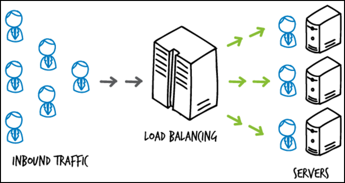

## 로드 밸런싱

---

### 로드 밸런싱이란?

---

로드 밸런싱은 애플리케이션을 지원하는 리소스 풀 전체에 **네트워크 트래픽을 균등하게 배포하는 방법**입니다. 최신 애플리케이션은 수백만 명의 사용자를 동시에 처리하고 정확한 텍스트, 비디오, 이미지 및 기타 데이터를 빠르고 안정적인 방식으로 각 사용자에게 반환해야 합니다. 이렇게 많은 양의 트래픽을 처리하기 위해 대부분의 애플리케이션에는 데이터가 중복되는 리소스 서버가 많이 있습니다. 로드 밸런서는 사용자와 서버 그룹 사이에 위치하며 보이지 않는 촉진자 역할을 하여 모든 리소스 서버가 동일하게 사용되도록 하는 디바이스입니다.   [참고 - [AWS](https://aws.amazon.com/ko/what-is/load-balancing/)]

로드 밸런싱이란 서버가 처리해야 할 업무 혹은 요청(Load)을 여러 대의 서버로 나누어(Balancing) 처리하는 것을 의미한다. 한 대의 서버로 부하가 집중되지 않도록 트래픽을 관리해 각각의 서버가 최적의 퍼포먼스를 보일 수 있도록 하는 것이 목적이다  [참고 - [Tecoble](https://tecoble.techcourse.co.kr/post/2021-11-07-load-balancing/)]

### 로드 밸런싱의 이점

---

로드 밸런싱은 애플리케이션 서버와 방준자 또는 클라이언트 간의 인터넷 트래픽을 지시하고 제어합니다. 결과적으로 애플리케이션의 **가용성**, **확장성**, **보안** 및 **성능**이 향상됩니다.

#### **가용성**

서버 장애 또는 유지 관리로 인해 애플리케이션 가동 중지 시간이 늘어 방문자가 애플리케이션을 사용할 수 없게 될 수 있습니다. **로드 밸런서**는 서버 문제를 자동으로 감지하고 클라이언트 트래픽을 사용 가능한 서버로 리디렉션 하여 시스템의 내결함성을 높입니다.

* 애플리케이션 가동 중지 없이 애플리케이션 서버 유지 관리 또는 업그레이드 실행
* 백업 사이트에 자동 재해 복구 제공
* 상태 확인을 수행하고 가동 중지를 유발할 수 있는 문제 방지

#### **확장성**

로드 밸런서를 사용하여 여러 서버 간에 네트워크 트래픽을 지능적으로 전달할 수 있습니다. 로드 밸런싱이 다음을 수행하므로 애플리케이션에서 수천 개의 클라이언트 요청을 처리할 수 있습니다.

* **한 서버에서 트래픽 병목 현상 방지**
* 필요한 경우 다른 서버를 추가하거나 제거할 수 있도록 애플리케이션 트래픽을 예측합니다.
* 안심하고 조정할 수 있도록 시스템에 중복성을 추가합니다.

#### **보안**

로드 밸런서에는 인터넷 애플리케이션에 또 다른 보안 계층을 추가할 수 있는 보안 기능이 내장되어 있습니다. 이는 공격자가 서버 장애를 일으키는 수백만 개의 동시 요청으로 애플리케이션 서버를 가득 채우는 분산 서비스 거부 공격을 처리하는 데 유용한 도구입니다. 로드 밸런서는 다음을 수행할 수도 있습니다.

* 트래픽 모니터링 및 악성 콘텐츠 차단
* 공격 트래픽을 여러 백엔드 서버로 자동으로 리디렉션하여 영향 최소화
* 추가 보안을 위해 네트워크 방화벽 그룹을 통해 트래픽 라우팅

#### **성능**

로드 밸런서는 응답 시간을 늘리고 네트워크 지연 시간을 줄여 애플리케이션 성능을 향상합니다. 다음과 같은 몇 가지 중요한 태스크를 수행합니다.

* 서버 간에 로드를 균등하게 배포하여 애플리케이션 성능 향상
* 클라이언트 요청을 지리적으로 더 가까운 서버로 리디렉션하여 지연 시간 단축
* 물리적 및 가상 컴퓨팅 리소스의 신뢰성 및 성능 보장

### 로드 밸런싱 알고리즘

로드 밸런싱은 각 서버의 특징에 따라서 다양한 알고리즘을 조합해서 사용할 수 있습니다.

로드 밸런싱 알고리즘은 크게 2가지 범주로 구분할 수 있습니다.

#### **정적 로드 밸런싱**

정적 로드 밸런싱 알고리즘은 고정된 규칙을 따르며 현재 서버 상태와 무관합니다. 

**라운드 로빈 방식(Round Robin Method)**

서버에는 클라이언트에게 요청을 전송할 위치를 알려주는 IP 주소가 있습니다. IP 주소는 기억하기 어려운 긴 숫자입니다. 이를 쉽게 하기 위해 도메인 이름 시스템은 웹 사이트 이름을 서버에 매핑합니다. 브라우저에 aws.amazon.com을 입력하면 먼저 요청이 당사의 이름 서버로 전달되고 이름 서버는 IP 주소를 브라우저로 반환합니다.   

라운드 로빈 방식에서는 권한 있는 이름 서버가 특수 하드웨어나 소프트웨어 대신 로드 밸런싱을 수행합니다. 이름 서버는 서버 팜에 있는 여러 서버의 IP 주소를 차례대로 또는 라운드 로빈 방식으로 반환합니다.

정리하면 **서버에 들어온 요청을 순서대로 돌아가며 배정하는 방식**이고 클라이언트의 요청을 순서대로 분배하기 때문에 여러 대의 서버가 동일한 스펙을 갖고 있고, 서버와의 연결(세션)이 오래 지속되지 않는 경우에 활용하기 적합합니다.

**가중 기반 라운드 로빈 방식(Weighted Round Robin Method)**

가중치 기반 라운드 로빈 로드 밸런싱에서는 **우선순위 또는 용량에 따라 각 서버에 서로 다른 가중치를 할당**할 수 있습니다. 가중치가 높은 서버는 이름 서버에서 들어오는 애플리케이션 트래픽을 더 많이 수신합니다.

정리하면 **각각의 서버마다 가중치를 매기고 가중치가 높은 서버에 클라이언트 요청을 우선적으로 배분**하는 방식입니다.

**IP 해시 방식(IP Hash Method)**

IP 해시 방법에서 로드 밸런서는 클라이언트 IP 주소에 대해 해싱이라고 하는 수학적 계산을 수행합니다. 클라이언트 IP 주소를 숫자로 변환한 다음 개별 서버에 매핑합니다.

정리하면 **클라이언트의 IP 주소를 특정 서버로 매핑하여 요청을 처리하는 방식**입니다. 

#### **동적 로드 밸런싱**

동적 로드 밸런싱 알고리즘은 트래픽을 배포하기 전에 서버의 현재 상태를 검사합니다. 다음은 동적 로드 밸런싱 알고리즘의 몇 가지 예제입니다.

**최소 연결 방법(Least Connection Method)**

연결은 클라이언트와 서버 간의 개방형 통신 채널입니다. 클라이언트는 서버에 첫 번째 요청을 전송할 때 서로 활성 연결을 인증하고 설정합니다. 최소 연결 방법에서 로드 밸런서는 활성 연결이 가장 적은 서버를 확인하고 해당 서버로 트래픽을 전송합니다. 이 방법에서는 모든 연결에 모든 서버에 대해 동일한 처리 능력이 필요하다고 가정합니다.

정리하면 **요청이 들어온 시점에 가장 적은 연결상태를 보이는 서버에 우선적으로 트래픽을 배분하는 방식**으로 자주 세션이 길어지거나, 서버에 분배된 트래픽들이 일정하지 않은 경우에 적합한 방식입니다.

**가중치 기반 최소 연결 방법(Weighted least connection method)**

가중치 기반 최소 연결 알고리즘은 일부 서버가 다른 서버보다 더 많은 활성 연결을 처리할 수 있다고 가정합니다. 따라서 각 서버에 다른 가중치 또는 용량을 할당할 수 있으며 로드 밸런서는 용량별 연결이 가장 적은 서버로 새 클라이언트 요청을 전송합니다.

정리하면 **용량별 연결이 가장 적은 서버로 새 클라이언트 요청을 전송하는 방식**입니다.

**최소 응답 시간 방법(Least Response Time Method)**

응답 시간은 서버가 들어오는 요청을 처리하고 응답을 전송하는 데 걸리는 총시간입니다. 최소 응답 시간 방법은 서버 응답 시간과 활성 연결을 결합하여 최상의 서버를 결정합니다. 로드 밸런서는 이 알고리즘을 사용하여 모든 사용자에게 더 빠른 서비스를 보장합니다.

정리하면 **서버의 현재 연결 상태와 응답 시간(Response Time, 서버에 요청을 보내고 최초 응답을 받을 때까지 소요되는 시간)을 모두 고려하여 트래픽을 배분**하는 방식으로 가장 적은 연결 상태와 가장 짧은 응답 시간을 보이는 서버에 우선적으로 로드를 배분합니다.

**리소스 기반 방법(Resource-based method)**

리소스 기반 방법에서 로드 밸런서는 현재 서버 부하를 분석하여 트래픽을 배포합니다. 에이전트라고 하는 특수 소프트웨어는 각 서버에서 실행되며 컴퓨팅 용량 및 메모리와 같은 서버 리소스의 사용량을 계산합니다. 그런 다음 로드 밸런서는 해당 서버에 트래픽을 배포하기 전에 에이전트에 충분한 여유 리소스가 있는지 확인합니다.

정리하면 **서버 부하량 즉 서버 리소스의 사용량에 따라서 배분하는 방식**입니다.

---

**참고**

* https://aws.amazon.com/what-is/load-balancing
