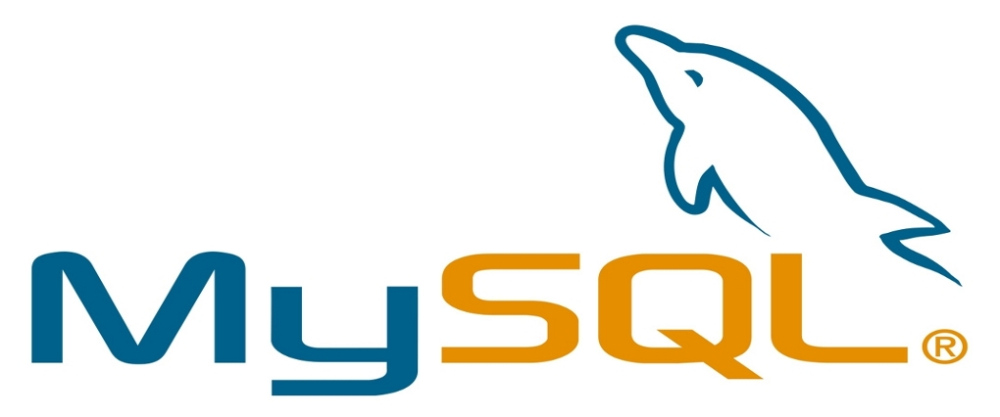
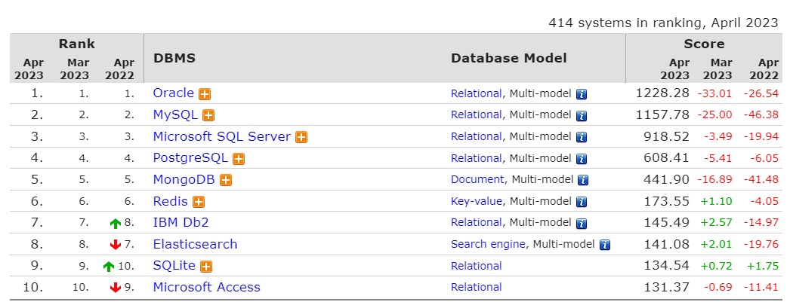
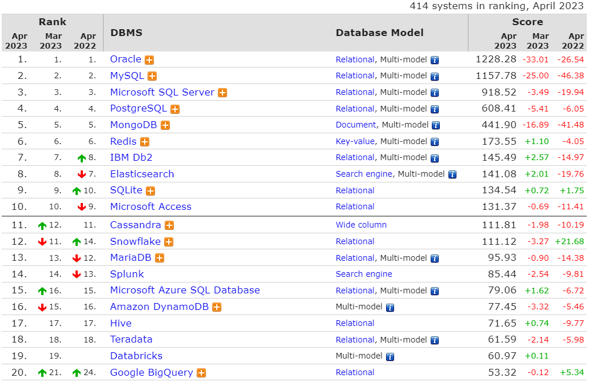
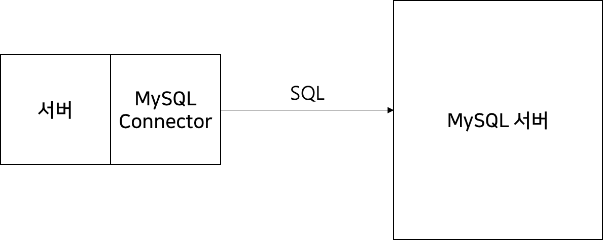
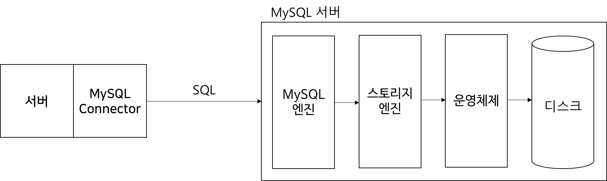
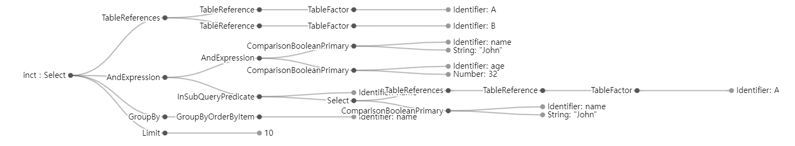

## MySQL

---

### MySQL 이란?

---

MySQL(마이에스큐엘, /maɪ ˌɛskjuːˈɛl/)[2]은 세계에서 가장 많이 쓰이는[3] 오픈 소스의 관계형 데이터베이스 관리 시스템(RDBMS)이다.[4] 다중 스레드, 다중 사용자 형식의 구조질의어 형식의 데이터베이스 관리 시스템으로서 오라클이 관리 및 지원하고 있으며, Qt처럼 이중 라이선스가 적용된다. 하나의 옵션은 GPL이며, GPL 이외의 라이선스로 적용시키려는 경우 전통적인 지적재산권 라이선스의 적용을 받는다. [참고 - [위키백과](https://ko.wikipedia.org/wiki/MySQL)]

### MySQL 을 학습해야하는 이유

---

#### **관계형 데이터베이스를 공부해야하는 이유**

수 많은 종류의 데이터베이스들이 있다.

* **Document DB**(MongoDB, CouchDB etc)
* **전문색인 DB**(Elasticsearch etc)
* **관계형 DB**(MySQL, Oracle etc)
* **Key-value DB**(Redis, Memcached etc)
* **Wide column DB**(Cassandra, Hbase etc)
* **Graph DB**(Neo4j, OrientDB)

수 많은 데이터베이스 중에서 무엇부터 공부해야할까?

**DB-Engines**에서 조사한 자료에 따르면 다음과 같은 랭킹을 볼 수 있다.

[](https://db-engines.com/en/ranking)

db-engines(20230.04.29 기준)

해당 순위에 기준은 Stack Overflow에 노출 빈도, LinkedIn에 언급 빈도 등 여러 자료들을 종합해서 전 세계 데이터베이스 순위를 집계한 자료입니다. 그 중 1위부터 10위까지 집계한 자료입니다.

흥미로운 점은 1위부터 4위까지 Relatioin DB 즉 모두 **관계형 데이터베이스** 입니다.

1위부터 20까지 범위를 넓혀봐도 관계형 데이터베이스가 가장 많이 등장하는 것을 볼 수 있습니다.



> 관계형 데이터베이스는 아직까지도 가장 범용적으로 사용합니다.  
>   
> 백엔드 개발자라면 아주 높은 확률로  
> 관계형 데이터베이스를 실무에서 다루게 될 것입니다.

**다른 종류의 데이터베이스들은 몰라도 될까?**

알아야합니다.

하지만 여러 종류의 데이터베이스들은 전혀 다른 새로운 기술이 아니라 서로의 문제를 보완하고 발전한 상호보완적인 관계입니다. 그렇기 때문에 하나를 깊게 학습하고나면 다른 종류의 데이터베이스들도 쉽게 학습할 수 있습니다.

#### **관계형 데이터베이스 중에서 MySQL을 공부해야하는 이유**

관계형 데이터베이스 안에서도 많은 데이터베이스들이 존재합니다.

* Oracle
* MySQL
* Postgresql
* MariaDB
* MSSQL
* IDB db2
* SQLite
* Microsoft Access
* Snowflake
* etc

#### 

**1.  인기**

가장 인기 많은 오픈소스 관계형 데이터베이스이기 때문에 궁금하면 언제든지 소스 코드를 볼 수 있습니다.

* <https://github.com/mysql>

[MySQL

Oracle Corporation. MySQL has 23 repositories available. Follow their code on GitHub.

github.com](https://github.com/mysql)

**2. 높은 접근성과 낮은 비용**

오픈소스 관계형 데이터베이스이기 때문에 엔터프라이즈 모델을 사용하는 것이 아니라면 무료로 사용할 수 있기 때문에 진입장벽이 낮은 데이터베이스 중 하나입니다.

**3. 네이버, 카카오, 토스 등 대부분의 국내 IT 기업에서 가장 많이 사용됨.**

국내뿐만 아니라 페이스북과 같은 유명한 해외 기업에서 많이 사용하고 있다.

**4. SQL 안식 표준을 지키고 있음**

표준을 지키고 있기 때문에 Postgresql 등 다른 관계형 데이터베이스를 접하게되더라도 어렵지 않게 쿼리를 작성할 수 있습니다.

### MySQL 아키텍처

---

#### **데이터베이스는 무엇일까?**

데이터베이스는 파일을 관리하는 서버입니다.



클라이언트가 서버에 데이터를 요청하는 것처럼 서버는 데이터베이스를 통해 데이터를 요청하게 됩니다.


클라이언트는 JSON을 통해서 데이터를 요청하는 것과 같이 서버는 SQL을 통해서 데이터베이스 서버(**MySQL**)에 데이터를 요청하게 됩니다.

어떻게 보면 MySQL 서버 입장에서는 클라이언트와 같습니다.

우리가 전달한 SQL 요청은 MySQL 서버에 MySQL 엔진, 스토리지 엔진, 운영체제, 디스크를 걸쳐서 데이터를 탐색하고 그 결과를 돌려주게 됩니다.

**MySQL 엔진**을 사람으로 비유하면 **판단**과**명령**하는 사람의 두뇌와 같고, **스토리지 엔진**은 판단을 수행하고 동작하는 사람의 팔과 다리라고 볼 수 있습니다.



#### **MySQL 엔진**

MySQL 엔진은 **쿼리 파서**, **전처리기**, **옵티마이저**, **쿼리 실행기** 등의 구성요소로 구성되어 있습니다.


**쿼리파서**

* SQL을 파싱하여 Syntax Tree를 만듬
* 이 과정에서 문법 오류 검사가 이루어짐

**전처리기**

* 쿼리파서에서 만든 Tree를 바탕으로 전처리 시작
* 테이블이나 컬럼 존재 여부, 접근권한 등 **Semantic** 오류 검사

[**SQL Query Visualizer**](http://%20https://observablehq.com/@john-guerra/sql-query-visualizer) 사이트를 통해 작성한 쿼리의 Syntax Tree가 어떻게 만들어지는지를 간략하게 확인할 수 있다.

```sql
SELECT distinct *
FROM A, B
WHERE name = 'John' and age > 32
GROUP BY name
LIMIT 10
```



**쿼리파서, 전처리기**

* 쿼리파서, 전처리기는 컴파일 과정과 매우 유사하다.
* 하지만 SQL은 프로그래밍 언어처럼 컴파일 타임때 검증할 수 없어(서버에서 동적으로 SQL문이 전달되기 때문에) 매번 구문 평가를 진행한다.

**옵티마이저**

* 쿼리를 처리하기 위한 여러 방법들을 만들고, 각 방법들의 비용정보와 테이블의 통계정보를 이용해 비용을 산정
* 테이블 순서를 조절하기도 하고 불필요한 조건 제거하기도 한다. **통계정보**(비용이 산정된 여러 방법)를 바탕으로 전략을 결정(**실행 계획 수립**)
* 옵티마이저가 어떤 전략을 결정하느냐에 따라 성능이 많이 달라진다.
* 가끔씩 성능이 나쁜 판단을 하여 개발자가 힌트를 사용해 도움을 줄 수 있다.  
  (**explain**이라는 명령을 통해 어떤 결정을 하였는지를 확인할 수 있음)

**쿼리 실행기**

* 옵티마이저가 정한 계획대로 스토리지 엔진에 요청하는 역할
* 스토리지 엔진에 요청할 때 **Handler API**를 사용(**Handler 요청**)
* Handler API를 만족하는 스토리지를 구현할 수 있다면 직접구현한 스토리지 엔진을 사용할 수 있다.


**쿼리캐시**

MySQL 5.0까지는 쿼리 캐시라는 것이 존재하였는데 8.0대에 들어와서 쿼리캐시는 폐기되었다.

> **※ 쿼리캐시란?**SQL과 데이터를 매핑하여 동일한 SQL 요청이 발생할 경우 뒤의 과정을 거치지 않고 캐시에 저장된 데이터를 그대로 반환해주는 것을 의미한다.  
>   
> **※ 폐기된 이유**데이터를 직접 캐싱하는 것이기 때문에 테이블의 내용이 변경되면 캐싱된 데이터로 변경되어야 하는데 이 과정에서 Lock 과 같은 이슈과 존재하였고 쿼리 캐시가 주는 이점보다 이 과정에서 생기는 문제점이 더 높다고 판단되어 폐기가 되었다고 한다.

**Oracle**에는 **소프트 파싱**과 **하드 파싱**이 존재한다.

* **소프트 파싱**SQL, 실행 계획을 캐시에서 찾아 옵티마이저 과정을 생략하고 실행 단계로 넘어감
* **하드 파싱**SQL, 실행계획을 캐시에서 찾지못해 옵티마이저 과정을 거치고나서 실행단계로 넘어감

정리해보면

MySQL에는 **소프트 파싱**이 없다. 하지만 5버전까지는 쿼리 캐시가 존재하였다.

쿼리 캐시는 SQL에 해당하는 데이터를 저장하는 것이고 **쿼리캐시는 데이터를 캐시하기 때문에 테이블의 데이터가 변경되면 캐시의 데이터도 함께 갱신시켜줘야한다.**

**Orable** 에는 **소프트 파싱(**실행계획까지만 캐싱**)**이 존재한다.

하지만 모든 SQL과 매핑해 데이터까지 캐싱하지는 않음(힌트나 설정으로 쿼리 캐싱이 가능하긴 함)

**MySQL**의 쿼리캐시, **Oracle**의 소프트 파싱 모두 성능 최적화를 위해 캐시라는 기술을 도입한 사례이다.

그러나 캐시의 범위가 다르다. 캐시를 도입할 때는 항상 만료정책을 고려해야한다.

쿼리캐시는 소프트 파싱에 비해 조회성능은 더 높지만(디스크까지 가지 않기 때문) 캐시 데이터 관리에 더 높은 비용이 들어간다.

> **모든 기술은 트레이드 오프다.**  
>   
> 캐시의 범위를 어떻게 설정하느냐에 따라서  
> 조회의 성능과 쓰기의 성능   
> 두 성능 사이의 균형을 잘 맞출 수 있다.

조회와 쓰기 성능을 어떻게 50대 50으로 맞출 것인지 쿼리 캐시는 극단적으로 조회 성능을 높인다면  
소프트파싱 같은 경우에는 쓰기에 성능을 높인다고 볼 수 있다.  
이처럼 캐시의 범위를 어떻게 설정하느냐에 따라서 조회와 쓰기의 가중치가 정해진다.  

이것은 없던 가중치가 생기는 것이 아니라 반대 사이드 가중치를 가져오는 것이다.

캐시뿐만 아니라 모든 기술은 트레이드 오프로 A라는 장점이 있으면 B 라는 단점이 있고 A라는 장점에 어느정도에 가중치를 줘야하고 B라는 가중치를 얼마나 주어야하는지를 고민해야한다.

#### 스토리지 엔진

* 디스크에서 데이터를 가져오거나 저장하는 역할
* MySQL 스토리지 엔진은 플러그인 형태로 Handler API만 맞춘다면 직접 구현해서 사용할 수 있다.
* InnoDB, MyIsam 등 여러개의 스토리지 엔진이 존재
* 8.0대 부터는 InnoDB 엔진을 디폴트

**InnoDB 엔진 핵심 키워드**

* **Clustered Index**
* **Redo - Undo**
* **Buffer Pool**
