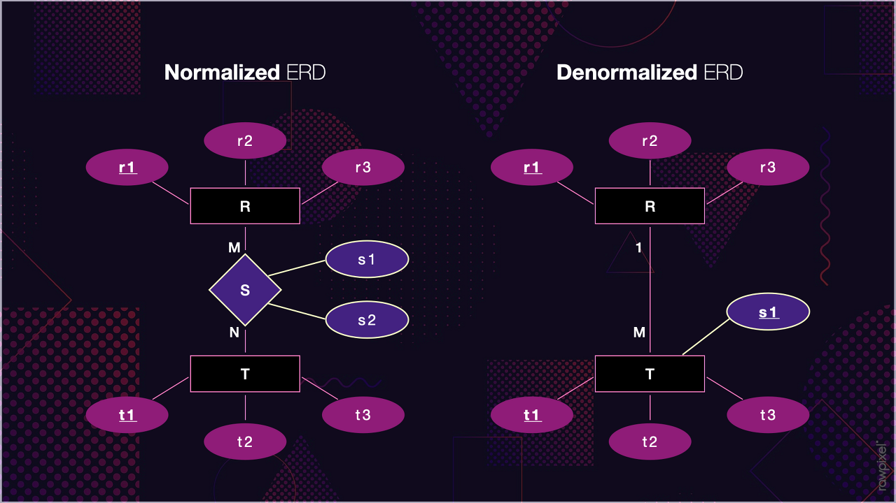

## 정규화 - 비정규화

---

### **정규화** 란?

---

관계형 데이터베이스의 설계에서 **중복을 최소화하게 데이터를 구조화하는 프로세스**를 정규화(Normalization)라고 한다.

데이터베이스 정규화의 목표는 이상이 있는 관계를 재구성하여 작고 잘 조직된 관계를 생성하는 것에 있다. 일반적으로 정규화란 크고, 제대로 조직되지 않은 테이블들과 관계들을 작고 잘 조직된 테이블과 관계들로 나누는 것을 포함한다. 정규화의 목적은 하나의 테이블에서의 데이터의 삽입, 삭제, 변경이 정의된 관계들로 인하여 데이터베이스의 나머지 부분들로 전파되게 하는 것이다.  [참고 - [위키백과](https://ko.wikipedia.org/wiki/%EB%8D%B0%EC%9D%B4%ED%84%B0%EB%B2%A0%EC%9D%B4%EC%8A%A4_%EC%A0%95%EA%B7%9C%ED%99%94)]

#### 정규화 예시

소설을 쓰는 작가가 되었다고 했을 때 주인공의 정보가 이름은 짱구, 성별은 남자, 나이는 5살, 직업은 유치원생이라고 설정해두고 나서 마감일 하루 전에 주인공 이름을 신짱구로 변경해달라고 요청이 왔다.

만약 소설의 총 페이지 수가 1,000 페이지가 넘는다면 모든 페이지를 점검해서 다 수정해주어야 한다...

최악의 경우 변경한 후에 검토를 위해 몇번의 과정을 더 거쳐야한다...

이러한 문제를 해결하기 위해 책속에 나오는 인물의 정보를 정리해두고 해당 정보를 확인하도록 매칭시켜두면 어떻게 될까?

> 짱구는 철수, 훈이와 함께 놀이터에서 축구를 한다.  
> => {등장인물 설정집.1page.이름}는 {등장인물 설정집.2page.이름}, {등장인물 설정집.3page.이름}와 함께 놀이터에서 축구를 한다.

와 같이 구성을 하였다면 등장인물 설정집 1page에 이름만 변경하면 짱구라는 이름을 신짱구라는 이름으로 한 번에 변경이 가능해진다. 즉 중복을 제거하고 한 곳에서만 데이터를 관리하는 것이다.

이와 같이 정규화를 하면 데이터의 변경이 일어나더라도 데이터를 한 곳에서만 관리하고 있기 때문에 데이터의 부정합이 발생하지 않는다. 하지만 읽을 때는 항상 원본 데이터를 참조해야한다는 문제가 있다.

> 정규화는 테이블 설계관점에서  
> 조회와 쓰기 사이의 트레이드 포드

대용량 시스템을 설계하는데 있어서 조회와 쓰기를 다르게 바라보는 좋은 것은 좋은 인사이트다.

조회와 쓰기 중 어떤 것에 중점을 두느냐에 따라서 데이터나 아키텍처의 모습이 달라지게 되고

조회와 쓰기는 서로 다른 최적화 기법들이 들어가게 된다.

그래서 조회와 쓰기는 다르게 보는 시야를 갖는 것이 중요하다.

### 비정규화(반정규화)

---

> {등장인물 설정집.1page.이름}는 {등장인물 설정집.2page.이름}, {등장인물 설정집.3page.이름}와 함께 놀이터에서 축구를 한다.  
> => 짱구는 철수, 훈이와 함께 놀이터에서 축구를 한다.

**정규화**는 **데이터 관리** 즉 **쓰기의 이점을** 얻기 위해 조회의 성능을 포기한 것이라면 

**비정규화**는 **읽기의 성능**을 얻기 위해 쓰기 **성능의 감소**를 어느 정도 포기한 것이다.

### 정규화와 비정규화 비교

---

|  | **정규화** | **비정규화** |
| --- | --- | --- |
| 장점 | 1. 중복을 제거하고 한 곳에서 관리 2. 데이터 정합성 유지가 쉬움 | 1. 중복을 허용 2. 빠른 데이터 조회 가능 3. 참조없이 읽기 가능 4. 데이터 쿼리의 간단화 |
| 단점 | 1. 읽기시 참조 발생 2. Join 연산의 증가로 응답 시간 저하 | 1. 데이터 정합성 유지가 어려움 2. 데이터의 무결성 해침 3. 데이터 중복저장으로 인한 추가 비용 |
