오늘은 Javascript 문법 뽀개기를 수강했다!

Javascript는 NodeJS를 공부할 때 배웠지만

간단하지만 간단하지 않은 그러한 문법 같았다..

오늘같은 주말은 뭐다 ?

항해99 질주다~!!

---

#### 

#### **과목 : Java 문법 뽀개기 1주차**

**[ 목차 ]**

**1-1. 필수 프로그램 설치**

**1-2. 시작하기 앞서**

**1-3. Hello World**

**1-4. 변수**

**1-5. 데이터 타입**

**1-6. 연산자**

**1-7. 조건문**

**1-8. 반복문**

**1-9. 반복문과 조건문 활용**

**1-10. 함수**

****1-11. 클래스와 객체****

**1-12. 배열**

---

**1. 필수 프로그램 설치**

**▶ Chrome                ( OK )**

**▶ Visual Studio Code ( OK )**

**▶ Node.js 설치          ( OK )**

---

**2. 시작하기에 앞서**

**1) 프로그래밍이란?**

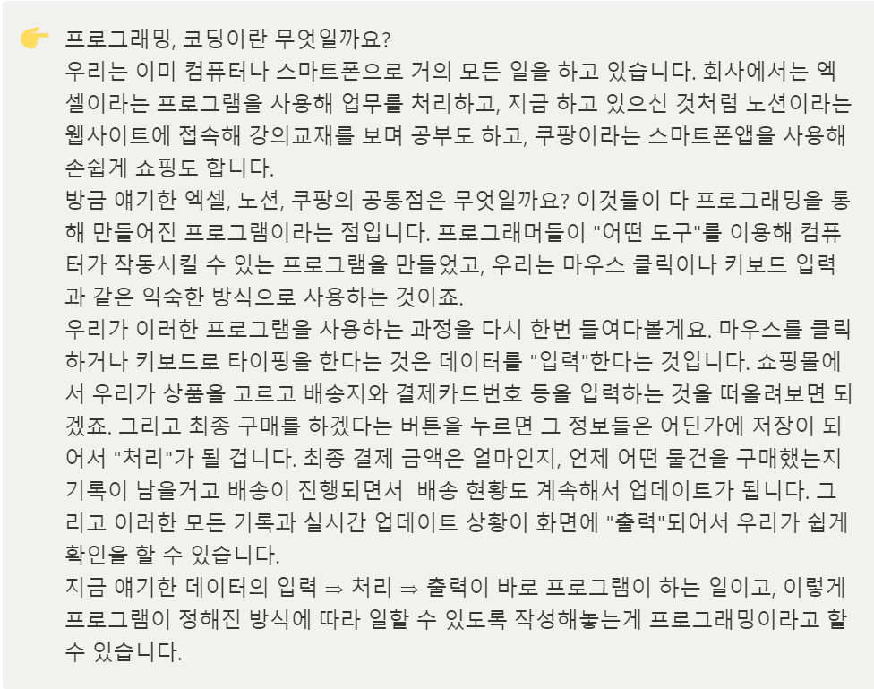

2.1 프로그래밍에 대한 설명

---

**3. Hello World(설명 생략)**

****1) 파일 실행 방법****

****- 터미널을 통해서 파일의 위치 경로로 이동하여 node + 파일명(.js 생략가능)****

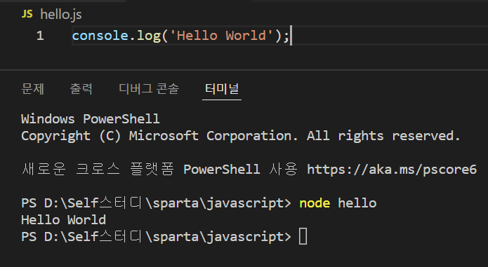

3.1 Nodejs를 활용하여 파일 출력

---

**4. 변수**

****1) 변수 선언과 데이터 할당****

****- 변수란?****

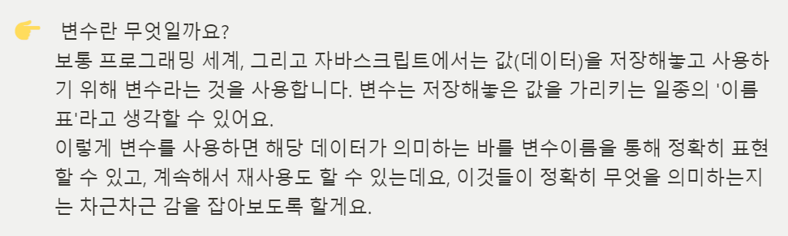

4-1. 변수에 대한 설명

****- 변수의 종류(scope기준)****

• let : 지역변수 (값 재할당 가능)

• const : 상수 (값을 변경시킬 수 없음)

• var : 전역변수 (값 재할당 가능)

       - const에 값을 재할당 할경우, 아래와 같이 **Assignment to constant variable** 에러가 발생한다.

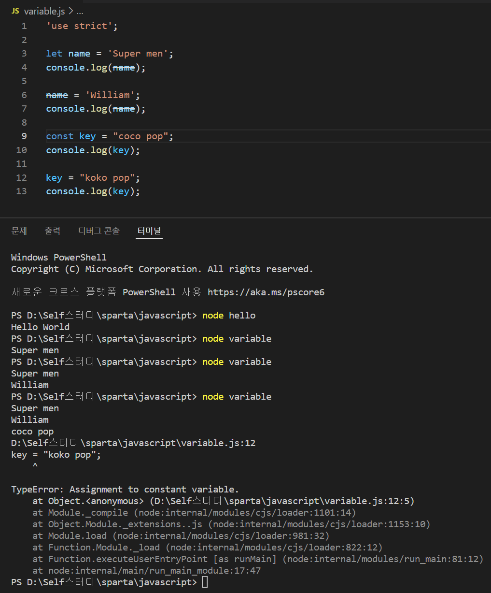

4-2. 변수 선언 및 데이터 할당

---

**5. 데이터 타입**

****1) 데이터 타입****

****- primitive 타입 : number(숫자), string(문자열), boolean(논리형), null(빈값), undefined(값이 할당되어 있지 않은 것)****

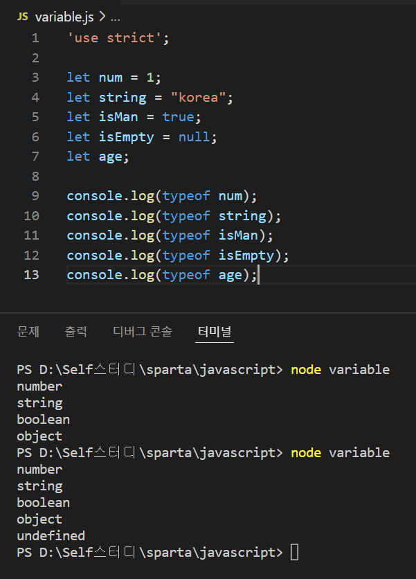

5-1. 데이터 타입 예제 코드

****Quiz : 내가 원하는 변수들을 자유롭게 선언해보고 데이터를 할당한 뒤 출력해보아요.****

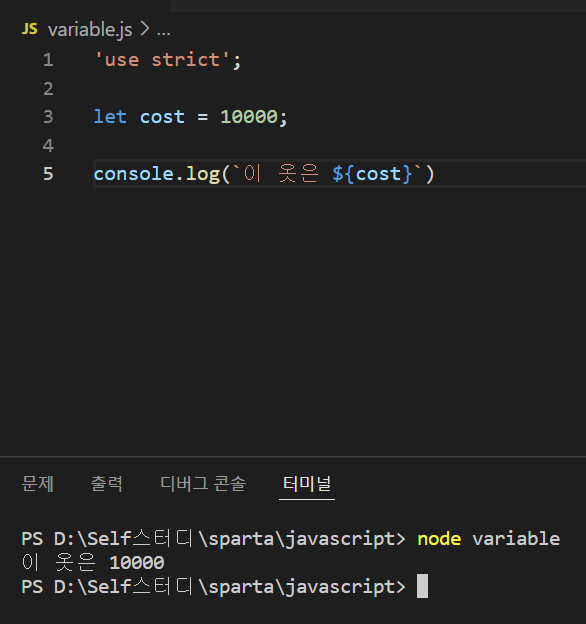

5-2. 퀴즈 풀이

---

**6. 연산자**

******1) 문자열 붙이기******

****•'+'를 사용하여 문자열을 이어 붙일 수 있다.****

****•템플릿 리터럴(Template literals)는 백틱( ` )을 사용하여 문자열 데이터를 표현할 수 있다.****

********•****이중 따옴표나 작은 따옴표로 문자열을 표현할 때보다 간결하게 문자열 붙이기가 가능하다.****

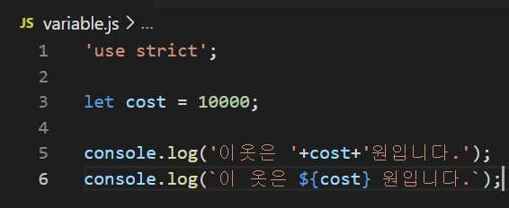

6-1. 문자열 붙이기 예제

******2) 산술연산자******

****•사칙연산뿐만 아니라 나머지연산, \*\*(거듭제곱)도 있다.****

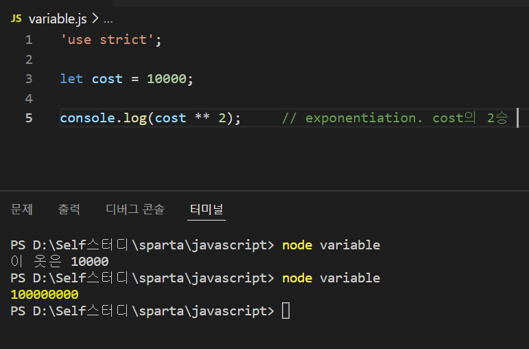

6-2. 거듭제곱 사용 예

******3) 증감연산자******

****•사칙연산뿐만 아니라 나머지연산, \*\*(거듭제곱)도 있다.****

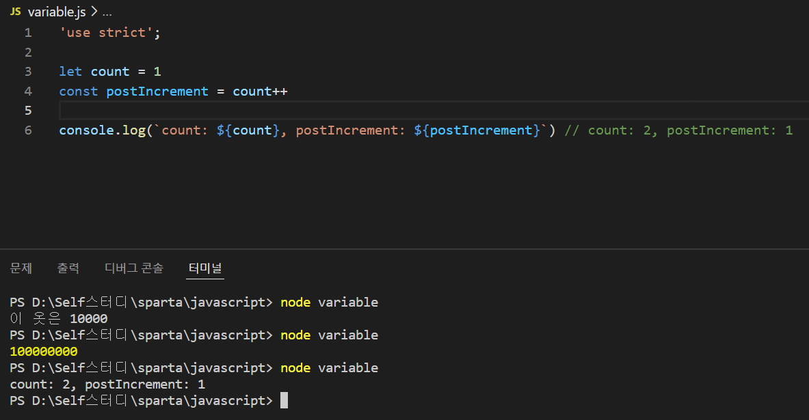

6-3. 증감연산자 사용 예

******4) 비교 연산자******

****•비교연산자는 ( <, <=, >, >= )가 있고, 얻는 값은 boolean이다.****

******5) 논리 연산자******

****•논리연산자는 AND(&&), OR(||), NOT(!)과 같은 연산자를 말한다.****

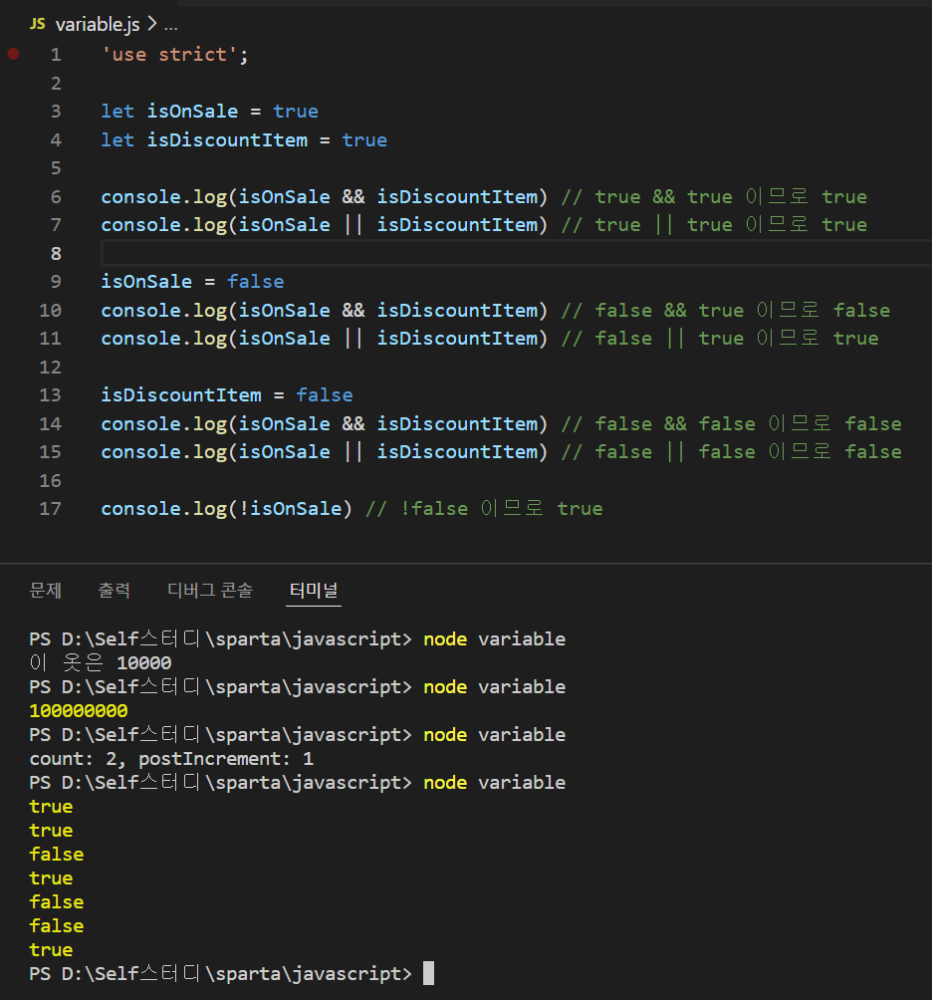

6-4. 논리 연산자 사용 예

******6) 일치 연산자******

**********• 일치 연산자는 '=='와 '==='가 있다.**********

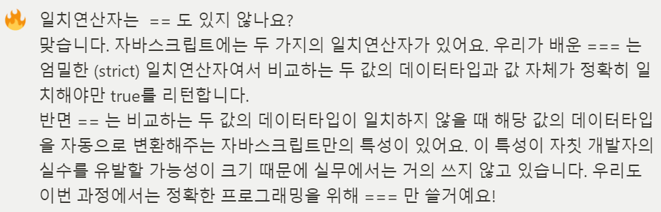

6-5. 일치 연산자 사용 예

******7) Quiz문제******

**********•상품 가격을 나타내는 2개의 변수를 선언하고 각각의 변수에 원하는 가격값을 할당해보아요. 두 상품을 더한 가격**********

**********역시 총가격을 나타내는 변수에 할당해봅니다. 마지막으로 총가격의 20% 할인된 가격을 구해서 '총 몇 원에 물건을**********

**********구입합니다.' 라는 문자열을 출력합니다.**********

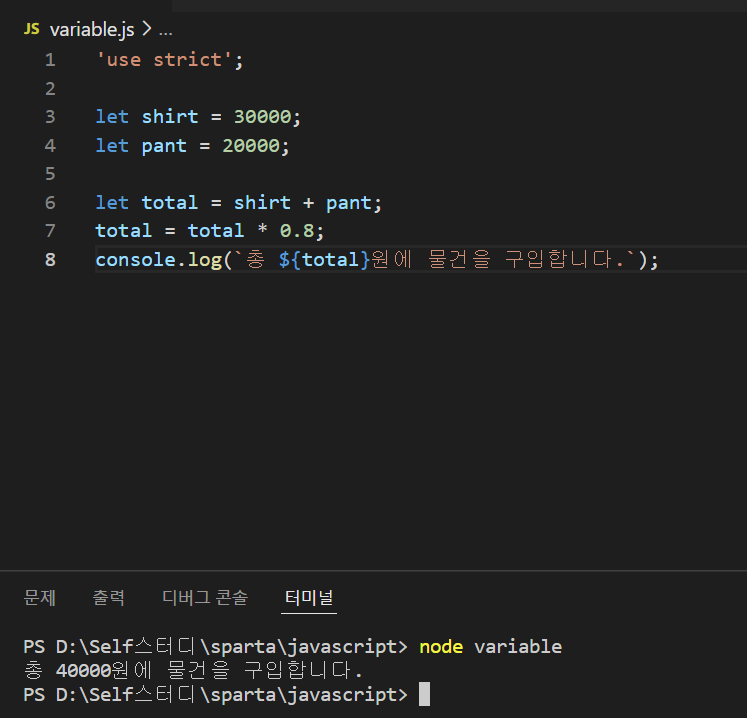

6-6. 퀴즈 문제 풀이

---

**7. 조건문**

******1) Quiz문제******

**********•거리를 의미하는 변수를 선언하고 원하는 숫자값 (단위는 km라고 가정) 을 할당합니다. 2km 미만이면 "걸아가자"를,**********

**********2km 이상이고 5km 미만이면 "택시를 타자"를, 그 외에는 "기차를 타자"를 출력해봅니다.**********

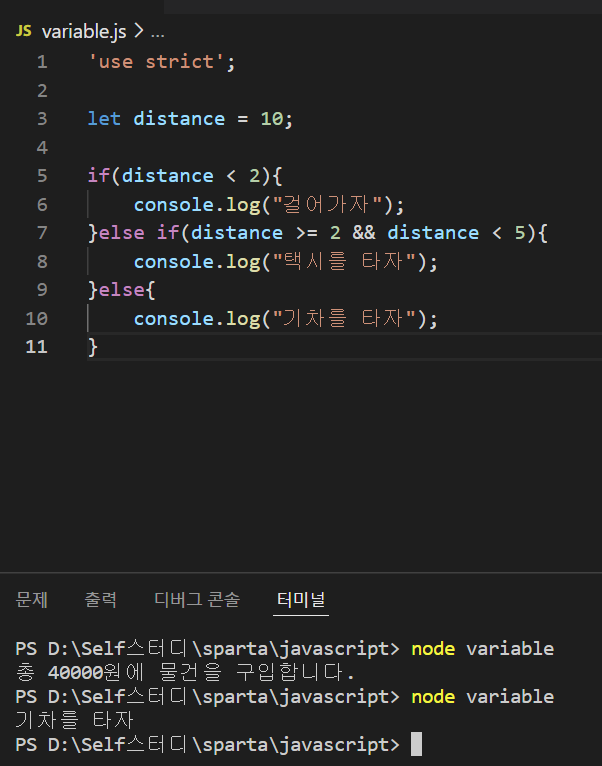

7-1. 조건문 - Quiz 풀이

---

**8. 반복문**

******1) Quiz문제******

**********•1부터 20까지의 숫자중 홀수인 경우는 '숫자 ...은 홀수입니다.'를 짝수인 경우는 '숫자 ...은 짝수입니다' 를**********

**********출력하는 프로그램을 작성해봅니다.**********

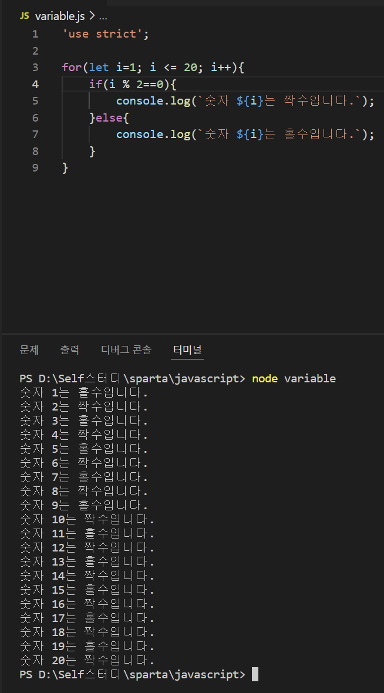

8-1. 반복문 - Quiz 풀이

---

**9. 함수**

******1) 함수란******

**********•함수는 특정 작업을 수행하는 코드의 집합이다.**********

**********•반복되는 특정 작업을 수행해야 한다면 그 코드 자체를 어딘가에 만들어서 저장해놓고 사용할 수 있다.**********

******2) 함수의 선언과 호출******

**********•함수의 선언**********

**********- 변수를 선언하고 해당 변수에 값을 할당했던 것처럼, 함수도 선언을 하고 해당 함수가 실행할 코드의 집합을 만들어서 저장해줍니다.**********

**********•매개변수(parameter)**********

**********- 해당 함수의 바디에 있는 코드에서 사용할 수 있는 일종의 변수이고, 함수 호출시 전달하게 됩니다.**********

**********함수를 실행하기 위해서 필요한 일종의 input 이라고 생각하면 될거 같아요.**********

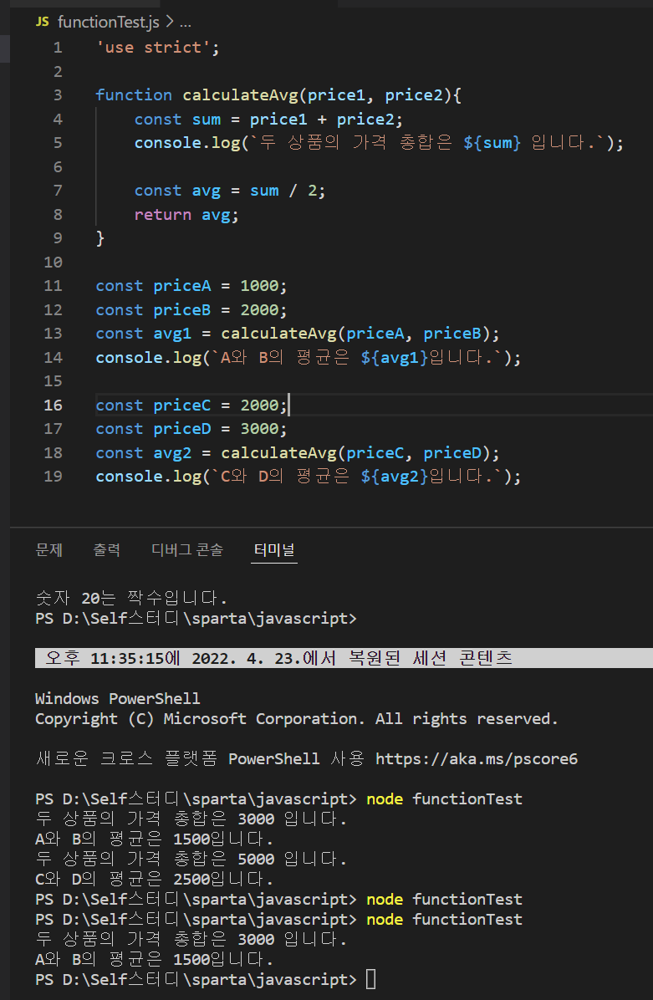

9-1. 함수 테스트 코드

******3) 퀴즈******

**********•세 개의 물건가격을 매개변수로 전달받아 평균값을 리턴하는 함수를 정의하고, 그 함수를 호출해서 평균값을 출력해보세요.**********

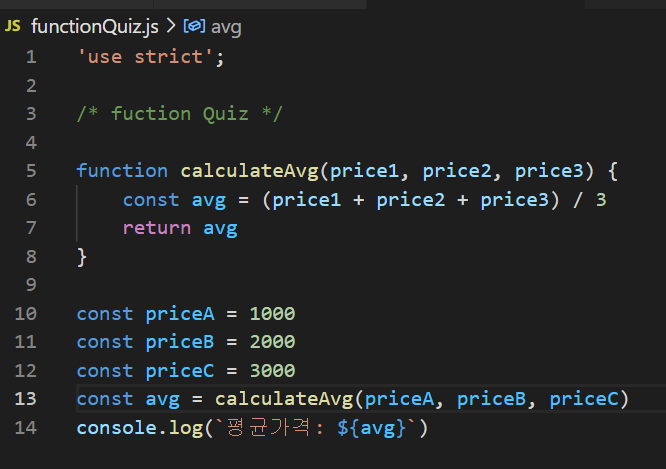

9-2. 함수 퀴즈 문제 풀이

---

**10. 클래스와 객체**

******1) 객체 타입******

**********•객체는 '물리적으로 존재하거나 추상적으로 생각할 수 있는 것중에서 자신의 속성을 갖고 있고 다른 것과 식별 가능한 것' 을 의미**********

******2) 클래스 선언******

**********•객체를 만들때 마치 설계도처럼 사용하는 것이 바로 클래스**********

**********=> 클래스는 템플릿이고, 객체는 이를 구체화한 것이다.**********

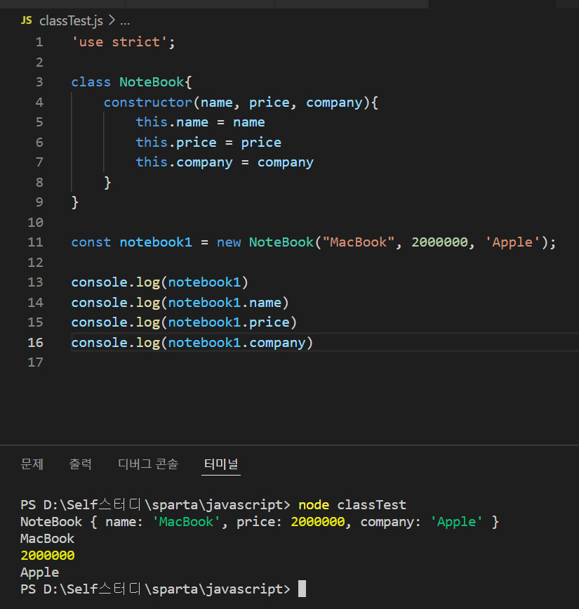

10-1. 클래스 선언 및 객체 사용

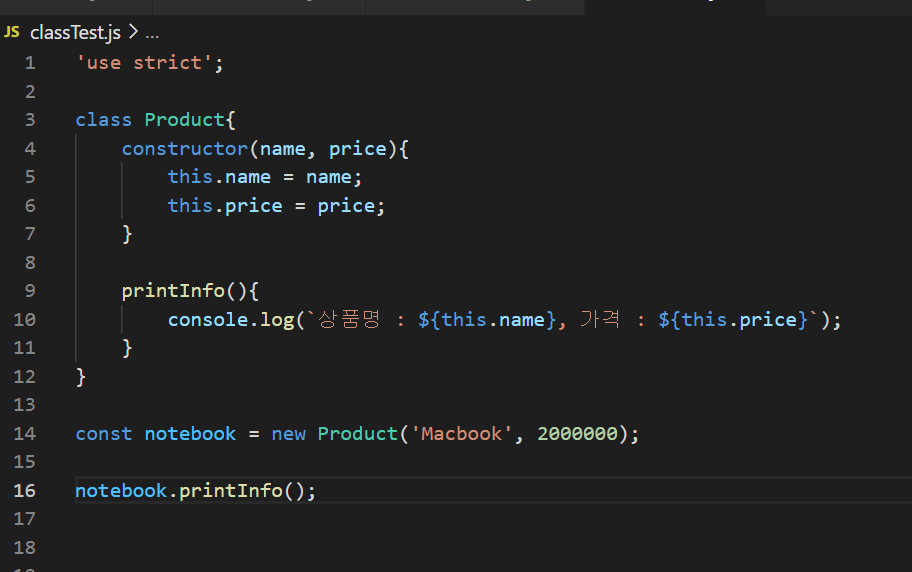

10-2. 클래스 내 메소드 선언 및 사용법

******3) 객체 리터럴******

**********•객체 리터럴은 클래스와 같은 템플릿 없이 빠르게 객체를 만들 수 있는 방법**********

******4) 퀴즈******

**********•여러분만의 의류 쇼핑몰을 만들려고 합니다. 옷의 종류는 많지만 기본적으로 색깔, 사이즈, 가격의 속성을 갖고 있네요.**********

**********그리고 이 옷들의 세 속성을 바로 확인할 수 있게 출력해주는 메소드가 필요할 거 같습니다. 클래스와 객체를 활용해 작성해보아요.**********

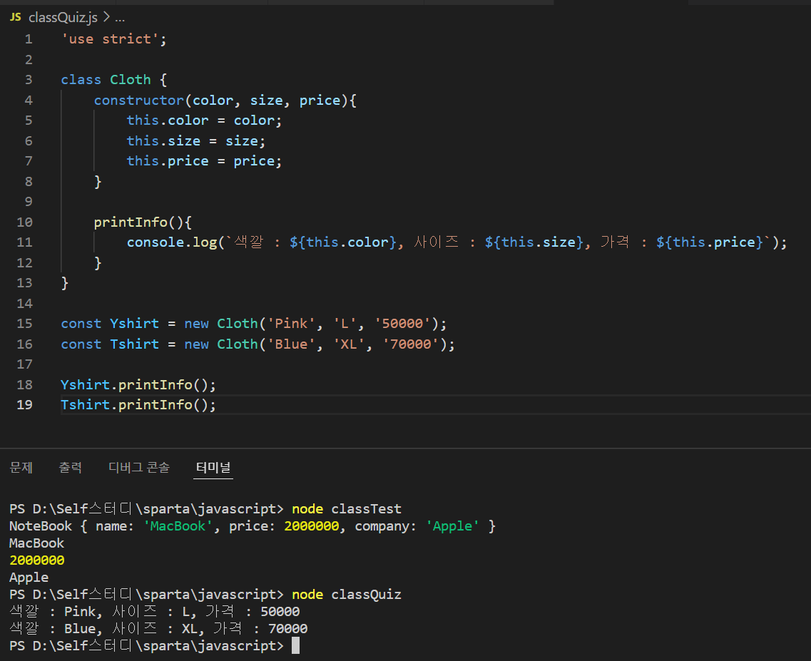

10-3. 클래스와 객체 퀴즈 풀이

> **(생각해보기) 객체 리터럴을 사용하면 되는것인데, 왜 복잡하게 클래스를 사용하는 것일까??**

**(Answer)**

**바로 재사용성 때문입니다. 한번 클래스를 만들어두면 같은 속성과 메소드를 갖고 있는 객체를 훨씬 더 간결한 코드로 만들 수 있습니다**.

---

**11. 배열**

******1) 배열******

**********•같은 타입의 데이터들을 하나의 변수에 할당하여 관리하기 위해 사용하는 데이터 타입**********

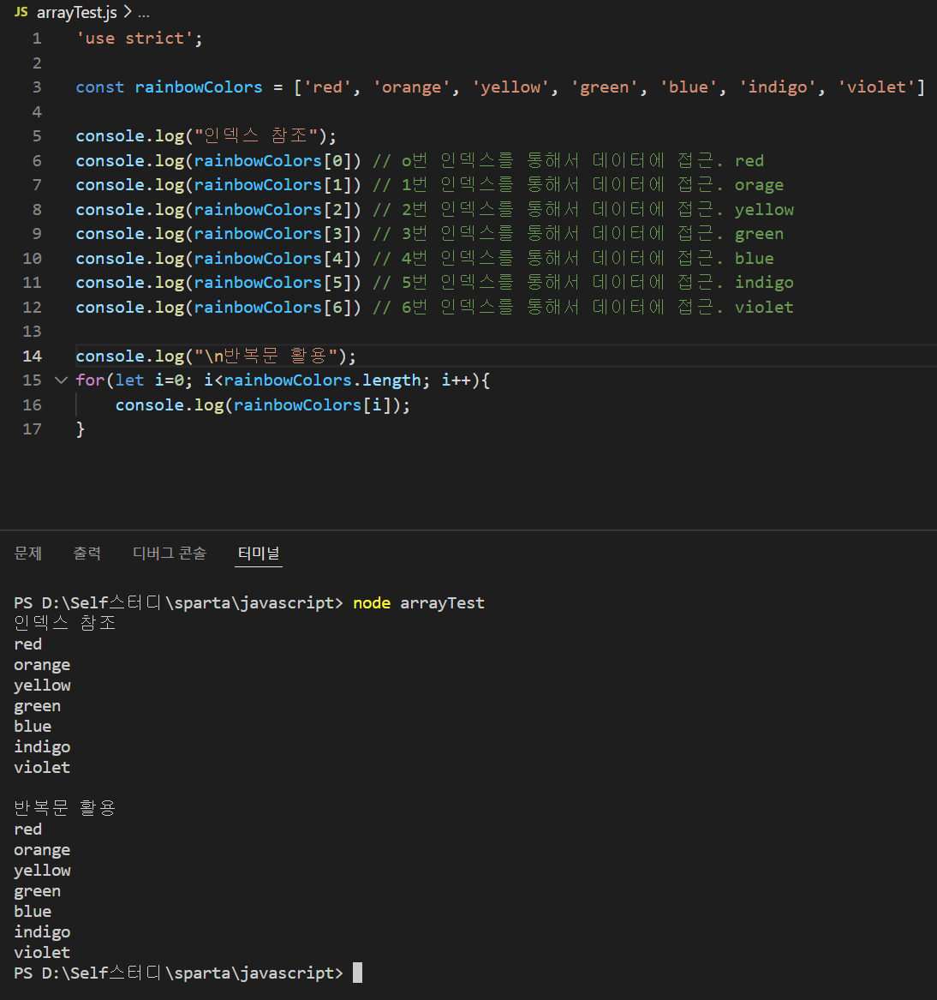

11-1. 배열의 사용 예제

******2) 배열의 삽입 삭제******

**********•배열명.push('value') : 자료구조 stack과 유사하게 배열에 마지막에 데이터가 저장된다.**********

**********•배열명.pop() : 자료구조 stack과 유사하게 배열에 마지막에 데이터가 삭제된다.**********

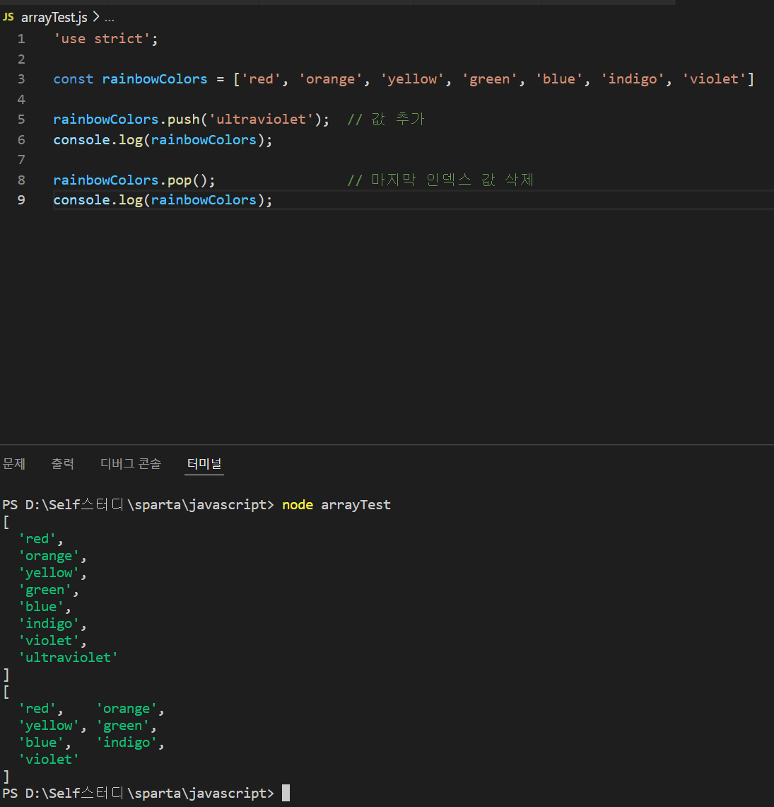

11-2. 배열의 삽입, 삭제

******3) Quiz******

**********•열 개의 상품 가격 데이터를 갖고 있는 배열을 만듭니다. 반복문을 활용해 상품들의 가격 합계와 평균을 구해보아요.**********

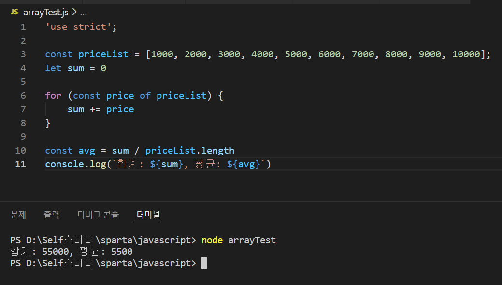

11-3. 배열 퀴즈 문제 풀이

---

**정리**

**오늘은 자바스크립트를 마무리 하였다..****이제 사전학습 모든 강의를 1회독하였다..****모든 과목을 이전에 학습하고 개발에 사용한 경험이 있었지만,****배우면서 새로운 내용도 있었고, 학습 진도율을 경쟁을 통해 보여주는 것이**

**크게 인상적이었다. 이점이 더 학습효과를 극대화 시키는 것 같다!**

