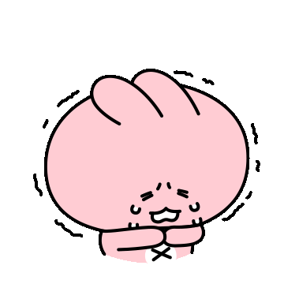
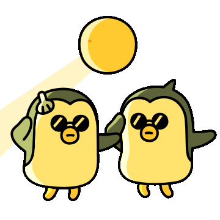

## Be gentle first with yourself

---

### 호랑이 굴에 들어가도 정신만 차리면 산다.

---

버그가 발생하여 기능을 개선하면서 신기한 일을 경험했다.

#1 이슈를 해결하고 병합하고

#2 이슈를 해결하고 병합하고

#3 이슈를 해결하고 #1, #2 테스트를 진행하였다.

그런데... #1 이슈가 동일하게 발생한다... 이유가 무엇일까?

무엇이 문제인지 파악하기 위해 #1 브랜치로 체크아웃해서 테스트를 진행하였는데 문제가 없다.

#2 브랜치로 이동해서 테스트를 진행하였는데 문제가 없다.

해당 부분에 호출순서가 달라진 것이 있는지 확인하였는데 달라진 것이 없었다. 

그리고 #3브랜치에서도 해당 코드를 수정한 것이 없었기 때문에 왜 안되는것인지 너무 혼란스러웠다....

혼란스러워서 이것저것 다 수정해가면서 코드를 보다가 물 한잔 마시고 다시 코드를 확인하니 문제의 원인이 보였다....

#3에서 수정한 코드에서 API를 호출하는 코드가 있어 발생한 문제였다.

API를 호출을 기다리지 않고 #1 에서 발생한 문제를 해결하기 위한 메소드가 실행되어 API 호출후 해당 코드가 다시 리셋되어 버리는 효과가 발생한 것이다...

해결방법은 async/await을 설정하여 간단하게 해결할 수 있었다....

간단한 문제를 복잡하게 생각하고 너무 쉬운 것을... 너무 오랜 시간을 끌어버렸다...

### 12 주차 후기

---

이번 주가 12주차였다... 회사에 입사한지 얼마 안된 것 같은데...

정말 많은 것을 한 것 같지만 생각해보면 적은 것도 같다.

매일을 바쁘게 개발 개발 개발 하다보니까 사이드 프로젝트나 인턴 때 경험했던 것과는 많은 것들이 달랐다.

인턴 때는 간단한 것들에 대해서만  주워지고 메인 서비스를 담당하지 않았던 것 같았다.

그리고 새로운 기능에 대한 베타 서비스를 구현하는 것에 참여하고 기존 서비스 로직 개선은 참여해보지 못했던 것 같다.

이전에는 기존 기능을 개선하는 것보다 새로운 기능을 구현하는 것이 더 어려울 것이라고 생각했는데.. 

필자가 느낀바로는 새로운 기능을 구현하는 것이 더 쉬운 것 같다. 

새로운 기능을 구현하면 그에 맞게 잘 구성하면 되지만...

기존 기능을 개선하기 위해서는 기존 로직을 파악해야하고 영향 범위를 알아야한다...

개발을 하면서 어디까지 영향이 가는지 알지 못한 상태로 개발할 때도 많았다... 

실제 사용자가 사용하고 있는 서비스를 개발하다보니까 영향범위인지 몰랐던 부분에서 많은 버그가 발생하기도 했다.

그러면서 경각심을 더 느끼게 되고 해당 코드의 범위가 어디까지인지 지속적으로 확인하고 테스트하는 습관이 생기게 되었다.

가장 많이 배운 것은 다양한 해결책을 찾고 테스트하면서 최적의 방법을 찾는 것이었다.

프론트에서도 해결할 수 있고 백엔드에서도 해결할 수 있고 쿼리적으로 해결할 수 있고 다양한 방법이 있을 텐데 그러한 방법 중에 어떤 것이 다른 곳에 영향을 주지 않으면서 비용이 적게 발생하는지 고민을 하면서 개발을 하다보니까 프론트의 중요성도 다시 한번 깨닫게 되었다...

프론트 개발자분들 존경스럽습니다...

백엔드 개발자분들도 존경스럽습니다...

아직 12주차밖에 안되었지만... 시간이 진짜 빠른 것 같다...

하나라도 더 많은 것을 배우고 더 성장할 수 있게 노력해야겠다... 헤헷

