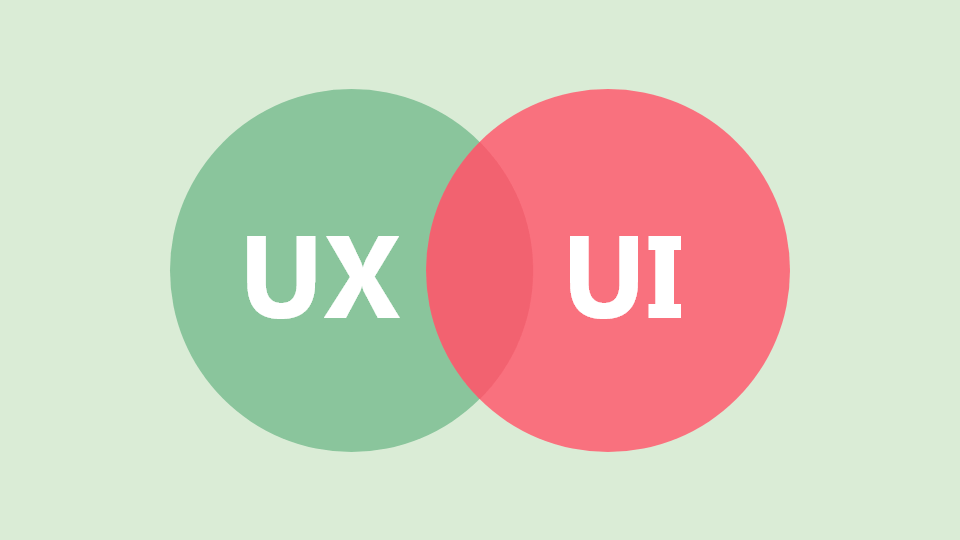
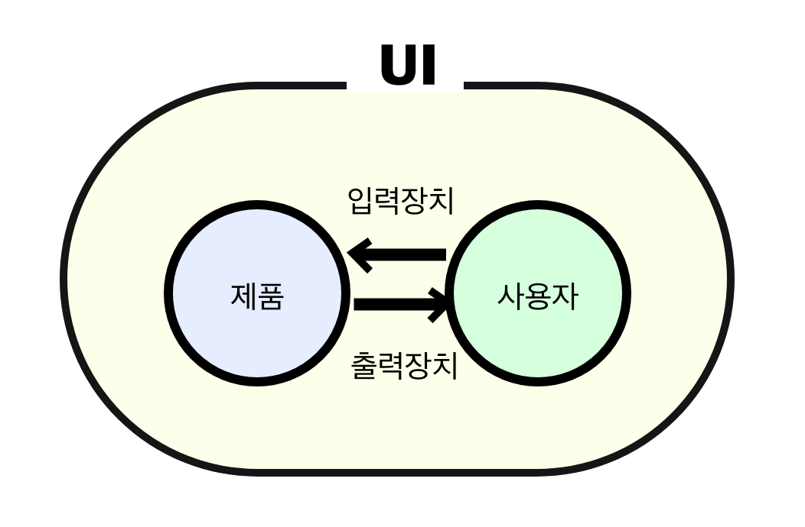

## UI, UX, 인터렉션 개념 정리

---

디자이너 분들과 소통을 하면서 인터렉션이라는 단어를 들었는데 무엇을 해야하는지 알 수는 있었지만, 인터렉션이 어떤 의미를 갖고 있는지 궁금하여 공부하고 정리하게 되었다.

### UI(User Interface)

---

> **사용자 인터페이스** 또는 **유저 인터페이스**(영어: user interface, **UI**)는 **사람(사용자)과 사물 또는 시스템, 기계, 컴퓨터 프로그램 등 사이에서 의사소통을 할 수 있도록 일시적 또는 영구적인 접근을 목적으로 만들어진 물리적, 가상적 매개체**를 뜻한다. 사용자 인터페이스는 사람들이 컴퓨터와 상호 작용하는 시스템이다. 사용자 인터페이스는 물리적인 하드웨어와 논리적인 소프트웨어 요소를 포함한다. 사용자 인터페이스는 크게 다음과 같은 수단을 사용한다.  
> [참고 - [위키백과](https://ko.wikipedia.org/wiki/%EC%82%AC%EC%9A%A9%EC%9E%90_%EC%9D%B8%ED%84%B0%ED%8E%98%EC%9D%B4%EC%8A%A4)]

한줄로 요약하면 **사용자와 서비스 간의 상호작용을 위한 장치**를 말합니다.

사용자가 서비스를 사용하기 위해 입력장치를 조작하면 서비스는 출력 장치를 통해 정보를 제공해준다.

=> UI에는 입력 장치와 출력 장치가 존재하고 있습니다.

UI에 물리적인 장치 뿐만 아니라 출력장치를 통해 제공되는 정보도 포함된다.

이해하기 쉽게 말하자면, **디스플레이스를 통해 보여지는 시각정보**, **스피커를 통해 전달되는 청각 정보**, **진동모터를 통해 전달되는 촉각 정보**가 모두 UI에 포함된다.

예를 들면, 스마트폰에 입력장치에는 키보드, 볼륨 버튼, 홈 버튼, 밝기 센서, 카메라, 터치 화면 등이 있습니다.

반면 출력장치에는 디스플레이, LED, 스피커, 진동 모터 등이 있습니다.

### UX(User eXperience)

---

> **사용자 경험**(**User Experience**)은 사용자가 어떤 시스템, 제품, 서비스를 직, 간접적으로 이용하면서 느끼고 생각하게 되는 총체적 경험을 말한다. 단순히 기능이나 절차상의 만족뿐 아니라 전반적인 지각 가능한 모든 면에서 사용자가 참여, 사용, 관찰하고 상호 교감을 통해서 알 수 있는 가치있는 경험이다. 긍정적인 사용자 경험의 창출은 산업 디자인, 소프트웨어 공학, 마케팅, 및 경영학의 중요 과제이며 이는 사용자의 니즈의 만족, 브랜드의 충성도 향상, 시장에서의 성공을 가져다 줄 수 있는 주요 사항이다. 부정적인 사용자 경험은 사용자가 원하는 목적을 이루지 못할 때나 목적을 이루더라도 감정적, 이성적으로나 경제적으로 편리하지 못하거나 부정적인 반응을 불러일으키는 경험을 하게 되는 경우 발생할 수 있다.  
> 긍정적인 사용자 경험을 개발, 창출하기 위해서 학술적, 실무적으로 이를 만들어 내고자 하는 일을 사용자 경험 디자인이라고 하며 영역에 따라 제품 디자인, 상호작용 디자인, 사용자 인터페이스 디자인, 정보 아키텍처, 사용성 등의 분야에서 주로 연구 개발되고 있다. 그러나 사용자 경험은 다학제적이며 다분야의 총체적 시각에서 접근해나가야 하는 핵심적인 원리를 바탕으로 한다.  
>   
> [참고 - [위키백과](https://ko.wikipedia.org/wiki/%EC%82%AC%EC%9A%A9%EC%9E%90_%EA%B2%BD%ED%97%98)]

한줄로 요약하면 UX는 사용자가 직, 간접적으로 서비스를 이용하면서 느끼게 되는 경험을 의미합니다.

경험에는 느낌, 태도, 행동이 핵심이며 IT 서비스에서의 UX는 소프트웨어를 사용하는 혹은 하드웨어를 사용하는 사용자의 느낌, 태도, 행동을 의미합니다.

따라서 UX 디자인이란 사용자에게 목적 달성 절차의 효율성과 함께 만족스러운 경험을 제공하는 UI를 디자인하는 것을 말합니다.

예시로 스마트폰 스트랩을 생각해보자.

스마트폰 스트랩은 디자인의 아름다움도 중요하지만, 케이스와 스트랩이 스마트폰을 안전하게 받쳐줄 수 있는지, 사람의 손에는 얼마나 안정적으로 감기는지, 잘늘어나지 않고 오랫동안 탄력성이 유지되는지, 브랜드가 얼마나 사용자에게 믿음을 줄 수있는지 등도 고려할 수 있는 부분들이 다 UX를 의미합니다.

따라서 사용자가 서비스에 대해 느끼는 만족감, 고급감, 브랜드, 신뢰 등이 모두 UX에 포함됩니다.

사용자가 제품을 사용하는 과정에서 경험하는 만족감은 3가지로 본능적, 행동적, 반성적 만족감으로 나눠진다.

* **본능적 만족감**은 제품의 스타일, 촉감, 사운드 피드백으로부터 감감적으로 느끼는 만족감을 의미합니다.
* **행동적 만족감**은 제품을 사용하는 과정에서 경험하는 사용편의성, 즐거움, 효용을 의미합니다.
* **반성적 만족감**은 제품이 사용자에게 주는 의미, 가치, 메시지를 의미합니다.

### 인터렉션

---

> 상호 작용(Interaction)은  철학과 과학에서 일반적으로 사용되는 두 개 이상의 개체 간에 발생하는 작업입니다.   
> [참고 - [위키백과](https://en.wikipedia.org/wiki/Interaction)]

Interaction의 사전적 의미는 둘 이상의 물체나 대상이 서로 영향을 주고 받는 일종의 행동을 의미합니다. 즉, 인터렉션은 단방향 서비스가 아니라 서로 교류가 있는 양방향 통신이나 서비스를 의미합니다.

#### 인터렉션 디자인이란?

인터렉션 디자인은 인간이 제품이나 서비스를 사용하면서 경험하는 상호 작용을 용이하게 해주는 디자인으로 사용자의 일방적이고 단순한 조작이 아닌 최신 디지털 기술을 이용한 사람과 제품의 상호작용을 통해 새로운 방식으로 소통하는 디자인을 말합니다.

#### 상호작용

TV를 보면서 일방적으로 TV가 전해주는 정보를 전달 받기만 했었는데 인터렉티브 미디어랑 이런 일방적이고 수직적인 관게에서 벗어나 상호 작용이 가능하게 됩니다. 즉, 사용자가 정보의 수혜자뿐 아니라 공급자 역할을 할 수 있습니다.

정리해보면 인터렉션은 사용자가 목적을 달성하기 위해서 제품의 UI를 사용하여 상호작용하는 과정을 의미합니다. 처음에 인터렉션이란 말을 접했을 때는 단순히 애니메이션 하나를 뜻하는 줄 알았으나, 인터렉션은 UI보다 더욱 큰 개념입니다.

예시로 스마트폰을 생각해보자.

전화를 걸기 위해 사용자가 통화 버튼을 누르면 최근 통화 목록이 표시되고, 연락처를 보고 싶으면 연락처 리스트를 클릭하면 저장되어 있는 연락처가 리스트로 쭉 뜬다. 이때 통화 목록을 상하로 스크롤하고, 통화를 원하는 사람 혹은 항목의 전화하기 버튼을 터치하면 통호가 되고 종료 버튼을 누르면 통화가 종료된다. 그러면 해당 항목은 최근 통화목록 맨 위에 새롭게 항목이 추가 된다. 이렇게 사용자와 스마트폰이 주고 받는 과정이 모두 다 인렉션이다.

따라서 정리하면 인터렉션은 사용자가 어떤 목적을 달성하기 위해 제품의 UI를 사용해서 제품과 상호작용하는 과정을 포함한다. 그렇다면 UI 집합에는 없고 인터렉션 집합에만 포함되는 것은 무엇일까? 바로 목적 달성을 위한 절차입니다. 목적 달성 절차를 포함하면 인터렉션이고 그것을 포함하지 않는다면 UI 입니다.

### UX 범위

---

UX에는 크게 두 가지의 범위를 얘기할 수 있다.

제품을 구입한 후 제품을 사용하는 과정에서 경험하는 UX를 협의의 UX라고 한다면, 제품 구입을 위한 정보 탐색 단계부터 대안을 평가하고 구매하기까지의 일련의 과정에서 경험하는 UX를 광의의 UX라고 볼 수 있습니다.

따라서 광의의 UX가 협의의 UX보다 더욱 큰 개념입니다. 또한 제품 밖으로 시야를 확장하여 시스템적으로 어떤 경험을 주는지 보는 시스템 관점의 UX는 광의의 UX보다 큰 개념입니다.

**참조**

<https://everybody-yeah.tistory.com/12>
