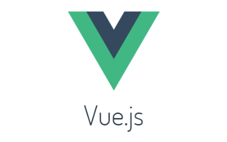



## 부모 컴포넌트 API 호출을 자식 컴포넌트에서 제어하는 방법

---

서비스를 구현하면서 부모 컴포넌트에서 API를 호출하고 자식 컴포넌트에서 API를 호출하는 것을 확인할 수 있었다.

단순히 조회 기능이기 때문에 문제가 되지 않을 수 있지만, 성능적인 문제가 발생할 수 있다.

이러한 중복 API를 불필요하기 때문에 **부모 컴포넌트에서 호출하는 API는 자식 컴포넌트에서 필요하지 않기 때문에 자식 컴포넌트에서 부모 컴포넌트에 API 를 제어할 수 없을까** 라는 생각이 들었다.

Vue.js에서는 부모 컴포넌트에서 호출되는 API를 자식 컴포넌트에서 제어할 수 있습니다.

Vue.js는 **부모-자식 컴포넌트** 간의 데이터 흐름을 쉽게 관리할 수 있는 특징을 가지고 있습니다.

일반적으로 **부모 컴포넌트에서 호출되는 API**는 데이터를 가져오거나 업데이트하는 데 사용되고, **자식 컴포넌트**에서는 부모로부터 전달받은 데이터를 표시하거나 수정하는 등의 작업을 수행할 수 있습니다.

이러한 중복 호출을 방지하기 위한 방법은 크게 2가지로 볼 수 있습니다.

### 부모 컴포넌트에서 자식 컴포넌트로 전달

---

부모 컴포넌트에서 자식 컴포넌트로 데이터를 전달하려면 **props**를 사용하면 됩니다.

**props**는 자식 컴포넌트에 속성으로 전달되는 값이며, 이를 활용하여 부모 컴포넌트에서 API 호출 결과를 자식 컴포넌트로 전달할 수 있습니다.

### 자식 컴포넌트에서 부모 컴포넌트에 API 제어

---

자식 컴포넌트에서 API 호출을 제어하려면 해당 로직을 자식 컴포넌트의 메서드나 라이프사이클 훅 등에서 처리하면 됩니다. **자식 컴포넌트의 데이터나 동작에 대한 변경**은 **부모 컴포넌트로 다시 전달**되어 **전체 애플리케이션의 상태를 업데이트**할 수 있습니다.

예를 들어, 부모 컴포넌트에서 API를 호출하고 그 결과를 자식 컴포넌트로 전달하는 경우

```javascript
// ParentComponent.vue (부모 컴포넌트)
<template>
  <div>
    <ChildComponent :apiData="apiData" />
    <button @click="fetchData">데이터 가져오기</button>
  </div>
</template>

<script>
export default {
  data() {
    return {
      apiData: null
    };
  },
  methods: {
    fetchData() {
      // API 호출 로직
      // ...

      // API 결과를 자식 컴포넌트로 전달
      this.apiData = apiResponse;
    }
  }
};
</script>

// ChildComponent.vue (자식 컴포넌트)
<template>
  <div>
    <p v-if="apiData">{{ apiData }}</p>
    <button @click="updateData">데이터 수정</button>
  </div>
</template>

<script>
export default {
  props: ['apiData'],
  methods: {
    updateData() {
      // 데이터 수정 로직
      // ...

      // 변경된 데이터를 부모 컴포넌트로 전달
      this.$emit('update:apiData', modifiedData);
    }
  }
};
</script>
```

### 부모가 컴포넌트가 App.vue인 경우라면?

---

자식 컴포넌트에서 App.vue에서의 API 호출을 제어할 수 있습니다. Vue.js에서는 컴포넌트 간의 데이터 흐름을 쉽게 관리할 수 있는 여러 가지 방법을 제공합니다.

일반적으로 자식 컴포넌트에서 부모 컴포넌트의 메서드를 호출하여 API를 제어합니다. 부모 컴포넌트인 **App.vue**에서 **API 호출 로직을 구현**하고, **해당 로직을 자식 컴포넌트로 전달하여 사용**할 수 있습니다.   

**자식 컴포넌트에서 API 호출을 제어**하려면 **부모 컴포넌트의 메서드를 호출하거나 이벤트를 발생**시켜야 합니다. 메서드 호출은 **this.$parent**를 사용하여 부모 컴포넌트의 메서드에 접근할 수 있습니다. 이벤트 발생은 **$emit** 메서드를 사용하여 부모 컴포넌트에 이벤트를 전달할 수 있습니다.   

예를 들어, 자식 컴포넌트에서 App.vue 의 API 호출을 제어하는 경우

```javascript
// App.vue (부모 컴포넌트)
<template>
  <div>
    <ChildComponent @callApi="fetchData" />
  </div>
</template>

<script>
export default {
  methods: {
    fetchData() {
      // API 호출 로직
      // ...
    }
  }
};
</script>

// ChildComponent.vue (자식 컴포넌트)
<template>
  <div>
    <button @click="callApi">API 호출</button>
  </div>
</template>

<script>
export default {
  methods: {
    callApi() {
      // 부모 컴포넌트의 메서드 호출
      this.$parent.fetchData();

      // 또는 이벤트 발생
      this.$emit('callApi');
    }
  }
};
</script>
```

위 예제에서 **ChildComponent**는 버튼을 클릭하면 **App.vue**의 API 호출을 제어합니다.

**ChildComponent**의 버튼 클릭 이벤트가 발생하면 **callApi**메서드가 실행되고, 이 메서드에서는 부모 컴포넌트의 **fetchData**메서드를 호출하거나 **callApi**이벤트를 발생시킵니다. 이를 통해 **App.vue**에서 정의한 API 호출 로직을 자식 컴포넌트에서 제어할 수 있습니다.

### **정리**

---

부모 컴포넌트에서 조회 API를 호출하고

자식 컴포넌트에서 업데이트 API 를 호출하는 방식이 일반적이지만

실제 원하지 않게 부모 컴포넌트에서도 자식 컴포넌트에서도 조회 API가 발생한다면 위와 같이 제어할 수 있다.

마지막으로 유의해야할 것은 Vue 부모 자식간에 라이프 사이클 호출 순서이다.

* **Created : 부모, 자식**
* **Mounted : 자식, 부모**

이처럼 **created**와 **mounted Hook**의 호출 순서 차이가 있다는 것을 알아야합니다.
