### 정규화란?

---

정규화를 이해하기 위해서는 다음과 같이 이상현상(Anomly)과 함수 종속성(Functional Dependency)을  먼저 이해하는 것이 좋습니다.

#### **이상현상(Anomly)**

**삭제이상(**Deletion Anomly)****

**삭제 이상(****Deletion****Anomly)**란 튜플을 삭제할 때 저장되어 있는 다른 정보도 삭제되어 연쇄 삭제(Triggered Deletion)의 문제가 발생하는 경우를 의미합니다.

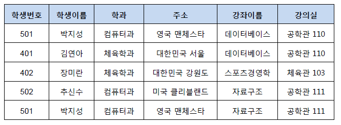

위 그림에서 장미란이라는 학생의 정보를 지울 경우 강의실 103도 같이 사라지게 되어 다른 튜플들이 강의실 103을 사용하지 못하는 경우에 발생한다.

**삽입이상(Insertion Anomly)**

삽입 이상(Insertion Anomly)란 튜플을 삽입하는 경우에 해당하는 정보가 없어 NULL을 넣는 현상입니다.

**수정 이상(Update Anomly)**

수정 이상(Update Anomly)란 어떤 값을 참조하는 튜플의 값을 수정할 때 같은 데이터를 참조하는 다른 튜플과 데이터가 달라지는 현상입니다.

예를 들어 위 그림에서 박지성이라는 학생과 김연아라는 학생이 같은 데이터베이스라는 수업을 강의실 110호 에서 수강하고 있습니다. 그런데 두 강의는 독립적으로 입력된 데이터이기 때문에 박지성 학생에서 강의실을 201호로 변경하여도 김연아 학생은 110호로 데이터가 그대로 유지되고, 같은 데이터베이스 수업임에도 불구하고 강의실이 달라지는 현상이 발생합니다. 

이러한 이상현상은 서로 공유하는 데이터임에도 불구하고 각자의 튜플에 독립적으로 존재하기 때문에 발생합니다. 그러므로 테이블을 분리하여 그 테이블을 통해 강의 제목이나 강의실을 참고하게끔 한다면 이상현상들을 해결할 수 있습니다. 

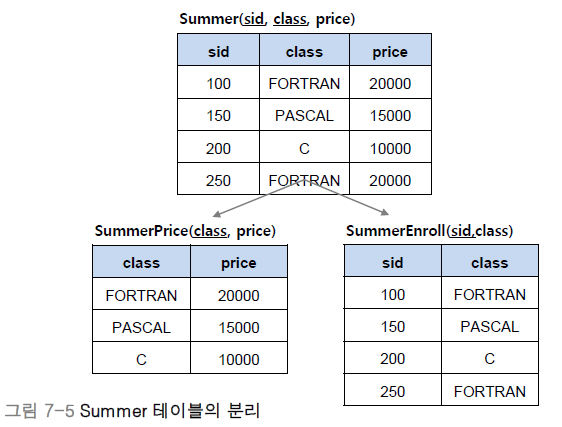

정리하면 

* **삭제 이상 -**튜플 삭제 시 같이 저장된 다른 정보까지 연쇄적 삭제되는 현상
* **삽입 이상 -**튜플 삽입 시 특정 속성에 해당하는 값이 없어 NULL을 입력해야 하는 현상
* **수정 이상 -**튜플 수정 시 중복된 데이터의 일부만 수정되어 일어나는 데이터 불일치 현상로 써 **무결성(Integrity)을** 유지할 수 있으며, DB의 저장 용량 역시 줄일 수 있다.

---

#### **함수 종속성(Functional Dependency)**

* 어떤 속성 A의 값을 알면 다른 속성 B의 값이 유일하게 정해지는 관계를 **종속성**이라 함
* A->B로 표기하며 A를 B의 결정자라고 함

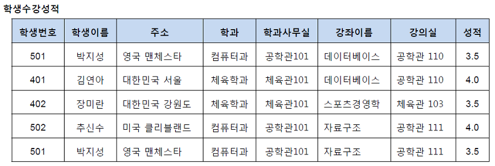

위의 그림과 같은 학생 수강 성적 릴레이션이 있다고 가정합시다. 우리는 학생과 수강 그리고 성적의 속성에는 의존성이 존재한다고 표현합니다. 

**의존성**이란 501이라는 학생번호를 보면 학생이름이 박지성으로 정해지는 관계를 의미하며, 정리하면 속성 A의 값을 알면 다른 속성 B의 값이 유일하게 정해지는 의존관계를 속성 B는 속성 A에 종속한다.

의존성(Dependent) 또는 속성 A는 속성 B를 결정한다(Determine)라고 합니다.

학생번호 -> 학생이름처럼 A->B로 표현하며 A가 B를 결정한다고 하여 **A를 B의 결정자**라고 합니다.  그 외에도 아래의 그림에는 학과 -> 학과사무실, 강좌이름 -> 강의실과 같은 **종속관계**가 있습니다. 종속하지 않는 관계로는 학과 -> 학생번호, 학생이름 -> 강좌이름이 있습니다. 학생이름 -> 학과는 종속하는 것처럼 보이지만 동명이인의 학생이 있는 경우 그 학생의 이름은 학과를 결정하지 못하므로 종속의 관계가 아닙니다.

**함수 종속성 다이어그램**

* 릴레이션의 속성: 직사각형
* 속성 간의 함수 종속성: 화살표
* 복합 속성: 직사각형으로 묶어서 그림

**함수 종속성 다이어그램(Functional Dependency Diagram)**은 **함수 종속성을 나타내는 표기법**입니다.

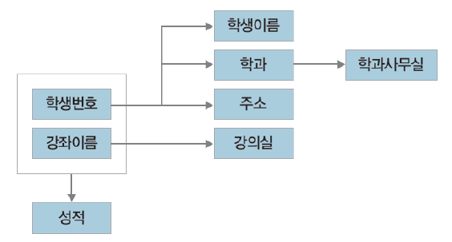

학생이름, 학과, 주소 등과 같은 릴레이션의 속성은 직사각형으로 표기합니다. 그리고 두 속성이 종속적인 관계를 가질 때 예를 들면 학생번호가 학생이름을 결정하는 관계를 가질 때는 화살표를 이용하여 종속성을 표현합니다. 또한 복합속성의 경우에는 그 속성들을 묶어 하나의 직사각형으로 표시해 줍니다. 예를 들어 학생번호와 강좌이름을 확인하면 성적을 확인할 수 있으므로 학생번호와 강좌이름을 큰 직사각형으로 묶어 복합 속성으로 두고 성적에 화살표 연결을 해줍니다. 

**릴레이션과 기본키**

* **관계(Relationship)**란 개체 사이의 연관성을 나타내는 개념이다.
* **관계 타입(Relationhip Type)**이란 개체 타입과 개체 타입 간의 연결 가능한 관계를 정의한 것이다.
* **관계 집합(Relationship set)**은 관계로 연결된 집합을 의미한다.

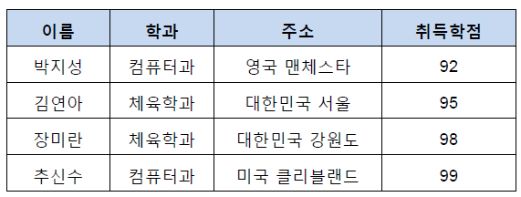

릴레이션의 함수 종속성을 파악하기 위해서는 우선 기본키를 찾아야 합니다. 기본키가 함수의 종속성에서 어떤 역할을 하는지 알면 이상 현상을 제거하는 정규화 과정을 쉽게 이해할 수 있습니다. 여기서 기본키는 한 릴레이션의 다른 속성들을 모두 결정할 수 있어야 합니다. 아래와 같은 그림에서 우리는 이름을 기본키로 사용하여 어디과인지, 어디에 사는지, 어떤 학점을 받았는지 알 수 있으므로 이름이라는 속성이 기본키가 된다고 분석할 수 있습니다.

**이상현상과 결정자**

이상현상은 **한 개의 릴레이션에 두 개 이상의 속성이 포함되어 있고 기본키가 아닌 속성이 결정자일 때 발생**합니다. 위의 학생수강성적 릴레이션의 경우 기본키를 지닌 학생 정보(학생번호, 학생이름, 주소, 학과)와 기본키가 아니지만 결정자적 성질을 지닌 강좌 정보(강좌이름, 강의실)가 한 릴레이션에 포함되어 이상현상이 나타난 것입니다. 그 외에도 학과, 학생 번호, 강좌 이름은 기본키가 아니면서 결정자이기 때문에 이상현상을 해결하기 위해 우리는 총 4개의 릴레이션으로 학생수강성적 릴레이션을 분해하면 됩니다. 

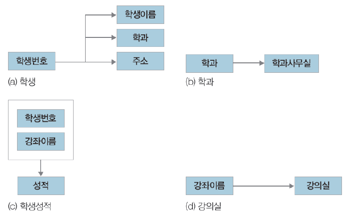

---

#### **정규화(Normalization)**

* **정규화**: 이상현상이 발생하는 릴레이션을 분해하여 이상현상을 없애는 과정
* 이상현상이 있는 릴레이션은 이상현상을 일으키는 함수 종속성의 유형에 따라 등급을 구분가능
* 릴레이션은 정규형 개념으로 구분하며, 정규형이 높을수록 이상현상은 줄어듦

**제1 정규형**

제1 정규형은 릴레이션의 모든 속성 값이 원자값을 갖는 경우입니다. 

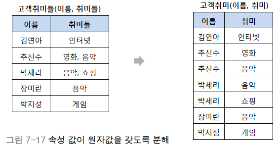

예를 들어 **고객 취미들(이름, 취미들)**이라는 릴레이션에**(추신호, (영화, 음악))**이라는 열이 있다고 가정하면 이 속성들이 각각 다른 열로 분해된 릴레이션을 **제1 정규형**이라 합니다. 

**제2 정규형**

**제2 정규형은 릴레이션이 제1 정규형을 만족하고, 기본키가 아닌 속성이 기본키에 완전 함수 종속일 때**를 의미합니다. 

**완전 함수 종속**은 **기본키로 묶인 복합키가 존재할 때 복합키(A, B, C)가 모여서 하나의 다른 값(X)을 결정하고 복합키의 부분집합이 결정자가 되면 안 된다는** 의미입니다.

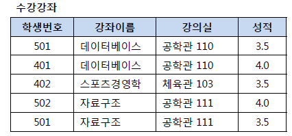

위 그림과 같이 수강강좌 릴레이션이 있고, (학생번호, 강좌이름)의 복합키를 가지고 있다고 가정합시다.

학생 번호와 강좌 이름(501, 데이터베이스)이 모여서 성적이라는 하나의 값을 결정하지만, 강의실의 경우에는 학생 번호가 없어도 강좌 이름과 강의실(데이터베이스, 공학관 110) 만으로도 강의실을 결정할 수 있습니다.

이러한 관계를 **부분 함수 종속**이라고 하며 제2 정규형은 완전 함수 종속을 만족시켜야 하므로 강좌이름과 강의실을 분리하면 제2 정규형이 만들어집니다.

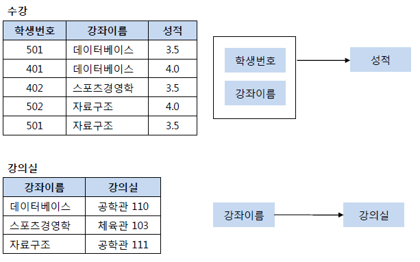

**제3 정규형**

**제3 정규형은 릴레이션 R이 제2 정규형을 만족하고 기본키가 아닌 속성이 기본키에 비이행적(Non-Transitive)으로 종속할 때(직접 종속)**를 의미합니다.

**이행적 종속**이란, **A->B, B->C가 성립할 때 A->C가 성립되는 함수 종속성**을 의미합니다.

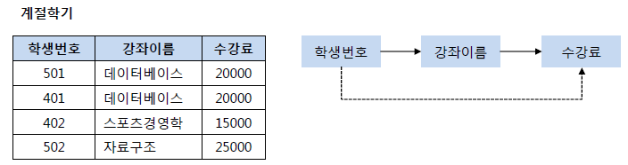

위 그림과 같이 계절학기 릴레이션에서 학생번호 501의 강좌이름이 스포츠경영학으로 변경되면 수강료도 15000원으로 변경되어야 합니다. 위의 속성들을 독립적으로 만드는 것이 아니라 학생 번호로 학생이 수강하는 강좌이름을 찾게 하고 그 학생번호가 참조하는 강좌이름을 참조하여 수강료를 찾게 하여 학생번호가 수강료를 참조할 수 있게 끔 만들면 제3 정규형이 됩니다. 

**BNCF 정규형**

**BCNF 정규형**은 **릴레이션 R에서 함수 종속성 X->Y가 성립할 때 모든 결정자 X가 후보키인 정규형**입니다.

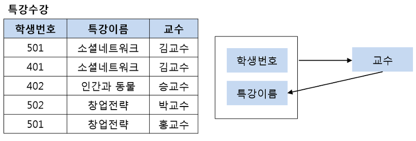

위 그림의 왼쪽 그림에서 **기본키는(학생번호, 특강이름)이고** **교수는 (학생번호, 특강이름)**에 완전하게 함수적으로 종속하고 있습니다. 또한 교수도 특강 이름을 결정하며 결정자의 역할을 하고 있습니다.

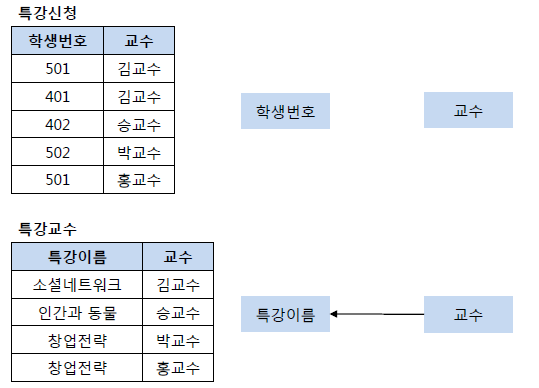

다음으로 모든 결정자 X가 후보키인지를 확인해야 합니다. (학생번호, 특강이름)은 기본키이므로 당연히 결정자이며 후보키입니다. 하지만 교수는 결정자이면서 후보키가 아니므로 아래의 왼쪽 테이블은 BCNF정규형이 아닙니다. BCNF정규형을 만족하기 위해서 왼쪽의 테이블을 오른쪽과 같이 분리해야 합니다.

**무손실 분해**

이상현상을 해결하기 위해서 우리는 릴레이션을 분해해야 한다. 하지만 하나의 릴레이션 R을 분해할 때 분해 후의 결과와 달라지면 문제가 발생하게 되므로 우리는 손실이 없이 릴레이션을 분해해야 합니다. 여기서 **릴레이션 R을 R1과 R2로 분해할 때, R1▷◁R2를 만족하는 경우를 무손실 분해(Loseless-join decomposition)**라고 합니다. **그리고 R1과 R2는 R1∩R2 -> R1 혹은 R1∩R2 -> R2 중 하나를 만족해야 합니다**. 아래의 그림에서 교수 속성으로 분리한 후 다시 조인하면 원래의 릴레이션이 되지만 특강이름 속성을 사용하여 분해하는 경우는 창업전략의 교수님이 다르므로 원래의 릴레이션이 되지 않습니다. 그리므로 이 경우는 무손실 분해가 아닙니다. 

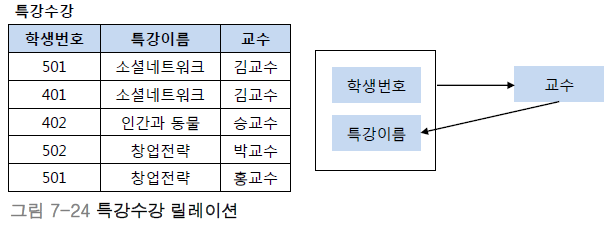
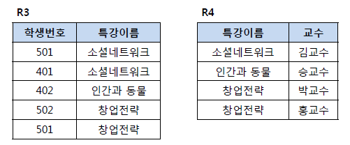
