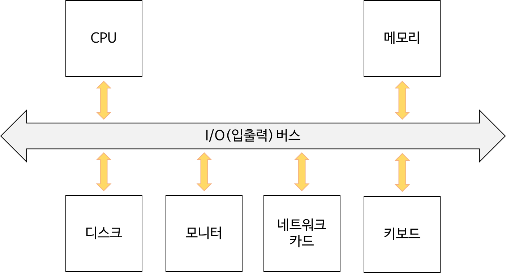
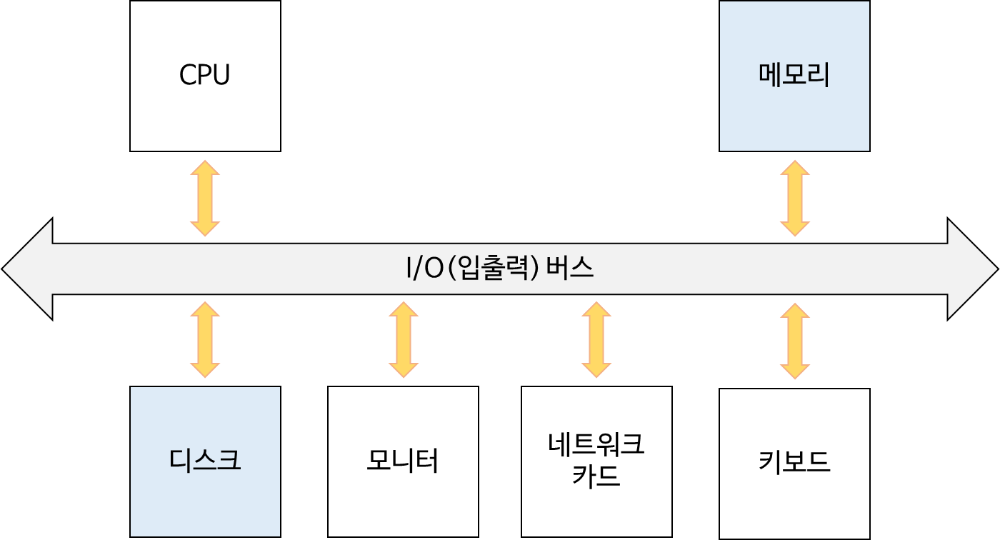
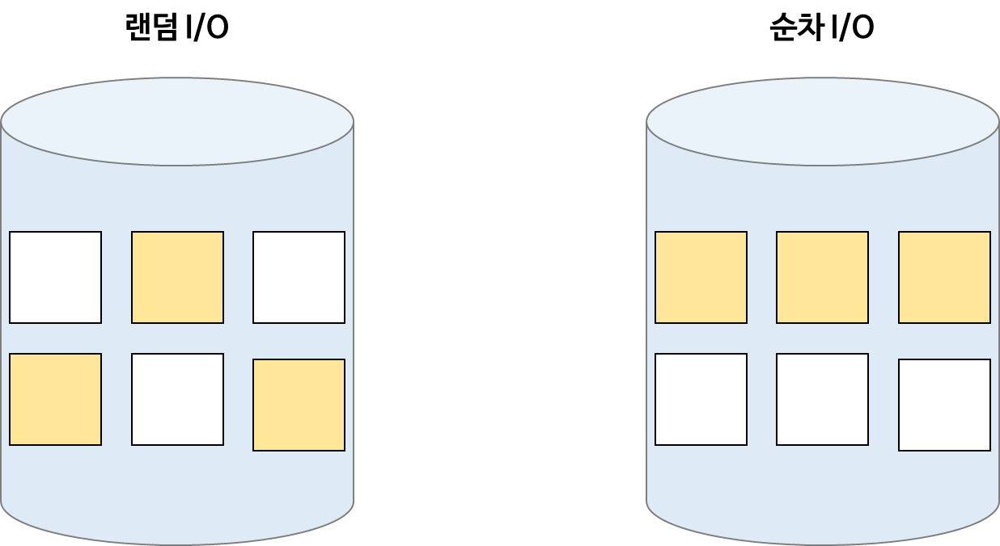
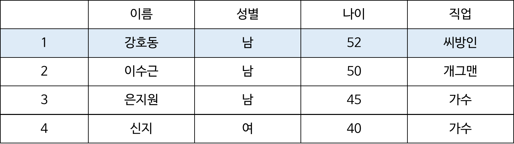
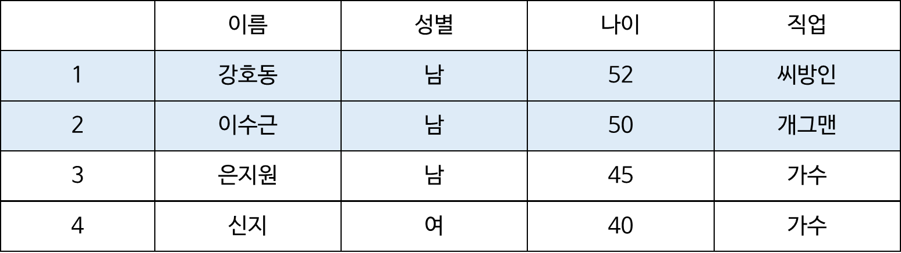
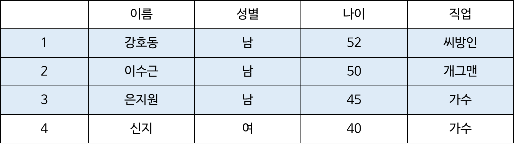
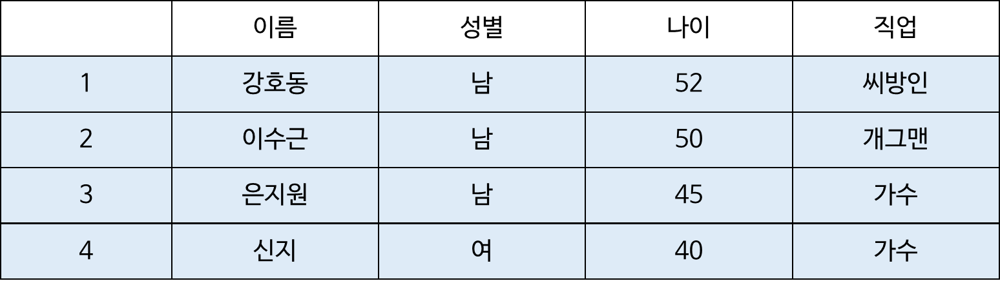
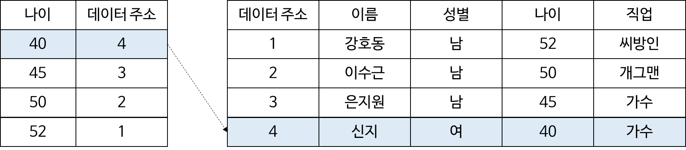

## **조회 최적화를 위한 인덱스**

---

### **데이터베이스 성능 핵심**

---

데이터베이스 서버도 결국 컴퓨터이기 때문에 컴퓨터 구조에 대한 이해가 필요합니다.

#### **컴퓨터 구조**

컴퓨터에는 CPU, 메모리, 디스크, 모니터, 네트워크 카드, 키보드 등등이 있습니다. 



CPU 가 데이터를 가져오기 위해서는 I/O 입출력 버스를 통하게 되고 디스크나 메모리, 모니터 등등으로 데이터를 전달하게 됩니다. 이외에도 수많은 I/O 장치들이 존재할 수 있는데 데이터를 저장하기 위한 용도로 어떤 것들을 많이 사용하게 될까?



정답은 메모리와 디스크입니다. 모니터와 네트워크 카드로 데이터를 보낼 수 있으나 데이터를 저장하기 위한 용도로 메모리와 디스크를 많이 사용합니다. 

---

#### **메모리 / 디스크 비교**

메모리와 디스크를 표로 정리하면 다음과 같습니다. 


속도 측면에서 메모리는 디스크보다 훨씬 빠릅니다. 하지만 영속성 측면에서 전원이 공급되지 않으면 메모리는 사라집니다. 반면에 디스크 같은 경우 전원이 공급되지 않더라도 데이터가 보존됩니다. 메모리는 디스크와 비교해서 상대적으로 비쌉니다. 

---

#### **데이터베이스 성능 핵심**

데이터베이스의 데이터는 결국 디스크에 저장된다.

전원이 공급되지 않는다고 해서 데이터가 휘발되지 않아야 하기 때문에 디스크에 저장되어야 합니다.

하지만 디스크는 메모리에 비해 속도가 훨씬 느립니다.

결국 **데이터베이스 성능에 핵심은 디스크 I/O(접근)을 최소화 하는 것**입니다.

> 디스크 접근은 어떻게 줄일 수 있을까?

**메모리 캐시 히트율을 높이는 방법**

메모리에 올라온 데이터로 최대한 요청을 처리하는 것을 의미합니다. 

디스크보다 메모리에 속도가 훨씬 빠르므로 메모리에 올라온 데이터로 최대한 제공할 수 있다면 당연히 성능을 좋아질 것입니다. 

심지어 데이터베이스에 값을 쓸 때 즉 INSERT, UPDATE, DELETE 할 때도 곧 바로 디스크에 쓰지 않고 메모리에 쓴다. 

메모리는 전원이 공급되지 않으면 날라간다고 했는데 갑자기 전원이 꺼져서 데이터가 날아가면 어떻하지? 라는 생각을 할 수 있습니다. 메모리에 데이터 유실을 고려해 **WAL(Write Ahead Log)**를 사용합니다.

WAL을 이해하기 위해서는 **랜덤 I/O**와 **순차 I/O**에 대한 이해가 필요합니다.

앞에서 디스크 접근은 메모리 접근보다 훨씬 느리다고 했습니다.

하지만 디스크의 접근 방법은 **랜덤 I/O**와 **순차 I/O** 가 있습니다.



랜덤 I/O 는 무작위로 데이터를 가져오는 것입니다. 

순차 I/O 는 연속된 블락에 데이터를 한 번에 읽어오는 것입니다. 

대부분의 트랜잭션은 무작위하게 Write 가 발생합니다. 예시로 A 테이블에 10번 ID에 업데이트를 발생시키고 100번 ID에 업데이트를 발생시킬 수 있습니다. 이와 같이 대부분 무작위하게 Write가 발생합니다. 

이처럼 곧이곶대로 데이터를 넣어버리면 그만큼 랜덤 I/O가 발생하게 됩니다. 

하지만 앞에서 언급한 WAL이라는 기술은 랜덤 I/O을 발생시키는 것이 아니라 하나의 파일에 순차적으로 Write를 발생시키는 것입니다. 업데이트가 아닌 Write만 하는 것입니다. 끝부분부터 쌓아두다보니까 순차적으로 Write를 쌓아두게 되면 랜덤 I/O보다 순차적 I/O가 발생하게 됩니다.

데이터베이스는 INSERT, UPDATE 요청이 올 때마다 DISK에 접근하는 것은 비효율적이므로 대신에 메모리에 쌓아두었다가 한 번에 처리하는 것이 효율적이다. 이러한 데이터가 메모리에 쌓여서 죽어버리면 데이터 유실이 발생할 수 있으므로 WAL이라는 기술을 도입한 것입니다. 

실행한 쿼리가 로그에 남기 때문에 설령 메모리에 쌓인 데이터가 디스크에 가지 않고 유실이 되더라도 파일에 히스토리가 있으므로 서버가 다시 뜰때 파일에 순차적으로 쌓여있던 로그를 재실행 시키는 것입니다. 그렇게되면 디스크에 있는 원본데이터가 같아지게 됩니다. 

=> **지연시켜 랜덤 I/O 횟수를 줄이는 대신 순차적 I/O를 발생시켜 정합성을 유지시킬 수 있습니다.** 

* [참고] [메모리와 디스크의 속도 차이를 볼 수 있는 자료](https://colin-scott.github.io/personal_website/research/interactive_latency.html)

[Numbers Every Programmer Should Know By Year

colin-scott.github.io](https://colin-scott.github.io/personal_website/research/interactive_latency.html)

---

#### 정리

> 결국 **데이터베이스 성능에 핵심은 디스크의 랜덤 I/O(접근)을 최소화** 하는 것이다.

### 인덱스의 기본 동작

---

> 아래 그림에 A ~ G까지 문자가 담겨있는 표가 있습니다.   
> G를 찾아보세요.


> 다음 그림에서는 알파벳 순으로 정렬되어 있습니다.   
> 마찬가지로 'G' 를 찾아보세요.


> 앞에 두 가지 중에서 어떤 것이 'G'가 없다는 것을  
> 파악하시는데 더 짧은 시간이 드시나요?

인덱스는 정렬된 자료구조이기 때문에 이를 통해 탐색범위를 최소화할 수 있습니다.

---

#### **인덱스의 기본 동작=**

예시를 통해 인덱스가 어떻게 동작하고 어떤 차이가 있는지 설명드리겠습니다. 

다음과 같이 이름, 성별, 나이, 직업이 있는 테이블이 있다고 가정해보자.


> 나이가 가장 어린 사람의 데이터를 찾아주세요.

**인덱스가 없는 경우**

순차적으로 테이블의 데이터를 비교합니다.

**최소 나이 : 52**



**최소 나이 : 50**



**최소 나이 : 45**



**최소 나이 : 40**



**정답은 최소 나이 40인 신지**

=> 전체 데이터를 다 봐야한다.

인덱스가 적용된 경우

인덱스는 정렬된 자료라고 앞서 말씀 드렸습니다. 나이로 인덱스를 걸어두게 되면 왼쪽과 같은 테이블이 생성되게 됩니다. 

인덱스를 설정해두게 되면 인덱스는 정렬된 데이터이므로 맨 첫 번째 데이터만 보면 됩니다.


> 데이터가 나이순으로 정렬되어 있어 하나만 조회하면 됨

유의해야할 것은 인덱스도 테이블입니다.



인덱스가 없는 구조에서는 오른쪽 테이블 하나만 있었지만 인덱스를 추가하면서 왼쪽 테이블이 생성되게 되었습니다. 

실제 데이터베이스는 쿼리가 발생하면 인덱스를 한 번 보고 인덱스를 조회한 다음 원본 데이터만 찾아가면 됩니다.

---

#### **정리**

> **인덱스의 핵심**은 **탐색(검색) 범위를 최소화** 하는 것이다.

### 인덱스 자료구조

---

"**인덱스의 핵심은 탐색(검색) 범위를 최소화 하는 것이다**"인데

탐색이라는 말은 결국 검색인데 검색이 빠른 자료구조는 어떤 것이 있을까?

Hash Map, List, Binary Search Tree .... 

하나씩 인덱스 자료구조에 적합한 자료구조인지 판별해봅시다.

#### **Hash Map**

**HashMap**은 **Key**와 **Value**로 구성되어 있습니다. 

**1. 단건 검색 속도O(1)**

단건 검색 속도는 O(1)의 시간복잡도를 가지며 상수 시간내에 가능합니다. 충돌이 있는 것을 감안하더라도 거의 상수 시간 내에 처리 가능합니다. 

**2. 범위 탐색: O(N)**

단건 검색 속도가 **O(1)**이므로 범위 탐색은 **O(N)**이 됩니다.

예를들어 나이를 검색한다고 할 때 1살부터 10살까지에 데이터를 조회한다고 했을 때 HashMap은 전체 데이터를 봐야합니다. 

**3. 전방 일치 탐색 불가(예시: like 'AB%')**

HashMap은 Key를 하나하나 꺼내서 검색해야하기 때문에 전방 일치 탐색이 불가능합니다.

> 범위 탐색이 많지 않은 메모리 DB에는 사용되기도 합니다.

#### List

**정렬되지 않은 리스트의 탐색: O(N)**

데이터가 무작위하게 들어가있기 때문에 어디서 검색해야할지 모르기 때문에 시간복잡도가 **O(N)**이 됩니다.

**정렬된 리스트의 탐색: O(logN)**

정렬된 리스트의 탐색은 **Binary Search**를 이용하면 되기 때문에 **O(logN)**이 걸리게 됩니다. 

**정렬되지 않은 리스트의 정렬 시간 복잡도: O(N) ~ O(N\*logN)**

정렬되지 않은 리스트를 정렬된 리스트로 정렬하는 데 걸리는 시간은 정렬 알고리즘에 따라 다르겠지만 **O(N)**에서 **O(N\*logN)**이 걸릴 것입니다. 

**삽입 / 삭제 비용이 매우 높음**

List 자료구조에 가장 치명적인 단점은 삽입 및 삭제 비용이 매우 크다는 점입니다. 

가운데 있는 데이터를 삭제하려면 끝에 있는 데이터를 다 옮겨주어야 한다는 문제가 생깁니다. 

최악의 경우 첫 번째 데이터를 삭제한다고 하면 모든 데이터를 다 옮겨주어야 한다는 문제가 생깁니다. 

#### Tree

**트리 높이에 따라 시간 복잡도가 결정됨**

트리는 Binary Search를 이용한다는 가정하에 트리 높이에 따라 시간 복잡도가 결정됩니다.

절반씩 탐색 범위를 좁히게 되기 때문입니다.

**트리의 높이를 최소화하는 것이 중요**

트리 높이가 검색 시간에 중요한 요소가 되므로 트리의 높이를 최소화하는 것이 중요합니다.

**한쪽으로 노드가 치우치지 않도록 균형을 잡아주는 트리 사용**

일반 트리같은 경우에는 트리가 한쪽으로 균형이 쏠려버려서 한쪽으로 노드가 존재해버리게 된다면 결국 리스트 탐색과 시간이 동일해지게 됩니다.

그래서 한쪽으로 노드가 치우치지 않도록 균형을 잡아주는 트리를 사용해야 합니다. 

예시) Red-Black Tree, B+Tree

하지만 대부분의 RDMS는 B+Tree를 많이 사용하게 됩니다. 

#### B+Tree

**삽입/삭제시 항상 균형을 이룸**

삽입/삭제시 항상 균형을 이루어져야 한다. 트리가 한쪽 노드로만 쌓이게 되면 결국 리스트 탐색 속도와 다르지 않기 때문에 양쪽 균형을 맞춰가면서 균형을 이루는 것이 중요하다.

**이 부분은 Red-Black Tree도 만족**

**하나의 노드가 여러 개의 자식 노드를 가질 수 있음**

핵심은 트리의 높이를 낮추어 탐색 속도를 줄이는 것인데 

B+Tree 같은 경우 노드 하나가 2개의 노드만 가질 수 있는 것이 아니라 여러 개의 자식 노드를 가질 수 있습니다.(B Tree도 동일) 

**리프노드에만 데이터 존재**

B Tree은 각 노드가 데이터가 되는 반면, B+Tree는 리프노드에만 데이터가 존재하고 위에 노드들은 데이터를 찾는 Key가 됩니다. 그렇기 때문에 연속적인 데이터를 접근할 때 리프노드만 훓으면 됩니다.

=> **연속적인 데이터 접근시 유리하다.**

각 노드를 접근할 때마다 데이터를 직접 보는 것이 아니라서 데이터의 레퍼런스의 수도 훨씬 적게 됩니다.

그래서 B+Tree 가 인덱스로 많이 사용됩니다.

* [참고] [샌프란시스코 대학에서 B+Tree를 시각화 한 것](https://www.cs.usfca.edu/~galles/visualization/BPlusTree.html)

[B+ Tree Visualization

www.cs.usfca.edu](https://www.cs.usfca.edu/~galles/visualization/BPlusTree.html)

#### B+Tree 예제

실제 데이터베이스가 인덱스를 어떻게 탐색하는지 알아보기 위한 예제입니다.


과일 필드에 인덱스를 설정하고 Where 조건에 과일을 선택했다고 가정해봅시다.

```sql
SELECT *
FROM fruit
WHERE name = 'Cherry'
```

* **노드1**에서 Cherry는 A와 D 사이이므로 Apple 주소와 연결뇐 **노드 2**로 이동
* **노드2**에서 Cherry는 A와 C 사이에서 C에 해당하므로 **노드 5**로 이동
* **노드** **5에서** Cherry가 존재하므로 **Cherry**의 **PK** 추출
* PK를 가지고 PK 인덱스를 통해 유사한 과정을 거치고 데이터를 탐색하고 데이터를 반환

MySQL에서는 PK 사이즈가 중요하다. PK 사이즈가 커지게 되면 하나의 노드가 가질 수 있는 개수가 제한적이게 되고 노드의 개수가 적어지면 **리밸런싱이** 자주 발생하게 된다. 

유의해야할 것은 데이터 삽입이나 삭제가 일어날 때 B+Tree에 리밸런싱 과정이 발생하게 되는데 인덱스를 사용한 다는 것은 조회의 성능을 높일 수 있지만, 쓰기나 갱신의 속도를 낮출 수 밖에 없다. 그러므로 균형을 잘 잡는 것이 중요하다.

---

#### **정리**

> 모든 기술은 트레이드 오프다.  
>   
> 인덱스를 사용하면 조회의 성능을 높일 수 있지만,  
> 쓰기나 갱신의 속도를 낮출 수 밖에 없다.

### **클러스터 인덱스**

---

#### 클러스터 인덱스

클러스터 인덱스는 다음과 같이 3가지로 요약할 수 있습니다.

1. 클러스터 인덱스는 데이터 위치를 결정하는 키 값이다.
2. MySQL의 PK는 클러스터 인덱스다
3. MySQL에서 PK를 제외한 모든 인덱스는 PK를 가지고 있다.

---

#### 클러스터 인덱스는 데이터 위치를 결정

클러스터 키와 데이터 주소가 매핑된 데이터가 있다고 가정해보자.


클러스터 키는 1, 2, 3, 5 로 정렬되어 있는 상태이고 이에 맞게 데이터 주소도 정렬되어 있습니다.

> [요청] 클러스터 키 4번 Insert

클러스터 키는 정렬을 이루고 있는데

클러스터 키의 가장 중요한 핵심은 정렬을 이루고 정렬된 순서에 따라서 데이터의 주소가 결정된다는 것이다.


클러스터 키 4번은 3번과 5번 사이에 들어가게 될 것이다. 5번이 밑에 주소로 밀리게 되고 4번이 3번과 5번 사이에 빈 공간에 들어가게 됩니다.


> **클러스터 키는 인덱스와 같이 정렬된 자료구조이고  
> 클러스터 키 위치에 따라서 데이터의 주소가 결정된다.**

지금은 4번 밑에 데이터가 1건 밖에 없어서 5번 데이터 1건만 밀렸는데

하지만 데이터가 엄청나게 많아진다면 밀리는 데이터가 1000건, 10,000건 많게는 100만 건이되게 될 것입니다.

> **클러스터 키 순서에 따라서 데이터 저장 위치가 변경되기 때문에  
> 클러스터 키 삽입/갱신 시에 성능이슈가 발생할 수 있습니다.**

---

#### MySQL PK는 클러스터 인덱스

MySQL 인덱스는 클러스터 인덱스이기 때문에 삽입/갱신 시에 성능 이유가 발생한다고 말할 수 있다.

=> **MySQL에서는 PK 순서에 따라서 데이터 저장 위치가 변경되고 PK 삽입/갱신 시에 성능이슈가 발생할 수 있습니다.**

그러므로 MySQL에서 PK를 설정하는 것은 굉장히 중요하다.

* [참고] [PK로 Auto Increment VS UUID](https://velog.io/@qnfmtm666/DevTip-UUID-vs-Auto-Increment)

[[DevTip] UUID vs Auto Increment

UUID 는 간단하게 범용 고유 식별자라고 생각하면 편할것 같습니다.예를 들어 내가 뭔가 만들 때마다 식별할 수 있는 고유값을 만들고 싶다면 사용하면 됩니다.문서를 만들고 문서의 고유 식별자

velog.io](https://velog.io/@qnfmtm666/DevTip-UUID-vs-Auto-Increment)

PK 설정 시에는 삽입 및 갱신 시에 정렬이 일어나야 하기 때문에 AutoIncrement와 UUID는 성능 이슈가 발생할 수 있고 이를 개선하기 위한 여러가지 방법들이 있는데 찾아보시는 것을 권장드립니다.

---

#### 모든 인덱스는 PK를 가지고 있다

MySQL에서 PK를 제외한 모든 인덱스는 PK를 가지고 있습니다.

그래서 인덱스를 만들 때 마다 PK를 가지게 되고 PK의 사이즈가 인덱스의 사이즈를 결정하게 됩니다.

**MySQL이 PK를 가지고 있는 이유**

PK가 클러스터 인덱스이기 때문에 PK가 삽입/갱신이 발생할 때마다 PK에 해당되는 데이터 주소가 바뀌게 되는데 인덱스가 PK가 아니라 데이터 주소를 직접적으로 갖고 있게 되면 데이터 순서가 바뀔 때 인덱스도 같이 갱신되어야 하므로 부하가 훨씬 많이 들게 될 것이다.

그래서 인덱스는 PK를 들고 있고 PK의 데이터 위치가 변경될 때 인덱스는 아무 상관 없이 PK를 들고 있으므로 영향이 줄어들게 된다.

**세컨데리 인덱스만으로는 데이터를 찾아갈 수 없다**

PK를 제외한 모든 인덱스를 세컨더리 인덱스 혹은 보조 인덱스라고 부릅니다.

세컨더리 인덱스 만으로는 데이터를 찾아갈 수 없습니다. 인덱스가 가지고 있는 것은 데이터의 주소가 아니라 PK이기 때문입니다. 그래서 항상 세컨더리 인덱스에서 PK를 찾고 PK에서 데이터를 찾아가야합니다.

=> PK 인덱스는 항상 검색해야 합니다.

---

#### 클러스터 인덱스 장점

**1. PK를 활용한 검색이 빠르다(특히 범위 검색)**

PK의 순서가 곧 데이터의 순서이기 때문에 PK를 활용한 검색이 빠르고 특히 범위 검색 때 엄청난 속도를 자랑할 수 있습니다.

PK가 정렬되어 데이터가 이에 맡게 모여있기 때문에 범위 검색이 굉장히 빠르고 공간적 캐싱의 이점을 누릴 수 있습니다.

**2. 세컨더리 인덱스들이 PK를 가지고 있어 커버링에 유리**

모든 인덱스들이 PK를 가지고 있어서 인덱스 데이터로 요청을 처리하는데 훨씬 유리하다.

PK가 인덱스 테이블에 존재하기 때문에 정렬 순서를 PK로 한다거나 테이블을 보지 않아도 된다는 장점이 있습니다.

> **커버링**이란 인덱스 테이블 자체만으로도 데이터의 응답을 모두 내려줄 수 있어서 테이블까지 가지 않는 것을 의미합니다.

---

#### **클러스터 인덱스는 데이터위치를 결정**

실제 클러스터 인덱스가 어떻게 동작하는지 그림을 통해 알아보자.


인덱스 검색이기 때문에 인덱스 순서대로 리프노드가 정렬되어 있는 것을 보실 수 있습니다. 

동일하게 `Cherry`를 찾아봅시다.

1. 루트 노드(노드1)에서 Apple과 Durian 중 `Cherry`는 D 이전이므로 A에 주소(노드 2)를 따라갑니다.
2. 노드 2에서 `Cherry`는 `Carrot`보다 이후에 있으므로 `Carrot`의 주소(노드 5)을 따라갑니다.
3. 노드 5에서 `Cherry`를 찾아서 PK 2번을 통해 PK 인덱스를 찾아갑니다.

아래 그림은 PK 인덱스로 넘어와서 어떻게 동작하는지 표현한 그림입니다.


이전 그림에서 `Cherry`가 PK 2번을 들고 있었으므로 PK 인덱스에서 2번을 찾으라고 요청이 들어오게 됩니다.

1. 루트 노드(노드 1)에서 1과 7 사이에서 2는 7보다 작기 때문에 1에 주소 2(노드 2)로 이동합니다.
2. 노드 2에서 2를 바로 찾았기 때문에 곧바로 주소 4(노드 4)로 이동합니다.
3. 리프노드(노드 4)에서 인덱스 키 2번의 PK 64를 찾아 데이터를 찾는 과정입니다.

> 세컨더리 인덱스 즉 보조 인덱스들은 항상 PK 인덱스를 거쳐가게 됩니다.  
>   
> 보조 인덱스의 리프노드들은 PK를 가지고 있습니다.

---

#### 정리

정리하면 핵심은 3가지입니다.

1. **클러스터 인덱스는 데이터 위치를 결정하는 키 값이다.**
2. **MySQL의 PK는 클러스터 인덱스다.**  
   => 클러스터 키 순서에 따라서 데이터 저장 위치가 변경되기 때문에 클러스터 키 삽입/갱신 시에 성능이슈가 발생
3. **MySQL에서 PK를 제외한 모든 인덱스는 PK를 가지고 있다.**
