**오늘은 2회독 스타트입니다...**

**그룹 스터디를 진행하는데 저는 또 까먹어서...**

**어떻게 했는지 기억하기 위해 다시 2회독을 시작하게 되엇습니다..**

**몇일 후 항해99 테스트도 있기 때문에 겸사겸사 하는거라 생각하고**

**다시 리스타트~!!!**

---

#### 

**3강. HTML, CSS**

**1. HTML - 뼈대, CSS - 꾸미기**

**2. HTML, CSS, JS를 프론트 엔드라 부른다.**

**3. HTML, CSS, JS파일을 주는 애가 서버다.**

**( Tip ) 코딩은 저질러보고 왜 이렇게 되는거지를 생각하는게 편하다.**

**4. HTML은 크게 Head와 Body로 구성된다.**

**- body 는 웹페이지에 보이는 내용**

**- head 는 웹페이지에 보이지 않는 내용과 favicon, title, 구글 검색 엔진이 내 웹사이트를 잘 긁어가게 해주는 속성 등**

**5. h1 태그는 html 문서의 제목이다. ( 페이지에 하나씩 넣어 주는 것이 좋다. )**

**6. span 태그는 특정 글자만을 꾸미고 싶을 때 사용한다.**

---

**4강. Quiz\_간단한 로그인 페이지 만들어보기**

**1. 간단한 로그인 페이지 구현**

**- 기존 로그인 페이지 퀴즈에서 input 태그에 placeholder속성에 값을 추가하였다.**

**- 제목을 나타태는 h1 태그, 
태그를 사용하여 ID, PW 각 라인을 나누었고, 그 안에 input태그를 넣어주었다.**

**- button은 다양하게 만들 수 있지만, 현재 코드에서는 button 태그를 사용하였다.**

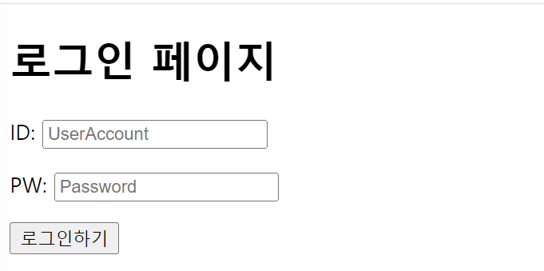

4-1. 로그인페이지 구현(퀴즈)

**(4강에서는 HTML 뼈대 만드는 작업까지 진행)**

---

**5강. CSS 기초**

**1. CSS - 꾸미기**

**2. 꾸민다는 것은 가리킬수 있어야 꾸밀 수 있다.**

**Ex) 짱구의 바지색을 바꿔줘!! -> What : 짱구의 바지**

**=> CSS는 대상 이름을 선택하고, 어떻게 꾸며줄지를 작성하는 것이다.**

**3. CSS에는 부모 자식 관계가 있다.**

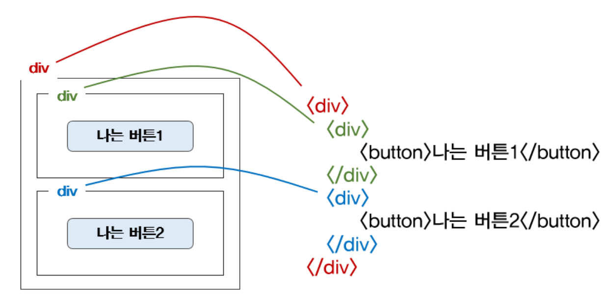

5-1. CSS의 기초

---

**6강. 자주 쓰이는 CSS연습하기**

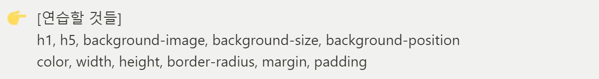

6-1. 자주 쓰이는 CSS

**1. CSS - 꾸미기**

**2. 배경 이미지 넣는 방법(Tip)**

> background-image : url('~');  
> background-position : center;  
> background-size : cover;

**3. 여백의 종류 : margin(외부), padding(내부)**

     4. CSS를 잘 다루는 것과 즉, 붓을 쥘 줄 아는 것과 예쁘게 그림을 그릴 줄 아는 것은 다른 이야기다.

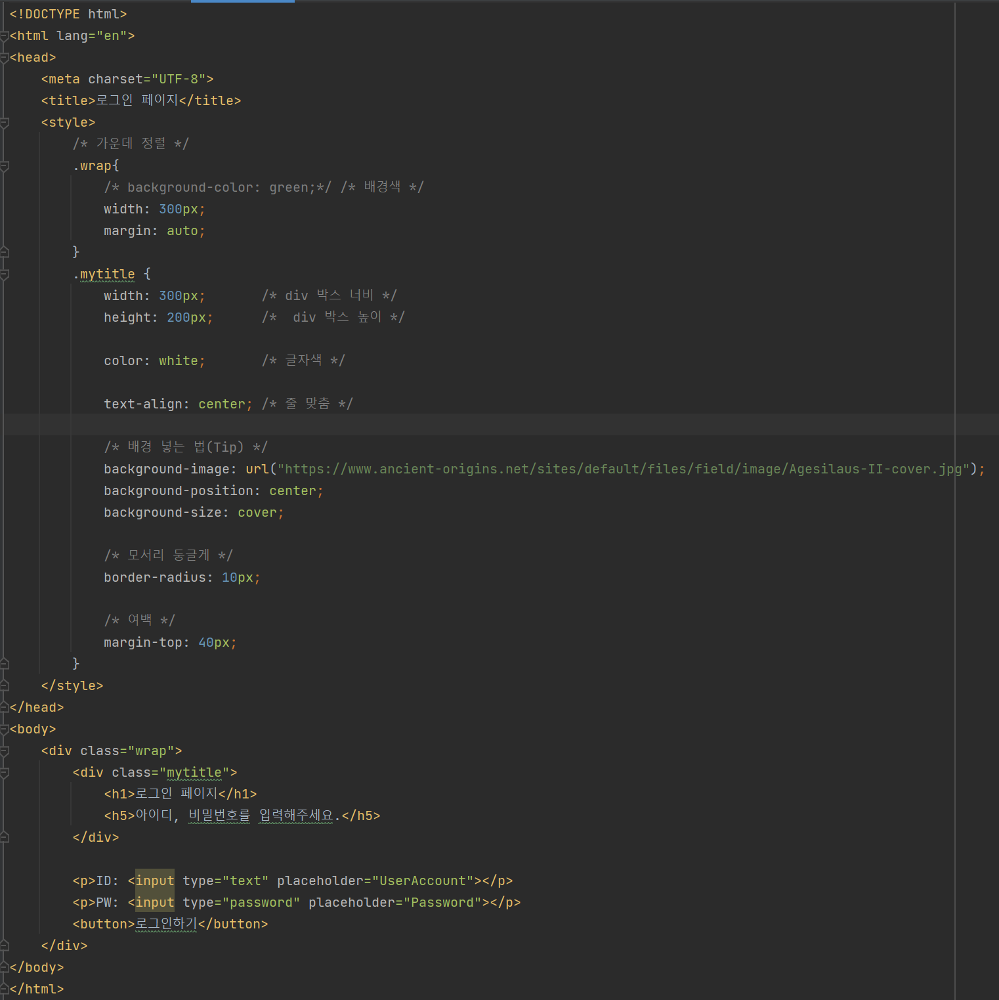

6-1. 자주 쓰이는 CSS 적용 코드

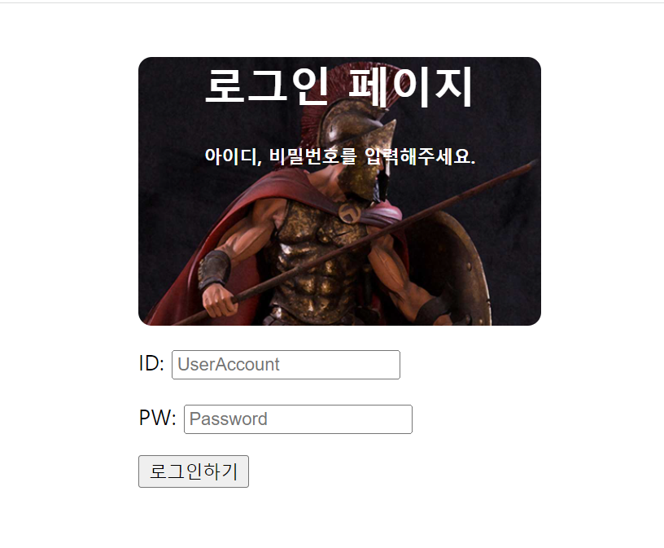

6-2. 자주 쓰이는 CSS 적용 페이지

---

**7강. 폰트, 주석, 파일 분리**

**1. 폰트 적용(IBM Plex Sans KR 폰트를 적용함)**

**2. CSS 파일분리**

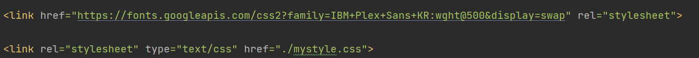

7-1. CSS 폰트 적용과 파일 분리

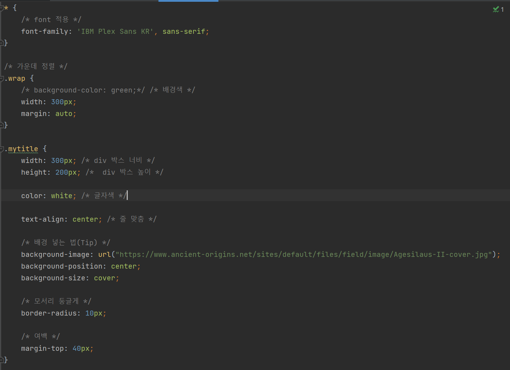

7-2. 분리된 CSS 파일 내부

---

**8강. 폰트, 주석, 파일 분리**

**1. 부트스트랩 : 예쁜 CSS 모음집**

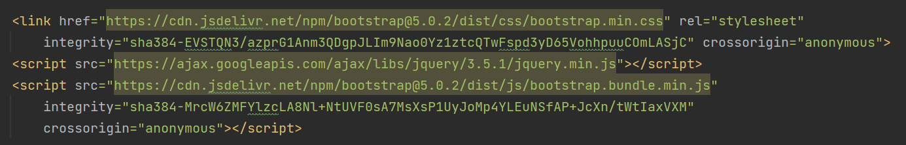

8-1. 부트스트랩 필수 URL 파일

---

**9강. CSS 꿀팁 한번 더 배우기**

> **부트스트랩만 쓰려고 생각하면 조금 아쉽습니다!! 자신이 알고 있는 CSS 지식으로 뭔가를 만들어두고**   
> **부트스트랩을 적재적소에 써가면서 하는게 좋은 것이다. 그래야 내가 원하는 대로 부트스트랩을 이용할 수 있게 됩니다.**

**1. 컨텐츠 가운데 정렬 방법(외우지 말고, 복붙!!)**

> display: flex;  
> flex-direction:column;  
> justify-content: center;  
> align-items: center;

**2. 이미지 어둡게 하기(글자의 가독성을 높이기 위해)**

> background-image: linear-gradient(0deg, rgba(0, 0, 0, 0.5), rgba(0, 0, 0, 0.5)), url("");

**3. CSS 적용 페이지**

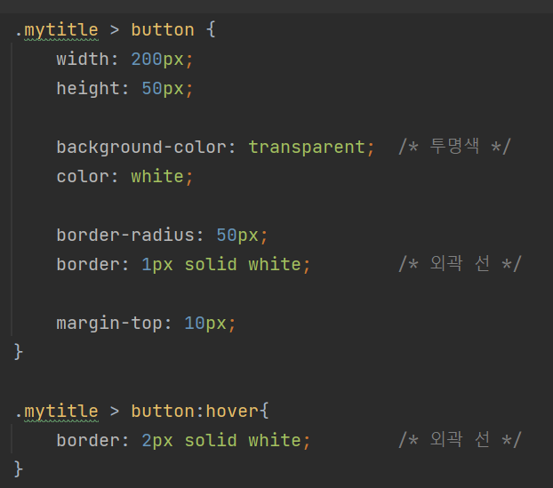

9-1. CSS 추가 코드

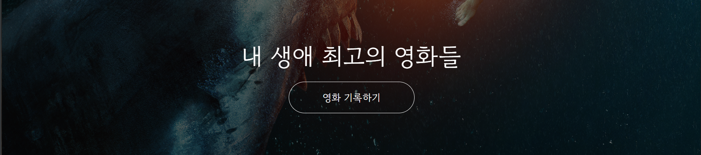

9-2. CSS 적용된 페이지 상태

---

**10강. 본격 부트스트랩 적용**

**1. 이모티콘 꿀팁**

> https://kr.piliapp.com/facebook-symbols/

**2. bootstrap - card 사용**

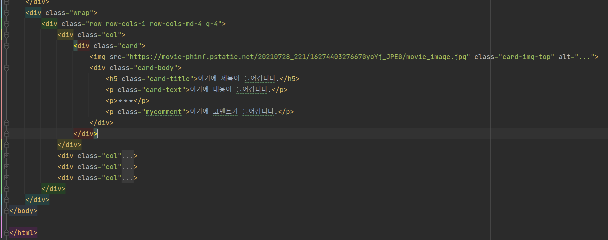

10-1. 카드 사용 코드

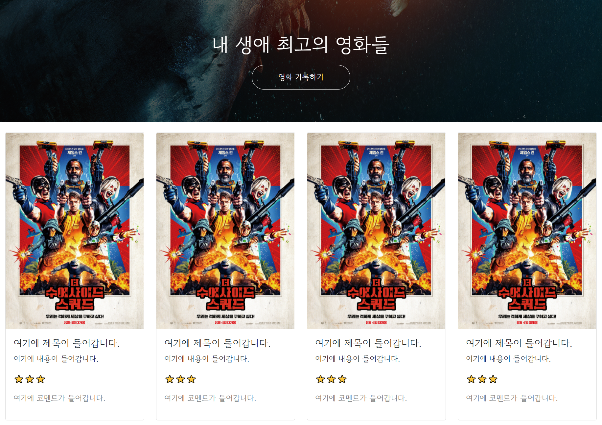

10-2. 카드 사용 페이지

---

**11강. Quiz\_포스팅박스를 완성하기**

**1. 포스팅 박스 만들기**

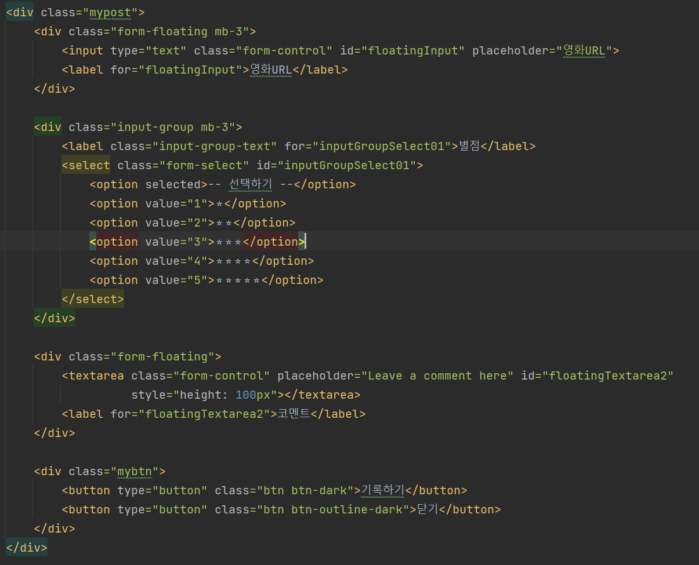

11-1. 포스팅 박스 만들기

**2. 간단한 모바일 버전 처리**

> 모바일 버전은 "가로 사이즈"가 가장 문제입니다.  
> 다음과 같이 설정하면 모바일에서 문제 없이 가능하십니다.  
> width: 95%;  
> max-width: 500px;

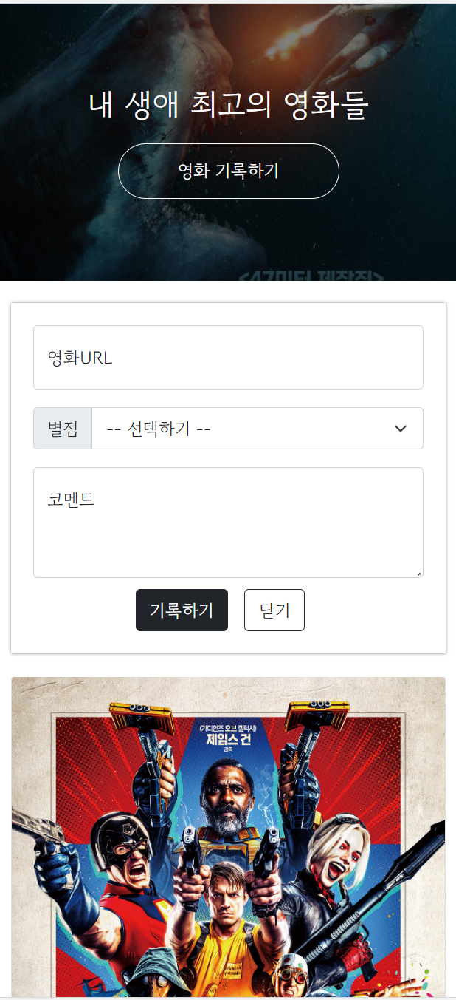

11-2. 모바일 버전으로 보기

---

**12강. Javascript **기초 문법****

**1. Javascript  - 움직이게 해주는 역할**

**2. 프로그래밍 언어를 배울 때 5가지만 기억하면 된다.**

**: 변수, 자료형, 함수, 조건문, 반복문**

**3. 데이터를 한번에 모아서 정렬하는 방법**

**1) 리스트 : 순서를 지켜서 가지고 있는 형태**

**2) 딕셔너리 : 키(key)-값(value)의 모임**

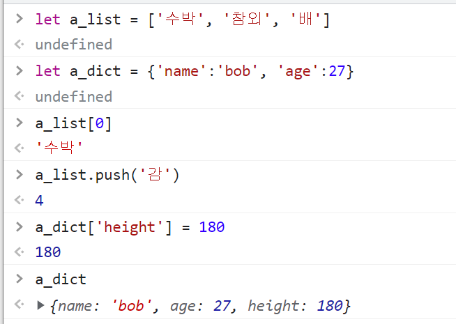

12-1. 자바스크립트 - 리스트와 딕셔너리 예제

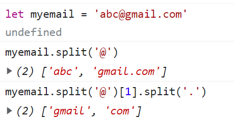

12-2. 자바스크립트 내장 함수 사용 예제

**4. 미세먼지(IDEX\_MVL)의 값이 40 미만인 구 이름(MSRSTE\_NM)과 값을 출력하기**

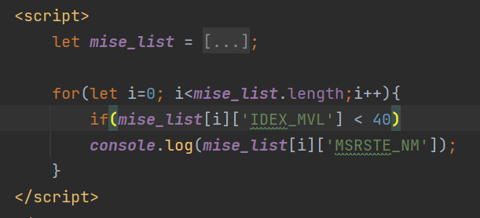

12-3. 구현 코드

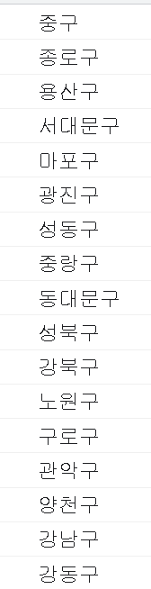

12-4. 출력 결과

---

**정리**

**2회독을 시작했는데, 아직 익숙하지 않은 것 같다.**

**집중해서 다시 복습하는게 좋은 것 같다고 생각된다.**

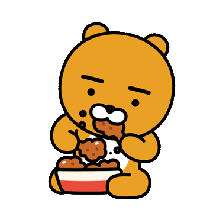
