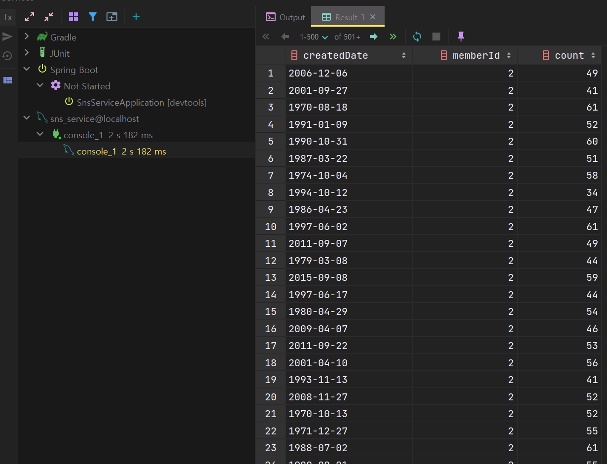
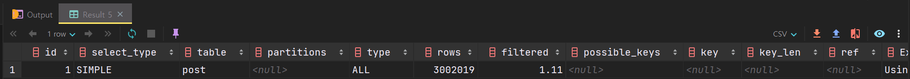
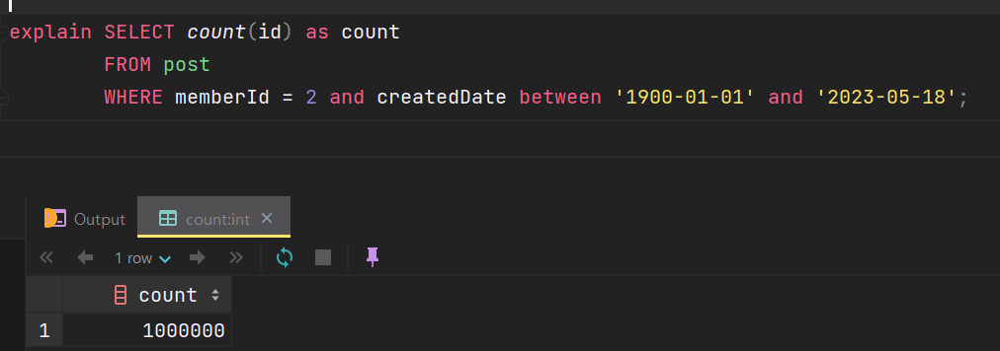
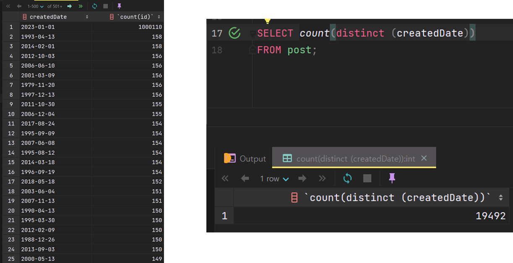
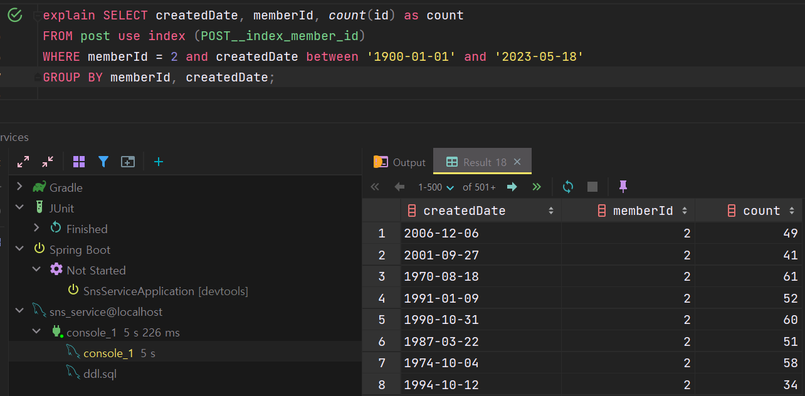
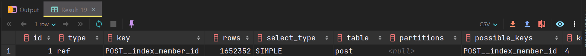
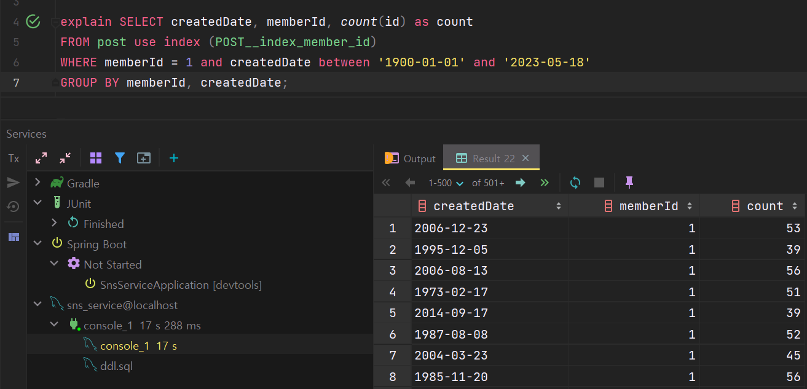
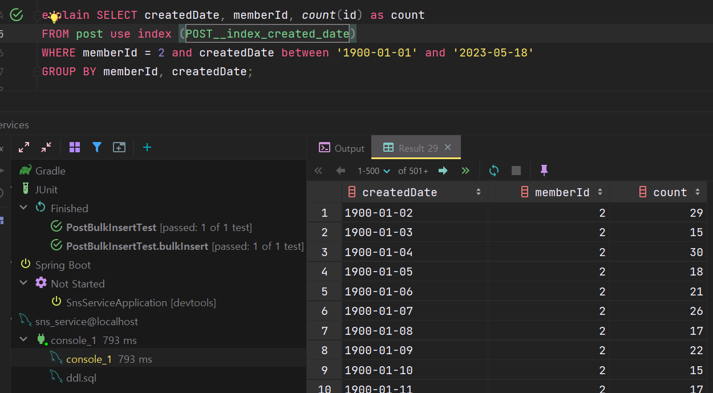
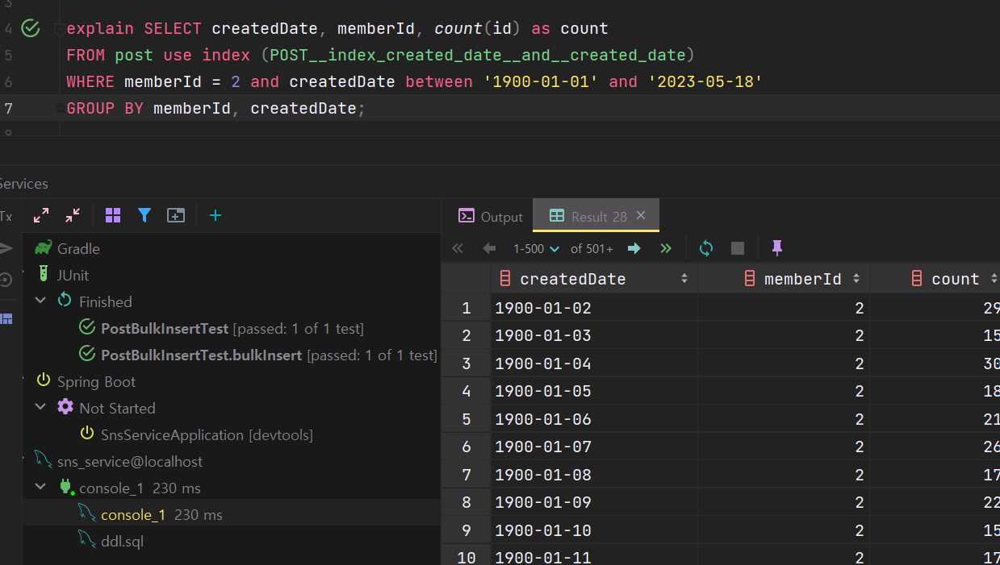

## 데이터베이스 부하 테스트

---

데이터베이스 성능 테스트를 진행해 보았다.

현재 컴퓨터 사양이 좋지 않아 너무 많은 양의 데이터를 삽입할 경우, 너무 오래 걸리기 때문에 컴퓨터 사양을 고려하여 100만 건에 데이터를 삽입하는 테스트 코드를 통해 데이터베이스를 부하를 시도해 보았습니다.

[참고]

* IDE : Intellij Ultimate 22.3
* DB : MySQL
* CPU : Intel i5-6400
* Memory : 16GB
* OS : Windows 10

### 테스트 코드 작성

---

테스트 코드는 현재 진행 중인 프로젝트인 SNS 서비스를 구현하면서 게시글을 삽입하는 테스트 코드를 작성해 보았습니다.

대량의 데이터를 넣는 방법은 다양하지만, 그중 사용한 방법은 EasyRandom 라이브러리를 사용하여 랜덤 값을 생성하고 Jdbc 템플릿을 이용하여 삽입하는 코드를 구현하였습니다.

```java
package com.example.domain.post;

@SpringBootTest
public class PostInsertTest {

    @Autowired private PostRepository postRepository;

    @Test
    void bulkInsert() {
        EasyRandom easyRandom = PostFixtureFactory.get(
                3L,
                LocalDate.of(2023, 1, 1),
                LocalDate.of(2023, 1, 31)
        );

        StopWatch stopWatch = new StopWatch();
        stopWatch.start();

        List<Post> posts = IntStream.range(0, 10000 * 100)
                .parallel()
                .mapToObj(i -> easyRandom.nextObject(Post.class))
                .toList();

        stopWatch.stop();
        System.out.println("객체 생성 시간: " + stopWatch.getTotalTimeSeconds());

        StopWatch queryStopWatch = new StopWatch();
        queryStopWatch.start();
        postRepository.bulkInsert(posts);
        queryStopWatch.stop();

        System.out.println("DB INSERT 시간: " + queryStopWatch.getTotalTimeSeconds());
    }
}
```

EasyRandom을 통해 객체가 생성되는 시간과 DB에 INSERT 요청이 이루어지는 시간을 출력해 보았습니다.

객체를 생성하는 데 걸린 시간은 약 14초가 소요되었고, DB INSERT 시간은 약 70초 정도 소요되었습니다. 

> 100만 건에 더미 데이터를 쌓는 것을 최적화할 수 있을까?  
>   
> API 부하 테스트는 견딜 수 있을까?  
>   
> 라는 고민이 들게 되었다... 

### 인덱스 추가 후 성능 비교

---

조회 성능을 테스트하기 위한 용도이기 때문에 100만 건에 데이터로는 부족하다고 판단되었고

2023년 1월에 한정되기 때문에 데이터의 범위가 적다는 문제가 있어 데이터의 범위를 늘리고 200만 건에 데이터를 삽입하였습니다.

성능 테스트 대상은 `내가 쓴 글`이라는 기능으로 자신이 작성한 글에 대한 조회를 진행하는 기능입니다.

실제 쿼리를 실행하면 다음과 같이 2s 182ms가 발생합니다. 

```sql
SELECT createdDate, memberId, count(id) as count
FROM post
WHERE memberId = 2 and createdDate between '1900-01-01' and '2023-05-18'
GROUP BY memberId, createdDate;
```



Query 1개에 2초가 발생한다는 것은 엄청 오래 걸린 것이고 CPU가 100%에 가까이 올라가기 때문에 대형사고가 발생할 수 있습니다. 

현재 쿼리가 어떻게 동작하고 있는지 파악하기 위해서는 `**explain**` 명령어를 사용하여 옵티마이저가 어떤 실행계획을 가지고 얼마나 많은 데이터에 접근하였고 필터링을 했는지 확인할 수 있습니다.



* **type: ALL**  
  => 모든 테이블을 스캔하였다는 의미입니다.
* **rows: 3,002,019**  
  => 전체 데이터가 3백만 개인데 3백만 개를 넘게 읽고 있다. 즉 중복된 데이터를 조회하는 케이스가 존재하고 있다는 의미이다.

인덱스를 설정하면 rows를 낮추고 설정한 type으로 조회를 실행시킬 수 있습니다. 

실제 데이터는 다음과 같이 100만 건인데, `Explain` 명령어를 통해 확인했을 때 300만 건에 데이터를 조회하고 있다는 사실을 알 수 있게 되었다. 불필요한 200만 개에 데이터를 조회하는 비용이 발생하고 있다는 것을 확인할 수 있다.



인덱스 설정하여 어떻게 실행속도가 줄어드는지 확인 보자.

다음과 같이 3가지에 인덱스를 설정해보려고 한다.

1. **memberId**에 인덱스 설정  
   => 조건절에 **memberId**를 사용하고 있음
2. **createdDate**에 인덱스 설정  
   => 조건절에 **createdDate**를 사용하고 있음
3. memberId와 createdDate를 복합 인덱스키로 설정  
   => 조건절에 사용하는 모든 데이터

---

#### **데이터 분포도**

먼저 데이터 분포도를 확인해보려고 한다.

**멤버별**

memberId 2, 3은 모두 100만 건씩, 1번은 200만 건 가지고 있습니다.

**날짜별**

데이터는 2023년 1월 1일에 100만 건 19492개의 createdDate가 있다.



데이터 분포도를 정리해 보면 고유한 **memberId**로는 1, 2, 3번 3가지로 나뉘고

**createdDate**는 **19492**개로 분포되어 있습니다.

---

#### **인덱스 비교**

**memberId 인덱스를 사용한 경우**

인덱스를 설정하지 않았을 때보다 훨씬 늦은 5초가 걸리는 것을 확인할 수 있다. 



이유는 무엇일까요?



type이 **ref**(인덱스를 사용하였다는 의미)로 설정한 key를 통해 설정한 인덱스를 정상적으로 동작하였고 rows는 1,652,352 개 필터링되었다.

오래 걸린 이유는 memberId 인덱스를 타고 들어가면 범위의 조건을 좁힐 수가 없기 때문이다.

**memberId**는 1, 2, 3번 중 하나이다. 백만 건이 떨어지고 2백만 건이 남은 건데 2백만 건의 데이터를 테이블도 보고 인덱스도 봐야 한다. 그래서 공수가 2배 이상 소요되는 것을 확인할 수 있다.

인덱스가 없을 때는 테이블만 보면 되었지만 인덱스가 있어 인덱스 테이블도 봐야 하고 데이터 테이블도 봐야 하는데 인덱스 테이블에서 범위 탐색 범위를 좁혀주지 못하게 되면서 오히려 역효과가 발생하는 것입니다.



200만 건에 데이터를 갖고 있는 memberId는 17초가 걸리는 것을 확인할 수 있다.

> 동일한 쿼리에 동일한 인덱스를 설정하여도  
> 해당되는 데이터의 분포도에 따라서  
> 쿼리의 속도가 느려질 수 있다는 것을 확인할 수 있다.

**createdDate 인덱스를 사용한 경우**

인덱스를 createdDate를 사용할 경우 더 빠른 것을 확인할 수 있다. 



createdDate는 식별 값이 높기 때문에 memberId보다 접근성이 높다는 것을 알 수 있다.

**memberId와 createdDate 복합 인덱스를 사용한 경우**

memberId와 createdDate를 인덱스로 설정하면 어떻게 될까?

memberId로 필터링하고 createdDate를 기준으로 필터링하여 탐색 범위를 좁힐 수 있습니다.

다음과 같이 성능이 압도적으로 차이가 나는 것을 확인할 수 있습니다. 



createdDate만 설정했을 때보다 약 3.5배 이상 빠른 것을 확인할 수 있습니다.

### 정리

---

> 동일한 인덱스임에도 불구하고  
> 파라미터로 전달된 데이터의 분포도에 따라서  
> 성능차이가 심하다는 것을 확인할 수 있다.  
>   
> 인덱스를 설정할 때 고려해야 하는 것은  
> 데이터의 분포도를 고려해야 하고  
> 어떤 쿼리의 ORDER BY, GROUP BY가 들어가는지도  
> 같이 고려해주어야 합니다.  
>   
> 인덱스 적절하게 설정하면   
> 1초가 걸리는 것이 100ms로 줄일 수 있고  
> 10초가 걸리는 것도 100ms로 줄일 수 있습니다.  
>   
> 하지만 인덱스를 잘못 설정하게 되면   
> 1초가 걸리던 작업이 10초가 걸릴 수 있습니다.   
>   
> 인덱스의 성질을 잘 이해하고 적절하게   
> 인덱스를 설정하는 것이 중요합니다.
