## **페이지네이션**

---

> 1만 개가 넘는 게시물들을 한 화면에 노출시킬 수 있을까?  
>   
> 많은 양의 데이터를 어떻게 노출시킬 것인가라는 비롯해서  
> **페이지네이션**이라는 개념이 나왔습니다.

점점 스마트폰 시대에 오면서 화면의 크기는 작아지고 데이터의 사이즈는 커지는 등 이러한 것들을 어떻게 노출시킬지에 대한 문제라고 볼 수 있습니다.

페이지를 어떻게 노출시킬 것인가에 대한 전략은 게시판 형태의 다음 페이지 방식과 페이스북과 인스타그램 같은 스크롤하는 방식이 있습니다.

**페이지네이션과 무한스크롤**

* **페이지네이션** - 게시판 번호를 선택하여 특정 페이지에 게시물을 보여주는 방식
* **무한스크롤** - 위에서 부터 스크롤하면서 내려가는 방식

### **페이지네이션이란**

---

> **페이징 기법**은 **컴퓨터가 메인 메모리에서 사용하기 위해 2차 기억 장치로부터 데이터를 저장하고 검색하는 메모리 관리 기법**이다. 즉 가상기억장치를 모두 같은 크기의 블록으로 편성하여 운용하는 기법이다. 이때의 일정한 크기를 가진 블록을 페이지라고 한다.  
>   
> [참고] [위키백과](https://ko.wikipedia.org/wiki/%ED%8E%98%EC%9D%B4%EC%A7%95)

페이지네이션은 페이징의 방법이라고 볼 수 있습니다.

* 전체 데이터에서 지정된 개수만 데이터를 전달하는 방법
* 필요한 데이터만 주고받으므로 네트워크의 오버헤드를 줄일 수 있습니다.
* 구현 방식
  + **오프셋 기반 페이지네이션**(Offset-based Pagination)
  + **커서 기반 페이지네이션**(Cursor-based Pagination)

### **페이지네이션 구현**

---

페이지네이션이 어떻게 구현되는지 간단히 살펴보자.


1. **클라이언트는 서버에 몇 번 페이지에 몇 개 데이터를 달라고 요청합니다.**  
   EX) Page 0, Size 2
2. **서버는 페이지와 사이즈에 따라서 적절한 데이터를 스캔하여 데이터를 Size로 나누어 인덱스(Page) 번째 데이터를 반환해 줍니다.**

이때 구현에 따라 조금씩 다르지만, 전체 페이지와 전체 개수를 반환해 주는데 이러한 데이터를 반환하는 이유는 UI에서 페이지네이션 방식을 선택하였다면 게시물의 마지막 페이지를 알아야 몇 번째 페이지까지 접근할 수 있게 할 것인지를 정해줄 수 있습니다.

#### **문제점**

**1. 데이터베이스는 0페이지에서 1번 페이지로 이동할 때 0번 페이지에 데이터도 스캔하게 됩니다.**

**2. 마지막 페이지를 구하기 위해서는 전체 개수를 알아야 합니다.**

현재 페이지가 마지막 페이지인지 전체 페이지 중 마지막 페이지가 몇 번째 페이지인지를 알아야 합니다.

위 2가지 문제로 인해 생기는 문제점이 있는데 대용량 시스템에 어떠한 문제가 발생하는지 살펴보자.

### **오프셋 기반 페이지네이션 구현**

---

게시판에서 많이 사용되고 있는 **오프셋 기반 페이지네이션 방식**을 구현해보도록 하겠습니다.

아래 코드는 작성된 일자별 게시물의 개수를 반환하는 API입니다.

```java
@RequiredArgsConstructor
@RestController
@RequestMapping("/posts")
public class PostController {

    private final PostReadService postReadService;

    @GetMapping("/daily-post-counts")
    public List<DailyPostCount> getDailyPostCounts(DailyPostCountRequest request) {
        return postReadService.getDailyPostCount(request);
    }
}
```

일자별로 게시물을 리스트 형태로 반환하는데 오프셋 기반 페이지네이션 형태로 반환하는 API로 변경해보도록 하겠습니다.

회원의 Sequence(memberId)에 따라 게시물을 페이지네이션 하여 반환할 것이므로 **페이징의 정보(size, page, sort by)**를 받아야합니다.

Spring data쪽에서 제공해주는 **PageReuqest**(Spring Data JPA에서 많이 사용하는)를 사용할 것입니다.

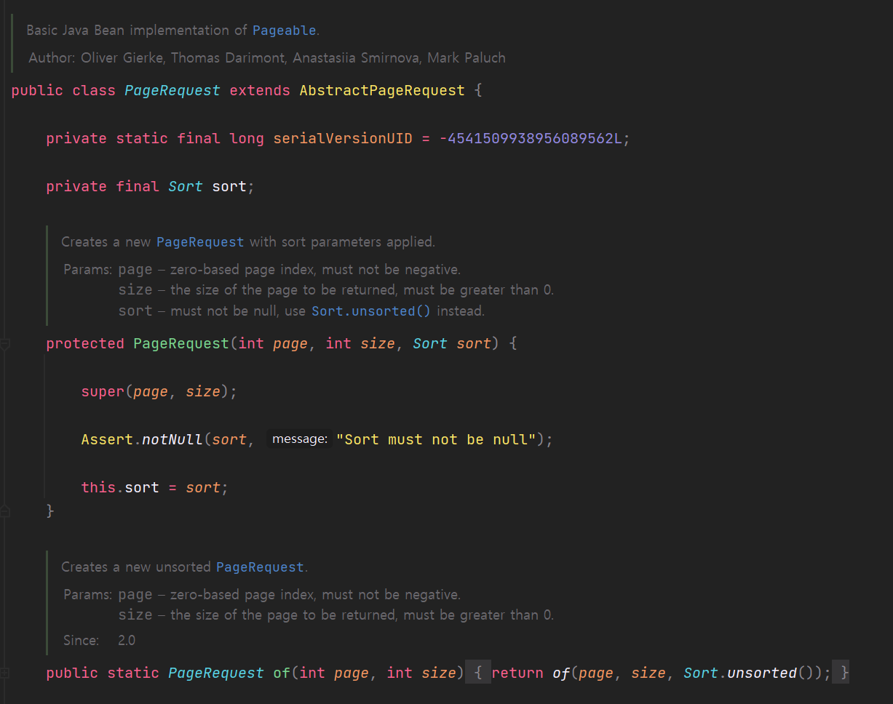

반환 객체도 마찬가지로 페이지로 Spring Data 에서 제공해주는 **Page** 인터페이스를 이용할 것입니다. Page 인터페이스는 totalPage, totalElements와 외부 객체를 매핑할 수 있는 map함수가 존재합니다.

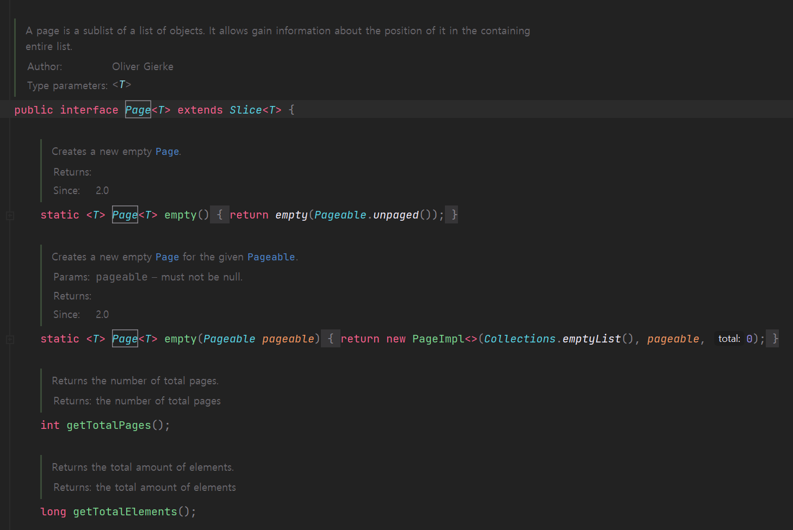

서비스 Layer에서 할 수 있는 것은 메소드를 호출하는 것 뿐입니다.

```java
@RequiredArgsConstructor
@Service
public class PostReadService {

    private final PostRepository postRepository;

    public Page<Post> getPosts(Long memberId, PageRequest pageRequest) {
        return postRepository.findAllByMemberId(memberId, pageRequest);
    }
}
```

직접적인 구현한 Repository에서 이루어집니다.

```java
@RequiredArgsConstructor
@Repository
public class PostRepository {

    private static final String TABLE = "POST";

    private final NamedParameterJdbcTemplate namedParameterJdbcTemplate;

    private final static RowMapper<DailyPostCount> DAILY_POST_COUNT_MAPPER = (ResultSet resultSet, int rowNum) -> new DailyPostCount(
            resultSet.getLong("memberId"),
            resultSet.getObject("createdDate", LocalDate.class),
            resultSet.getLong("count")
    );

    public Page<Post> findAllByMemberId(Long memberId, PageRequest pageRequest) {

    }
}
```

> **Page**와 **PageRequest**를 사용하는 이유는  
> 메소드 이름도 Spring Data JPA의 네이밍 방식을 따라가는 이유와 동일합니다.  
>   
> 추후 Spring Data JPA로 전환할 때   
> 최소한의 변경(Spring Data JPA의 네이밍 방식 사용)으로 할 수 있도록 하기 위함입니다.

Spring Data JPA를 사용하면 **Page**와 **PageRequest**를 이용해서 메소드 시그니처를 정의해주면 코드를 만들어주는데 그때는 **PageRequest**가 아니라 **Pageable** 을 받게 되는데 **PageRequest**가 **Pageable**을 구현한 객체이기 때문에 크게 문제 없이 변경가능합니다.

**페이지네이션 쿼리**는 MySQL의 **OFFSET**과 **LIMIT** 쿼리를 이용하여 구현할 것입니다.

여기서 **LIMIT**은 개수이고 **OFFSET**은 어디부터 가져올 것인지에 대한 설정입니다. 그래서 **OFFSET**은 페이지 번호와 밀접하게 관련이 있습니다.

다음과 같이 **OFFSET**에 따라 순차적으로 데이터가 조회되는 것을 확인할 수 있습니다.

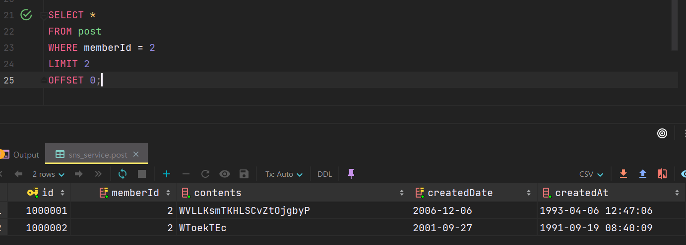
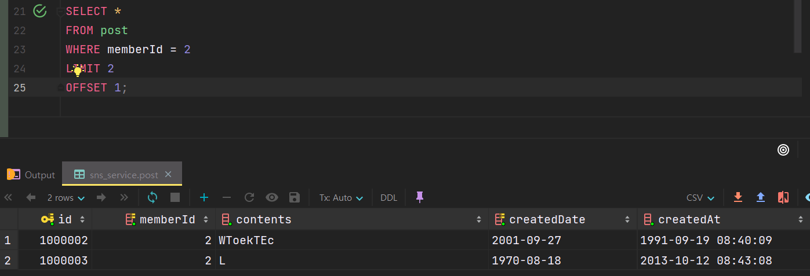

OFFSET을 관리하는 것은 코드로 구현한 것도 간단하긴 하지만 **PageRequest** 객체를 관리하게 되면 파라미터로 PageSize만 전달해주면 됩니다. 그러면 자체적으로 **OFFSET**을 관리해줍니다.

**PageRequest** 인터페이스를 보면 다양한 함수가 있는데 **PageRequest**의 부모인 **AbstractPageRequest**에 **getOffset** 이라는 함수가 있습니다.

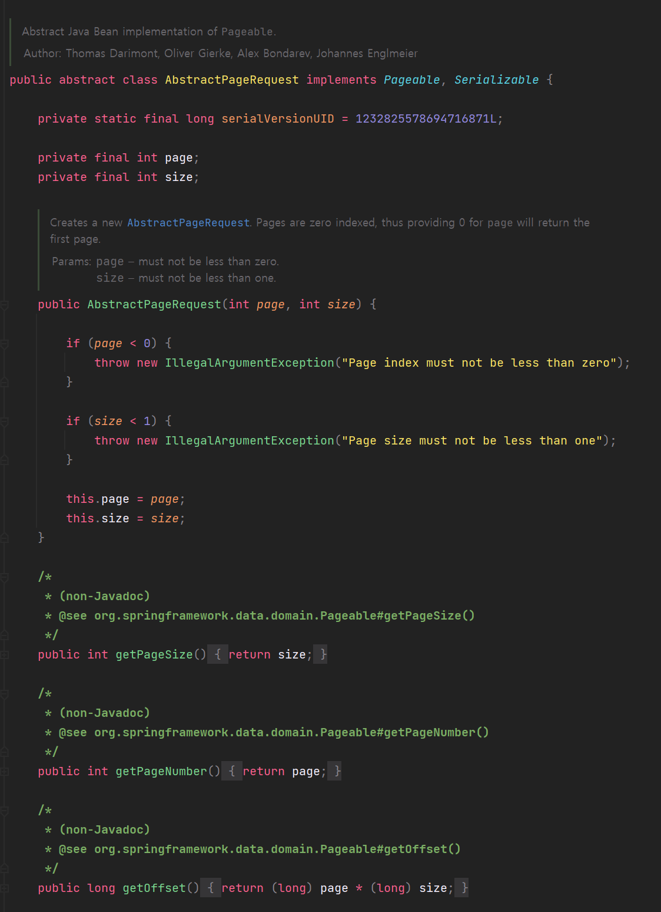

쿼리를 통해 **OFFSET**을 설정해주었던 것처럼 자체적으로 **OFFSET**을 반환해줍니다.

MySQL에서는 정렬 기준으로 설정해주지 않으면 PK를 기준으로 정렬된 데이터가 반환되게 되는데 `**OrderBy**`를 통해 어떤 기준으로 정렬할 것인지 설정해줄 수 있습니다. 이것 또한 **PageReqeust**에 **sort**라는 객체가 있어서 객체를 잘 활용하여 파라미터로 전달해주면 됩니다.

쿼리를 통해 게시물 리스트가 반환되게 될 것인데 필요한 것은 Page 객체를 만들기 위해서는 어떤 것이 필요한지 알아봅시다.

Page 객체는 Slice를 상속받고 있고  Slice는 다양한 메소드를 가지고 있습니다.

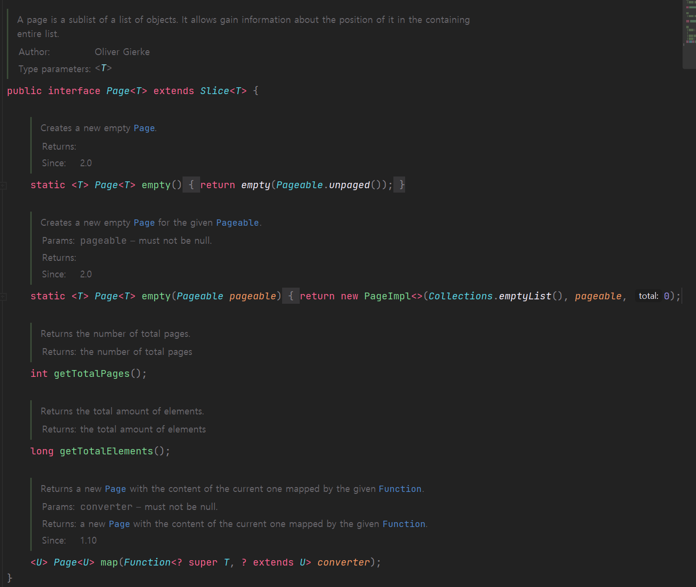

Page 인터페이스

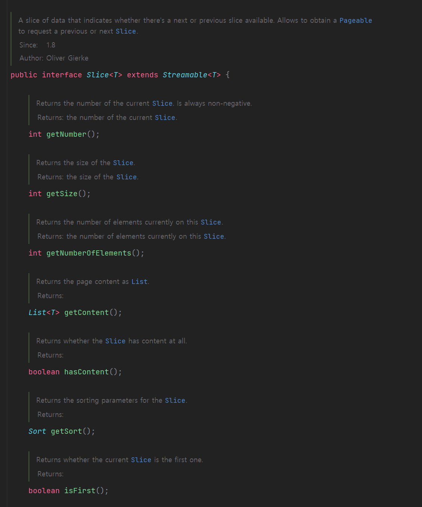

Slice 인터페이스

**Page**와 **Slice**는 인터페이스이므로 인터페이스를 구현한 구현체가 필요하다는 의미가 됩니다. 직접 인터페이스를 구현하여 사용할 수 있지만, 직접 구현하지 않고 Spring Data에서 Page 인터페이스의 구현체로 제공해주고 있는 **PageImpl**을 사용하려고 합니다.

**PageImpl** 은 **content**, **pageable**, **total**을 인자로 받아 인스턴스를 생성할 수 있습니다.

**content**은 쿼리를 통해 전달받은 타입을 제네릭으로 선언하여 넣어주면 될 것이고

**pageable**은 content을 가져올 때 요청받은 **PageRequest**(**PageRequest**가 **Pageable**의 **구현체**)를 전달해주면 될 것 같다.

**total**은 전체 개수를 파악하여 넘겨주어야 합니다.

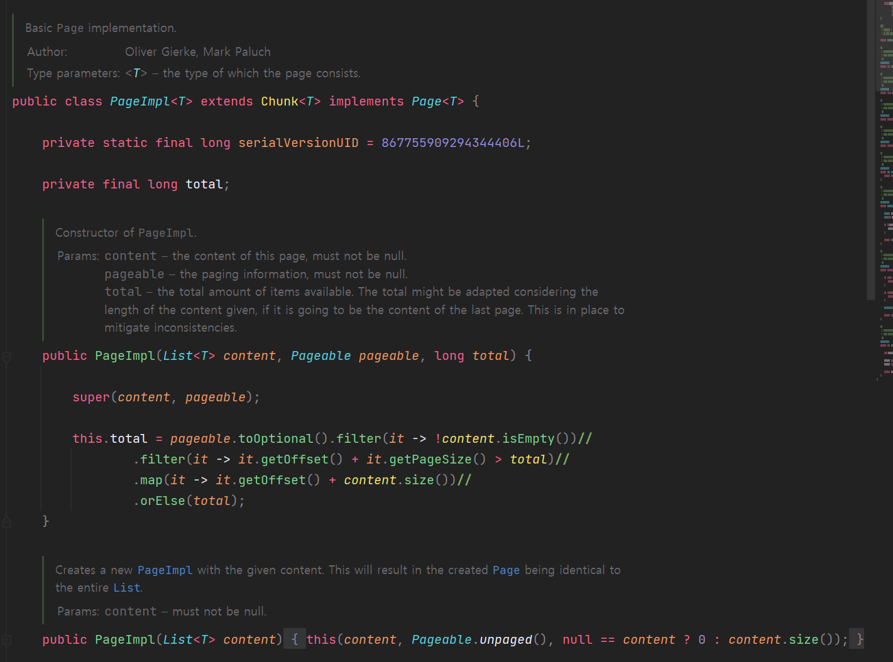

Page 구현체

content와 pageable은 추가적인 작업이 필요하지 않지만, total에 전체 개수를 전달하기 위한 쿼리가 필요합니다.

```java
public Long getCount(Long memberId) {
    String sql = String.format("""
            SELECT count(id)
            FROM %s
            WHERE memberId = :memberId
            """, TABLE);

    MapSqlParameterSource params = new MapSqlParameterSource()
            .addValue("memberId", memberId);

    return namedParameterJdbcTemplate.queryForObject(sql, params, Long.class);
}
```

다음과 같이 전체 개수 조회와 전체 게시물 조회 코드가 완성되게 됩니다.

```java
package com.example.domain.post.repository;

@RequiredArgsConstructor
@Repository
public class PostRepository {

    private static final String TABLE = "POST";

    private final NamedParameterJdbcTemplate namedParameterJdbcTemplate;

    private final static RowMapper<Post> ROW_MAPPER = (ResultSet resultSet, int rowNum) -> Post.builder()
            .id(resultSet.getLong("id"))
            .memberId(resultSet.getLong("memberId"))
            .contents(resultSet.getString("contents"))
            .createdDate(resultSet.getObject("createdDate", LocalDate.class))
            .createdAt(resultSet.getObject("createdAt", LocalDateTime.class))
            .build();

    public Long getCount(Long memberId) {
        String sql = String.format("""
                SELECT count(id)
                FROM %s
                WHERE memberId = :memberId
                """, TABLE);

        MapSqlParameterSource params = new MapSqlParameterSource()
                .addValue("memberId", memberId);

        return namedParameterJdbcTemplate.queryForObject(sql, params, Long.class);
    }

    public Page<Post> findAllByMemberId(Long memberId, Pageable pageable) {
        String sql = String.format("""
                SELECT *
                FROM %s
                WHERE memberId = :memberId
                LIMIT :size
                OFFSET :offset
                """, TABLE, pageable.getPageSize(), pageable.getPageNumber());

        MapSqlParameterSource params = new MapSqlParameterSource()
                .addValue("memberId", memberId)
                .addValue("size", pageable.getPageSize())
                .addValue("offset", pageable.getOffset());

        List<Post> posts = namedParameterJdbcTemplate.query(sql, params, ROW_MAPPER);

        return new PageImpl<Post>(posts, pageable, getCount(memberId));
    }
}
```

Controller는 다음과 같이 간단하게 만들었습니다.

```java
@GetMapping("/members/{memberId}")
public Page<Post> getPosts(
        @PathVariable Long memberId,
        @RequestParam Integer page,
        @RequestParam Integer size
) {
    return postReadService.getPosts(memberId, PageRequest.of(page, size));
}
```

Swagger를 통해 API 테스트를 하면 다음과 같이 정상적으로 동작함을 확인할 수 있습니다.

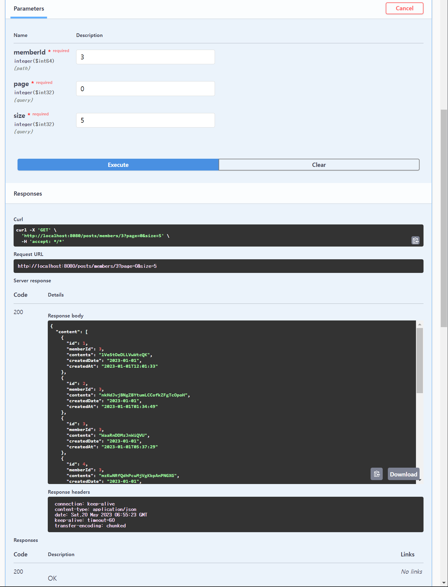

Swagger를 이용한 API 테스트

정렬은 Pageable에 Sort 객체가 있는데 Sort 객체는 **Direction** 과 **properties**를 받는다는 것이 중요합니다.

**properties**는 필드(아이디 등)이고, **Direction**은 정렬 방식(오름차순, 내림차순)을 의미합니다.

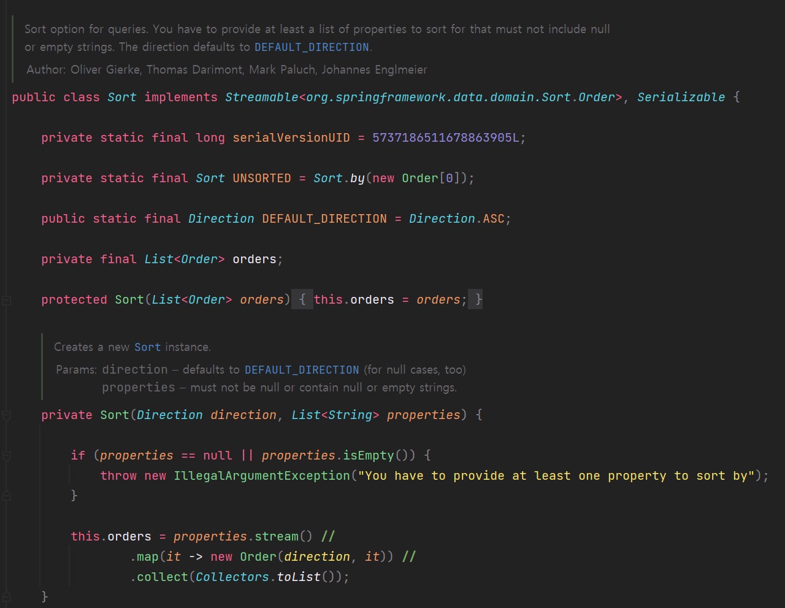

실제로 사용할 때는 Sort에 Sort를 연결해서 사용하기도 합니다.

무슨 말이냐면 **Sort**에 **and** 메소드를 통해 정렬의 순서를 여러 개 설정해줄 수 있습니다.

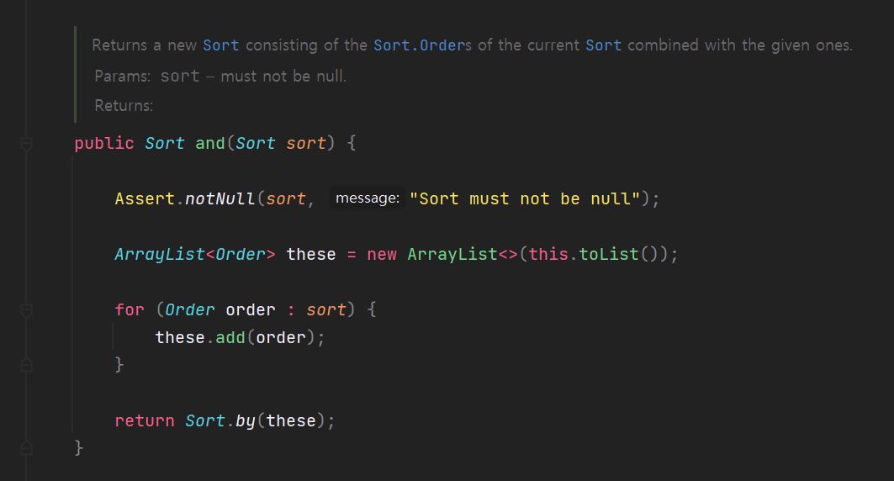

**Sort**를 **String**으로 변환하여 쿼리로 사용할 수 있도록 변환해주는 코드가 필요하므로 구현하려고 합니다.

추가적으로 Sort가 없을 때 기본 처리도 해줄 필요가 있습니다.

```java
public class PageHelper {

    public static String orderBy(Sort sort) {
        if(sort.isEmpty()) {
            return "id DESC";
        }

        List<Sort.Order> orders = sort.toList();
        List<String> orderBys = orders.stream()
                .map(order -> order.getProperty() + " " + order.getDirection())
                .toList();

        return String.join(", ", orderBys);
    }
}
```

이를 적용하면 코드가 다음과 같이 변경됩니다.

```java
public Page<Post> findAllByMemberId(Long memberId, Pageable pageable) {
    String sql = String.format("""
            SELECT *
            FROM %s
            WHERE memberId = :memberId
            ORDER BY %s
            LIMIT :size
            OFFSET :offset
            """, TABLE, PageHelper.orderBy(pageable.getSort()));

    MapSqlParameterSource params = new MapSqlParameterSource()
            .addValue("memberId", memberId)
            .addValue("size", pageable.getPageSize())
            .addValue("offset", pageable.getOffset());

    List<Post> posts = namedParameterJdbcTemplate.query(sql, params, ROW_MAPPER);

    return new PageImpl<Post>(posts, pageable, getCount(memberId));
}
```

실제 서비스에서는 정렬을 파라미터로 주입받을 것인지는 MySQL만 사용하고 있지 않습니다. 조금 고민이 필요한 부분입니다.

동일하게 Swagger를 통해 테스트해보면 다음과 같이 정상적으로 동작함을 확인할 수있습니다.

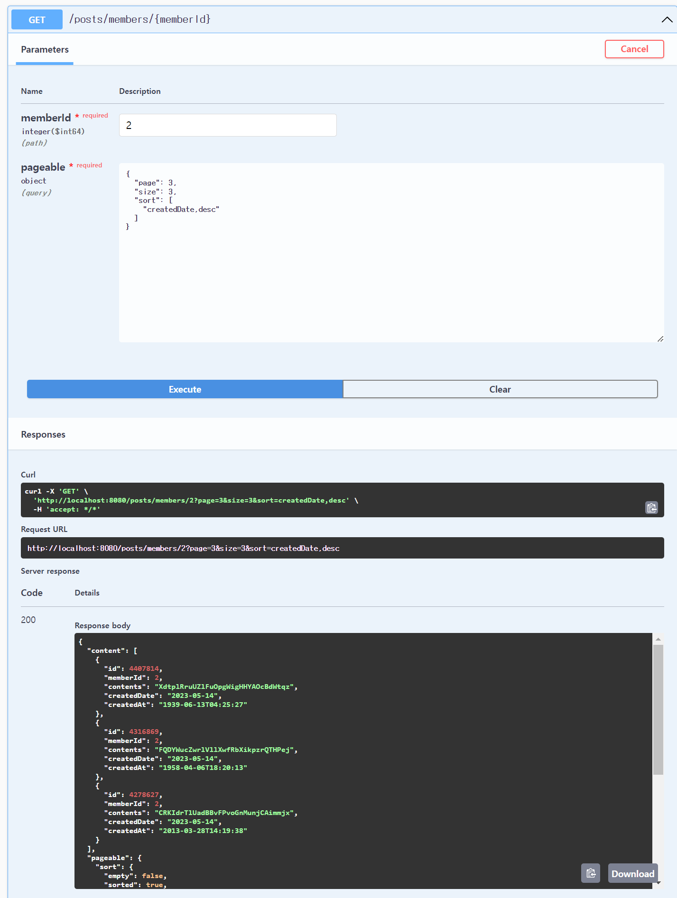

### **오프셋 기반 페이징 구현의 문제**

---

#### **전체 개수 조회**

오프셋 기반 페이지네이션은 마지막 페이지를 구하기 위해 전체 개수를 알고 있어야합니다.

마지막 페이지를 알아야하는 이유는 더보기를 활성화시킬지를 판단하기 위한 근거이기 때문입니다.

그래서 위에 오프셋 기반 페이지네이션을 구현하기 위해 전체 개수를 파악하는 코드를 추가했었습니다.

> 전체 개수를 구하는 쿼리가 문제가 될까?

데이터 사이즈가 많아질 수록 전체 데이터 개수를 구하는 쿼리가 굉장히 큰 부하가 될 수 있습니다.

실제로 대용량 시스템에서 정말 많은 양의 데이터를 제공하는 서비스들은 보면 마지막 페이지에 대한 접근을 막거나 무한 스크롤 형태의 UI를 만들고 있습니다.

구글이나 네이버를 통해 검색해보면 전체 데이터를 보여주지 않고 특정 페이지까지만 보여주고 전부 접근을 막고 있습니다.

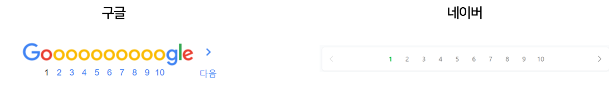

---

#### **OFFSET과 LIMIT으로 인한 불필요한 조회 발생**

실제로 이외에도 **OFFSET**과 **LIMIT**을 쿼리에 사용하고 있습니다.

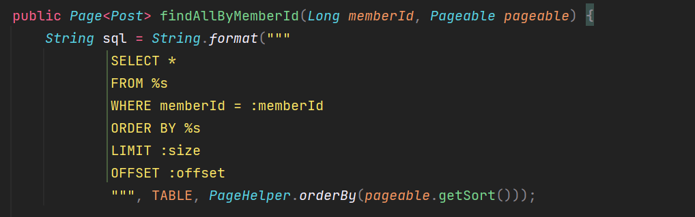

**OFFSET** 4, **SIZE** 2일 때를 케이스를 살펴보자.


'

실제로 반환하는 데이터는 2개인데 반환하는 데이터를 읽기까지 4개의 데이터를 읽고 버리게 됩니다.

OFFSET 4로 작기 때문에 4개밖에 데이터를 버리지 않지만 실제로는 OFFSET 사이즈가 커지면 커질수록 버려지는 데이터의 개수가 훨씬 많게 됩니다. 그렇기 때문에 데이터 사이즈가 커지면 커질 수록 **오프셋 페이네이션 방식**은 다른 방식에 비해 불리한 방식이라 볼 수 있습니다.

### **커서 기반 페이지네이션**

---

오프셋 페이지네이션의 단점을 보완한 **커서 기반 페이지네이션** 방식이 있습니다.

오프셋 페이지네이션 기반에서는 페이지 번호를 전달하고, 커서 기반 페이지네이션 방식에서는 **페이지 번호가 아닌 Key** **번호**를 전달해줍니다.

예시를 통해 알아보자.

Key 4번부터 읽었으므로 4번 이후에 데이터에서 2개를 읽으면 된다.


즉 Key 4, Size 2를 보내게되면, Key 4번 이후에 데이터부터 읽어서 사이즈 만큼 반환해주고 마지막 Key 번호를 반환해주는 방식인 것입니다.


마지막 Key 번호는 클라이언트가 가지고 있다가 다음 요청 때 사용하면 다음 데이터를 쭉 볼 수 있게 됩니다.

> 커서 기반 페이징은 키를 기준으로  
> 데이터 탐색 범위를 최소화  
>   
> 커서 기반 페이징은 전체 데이터를 조회하지 않기 때문에  
> 오프셋 기반 페이지네이션과 같은 UI 구현이 어렵습니다.  
>   
> 대신에 전체 개수를 조회하는 쿼리가 필요하지 않다는 장점이 있습니다.

그렇다고 해서 커서 기반 페이징 방식이 오프셋 기반 페이지네이션 방식보다 좋은 것은 아닙니다.

UI/UX 정책에 따라 페이지네이션 방식을 고집해야할 수 도 있고 오프셋 기반 페이지네이션 부하를 줄이기 위한 해결책이 커서 기반 페이지네이션만 있는 것은 아니다.

커버링 인덱스도 오프셋 기반 페이지네이션 부하를 줄일 수 있는 방법 중 하나이고, 문제가 되었던 전체 개수를 조회하는 쿼리 최적화 방법도 존재하고 이외에도 여러가지 방법이 있습니다.

> 오프셋 기반 페이지네이션의 단점을 보완하기 위한 방법이  
> 커서 기반 페이지네이션만 있는 것은 아니다.  
>   
> 커서 기반 페이지네이션은 오프셋 기반 페이지네이션의 문제를  
> 해결할 수 있는 해결책 중 하나이고 장점만 있는 것은 아니다.

### 커서 기반 페이지네이션 구현

---

**커서 기반 페이지네이션 방식**은 **오프셋 기반 페이지네이션 방식**이 Page와 Size를 받는 것에 비해 마지막 데이터 Key와 Size를 받습니다. 그래서 Pageable 인터페이스를 사용하는 것 보다는 직접 커서 기반 페이지네이션에 필요한 인터페이스를 구현하는 것이 좋습니다.

#### 커서 페이지네이션 요청 인터페이스

클라이언트로부터 Key와 Size을 전달받아 페이지네이션을 진행하므로 Key와 Size를 구조로 생성합니다.

사실 커서 Key를 어떤 것으로 설정할 것인지도 커서 페이지네이션 방식에서 매우 중요합니다. 간단하게 도메인의 식별자 id PK를 커서 Key로 사용할 것입니다.

```java
public record CursorRequest(Long key, Long size) {
}
```

커서 Key를 설정할 때 인덱스가 있어야하고 중복이 없어야한다는 것을 유의해주시면 됩니다. 중복된 Key가 존재하면 읽다가 끊길 수 있기 때문에 주의해주셔야합니다.

클라이언트가 처음 데이터를 요청할 때에는 최초 Key가 존재하지 않으므로 Default key를 설정해주는 것이 좋습니다.

Default Key는 클라이언트가 서버에 접근할 때 Key가 없이 들어오는 것이 편할 것입니다. Default Key는 Null로 설정할 것입니다. 그리고 Key를 읽었을 때 클라이언트에서 마지막 페이지인 것을 알 필요가 없지만, 마지막 데이터인지는 알아야 더 이상 스크롤 했을 때 서버에 요청을 안할 것입니다.

그래서 더 이상 데이터가 없음을 표시해주어야 하는데 현재 PK를 Key로 사용하고 있으므로 -1을 Key로 반환될 경우 데이터가 없음을 나타내게 됩니다.

추가적으로 필요한 것은 다음 데이터의 요청이 들어올 수 있도록 마지막 데이터의 Key를 설정해주어야합니다.

이를 정리해보면 다음과 같이 코드를 작성할 수 있습니다.

```java
package com.example.util;

public record CursorRequest(Long key, Long size) {

    public static final Long NONE_KEY = -1L;

    public CursorRequest next(Long key) {
        return new CursorRequest(key, size);
    }
}
```

함수를 수행할 텐데 Repository 함수를 그대로 수행할 것입니다. 이때 인가 값도 자세히 생각해보면 Page 라는 것은 Page 객체를 만들어주기 위해 전체 개수를 조회하는 Count Query를 사용해야했습니다. 그래서 커서 기반 페이지네이션에 맞는 객체를 만들어주었습니다.

```java
package com.example.util;

import java.util.List;

public record PageCursor<T>(
        CursorRequest nextCursorRequest,
        List<T> contents
) {
}
```

객체는 여러 객체를 받아야하므로 제네릭 타입으로 선언해주었고 클라이언트가 다음 요청을 할 수 있도록 cursorRequest를 반환해줄 것입니다. Page 인터페이스와 동일하게 내용을 갖는 제네릭 리스트를 반환해도록 하였습니다.

---

#### 커서 기반 페이지네이션 구현

#### 

#### Repository 구현

커서 Request를 받는 Repostory 메소드를 구현해보도록 하겠습니다.

먼저 생각해보아야 할 것은 **CursorRequest**로 전달되는 Key는 Null이 될 수 있습니다. 즉 Key에 대한 유효성 검사를 갖고 분기를 나누어야할 필요가 있습니다.

먼저 기본 쿼리를 생각해봅시다.

```sql
SELECT *
FROM POST
WHERE memberId = 1 and id > 500;
```

만약 Key가 Null 이라면 아래와 같이 쿼리가 작성되게 될 것이고 데이터가 존재하지 않게 됩니다.

```sql
SELECT *
FROM POST
WHERE memberId = 1 and id > NULL;
```

이러한 문제를 해결할 수 있는 가장 간단한 방법은 Key가 존재할 때는 id 조건을 추가하고, Key가 Null일 경우 id를 조건문에서 제외하는 쿼리를 실행시켜주면 됩니다.

```java
public List<Post> findAllByMemberIdAndOrderByIdDesc(Long memberId, int size) {
    String sql = String.format("""
            SELECT *
            FROM %s
            WHERE memberId = :memberId
            ORDER BY id desc
            LIMIT :size
            """, TABLE);

    MapSqlParameterSource params = new MapSqlParameterSource()
            .addValue("memberId", memberId)
            .addValue("size", size);

    return namedParameterJdbcTemplate.query(sql, params, ROW_MAPPER);
}
```

커서 Key를 설정할 때 중요한 것 중 하나는 Cursor Key를 기준으로 정렬이 되어야 합니다. 페이지네이션 방식에서는 정렬 key를 강제하지 않았지만, 커서 기반에서는 사용하는 Key와 정렬 순서가 반드시 맞아야 데이터를 순서대로 읽을 수 있습니다.

그리고 Key 보다 작은 데이터를 조회하는 Repository 메소드가 필요합니다.

```java
public List<Post> findAllByLessThanIdAndMemberIdAndOrderByIdDesc(Long id, Long memberId, int size) {
    String sql = String.format("""
            SELECT *
            FROM %s
            WHERE memberId = :memberId and id < :id
            ORDER BY id desc
            LIMIT :size
            """, TABLE);

    MapSqlParameterSource params = new MapSqlParameterSource()
            .addValue("memberId", memberId)
            .addValue("id", id)
            .addValue("size", size);

    return namedParameterJdbcTemplate.query(sql, params, ROW_MAPPER);
}
```

서비스 로직에서는 Key Null일 때와 아닐 때는 구분하여 Repository 메소드를 호출하도록 해주면 됩니다.

---

#### Service 구현

가장 먼저 해야할 것은 Key가 Null인지 아닌지 판별하는 검사가 필요합니다.

검사를 어디서하면 좋을지 생각해보면 Request 자체에서 key 를 검사하는 메소드를 가지고 있는 것이 좋을 것으로 판단됩니다.

```java
public record CursorRequest(Long key, Long size) {

    public static final Long NONE_KEY = -1L;

    public Boolean hasKey() {
        return !Objects.isNull(key);
    }

    public CursorRequest next(Long key) {
        return new CursorRequest(key, size);
    }
}
```

> 왜? 굳이? 저기서 했을까?  
>   
> Key를 가지고 있냐없냐에 로직은 바뀔 수 있기 때문입니다.  
> 클라이언트에서 Key를 Null로 전달하는 방식이 아닌  
> 시작 값을 주는 방식으로 정책이 변경될 수 있는데  
> 이러한 로직을 서비스 여러 곳에 작성하게 되면  
>   
> 지금은 1곳에서만 사용할 수도 있지만,  
> 여러 서비스에서 제네릭하게 사용할 수 있게 해두었으므로  
> 객체 내부에서 갖고 있는 것이 좋다고 판단되었습니다.

조회 후 반환된 데이터 중에서 가장 마지막 key값 즉 현재 최신 순으로 데이터를 정렬하고 있기 때문에 가장 작은 PK 값을 주면 됩니다. 요청이 들어올 때마다 작은 PK로 변경되게 될 것입니다.

```java
package com.example.domain.post.service;

import java.util.List;

@RequiredArgsConstructor
@Service
public class PostReadService {

    private final PostRepository postRepository;

    public PageCursor<Post> getPosts(Long memberId, CursorRequest cursorRequest) {
        List<Post> posts = findAllByMemberId(memberId, cursorRequest);

        Long nextKey = posts.stream()
                .mapToLong(Post::getId).min()
                .orElse(CursorRequest.NONE_KEY);

        return new PageCursor<>(cursorRequest.next(nextKey), posts);
    }

    private List<Post> findAllByMemberId(Long memberId, CursorRequest cursorRequest) {
        if(cursorRequest.hasKey()) {
            return postRepository.findAllByLessThanIdAndMemberIdAndOrderByIdDesc(cursorRequest.key(), memberId, cursorRequest.size());
        }

        return postRepository.findAllByMemberIdAndOrderByIdDesc(memberId, cursorRequest.size());
    }
}
```

커서 기반 페이지네이션 방식을 구현하는 것은 어렵지 않습니다.

오히려 오프셋 기반 페이지네이션 방식보다 명시적이고 커서 Key 값으로 정렬 기준이 정해지기 때문에 조금 더 자유도가 낮은 편입니다.

**Case1. Key를 전달하지 않은 경우**

id 순서대로 데이터가 전달되고 있는 것을 확인할 수 있고 nextKey가 전달된 것을 확인할 수 있습니다.

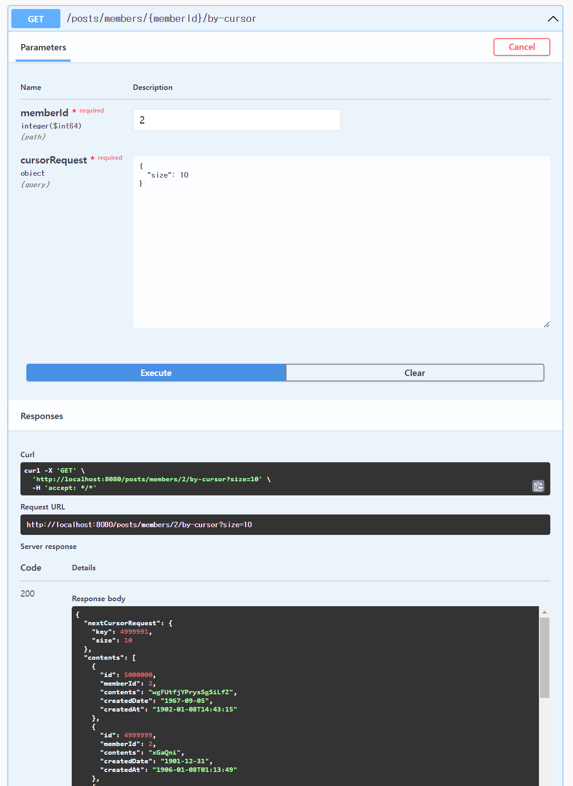

**Case 2. Key를 전달한 경우**

동일하게 데이터가 id에 순서따라 전달되고, 새로운 key가 전달되는 것을 확인할 수 있습니다.

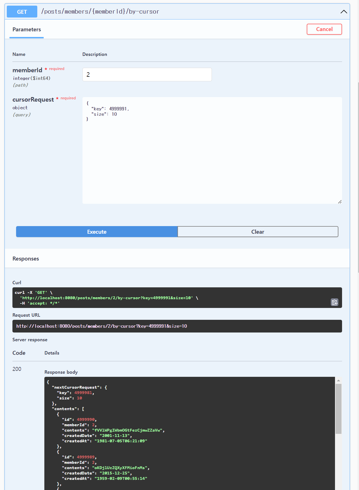

---

#### 정리

오프셋 기반 페이지네이션 방식와 커서 기반 페이지네이션 방식의 차이점 중 하나는 중복 데이터에 대한 여부가 있습니다.

오프셋 기반 페이지네이션 방식은 페이지를 기준으로 하기 때문에 중복 데이터가 존재할 수 있습니다.

예시로 1 페이지를 보고 있다가 2 페이지로 넘어갔을 때 데이터가 더 많아지게 되면 OFFSET이 밀리면서 1번 페이지에서 보았던 데이터가 2페이지에서도 보일 수 있습니다.

반면 커서 기반 페이지네이션 방식은 마지막 데이터의 Key를 고정하기 때문에 대부분의 최신 데이터는 위로 올라가기 때문에 두 번이상 동일한 데이터를 볼 확률은 거의 없습니다.

### 커버링 인덱스

---

#### 커버링 인덱스란?

SQL 문이 들어오게 되면 바로 테이블에 접근하는 것보다 중간에 인덱스 테이블을 거쳐 범위를 제한한 다음에 테이블로 가는 것이 빠릅니다.


> 검색조건이 인덱스에 부합하다면, 테이블에 바로 접근하는 것보다 인덱스를 통해 접근하는 것이 매우 빠르다.

> 테이블에 접근하지 않고 인덱스로만 데이터 응답을 내려줄 순 없을까?

이것이 **커버링 인덱스**의 기본 개념이고 **커버링 인덱스**의 전부입니다.

예시를 통해 알아보자.


50 살 이하의 나이를 가진 회원을 조회하는 쿼리가 있습니다.

```sql
SELECT 나이
FROM 회원
WHERE 나이 < 50;
```

현재 나이라는 인덱스가 있으므로 인덱스 테이블을 먼저 접근할 것입니다.

인덱스 테이블을 통해 40, 45살 데이터를 찾고 해당 데이터 주소에 따라 원본 데이터를 조회하게 될 것입니다.


필요한 데이터는 '나이' 1개 입니다. 이 데이터는 인덱스 테이블에 존재합니다. 이 경우에는 테이블에 접근하지 않고 회원 테이블에 접근하지 않고 인덱스 테이블에서 접근이 끝납니다. 그래서 데이터 블록에 접근할 때보다 성능이 훨씬 빠릅니다.

그렇다면 아래 경우는 어떨까요?

위에 쿼리와 동일한데 id 필드가 추가된 것입니다.

```sql
SELECT 나이, id
FROM 회원
WHERE 나이 < 50;
```

id 라는 필드도 MySQL 에서는 PK가 클러스터 인덱스이기 때문에 모든 인덱스에 테이블에 존재합니다. 그래서 id 필드가 추가된다고 해도 여전히 커버링 인덱스처럼 동작하게 됩니다.


> MySQL에서는 PK가 클러스터 인덱스이기 때문에  
> 커버링 인덱스에 유리하다.

다시 정리해보면

> **커버링 인덱스**은 테이블에 접근하지 않고 인덱스로만 데이터 응답을 내려줄 수 있는 쿼리라면 인덱스로만 커버하겠다는 의미입니다.   
>   
> 커버링 인덱스는 테이블에 직접 접근하지 않기 때문에 테이블에 접근하는 쿼리보다 훨씬 빠릅니다.

> 커버링 인덱스로 페이지네이션 최적화를 어떻게 할 수 있을까?

다음 예시를 통해 알아보자.

요청: 나이가 50 이하인 회원의 이름을 2개만 조회해라!

현재 이름은 커버링할 수 없다. 이 상태에서 2개만 조회해야하므로 LIMIT 2를 설정하면 어떤일이 발생할까?

현재는 나이가 50 이하인 회원이 2명밖에 없지만, 1만명이 있다고 가정해보자. 그러면 1000명에 대한 데이터 블록 접근이 모두 일어난다.

데이터베이스 성능 핵심에서 이야기한 적이 있지만, 디스크의 랜덤 IO를 줄여야하는 것인데 커버링 인덱스가 아닌 인덱스만 타고 데이터를 찾아가게 되면 그만큼에 랜덤 IO가 발생하게 됩니다.

이러한 문제를 커버링 인덱스를 통해 어느정도 줄일 수 있습니다.

MySQL with문을 통해 임시 테이블을 만들고 아래에서 JOIN이 발생하도록 하는 것입니다.

```sql
with 커버링 as (
SELECT id
FROM 회원
WHERE 나이 < 50
LIMIT 2
)

SELECT 이름
FROM 회원
INNER JOIN 커버링 on 회원.id = 커버링.id
```

위 쿼리는 커버링을 태울 수 있도록 우선 나이가 50이하인 회원을 2명만 찾아와서 그러면 나이와 id는 커버링 인덱스로 해결되므로 원본 데이터에 대한 접근이 발생하지 않게 된다.

해당 id로만 원본 데이터에 접근하게 되면 불필요한 랜덤 I/O를 줄일 수 있게 됩니다.

LIMIT이 없다면 바로 조회하는 것과 동일하지만,

**LIMIT, ORDER BY, OFFSET** 이 들어가면 불필요한 Access가 발생하기 때문에 커버링 인덱스를 잘 활용하여 최적화할 수 있다는 것이 Key Point  입니다.

---

#### 정리

> Order By, Offset, Limit 절로 인한 불필요한 데이터블록 접근을  
> 커버링 인덱스를 통해 최소화할 수 있다.

추가적으로 SNS에 노출되는 피드 데이터들은 그렇게 데이터가 많지 않다.

사진 URL, 동영상 URL, 제목, 내용, 작성자 정보 등인데 실제 데이터베이스에 게시글 데이터 정보는 엄청나게 많을 수 있습니다.

최적화 없이도 위와 같이 필요한 데이터만 인덱스를 설정하여 사용할 수 있습니다.
