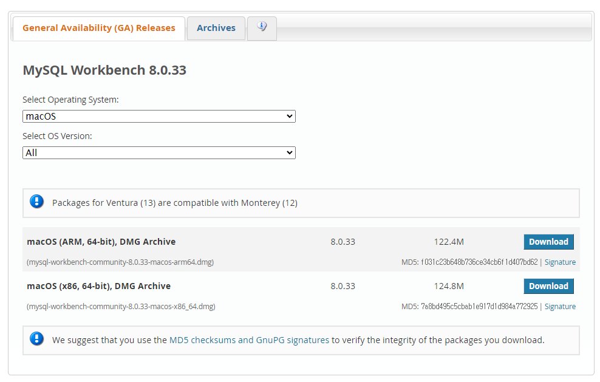
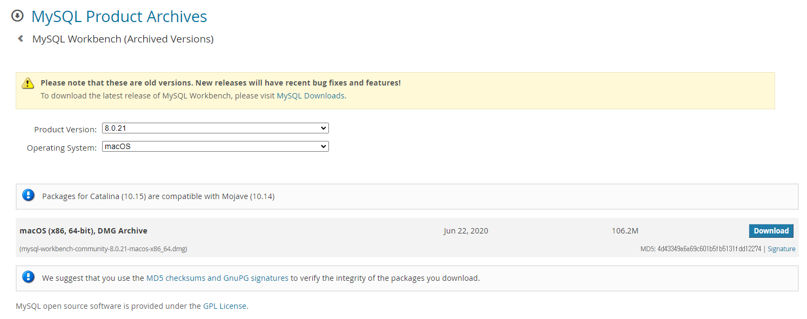

## MySQL WorkBench 클라우드 DB 연결

---

테이블 개편을 진행하면서 설계한 테이블을 가지고 테스트를 진행해 보았습니다.

Dev 환경에서는 해당 데이터를 가지고 직접 테스트하였고 Prod DB는 데이터베이스를 마이그레이션 하여 테스트를 진행하였습니다. 네이버 클라우드 DB를 사용하고 있어 DB를 마이그레이션 하기 MySQL WorkBench를 설치하였습니다.

네이버 클라우드에서 접근 권한을 주지 않기? 때문에 MySQL WorkBench를 통해 해야 한다고 들어 MySQL WorkBench를 통해 진행하였습니다.

### **Version 문제**

---

[MySQL 공식 사이트](https://dev.mysql.com/downloads/workbench/)를 통해 MySQL WorkBench를 설치하였습니다. 현재 M1 맥북이기 때문에 ARM 기반 파일을 다운로드하였습니다.

그런데 금지 아이콘이 붙은 상태로 설치가 되지 않았습니다....

구글링을 통해 macOS 기준 8.0.21 버전을 설치하여 사용하였다고 하셔서 설치하려고 하는데 x86 버전밖에 존재하지 않아 일단 다운로드하였습니다.

다행히도 설치는 가능했으나... 실행하니까 지속적으로 프로그램이 꺼지는 현상을 발견하였습니다...

구글링을 통해 확인하였을 때 MacOS에 따라 실행이 가능한 버전들이 존재하다고 하여 동일한 OS 버전을 사용하고 있는 포스팅을 발견하여 8.0.27 버전을 다운로드하여 실행하니 정상적으로 동작하였습니다.

### DB 연결 실패...

---

Host를 입력하고 DB 계정의 아이디와 패스워드를 아무리 입력해도 접속 실패라는 에러가 발생했습니다....

뭐지?? SSL Required? 뭐지... 무엇을 잘못 선택했나? 싶어서 SSL 선택지에서 변경하려고 해도 Required가 선택된 옵션밖에 존재하지 않아 다시 설치하고 테스트하고 테스트하고 테스트했습니다... 그런데 접속 실패라는 에러가 지속적으로 발생했습니다....

와..... 윈도우 환경에서는 사용 안 함 옵션이 존재하고 쉽게 접속할 수 있던데... 왜 맥은... MySQL이 macOS를 싫어하나..??

MySQL WorkBench 버전에 따라 다를 수 있으므로 8.0.27 버전 M1 맥북에서 접속할 수 있는 방법을 찾다가... 찾은 방법은 직접 `Advanced` 탭에서 useSSL=1이라는 값을 주어 해결할 수 있다고 하여 시도해 보았습니다...

뚜둥!! 탁!

실제로 해당 값을 설정해주 고나니 정상적으로 접근가능해졌습니다. 문제는... 접속할 때마다 다시 설정해주어야 하는... 문제가... 있었다고 합니다... 하하ㅏㅎ

찾아보니 해당 문제는 WorkBench 버전에 따라 다르다고 합니다..

[참고] <https://stackoverflow.com/questions/69769563/how-do-i-disable-the-ssl-requirement-in-mysql-workbench>

### 정리

---

> MacOS 버전에 따라 사용할 수 있는   
> MySQL WorkBench 버전이 정해져있는 것 같다...  
>   
> 이런 것을 빨리 깨달을 수 있어 다행이다...
