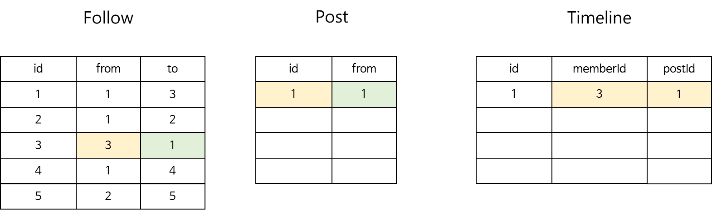
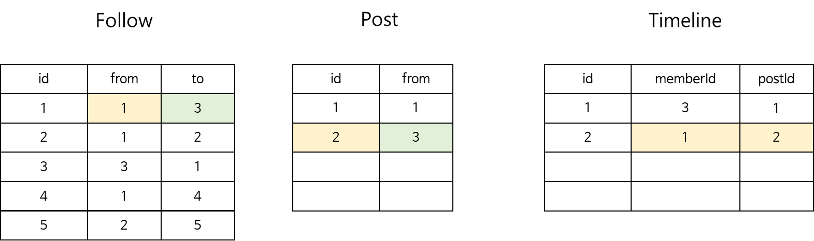
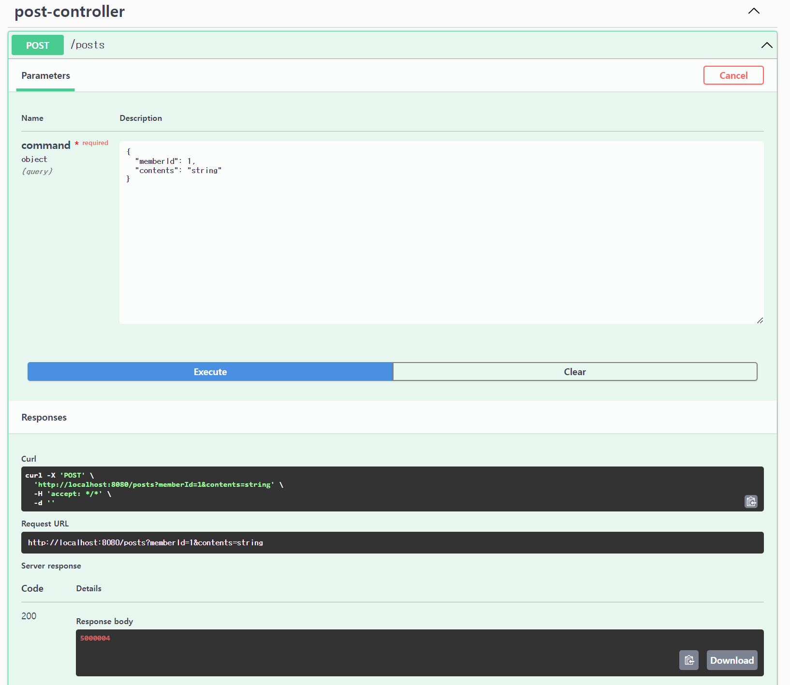
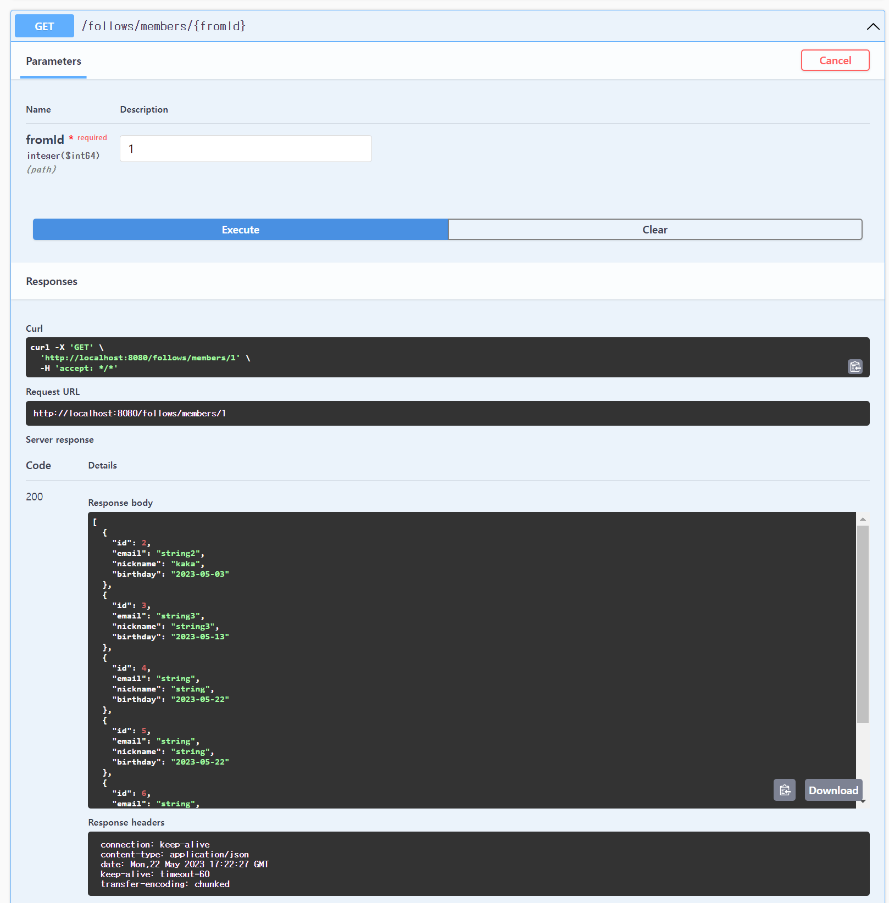
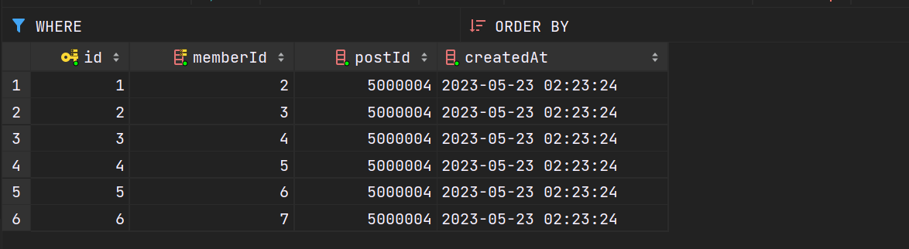
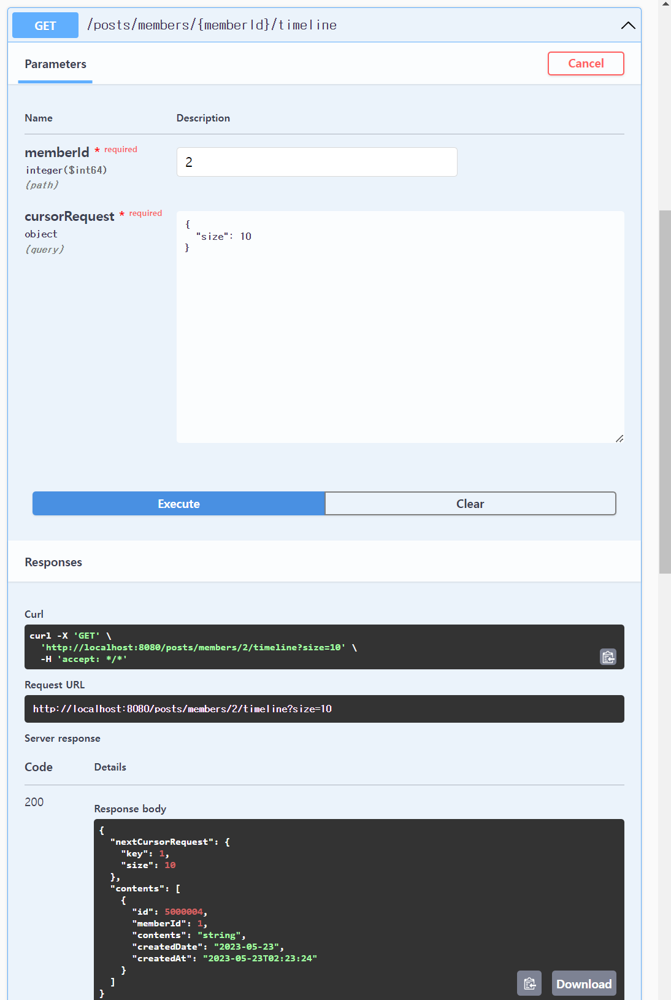
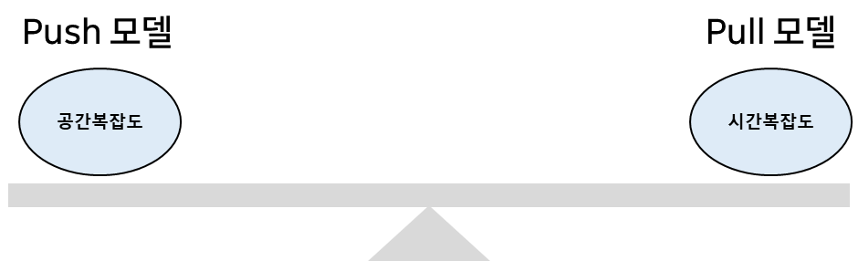
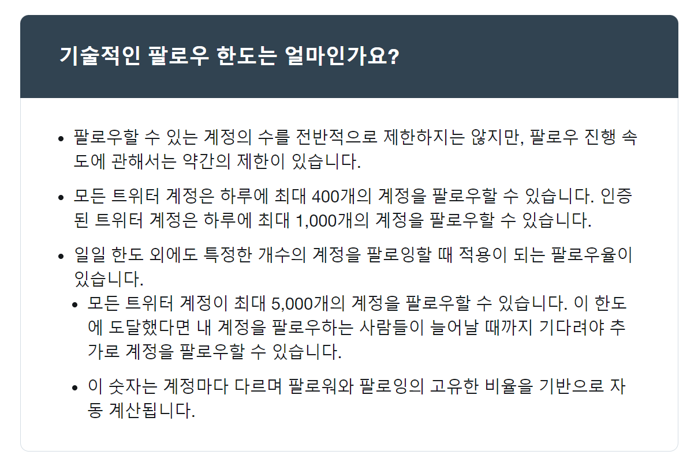

## 타임라인 구현

---

타임라인이란 SNS에 팔로우한 사용자의 게시물을 보여주는 기능을 의미합니다.

타임라인 구현 흐름은 다음과 같습니다.

1. 회원의 팔로우 목록 조회
2. 1번의 팔로우 회원 id로 게시물 조회

타임라인을 구현하는 대표적인 방식은 Fan Out On Read 방식과 Fan Out On Write 방식으로 나눌 수 있습니다.

먼저 Fan Out On Read 방식을 구현해보도록 하겠습니다.

### Fan Out on Read

---

타임라인 구현 흐름대로 구현해보면 다음과 같습니다.

```java
@RequiredArgsConstructor
@Service
public class GetTimelinePostUsecase {

    private final FollowReadService followReadService;
    private final PostReadService postReadService;

    public PageCursor<Post> execute(Long memberId, CursorRequest cursorRequest) {
        /**
         * 1. memberId -> follow 조회
         * 2. follow를 바탕으로 게시물 조회
         */
        List<FollowDto> folloings = followReadService.getFolloings(memberId);
        List<Long> followingMemberIds = folloings.stream().map(FollowDto::toMemberId).toList();
        return postReadService.getPosts(followingMemberIds, cursorRequest);
    }
}
```

**1. 회원의 Follow를 조회**

```java
@RequiredArgsConstructor
@Service
public class FollowReadService {

    private final FollowRepository followRepository;

    public List<FollowDto> getFolloings(Long memberId) {
        return followRepository.findAllByFromMemberId(memberId)
                .stream()
                .map(FollowDto::toDto)
                .collect(Collectors.toList());
    }
}
```

**2. 팔로우 회원 id를 기준으로 게시물 조회**

```java
package com.example.domain.post.service;

@RequiredArgsConstructor
@Service
public class PostReadService {

    private final PostRepository postRepository;

    public PageCursor<Post> getPosts(List<Long> memberIds, CursorRequest cursorRequest) {
        List<Post> posts = findAllByMemberIds(memberIds, cursorRequest);

        Long nextKey = getNextKey(posts);

        return new PageCursor<>(cursorRequest.next(nextKey), posts);
    }

    private List<Post> findAllByMemberIds(List<Long> memberIds, CursorRequest cursorRequest) {
        if(cursorRequest.hasKey()) {
            return postRepository.findAllByLessThanIdAndInMemberIdsAndOrderByIdDesc(cursorRequest.key(), memberIds, cursorRequest.size());
        }

        return postRepository.findAllByInMemberIdAndOrderByIdDesc(memberIds, cursorRequest.size());
    }

    private static Long getNextKey(List<Post> posts) {
        return posts.stream()
                .mapToLong(Post::getId).min()
                .orElse(CursorRequest.NONE_KEY);
    }
}
```

해당 로직의 시간 복잡도를 계산해보면 다음과 같습니다.

> log(Follow 전체 레코드) + 해당 회원의 Follow 수 \* log(Post 전체 레코드)   
> => logN + NlogN

이러한 모델을 **Fan Out on Read(Pull Model)**이라 합니다. 읽는 시점에 Fan Out을 시킨다.

Fan Out on Read 방식은 사용자가 홈에 접속할 때마다 시간 복잡도(logN + NlogN)를 견뎌내야합니다. 사용자의 수가 늘어날수록 타임라인 조회 속도가 점점 느려지게 됩니다.

팔로우 수가 많다는 것은 서비스의 충성 고객이 많다는 의미이고 그러한 고객에게 제공되는 서비스의 속도가 점점 느려진다는 의미가 된다.

> "사용자가 매번 홈에 접속할 때마다 부하가 발생"하는 문제는 어떻게 해결할 수 있을까? 

### Fan Out On Write

---

#### Fan Out On Write 모델이란

사용자가 매번 홈에 접속할 때마다 부하가 발생하는 문제는 여러 가지 방법으로 해결할 수 있겠지만 Fan Out On Write (Push Model)로 이 문제를 해결할 수 있습니다. 

Fan Out On Write 는 Write 시점에 Fan Out 하는 방식을 의미합니다.

핵심은 다음과 같습니다.

> 게시물 작성 시, 해당 회원을 팔로우하는 회원들에게 데이터를 배달한다.

예시를 통해 자세히 이해해봅시다.

게시물이 아무것도 없는 상태라고 가정해봅시다.


게시물이 아무것도 없는 상태에서 1번 유저가 게시물을 작성했습니다.


어떤 일이 벌어질까요? 

Fan Out On Write Push 모델에서는 타임라인이라는 별도의 테이블이 생기게 됩니다. 

그리고 유저가 게시물을 작성한 시점에 내 팔로우를 찾게 됩니다. 즉 나를 팔로우하고 있는 유저를 찾게 됩니다. 

그러면 3번 유저에게 1번 유저가 작성한 게시물을 전달해줍니다. 즉 타임라인 테이블에 Insert 합니다.



'

이번에는 3번 유저가 게시물을 작성했습니다.

동일하게 3번 유저를 팔로우하고 있는 유저를 찾아 작성한 게시물을 전달해줍니다.



> 이렇게 되면 조회 시점에 어떻게 될까요?  
>   
> 타임라인 조회시에는 Timeline 테이블을 조회하여 게시물들 조회

3번 유저가 게시물을 달라고 요청했을 때 팔로우 목록을 가져온 다음에 게시물을 OR 조건으로 조회를 하는 것이 아니라 순전히 timeline 테이블에 memberId가 본인으로 되어있는 게시물만 조회해주면 됩니다.

그래서 타임라인 조회시에는 Timeline 테이블을 조회하여 게시물들을 조회하면 됩니다.

이렇게 되면 Fan Out On Read 방식에서 발생한 팔로우 수가 많은 유저인 경우 OR 조건으로 병목이 발생하였는데 위와 같이 Timeline 테이블을 조회하여 게시물들을 조회하면 병목 현상을 해결할 수 있습니다.

> **Push** 모델은 **Pull** 모델에서 조회 시점에 발생한 부하를 쓰기 시점에 부하가 발생하도록 변경한 것이다. 

게시물을 쓸 때 게시물을 작성하고 끝나는 것이 아니라 타임라인 테이블에 전달해주어야 합니다. 그래서 무조건 좋은 것은 아닙니다. 쓰기 시점으로 부하를 변경한 것이기 때문입니다.

예를들어 블랙핑크 제니처럼 팔로우가 많은 유저의 경우 게시물을 작성하면 엄청난 Write가 발생하게 됩니다. 

실제로 FaceBook은 Pull 모델을, 트위터는 Push 모델을 사용하고 있습니다. 

---

#### Fan Out On Write 구현

Fan Out on Write는 게시물 작성 시점에 굉장히 많은 량에 Write 가 발생할 수 있기 때문에 그 부분을 어떻게 최적화할 수 있는지도 생각해보면 좋을 것 같습니다.

먼저 구현 흐름은 다음과 같습니다.

**조회 기능**

1. Timeline 조회
2. 1번에 해당하는 게시물을 조회한다.

1번과 2번은 JOIN을 통해 가져올 수 있지만, **IN Query**을 통해 가져오도록 하겠습니다.

**타임라인 생성**

1. 게시물 작성
2. 팔로우에 대한 타임라인 생성

가장 먼저 도메인을 구현해봅시다.

**타임라인 도메인 구현**

위에서 보여드린 그림과 같이 도메인은 간단합니다.

PK와 memberId(팔로워), postId(게시글 PK), createAt(생성일)로 구성됩니다.

```java
@Getter
public class Timeline {
    private final Long id;

    private final Long memberId;

    private final Long postId;

    private final LocalDateTime createdAt;

    @Builder
    public Timeline(Long id, Long memberId, Long postId, LocalDateTime createdAt) {
        this.id = id;
        this.memberId = Objects.requireNonNull(memberId);
        this.postId = Objects.requireNonNull(postId);
        this.createdAt = createdAt == null ? LocalDateTime.now() : createdAt;
    }
}
```

**Repositoy 구현**

저장소에는 2가지 기능이 필요합니다.

1. **저장(Write)**
2. **조회(Read)**: 회원의 Id를 받아 커서 처리

기존에 구현한 로직과 유사합니다.

```java
package com.example.domain.post.repository;

import com.example.domain.post.entity.Timeline;
import lombok.RequiredArgsConstructor;
import org.springframework.jdbc.core.RowMapper;
import org.springframework.jdbc.core.namedparam.BeanPropertySqlParameterSource;
import org.springframework.jdbc.core.namedparam.MapSqlParameterSource;
import org.springframework.jdbc.core.namedparam.NamedParameterJdbcTemplate;
import org.springframework.jdbc.core.namedparam.SqlParameterSource;
import org.springframework.jdbc.core.simple.SimpleJdbcInsert;
import org.springframework.stereotype.Repository;

import java.sql.ResultSet;
import java.time.LocalDateTime;
import java.util.List;

@RequiredArgsConstructor
@Repository
public class TimelineRepository {

    private static final String TABLE = "TIMELINE";

    private final NamedParameterJdbcTemplate namedParameterJdbcTemplate;

    private final static RowMapper<Timeline> ROW_MAPPER = (ResultSet resultSet, int rowNum) -> Timeline.builder()
            .id(resultSet.getLong("id"))
            .memberId(resultSet.getLong("memberId"))
            .postId(resultSet.getLong("postId"))
            .createdAt(resultSet.getObject("createdAt", LocalDateTime.class))
            .build();

    public List<Timeline> findAllByMemberIdAndOrderByIdDesc(Long memberId, int size) {
        String sql = String.format("""
                SELECT *
                FROM %s
                WHERE memberId = :memberId
                ORDER BY id desc
                LIMIT :size
                """, TABLE);

        MapSqlParameterSource params = new MapSqlParameterSource()
                .addValue("memberId", memberId)
                .addValue("size", size);

        return namedParameterJdbcTemplate.query(sql, params, ROW_MAPPER);
    }

    public List<Timeline> findAllByLessThanIdAndMemberIdAndOrderByIdDesc(Long id, Long memberId, int size) {
        String sql = String.format("""
                SELECT *
                FROM %s
                WHERE memberId = :memberId and id < :id
                ORDER BY id desc
                LIMIT :size
                """, TABLE);

        MapSqlParameterSource params = new MapSqlParameterSource()
                .addValue("memberId", memberId)
                .addValue("id", id)
                .addValue("size", size);

        return namedParameterJdbcTemplate.query(sql, params, ROW_MAPPER);
    }

    public Timeline save(Timeline timeline) {
        if(timeline.getId() == null) {
            return insert(timeline);
        }

        throw new UnsupportedOperationException("Timeline은 갱신을 지원하지 않습니다.");
    }

    private Timeline insert(Timeline timeline) {
        SimpleJdbcInsert simpleJdbcInsert = new SimpleJdbcInsert(namedParameterJdbcTemplate.getJdbcTemplate())
                .withTableName(TABLE)
                .usingGeneratedKeyColumns("id");

        SqlParameterSource params = new BeanPropertySqlParameterSource(timeline);
        Long id = simpleJdbcInsert.executeAndReturnKey(params).longValue();

        return Timeline.builder()
                .id(id)
                .memberId(timeline.getMemberId())
                .postId(timeline.getPostId())
                .createdAt(timeline.getCreatedAt())
                .build();
    }
}
```

**서비스 로직 구현**

저장 로직을 구현하면 다음과 같습니다.

```java
package com.example.domain.Timeline.service;

import com.example.domain.Timeline.domain.Timeline;
import com.example.domain.Timeline.repository.TimelineRepository;
import lombok.RequiredArgsConstructor;
import org.springframework.stereotype.Service;

import java.util.List;

@RequiredArgsConstructor
@Service
public class TimelineWriteService {

    private final TimelineRepository timelineRepository;

    public void deliveryTimeline(Long postId, List<Long> tomemberIds) {
        List<Timeline> timelines = tomemberIds.stream()
                .map((memberId) -> Timeline.builder().memberId(memberId).postId(postId).build())
                .toList();

        timelines.forEach(timelineRepository::save);
    }
}
```

그런데 리스트를 일일이 삽입하는 것은 비효율적이므로 리스트 형태로 데이터를 한 번에 Insert할 수 있는 bulkInsert를 구현해보도록 하겠습니다.

다음과 같이 굉장히 간단하게 구현할 수 있습니다.

```java
public void bulkInsert(List<Timeline> timelines) {
    String sql = String.format("""
            INSERT INTO `%s` (memberId, postId, createdAt)
            VALUES (:memberId, :postId, :createdAt)
            """, TABLE);

    SqlParameterSource[] params = timelines.stream()
            .map(BeanPropertySqlParameterSource::new)
            .toArray(SqlParameterSource[]::new);

    namedParameterJdbcTemplate.batchUpdate(sql, params);

}
```

이를 적용하면 다음과 같이 서비스 로직이 변경됩니다.

```java
package com.example.domain.Timeline.service;

import com.example.domain.Timeline.domain.Timeline;
import com.example.domain.Timeline.repository.TimelineRepository;
import lombok.RequiredArgsConstructor;
import org.springframework.stereotype.Service;

import java.util.List;

@RequiredArgsConstructor
@Service
public class TimelineWriteService {

    private final TimelineRepository timelineRepository;

    public void deliveryTimeline(Long postId, List<Long> tomemberIds) {
        List<Timeline> timelines = tomemberIds.stream()
                .map((memberId) -> Timeline.builder().memberId(memberId).postId(postId).build())
                .toList();

        timelineRepository.bulkInsert(timelines);
    }
}
```

이제 타임라운 구현은 끝났습니다.

변경된 로직에 따라 게시물 작성 후 팔로우를 조회하는 로직을 구현해봅시다.

기존 로직은 다음과 같이 굉장히 단순했습니다.

```java
@RequiredArgsConstructor
@Service
public class PostWriteService {

    private final PostRepository postRepository;

    public Long create(PostCommand command) {
        Post post = Post
                .builder()
                .memberId(command.memberId())
                .contents(command.contents())
                .build();

        return postRepository.save(post).getId();
    }
}
```

로직을 해당 클래스에서 작성하지 않고 Usecase 레벨까지 올라가서 작성하려고 합니다. 왜냐하면 게시물을 작성한 작성자의 팔로우를 조회하여 타임라인 전달을 해주어야하기 때문입니다. 즉 두 도메인이 겹치기 때문에 Usecase로 올려서 진행하도록 하겠습니다.

위에서 말씀드린 것처럼 게시물을 생성하고 팔로우를 조회하고 해당 팔로우에 타임라인에 게시글을 전달해줍니다.

```java
package com.example.application.usecase;

import com.example.domain.Timeline.service.TimelineWriteService;
import com.example.domain.follow.dto.FollowDto;
import com.example.domain.follow.service.FollowReadService;
import com.example.domain.post.dto.PostCommand;
import com.example.domain.post.service.PostWriteService;
import lombok.RequiredArgsConstructor;
import org.springframework.stereotype.Service;

import java.util.List;

@RequiredArgsConstructor
@Service
public class CreatePostUsecase {
    private final PostWriteService postWriteService;
    private final FollowReadService followReadService;
    private final TimelineWriteService timelineWriteService;

    public Long execute(PostCommand postCommand) {
        Long postId = postWriteService.create(postCommand);

        List<Long> followersMemberIds = followReadService.getFollowers(postCommand.memberId())
                .stream()
                .map(FollowDto::fromMemberId)
                .toList();

        timelineWriteService.deliveryTimeline(postId, followersMemberIds);

        return postId;
    }
}
```

위와 같이 Pull 방식보다는 Push 방식이 구현이 조금 더 많이 필요합니다.

구현을 완료하였으므로 Swagger를 통해 간단하게 테스트해보자.

먼저 게시글을 작성해보자.



그리고 현재 MemberId 1인 사용자의 팔로우를 조회해보자.

그림과 같이 현재 MemberId 1를 팔로우하고 있는 사용자는 2~7입니다.



그러면 타임라인에는 1번과 2~7번 회원에게 PostId 5,000,001 게시글을 타임라인이 전달되어야합니다.



정상적으로 동작하고 있음을 확인할 수 있습니다.

이번에는 조회 기능을 구현해보자.

게시물 조회 기능과 유사하므로 참고만 하면 됩니다.

```java
package com.example.domain.Timeline.service;

import com.example.domain.Timeline.domain.Timeline;
import com.example.domain.Timeline.repository.TimelineRepository;
import com.example.util.CursorRequest;
import lombok.RequiredArgsConstructor;
import org.springframework.stereotype.Service;

import java.util.List;

@RequiredArgsConstructor
@Service
public class TimelineReadService {

    private final TimelineRepository timelineRepository;

    public PageCursor<Timeline> getTimelines(Long memberId, CursorRequest cursorRequest) {
        List<Timeline> timelines = findAllByMemberId(memberId, cursorRequest);
        Long nextKey = timelines.stream().mapToLong(Timeline::getId).min().orElse(CursorRequest.NONE_KEY);

        return new PageCursor<>(cursorRequest.next(nextKey), timelines);
    }

    private List<Timeline> findAllByMemberId(Long memberId, CursorRequest cursorRequest) {
        if(cursorRequest.hasKey()) {
            return timelineRepository.findAllByLessThanIdAndMemberIdAndOrderByIdDesc(cursorRequest.key(), memberId, cursorRequest.size());
        }

        return timelineRepository.findAllByMemberIdAndOrderByIdDesc(memberId, cursorRequest.size());
    }

}
```

이를 테스트해보면 다음과 같습니다.



#### 정리

> 조회 때 성능이 좋아지겠지만  
> Write 기능이 복잡해졌고 부하가 추가되었습니다.

### 정합성과 성능의 트레이드 오프

---



* **Push 모델**은 Write(생성) 시점에 타임라인에서 읽어와야할 데이터를 배달해주는 방식  
  => 공간 복잡도 희생(타임라인과 같은 별도 공간이 필요하기 때문)
* **Pull 모델**은 Read(조회) 시점에 데이터를 읽어오는 방식  
  => 시간 복잡도 희생(조회 시점에 즉 팔로우 수가 많을 수록 많은 시간이 필요해지기 때문)

> Push 모델과 Pull 모델 중에서  
> 어떤 것이 정합성을 보장하기 쉬울까?

Pull 모델은 원본 데이터를 직접 참조하므로, 정합성 보장에 유리하지만, Follow 수가 많은 회원일수록 처리속도가 느리다는 단점을 갖습니다.

실제로 페이스북에서는 Pull 모델을 사용하고 있고, 반면에 트위터에서는 Push 모델을 사용하고 있습니다.

재미있는 차이점이 있습니다. 아래 그림은 페이스북에 제한사항이고 모바일에서만 접근 가능합니다.


[참고] <https://www.facebook.com/help/211926158839933?helpref=related_articles> (모바일에서만 접근가능)

Facebook 에서 최대 5,000 명의 친구를 보유할 수 있다고 되어있습니다.

5,000명 이상의 사람들과 연결해야 하는 경우 프로페셔널 모드를 설정하거나 다른 친구와의 친구관계를 끊어야한다고 합니다. 즉 페이스북에서 친구의 최대 한계가 5,000명이라고 명시해주고 있습니다.

페이스북 같은 경우에는 Pull 모델을 사용하고 있어 팔로우 수가 많을 수록 성능이 기하급수적으로 내려갑니다. 그래서 페이스북에서는 어느 정도 적정 수준을 정해놓은 것입니다.

트위터의 경우는 다음과 같습니다.



`일일 한도 외에도 특정한 개수의 계정을 팔오잉 할때 적용되는 팔로우율이 있습니다. 모든 트위터 계정이 최대 5,000개의 계정을 팔로우할 수 있고, 이 한도에 도달했다면 내 계정을 팔로우하는 사람들이 늘어날 때까지 기다려야 추가로 계정을 팔로우할 수 있습니다.`

페이스북과 트위터가 5,000명이라는 한계점을 동일합니다.

차이점은 페이스북은 5,000명이 넘어가면 친구를 끊기전까지 5,000명을 넘길 수 없고,

반면에 트위터는 5,000명이 최대치이긴 하지만 나를 팔로우한 사람이 늘어난다면 계정을 팔로우할 수 있게 됩니다.

즉 트위터는 5,000명을 넘길 수 있다는 말입니다.

트위터는 Push 모델을 사용하고 있기 때문에 페이스북에 비해서는 비교적 팔로우 수에 기술적 제약이 없다고 볼 수 있습니다.

> Push 모델에서는 게시물 작성과 타임라인 배달의  
> 정합성 보장에 대한 고민이 필요합니다.

게시물을 작성 할 때 팔로우가 많은 유저가 게시물을 작성하면 Write가 기하급수적으로 늘어납니다. 이 문제를 비동기 또는 다른 저장소 사용 등 다양한 해결책이 존재합니다.

> Push 모델을 적용한다면  
> 모든 회원의 타임라인에 배달되기 전까지  
> 게시물 작성의 트랜잭션을 유지하는 것이 맞을까?

A 유저를 팔로우하고 있는 유저들 중에서는 아예 접속을 하지 않는 유령 회원도 존재할 텐데 그런 회원에게까지 게시물 트랜잭션을 잡고있는 것이 맞을지는 고민해볼 만한 문제입니다.

이것과 관련된 재미있는 [CAP 이론](https://onduway.tistory.com/106)이 있습니다.

CAP 이론이란 Consistency(일관성), Avaliability(가용성), Partition Tolerance(분할 허용성)의 밸런스는 모두 충족할 수 없다는 이론입니다. 즉 3가지 중 2가지만 가져갈 수 있다는 이론입니다.

다시 정리해보면

> Push 모델은 Pull 모델에 비해 시스템 복잡도가 높습니다.   
> 하지만 그만큼 비즈니스, 기술 측면에서 유연성을 확보시켜줍니다.   
>   
>   
> 결국 은총알은 없다.  
> 상황, 자원, 정책 등 여러가지를 고려해  
> 트레이드 오프 해야합니다.  
>   
>   
> 트레이드 오프를 잘 하기 위해서는  
> 기술의 사용법이 아니라 기술이 풀고자하는 문제와  
> 문제를 해결하면서 생기는 다른 한계점이 무엇인지를  
> 확인하는 습관을 갖는 것이 중요하다.
