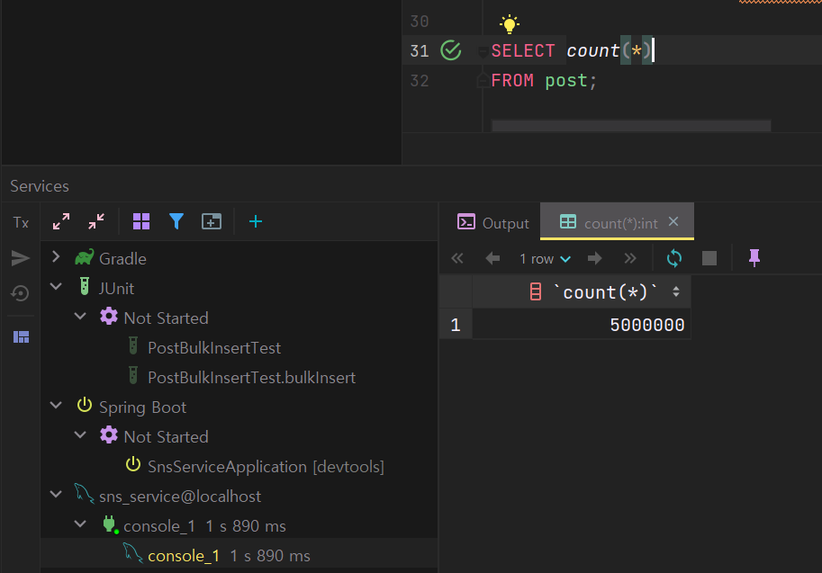
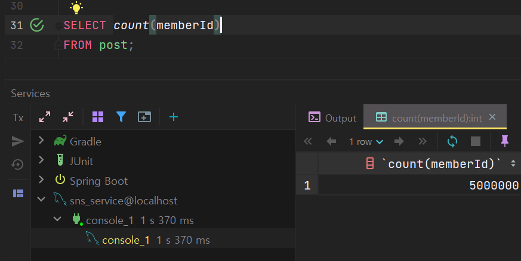
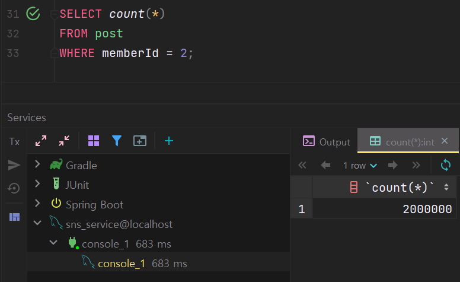
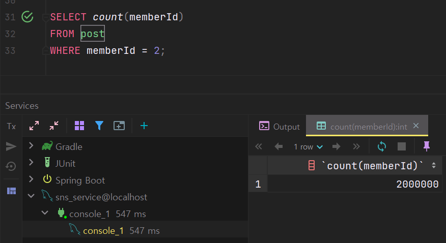

## Don’t close your eyes. Look! The reality of fear can be different than you think

---

최근 데이터베이스 개편을 진행하면서 다양한 것을 경험하고 있다...

### 무서운 습관

---

전체 개수를 조회하는 쿼리를 작성할 때 습관적으로 전체 컬럼에 대한 개수를 조회하였습니다.

조건이 없는 경우에 전체 데이터를 조회하는데 전체 컬럼을 선택할 필요가 있을까? 라는 생각이 들었다.

그래서 다양한 테스트를 진행해보았다.

현재 데이터의 개수를 500만 개에 테스트 더미 데이터를 삽입한 상태입니다.

#### **조건이 없는 경우**

**1. 전체 필드를 선택**

```sql
SELECT COUNT(*)
FROM POST;
```

실행했을 때 시간이 1s 890ms가 소요되었습니다...



**2. 인덱스 필드 선택**

```sql
SELECT count(memberId)
FROM post;
```



평소에는 동일할 것이라 생각하고 전체 필드를 대상으로 개수를 파악했는데... 인덱스만 선택하여 테이블의 개수만 파악하도록 하면 더 빠르지 않을까 라는 생각이 들어서 시도해보니... 1/3의 시간이 감소하는 것을 확인할 수 있었습니다.

#### **조건이 있는 경우**

**1. 전체 필드 선택**

```sql
SELECT count(id)
FROM post
WHERE memberId = 2;
```



전체 데이터를 조회할 때보다 일부를 선택하여 개수를 조회할 때

데이터의 개수가 2/5로 줄었고 속도는 1/3로 줄었습니다.

**2. 인덱스 필드 선택**

```sql
SELECT count(memberId)
FROM post
WHERE memberId = 2;
```



전체 필드를 선택했을 때보다 약 100ms 가 줄어든 것을 확인할 수 있습니다.

> 간단한 기능였기에 고민하지 않고   
> 작성한 쿼리한 쿼리가   
> 문제가 될 수 있을 것이라 생각하지 못했다.  
>   
> 앞으로는 간단한 것 하나라도 살피면서 개발해야한다는 것을 느꼈다.
