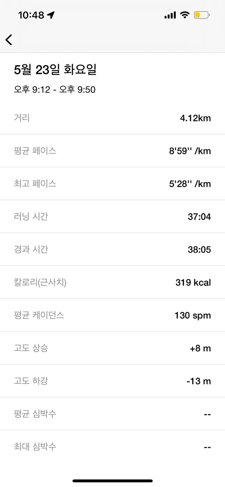

an unusual day

---

요즘에 커피를 줄였는데.. 잠을 잘 못 잔다... 

잠을 설치다가 4시 넘어서 잠이 들어버렸다... 운동을 안 해서 그런가?? 

어제 회사에서 야근해서 운동을 쉬었더니... 잠을 못자는 건가??...

그런데 일요일에는 운동을 했는데 왜 못 잣을까?.... 뭐지 

오늘은 회사에서 일찍 끝나서 끝나자마자 집에 와서 옷갈아입고 러닝을 했다!

그런데 두둥.. 평소와 다르게 몸이 무겁고 열심히 걷고 뛰어도 귀에 그녀의 목소리가 들리지 않았다...

평소에는 귀찮을 정도로 말을 많이 해줬는데 오늘은 나에게 관심이 없던 것 같았다...

최근에 5km 를 뛰었는데.. 오늘은 4km 뛰었다... 이틀 전에 다리를 삐어서 조심스럽기도 했다..

내일은 더 열심히 뛰어야지(야근하지 않는다면... )
