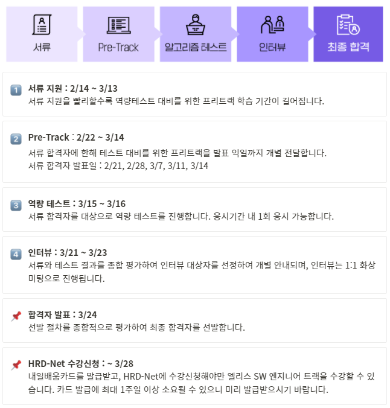
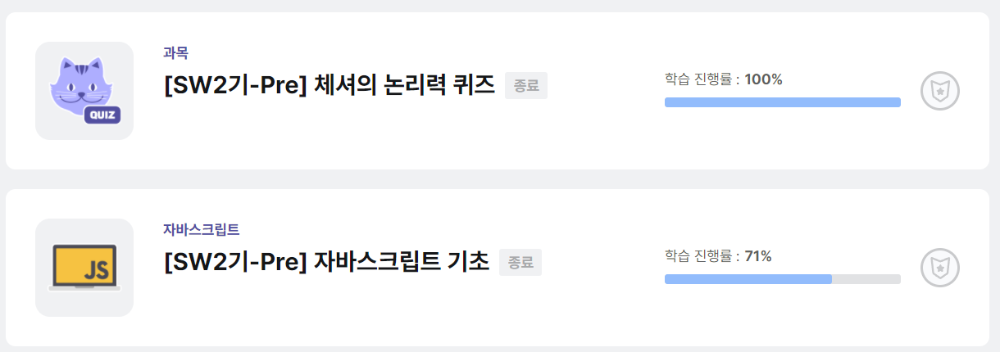
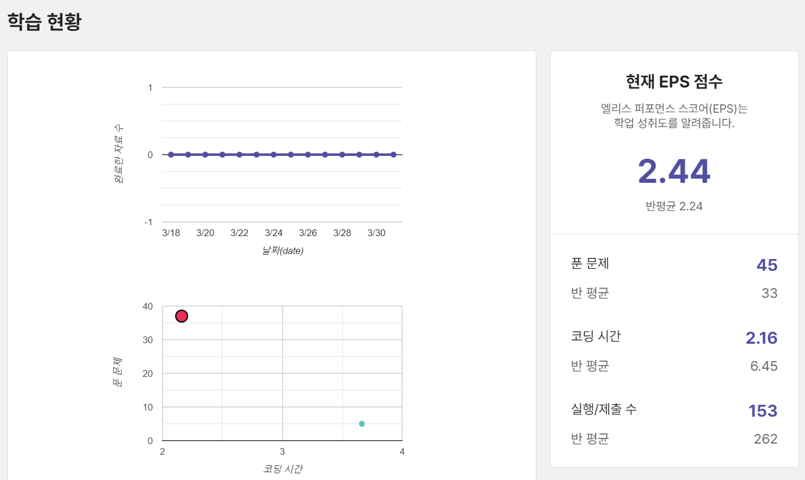
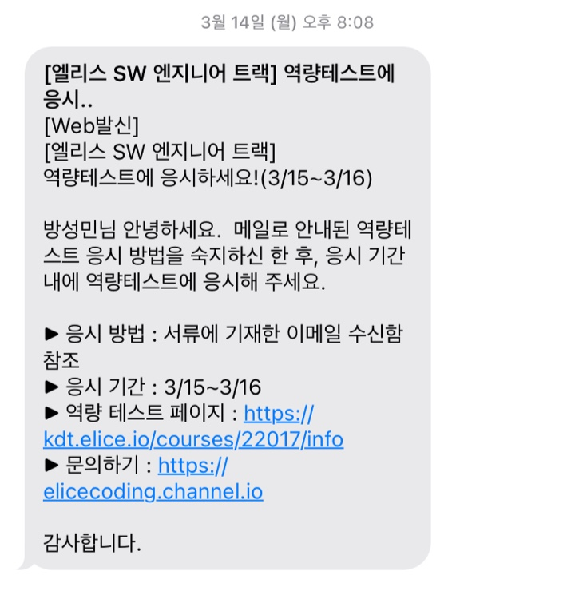
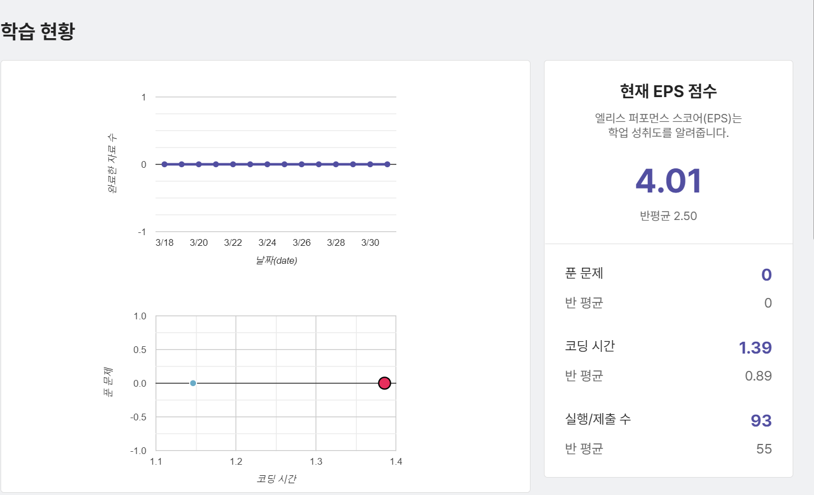
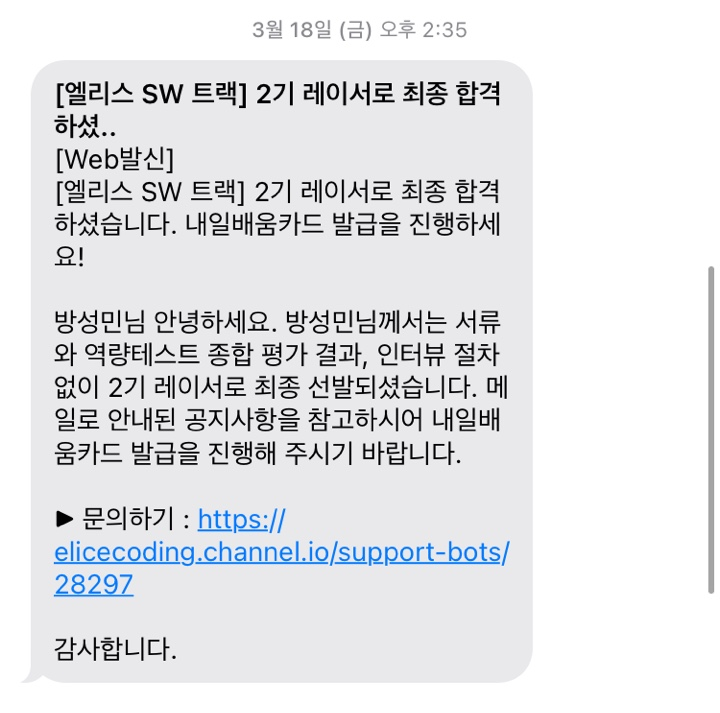

## 1. 서론

- 백엔드 개발자로 성장하기 위해서 **엘리스 SW 엔지니어 트랙** 2기에 지원을 하였습니다.

첫 부트캠프 도전기로 너무나도 긴장된 상태로 모든 것을 열심히 성실히 임하였습니다

## 2. 본론

엘리스 과정은 다음과 같습니다.

엘리스 부트캠프 신청

1. 서류지원으로 자기소개서를 작성합니다. 간단하지만 열심히 썼습니다. 최대한 간단하고 무엇을 원하는지에 대해서 작성을 했습니다.

2. 서류 합격할 경우 프리트랙을 수강할 수 있었습니다!!

프리 트랙

기본적으로 자바스크립트 문법을 알고 있었지만... 논리가 부족하다고 생각들어서 논리를 먼저 시작했습니다. 저는 다른 분들과 달리 이메일로 온 것을 알게 되어 늦게 시작하게 되었습니다.. 그래서 하루만에 끝내려고 노력했지만 논리력 퀴즈가 생각보다 오래걸려서 다 끝내지는 못했었습니다...

프리 트랙

다른분들보다는 많이 풀었지만.. 시간은 적은것을 볼수 있었습니다.

다시 생각해보면 전공자라서 조금 더 빠르게 풀수 있었던 것같습니다.

역량 테스트는 이틀 중 원하는 시간에 응시할 수 있었습니다.

그래서 저는 15일 오전에 백준과 프로그래머스를 통해 알고리즘을 학습하고 오후에 시험을 치뤘습니다.

결과는 두근두근... 컴퓨팅적 사고력 테스트는 58점.. 코딩테스트는 70점을 받았습니다..

코딩 시간도 다른분들보다 많이 걸렸더라고요.... ㅠㅠ

역량테스트 결과

저는 그래서 떨어질것이라는 생각을 하고 있었습니다.. 엘리스 SW 아카데미 2기 오픈톡이 있는것을 늦게 알게 되었고 들어갔는데.. 다른분들이 면접 관련 공지가 왔다고 하셨는데 저는 오지 않더라고요...

그래서 저는 조용히 다른분들 이야기 듣다가 나가려고 했었습니다..

그런데 그때.. **빠밤!!**

엘리스 합격 문자

이렇게 문자가 빵!! 하고 오더라고요... 그래서 행복함을 느꼈습니다...

## 3. 결론

하지만 결론적으로 저는 수강하지는 않았습니다. 3/30일까지 고민을 하다가 제가 원하는 것을 백엔드 개발로 엘리스 SW 트랙은 프론트 중심이라는 것을 알게 된 후, 고민을 하다가 그만 포기해버렸습니다...

또 다른 도전을 위해서 화이팅!!
