오늘 같이 자외선이 뜨거운 날은!!?? 

공부하는게 최고죠!! 

집에서 개발하는 즐거움 !!

다함께 느껴보셔요!!

---

### **2주차**

> 2회독이기 때문에 간단한 내용을 생략하였고, 목차를 주제별로 간추렸습니다.

**[2주차 목표]**

**1. Javascript 문법에 익숙해진다.**

**2. jQuery로 간단한 HTML을 조작할 수 있다.**

**3. Ajax로 서버 API(약속)에 데이터를 주고, 결과를 받아온다.**

**[목차]**

**1. JQuery + Quiz**

**2. Ajax + Quiz**

**3. Homework**

---

**1. JQuery**

******1) JQuery가 필요한 이유******

**- 버튼의 색깔을 바꾸거나 div 박스를 하나 감추고 싶을 때 JQuery를 통해 쉽게 할 수 있다.**

****(**장점)**

**1. 웹 개발자들은 상호작용하는 웹 페이지를 만들기 위해서 DOM을 조작하는데, 제이쿼리는 이러한 DOM 조작을**

**아주 쉽게 만들어줍니다. DOM은 HTML 요소들이 트리 구조(tree structure)로 정리되어 있는 것입니다.  
2. 제이쿼리는 무료이며 오픈 소스 라이브러리입니다. 여기에 기여하는 커뮤니티는 그 어떤 자바스크립트**

**라이브러리보다도 훨씬 다양하며 규모도 큽니다.  
3. 프로젝트에 쉽게 포함시킬 수 있는 무료 플러그인들만 해도 1000개가 넘습니다.  
4. 다양한 브라우저를 지원합니다. 그러니까, 일반적으로 사용되는 거의 모든 브라우저를 지원한다고 보시면 됩니다.**

**(단점)**

**1. 실행 명령을 처리하는 데 오랜 시간이 걸린다**

**2. 사용할 이유가 딱히 없다.**

**- 이제 과거와 달리 크로스 브라우징 이슈도 적어졌고, virtual DOM의 인기로 DOM을 직접 조작할 필요가 없어졌다.**

**또한, jQuery로 할 수 있는 대부분 기능은 바닐라 JS나 TypeScript 등으로 똑같이 구현할 수 있다.**

**3. 무겁다.**

**- jQuery는 기존 코드를 래핑(wrapping)해서 새롭게 만든 패키지이다. 문제는 이러한 래핑이 지나치게 많고,**

**애초에 최적화를 위해 설계되지도 않았다는 점이다.**

**4. 좋은 대안이 많이 생겼다.**

**- 리액트만 해도 재사용성을 높이는 컴포넌트를 기반으로 jQuery보다 훨씬 가독성이 높은 코드를 작성할 수 있다.**

**또한 1번에서 언급했듯이 더는 DOM을 직접 조작하지 않고 virtual DOM을 이용하는 프레임워크가 널리 사용되고 있다.**

******2) Quiz 문제******

**- 기존 문제 풀이 코드와 동일할 수 도 있고, 다를 수도 있다**

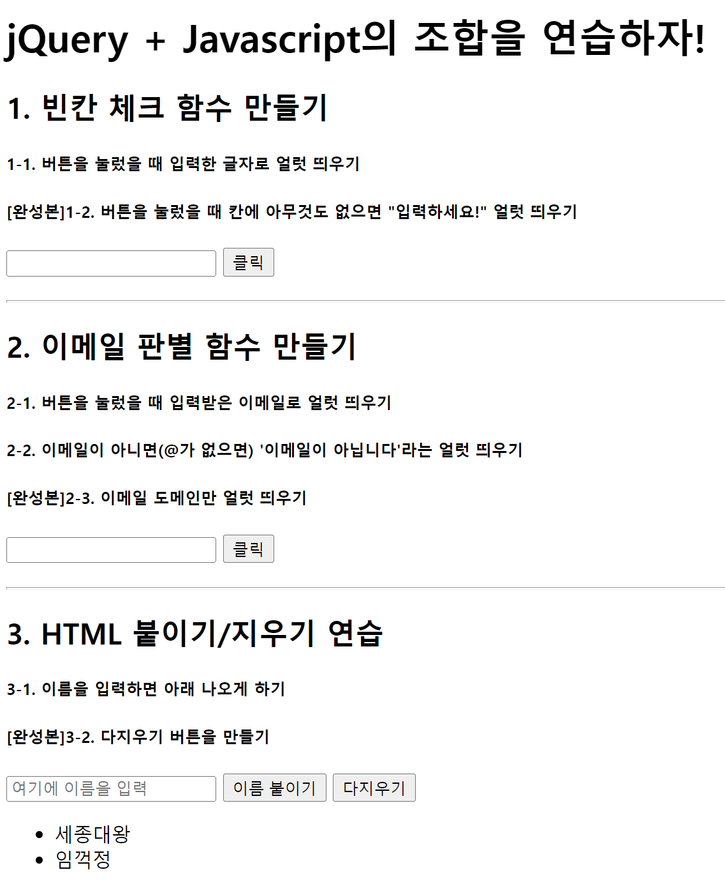

1-1. JQuery 퀴즈 문제

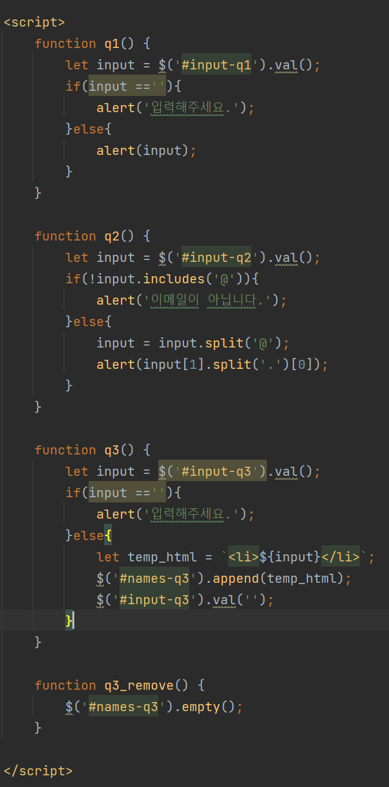

1-2. JQuery 퀴즈 문제풀이

---

****2**.  Ajax**

******1) **Ajax 정의********

> AJAX란 비동기 자바스크립트와 XML (Asynchronous JavaScript And XML)을 말합니다. 간단히 말하면, 서버와 통신하기 위해 XMLHttpRequest 객체를 사용하는 것을 말합니다. JSON, XML, HTML 그리고 일반 텍스트 형식 등을 포함한 다양한 포맷을 주고 받을 수 있습니다. AJAX의 강력한 특징은 페이지 전체를 리프레쉬 하지 않고서도 수행 되는 "비동기성"입니다. 이러한 비동기성을 통해 사용자의 Event가 있으면 전체 페이지가 아닌 일부분만을 업데이트 할 수 있게 해줍니다.  

******2) **Ajax 특징********

********- 페이지 새로그침 없이 서버에 요청********

********- 서버로부터 데이터를 받고 작업을 수행********

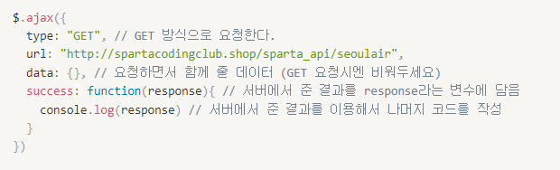

2-1. JQuery-Ajax 방식

******3) **Ajax 예제********

******************- Ajax를 통해서 글 또는 카드 등을 연속으로 출력할 때는 템플릿 리터럴을 활용한다. (활용1, 활용2)******************

******************(1단계) 요청받은 ******************JSON형태의****************** 데이터를 response에서 원하는 값을 추출한다.******************

******************(2단계) 원하는 부분의 html 코드를 템플릿 리터럴 변수에 넣는다.******************

******************(3단계) 템플릿 리터럴에 추출한 데이터를 담은 변수를 넣는다.******************

******************- Ajax를 통해서 이미지 또는 텍스트 바꾸는 방법******************

******************(이미지) $("#아이디값").attr("src", 이미지URL);******************

************************************(텍스트) $("#아이디값").text('수정할 텍스트');************************************

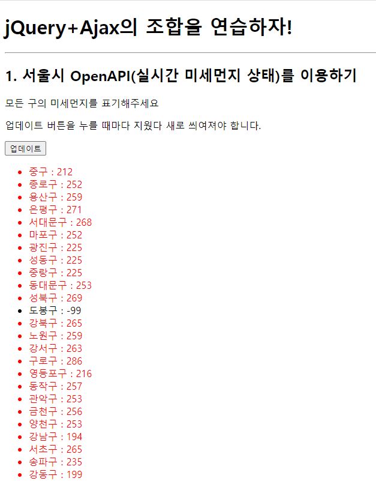

2-2.&nbsp;&nbsp;Ajax 활용(1) - 서울시 미세먼지 OpenAPI

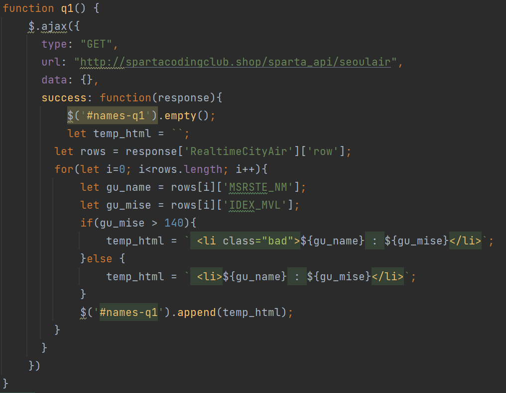

2-3. Ajax 활용(1) - 구현 코드

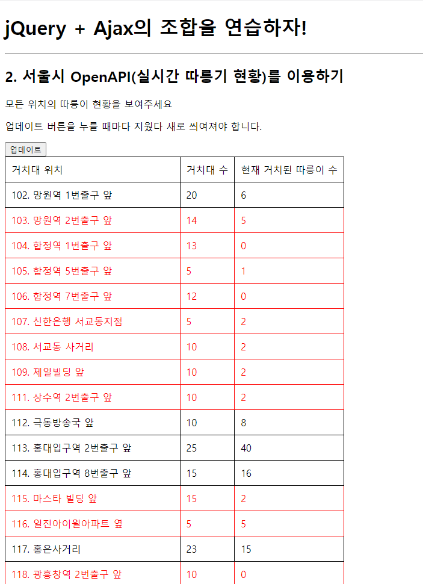

2-4. Ajax 활용(2) - 서울시 따릉이 OpenAPI

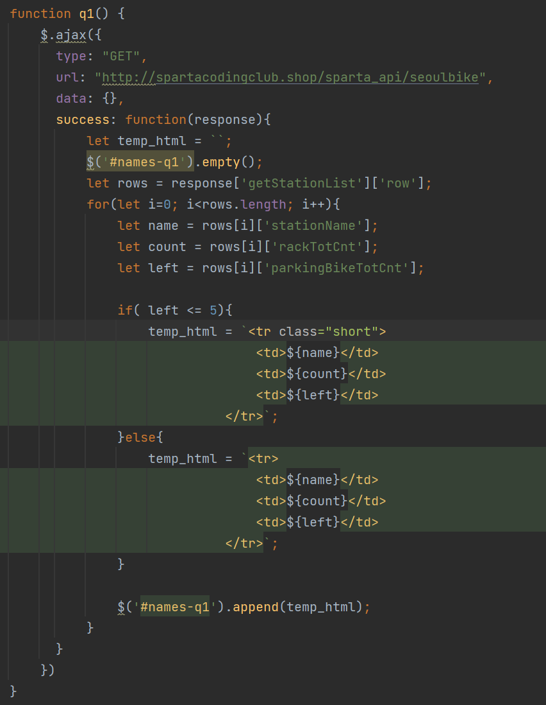

2-5. Ajax 활용(2) - 구현 코드

2-6. Ajax 활용(3) - 르탄이 API

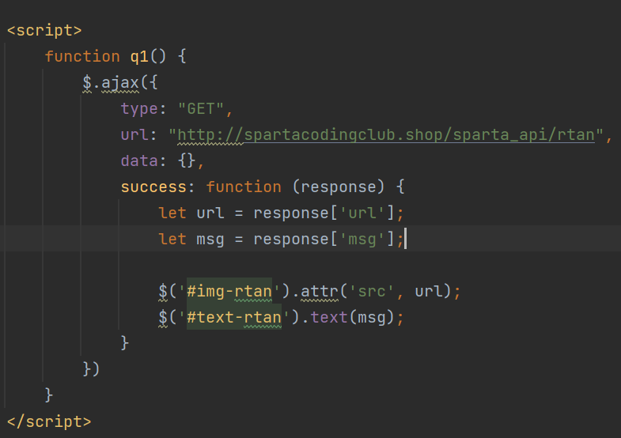

2-7. Ajax 활용(3) - 구현 코드

---

****3. homework****

******1) 날씨 API 활용******

******************- 로딩 후 호출하기 : $(document).ready(function(){ ~ });******************

******************- 과제에서 추가된 것  
             1. 온도를 나타내는 아이콘 추가  
             2. 현재 날씨가 출력되고 있는 도시 추가******************

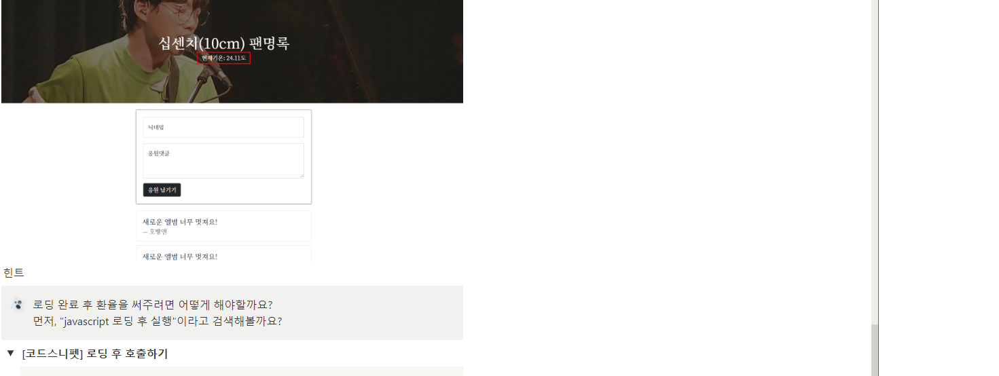

3-1. 과제 미리보기

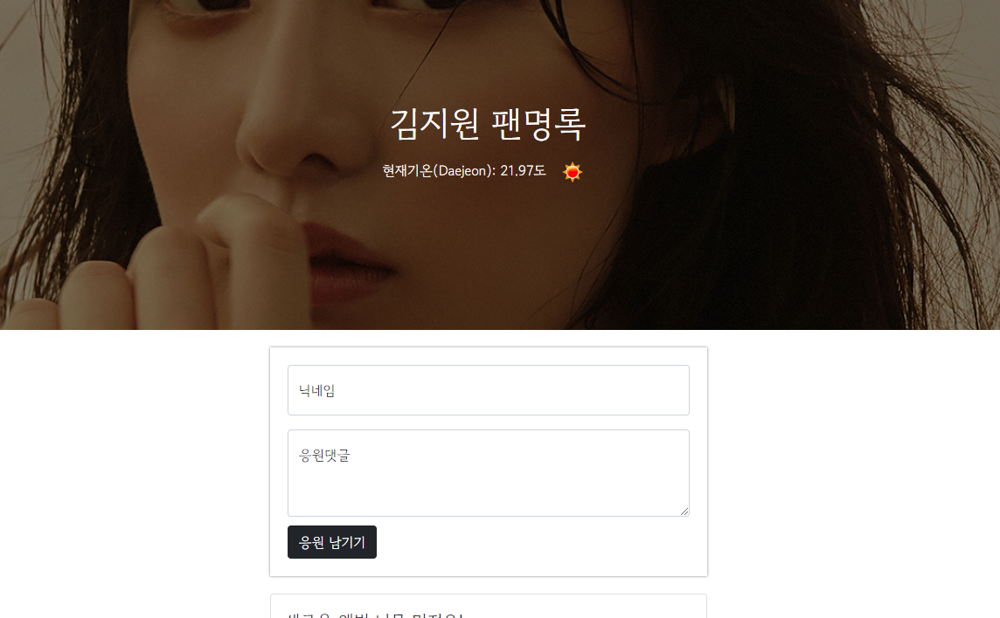

3-2. 과제 수행 결과

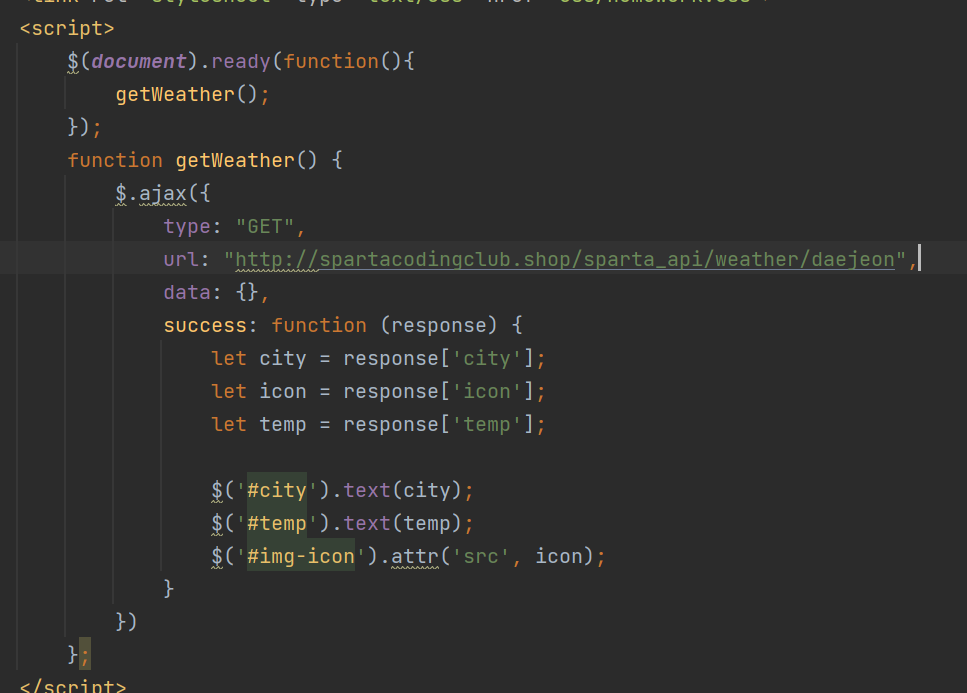

3-3. 과제 수행 결과

---

**정리**

**오늘은 요구된 것에서 기존의 배운 것을 활용해보자라는 생각으로**

**이번 주차를 듣게 되었다. 아직 몇가지 아쉬운게 조금 남아 있다.**

**예를 들면 현재 지역을 가져오거나 선택하여 날씨를 받는 코드로**

**변경된다면 더 재미있고 유용한 코드가 될 것이라 생각된다.**

**오늘 여기까지!**

