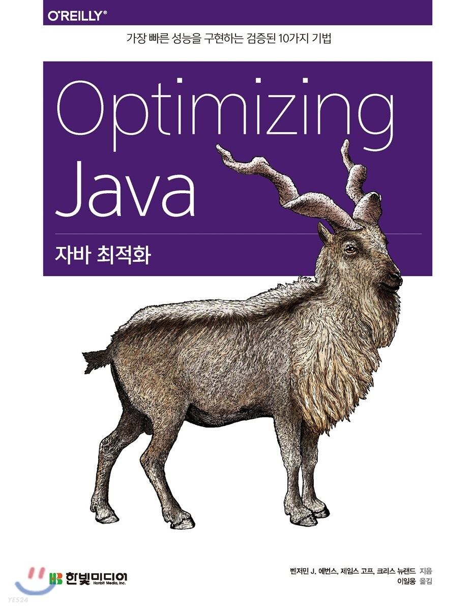
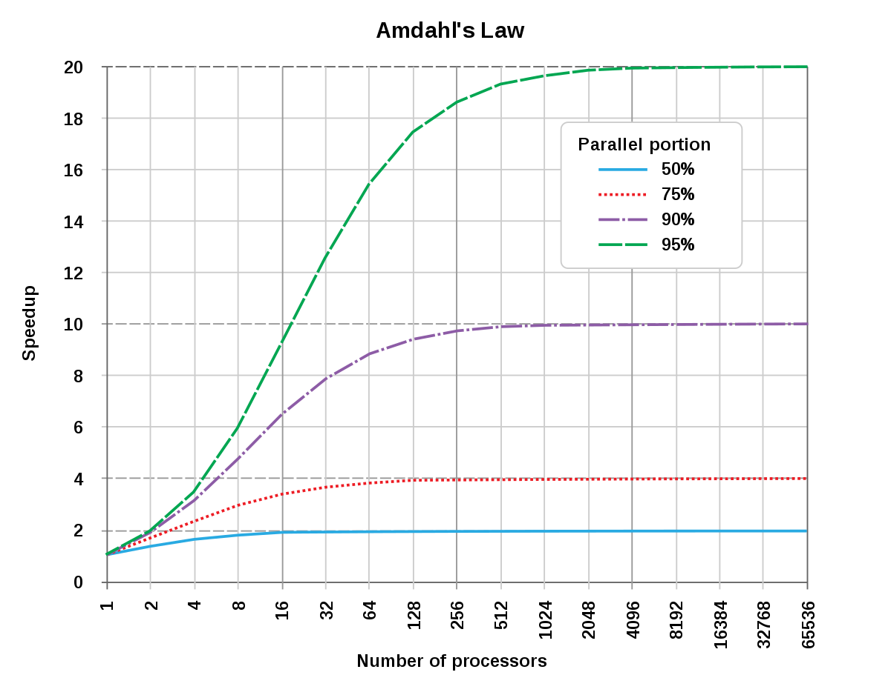
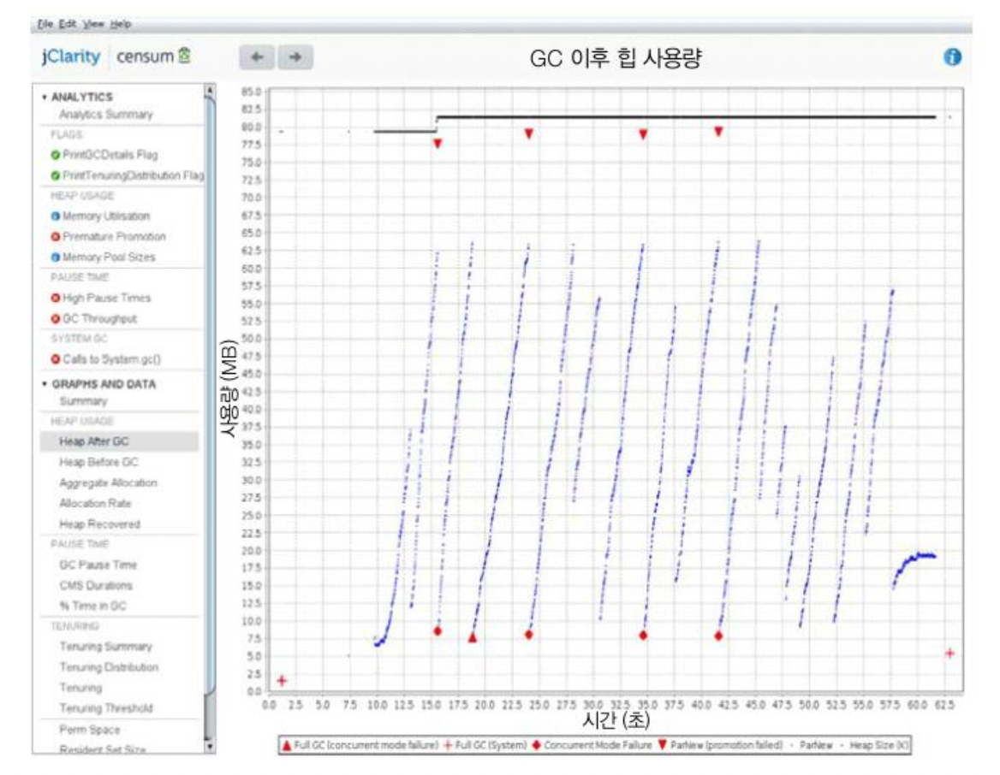
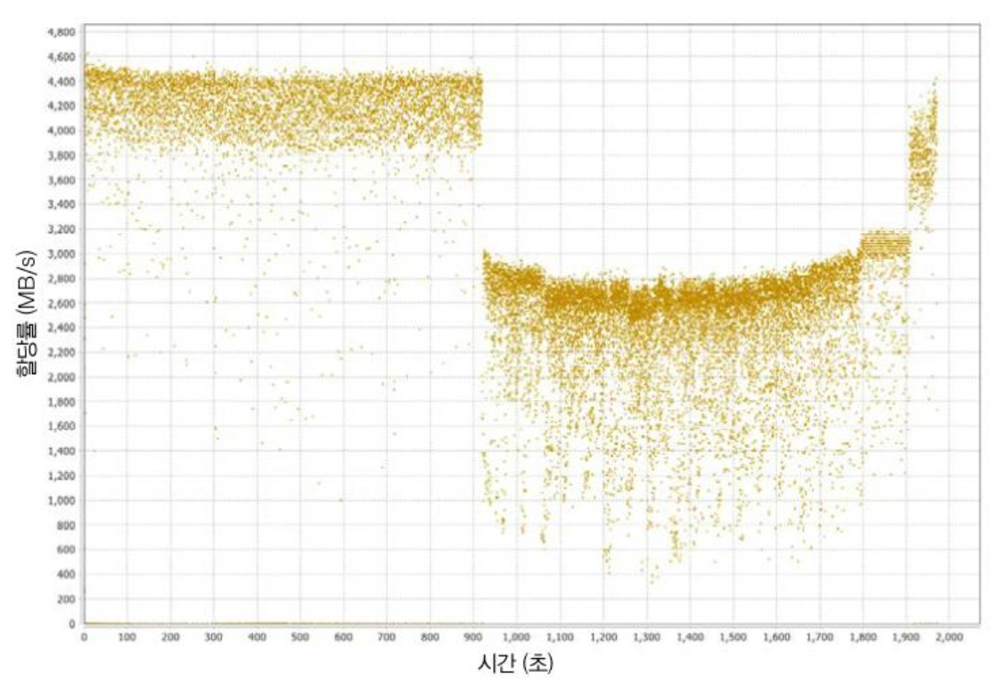
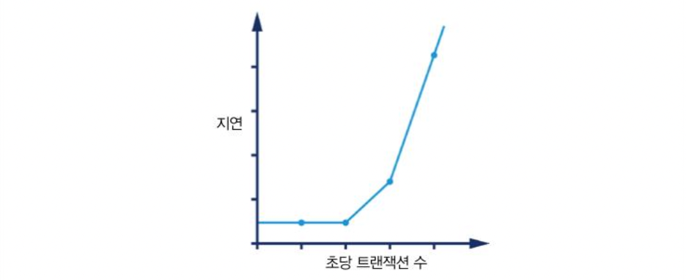

친구와 이전부터 이야기했었는데 이제는 둘 다 취업하여 스터디 모임을 시작하기로 했다.

둘 다 성능 최적화라는 것에 관심이 있어 이번에 `자바 최적화`라는 책을 같이 스터디하면서 공부해 보기로 결정하였다.

그러면서 `자바 최적화`라는 책을 읽은 것을 바탕으로 내용을 정리해보려고 한다.

## 들어가며

---

> 성능(Performance)이 무엇이라고 생각하십니까?

> [필자] 도구가 일을 처리하는 능력

개발자들에게 애플리케이션 성능에 대해 질문하면 제일 먼저 속도 측정을 떠올립니다.

초당 트랜잭션 처리 수나 기가바이트의 데이터를 처리했는지 등 '짧은 시간에 얼마나 많은 일을 했느냐?'를 나타내는 지표로 판단합니다. 하지만 애플리케이션 아키텍트(Application Architect, AA)라면 이보다 훨씬 넓은 지표를 측정해야 합니다.

순차적으로 실행되는 프로그램 흐름보다 리소스(자원) 사용률을 더 주의 깊게 봐야 할 때도 있고, 서비스 자체보다 여러 서비스 간의 연결 성능이 더 중요한 관심사인 경우도 있습니다.

사내 비즈니스 요건이 정해지면 애플리케이션 성능은 더 이상 초 단위가 아닌, 금액으로 환산해서 생각해야 합니다. 그 과정에서 데브옵스팀 운영 비용과 업무 소요 시간을 저울질하며 개발자, 아키텍트들과 언쟁을 벌이기도 합니다.

자바의 JIT와 GC 기술이 점점 발전하면서 애플리케이션 성능을 어떻게 개선해야 할지 방향을 정하기 어려워졌고, JVM이 코드를 최적화하고 객체를 거의 자유롭게 풀어주었음에도 애플리케이션 요건은 점점 늘었습니다.

```cpp
int pred(int x) {
  if(x == 0) return 0;
  else return x - 1;
}

// 인라이닝 전
int func(int y) {
  return pred(y) + pred(0) + pred(y+1);
}

// 인라이닝 후
int func(int y) {
    int tmp;
    if (y   == 0) tmp  = 0; else tmp  = y       - 1; /* (1) */
    if (0   == 0) tmp += 0; else tmp += 0       - 1; /* (2) */
    if (y+1 == 0) tmp += 0; else tmp += (y + 1) - 1; /* (3) */
    return tmp;
}
```

대부분은, 작은 메소드를 적절히 **인라이닝**하고 **인터페이스** 및 **타입 체크**는 저렴하게 처리하면서 JIT 컴파일러가 만든 네이티브 코드는 간결하고 효율적으로 유지하는, '좋은' 코딩 패턴을 따르는 게 맞습니다. 그러나 경우에 따라 사람이 직접 코드를 작성하고 컴파일러 및 CPU 한계를 감안해 추상화와 아키텍처를 재조정해야 할 때도 있습니다. 물론 객체는 정말 자유로운 데다 그들이 **메모리 대욕폭(bandwidth)**과 **GC 사이클**을 소비한다는 사실조차 무시해도 좋을 때도 있습니다. 하지만, 최상품 GC나 메모리 서비스시스템에도 부하를 일으키는 테라바이트급(또는 그 이상) 데이터 셋을 처리해야 할 경우도 생기기 마련입니다.

오늘날 성능 문제를 해결하려면 툴 사용법을 익혀야 합니다. 자바 언어의 작동 원리는 말할 것도 없고 애플리케이션이 상호작용하는 **JVM 라이브러리**, **메모리**, **컴파일러,** **GC**, **하드웨어** 지식까지 총동원해야 합니다.

## 1장. 성능과 최적화

---

자바 성능을 최적화하는 일은 마치 어둠의 마법처럼 느껴집니다. 흔히들 성능 분석이라고 하면 '홀로 고뇌하며 깊은 생각에 빠져 살아가는 고독한 해커(할리우드 영화에서 컴퓨터를 다루는 사람들을 보통 이렇게 묘사하죠)' 나 할 수 있는 고도의 숙련된 기술 처럼 바라봅니다. 시스템을 손금 보듯 깊숙이 들여다보며 더 빨리 작동시킬 마법 같은 솔루션을 번뜩이며 찾아내는 과정처럼요.

안타깝게도 이런 이미지는 성능이 소프트웨어 팀의 부차적인 관심사인(그런 일이 너무 흔하죠) 상황과 맞물려 있습니다. 그래서 시스템이 결단나는 지경에 이르러서야 부랴부랴 분석 작업을 해보고 성능 '해결사'에게 구원의 손길을 뻗는 시나리오를 당연하게 생각하는데요. 이는 현실과 다릅니다.

실제로 **성능 분석**은 **경험주의**(empiricism)와 질퍽한 **인간 심리학**(human psychology)이 교묘히 어우러진 분야입니다. 그리고 정작 중요한 건, **관측 지표(observable metrics)**의 **절대 수치**, 그리고 **엔드 유저**(최종 사용자, 실제로 시스템을 사용하는 사람)와 기타 이해관계자들이 그 수치를 어떻게 받아들이는가 하는 점입니다. 이 책의 주제는 이 뻔한 패러독스(역설)를 해결하는 것입니다.

### 자바 성능: 잘못된 방법

---

한동안 구글에서 '**Java Performance Tuning**(자바 성능 튜닝)'이라고 검색하면 1997-1998년에 작성된 글 3개가 상위권을 차지했습니다. 구글 서비스가 처음 시작된, 오래전에 인덱싱된 글입니다. 초기 검색 랭킹(순위) 별로 트래픽이 많이 유입됐고 그만큼 피드백도 활발했기 때문에 계속 상위권을 지킬 수 있었을 것입니다.

그런데 이들 페이지는 지금은 더 이상 안 맞는, 완전 구닥다리 조언들과 심지어는 애플리케이션에 악영향을 끼칠 만한 내용으로 가득 차 있었습니다. 하지만 검색 엔진 결과 상위권을 점유한 탓에 많은 개발자가 끔찍한 조언에 고스란히 노출될 수밖에 없었습니다.

예를 들면, 자바 초창기에 **메서드** **디스패치 성능**은 정말 최악이었습니다. 그래서 메서드를 잘게 나누지 말고 하나의 덩치 큰 메서드로 작성하는 게 좋다고 권고하는 개발자가 있었습니다. 물론 시간이 지나면서 가상 디스패치 성능은 좋아졌고, 특히 최신 **자바 가상 머신(Java Virtual Matche, JVM)**에서는 **자동 인라이닝(Automatic managed inlining)** 덕분에 가상 디스패치 조차 대부분의 호출부(call site)에서 사라지게 되었습니다. '모든 코드를 한 메서드에 욱여넣어라'는 말대로 짠 코드는 바야흐로 현대 JIT(적시) 컴파일러와는 어울리지 않는 퇴물이 되었습니다.


> 자바에서 [디스패치(dispatch)](tistory-413.html)란 메소드 호출을 처리하는 방법을 의미합니다.  
> 특히 다형성을 기반으로 메소드를 동적으로 선택하는 과정을 말합니다.

그릇된 조언이 애플리케이션 성능을 얼마나 나쁜 길로 빠져들게 했을지 가늠할 수 없지만, 정량적, 검증 가능한 방식으로 성능을 다루지 않으면 얼마나 안 좋은 영향을 끼칠 수 있는지 사람들이 깨달을 수 있는 계기가 되었습니다. 인터넷에서 찾은 글을 무턱대고 믿어선 안 된다는 교훈을 주었습니다.

> **NOTE\_** 자바 코드가 실행되는 속도는 매우 변화무쌍하며 전적으로 코드를 실행하는 하부(겉으로 드러나지 않는 내부 구현에 관한) JVM에 따라 다릅니다. 따라서 오래전 작성한 자바 코드도 재컴파일 없이 최신 JVM에서 실행하면 더 빨리 작동될 수 있습니다.

이 책은 이런 이유로 코드에 바로 써먹을 수 있는 성능 팁을 나열할 목적으로 쓰지 않았습니다. 대신, 우수한 성능 목표를 달성하기 위해 필요한 여러 가지 단면을 종합적으로 집중 조명하고 있습니다.

* **전체 소프트웨어 수명주기의 성능 방법론**
* **성능과 연관된 테스트 이론**
* **측정, 통계, 툴링(tooling, 도구 선정)**
* **(시스템 + 데이터) 분석 스킬**
* **하부 기술과 메커니즘(mechanism, 장치 또는 수단)**

최적화하는 **휴리스틱(heuristics)**과 각종 코드 수준의 테크닉은 끝부분에서 소개합니다. 모든 최적화 기법에는 개발자가 사용하기 전에 알아두어야 할 함정과 트레이드오프(상충 관계)가 도사리고 있으니 조심해야 합니다.

> **TIP\_** 어떤 맥락에서 쓰인 조언인지 제대로 알지 못한 채 섣불리 뒷장부터 펼쳐보며 세부 기법을 적용하지 마세요. 적용 원리를 잘 모르고는 어떤 기법도 득 보다 실이 더 많을 것입니다.

일반적인 원칙은 이렇습니다.

* JVM을 더 빨리 작동시키는 `**마법의 스위치**` 같은 건 없습니다.
* 자바를 더 빨리 실행하게 만드는 `**팁, 트릭**`은 없습니다.
* 여러분이 못 보게 꼭꼭 숨겨둔 `**비밀 알고리즘**` 같은 것도 없습니다.

앞으로 자바 성능 분석 및 그와 연관된 이슈를 다루면서 개발자들이 저지르기 쉬운 실수와 갖가지 오해를 점점 구체적으로 살펴보겠습니다.

### 자바 성능 개요

---

자바 성능의 본질을 이해하려면 자바 창시자인 제임스 고슬링의 한마디를 거슬러 인용하지 않을 수 없습니다.

> 자바는 블루 칼라(주로 생산직에 종사하는 육체 노동자) 언어입니다.   
> 박사 학위 논문 주제가 아니라 일을 하려고 만든 언어입니다.

자바는 처음부터 지극히 실용적인 언어였습니다. 개발 환경이 '충분히 빠르다면' 개발자 생산성이 높아지는 대가로 어느 정도의 성능 희생은 감수할 만하다는 입장이었죠. 그러나 자바 환경이 고성능 컴퓨터 애플리케이션에 적합한 수준에 이른 건 비교적 최근에 핫스팟 같은 정교한 [JVM](tistory-415.html)이 성숙했기 때문입니다.

실용성을 추구하는 자바 플랫폼의 성격은 여러 방면에서 드러나는데요. 그중 관리되는 **서브시스템(managed subsystem)**이 가장 대표적입니다. 개발자가 일일이 용량을 세세하게 관리하는 부담을 덜어주고, 대신 저수준으로 제어 가능한 일부 기능을 포기하자는 발상입니다.

단적으로, 메모리 관리가 그렇습니다. JVM이 탈착형 가비지 수집 서브시스템 형태로 메모리를 자동 관리하는 덕분에 프로그래머는 수동으로 메모리를 의식하며 개발할 필요가 없습니다.

> **NOTE\_** JVM 전반에 걸쳐 등장하는 관리되는 서브시스템은 그 존재 자체로 JVM 애플리케이션의 런타임 동작에 복잡도(complexity)를 유발합니다.

다음 장에서 다루겠지만, 런타임 동작이 복잡한 JVM 애플리케이션은 실험 대상처럼 다룰 수밖에 없고, 이런저런 측정을 통해 통계치를 내어 보면 불편한 진실을 마주하게 됩니다.

JVM 애플리케이션의 성능 측정값은 정규 분포를 따르지 않는 경우가 많아서 기초 통계 기법(예. 표준편차, 분산)만 갖고는 측정 결과를 제대로 처리하기에 역부족입니다. 기초 통계 기법은 대부분 암묵적으로 정규 분포를 전제로 하니까요.

쉬운 예로, **JVM 애플리케이션(예: 저지연 거래 애플리케이션, low-latency trading application)에서 특이점(아웃라이어)은 매우 중요한 의미를 내포할 수 있습니다. 즉, 측정값을 샘플링(sampling, 표본추출)하면 특이점을 일으킨 가장 중요한 이벤트가 묻혀버릴 가능성이 큽니다.**

끝으로, 자바 성능 측정값 때문에 판단이 흐려지기 쉬우므로 조심해야 합니다. 환경이 복잡해질수록 시스템을 개별적으로 따로 떼어내 생각하기는 몹시 어렵습니다.

측정하는 행위 자체도 오버헤드(과부하)를 일으키며, 너무 자주 샘플링하거나 매번 결과를 기록하는 것 역시 성능 결과 수치에 적잖은 영향을 끼칩니다. 자바 성능 수치는 일정 부분 세심한 손질이 필요합니다. 자바/JVM 애플리케이션을 우직한 기법으로 접근하면 부정확한 결과가 나올 공산이 큽니다.

### 성능은 실험과학이다.

---

대부분의 최신 소프트웨어 시스템이 그렇듯, 자바/JVM 소프트웨어 스택 역시 아주 복잡합니다. 자신이 처한 환경에 적응하며 고도로 최적화하는 JVM을 기반으로 구축된 운영 시스템의 성능 양상은 상당히 미묘하고 복잡하게 나타탈 수 있습니다. 이렇게 복잡한 지경까지 이른 건 **무어의 법칙(Moore's Law)**과 그로 인한 하드웨어 용량의 전무후무한 발전 때문일 것입니다.

> 소프트웨어 산업의 가장 경이적인 성과는   
> 하드웨어 산업에서 꾸준히 이루어낸 혁신을  
> 끊임없이 무용지물로 만들고 있는 것이다.   
>   
> - 헨리 페트로스키 -

오랜 시간에 걸쳐 이룩한 업계의 성과를 수포로 만든 소프트웨어 시스템도 있지만, JVM은 실로 엔지니어링의 개가라고 하지 않을 수 없습니다. 1990년대 후반 이후로 JVM은 아주 다재다능한 초고성능, 범용 실행 환경으로 거듭났지만, 원래 세상은 공평한 법! JVM도 다른 복잡한 고성능 시스템처럼 최상의 성능을 발휘하려면 어느 수준 이상의 스킬과 경험이 필요합니다.

> 명확하게 정의하지 않고 측정하는 것은 백해무익하다.  
>   
> - 엘리 골드렛 -

JVM 성능 튜닝은 기술, 방법론, 정량적 측정값, 툴을 망라한 개념입니다. 그 목표는 시스템 소유자/유저가 추구하는 측정 결과를 얻는 것입니다. 즉, 성능은 다음과 같은 활동을 하면서 원하는 결과를 얻기 위한, 일종의 실험과학이라고 볼 수 있습니다.

1. 원하는 결과를 정의한다.
2. 기존 시스템을 측정한다.
3. 요건을 충족시키려면 무슨 일을 해야 할지 정한다.
4. 개선 활동을 추진한다.
5. 다시 테스트한다.
6. 목표가 달성됐는지 판단한다.

바람직한 성능 결과를 정의하고 판단하는 과정에서 정량적인 일련의 목표가 수립됩니다. 무엇을 측정할지 대상을 확정하고 목표를 기록하는 행위가 중요한데, 결국 이런 활동들이 프로젝트 아티팩트(artifact, 결과물)와 제품 일부를 형성합니다. 성능 분석은 비기능 요건을 정의하고 달성하는 활동입니다.

즉, 성능 분석은 닭을 해부해 보거나 점을 치는 과정이 아니라, 통계치에 근거해 적절히 결과를 처리하는 활동입니다. JVM 성능 분석 프로젝트에서 생성된 데이터를 정확하게 처리하기 위해 필요한 기본 통계 기법은 5장에서 소개합니다.

실무 프로젝트에서는 훨씬 더 정교한 데이터와 통계 지식이 요구됩니다. 모든 통계 기법을 이 책에서 전부 다룰 수는 없지만, 이 책을 출발점 삼아 공부하면 큰 도움이 될 것입니다.

### 성능 분류

---

이 절에서는 기본적인 성능 지표를 소개합니다. 성능 지표는 성능 분석의 어휘집이자, 튜닝 프로젝트의 목표를 정량적인 단위로 표현한 기준입니다. 성능 목표를 정의한 비기능 요건이죠. 다음은 가장 일반적인 기본 성능 지표입니다.

* 처리율
* 지연
* 용량
* 사용률
* 확장성
* 저하

지금부터 하나씩 간략히 살펴보겠습니다. 대다수 성능 프로젝트에서 이 모든 지표가 동시에 최적화되는 경우는 거의 없습니다. **성능 이터레이션(반복)을 수행할 때마다 많아야 두세 개 지표가 개선되는 정도이고 실제로는 어느 한 지표를 최적화하면 다른 지표(들)가 악화되는 경우도 흔합니다.**

#### 처리율

**처리율**(throughput)은 (서브) 시스템이 수행 가능한 작업 비율을 나타낸 지표입니다. 보통 일정 시간 동안 완료한 작업 단위 수로 표시합니다. (예. 초당 처리 가능한 트랜잭션 수)

처리율이 실제 성능을 반영하는 의미 있는 지표가 되려면 수치를 얻은 기준플랫폼에 대해서도 내용을 기술해야 합니다(예. 하드웨어 스펙, OS, 소프트웨어 스택, 그리고 테스트한 시스템이 단일 서버인지, 클러스터(cluster) 환경인지 등). 그리고 트랜잭션(또는 작업 단위)은 테스트할 때마다 동일해야 합니다. 처리율을 테스트할 때 실행 간 **워크로드(workload)** 역시 일정하게 유지해야 합니다.

#### 지연

성능 지표는 수도 배관에 빗대어 설명할 때가 많습니다. 1초에 100리터를 흘려보내는 수도관의 처리율은 바로 1초에 처리되는 부피(100 리터)입니다. 이때 지연(latency)은 수도관 자체의 길이에 해당합니다. 즉, 하나의 트랜잭션을 처리하고 그 결과를 반대편 수도관 끝에서 바라볼 때까지 소요된 시간입니다.

지연을 종단 시간이라고도 하며, 대개 그래프에서 워크로드에 비례하는 함수로 표시합니다. 1.5절에서도 이런 유형의 그래프가 나옵니다.

#### 용량

**용량**(capacity)은 시스템이 보유한 작업 병렬성의 초량, 즉 시스템이 동시 처리 가능한 단위(즉, 트랜잭션) 개수를 말합니다.

용량은 처리율과 밀접한 연관이 잇습니다. 시스템에 동시 부하가 증가할수록 처리율(그리고 지연)도 당연히 영향을 받습니다. 이런 이유로 보통 용량은 어떤 처리율 또는 지연 값을 전제로 가능한 처리량으로 표시합니다.

#### 사용률

성능 분석 업무 중 가장 흔한 태스크는 시스템 리소스를 효율적으로 활용하는 것입니다. 가령, CPU라는 리소스는 놀리는(또는 OS에 시간을 빼앗기거나 다른 관리 태스크를 수행하는) 것보다 실제 작업 단위를 처리하는데 쓰여야 온당합니다.

**사용률**(utilization)은 워크로드에 따라서 리소스별로 들쑥날쑥할 수 있습니다. 이를테면, 계산 집약적 워크로드(예. 그래픽 처리, 암호화)를 주면 CPU 사용률은 100%에 육박하지만, 메모리 사용률은 얼마 안 나옵니다.

#### 효율

전체 시스템의 **효율**(effiency)은 처리율을 리소스 사용률로 나눈 값으로 측정합니다. 같은 처리율을 더 많은 리소스를 쏟아부어야 달성할 수 있다면 분명 효율이 낮은 것입니다.

대형 시스템에서는 원가 회계 형태로 효율을 측정하는 방법도 있습니다. 처리율이 동일하다는 조건하에 A 솔루션의 **총 소유비용(total** cost of ownership, TCO)이 B 솔루션의 2배라면 말할 것도 없이 효율은 절반밖에 안 되는 셈입니다.

#### 확장성

처리율이나 시스템 용량은, 처리하는 데 끌어 쓸 수 있는 리소스에 달려 있습니다 리소스 추가에 따른 처리율 변화는 시스템/애플리케이션의 확장성(scalability)을 가능하는 척도입니다. 시스템 확장성은 궁극적으로 정확히 리소스를 투입한 만큼 처리율이 변경되는 형태를 지향합니다.

서버클러스터기반으로 구축된 시스템이 있다고 합시다. 클러스터를 2배 확장하면 처리율은 얼마나 올라갈까요? 클러스터 2배로 늘려 트랜잭션 처리량도 2배 늘었다면 이 시스템은 '**완벽한 선형 확장**'을 달성한 것입니다 그러나 현실적으로 (특히, 오만 가지 부하가 다 걸리는 상황에서) 선형 확장을 달성하기란 매우 어렵습니다.

보통 시스템 확장성은 하나의 단순한 상수 인자가 아니라, 여러 가지 인자들의 영향을 받습니다. 리소스를 어느 정도까지 늘리면 거의 선형적으로 확장되지만, 대부분 부하가 높아지면 완벽한 확장을 저해하는 한계점에 봉착하게 됩니다.

#### 저하

요청(또는 클라이언트) 개수가 증가하건, 요청 접수 속도가 증가하건, 어떤 형태로든 시스템이 더 많은 부하를 받으면 지연 그리고/또는 처리율 측정값에 변화가 생깁니다.

그 변화는 사용륭에 따라 다릅니다. 시스템을 덜 사용하고 있으면 측정값이 느슨하게 변하지만, 시스템이 풀 가동된 상태면 처리율이 더는 늘어나지 않는, 즉 지연이 증가하는 양상을 띱니다. 이런 현상을 부하 증가에 따른 **저하(degradation)라고** 합니다.

#### 측정값 사이의 연관 관계

다양한 성능 측정값은 어떤 식으로든 서로 연결돼 있습니다. 또 구체적인 상호 관계는 시스템이 풀가동 중인지 여부에 따라 달라집니다. 예를 들어, 일반적으로 시스템 부하가 증가하면 사용률도 달라지지만, 시스템을 많이 사용하지 않는 시간에는 부하가 늘어도 사용률은 별로 눈에 띄게 증가하지 않을 수도 있습니다. 반대로, 이미 시스템에 상당한 부하가 걸려 있는 상태면 부하가 조금만 늘어도 다른 측정값이 크게 요동칠 수 있습니다.

다른 예를 들면, 확장성과 저하는 부하가 증가함에 따라 시스템 양상이 어떻게 바뀌는지 반영하는 지표입니다. 확장성을 감안하면 부하가 늘 때 가용 리소스도 함께 늘려야 하는데, 시스템이 이렇게 확장한 리소스를 제대로 활용할 수 있을지가 관건입니다. 한편, 부하가 늘었는데 리소스는 그대로라면 마땅히 저하되는 성능 측정값(즉, 지연)이 있을 것입니다.

> **NOTE\_** 드물지만 부하 증가로 반직관적인 결과를 얻는 경우도 있습니다. 가령, 부하 변화로 인해 시스템 일부가 리소스를 집중적으로 소모하는 고성능 모드로 전환되면, 더 많은 요청이 시스템에 유입돼도 오히려 지연이 감소하는 모습을 보입니다.

9장에서 다룰 핫스팟 JIT 컴파일러도 좋은 예입니다. JIT 컴파일 대상이 되는 메서드는 `**충분히 빈번하게**` 인터프리티드 모드(interpreted mode, 해석 모드)로 실행돼야 합니다. 따라서 부하가 적을 경우 핵심 메서드가 인터프리티드 모드의 늪에서 허우적거릴 가능성도 있지만, 부하가 많아 메서드 호출 빈도가 증가하면 JIT 컴파일 대상이 될 수도 있습니다. 결국 같은 메서드지만 나중에 호출하는 게 처음보다 훨씬 더 빨리 실행됩니다.

워크로드 종류에 따라서도 천차만별입니다. 예컨대, 금융 시장의 거래는 종단 지점에서 느끼기에 실행 시간(즉, 지연)이 몇 시간 또는 며칠씩 걸릴 수 있습니다. 하지만, 그중 상당수 거래는 주어진 시점에 주요 은행에서 진행 중일 것입니다. 따라서 이런 시스템은 용량이 매우 크지만 지연 역시 매우 큽니다. 그러나 은행 내부의 어느 한 서브 시스템만 생각합시다. (어떤 가격에 합의한) 구매자와 판매자를 이어주는 해우 이를 주문 체결(order matching)이라고 합니다. 이 개별 서브시스템은 주어진 시점에 처리 대기 중인 주문이 몇백 건에 불과하겠지만, 주문 접수부터 체결까지 소요된 지연은 기껏해야 1밀리 초(`저지연` 거래 시 이 시간이 더 짧음)밖에 안 될 것입니다.

지금까지 여러분이 가장 자주 실무에서 맞닥뜨릴 성능 측정값을 살펴보았습니다. 때때로 조금씩 다르게 정의하거나 아예 다른 지표를 사용하는 경우도 있지만, 이들 지표는 대부분 시스템 성능 튜닝을 가이드하는 용도로 쓰이고 관심이 있는 시스템 성능을 논할 때 체계적인 분류 기준으로 활용됩니다.

### 성능 그래프 읽기

성능 테스트에서 자주 등장하는 패턴을 소개하는 것으로 이 장을 마무리하겠습니다. 먼저 실제 측정값을 바탕으로 작성된 그래프와 함께 몇 가지 다른 그래프 사례를 차례로 살펴봅시다.

[그림 1-1]은 부하가 증가하면서 예기치 않게 저하(여기서는 지연)가 발생한 그래프입니다. 이런 형태를 보통 성능 엘보(performance elbow)라고 합니다.


그림1-1. 성능 엘보

이와 반대로, [그림 1-2]는 클러스터에 장비를 추가함에 따라 거의 선형적으로 처리율이 확장되는, 운이 아주 좋은 케이스입니다. 이렇게 이상적인 모습에 가까운 결과는 환경이 극단적으로 순조로울 때(예. 서버 하나에 **세션 어피니티**(session affinity, 세션 고정)가 필요 없는, **무상태 프로토콜**을 확장하는 경우)나 가능합니다.


그림 1-2. 준-선형적(near-linear) 확장

12 장에서는 IBM의 전설적인 컴퓨터 과학자, 진 암달(Gene Amdahl)이 발표한 **암달의 벌칙(Amdahl's Law)**이 나옵니다. 암달에 따르면 근본적으로 확장성에는 제약이 따릅니다. [그림 1-3]은 태스크를 처리할 때 프로세서 개수를 늘려도 실행 속도를 최대 어느 정도까지 높일 수 있는지를 나타낸 그래프입니다.



그림 1-3. 암달의 법칙

하부 태스크를 75%, 90%, 95% 세 가지 다른 비율로 병렬화했는데요, 그래프를 잘 보면 워크로드에 반드시 순차 실행되어야 할 작업 조각이 하나라도 있으면 선형 확장은 처음부터 불가능하며 확장 가능한 한계점도 뚜렷하다는 사실을 알 수 있습니다. [그림 1-2]에서 언급한 내용과 일맥상통 합니다. 최선의 경우라도 사실상 선형 확장은 불가능한 미션입니다.

암달의 법칙에 따르면 의외로 제한이 많습니다. 이 그래프 x 축은 대수 눈금인데요, 순차 비율이 (겨우) 5%인 알고리즘도 12배 시간을 단축하려면 프로세서가 32개나 필요합니다. 설령, 코어를 아주 많이 늘린다 해도 20배 이상 시간 단축은 어렵죠. 실제로는 순차 비율이 5%보다 훨씬 높은 알고리즘이 태반인지라 최대 속도 향상은 더욱 제약을 받습니다.

6장에서 다시 보겠지만, JVM 가비지 수집 서브시스템의 메모리 사용 패턴은 그 하부 기술 때문에 부하가 별로 없는 건강한 애플리케이션도 [그림 1-4]처럼 `톱니` 모양을 나타냅니다.



그림 1-4. 건강한 메모리 사용 현황

[그림 1-5]는 피보나치수열(Fibonnaci numbers)을 계산하는 애플리케이션을 실행하여 얻은 그래프로, 애플리케이션에서 메모리 할당(memery allocation rate)을 성능 튜닝할 때 아주 중요한 메모리 그래프입니다. 90초 부근에서 갑자기 할당률이 급격히 떨어지고 있습니다.

동일한 툴(jClarity Censum)로 측정한 다른 그래프를 보면, 바로 이 지점에서 애플리케이션에 심각한 가비지 수집 문제가 발생했고 가비지 수집 스레드들이 서로 CPU 경합을 벌인 탓에 메모리를 충분히 할당받지 못했다는 사실을 알 수 있습니다.

또 할당 서브시스템도 4GB/s라는 미친 속도로 메모리를 할당하고 있습니다. 최신 시스템 대부분(서브급 하드웨어까지 포함)의 권장 최대 용량을 훨씬 웃도는 수준이지요. 메모리 할당은 6장에서 가비지 수집을 논하면서 자세히 다룰 예정입니다.



그림 1.5. 문제가 있는 할당률 분포

[그림 1-6]은 시스템 리소스가 누수될 때 흔히 나타나는 징후입니다. 부하가 증가하면서 지표(여기서는 지연)가 차츰 악화되다가 결국 시스템 성능이 급락하는 **변곡점**(inflection point)에 이르게 됩니다.



그림 1.6 부하가 높을 때 상당한 지연 발생

### 마치며

---

자바 성능이란 무엇인지 알아보면 첫 장을 시작했습니다. 경험적 과학, 측정에 관한 기본적인 토픽들을 살펴봤고 성능 활동을 멋지게 수행하는데 꼭 필요한 기본 영어들과 측정값을 설명했습니다. 끝으로, 성능 테스트를 하면 흔히 볼 수 있는 몇 가지 사례를 살펴보았습니다. 다음 장부터는 JVM의 주요 파트를 하나씩 살펴보며 JVM 기반의 성능 최적화가 왜 그렇게 복잡한지 알아보겠습니다.

### 용어 정리

---

* **툴링(tooling)** : 역자주\_ 사용 목적과 의도에 맞게 소프트웨어 소프트웨어 툴을 선정하고 조합하는 등의 활동
* **휴리스틱(heuristics)**: 불충분한 시간이나 정보로 인하여 합리적인 판단을 할 수 없거나, 체계적이면서 합리적인 판단이 굳이 필요하지 않은 상황에서 사람들이 빠르게 사용할 수 있는 어림짐작의 방법(출처 위키백과)
* **트레이드오프(상충관계)**: 소프트웨어의 어느 한 부분의 품질을 높이거나 낮추면 다른 부분의 품질을 높이거나 낮추는 데 영향받는 것. 대게 어느 하나를 개선하면 다른 부분이 약화되는 식입니다.
* **이터레이션**: 짧은 주기로 여러 차례 반복하여 성능을 조금씩 개선하는 활동
* **워크로드**: 시스템이 주어진 시간 내에 처리해야 할 작업 할당량
* **총 소유비용**: 한 회사가 어떤 기술을 보유하기 위해 들여야 할 직/간접 비용. 하드웨어/소프트웨어 획득, 설치, 교육, 지원, 유지 보수, 기타 공간/에너지 등등 여러 가지 비용이 듭니다.
* **성능 엘보**: 그래프가 팔꿈치(elbow)를 굽힌 것처럼 갑자기 꺾여 올라가는 모양을 빗댄 것.
* **세션 어피니티**: 로드 밸런서(load balancer)가 사용자 세션을 특정 서버(인스턴스)에 고정되도록 바인딩하는 기술
* **무상태 프로토콜**: 컴퓨터에서 무상태 프로토콜(stateless protocol)은 어떠한 이전 요청과도 무관한 각각의 요청을 독립적인 트랜잭션으로 취급하는 통신 프로토콜로 통신이 독립적인 쌍의 요청과 응답을 이룰 수 있게 하는 방식. 무상태 프로토콜은 서버가 복수의 요청 시간대에 각각의 통신 파트너에 대한 세션 정보나 상태 보관을 요구하지 않습니다. 반면, 서버의 내부 상태 유지를 요구하는 프로토콜(IP)과 월드 와이드 웹의 데이터 통신의 토대가 되는 HTTP가 있습니다. (출처. 위키백과)
* **피보나치 수열:** 0과 1로 시작해서 그다음 수는 바로 앞의 두 수의 합이 되는 수열(0, 1, 1, 2, 3, 5, 8, 13, 21, 34, 55, 89, 144,...)

### 참고

---

* [RedHat] [애플리케이션 아키텍처란 무엇인가?](https://www.redhat.com/ko/topics/cloud-native-apps/what-is-an-application-architecture)
* JVM
  + [위키백과] [JVM](https://ko.wikipedia.org/wiki/%EC%9E%90%EB%B0%94_%EA%B0%80%EC%83%81_%EB%A8%B8%EC%8B%A0)
  + [개인 블로그] [JVM 구조](https://catch-me-java.tistory.com/m/12)
* [Laytoun's blog] [JIT](https://aboullaite.me/understanding-jit-compiler-just-in-time-compiler/)
* [개인 블로그g] [JVM과 JIT 컴파일](https://catch-me-java.tistory.com/m/11)
* [개인 블로그] [소프트웨어 생명주기](https://davinci-ai.tistory.com/21)
* [개인 블로그] [소프트웨어 생명주기](https://onecoin-life.com/7)
* [개인 블로그] [Hospot JVM](https://velog.io/@aki/HotSpot-JVM)
* [위키백과] [무어의 법칙](https://ko.m.wikipedia.org/wiki/%EB%AC%B4%EC%96%B4%EC%9D%98_%EB%B2%95%EC%B9%99)
* [위키백과] [암달의 법칙](https://ko.wikipedia.org/wiki/%EC%95%94%EB%8B%AC%EC%9D%98_%EB%B2%95%EC%B9%99)
