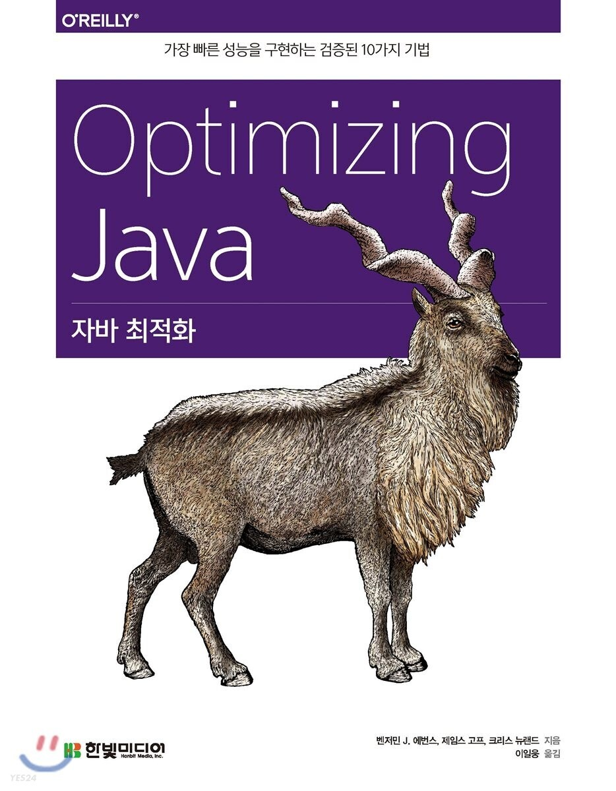
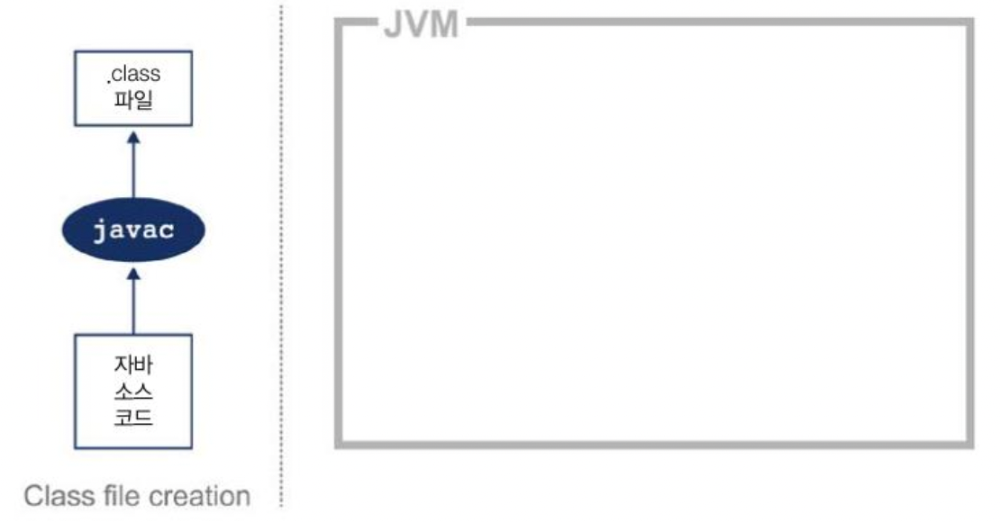
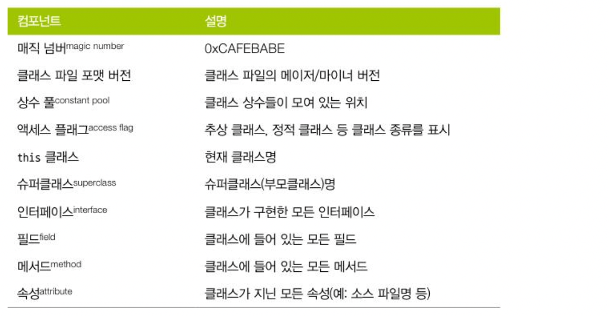
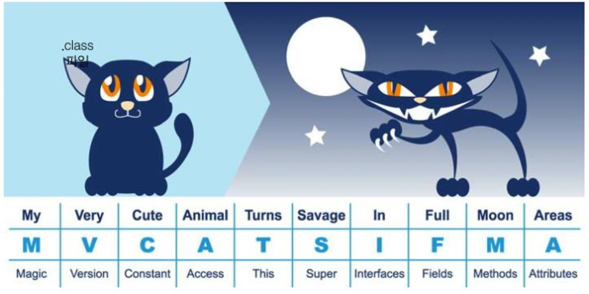
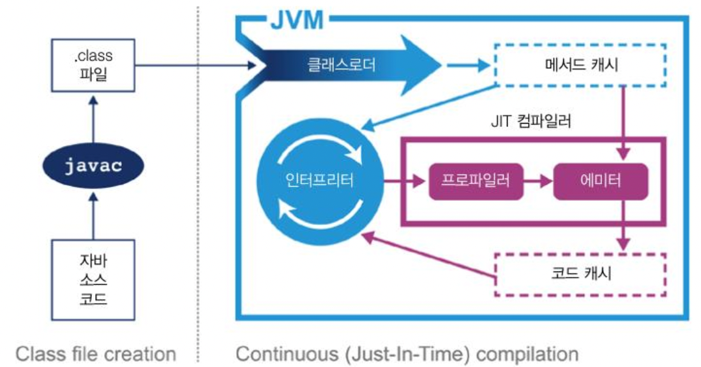
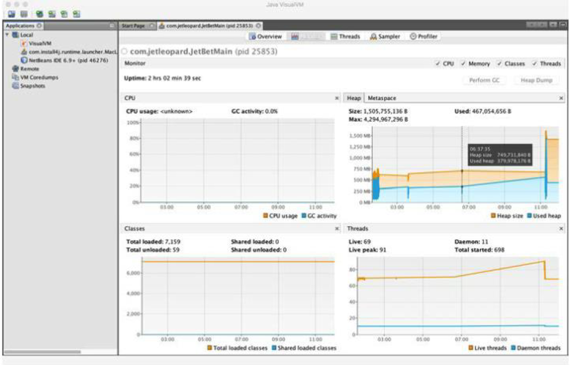

## JVM 이야기

---

자바 현존하는 가장 거대한 기술 플랫폼 중 하나입니다. 오라클 자료에 따르면, 개발자 수가 1400만 명에 달합니다([2022년 statista 기준](https://www.statista.com/statistics/1241923/worldwide-software-developer-programming-language-communities/)). 처음부터 자바는 개발자가 플랫폼을 저수준에서 다 알 필요가 없도록 설계되었습니다. 그래서 고객이 성능이 느리다고 얘기해도 개발자는 내가 할 일은 다했노라 항변할 수밖에 없는 상황이 연출되곤 했었습니다.  

그러나 성능에 관심 있는 개발자라면 기본적인 JVM 기술 스택(technology stack)의 구조를 이해해야 합니다. JVM 기술을 이해하면 더 좋은 소프트웨어를 개발할 수 있고 성능 이슈를 탐구할 때 필요한 이론적 배경지식을 갖추게 됩니다.

### 인터프리팅과 클래스 로딩

자바 가상 머신을 규정한 명세서(보통 VM 스펙이라고 함)에 따르면 JVM은 스택 기반의 해석머신입니다. (물리적 CPU 하드웨어인) 레지스터는 없지만 일부 결과를 실행 스택에 보관하며, 이 스택의 맨 위에 쌓인 값(들)을 가져와 계산을 합니다.  

JVM 인터프리터(해석기)의 기본 로직은, 평가 스택을 이용해 중간값들을 담아두고 가장 마지막에 실행된 명령어와 독립적으로 프로그램을 구성하는 옵코드(opcode)를 하나씩 순서대로 처리하는 `while 루프 안의 switch문`입니다.

> **NOTE\_** 오라클/OpenJDK(오픈 JDK) VM(핫스팟) 같은 실제 제품급 자바 인터프리터는 이보다 훨씬 복잡하지만, 지금은 머릿속에 `**While 루프 안의 switch문**` 이라는 이미지를 떠올리며 이해하면 도움이 될 것입니다.

java HelloWorld 명령을 내려 자바 애플리케이션을 실행하면 OS(운영체제)는 가상 머신 프로세스(자바 바이너리)를 구동합니다. 자바 가상 환경이 구성되고 스택 머신이 초기화된 다음, 실제로 유저가 작성한 HelloWorld 클래스 파일이 실행됩니다.  

애플리케이션의 진입점(Entry Point)은 HelloWorld.class에 있는 main() 메서드입니다. 제어권을 이 클래스로 넘기려면 가상 머신이 실행이 시작되기 전에 이 클래스를 로드해야 합니다.  

여기에 자바 **클래스로딩(classloading)** 메커니즘이 관여합니다. 자바 프로세스가 새로 초기화되면 사슬처럼 줄지어 연결된 클래스로더가 차례차례 작동하죠. 제일 먼저 부트스트랩 클래스가 기지개를 켜며 자바 런타임 코어 클래스를 로드합니다. 런타임 코어 클래스는 자바 8 이전까지는 rt.jar 파일에서 가져오지만, 자바 9 이후부터는 런타임이 모듈화되고 클래스로딩 개념 자체가 많이 달라졌습니다.  

부트스트랩 클래스로더의 주임무는 다른 클래스로더가 나머지 시스템에 필요한 클래스를 로드할 수 있게 최소한의 필수 클래스(예: java.lang.Object, Class, Classloader)만 로드하는 것입니다.

> **NOTE\_** 자바에서 클래스로더는 런타임과 타입 체계 내부에 있는 하나의 객체에 불과합니다. 따라서 클래스 초기 세트를 존재하게 할 방법이 필요합니다. 그렇지 않으면 클래스로더를 정의하는 과정에서 순환성(circularity)이 문제가 될 것입니다.

그다음, 확장 클래스로더가 생깁니다. 부트스트랩 클래스로더를 자기 부모로 설정하고 필요할 때 클래스로딩 작업을 부모에게 넘깁니다. 그리 널지 쓰이지는 않지만, 확장 클래스로더를 이용하면 특정 OS나 플랫폼에 네이티브 코드(native code)를 제공하고 기본 환경을 오버라이드(재정의) 할 수 있습니다. 자바 8에서 탑재된 자바스크립트 런타임 내시혼(Nashom)을 확장 클래스로더가 로드합니다.  

끝으로, 애플리케이션 클래스로더가 생성되고 지정된 클래스패스에 위치한 유저 클래스를 로드합니다. 애플리케이션 클래스로더를 '시스템' 클래스로더라고 부르는 글도 있는데, (부트스트랩 클래스로더가 로드하는)시스템 클래스는 로드하지 않기 때문에 이런 말은 가급적 쓰지 않는 것이 좋습니다. 확장 클래스로더의 자식인 애플리케이션 클래스로더는 아주 자주 쓰입니다.  

자바는 프로그램 실행 중 처음 보는 새 클래스를 **디펜던시(dependency, 의존체)**에 로드합니다. 클래스를 찾지 못한 클래스로더는 기본적으로 자신의 부모클래스로더에게 대신 룩업(찾아보기)을 넘깁니다. 이렇게 부모의 부모로 거슬러 올라가 결국 부트스트랩도 룩업하지 못하면 ClassNotFoundException 예외가 발생합니다. 따라서 나중에 뒤탈을 없애려면 빌드 프로세스 수립 시 운영 환경과 동일한 클래스패스로 컴파일하는 것이 좋습니다.  

보통 환경에서 자바는 클래스를 로드할 때 런타임 환경에서 해당 클래스를 나타내는 Class 객체를 만듭니다. 그런데 똑같은 클래스를 상이한 클래스로더가 두 번 로드할 가능성도 있으니 주의하세요. 한 시스템에서 클래스는 (패키지명을 포함한) 풀 클래스명과 자신을 로드한 클래스로더, 두 가지 정보로 식별됩니다.  


### 바이트코드 실행

---

자바 소스 코드는 실행되기까지 꽤 많은 변환 과정을 거칩니다. 첫 단계는 자바 컴파일러 javac를 이용해 컴파일하는 것으로, 보통 전체 빌드 프로세스의 한 부분으로 수행합니다. javac가 하는 일은 자바 소스 코드를 바이트코드로 가득 찬 .class 파일로 바꾸는 것입니다.   

[그림 2-1]에서 보다시피 소스 코드 번역 작업은 아주 간단합니다. javac는 컴파일하는 동안 최적화는 거의 하지 않기 때문에 그 결과로 생성된 바이트코드는 쉽게 해독할 수 있습니다 또 javap 같은 표준 역어셈블리 툴로 열어보면 원래 자바 코드도 어렵잖게 알아볼 수 있습니다.



그림 2.1 자바 소스 코드를 컴파일해서 클래스 파일을 만듦.

바이트 코드는 특정 컴퓨터 아키텍처에 특정하지 않은, **중간 표현형(Intermediate Representation, IR)**입니다. 컴퓨터 아키텍처의 지배를 받지 않으므로 이식성이 좋아 개발을 마친(즉, 컴파일된) 소프트웨어는 JVM 지원 플랫폼 어디서건 실행할 수 있고 자바 언어에 대해서도 추상되어 있습니다. JVM이 코드를 실행하는 원리를 이해하는 중요한 첫 단추입니다.

> **NOTE\_** 자바 언어와 JVM(자바 가상 머신)은 어느 정도 독립적이라서 JVM 앞에 붙인 J자는 오해의 소지가 있습니다. JVM 규격에 따라 클래스 파일로 컴파일되는 JVM 언어는 모두 다 실행됩니다. 스칼라(Scala) 컴파일러 scalac로 컴파일한 바이트코드도 JVM에서 문제없이 작동합니다.


컴파일러가 생성한 클래스 파일은 VM 명세서에 아주 명확히 잘 정의된 구조(표 2-1)를 갖추고 있습니다. JVM은 클래스를 로드할 때 올바른 형식을 준수하고 있는지 빠짐없이 검사합니다.



표 2-1. 클래스 파일 해부도

모든 클래스 파일은 0xCAFEBABE 라는 매직 넘버, 즉 이 파일이 클래스 파일임을 나타내는 4바이트 16진수로 시작합니다. 그 다음 4바이트는 클래스 파일을 컴파일 할 때 꼭 필요한 메이저/마이너 버전 숫자입니다. 클래스를 실행하는 대상 JVM이 컴파일한 JVM보다 버전이 낮으면 안되겠죠? 메이저/마이너 버전은 클래스로더의 호환성 보장을 위해 검사하고 호환되지 않는 버전의 클래스 파일을 만나면 런타임에 UnsupportedClassVersionError 예외가 납니라. 런타임 버전이 컴파일된 클래스 파일 버전보다 낮으면 안 되니까요.

> NOTE\_ 매직 넘버는 유닉스 환경에서 파일 종류를 식별(윈도우는 보통 파일 확장자로 구분함)할 용도로 쓰이므로 한번 정한 매직 넘버는 나중에 쉽게 바꿀 수가 없습니다. 그래서 당분간은 어쩔 수 없이 성차별 느낌이 배어 있는 **0xCAFEBABE**를 게속 쓸 수 밖에 없고 자바 9부터는 모듈 파일에 **0xCAFEDADA** 매직 넘버를 쓰기로 했습니다.

상수 풀에는 코드 곳곳에 등장하는 상수값(예. 클래스명, 인터페이스명, 필드명 등)이 있습니다. JVM은 코드를 실행할 때 런타임에 배치된 메모리 대신, 이 상수 풀 테이블을 찾아보고 필요한 값을 참조합니다.  

액세스 플러그는 클래스에 적용한 수정자를 결정합니다. 플래그 첫 부분을 일반 프로퍼티로, public 클래스인지, 그다음은 상속이 금지된 Final 클래스인지를 나타냅니다. 또 이 클래스 파일이 인터페이스인지, 추상 클래스인지도 액세스 플래그로 표시합니다. 플래그 끝부분은 클래스 파일이 소스 코드에 없는 합성 클래스인지, 애노테이션 타입인지, 이늄(enum)인지를 각각 나타냅니다.  

this 클래스, 슈퍼클래스, 인터페이스 엔트리는 클래스에 포함된 타입 계층을 나타내며, 각각 상수 풀을 가리키는 인덱스로 표시합니다. 필드와 메서드는 시그니처(서명부) 비슷한 구조를 정의하고 여기에 수정자도 포함되어 있습니다. 속성 세트는 더 복잡하고 크기가 고정되지 않은 구조를 나타내는 데 쓰입니다. 예를 들어, 메서드는 Code 속성으로 특정 메서드와 연관된 바이트 코드를 나타냅니다.  

[그림 2-2]는 클래스 파일 구조를 기억할 때 알아두면 좋은 암기 요령(mnemonic)입니다.



?그림 2-2. 클래스 파일 구조를 암기하는 요령

다음과 같이 간단한 HelloWorld 클래스를 javac로 컴파일하면 무슨 일이 일어날까요? 

```java
public class HelloWorld {

    public static void main(String[] args) {

        for(int i=0; i<10; i++) {
            System.out.println("Hello World");
        }
    }
}
```

자바 SDK에는 클래스 파일 내부를 볼 수 있는 javap라는 역어셈블리가 있습니다. javap -c HelloWorld 명령을 실행하면 HelloWorld 클래스 파일을 들여다볼 수 있습니다.

```java
public class HelloWorld {

    public HelloWorld();

        Code:
           0: aload_0
           1: invokespecial #1 // # Method java/lang/Object. "<init>":()V
           4: return

    public static void main(String[]);
      Code:
         0: iconst_0
         1: istore_1
         2: iload_1
         3: bipush         10
         5: if_icmpage     22
         8: getstatic      #2     // Field java/lang/System.out
        11: ldc            #3     // String Hello World
        13: invokevirtual  #4     // Method java/io/Printstream.println
        16: iinc           1, 1
        19: goto           2
        22: return
}
```

HelloWorld.class 파일을 구성하는 바이트코드가 어떻게 배치되었는지 나옵니다. javap에 -v 옵션을 추가하면 클래스 파일 헤더 전체 정보, 상수 풀 세부 정보 등 좀 더 자세한 내용까지 볼 수 있습니다. 소스 파일에는 메서드가 main() 하나뿐이지만 컴파일 후 변환된 클래스 파일에는 javac가 클래스 파일에 디폴트(기본) 생성자를 자동 추가하므로 메서드는 총 2개 생성됩니다.  

제일 먼저 생성자에서 this 레퍼런스를 스택 상단에 올려놓은 aload\_0 명령이 실행됩니다. 그 다음, invokespecial 명령이 호출되면 슈퍼생성자들을 호출하고 객체를 생성하는 등 특정 작업을 담당하는 인스턴스 메서드를 실행합니다. HelloWorld 클래스는 디폴트 생성자를 오버라이드한 코드가 없으므로 Object 디폴트 생성자가 매치됩니다.

> **NOTE\_** 옵코드는 JVM 내부에서 매우 간결한 형태로, 타입, 작업을 비롯해 지역 변수, 상수, 풀, 스택 간의 상호 작용을 나타냅니다.

main() 메서드에서는 iconst\_0으로 정수형 상수 0을 평가 스택에 푸시(push)하고, istore\_1으로 이 상수값을 오프셋 1에 위치한 지역 변수(루프의 i)에 스토어(저장)합니다. 지역 변수 오프셋은 0부터 시작하며, 인스턴스 메서드에서 0번째 엔트리는 무조건 this입니다. 그리고 오프셋 1의 변수를 스택으로 다시 로드(iload\_1) 한 뒤, 상수 10을 푸시(bipush\_10)한 다음 if\_icmpge 로 둘을 비교합니다('정수값이 10보다 같거나 큰가'). 물론 이 테스트는 정수값이 ≥ 10일 때 성공할 것입니다.  

처음 몇 차례는 이 비교 테스트가 실패할 것이므로 8번 명령으로 넘어갑니다. 여기서 System.out 의 정적 메서드를 해석(getstatic #2)하고 상수 풀에서 "Hello World"라는 스트링(문자열)을 로드(ldc #3)한 다음, invokevirtual 명령으로 이 클래스에 속한 인스턴스 메서드를 실행합니다. 정수값은 하나 증가(iinc 1, 1)되고 goto를 만나 다시 2번 명령으로 되돌아갑니다.  

이 과정이 if\_icmpge 테스트가 성공할 때(i ≥ 10일 경우)까지 반복되다가 마지막에 22번 명령으로 제어권이 넘어가 메서드가 반환됩니다.  


---

### 핫스팟 입문

1999년 4월, 썬 마이크로시스템즈는 성능 관점에서 자바에 가장 큰 변화를 가져왔습니다. 바로 자바의 요체인 핫스팟 가상 머신입니다. 핫스팟을 처음 선보인 이후로 자바는 C/C++ 같은 언어에 필적할 만한 성능을 자랑하며 진화를 거듭했습니다(그림 2-3). '어떻게 이런 일이 가능했을까요' 애플리케이션 개발에 초점을 두고 설계된 자바 언어를 좀 더 깊숙이 알아보겠습니다.



그림 2-3. 핫스팟 JVM


언어 및 플랫폼 설계 과정에는 추구하는 바를 끊임없이 저울질하며 결정을 내려야 할 일이 따릅니다. '제로 코스트(비용이 들지 않는) 추상화(zero-cost abstractation)`사상에 근거한 '기계에 가까운' 언어와 개발자의 생산성에 무게를 두고 엄격한 저수준 제어라는 '일을 대행하는' 언어 사이에서 갈등을 겪게 되지요.

> C++ 코드는 제로-오버헤드 원칙을 준수합니다.  
> 사용하지 않는 것에는 대가를 치르지 않습니다.  
> 즉, 여러분이 사용하는 코드보다 더 나은 코드를 건네줄 수는 없습니다.  
>   
> - 비야네 스트롭스트룹(Bjarne Stroustrup) -

제로-오버헤드 원칙은 이론적으로 그럴싸하지만, 결국 컴퓨터와 OS가 실제로 어떻게 작동해야 하는지 언어 유저(개발자)가 아주 세세한 저수준까지 일러주어야 한다는 것입니다. 성능 자체가 주 관심사가 아닌 개발자 입장에서는 엄청난 학습 부담으로 다가올 것입니다.  

뿐만 아니라 이런 언어로 작성한 소스 코드를 빌드하면 플랫폼에 특정한(그 플랫폼에서만 사용 가능한) 기계어로 컴파일 됩니다. (이것을 **사전**(Ahead-of-Time, AOT) **컴파일**이라고 합니다). 확실히 인터프리터, 가상 머신, 이식성 레이어 같은 대안 실행 모델은 대부분 제로-오버헤드가 아니기 때문입니다.  

"여러분이 사용하는 코드보다 더 나은 코드를 건네줄 수는 없습니다"는 표현 역시 문제의 소지가 있습니다. 이 말은 많은 의미를 내포하지만, 특히 개발자는 결코 자동화 시스템보다 더 나은 코드를 작성할 수 없을 거라는 전제가 깔려 있습니다. 하지만 이것은 안전한 추정이 아닙니다. 요즘 어셈블리 언어로 코딩할 사람은 거의 없을 테니 (컴파일러 같은) 자동화 시스템으로 코드를 생성하는 편이 대다수 프로그래머에게는 분명 이롭습니다.  

자바는 이러한 자바-오버헤드 추상화 철학을 한번도 동조한 적이 없습니다. 오히려 핫스팟은 프로그램의 런타임 동작을 분석하고 성능에 가장 유리한 방향으로 영리한 최적화를 적용하는 가상 머신입니다. 핫스팟 VM의 목표는 개발자가 억지로 VM 틀에 맞게 프로그램을 욱여넣는 대신, 자연스럽게 자바 코드를 작성하고 바람직한 설계 원리를 따르도록 하는 것입니다.  


JIT 컴파일이란?

자바 프로그램은 바이트코드 인터프리터가 가상화한 스택 머신에서 명령어를 실행하며 시작됩니다. CPU를 추상화한 구조라서 다른 플랫폼에서도 클래스 파일을 문제없이 실행할 수 있지만, 성능을 최대로 내려면 네이티브 기능을 활용해 CPU에서 직접 프로그램을 실행시켜야 합니다.  

이를 위해 핫스팟은 프로그램 단위(메서드와 루프)를 인터프리티드 바이트코드에서 네이트브 코드로 컴파일합니다. 바로 **JIT**(Just-in-Time, 적시 or 그때그때 하는) **컴파일** 이라고 알려진 기술 입니다.  

핫스팟은 인터프리티드 모드로 실행하는 동안 애플리케이션을 모니터링하면서 가장 자주 실행되는 코드 파트를 발견해 JIT 컴파일을 수행합니다. 이렇게 분석을 하는 동안 미리 프로그래밍한 추적 정보가 취합되면서 더 정교하게 최적화를 할 수 있습니다. 특정 메서드가 어느 한계치(threshold, 임계점)을 넘어가면 프로파일러(profiler)가 특정 코드 섹션을 컴파일/최적화합니다.  

JIT 방식으로 컴파일하면 여러모로 이점이 많습니다. 무엇보다 컴파일러가 해석 단계에서 수집한 추적 정보를 근거로 최적화를 결정한다는 게 가장 큰 장점입니다. 상황별로 수집한 다양한 정보를 토대로 핫스팟이 더올바른 방향으로 최적화할 수 있습니다.  

핫스팟은 개발에 공들인 시간만도 수백 년(또는 그 이상)에 이르고 새 버전이 나올 때마다 최신 최적화 기법과 혜택을 추가해 왔습니다. 따라서 최신 성능 최적화의 덕을 보려면 아무래도 핫스팟 새 버전에서 자바 애플리케이션을 실행하는 것이 좋습니다. (물론, 다시 컴파일할 필요는 없습니다)

> **TIP\_** 자바 소스 코드가 바이트코드로 바뀌고 또 다른 컴파일 단계(JIT)를 거친 후 실제로 실행되는 코드는 처음에 개발자가 작성한 소스 코드와는 사뭇 다릅니다. 성능 관련 탐구를 할 때 아주 중요한 사실이니 꼭 기억하세요. JVM에서 JIT 컴파일 후 실행되는 코드는 원본 자바 소스 코드와는 전혀 딴판일 가능성이 큽니다.

일반적으로 C++(그리고 요즘 떠오르는 러스트(Rust)) 같은 언어에서는 성능을 좀 더 쉽게 예측할 수 있지만, 저수준의 수많은 복잡한 골칫거리를 유저가 고스란히 안고 갈 수 밖에 없습니다.  

그렇다고 '성능을 예측할 수 있는 것'이 반드시 '더 나은 것'도 아닙니다. AOT 컴파일러는 여러 기종의 프로세서에서 실행 가능한 코드를 만들지만, 프로세서에 특정한 기능은 어쩔 도리가 없습니다.  

자바처럼 **프로필 기반 최적화(profile-guided optimization, PGO)**를 응용하는 환경에서는 대부분의 AOT 플랫폼에서 불가능한 방식으로 런타임 정보를 활용할 여지가 있으므로 **동적 인라이닝(dynamic inlining)** 또는 가상 호출(virtual call) 등으로 성능을 개선할 수 있습니다. 또 핫스팟 VM은 시동시 CPU 타입을 정확히 감지해 가능하면 특정 프로세서의 기능에 맞게 최적화를 적용할 수 있습니다.

> **TIP\_** 프로세서 기능을 정밀하게 감지하는 기법을 **JVM 인트린작(intrinsics, 고유체, 내장 함수)**이라고 합니다. **synchronized** 키워드를 써서 설정하는 인트린직 락(고유 락)과는 전혀 무관합니다.

PGO와 JIT 컴파일은 9, 10장에서 자세히 다룹니다.  

핫스팟 특유의 정교한 접근 방식 덕분에 대다수 일반 개발자는 엄청난 혜택을 누리게 됐지만, 제로 오버헤드 추상화를 포가한 탓에 고성능 자바 애플리케이션을 개발하는 사람들은 '상식적인' 추론으로 애플리케이션 실제로 동작하는 방식을 단순하게 념겨짚지 않도록 조심해야 합니다.

> **TIP\_** 한정된 부분의 자바 코드의 성능을 분석하는 건(**마이크로벤치마크**, micro-benchmark) 보통 전체 애플리케이션을 대상으로 분석하는 작업보다 훨씬 더 까다롭고, 어느 개발자가 맡기엔 버거운, 고도로 전문적인 분야입니다.

핫스팟의 컴파일 서브 시스템과 더불러 초창기부터 자바를 독보적인 언어로 만들었던 특징은 바로 자동 메모리 관리(automatic memory management) 기능입니다.  


### JVM 메모리 관리

C, C++, 오브젝브-C 개발자는 메모리 할당/해제 작업을 직접 수행합니다. 메모리와 객체 수명을 사람이 관리하면 좀 더 확정적인 성ㄴ능을 낼 수 있고, 리소스 수명을 객체 생성/삭제와 직접 결부시킬 수 있는 장점이 있지만, 그만큼 반드시 개발자가 메모리를 정확하게 계산해서 처리해야 하는 막중한 책임이 수반됩니다.  

그러나 실제로 수십 년간 프로그래밍 역사를 거치면서 메모리 관리 용어나 패턴조차 제대로 모르는 개발자가 태반이라는 사실을 알게 되었습니다. 나중에 등장한 C++, 오브젝트-C 버전은 표준 라이브러리에 **스마트 포인터**(smart pointer)를 도입해 어느 정도 성과를 거두긴 했지만, 자바 탄생 무렵엔 부실한 메모리 관리 탓에 애플리케이션 에러가 나는 일이 비일비재 했습니다. 수많은 개발자와 관리자가 비즈니스 가치를 부여하는 활동을 멈추고 언어 자체와 씨름하다가 귀중한 시간을 허비했습니다.  

자바는 **가비스 수집**(Garbabe Collection)이라는 프로세스를 이용해 힙 메모리를 자동 관리하는 방식으로 해결합니다. 가바지 수집이란 한 마디로, JVM이 더 많은 메모리를 할당해야 할 때 불필요한 메모리를 회수하거나 재사용하는 불확정적(nondeterministic) 프로세스 입니다.  

 GC를 만드는 일은 결코 간단하지 않았고 자바 역사를 통틀어 온갖 가비지 수집 알고리즘이 개발/응용되었습니다. 일단 GC가 실행되면 그동안 다른 애플리케이션은 모두 중단되고 하던 일은 멈춰야 합니다. 이 중단 시간은 대개 아주 짧지만, 애플리케이션 부하가 늘수록 이 사간도 무시할 수 없습니다.  

가비지 수집은 자바 성능 최적화의 중심 주제이므로 6, 7, 8장에 걸쳐 다룹니다.  


### 스레딩과 자바 메모리 모델(JMM)

자바는 1.0부터 멀티스레드 프로그래밍을 기본 지원했습니다. 다음 구문(자바 8 기준으로)으로 자바 개발자가 얼마든지 실행 스레드를 새로 만들 수 있습니다.

```java
Tread t = new Thread(() -> {System.out.println("Hello World!");});
t.start();
```

그런데 원래 자바 환경 자체가 JVM처럼 멀티스레드 기반인 까닭에 자바 프로그램이 작동하는 방식은 어쩔 수 없이 한층 더 복잡해졌고 성능 분석가도 작업하기가 훨씬 힘들어졌습니다.  

주류 JVM 구현체에서 자바 애플리케이션 스레드는 각각 정확히 하나의 전용 OS  스레드에 대응됩니다. 공유 스레드 풀을 이용해 전체 자바 애플리케이션 스레드를 실행하는 방안(그린 스레드, green threads)도 있지만, 쓸데없이 복잡도만 가중시킬 뿐, 만족할 만한 수준의 성능은 나오지 않는 거로 밝혀졌습니다.

> **NOTE\_** 모든 JVM 애플리케이션 스레드의 이면에는 해당 Thread 객체의 start() 메서드가 호출될 떄 생성되는 유일한 OS 스레드가 있다고 보면 됩니다.

1990년대 후반부터 자바의 멀티스레드 방식은 다음 세 가지 설계 원칙에 기반합니다.

1. 자바 프로세스의 모든 스레드는 가비지가 수집되는 하나의 공용 힙을 가진다.
2. 한 스레드가 생성한 객체는 그 객체를 참조하는 다른 스 레드가 액세스할 수 있다.
3. 기본적으로 객체는 변경 가능하다(mutable). 즉, 객체 필드에 할당된 값은 프로그래머가 애써 Final 키워드로 불변(immutable) 표시하지 않는 한 바뀔 수 있다.

JMM은 서로 다른 실행 스레드가 객체 안에 변경되는 값을 어떻게 바라보는지를 기술한 공식 메모리 모델입니다. 자, 스레드 A와 스레드 B가 둘다 객체 obj를 참조할 떄 스레드 A가 obj 값을 바꾸면 스레드 B는 무슨 값을 참조하게 될까요?  

언뜻 보기에 간단한 문제 같지만 OS 스케쥴러(3장)가 언제라도 CPU 코어에서 강제로 스레드를 방출할 수 있기 때문에 의외로 복잡합니다. 스레드 A가 아직 처리 중인 객체를 스레드 B가 시작되면서 참조할 때 잘못된, 무효 상태의 객체를 바라보게 될 가능성이 도사리고 있습니다.  

상호 배타적 락(mutual exclusion lock)은 코드가 동시 실행되는 도중 객체가 손상되는 현상을 막을 수 있는 자바의 유일한 방어 장치지만 실제로 애플리케이션에 사용하려면 상당히 복잡해질 수 있습니다. JMM의 상세한 작동 원리와 실제로 스레드/락을 다루는 방법은 12장에서 다룹니다.  


### JVM 구현제 종류

#### JVM 구현체 종류

오라클이 제작한 핫스팟 이외에도 제각기 다른 방법으로 구현한 자바 구현체가 많습니다.

**OpenJDK**

OpenJDK는 자바 기준 구현체(reference implementation)를 제공하는 특별한 오픈 소스(GPL) 프로젝트입니다. 오라클이 직접 프로젝트를 주관/지원하며 자바 릴리즈 기준으로 발표합니다.  


**오라클 자바(Oracle)**

가장 널리 알려진 구현체로, OpenJDK가 기반이지만 오라클 상용 라이선스로 재라이선스를 받았습니다. 오라클 자바에 변경된 내용은 (아직 공식적으로 발표하지 않은 보안 패치를 제외하고) 거의 전부 OpenJDK 공개 저장소에 커밋됩니다.  


**줄루(Zulu)**

줄루는 아줄 시스템(Azul Systems)이 제작한, 자바 풀 인증을 받은 무료(GPL 라이선스) OpenJDK 구현체입니다. 사용 라이선스 문제로 제약받을 일 없이 자유롭게 재배포할 수 있습니다. 아줄 시스템은 OpenJDK 유료 지원 서비스를 제공하는 몇 안 되는 업체입니다.  


**아이스티(IcedTea)**

아이스티는 레드햇의 작품으로, 역시 풀 인증을 받았고 재배포 가능합니다. 레드햇은 자바 풀인증을 받은 OpenJDK 기반의 자바 구현체를 제작한 (오라클을 제외한) 최초의 회사입니다.  


**징(Zing)**

징은 아줄 시스템이 제작한 고성능 상용 JVM입니다. 자바 풀 인증을 받았고 64비트 리눅스에서만 작동합니다. 대용량 힙 메모리(수십 ~ 수백 GB).와 멀티 CPU 서버급 시스템을 위해 설계된 제품입니다.  


**J9**

IBM이 만든 J9는 상용 JVM으로 출발했다가 (핫스팟처럼) 중간에 오픈 소스로 바뀌었습니다. 지금은 이클립스 OMR 프로젝트 기반으로 제작되며 IBM 상용 제품의 근간을 이루고 있습니다. 자바 인증 체계와 완전히 호환됩니다.  


**애비안(Avian)**

애비안은 100% 자바 인증을 받은 구현체가 아닐므로 제품으로 쓰기에 완전한 솔루션은 아니지만, JVM의 세부 작동 원리가 궁금한 개발자에게 훌륭한 학습 도구 역할을 하는, 흥미로운 오픈 소스 프로젝트라서 목록에 추가했습니다.  


**안드로이드(Android)**

구글 안드로이드가 '자바에 기반한'  프로젝트라고 보는 분들이 많지만, 사실 조금 복잡한 속사정이 있습니다. 원래 안드로이드는 논JVM(non-jvm) 가상 머신 용도의 다른 파일 포맷(.dex)으로 변환하기 위해 (완전히 순수했던 하모니 프로젝트(Harmany project)에 있던) 여러 가지 자바 클래스 라이브러리 구현체와 교차 컴파일러(cross compiler)를 사용했습니다.  

이 책은 핫스팟에 관한 내용이 대부분이지만, 오라클 자바, 아줄 줄루, 레드햇 아이스티, 그밖의 다른 OpenJDK에서 파생된 JVM에도 똑같이 적용됩니다.

> **NOTE\_** 유사한 버전을 비교해보면 사실 핫스팟 기반 구현체 간에 큰 성능 차이는 없습니다.

핫스팟을 대신할 구현체의 존재를 알리고자 일부에 지나지 않지만, IBM J9 및 아줄 징(Azul Zing)에 관련된 내용도 수록했습니다. 관심 있는 독자는 성능 목표를 수립한 후에 측정, 비교를 거듭하며 깊이 있게 연구해보세요.  

안드로이드는 자체 런타임에서 직접 지원되는 OpenJDK 9 클래스 라이브러리를 사용하는 방향으로 옮아가는 추세입니다. 안드로이드 기술 스택은 다른 예제와는 다소 거리가 있으므로 이 책에서 안드로이드는 고려 대상에서 제외합니다.  


#### JVM 라이선스

JVM 구현체는 거의 다 오픈 소스이고 IBM J9(이클립스 라이선스)와 상용 제품인 아줄 징(아줄 줄루는 GPL라이선스)을 제외하면 대부분 핫스팟(GPL 라이선스)에서 비롯된 제품입니다.  

그런데 오라클 자바(자바 9 이후) 라이선스 체계는 좀 복잡합니다. 오라클 자바의 기반은 OpenJDK 코드 베이스지만 오픈 소스가 아닌, 상용제품 입니다. 그래서 오라클은 모든 OpenJDK 컨트리뷰터(contributor)들이 OpenJDK의 GPL 라이선스와 오라클사의 상용 라이선스, 이중 라이선스에 동의한다는 서명을 받아냈습니다.  

지금까지 오라클 자바의 업데이트 버전은 각각 OpenJDK 주 브랜치(mainline branch)에서 가져왔지만, 차기 릴리즈부터는 주 브랜치에서 패치하지 않겠다고 합니다. 그러면 오라클 JDK와 OpenJDK의 격차가 점점 더 벌어지는 현상을 막을 수 있고, 소스가 동일한 오라클JDK와 OpenJDK의 바이너리 간의 유의미한 차이점도 사라질 것입니다.  

다시 말해, 오라클 JDK와 OpenJDK는 라이선스 외에는 아무런 차이가 없습니다. 하지만 오라클 라이선스에는 개발자가 조심해야 할 몇가지 조항이 포함되어 있으니 눈여겨보세요.

* 회사 밖으로 오라클 바이너리를 (이를테면, 도커 이미지 형태로) 재배포하는 행위는 허용되지 않는다.
* 사전 동의(보통 서비스 지원 계약) 없이 오라클 바이너를 함부로 패치하면 안 된다.

또 오라클 JDK에서만 작동하는 상용 기능과 툴에도 동일한 라이선스 조항이 적용됩니다. 그러나 앞으로 오라클이 자바를 릴리즈하면서 이런 상황은 달라질 것입니다(15장 참고).  

여러분이 새로이 배포 환경을 기획하는 개발자/아키텍트라면 JVM 업체를 신중하게 고려해서 선정하셔야 합니다. 트위터나 알리바바처럼 큰 기업은 자체 OpenJDK 빌드 버전을 따로 두기도 하지만, 이 정도로 기술 역량을 축적한 회사는 그리 많지 않습니다.  


### JVM 모니터링과 툴링

JVM은 성숙한 실행 플랫폼으로, 실행 중인 애플리케이션은 인스트루먼테이션(instrumentation), 모니터링, 관측하는 다양한 기술을 제공합니다. 다음은 이런 종류의 툴에 쓰이는 몇 가지 중요한 기술입니다.

* 자바 관리 확장(Java Management Extensions, JMX)
* 자바 에이전트(Java agent)
* JVM 툴 인터페이스(JVM Tool Interface, JVMTI)
* 서비서빌리티 에이전트(Serviceability Agent, SA)

> JMX는 JVM과 그 위에서 동작하는 애플리케이션 제어하고 모니터링하는 강력한 범용 툴입니다. 어느 클라이언트 애플리케이션처럼 메서드를 호출하고 매개변수를 바꿀 수 있습니다. 모든 사용법은 전부 다 설명할 수 없지만, 어쨋든 JVM(및 이와 관련된 네트워크 전송 프로토콜 RMI)는 JVM을 관리하는 기본 수단입니다.

자바 에이전트는 (그 이름답게) 자바 언어로 작성된 툴 컴포넌트로, java.lang.instrument 인터페이스로 메서드 바이트코드를 조갖합니다. 에이전트는 다음과 같이 JVM에 시작 플래그를 추가해서 설치합니다.

> -javaagent:<에이전트 JAR파일이 위치한 경오>=<옵션>

에이전트 JAR 파일에서 **매니페스트**(manifest.mf 파일)은 필수입니다. 또 Premain-Class 속성에 에이전트 클래스명을 반드시 지정해야 합니다. 이 클래스는 자바 에이전트의 **등록 후크**(registration hook) 역할을 수행하는 public static premain() 메서드를 구현해야 합니다.  

**자바 인스트루먼테이션 API**로도 부족하면 JVMTI를 대신 사용할 수 있습니다. JVMTI는 JVM의 네티이브 인터페이스이기 때문에 JVMTI를 사용하는 에이전트는 필히 C/C++ 같은 네이티브 컴파일 언어로 작성해야 합니다. 네이티브 에이전트가 JVM 이벤트를 모니터링하며 알림을 받을 수 있도록 만든 통신 인터페이스입니다. 네이티브 에이전트를 설치하는 플래그는 자바 에이전트와 약간 다릅니다.

> -agentlib:<에이전트 라이브러리명>=<옵션>

또는

> -agentpath:<에이전트 경로>=<옵션>

JVMTI 에이전트를 네이티브 코드로 개발해야 하는 요건 떄문에 실행 중인 애플리케이션에 악영향을 미치거나 심지어 JVM을 멎게 할 만한 코드를 작성하기 쉽습니다.  

그래서 가급적 JVMTI보다 자바 에이전트로 작성하는 게 낫고 아래무도 코딩하기도 자바 에이전트가 더 쉽습니다. 물론 간혹 자바 API로 가져올 수 없는 정보는 JVMTI로 가져올 수밖에 업습니다.  

마지막으로 SA는 자바 객체, 핫스팟 자료 구조 모두 표출 가능한 API와 툴을 모아놓은 것입니다. SA를 이용하면 대상 JVM에서 코드를 실행할 필요가 없습니다. 핫스팟  SA는 심볼 룩업(Symbal lookup) 같은 기본형을 이요하거나 프로세스 메모리를 읽는 방식으로 디버깅합니다. SA는 코어 파일(core file, 크래스 덤프 파일이라고도함) 및 아직 생생한 자바 프로세스까지 디버깅할 수 있습니다.  


#### VisualVM

javac, java  등의 잘 알려진 바이너리뿐만 아니라 JDK에는 유용한 가외 툴이 참 많습니다. 넷빈즈(NetBeans) 플랫폼 기반의 시각화 툴인 VisualVM도 사람들이 잘 모르고 지나치는 툴입니다.

> **TIP\_** jvisualvm은 초기 자바 버전에 있다가 이제는 더 이상 안쓰는 jconsole을 대체하는 툴입니다. 아직도 jconsole를 사용하는 독자는 VisualVM으로 갈아타세여(VisualVM 내부에는 jconsole 플러그인을 실행할 수 있게 해주는 호환 플러그도 있습니다)

자바 최근 버전에 내장된 VisualVM은 안정된 버전이라서 그냥 쓰면 되지만 더 최신 버전을 써야할 경우에는 http:visualvm.java.net/ 에서 파일을 내려받으세요. 그리고 JRE에 포함된 기본 바이너리가 실행될 수 있으니 디폴트 경로에 visualvm 바이너리 경로를 잊지 말고 추가하기 바랍니다.  

VisualVM을 처음 시작하면 자신이 실행되는 머신을 보정(callibrate)하는 과정을 거치므로 성능 보정에 영향을 줄 만한 다른 애플리케이션은 닫는 게 좋습니다. 보정 후 VisualVM 이 시동되면 시작 화면이 표시됩니다. 



VisualVM 모니터

VisualVM은 JVM 어내티 메커니즘(attach mechanism)을 이용해 실행 프로세스를 실시간 모니터링합니다. 프로세스가 로컬인지, 원격인지에 따라 작동 방식이 조금 다릅니다.  

로컬 프로세스는 아주 간단해서 VisualVM은 화면 좌측에 프로세스를 쭉 나열합니다. 그중 하나를 더블클릭하면 우측 패널에 새 탭이 뜹니다.  

원격 프로세스에 연결하려면 원격지로부터 (JMX를 통해) 인바운드(안으로 들어오는) 접속이 허용돼야 합니다. 표준 자바 프로세스에서 이 말은 원격 호스트에서 jstatd이 실행되고 있어야 한다는 뜻입니다.

> **NOTE\_** 애플리케이션 서버나 실행 컨테이너는 jstatd를 직접 서버에서 실행한 것과 동등한 기능을 제공하므로 jstatd 프로세스를 별도로 띄울 수 없습니다.

탭에서 hostname(호스트명), display name(표시명)을 입력해서 원격 프로세스에 접속합니다. 디폴트 접속 포트는 1099번이지만 원하면 다른 번호로 바꿀 수 있습니다.  


### 용어 정리

---

* 옵코드(opcode): operation code(명령 코드)의 줄임말로, 기계어의 일부로서 수행할 명령어로 나타내는 부호
* 제품급: 실제 비즈니스 업무와 기업 컴퓨팅 환경에서 사용해도 될 정도로 완성도를 갖춘 상태
* 순환성(circularity): 어떤 클래스나 인터페이스가 자신의 슈퍼 클래스가 될 수도 있는 역설적인 상황. 실제로 이런 일을 JVM이 감지하면 ClassCircularityError 예외를 던집니다.
* 네이티브 코드(Native code): 네이티브 코드는 OS상에서 직접 컴파일하여 바로 기계어로 실행한 코드(예: C/C++ 코드). 반대로, JVM(자바)이나 .Net 프레임워크(C#)처럼 인터프리터가 반드시 있어야 실행되는 코드를 관리되는 코드(managed code)라고 합니다.
* 중간 표현형(IR): 소스 코드를 표현하기 위해 컴파일러 또는 가상 시스템에서내부적으로 사용하는 데이터 구조나 코드
* 0xCAFEBABE, 0xCAFEDADA: 0xCAFEBABE는 자바를 창시한 제임스 고슬링이 정한 것입니다(유래가 궁금하시다면 [참고](https://dzone.com/articles/the-magic-word-in-java-cafebabe)해주세요) 16진수로 사용 가능한 알파벳이 A~F이므로 별생각 없이 떠올린 것으로 보이지만, 'babe'란 낱말이 남자가 여자에게 치근덕거리며 부르는 비속어 느낌이 강한 것이 문제입니다. 마이크로소프트도 과거에 자사 가상화 제품 코드에 0xB1600005(Big Boobs, 거대한 가슴)을 넣는 걸 공식으로 사과한 바 있습니다.
* 액세스 플래그: 현재 명세서에는 다음 8 가지 클래스 접근 플래그가 이습니다. ACC\_PUBLiC(0x0001), ACC\_FINAL(0x0010), ACC\_SUPER(0x0020), ACC\_INTERFACE(0x0200), ACC\_ABSTRACT(0x0400), ACC\_SYNTHETIC(0x1000), ACC\_ANNOTATION(0x2000), ACC\_ENUM(0x4000)
* 클래스 파일 구조 : 자세한 설명은 [참조](https://blog.lse.epita.fr/2014/04/28/0xcafebabe-java-class-file-format-an-overview.html)해주세요.
* 이 책에서는 저자가 직접 작성한 코드가 아닌, 자바 JDK 등 다른 라이브러리의 소스 코드에 포함된 주석, 또는 javap 같은 툴을 실행하여 생성된(generated) 텍스트 내부의 주석은 독자의 혼란을 줄이기 위해 따로 번역하지 않았습니다.
* 비야네 스트롭스트룹(Bjarne Stroustrup): C++ 프로그래밍 언어를 개발한 덴마크의 저명한 과학자
* Rust: 모질라 리서치에서 개발한 범용 프로그래밍 언어. '안전하고 병렬적이며, 실용적인'언어로 디자인되었으며, 순수 함수형 프로그래밍, 액터 기반 병렬 프로그래밍, 명령형 프로그래밍, 객체 지향 프로그래밍 스타일을 지원합니다.(출처 - 위키백과)
* AOT 컴파일: AOT 컴파일(Ahead-Of-Time compile)은 목표 시스템의 기계어와 무관하게 중간 언어 형태로 배포된 후 목표 시스템에서 인터프리터나 JIT 컴파일 등 기계어 번역을 통해 실행되는 중간 언어를 미리 목표 시스템에 맞는 기계어로 번역하는 방식을 지칭합니다.(출처 - 위키백과)
* 프로필 기반 최적화(profile-guided optimization, PGO): Profile-directed feedback ( PDF ), 및 FDO ( feedback-directed optimization )라고도 하는 Profile -guided optimization(PGO , pogo 이라고도 함 ) 은 컴퓨터 프로그래밍 의 컴파일러 최적화 기술 입니다. 프로파일링을 사용하여 프로그램 런타임 성능을 향상시킵니다. [참고 - [위키백과](https://en.wikipedia.org/wiki/Profile-guided_optimization)]
* 스마트 포인터(smart pointer): C++ 11부터 새롭게 선보인, 포인터처럼 동작하는 클래스 템플릿. 헤더 파일에 unique\_ptr, shared\_ptr, weak\_ptr 세 종류가 정의되어 있고 사용을 마친 메모리를 자동으로 해제합니다.
* 그린 스레드(green threads): 가비지 컬렉션, 쓰레기 수집 등으로 표기한 문헌도 있지만, 이 책에서는 의도적으로 원음 음치(가비지)와 우리말(수집)을 결합시킨 '가비지 수집'이라는 용어를 쓰겠습니다.
* JVM 구현체의 종류: [참고-[위키백과](https://en.wikipedia.org/wiki/List_of_Java_virtual_machines)]
* 자바 기준 구현체: 다른 개발자가 어떤 하드웨어나 소프트웨어를 구현할 때 참조할 수 있는 샘플 프로그램
* 하모니 프로젝트: 오픈 소스 자바 SE를 표방하며 아파치 재단의 지원 하에 대부분 IBM 직원들이 코드를 작성했습니다.
* 교차 컴파일러: 컴파일러가 실행되는 플랫폼이 아닌 다른 플랫폼에서 실행 가능한 코드를 생성할 수 있는 컴파일러
* OpenJDK 컨트리뷰터: 오픈 소스의 코드를 작성/수정하는 일뿐만 아니라, 오류 제보, 주석 작성, 문서화 등 소프트웨어 개발에 도움을 주는 사람들.
* 인스트루먼테이션(instrumentation): 컴퓨터 프로그래밍에서 인스트루먼테이션(instrumentation)은 오류 진단이나 성능 개선을 위해 애플리케이션에 특정한 코드를 끼워 넣는 것.
* 자바 인스트루먼테이션 API: JVM이 로드한 바이트코드를 조작하는 기능을 제공하며, premain() 메서드는 그 이름답게 애플리케이션 main() 메서드 이전(pre)에 실행됩니다.
* 어태치 메커니즘: 자바 Attach API를 이용해 애플리케이션 타깃 JVM에 부착(attach)하는 장치를 말합니다.

### 참고

---

* [개인 블로그] [자바의 버전별 특징](https://velog.io/@ljo_0920/java-%EB%B2%84%EC%A0%84%EB%B3%84-%EC%B0%A8%EC%9D%B4-%ED%8A%B9%EC%A7%95)
