## 동시성 제어하기

---

### **멀티 스레드 환경에 대한 이해**

---

대부분 하나의 웹 서버는 여러 개의 요청을 동시에 수행할 수 있습니다.

코드로 보면 작성한 코드 한줄은 동시에 수행 될 수 있다는 말입니다.

코드 한줄을 동시에 수행될 수 있기 때문에 하나의 자원(데이터베이스 1개 레코드, 서버 내 글로벌 변수)을 두고 여러 개의 연산들이 경합하여 데이터 정합성을 깨뜨릴 수 있습니다.

#### **동시성 이슈가 발생하는 원인**

하나에 잔고에 대해서 3,000원을 출금을 동시에 요청하는 예제를 통해 알아봅시다.


위 그림과 같이 트랜잭션 3개가 동시에 발생한 경우에 대해 확인해봅시다.


트랜잭션 1에서는 강호동의 잔고가 10,000원으로 읽고 3,000원 출금가능하므로 UPDATE 쿼리를 진행할 것입니다.

트랜잭션 2에서는 트랜잭션 1이 조회하고 업데이트하기 전에 동일하게 잔고를 조회하고 출금가능한 금액이므로 3,000원을 출금합니다.

트랜잭션 3에서는 트랜잭션 2가 조회하고 업데이트하기 전에 동일하게 잔고를 조회하고 출금가능한 금액이므로 3,000원을  출금합니다.

이때 트랜잭션 1이 끝나고 나서 트랜잭션 2가 업데이트 연산을 수행하게 되면 트랜잭션 1에서 3,000원이 빠졌기 때문에 4,000원이 되어야하지만 트랜잭션 2에서는 10,000원으로 시작했기 때문에 7,000원으로 덮어 씌어지는 문제가 발생하게 됩니다. 트랜잭션 3에서도 동일하게 덮어지는 문제가 발생합니다.

이러한 이슈가 발생하면 3,000원에 대한 출금 요청이 유실되어 실제로는 없는 돈을 출금하는 경우가 발생할 수 있습니다.

> 데이터베이스에서 동시성 이슈가 발생하는 일반적인 패턴  
>   
> 1. 공유자원 조회  
> 2. 공유자원 갱신  
>   
> 이 과정에서 1번과 2번 사이에 다른 오퍼레이션을 수행하게 되면  
> 동시성 이슈가 발생할 수 있는 여지가 생기는 것입니다.  
>   
> 위 예시가 동시성 이슈가 발생할 수 있는 일반적인 패턴이긴 하지만  
> 이외에도 여러 패턴들이 더 많습니다.

그렇다면 이러한 이슈를 어떻게 제어할 수 있을까요?

여러 가지 방법이 있지만, 공유 자원에 대해 잠금을 획득하여 줄 세우기를 하는 방법이 있습니다. 

동시 다발적으로 발생했던 하나에 잔고에 대한 트랜잭션을 잔고를 획득해서 순착적으로 처리하는 방식입니다.


#### **동시성 이슈가 어려운 이유**

**1. 로컬에서는 대부분 하나의 스레드로 테스트**

하나의 스레드로 테스트하기 때문에 로직의 문제가 없으므로 정상적으로 동작하게 됩니다.

그래서 개발 환경에서 발견하는 것이 쉽지 않습니다.

**2. 이슈가 발생하더라도 오류가 발생하지 않음**

로직에 이슈라면 바로 이슈가 발생하지만 로직의 이슈가 아니므로 오류를 발생시키지 않습니다. 점진적으로 누적되어 오류가 발생할 수 있겠지만 하나하나 발생했을 때 즉각적인 피드백을 받기가 어렵습니다.

**3. 코드에서 잘 보이지 않음**

대부분 많은 회사에서 코드 리뷰를 하고 있는데 코드 리뷰에서는 동시성 이슈를 파악하기 쉽지 않습니다.

그래서 동시성 이슈가 발생하는 패턴인지 아닌지를 체크하고 동시성 이슈가 발생할 여지가 있다면 어떻게 해결할 것인지 이야기하는 것이 좋습니다. 

**4. 항상 발생하지 않고 비결정적으로 발생**

항상 발생하지 않고 비결정적으로 발생하는 것이 가장 어려운 점입니다. 비결정적으로 발생한다는 의미는 일관적인 패턴을 보이는 것이 아니라 우연하게, 랜던하게 발생하기 때문에 동시성 이슈인지 인프라로 인해 발생한 이슈인지 구분하기가 어렵습니다. 

#### **정리**

> 웹 서버 어플리케이션을 개발할 때는동시성 이슈를 염두에 두고  
> "작성한 코드 한 줄은 동시에 수행 될 수 있다."라는 문장을  
> 기억하시면서 개발하는 것이 좋습니다.

### **쓰기락과 읽기락**

---

#### **락의 범위**

동시성 제어를 위한 가장 보편적인 방법은 락을 통한 줄세우기라고 말씀드렸습니다.

즉 동시다발적으로 발생하는 여러 트랜잭션들에 대해서 잠금을 설정하여 순차적으로 처리하도록 하는 것입니다.


MySQL에서는 어떻게 락을 설정할 수 있고 사용할 때 주의할 점이 어떤 것이 있는지 살펴봅시다.

락을 통해 동시성을 제어할 때는, 락의 범위를 최소화하는 것이 중요합니다. 

즉 락이 타는 범위를 최소하는 것을 의미합니다. 

락을 크게 설정할 경우, 락을 대기하는 트랜잭션의 줄이 길어질 것이고 그만큼 성능이 내려가게 될 것입니다. 최악의 경우에는 쓰레드 1개로 처리하는 것과 다름이 없게 됩니다. Spring 기반 어플리케이션 등 웹 프레임워크는 커넥션 풀을 관리하게 됩니다. 락의 범위가 길어질 수록 커넥션 풀을 점유하는 시간이 길어지고 최악의 경우에는 커넥션 풀 고갈로 이어질 수 있으므로 락의 범위를 최소화 하는 것이 좋습니다. 

MySQL에서는 트랜잭션의 커밋 혹은 롤백시점에 잠금이 풀립니다. 트랜잭션이 곧 락의 범위가 됩니다. 

**락의 범위를 최소화한다는 의미는 하나의 트랜잭션을 최소화하는 것**입니다. 

예를 들면 S3 이미지를 업로드한다고 했을 때, 이를 트랜잭션 범위안에 설정하게 되면 S3 네트워크 상태에 따라서 트랜잭션이 길어질 수 도 있게 됩니다.

**외부 네트워크 의존성이나 외부 IO가 발생하는 것들은 가능하면 최대한 트랜잭션 밖에서 해주는 것이 좋습니다.**

#### **쓰기락과 읽기락**

MySQL에서는 쓰기락, 읽기락 두 가지 잠금을 제공하고 있습니다.

**읽기락**은 **Shared Lock**이라고도 부르고, **쓰기락**은 **Exclusive Lock**이라고 부릅니다.


**읽기락**을 잠금획득한 상태에서 다른 **읽기락**이 들어올 경우 영어로 **Shared Lcok**라고 불리는 것처럼 읽기락끼리는 잠금을 서로 공유할 수 있습니다. **다른 읽기락**이 먼저 선점하고 있더라도 뒤에 온 **다른 읽기락**은 대기 없이 데이터를 읽을 수 있게 되는 것입니다.

반면에 쓰기락은 영어 이름 **Exclusive Lock** 처럼 읽기락이 걸려있든 쓰기락이 걸려있든 무조건 대기가 발생하게 됩니다. **쓰기락**이 데이터를 점유하고 있는 상태에서 뒤늦게 읽기락이 걸려있는 상태에서는 Exclusive Lock 이기 때문에 대기를 하고 마찬가지로 쓰기락이 왔을 때도 대기를 하게 됩니다.

```sql
읽기락은 SELECT ... FOR SHARE
쓰기락은 SELECT ... FOR UPDATE 또는 UPDATE, DELETE 쿼리
```

매번 잠금이 발생할 경우, 성능저하를 피할 수 없습니다. 모든 쿼리에서 잠금이 발생할 경우 결국 쓰레드 1개를 사용하는 것과 동일한 효과를 보기 때문에 MySQL에서 일반 SELECT는 **nonblocking consister read**로 동작합니다. 

이것이 가능한 이유는 트랜잭션 격레레벨에서도 보았던 것처럼 `**Undo Log**`를 통해 원본 데이터를 변경했을 때 커밋이 되기전에 데이터를 모두 관리하고 있기 때문에 가능한 것입니다.

자세한 설명은 [MySQL Doc](https://dev.mysql.com/doc/refman/5.7/en/innodb-consistent-read.html)를 참고해주세요

#### 쓰기락과 읽기락 외에 락의 종류

MySQL에서는 **쓰기락**과 **읽기락** 외에도 락의 범위에 따라서 여러 종류 락으로 나눌 수 있습니다.

* **테이블 락**: 테이블 전체를 대상으로 하는 테이블 락
* **레코드 락**: Row 하나를 잡는 레코드 락
* **갭 락**: Row와 Row 사이에 있는 갭을 잡는 갭락

이중에서 가장 중요한 것은 **레코드 락**입니다. 대부분 락을 사용하게 되면 **레코드 락**을 사용하게 되는데 **MySQL**는 다른 RDBMS와는 다르게 **레코드 락은 인덱스를 잠그게 됩니다**. 

MySQL에서는 Lock을 잡을 때도 인덱스에 따라서 Lock이 잡히는 범위가 달라지기 때문에 인덱스 설정 범위가 굉장히 중요합니다. 만약 인덱스가 없는 조건문으로 Lock을 잡으려고 시도하는 경우에 불필요한 데이터가 잠길 수 있습니다. 

```sql
// Lock 상태 확인
SELECT * FROM performance_schema.data_locks;

// 트랜잭션 상태 확인
SELECT * FROM information_schema.innodb_trx;
```

실제 테스트를 통해 알아봅시다.

memberId가 1인 게시글이 개수가 5개가 존재합니다.

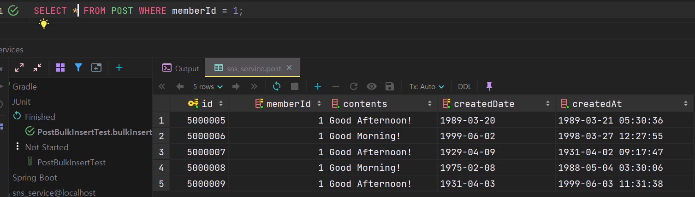

POST 테이블에는 인덱스가 4가지 종류로 memberId가 포함된 인덱스는 총 2개 입니다.

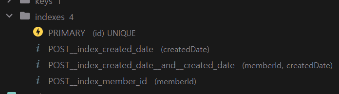

이때 인덱스가 설정되지 않은 contents 필드를 조건절에 추가하여 검색하면 2건이 검색되는 것을 확인할 수 있습니다.

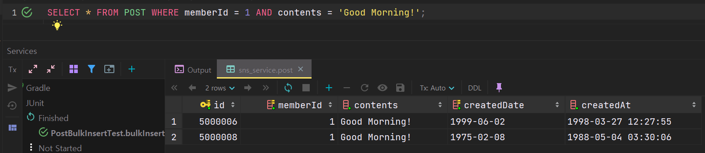

실제로 락을 획득해보면 5 건이 잡히게 됩니다. 이때 락을 잡기 위해서는 트랜잭션을 열어주어야하고, 레코드 락을 걸어주기 위해 content까지 설정해주었습니다.

해당 쿼리를 실행하고 커밋을 하지 않았기 때문에 memberId와 contents는 잠금 상태가 유지가 됩니다.

```sql
START TRANSACTION;
SELECT * FROM POST WHERE memberId = 1 AND contents = 'Good Morning!' FOR UPDATE;
```

확인하는 방법은 information 스키마에 innodb 트랜잭션 테이블을 통해 트랜잭션이 시작되었는지 확인할 수 있습니다.

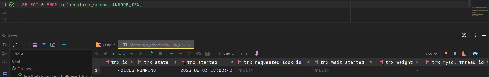

**performance\_schema**에 **data\_locks** 테이블을 통해 현재 잡혀 있는 락에 어떤 레코드의 락이 잡혀있는지 확인할 수 있습니다. 

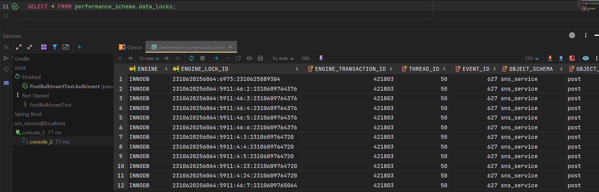

여러 종류의 락들이 동시적으로 잡혀있는 것을 확인할 수 있는데, 이중 중요하게 볼 부분은 **LOCK\_MODE**가 X라는 것은 쓰기 락이 잡혀있다는 의미이고 어떤 인덱스에 잡혀있는지 확인할 수 있습니다.

LOCK\_DATA가 인덱스에 대한 값이고 뒤에 있는 값이 클러스터 키(PK)입니다.

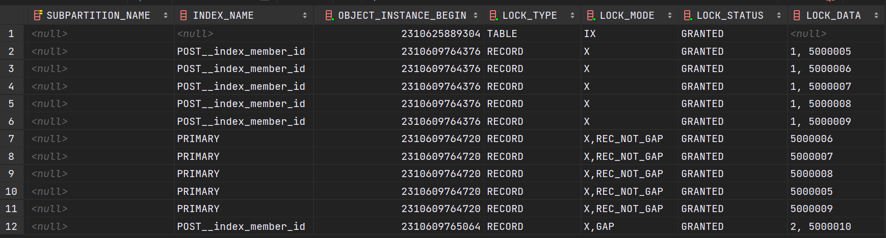

현재 5개에 대해 쓰기 락이 걸려있는 것을 확인할 수있습니다.

 memberId와 contents를 조회하면 2개의 데이터가 존재합니다.

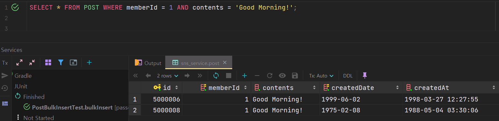

그런데 락이 잡힌 테이블을 보면 이외에도 3 건이 더 잡힌 것을 확인할 수 있습니다.

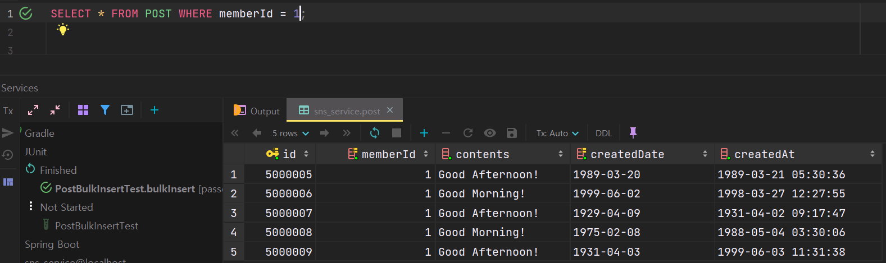

**performance\_schema**에 **data\_locks** 테이블에 **LOCK\_DATA**를 통해 확인해보면 memberId 1이 작성한 게시글인 것을 확인할 수 있습니다.

```sql
SELECT * FROM POST WHERE memberId = 1 AND contents = 'Good Morning!' FOR UPDATE;
```

락을 설정한 위 쿼리는 contents에 대한 조건문이 인덱스를 탈수 없기 때문에 memberId 인덱스를 통해 데이터 락을 획득하게 된 것입니다. 

그런데 memberId로 락을 획득하면 memberId에 대한 게시글이 5건이기 때문에 5건에 대해 모두 락을 걸어버리게 된 것입니다.

그러면 어떤 문제가 발생할 수 있을까요? 

다른 트랜잭션을 통해 해당 데이터를 조회해보도록 하겠습니다.

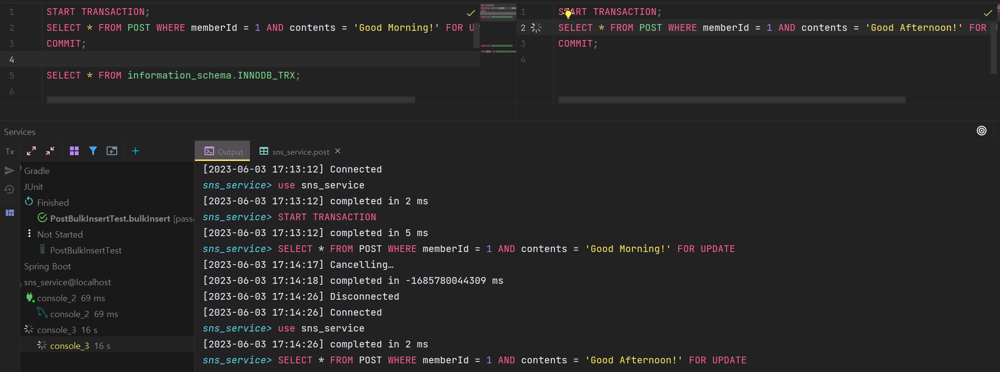

> \* 유의사항. 트랜잭션을 새로 열때는 같은 콘솔 창에서 트랜잭션을 새로 생성되지 않으므로 콘솔 창을 새로 열어주셔야 합니다.

이 상태에서 트랜잭션을 조회해보면 위 오른쪽 콘솔에서 실행한 쿼리는 LOCK WAIT 상태에 걸리게 됩니다. 

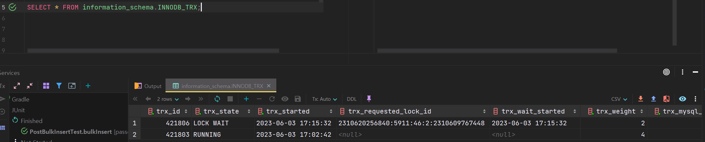

실제로는 1번 콘솔과 2번 콘솔이 조회하는 쿼리가 다른데 기다리게 되는 것입니다. 그렇기 때문에 MySQL을 사용하실 때는 인덱스를 통해 트랜잭션을 타도록 설정해주시는 것이 중요합니다.

memberId 1이 작성한 게시글이 5개이기 때문에 문제가 없을 수 있지만, 더 많은 게시글을 작성한 경우 큰 문제가 될 수 있습니다.

만약 다음과 같이 인덱스가 포함되지 않은 **작성일시**에 대해서만 트랜잭션을 설정하면 어떻게 될까요? 

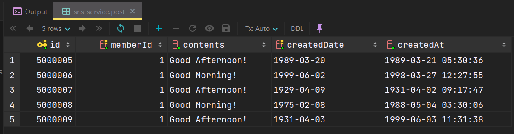

새롭게 트랜잭션을 걸어주고

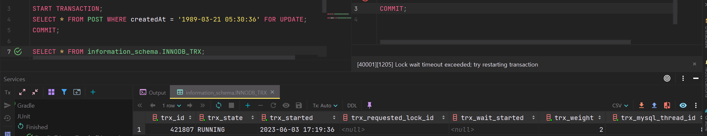

DATA\_LOCK에 개수를 조회해보면 21개가 잡혀있는 것을 확인할 수 있습니다.

즉 테이블 전체에 대한 락이 잡혀있다는 의미입니다.

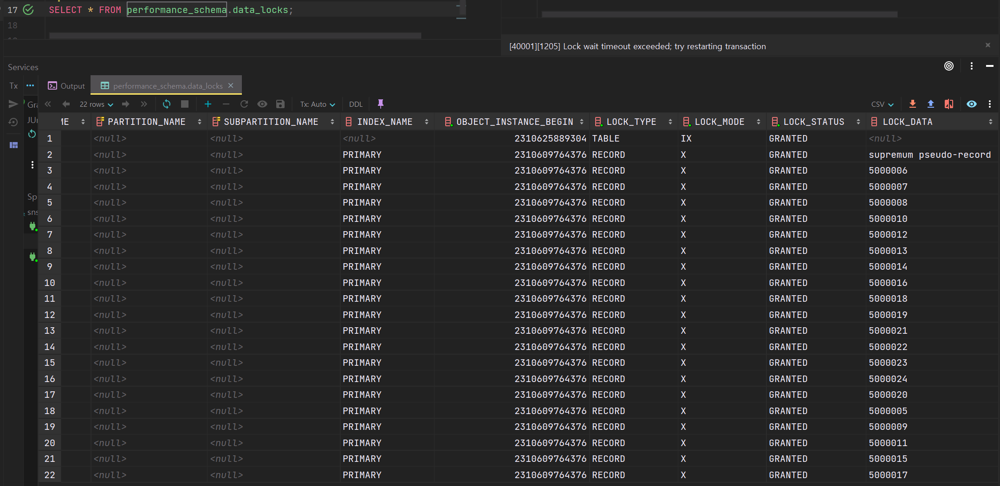

조건절을 잘못설정하면 테이블 전체에 대한 락이 걸릴 수 있습니다. 이로 인해 다른 트랜잭션이 해당 테이블에 접근하게 되면 먼저 실행된 트랜잭션이 끝나기 전까지 조회가 되지 않는 현상을 발견할 수 있습니다. 

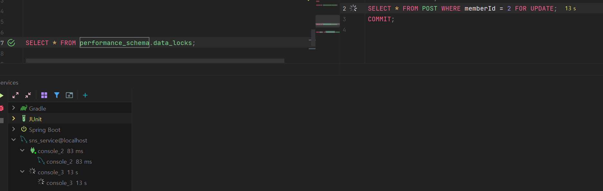

---

#### 정리

> MySQL에서 잠금은 row가 아니라 인덱스를 잠근다.  
> 인덱스가 없는 조건으로 Locking Read 시   
> 불필요한 데이터들이 잠길 수 있으므로 조심해야한다.

### 추천 정보

---

사실 락이라는 개념이 RDMBS 뿐만 아니라 정말 중요한 개념이기 때문에 추가적으로 함께 알아두면 좋은 몇가지 있어 참고하시면 도움이 되실 것입니다.

#### **Java에서의 동시성 이슈 제어방법**

1. **synchronized 키워드:** synchronized 키워드를 사용하여 메서드 또는 블록을 동기화할 수 있습니다. synchronized 키워드를 사용하면 한 번에 하나의 스레드만 해당 블록 또는 메서드에 접근할 수 있습니다. 이를 통해 공유 자원에 대한 동시 액세스를 제어할 수 있습니다.
2. **ReentrantLock 클래스:** ReentrantLock 클래스는 Lock 인터페이스의 구현체로서, 더 유연한 동기화를 제공합니다. ReentrantLock을 사용하면 명시적으로 락을 얻고 해제할 수 있으며, try-finally 블록을 사용하여 락을 안전하게 해제할 수 있습니다.
3. **AtomicInteger 및 Atomic 변수:** 자바의 java.util.concurrent.atomic 패키지에는 Atomic 변수가 포함되어 있습니다. 이 변수들은 원자적으로 증가, 감소 및 갱신될 수 있어 동시성 문제를 제어하는 데 사용할 수 있습니다.
4. **synchronized 블록:** synchronized 키워드를 사용하여 특정 블록을 동기화할 수 있습니다. 이렇게 하면 특정 코드 영역에서만 동시 액세스를 제어할 수 있습니다.
5. **volatile 키워드:**volatile 키워드를 사용하면 변수를 캐시하지 않고 항상 주 메모리에서 읽고 쓸 수 있습니다. 이를 통해 변수의 변경 사항을 모든 스레드에게 즉시 알릴 수 있습니다.
6. **ConcurrentHashMap 클래스:**ConcurrentHashMap은 스레드 안전한 맵으로, 여러 스레드에서 동시에 읽기 및 쓰기 작업을 수행할 수 있습니다. 내부적으로 분할된 세그먼트를 사용하여 동시성을 제어합니다.
7. **Executor 프레임워크:** 자바의 java.util.concurrent 패키지에는 Executor 프레임워크가 있습니다. 이를 사용하여 스레드 풀을 관리하고, 작업을 비동기적으로 실행하고, 동시성 이슈를 효율적으로 제어할 수 있습니다.

이외에도 자바에서는 동시성 이슈를 제어하기 위한 다양한 클래스와 도구가 있습니다. 선택할 방법은 상황과 요구 사항에 따라 다를 수 있습니다.

---

#### **분산환경에서의 동시성 이슈 제어방법**

1. **상태 공유 최소화:**동시성 이슈를 줄이기 위해 상태 공유를 최소화하는 것이 중요합니다. 상태 공유를 피하거나 최소화하기 위해 메시지 기반의 통신 방식을 사용하는 것이 일반적입니다. 각 프로세스 또는 스레드는 필요한 데이터를 메시지를 통해 전달하고, 상태를 공유하지 않도록 합니다.
2. **락의 사용 제한:**분산 환경에서 전역 락을 사용하는 것은 성능 저하와 확장성 문제를 야기할 수 있습니다. 대신, 락을 사용하는 대신 락 없이 동시성 제어를 할 수 있는 알고리즘을 고려해야 합니다. 예를 들어, CAS(Compare-and-Swap) 연산을 사용하는 비관적 락 대신 낙관적 락을 사용할 수 있습니다.
3. **분산 락:**분산 락은 분산 환경에서 동시성을 제어하는 데 사용됩니다. 여러 프로세스 또는 노드 간에 락을 획득하고 해제하는 프로토콜을 구현하여 동시성을 보장합니다. ZooKeeper, etcd 등과 같은 분산 코디네이터를 사용하여 분산 락을 구현할 수 있습니다.
4. **트랜잭션 처리:**분산 환경에서 데이터의 일관성을 보장하기 위해 트랜잭션 처리를 사용할 수 있습니다. ACID 원칙에 따라 트랜잭션을 정의하고, 분산 데이터베이스나 분산 트랜잭션 관리자를 사용하여 트랜잭션 처리를 관리합니다.
5. **분산 동시성 제어 알고리즘:**분산 환경에서 동시성 제어를 위한 특수한 알고리즘을 사용할 수 있습니다. 예를 들어, 분산 뮤텍스, 분산 세마포어, 분산 워크 스틸링 등과 같은 알고리즘을 사용하여 동시성을 관리합니다.
6. **쓰기 일관성 모델:**분산 환경에서 데이터의 일관성을 유지하기 위해 쓰기 일관성 모델을 사용할 수 있습니다. 예를 들어, 분산 데이터베이스에서는 Replication, Paxos, Raft 등과 같은 일관성 모델을 사용하여 데이터의 일관성과 동시성을 보장합니다.

분산 환경에서의 동시성 이슈는 더 복잡하고 어려운 문제일 수 있습니다. 이를 위해 분산 시스템 및 분산 알고리즘에 대한 깊은 이해가 필요합니다. 선택한 분산 시스템 및 동시성 제어 방법은 환경과 요구 사항에 따라 다를 수 있습니다.

* **MySQL의 넥스트 키락(갭락 + 레코드 락)이 등장한 배경**
  1. **일관성 유지:**MySQL은 다중 사용자 환경에서 동시성을 제어하고 데이터 일관성을 유지해야 합니다. 넥스트 키락은 여러 트랜잭션에서 동일한 인덱스 범위에 접근할 때 발생할 수 있는 일관성 문제를 해결하기 위해 도입되었습니다.
  2. **Phantom Read 방지:**넥스트 키락은 갭락을 사용하여 인덱스 범위 내의 존재하지 않는 레코드에 대한 쓰기 작업을 방지함으로써 Phantom Read 문제를 방지합니다. 즉, 다른 트랜잭션이 해당 범위에 새로운 레코드를 삽입하는 경우, 이를 감지하고 쓰기 작업을 차단합니다.
  3. **반복 가능한 읽기(Isolation Level: Repeatable Read):**넥스트 키락은 MySQL의 반복 가능한 읽기 격리 수준에서 필요한 일관성과 격리 수준을 제공합니다. 반복 가능한 읽기에서는 트랜잭션이 읽은 데이터가 그 트랜잭션이 종료될 때까지 변경되지 않음을 보장해야 합니다. 넥스트 키락은 이를 위해 인덱스 범위 내의 모든 레코드를 락으로 보호함으로써 반복 가능한 읽기를 지원합니다.
  4. **성능 향상:**넥스트 키락은 레코드 락보다는 더 큰 범위인 갭락을 사용하여 동시성을 제어합니다. 이를 통해 여러 트랜잭션이 동시에 다른 범위 내의 레코드에 접근할 수 있으며, 성능을 향상시킬 수 있습니다.

넥스트 키락은 MySQL의 InnoDB 스토리지 엔진에서 사용되며, 데이터베이스의 일관성과 격리 수준을 보장하는 데 중요한 역할을 합니다. 그러나 이는 락 경합과 데드락 등의 부작용을 가질 수 있으므로, 사용할 때 주의가 필요합니다.

---

#### **MySQL 외래키로 인한 잠금**

MySQL에서 외래키(Foreign Key)로 인한 잠금은 데이터 무결성을 보장하기 위해 발생하는 잠금 현상입니다. 외래키 제약조건을 가지는 테이블에서 데이터를 변경할 때, 관련된 다른 테이블의 데이터에 대한 잠금이 발생할 수 있습니다.   

외래키로 인한 잠금은 다음과 같은 상황에서 발생할 수 있습니다.

1. **외래키 무결성 검사**: 외래키 제약조건을 가지는 테이블에 데이터를 삽입, 수정, 삭제할 때, 관련된 다른 테이블의 데이터에 대한 잠금이 발생합니다. 이는 외래키 제약조건을 만족시키기 위해 필요한 잠금입니다.
2. **CASCADE 업데이트 및 삭제**: 외래키에 CASCADE 업데이트 또는 삭제 옵션이 설정되어 있는 경우, 외래키를 갖는 테이블의 데이터를 변경할 때 연관된 다른 테이블의 데이터도 함께 업데이트 또는 삭제될 수 있습니다. 이 때, 변경 작업에 따라 관련된 다른 테이블의 데이터에 대한 잠금이 발생합니다.

외래키로 인한 잠금은 데이터의 일관성을 보장하기 위해 필요한 잠금이지만, 잘못 사용하거나 부적절한 인덱스가 설정되어 있다면 잠금 경합이 발생하여 성능 저하를 초래할 수 있습니다. 이를 피하기 위해 다음과 같은 점을 고려할 수 있습니다.

1. **적절한 인덱스 사용**: 외래키를 갖는 열에 적절한 인덱스를 생성하여 조회 및 변경 작업을 최적화할 수 있습니다.
2. **작업 범위 최소화**: 관련된 다른 테이블의 데이터에 대한 잠금을 최소화하기 위해 변경 작업 범위를 최소화하는 것이 중요합니다. 필요한 경우, 트랜잭션을 적절히 분리하여 잠금 범위를 제어할 수 있습니다.
3. **CASCADE 옵션 주의**: CASCADE 업데이트 또는 삭제 옵션을 사용할 때는 주의해야 합니다. 잘못된 CASCADE 설정은 의도치 않은 데이터 변경이 발생할 수 있으므로, 신중하게 사용해야 합니다.

MySQL에서 외래키로 인한 잠금은 데이터 일관성을 보장하기 위한 중요한 기능이지만, 잠금 경합과 성능 저하에 대한 고려가 필요합니다. 데이터 모델링과 쿼리 작성 시 외래키 사용에 주의하고, 적절한 인덱스와 트랜잭션 관리를 통해 잠금 문제를 최소화할 수 있습니다.

---

#### **MySQL 데드락**

MySQL에서 **데드락(Deadlock)**은**두 개 이상의 트랜잭션이 상호간에 필요한 잠금(Lock)을 획득하려고 하며, 서로가 상대방의 잠금을 기다리는 상태에 놓이는 현상**을 말합니다. 이로 인해 **트랜잭션들이 무한히 기다리며 작업이 진행되지 않는 상태**가 됩니다.   

데드락이 발생하는 상황은 일반적으로 다음과 같습니다

1. **상호간의 순환적 잠금 요청**: 트랜잭션 A가 잠금 1을 획득하고, 트랜잭션 B가 잠금 2를 획득하기 위해 트랜잭션 A가 소유한 잠금 1을 기다릴 때, 동시에 트랜잭션 C가 잠금 1을 소유한 트랜잭션 B를 기다리는 순환적인 상태가 되면 데드락이 발생합니다.
2. **자원 경쟁**: 두 개 이상의 트랜잭션이 동시에 동일한 자원(테이블, 레코드, 인덱스 등)에 접근하며, 그 자원에 대한 잠금을 획득하기 위해 경쟁하는 상황에서 데드락이 발생할 수 있습니다.

MySQL에서 데드락을 해결하기 위해 몇 가지 방법을 사용할 수 있습니다:

1. **데드락 감지 및 해제**: MySQL은 데드락을 감지하고 해제하기 위한 기능을 제공합니다. innodb\_deadlock\_detect 설정을 활성화하면 MySQL이 데드락을 감지하고, 데드락이 발생한 경우 잠금을 해제하여 트랜잭션이 다시 진행될 수 있도록 합니다.
2. **잠금 타임아웃 설정**: MySQL에서는 innodb\_lock\_wait\_timeout 설정을 통해 잠금 대기 시간을 제한할 수 있습니다. 이를 통해 트랜잭션이 일정 시간 동안 잠금을 기다린 후 자동으로 롤백되도록 설정할 수 있습니다.
3. **트랜잭션 리팩토링**: 트랜잭션을 리팩토링하여 데드락 발생 가능성을 줄일 수 있습니다. 트랜잭션 범위를 최소화하거나, 잠금 요청 순서를 통일하여 상호간의 순환적 잠금 요청을 방지할 수 있습니다.
4. **인덱스 및 쿼리 최적화**: 적절한 인덱스를 사용하고, 쿼리를 최적화하여 자원 경쟁을 줄이는 방법도 효과적입니다. 이를 통해 트랜잭션 간의 잠금 경합을 최소화할 수 있습니다.

데드락은 복잡한 문제이며, 상황에 따라 다양한 원인과 해결 방법이 존재할 수 있습니다. MySQL에서는 위의 방법들을 통해 데드락을 예방하고 해결할 수 있습니다.

---

#### **동시성 이슈가 발생하는 패턴**

동시성 이슈는 다중 사용자 환경에서 여러 작업이 동시에 수행될 때 발생할 수 있는 문제입니다. 몇 가지 동시성 이슈가 발생할 수 있는 패턴은 다음과 같습니다.

1. **경쟁 상태 (Race Condition)**: 둘 이상의 작업이 서로 동시에 접근하여 공유 데이터를 변경하려고 할 때 발생합니다. 이러한 상황에서는 작업의 순서나 타이밍에 따라 예상치 못한 결과가 발생할 수 있습니다.
2. **잘못된 읽기 (Dirty Read)**: 하나의 작업이 데이터를 변경하는 도중에 다른 작업이 변경되지 않은, 일시적이고 유효하지 않은 데이터를 읽을 때 발생합니다. 변경 중인 데이터에 대한 잠금이 없는 경우에 발생할 수 있습니다.
3. **잘못된 변경 (Lost Update)**: 둘 이상의 작업이 동시에 동일한 데이터를 수정하려고 할 때 발생합니다. 이러한 상황에서는 마지막으로 수행된 작업의 결과로 데이터가 덮어씌워지므로, 이전 작업의 결과가 손실될 수 있습니다.
4. **교착 상태 (Deadlock)**: 둘 이상의 작업이 서로가 소유한 잠금을 기다리는 상태에 놓이고 더 이상 진행할 수 없는 상태입니다. 이 상태에서는 작업들이 서로의 잠금을 해제하기를 기다리며 무한히 대기합니다.
5. **병목 현상 (Contention)**: 여러 작업이 동시에 동일한 자원(데이터베이스 테이블, 네트워크 연결 등)에 접근하려고 할 때 발생합니다. 이로 인해 자원의 처리 속도가 떨어져 전체 시스템의 성능이 저하될 수 있습니다.

이러한 동시성 이슈들은 특정 환경과 작업 패턴에 따라 발생할 수 있습니다. 적절한 동시성 제어 기법과 데이터베이스 트랜잭션 관리를 통해 이러한 이슈를 예방하거나 해결할 수 있습니다.
