[동시성 제어하기](tistory-406.html)를 공부한 내용을 바탕으로 좋아요 기능을 구현해보려고 합니다. 

[[DB] 동시성 제어하기

동시성 제어하기 멀티 스레드 환경에 대한 이해 대부분 하나의 웹 서버는 여러 개의 요청을 동시에 수행할 수 있습니다. 코드로 보면 작성한 코드 한줄은 동시에 수행 될 수 있다는 말입니다. 코

to-be-a-artist.tistory.com](tistory-406.html)

## **좋아요 기능 구현하기**

---

**좋아요 기능**은 SNS 서비스에 많이 사용되고 있는 기능 중 하나로 글에 대한 공감이나 감정 표현을 할 때 좋아요 라는 버튼을 통해 상대방에게 공감이나 감정을 전달하는 기능입니다.

좋아요 기능을 2가지 방식으로 구현해보려고 합니다.

1. 게시물 테이블에 컬럼을 추가하는 방법
2. 낙관적 락을 적용한 방법

두 가지 방식으로 구현하여 서로의 장단점을 비교해보려고 합니다. 

### **게시물 테이블에 컬럼을 추가하는 방법**

---

#### **필드 추가**

Long 타입으로 좋아요 개수를 의미하는 `likes` 필드를 추가합니다.

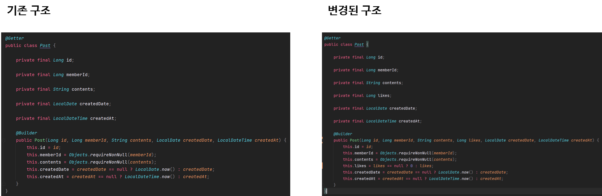

기존에 데이터가 많은 테이블에 컬럼을 추가하는 것도 꽤나 많은 작업이 필요합니다.

가령 좋아요 개수 같은 경우에는 Default 0을 설정하면 되기 때문에 문제가 되지 않습니다.

그런데 테이블에 Row 수가 100만 개, 1억 개 정도처럼 데이터 사이즈가 많아지면 컬럼을 추가하고 Default 값을 넣어주는 작업이 **테이블 락**을 야기시키기도 합니다. 

만약 토이프로젝트가 아닌 24시간 운영하는 서비스라면 이러한 작업은 어려울 것입니다.

이러한 경우에는 별도의 마이그레이션 배치를 만들어서 조금씩 조금씩 데이터를 넣는 전략을 수행하거나 조회 시점에 Null 이면 값을 채워주는 전략을 사용하기도 합니다.

위에 변경된 구조를 보면 좋아요 개수가 NULL일 경우 0으로 설정해 주도록 작성한 이유입니다.

---

#### **테이블 컬럼 추가**

애플리케이션에서 조회 시점에 **Null** 일 경우 0으로 처리해 주기 때문에 **Null을** 허용해 줍니다.

```sql
ALTER TABLE POST ADD COLUMN `likes` int null AFTER `contents`;
```

600만 건이 넘는 더미 데이터가 있기 때문에 NULL로 처리하는데도 많은 시간이 소요됩니다.

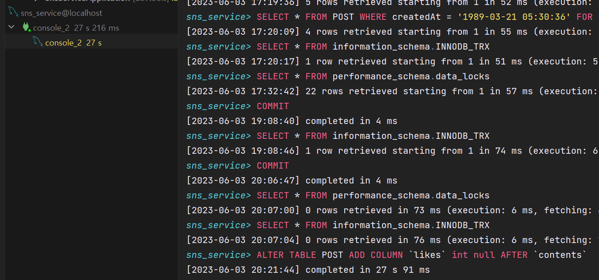

---

#### **Repository 맵핑**

Jdbc 템플릿을 이용하고 있기 때문에 Repository에 컬럼을 추가해 주는 작업이 필요합니다.

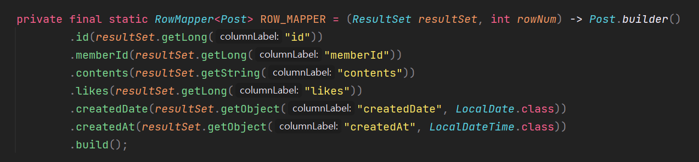

POST 객체를 엔티티로 바로 주는 것이 아니라 DTO를 새로 만들었다면 매핑하는 부분에도 넣어주셔야 합니다.

토이 프로젝트로 간단한 게 구현하기 위해 DTO를 구현하지 않았습니다.

---

#### **테스트**

정상적으로 동작하는지 파악하기 위해 Swagger를 이용해 간단하게 테스트해 보겠습니다.

memberId가 1인 사용자가 작성한 게시글을 조회한 결과를 보면 좋아요 개수가 모두 0으로 출력되는 것을 확인할 수 있습니다.

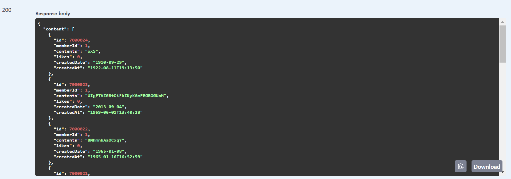

---

#### **좋아요 기능 구현**

좋아요 기능 로직은 다음과 같습니다.

1. 게시글 조회
2. 게시글 좋아요 업데이트(좋아요 개수 + 1)

```java
package com.example.domain.post.service;

@RequiredArgsConstructor
@Service
public class PostWriteService {

    private final PostRepository postRepository;

    public void likePost(Long postId) {
        Post post = postRepository.findById(postId).orElseThrow();
        post.incrementLike();
        postRepository.save(post);
    }
}
```

해당 기능을 테스트해 보면 다음과 같이 정상적으로 동작함을 확인할 수 있습니다.

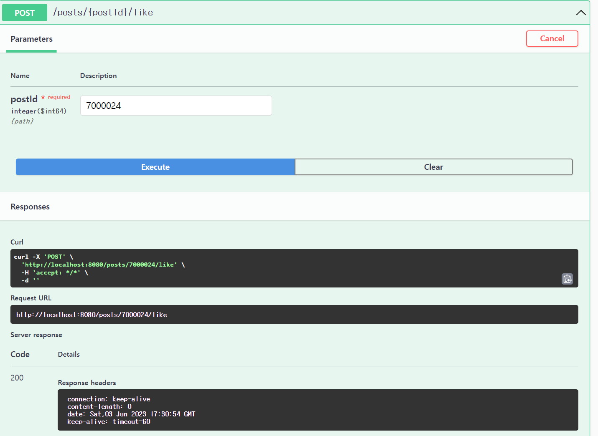

구현이 끝났다라고 하면 `**동시성 제어하기**` 포스팅을 다시 확인해 주시기 바랍니다.

앞선 포스팅에서 말씀드렸던 것처럼 읽기와 업데이트를 하는 로직은 동시성 문제가 발생할 수 있는 일반적인 패턴입니다.

디버그 모드를 통해 동시성 제어 테스트를 진행해 봅시다.

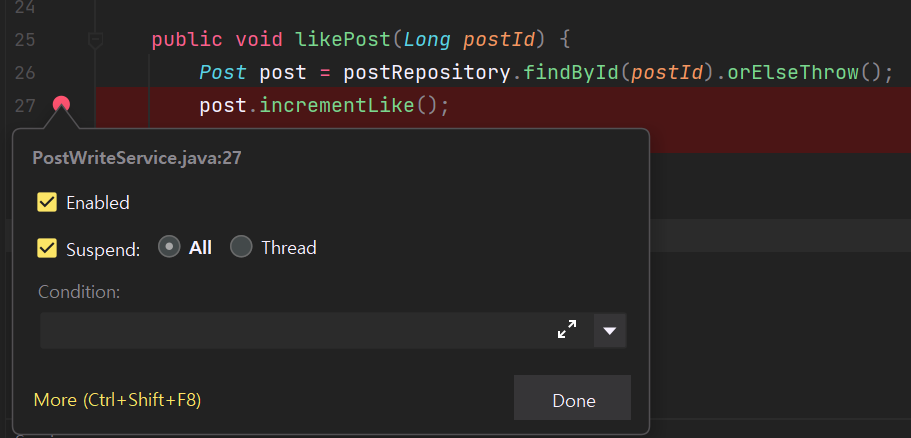

Intellij 기준 디버그 모드

**Suspend**가 **Default**로 **ALL**로 되어있을 텐데 **ALL**로 설정할 경우 1개밖에 처리를 못하고 동시에 요청을 보내더라도 기다리게 되기 때문에 **Suspend**를 **Thread**로 변경해주셔야 합니다.

여러 가지 방법으로 동시 요청을 할 수 있는 필자는 Swagger 페이지를 두 개를 켜서 하는 방식으로 진행했습니다.

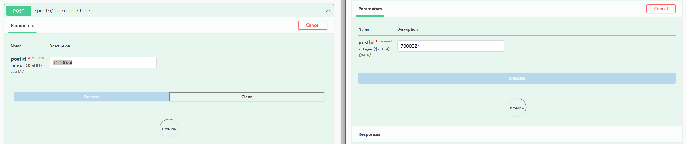

디버그를 통해 확인해 보면 2번의 요청이 들어온 것을 확인할 수 있습니다.

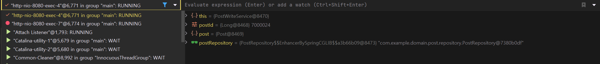

두 번의 요청을 처리해 주면 좋아요가 기존의 1에서 3이 될 것입니다.


그런데 데이터를 실제로 조회해 보면 2로 되어 있습니다...

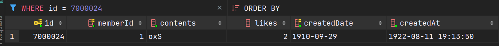

두 요청 모두 동일한 원본 데이터 좋아요 1이었던 원본 데이터를 사용하였기 때문에 발생한 문제입니다.

그렇기 때문에 조회 2번 업데이트 2번이 발생하였지만, 실제 값의 변화는 조회 1번, 업데이트 1번 발생한 것과 같은 결과가 만들어지게 되는 것입니다.

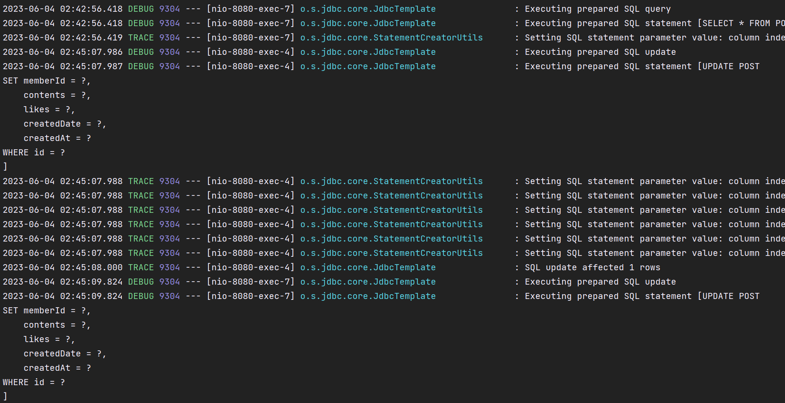

동시성 문제를 해결할 수 있는 방법이 다양한데 그중 **MySQL**에서 사용할 수 있는 방식 `SELECT... **FOR UPDATE**`를 사용해 해결해보려고 합니다.

* 잠금획득하기 위해서는 트랜잭션을 반드시 설정해주셔야 합니다.
* 모든 조회에 잠금 획득하면 성능저하가 발생할 수 있기 때문에 파라미터로 전달받도록 하였습니다.  
  (참고로 JPA에서는 어노테이션을 통해 제어할 수 있습니다)

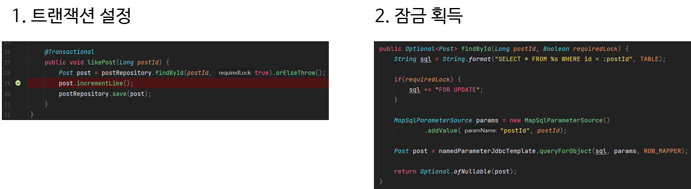

좋아요 기능에 대해 잠금 획득을 설정한 후 실제로 정상 동작하는지 확인하기 위해 동시 요청을 시도해 보겠습니다.

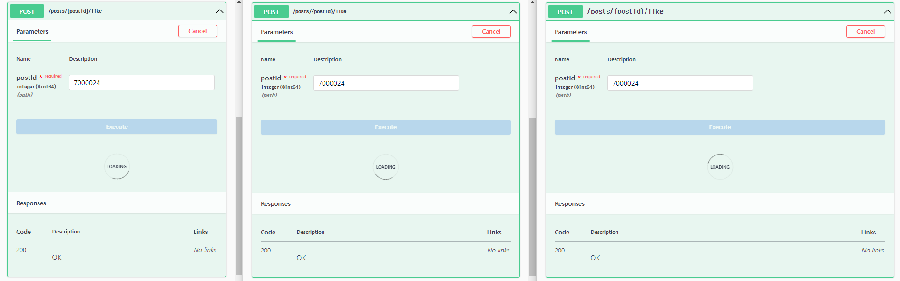

이번에는 3번의 요청을 동시에 요청했습니다.

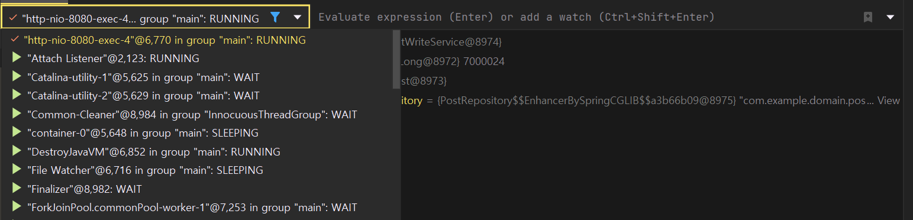

트랜잭션 요청이 1개 존재하는 것을 확인할 수 있고 요청 시간이 지연되면서 다른 요청이 Timeout 되는 현상을 확인할 수 있습니다.

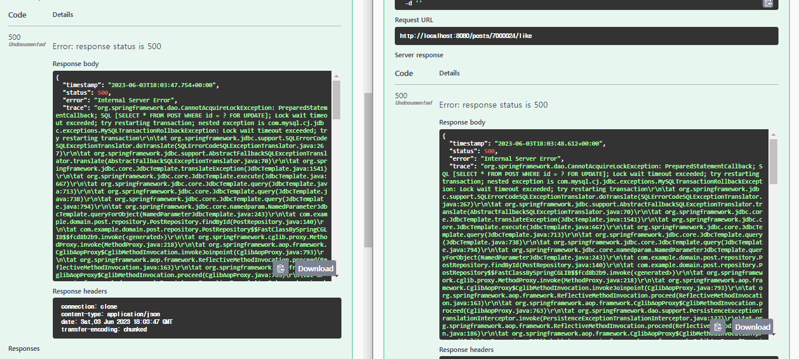

다시 빠르게 진행하면 조회 3번에 업데이트 3번이 순차적으로 발생하였고 좋아요가 5가 되는 것을 확인할 수 있습니다.

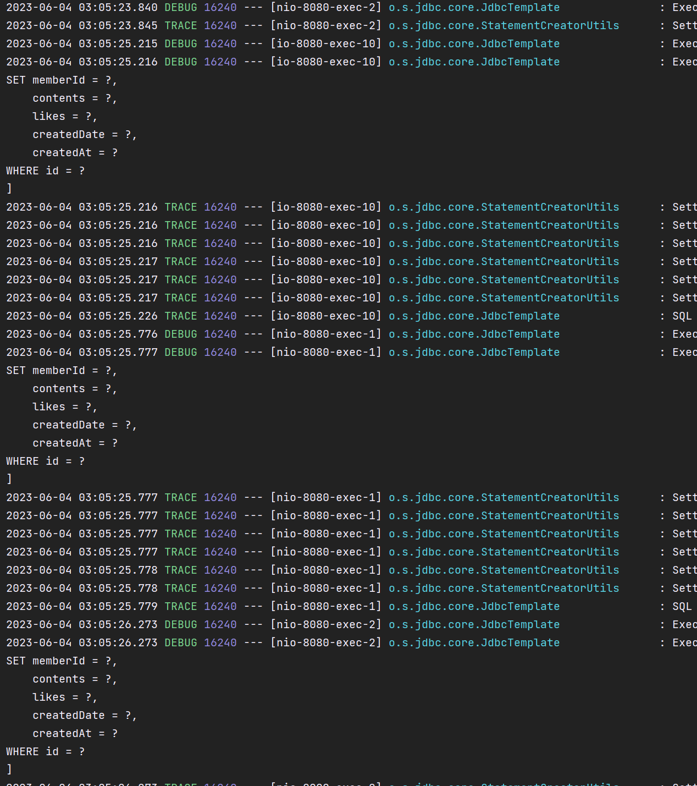

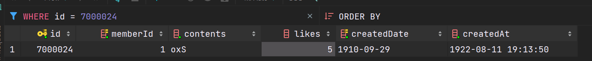

### 낙관적 락

---

#### 낙관적 락

`SELECT... **FOR UPDATE**`를 통해 동시성을 줄 세워서 좋아요 기능을 구현했습니다.

이와 같이 동시성 제어를 위한 가장 보편적인 방법은 락을 통한 줄 세우기인데 이를 **비관적 락(Pessimistic Lock)**이라고 부릅니다.

**비관적 락**은 동시성 이슈가 발생할 것이라고 비관적으로 생각하고 미리 줄 세워지도록 만든 것입니다.

하지만 **락을 통한 동시성 제어는 불필요한 대기 상태**를 만듭니다.

특히나 **MySQL에서는 인덱스를 잠그기 때문에 Where문 조건에 따라서 불필요한 데이터까지 잠기기**도 합니다.

동시성이 빈번하지 않은 쿼리라고 판단되는데 락을 걸게 되면 이로 인해 다른 쿼리들이 대기하는 현상으로 이어지게 될 것입니다.

> 동시성 이슈가 빈번하지 않길 기대하고,  
> 애플리케이션에서 제어한다가 낙관적 락의 기본 개념입니다.

---

#### 낙관적 락에서는 어떻게 제어할까?

낙관적 락에서는 애플리케이션에서  **CAS**(Compare and set) 연산을 통해 제어합니다.

영어단어 그대로 먼저 비교를 하고 그렇지 않으면 하지 않겠다는 개념입니다.

예제를 통해 이해해 봅시다.

아래 그림을 보면 이전 예시와 다르게 버전이라는 것이 추가되었습니다.

낙관적 락에서는 레코드마다 버전관리를 하여 내가 조회했던 버전이 맞는지 확인하고, 맞다면 업데이트를 하고 틀리면 하지 않는 방식입니다.


같은 코드에 2개의 트랜잭션이 동시에 발생한 상황입니다.

1. **트랜잭션 1**이 강호동의 잔고를 **조회**합니다(버전 포함) => **READ** 강호동 잔고 (10,000, 1)
2. **트랜잭션 1**이 끝나기 전에 **트랜잭션 2**가 강호동의 잔고 **조회** => **READ** 강호동 잔고 (10,000, 1)  

   현재까지는 트랜잭션 1과 트랜잭션 2가 동일한 버전 1을 읽은 상태입니다.  
   읽을 때는 락을 잡지 않기 때문에 서로 기다리지 않습니다.
3. **트랜잭션 1**이 강호동의 잔고에서 출금하고 **버전을 업데이트** => **UPDATE** 강호동 잔고 (5,000, 2)  

   트랜잭션 1이 끝났을 때는 강호동 잔고는 5,000원이고 버전 2가 됩니다.
4. 트랜잭션 2가 강호동의 잔고에서 출금을 시도 => UPDATE 강호동 잔고(5,000, 1)  

   버전이 일치하지 않기 때문에 실패

낙관적 락은 실패에 대한 처리를 직접 구현해주어야 한다는 단점이 있습니다.

락을 통해 제어를 할 때는 실패하지 않고 기다리므로 충돌했을 때에 처리를 구현하지 않습니다.

낙관적 락은 충돌했을 때 실패해 버리는데 이 경우 업데이트가 되지 않기 때문에 재시도를 하든 알림을 보내든 아니면 버리든 이러한 전략들을 선택해서 직접 구현해야 합니다.

만약 재시도를 하기로 했다면 이것 또한 어려운 문제가 될 수 있습니다. try-catch 문으로 묶어서 재시도를 하게 되면 재시도에 대한 실패가 또 발생할 수 있습니다. 그래서 재시도를 할 때는 비동기로 처리하거나 다른 방법은 선택하기도 합니다.

JPA를 사용하면 **Optimistic Locking**이라는 어노테이션을 엔티티에 붙여줌으로써 자동으로 구현해 줍니다.

---

#### 낙관적 락 구현

Jdbc 템플릿을 이용하므로 **낙관적 락(**Optimistic Locking)****을 직접 구현해주어야 합니다.

**낙관적 락**의 개념을 제대로 이해했다면  구현은 어렵지 않습니다.

**필드 추가**

**낙관적 락**에 필요한 것은 버전필드이므로 **버전필드**를 **추가**해주어야 합니다.

```java
package com.example.domain.post.entity;

@Getter
public class Post {

    private final Long id;

    private final Long memberId;

    private final String contents;

    private Long likes;

    private final Long version;

    private final LocalDate createdDate;

    private final LocalDateTime createdAt;

    @Builder
    public Post(Long id, Long memberId, String contents, Long likes, LocalDate createdDate, LocalDateTime createdAt) {
        this.id = id;
        this.memberId = Objects.requireNonNull(memberId);
        this.contents = Objects.requireNonNull(contents);
        this.likes = likes == null ? 0 : likes;
        this.createdDate = createdDate == null ? LocalDate.now() : createdDate;
        this.createdAt = createdAt == null ? LocalDateTime.now() : createdAt;
    }

    public void incrementLike() {
        likes += 1;
    }
}
```

버전 업데이트는 엔티티 클래스에 넣는 것보다는 모든 업데이트 쿼리에서 버전이 올라가야 하므로 Repostiory에 넣어주는 것이 좋습니다.

Repository 업데이트

업데이트가 발생할 때마다 버전을 업데이트해 주고 버전이 일치하는지 조건문에 추가해 주었습니다.

추가적으로 업데이트된 Row 수를 통해 실제 업데이트 되었는지 판단하고 업데이트되지 않았다면 에러를 던지도록 실패에 대한 처리를 구현했습니다.

```java
private Post update(Post post) {
    String sql = String.format("""
            UPDATE %s
            SET memberId = :memberId,
                contents = :contents,
                likes = :likes,
                version = :version + 1,
                createdDate = :createdDate,
                createdAt = :createdAt
            WHERE id = :id AND version = :version
            """, TABLE);

    SqlParameterSource params = new BeanPropertySqlParameterSource(post);
    int updatedRowCount = namedParameterJdbcTemplate.update(sql, params);
    System.out.println("업데이트 Row 수: " +  updatedRowCount);

    if(updatedRowCount == 0) {
        throw new RuntimeException("갱신 실패");
    }

    return post;
}
```

**컬럼 추가**

버전 관리를 위해 테이블에 컬럼을 추가해주셔야 합니다.

```sql
ALTER TABLE POST ADD COLUMN `version` int default 0 AFTER `likes`;
```

좋아요와 다르게 디폴트 값으로 0을 주었는데 디폴트 값을 설정한 이유는 Null일 경우 DB와 상태가 달라서 문제가 생길 수 있기 때문에 디폴트 값으로 0을 설정해 주었습니다.

**서비스 로직 업데이트**

낙관적 락은 락제어가 필요 없으므로 파라미터를 통해 락이 설정되지 않도록 변경해주셔야 합니다.

```java
package com.example.domain.post.service;

@RequiredArgsConstructor
@Service
public class PostWriteService {

    private final PostRepository postRepository;

    /**
     * 비관적 락
     */
    @Transactional
    public void likePost(Long postId) {
        Post post = postRepository.findById(postId, true).orElseThrow();
        post.incrementLike();
        postRepository.save(post);
    }

    /**
     * 낙관적 락
     */
    public void likePostWithOptimisticLock(Long postId) {
        Post post = postRepository.findById(postId, false).orElseThrow();
        post.incrementLike();
        postRepository.save(post);
    }
}
```

**테스트**

Swagger를 통해 간단하게 테스트를 진행해 보겠습니다.

먼저 업데이트 이전에 좋아요 개수는 다음과 같이 5입니다.

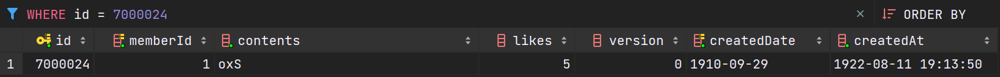

좋아요 요청이 동시에 2번 발생할 경우 정상적으로 2개 업데이트되는지 확인해 봅시다.

다음과 같이 정상적으로 쿼리가 발생하였고,

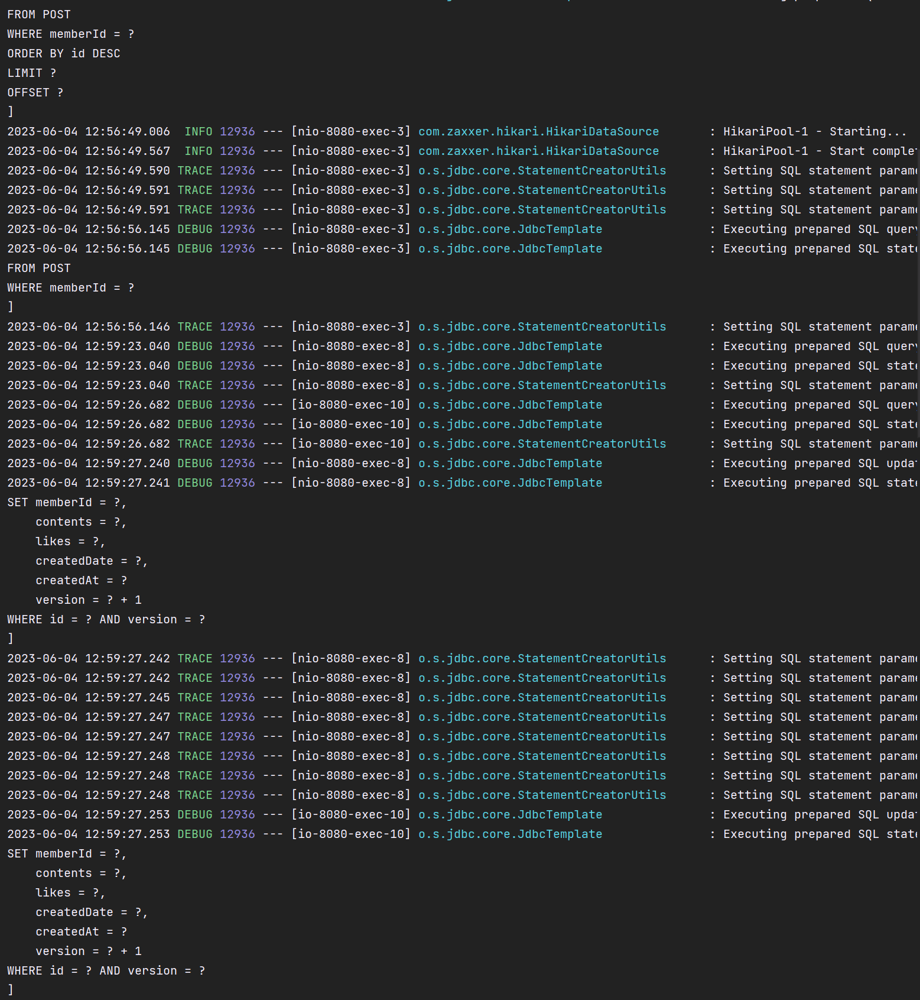

1개만 업데이트된 것을 확인할 수 있습니다.

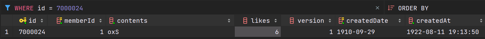

2번째 요청이 갱신 실패가 된 것을 확인할 수 있고 이를 통해 정합성을 지킬 수 있습니다.

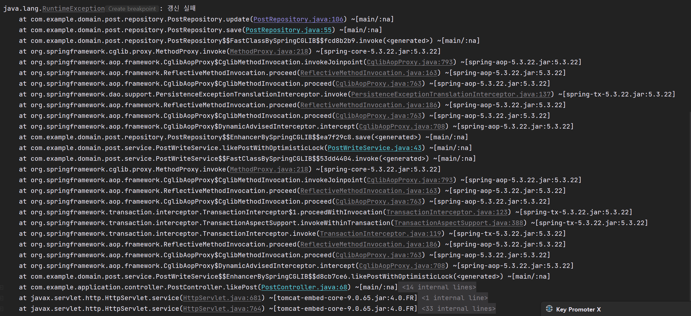

락을 잡는 코드와 비교해 보면 락을 잡는 코드는 트랜잭션 어노테이션도 붙여주고 Lock도 설정해주어야 합니다.

즉 트랜잭션도 열어주어야 하고 커밋도 주어야하기 때문에 낙관적락이 각각 트랜잭션으로 동작하여 성능 이점이 더 클 것입니다.

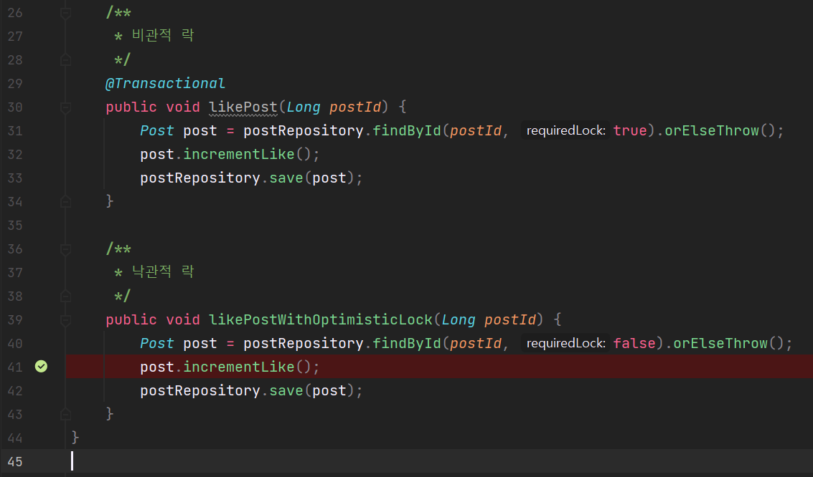

JPA를 사용하지 않고 있어 직접 구현해주어야 하지만, 실제로 실무에서는 JPA 어노테이션 하나만으로 간단하게 구현되기 때문에 부담 없이 구현을 추가할 수 있습니다.

그래서 정합성이 중요한 데이터들은 Optimistic Locking 어노테이션을 추가해서 Optimistic Locking과 비관적을 추가해서 섞어서 쓰기도 합니다.

분산환경으로 가게 되면 다른 데이터베이스를 사용할 수 있기 때문에 비관적 락을 간단하게 사용할 수 없습니다.

결국에는 로직의 실수로 인해 구멍이 생길 수 있는데 비관적 락은 개발자가 직접 걸어주어야 하기 때문에 만에 하나라도 데이터 정합이 일어났을 때도 데이터 정합성을 지키기 위해서 Optimistic Locking을 같이 사용하는 경우도 있습니다.

### 좋아요 수 집계 테이블 분리

---

컬럼으로 좋아요를 만들었는데 게시물에 컬럼을 추가하여 만드는 방식에는 성능적인 저하는 물론이고 유저 1명당 게시물에 좋아요를 여러 번 눌러도 좋아요 수가 올라가는 치명적인 문제가 발생할 수 있습니다.

예를 들어 게시물 1개가 인기 게시물이어서 100만 명이 좋아요를 눌렀다고 가정해 봅시다. 1개 레코드에 서로 업데이트를 치기 위해서 경합이 발생하게 됩니다.

비관적 락으로 정합성을 보장하게 되면 동일 게시물에 좋아요 요청이 줄 지어 이어지게 되면서 처리 속도가 굉장히 느려지게 될 것입니다.

낙관적 락을 사용하게 되면 끊임없이 실패가 발생하게 될 것입니다.

이를 테이블을 분리해서 성능 병목 지점을 해소하고 회원 정보를 함께 저장해서 추후에 1개 게시물에 1개 좋아요만 가능하게 하고 회원마다 좋아요 한 게시물만 모아서 볼 수 있게 할 수 있습니다.

이러한 맥락에서 좋아요 테이블을 분리해보려고 합니다.

#### **엔티티 생성 및 테이블 생성**

엔티티에는 `누가 언제 어떤 게시물`을 좋아요 눌렀는지만 알면 되기 때문에 많은 필드가 필요하지 않습니다.

```java
package com.example.domain.post.entity;

@Getter
public class PostLike {
    private final Long id;

    private final Long memberId;

    private final Long postId;

    private final LocalDateTime createdAt;

    @Builder
    public PostLike(Long id, Long memberId, Long postId, LocalDateTime createdAt) {
        this.id = id;
        this.memberId = Objects.requireNonNull(memberId);
        this.postId = Objects.requireNonNull(postId);
        this.createdAt = createdAt == null ? LocalDateTime.now() : createdAt;
    }
}
```

#### 

엔티티에 작성한 대로 테이블을 생성해 주면 됩니다.

```sql
CREATE TABLE PostLike (
    id int auto_increment,
    memberId int not null,
    postId int not null,
    createdAt datetime not null,
    CONSTRAINT POSTLIKE_ID_INDEX PRIMARY KEY (id)
);
```

---

#### **서비스 로직 분리**

좋아요 기능이 Post 엔티티에서 분리되어 PostLike 엔티티로 빠졌으므로 PostLike 서비스를 분리해서 만들어주는 것이 좋습니다.

사실 좋아요 레코드는 타임라인과 스키마와 기능이 100% 일치하고 호출 시점과 조회 요구사항이 다릅니다.

그렇다면 타임라인 테이블에 타입을 붙여 같이 쓸까? 아니면 분리를 할까?라는 고민을 할 수 있습니다.

꼭 스키마가 같다로 해서 테이블을 같이 쓰려고 하면 안 됩니다. 좋아요는 타임라인과 요구사항이 정말 다릅니다.

타임라인은 타임라인을 빠르게 가져오기 위한 인덱스 테이블이고, 좋아요 테이블은 좋아요 집계가 메인인 테이블입니다.

그래서 두 개의 테이블이 스키마는 같지만 요구사항이 완전히 다르기 때문에 합치시면 안 됩니다.

지금은 코드가 거의 비슷하지만, 업무라면 비즈니스 결정에 따라서 완전히 달라질 수 있기 때문에 합치시면 안 됩니다.

```java
package com.example.domain.post.service;

@RequiredArgsConstructor
@Service
public class PostLikeWriteService {

    private final PostLikeRepository postLikeRepository;


    public Long create(Post post, MemberDto memberDto) {
        PostLike postLike = PostLike
                .builder()
                .memberId(memberDto.id())
                .postId(post.getId())
                .build();

        return postLikeRepository.save(postLike).getPostId();
    }

}
```

---

#### **Repository 구현**

```java
package com.example.domain.post.repository;

@RequiredArgsConstructor
@Repository
public class PostLikeRepository {

    private static final String TABLE = "PostLike";

    private final NamedParameterJdbcTemplate namedParameterJdbcTemplate;

    private final static RowMapper<PostLike> ROW_MAPPER = (ResultSet resultSet, int rowNum) -> PostLike.builder()
            .id(resultSet.getLong("id"))
            .memberId(resultSet.getLong("memberId"))
            .postId(resultSet.getLong("postId"))
            .createdAt(resultSet.getObject("createdAt", LocalDateTime.class))
            .build();

    public PostLike save(PostLike postLike) {
        if (postLike.getId() == null) {
            return insert(postLike);
        }

        throw new UnsupportedOperationException("Timeline은 갱신을 지원하지 않습니다.");
    }

    private PostLike insert(PostLike postLike) {
        SimpleJdbcInsert simpleJdbcInsert = new SimpleJdbcInsert(namedParameterJdbcTemplate.getJdbcTemplate())
                .withTableName(TABLE)
                .usingGeneratedKeyColumns("id");

        SqlParameterSource params = new BeanPropertySqlParameterSource(postLike);
        Long id = simpleJdbcInsert.executeAndReturnKey(params).longValue();

        return PostLike.builder()
                .id(id)
                .memberId(postLike.getMemberId())
                .postId(postLike.getPostId())
                .createdAt(postLike.getCreatedAt())
                .build();
    }

}
```

---

#### **Usacase**

의존성을 낮추기 위해 Usacase로 작성해 보면 다음과 같습니다.

```java
package com.example.application.usecase;

@RequiredArgsConstructor
@Service
public class CreatePostLikeUsacase {

    private final PostReadService postReadService;
    private final MemberReadService memberReadService;
    private final PostLikeWriteService postLikeWriteService;

    public void execute(Long postId, Long memberId) {
        Post post = postReadService.getPost(postId);
        MemberDto member = memberReadService.getMember(memberId);
        postLikeWriteService.create(post, member);
    }
}
```

---

#### **테스트**

Swagger를 통해 간단히 테스트해 보았습니다.

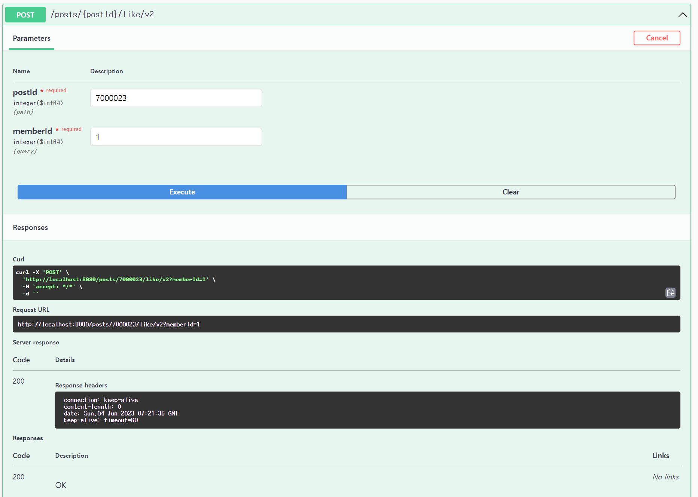

객체가 정상적으로 생성된 것을 확인할 수 있습니다.

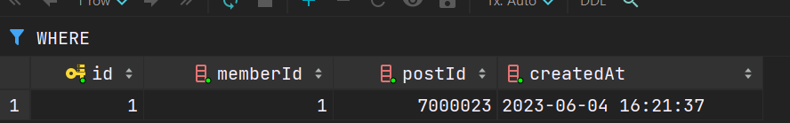

객체는 생성되었지만, 좋아요 개수는 올려가지 않을 것입니다. 게시글 조회 기능은 컬럼을 보고 있기 때문에  수정해주어야 합니다.

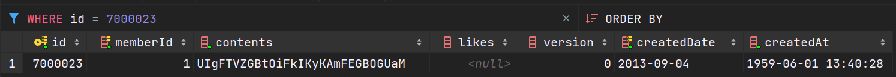

좋아요 객체 생성 작업이 들어갔지만, Write 성능이 훨씬 좋아집니다.

성능이 좋아지는 이유는

1. INSERT 이기 때문에 **POST**에 락을 걸지 않아도 됩니다.
2. 데이터 정합성 보장(한 개에 데이터에 UPDATE 요청이 지속적으로 발생하지 않음)
3. 성능 이외에도 다양한 요구사항을 처리할 수 있음(회원별 좋아요 조회 등)

---

#### 조회 기능 업데이트

**DTO 생성**

조회 기능은 지금은 POST 엔티티를 그대로 내려주고 있는데 DTO로 분리하여 좋아요 개수를 매핑시켜주려고 합니다.

```java
public record PostDto(
        Long id,
        String contents,
        LocalDateTime createdAt,
        Long likes
) {
}
```

**좋아요 Repository 업데이트**

```java
public Long count(Long postId) {
    String sql = String.format("""
            SELECT count(id)
            FROM %s
            WHERE postId = :postId
            """, TABLE);

    MapSqlParameterSource params = new MapSqlParameterSource()
            .addValue("postId", postId);

    return namedParameterJdbcTemplate.queryForObject(sql, params, Long.class);
}
```

**게시물 조회 업데이트**

```java
public Page<PostDto> getPosts(Long memberId, Pageable Pageable) {
    return postRepository.findAllByMemberId(memberId, Pageable).map(this::fromPost);
}

private PostDto fromPost(Post post) {
    return new PostDto(
            post.getId(),
            post.getContents(),
            post.getCreatedAt(),
            postLikeRepository.count(post.getId())
    );
}
```

---

#### 조회 기능 업데이트 테스트

**Swagger**를 이용해 게시글을 조회해 보면 Id 700023인 게시글의 좋아요 개수가 변동된 것을 확인할 수 있습니다.

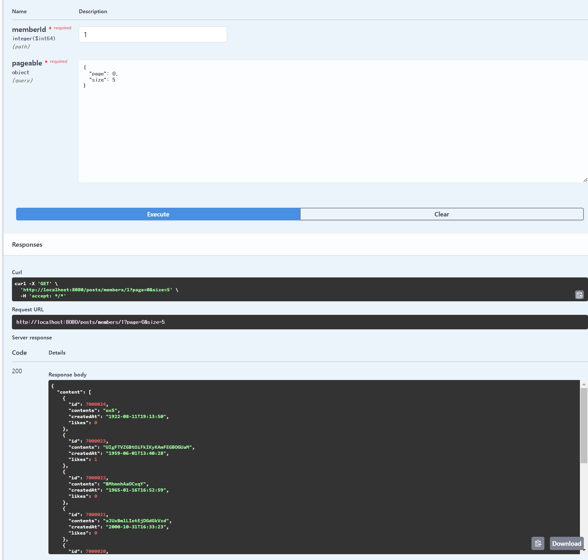

---

#### 정리

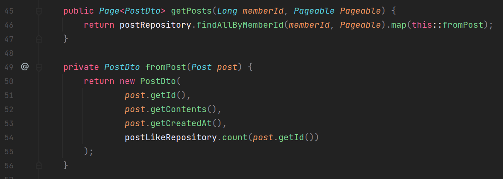

쓰기 성능을 얻은 것은 확실히 느낄 수 있지만, 조회 때 매번 개수를 조회하는 쿼리가 나가고 있습니다.

간단하게 구현하기 위해 DTO 코드에  Count 쿼리를 넣어두었는데 DTO로 변환하는 간단한 매핑 작업에는 IO 작업이 있으면 예상치 못한 일들이 일어날 수 있습니다. Mapper의 로직들은 파라미터로 빼서 전달해 주는 것이 좋습니다.

매번 PostDto를 조회할 때마다 PostLike 쿼리의 Count 쿼리가 날아가는데 PostLIke 데이터가 많이 쌓일 때마다 즉 조회 시점에 부하가 계속 쌓이게 될 것입니다. 결국 트레이드오프가 발생하게 됩니다.

쓰기 성능을 올리기 위해서 조회 성능을 희생한 것입니다. 이러한 문제는 MySQL 외에도 다른 기술들을 이용해서 해결할 수 있습니다.

주기적으로 likeCount 칼럼에 데이터를 넣어주는 방식을 사용하면 해결할 수 있습니다.

예시로 1초에 엄청난 조회가 발생하는 게시글이라면 1초에 한 번씩 카운트 쿼리를 넣어주는 것보다 이것을 조회해서 쓰게 되면 1초에 한 번만 조회하게 되므로 엄청난 성능을 올릴 수 있습니다.

### 읽기와 쓰기의 트레이드오프

---

#### 좋아요 구현

좋아요 기능을 총 3가지 구현하였습니다.

1. 게시물에 컬럼 추가를 통한 구현 - 비관적 락
2. 게시물에 컬럼 추가를 통한 구현 - 낙관적 락
3. 좋아요 테이블 추가를 통한 구현

크게는 컬럼 추가를 통한 방법과 테이블 추가를 통한 방법 2가지로 구분할 수 있습니다.

**컬럼을 통한 구현**

1. **조회시 컬럼만 읽어오면 됨**
2. **쓰기시 게시물 레코드에 대한 경합이 발생**  
   => 하나의 자원(게시물)을 두고 락 대기  
   동시성 이슈가 빈번한 Usacase이기 때문에 낙관적 락만으로 제어가 힘들기 때문에 하나의 자원을 두고 락 대기가 걸리게 됩니다. 이 문제를 해결하고자 테이블 추가를 통한 방식을 선택
3. **같은 회원이 하나에 게시물에 대해 여러 번 좋아요를 누를 수 있음**  
   게시물 테이블을 컬럼으로만 관리하고 있다보니까 어떤 회원이 어떤 게시물에 좋아요를 했는지 알 수가 없다는 문제가 있어 테이블 추가를 통한 방식으로 해당 문제를 해결함.

**테이블 추가를 통한 방법**

1. **조회 시 매번 Count 쿼리 연산**
2. **쓰기 시 경합 없이 INSERT만 발생**
3. **회원정보 등 다양한 정보 저장 가능**

2, 3번에 충분한 장점이 있지만, 조회 시 Count 쿼리가 매번 연산이 된다는 것은 굉장히 큰 문제라고 볼 수 있습니다.

이러한 문제를 어떻게 해결할 수 있을지 간단한 아키텍처를 통해 알려드리려고 합니다.

---

#### 병목 해소

병목을 해소하기 위해서는 병목 지점이 정확히 어디인지 파악하는 것이 중요합니다.

* 쓰기 지점에 병목은 하나의 레코드를 점유 => 락 대기 발생 => 테이블 분리
* 조회 지점의 병목은 카운트 쿼리

병목을 해소하기 전에 데이터의 성질을 확인할 필요가 있습니다.

> 좋아요 수는 높은 정합성을 요구하는 데이터인가?

좋아요 수가 0.1 초 딜레이를 갖는다고 해서 사용자에게 엄청난 큰 손실을 주는 데이터가 아니다.

즉 어느 정도 실시간성만 보장되면 된다. 100% 실시간성을 보여주어야 하는 데이터가 아니라고 볼 수있습니다.

아래와 같은 아키텍처링을 할 수 있습니다.


1. **클라이언트가 웹 서버에게 좋아요 이벤트가 발생 전달**
2. **웹서버는 좋아요 테이블에 INSERT**
3. **특정 주기마다 좋아요 테이블을 COUNT하여 게시물 테이블 업데이트**  
   조회 시점마다 COUNT 쿼리를 발생시키는 것이 아니라 게시물 테이블에 일종의 캐싱을 해두는 것입니다.

현재 코드에서는 고객이 요청할 때마다 COUNT 쿼리가 N번 발생하는데 실제로 인기 있는 게시물들은 1초에 10만번, 100만번의 조회 요청이 발생할 수 있습니다.

이러한 방법을 사용하게 되면 고객의 요청이 몇번이던간에 주기마다 1번씩만 업데이트해주면 됩니다. 가령 주기를 1초로 설정했다면 1초에 COUNT 쿼리가 한번만 나가게 되는 것입니다. 이를 통해 COUNT 쿼리를 비약적으로 줄일 수 있습니다.

하지만 장점만 있는 것은 아닙니다. 이전에는 웹 서버만 관리하면 되었지만, 이 버전을 채택할 경우에는 스케쥴러라는 별도의 모듈을 구성하고 관리해주어야 합니다. 스케쥴러가 메모리 부족으로 죽는다고 하면 사용자는 계속해서 잘못된 데이터를 보게 될 것입니다. => 관리 포인트가 늘어나고 시스템 복잡도가 올라간다.

게시물 테이블에 스케쥴러가 곧바로 업데이트를 하는데 이러한 경우는 Redis를 사용하기도 정말 좋습니다. Redis는 싱글 스레드로 동작하기 때문에 별도에 Lock operation이 필요가 없습니다. 하지만 메모리에 데이터를 올리고 있기 때문에 RDBMS보다 훨씬 더 빠른 속도를 보장할 수 있습니다. 그래서 Redis를 통한 COUNT를 관리하는 방법도 있을 수 있습니다.

이러한 아키텍처를 적용한다고 했을 때 따라오는 문제가 있습니다.

사용자가 좋아요를 눌렀다고 해서 곧 바로 게시물의 좋아요 수가 올라가지 않고 특정 주기에 따라서 좋아요 수가 바뀝니다. 하지만 SNS 또는 유튜브의 경험을 되살려보면 내가 좋아요를 누르면 곧바로 게시물에 올라갑니다. 위 아키텍처대로라면 곧 바로 반영되지 않을 것입니다.

> 사용자가 누른 좋아요가 곧 바로 반영이 될까?

이러한 문제는 어느정도 클라이언트 캐싱을 통해 해소 할 수 있습니다.

앱이나 웹 같은 프론트에서 사용자가 좋아요 눌렀을 때는 고객이 보고 있는 개수에 +1을 해주면 됩니다.

> 병목이 되고 있는 데이터의 성질,  
> 병목지점을 정확히 파악하고  
> 데이터의 성질과 병목지점에 트레이드 오프할 수 있는  
> 적당한 기술들을 도입해 해소할 수 있습니다.
