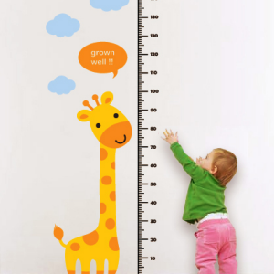

## 어제보다 오늘 더

---

점심먹고 이야기를 나누다가 현재 진행중인 데이터베이스 개편이 마무리되고 나서 CRM이 싹 개편된다는 이야기를 들었다...

현재의 코드 상태에 대한 이야기를 나누었는데.. 기능이 엄청 많아 기존 기능을 수정하고 수정하여 리팩토링하여 얼마전까지 최선을 다해 깔끔한 코드를 만들었다고 생각했다. 그런데 해당 컴포넌트에 코드 라인수는 5천 줄이 넘는다... 하하

처음에 CRM에 접근하기전에 다른 컴포넌트를 수정할 때는 천줄이 안되는 코드를 건드리다가 CRM에 넘어오면서 코드가 3천줄 정도였던 것 같은데.. 기능이 추가되고 추가되고 추가되면서 많은 것이 변했다.

처음 입사해서 봤던 CRM과 지금의 CRM을 비교하면 많은 것이 변경되었고 입사해서 지금까지 하고 있는 작업이 CRM 이라고 할 수 있을 만큼 가장 큰 비중을 차지한다.

얼마전까지는 컴포넌트를 분리하는 작업이 너무 어려웠고 그중 일부 코드가 컴포넌트에 들어가길 원했지만, 들어가면 너무 코드가 복잡해지고 에러가 많아서 뺐던 기능들을 다시 넣는 게 좋을 것 같다는 생각이 들었다..

그때보다 성장한 나는 그것을 해결할 수 있을까? 라는 생각을 했다.

정답은 못하는 것은 없다. 나는 그때보다 성장했기 때문에 할 수 있다는 생각이 들었다.

회사 서비스에 핵심 기능중 하나인 CRM을 더 발전시키고 다양한 기능을 구현하면서 성장할 수 있는 내가 되길 바란다.
