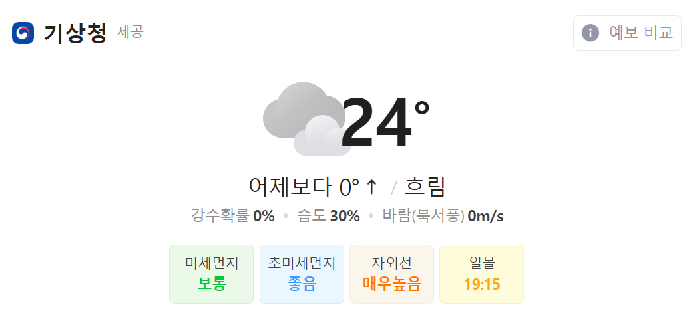

2022-04-28 현재 날씨

오늘의 날씨는 꽃가루가 기승입니다...

꽃가루가 심하고 자외선이 높은 이런날에는??

당연히 (빠밤!!) 공부하는게 최고죠!!

---

#### **3주차**

**[ 수업 목표 ]**

1. 파이썬 기초 문법을 안다.
2. 원하는 페이지를 크롤링 할 수 있다.
3. pymongo를 통해 mongoDB를 제어할 수 있다.

**[목차]**

1. 파이썬
2. 웹 스크래핑(크롤링) + Quiz
3. MongoDB
4. 웹 스크래핑(크롤링) + MongoDB
5. Homework

---

**0. 준비 운동**

1) [파이썬 설치](https://www.python.org/ftp/python/3.8.6/python-3.8.6-amd64.exe)(3.8.6 버전)

2) [Git Bash 설치](https://git-scm.com/)(윈도우 유저만)

3) 복습

- 영화 정보를 받아 페이지 로딩시 출력되게 하기

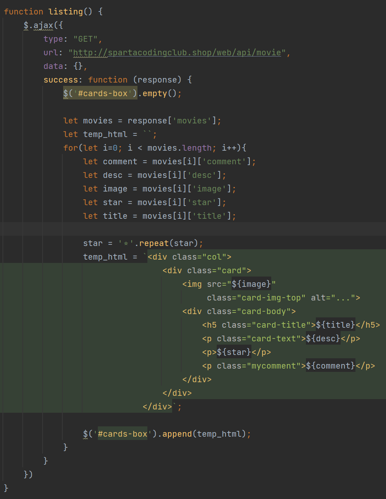

1. 스파르타피디아 OpenAPI 연동

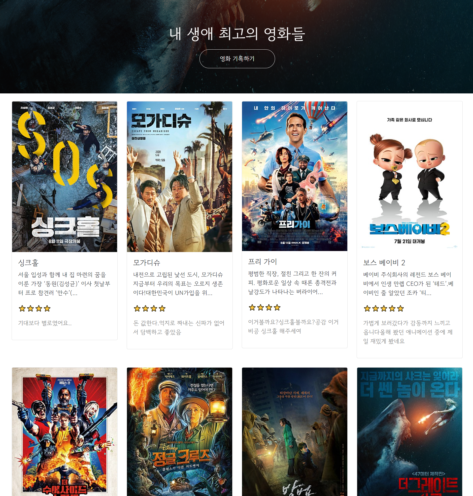

2. 스파르타피디아 OpenAPI 연동결과

---

**1. 파이썬**

1) 파이썬 기초 문법

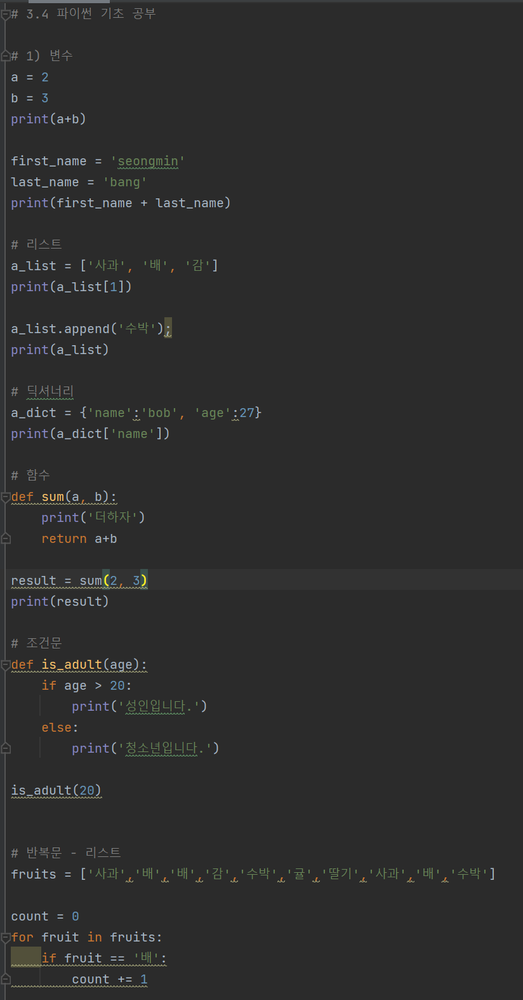

1-1. 파이썬 기초 문법(1)

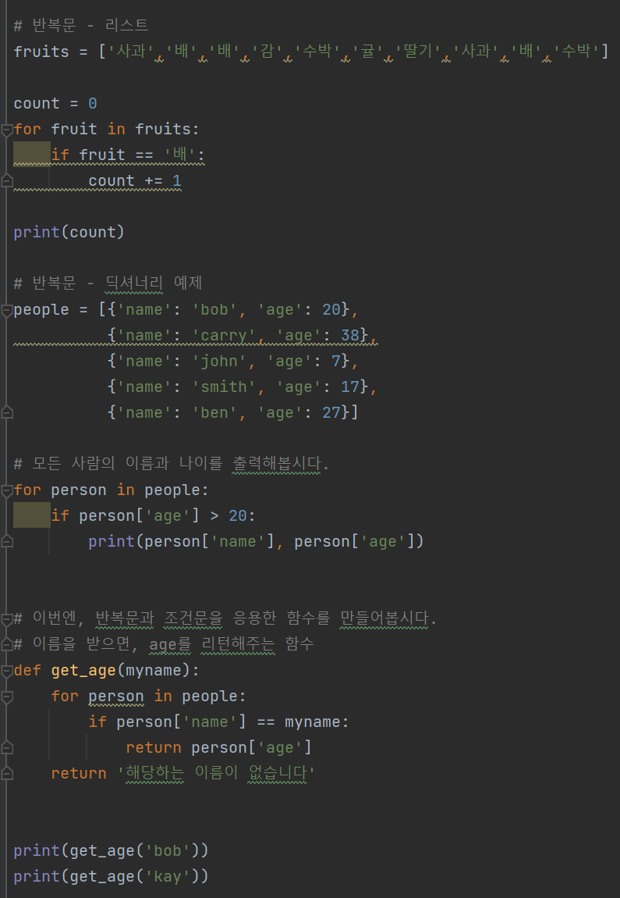

1-2. 파이썬 기초 문법(2)

2) 파이썬 패키지

> 패키지 - Python 에서 패키지는 모듈(일종의 기능들 묶음)을 모아 놓은 단위입니다. 이런 패키지 의 묶음을 라이브러리 라고 볼 수 있습니다. 즉, 패키지는 외부라이브러리를 의미합니다.

3) 가상 환경

> 가상환경(virtual environment)  
> 은 같은 시스템에서 실행되는 다른 파이썬 응용 프로그램들의 동작에 영향을 주지 않기 위해, 파이썬 배포 패키지들을 설치하거나 업그레이드하는 것을 가능하게 하는 격리된 실행 환경입니다.

※ 활용 예시)

> 회사에서는 패키지 A, B, C를 설치해서 쓰고, 개인 프로젝트에서는 패키지 B, C, D, E를 설치해서 쓰고 있었어요. 그런데 회사팀장님이 B를 이전 버전인 B' 로 쓰자고 하시네요. 그렇게 되면, 같은 컴퓨터에 깔려 있는 개인 프로젝트에서는 B'로 쓰면 코드를 다 바꿔야 해요   
>   
> 어떻게 하면 좋을까요?  
>   
> **해결책**  
> 다 담아둘 필요 없이 공구함을 2개 만들어서, 공구함1에 A, B', C를 담아두고, 공구함2에 B, C, D, E를 담아두고 쓰면 관리하기 편하겠죠? 그래서, 가상환경이라는 개념이 등장했습니다. 즉, 프로젝트별 공구함(VM)이에요.

4) 크롤링

   1단계 - URL을 요청하여 HTML을 가져오는 것(requests 모듈 활용)

   2단계 - HTML/XML Parser이기 때문에 HTML/XML문자열에서 원하는 태그정보를 뽑아줍니다.(beautifulsoup4 모듈 활용)

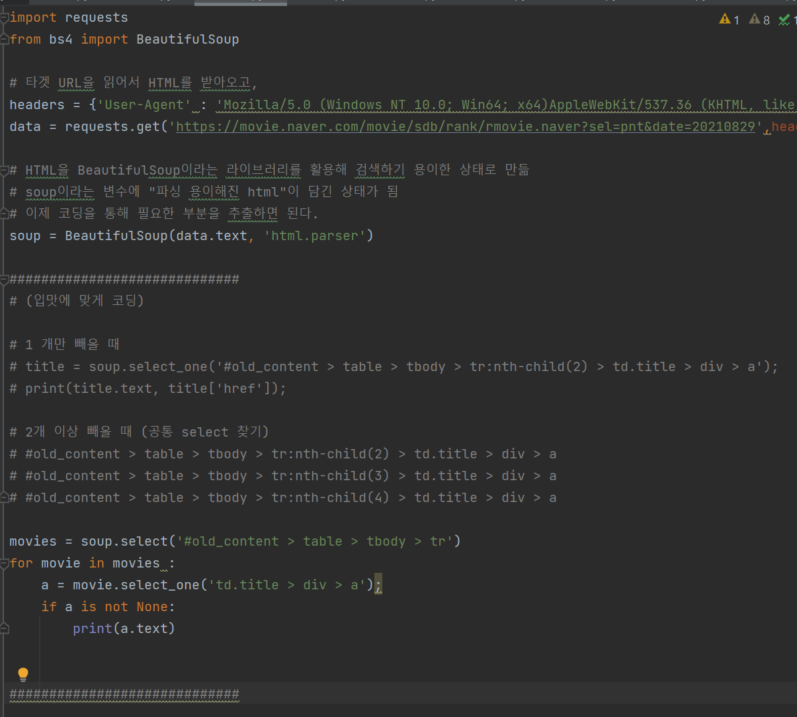

1-3. 스크랩핑 예제 코드

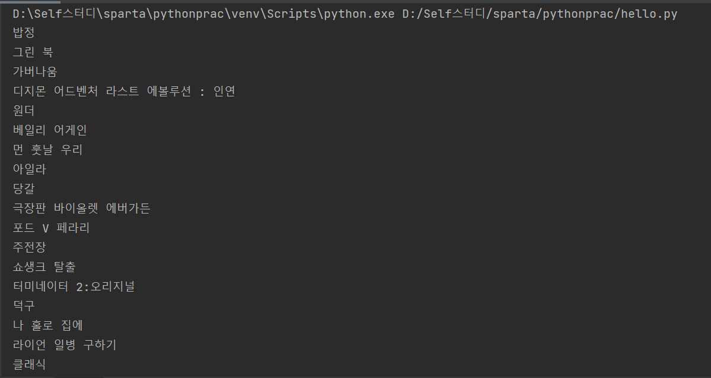

1-4. 스크래핑 예제 결과

---

**2.** 웹 스크래핑(크롤링) + Quiz

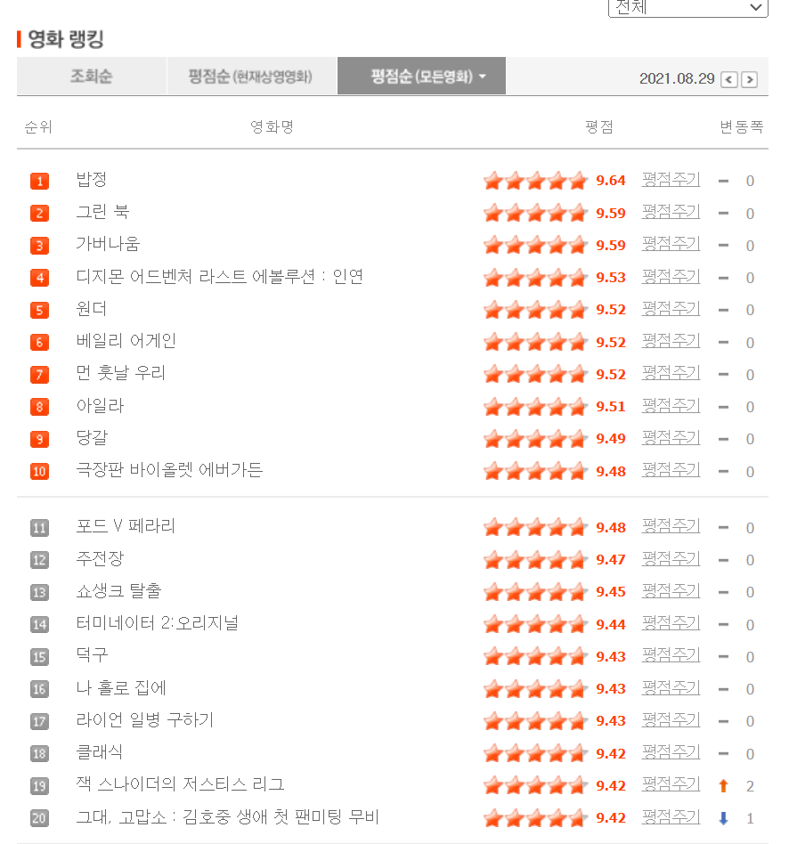

1-5. 크롤링 대상

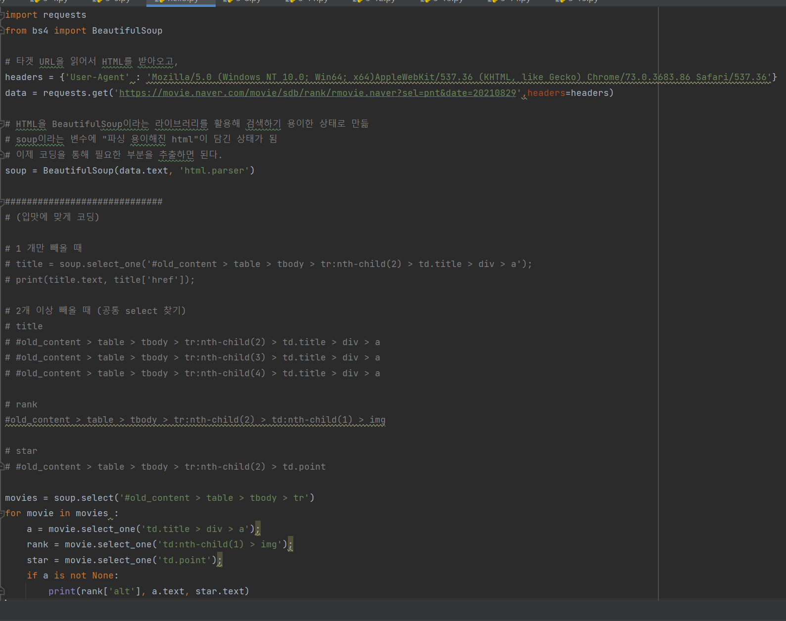

1-6. 크롤링 퀴즈 풀이 코드

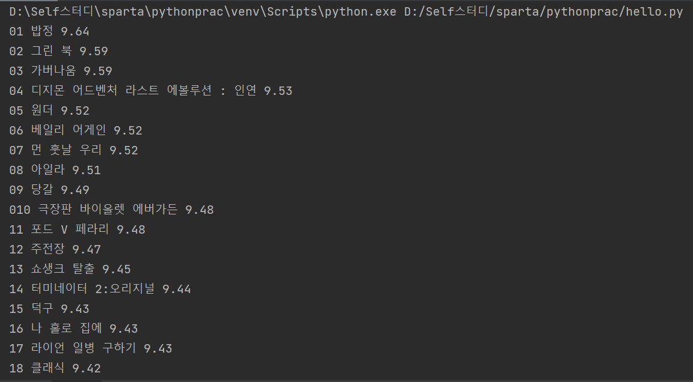

1-7. 크롤링 퀴즈 풀이 결과

---

**3. MongoDB**

**1) 데이터베이스**

* 데이터베이스를 사용하는 이유는 ?

> 우리가 방을 정리하는 이유와 같다. 나중에 잘 찾기 위해서 사용하는 것이다.

* DB의 종류

* **RDBMS**

> 행/열의 생김새가 정해진 엑셀에 데이터를 저장하는 것과 유사합니다. 데이터 50만 개가 적재된 상태에서, 갑자기 중간에 열을 하나 더하기는 어려울 것입니다. 그러나, 정형화되어 있는 만큼, 데이터의 일관성이나 / 분석에 용이할 수 있습니다.

* **NoSQL**

> 딕셔너리 형태로 데이터를 저장해두는 DB입니다. 고로 데이터 하나 하나 마다 같은 값들을 가질 필요가 없게 됩니다. 자유로운 형태의 데이터 적재에 유리한 대신, 일관성이 부족할 수 있습니다.

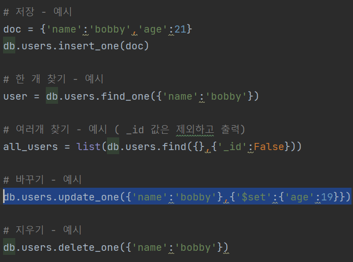

3-1. MongoDB CRUD 테스트

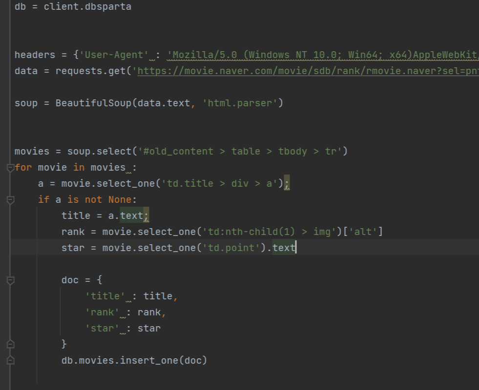

3-2. 웹 스크래핑 + MongoDB

---

**4. 웹 스크래핑(크롤링) + MongoDB**

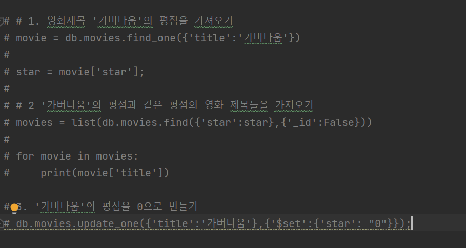

4-1. 웹 스크래핑 + MongoDB 퀴즈 문제풀이

---

**5. Homework**

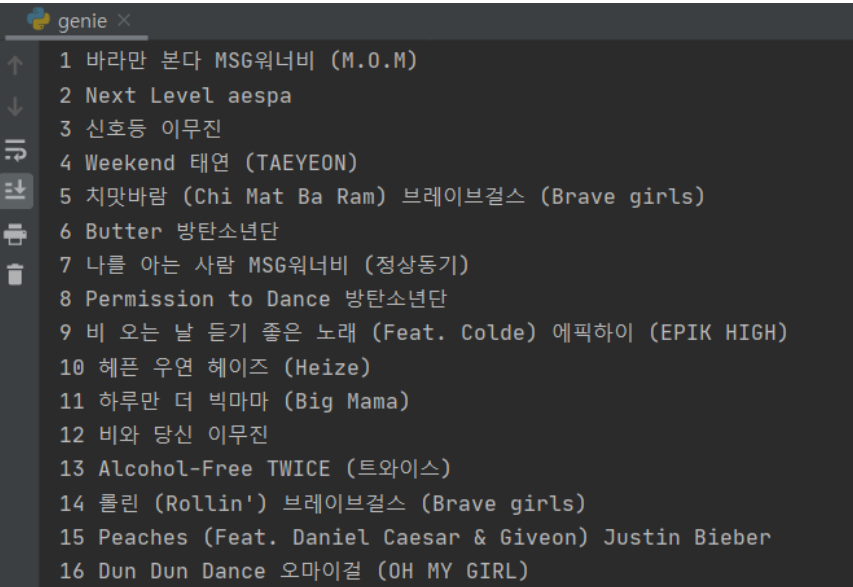

5-1. 숙제 완성본 미리보기

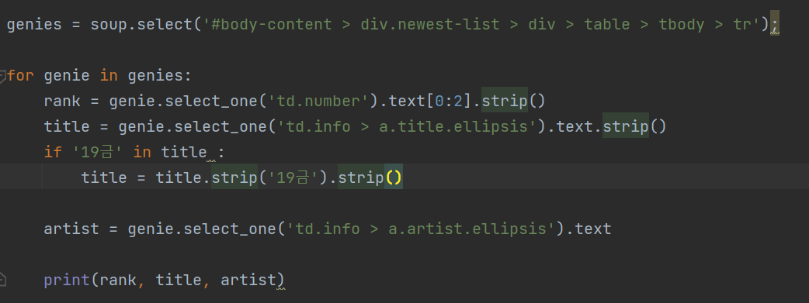

5-1. 지니 웹 크롤링 과제 풀이

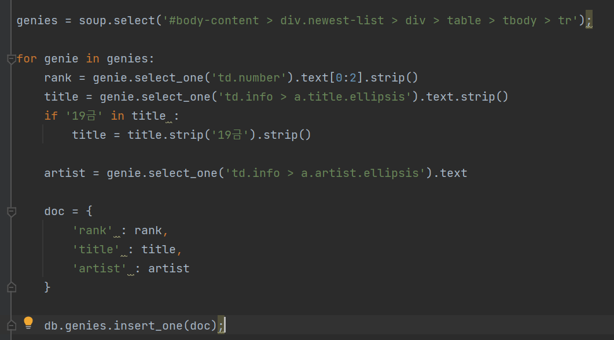

5-3.&nbsp; [한걸음더] 지니 뮤직 순위를 MongoDB에 저장

---

#### **정리**

**3주차를 학습하면서 느낀 것은 이전에 배운 것을 또 까먹고 있었다....****나는 멍청이 나는 멍청이... 라고 할 수 있지만****그래도 0은 아니고.. 기억하지 못하는 것도 있었다..****문제 풀이하면서 이전에 풀이한 것을 보지 않고 풀려고 하였다.****그래서 이전 포스팅 내용과 다를 수 있다.****사실 동일한지도 모른다... 아마 다들 것 같다..**

**오늘은 여기까지!**

