## MongoDB 개요

---

### MongoDB

#### **What is MongoDB?**

MongoDB는 [Double Click](https://en.wikipedia.org/wiki/DoubleClick)이라는 회사에서 한 팀으로 활동했던 Dwight Merriman, Eliot Horowitz, Kevin P. Ryan 등이 설립한 회사입니다. 기존 데이터베이스의 단점을 보완하기 위해 다양한 Custom Data Store을 개발해 사용했었는데 확장성과 신속성에서 자주 문제가 발생했다고 합니다. 기존에 사용하던 관계형 데이터베이스의 문제를 해결하기 위해 데이터베이스 개발에 나섰습니다. 처음에는 **10gen**이라는 이름으로 MongoDB 플랫폼 쓸 형태로 제공하고 있다가 2009년에는 오프 소스로 개발모드로 전환하며 공개하고 2013년에는 MongoDB로 회사명이 변경되었습니다. [참고 - [위키백과](https://en.wikipedia.org/wiki/MongoDB_Inc.)]

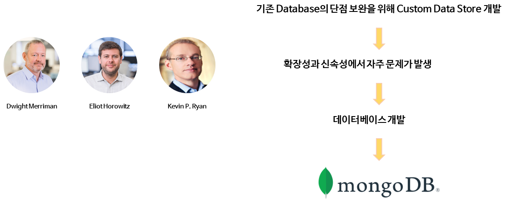

DB Engines라는 DBMS 통계 사이트인데 데이터베이스 순위를 보여주고 있습니다. 순위의 산정 기준은 구글 검색엔진에서 검색되는 횟수, Stack OverFlow에 질문이 올라오는 수, 채용 사이트에 올라오는 공고의 수 등 나름 트렌드를 파악할 수 있는 객관적인 지표를 이용해서 점수를 매긴 순위라고 볼 수 있습니다.

[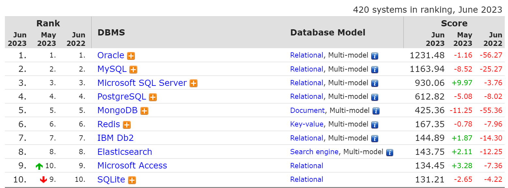](https://db-engines.com/en/ranking)

DB Engines

여기서 중요하게 봐야하는 것은 `Document` DB 중에 MongoDB가 1위를 하고 있고 전체 DB 중에 5위를 하고 있습니다. 1-4위는 전통적인 관계형 DB 강호들이라는 점을 감안해보면 MongoDB가 많은 개발자들에게 선택받고 있고 인기가 좋아지고 있다는 것을 확인할 수 있습니다.

---

#### Why is MongoDB Popular?

> MongoDB는 유연하고 확장성 높은  
> Opensource Document 지향 데이터베이스

많은 개발자들이 MongoDB를 사용하는 이유는 다양할 수 있는데 6가지로 정리할 수 있습니다.

1. **스키마가 자유롭다.**
2. **HA와 Scale-Out Solution을 자체적으로 지원하여 확장이 쉽다.**
3. **Secondary Index를 지원하는 NoSQL**
4. 다양한 종류의 Index를 제공한다.
5. 응답 속도가 빠르다.
6. 배우기 쉽고 간편하게 개발 가능

RDBMS와 비교해서 NoSQL의 장점인 스키마가 자유롭다는 점과 HA와 Scale-Out Solution을 자체적으로 지원하고 있어 확장하기 쉽다는 이유로 가장 많이 사용하고 있습니다.

NoSQL 중에서 DB를 선택할 때 **Secondary Index**를 지원하고 다양한 Index를 지원한다는 점입니다. **Secondary Index**는 Primary Key 인덱스 이외에 모든 인덱스를 의미하고 인덱스를 다양하게 사용할 수 있다는 의미는 다양하게 조회가 필요한 요구사항을 만족시킬 수 있다는 의미입니다.

예전 RDBMS를 사용하던 시절과 다르게 각각에 DBMS의 장점을 살려서 다양한 종류의 DBMS를 함께 서비스를 구축하는 경우가 많아졌습니다. 그래서 스키마가 정해져있지 않은데 다양하게 쿼리를 해야할 필요가 있다면 MongoDB가 적합한 서비스가 될 수 있습니다.

주요한 장점들 이외에도 응답 속도가 빠르다는 점과 배우기 쉽고 간편하게 개발 가능하다는 장점도 있습니다.

### **SQL vs NoSQL**

---

관계형 데이터베이스와 비 관계형 데이터베이스 즉 SQL과 NoSQL의 차이를 알아보는 것을 시작으로 해서 MongoDB를 왜 사용하는지 장단점 위주로 알아보도록 하겠습니다.

#### 관계형 데이터베이스

관계형 데이터베이스(RDBMS, Relational Database Management System)는 데이터를 **테이블 형식**으로 저장하고, 테이블 간의 관계를 통해 데이터를 관리하는 데이터베이스 시스템입니다. 대표적인 관계형 데이터베이스로는 **MySQL**, **PostgreSQL**, **Oracle**, **SQL Server** 등이 있습니다.

**장점**

* **데이터 무결성 및 일관성**  
  관계형 데이터베이스는 **ACID**(Atomicity, Consistency, Isolation, Durability) 속성을 준수하므로, 데이터를 신뢰성 있게 관리할 수 있습니다. 트랜잭션이 안전하게 처리되며, 데이터가 손상되거나 일관성을 잃지 않도록 보장합니다.
* **복잡한 쿼리 처리 가능**  
  관계형 데이터베이스는 **SQL**(Structured Query Language) 을 사용하여 복잡한 쿼리를 쉽게 작성할 수 있습니다. 여러 테이블을 조인(join)하여 데이터를 조회하고, 복잡한 조건을 처리할 수 있습니다.
* **데이터 중복 최소화**  
  정규화(Normalization) 를 통해 데이터를 중복 없이 관리할 수 있으며, 이는 저장 공간을 절약하고 데이터의 무결성을 높이는 데 기여합니다.
* **강력한 데이터 보안**  
  권한 관리와 사용자 제어가 잘 되어 있어, 데이터베이스 내에서 특정 사용자 또는 그룹에게 접근 권한을 세밀하게 부여하거나 제한할 수 있습니다.
* **관계 기반 데이터 모델링**  
  테이블 간의 관계를 정의하여 복잡한 데이터 구조를 논리적으로 표현할 수 있습니다. 예를 들어, 고객과 주문 간의 관계를 명확히 정의하여 일관성 있게 데이터를 관리할 수 있습니다.
* **성숙한 기술 및 광범위한 지원**  
  관계형 데이터베이스는 수십 년 동안 발전해 왔으며, 안정적이고 신뢰할 수 있는 데이터베이스 시스템으로서 널리 사용되고 있습니다. 풍부한 문서와 커뮤니티 지원이 존재합니다.

**단점**

* **수평 확장성 부족**  
  관계형 데이터베이스는 **수직 확장(Scale-Up)** 에는 강하지만, 수평 확장(Scale-Out)이 어려울 수 있습니다. 대규모 트래픽 처리 시 서버 성능에 의존하게 되어, 분산 시스템을 구축하는 데 적합하지 않을 수 있습니다.
* **비정형 데이터 처리의 어려움**  
  관계형 데이터베이스는 정형 데이터(Structured Data)에 적합하지만, 비정형 데이터(Unstructured Data)나 반정형 데이터(Semi-structured Data)를 처리하는 데는 비효율적입니다. 문서, 이미지, JSON 같은 데이터를 저장하고 처리하는 데 한계가 있을 수 있습니다.
* **복잡한 스키마 관리**  
  스키마가 고정되어 있기 때문에 데이터 구조가 자주 변경되는 프로젝트에서 불편함을 초래할 수 있습니다. 새로운 데이터 구조를 추가하거나 변경할 때, 기존 데이터를 변환하거나 업데이트해야 하는 작업이 번거롭습니다.
* **높은 학습 곡선**  
  관계형 데이터베이스는 설계와 관리가 복잡할 수 있습니다. 특히 대규모 데이터베이스에서는 정규화, 인덱스 설정, 쿼리 최적화 등의 작업이 필요해 관리자가 전문적인 지식을 갖추어야 합니다.
* **높은 비용**  
  상용 관계형 데이터베이스 시스템(Oracle, SQL Server 등)의 경우, 라이선스 비용이 매우 비쌀 수 있습니다. 오픈 소스 RDBMS도 존재하지만, 대규모 사용 시 최적화 및 유지 관리에 비용이 발생할 수 있습니다.

**[참고] Scale up과 Scale Out에 대한 설명**

더보기

**Scale Up (수직 확장)**

Scale Up은 현재 사용 중인 단일 서버나 컴퓨터의 성능을 향상시키는 방법으로 CPU, RAM, 스토리지 등을 추가하여 처리 성능을 증가시키는 것입니다.

**장점**

* 운영 체제와 애플리케이션을 재설치할 필요가 없기 때문에 상대적으로 간단합니다.
* 모든 데이터가 단일 시스템에 있으므로 관리가 용이합니다.

**단점**

* 물리적인 하드웨어 한계가 존재하므로 무한히 확장할 수 없습니다.
* 비용이 기하급수적으로 증가할 수 있습니다.

**Scale Out (수평 확장)**

Scale Out은 더 많은 서버나 컴퓨터를 추가하여 여러 시스템이 동시에 작업을 분담하는 방식으로 각 서버가 트래픽이나 데이터 처리 작업을 나누어 처리하도록 하는 것입니다.

**장점**

* 이론적으로 무한히 확장할 수 있습니다.
* 고가의 장비 없이 저가의 서버 여러 대를 사용할 수 있어 비용 효율적일 수 있습니다.

**단점**

* 시스템 관리와 유지보수가 복잡해질 수 있습니다.
* 데이터 동기화와 분산 처리를 위한 추가적인 소프트웨어 설계가 필요합니다.

MySQL 같은 경우 자체적으로 지원하는 스케일링 솔루션이 없어 서드 파티 솔루션을 사용하거나 애플리케이션 단에서 처리해야하는 경우가 있다. 실제로 스케일링 때문에 MySQL에서 MongoDB로 마이그레이션하는 경우도 있다. 이게 애플리케이션 단에서 스케일링을 처리해버리면 스케일링 할 때마다 애플리케이션 단에서 변경이 필요하기 떄문에 번거로운 작업들을 해야합니다.

> 역사적으로 보면 스케일 업 위주로 많이 하였는데,  
> 왜 제한되고 복잡하게 데이터베이스를 설계했을까?

1. **역사적 맥락과 초기 설계 철학**

관계형 데이터베이스(RDBMS)는 1970년대에 처음 등장했으며, 당시 컴퓨팅 환경은 주로 단일 서버에서 실행되는 시스템 중심이었습니다. 하드웨어가 상대적으로 적었기 때문에, 수평 확장(Scale Out)보다는 단일 시스템의 성능을 향상시키는 **Scale Up**이 기본적인 성능 개선 전략이었습니다.

* **비용과 관리 용이성**: 당시 하드웨어는 고비용이었고, 여러 대의 서버를 관리하는 것보다 하나의 강력한 서버에 집중하는 것이 더 경제적이고 실용적이었습니다.
* **데이터 일관성**: 관계형 DB는 **ACID**(Atomicity, Consistency, Isolation, Durability) 속성을 중요시했기 때문에, 분산된 시스템보다는 일관성을 쉽게 유지할 수 있는 단일 서버 중심 설계가 적합했습니다.

2. **복잡한 데이터 모델**

관계형 데이터베이스는 데이터를 **정규화**하고 테이블 간의 **관계**를 명확히 정의해야 했습니다. 이로 인해 데이터 모델이 엄격하고 복잡하게 설계되었으며, 이는 **데이터 무결성**을 유지하기 위한 필수적인 과정이었습니다. 데이터의 일관성과 정확성을 보장하기 위해 복잡한 쿼리와 테이블 간의 조인(Join)이 필요했습니다.

* **MySQL**: **Master-Slave** 복제를 지원하며, **Galera Cluster**와 같은 클러스터링 솔루션을 통해 더 나은 확장성을 제공합니다.
* **Oracle**: **Oracle RAC**(Real Application Clusters)를 사용하면 여러 노드에서 데이터를 공유하며 데이터베이스를 확장할 수 있습니다.

**3. 스케일 아웃을 위한 지원**

1. **Sharding (샤딩)**  
   샤딩은 데이터를 여러 데이터베이스 서버에 나누어 저장하는 방식으로, 수평 확장을 지원하는 대표적인 방법입니다. 이는 데이터베이스의 성능을 확장하고 단일 서버의 부하를 줄이는 데 효과적입니다.
   * **MySQL**: MySQL은 기본적으로 샤딩을 지원하지 않지만, **Vitess**와 같은 외부 도구를 통해 수평 확장을 할 수 있습니다.
   * **PostgreSQL**: PostgreSQL은 기본적으로 샤딩을 지원하지 않지만, **Citus** 확장을 통해 수평 확장이 가능합니다
2. **Replication (복제)**  
   복제는 하나의 마스터 데이터베이스를 여러 개의 슬레이브 DB로 복제하여 읽기 요청을 분산하는 방법입니다. 이는 주로 읽기 작업이 많은 시스템에서 효과적입니다.
   * **MySQL**: **Master-Slave** 복제를 지원하며, **Galera Cluster**와 같은 클러스터링 솔루션을 통해 더 나은 확장성을 제공합니다.
   * **Oracle**: **Oracle RAC**(Real Application Clusters)를 사용하면 여러 노드에서 데이터를 공유하며 데이터베이스를 확장할 수 있습니다.
3. **Partitioning (파티셔닝)**  
   파티셔닝은 테이블의 데이터를 여러 논리적 파티션으로 나누는 방식으로, 각 파티션을 별도의 물리적 디스크나 서버에 저장할 수 있습니다.
   * **Oracle**: 다양한 파티셔닝 기법(범위, 해시, 리스트)을 지원하여 데이터 분산과 성능 최적화를 도모합니다.
   * **PostgreSQL**: 최신 버전에서는 본격적인 **파티셔닝 기능**이 추가되어 대규모 데이터를 효율적으로 관리할 수 있습니다.

**4. 왜 스케일 아웃이 더 복잡했는가?**

관계형 DB는 데이터를 일관성 있게 관리하기 위해 **트랜잭션 일관성**을 유지해야 했기 때문에, 데이터를 여러 서버로 분산하는 것은 **분산 트랜잭션** 문제를 야기했습니다. 따라서 스케일 아웃은 트랜잭션 일관성을 보장하기 어려운 환경에서는 복잡하게 작동하며, **NoSQL**이 등장하기 전까지 수평 확장보다는 수직 확장이 더 많이 사용되었습니다.

---

#### NoSQL

**NoSQL이란?**

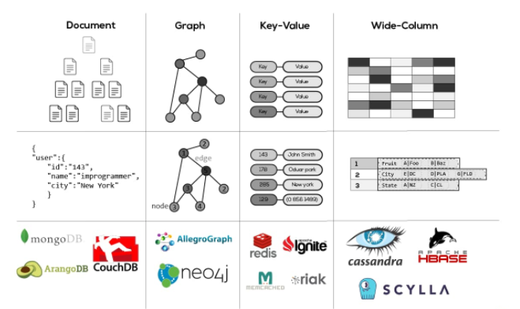

**NoSQL** 데이터베이스는 주로 관계형 데이터베이스(RDBMS)의 **스케일링 한계**와 **복잡성**을 해결하기 위한 대안으로 등장했습니다. NoSQL은 대규모 분산 시스템에서 수평 확장을 더 쉽게 지원할 수 있도록 설계되었습니다.

* **수평 확장의 필요성**  
  관계형 DBMS는 대부분 **스케일 업**(더 강력한 서버로 성능을 높이는 방식)을 통해 성능을 향상시켰지만, 이러한 방법은 하드웨어에 한계가 있었습니다. 특히 웹 서비스와 클라우드 컴퓨팅이 확산되면서, 대규모 데이터를 분산해서 처리하는 **스케일 아웃**(서버를 여러 대로 늘려 성능을 높이는 방식)이 더 중요한 요구사항이 되었고, 이를 보다 쉽게 구현하기 위한 기술로 NoSQL이 등장했습니다.
* **유연한 데이터 모델링**  
  관계형 DB는 데이터를 **정규화**하고, 엄격한 스키마와 조인(Join)을 사용하여 데이터를 처리해야 했습니다. 이는 복잡한 데이터 구조나 자주 변경되는 데이터 구조를 다루는 데 비효율적일 수 있었습니다. NoSQL은 **비정형 데이터**(semi-structured or unstructured data)를 처리하는 데 더 적합하며, **스키마리스(Schema-less)** 구조를 지원해 더 유연한 데이터 관리가 가능합니다.
* **빅데이터 처리**  
  SNS, IoT, 로그 데이터 등 대규모 비정형 데이터를 실시간으로 처리하는 환경이 증가함에 따라, NoSQL은 데이터 처리 성능과 확장성을 필요로 하는 **빅데이터** 애플리케이션에서 필수적인 기술로 자리 잡았습니다.

**NoSQL의 주요 특징**

1. **수평 확장성**  
   NoSQL은 데이터 분산 및 샤딩(Sharding)을 기본적으로 지원해 수천 대의 서버로 쉽게 확장할 수 있습니다. 이로 인해 **Facebook, Google, Twitter**와 같은 대형 플랫폼에서 사용됩니다.
2. **유연한 스키마**  
   데이터 구조가 자주 바뀌거나 비정형 데이터를 다루는 경우 NoSQL이 더 적합합니다. 관계형 DB는 스키마 변경이 복잡하고 비용이 많이 들지만, NoSQL은 데이터를 자유롭게 저장할 수 있습니다.
3. **고가용성 및 분산 처리**  
   NoSQL은 기본적으로 분산 시스템에서 동작하도록 설계되었으며, 여러 서버에 데이터를 복제하여 장애 발생 시에도 데이터의 가용성을 보장합니다.

NoSQL의 종류

* **문서형(Document-oriented) NoSQL**  
  문서형 데이터베이스는 **JSON**, **BSON** 또는 **XML**과 같은 형식으로 데이터를 저장하여, 비정형 또는 반정형 데이터를 유연하게 처리할 수 있습니다.
  + **MongoDB :** 가장 널리 사용되는 문서형 데이터베이스로, 데이터를 BSON(Binary JSON) 형식으로 저장합니다. 스키마가 유연하여 비정형 데이터나 자주 변경되는 데이터 구조에 적합합니다. **수평 확장성**과 **복제**를 기본적으로 지원해, 대규모 트래픽 처리에도 용이합니다.
  + **Couchbase :** 문서 기반으로 데이터를 저장하며, 고성능 읽기 및 쓰기 작업에 강합니다. **분산 아키텍처**를 통해 클러스터링 및 확장성을 지원하고, 실시간 데이터 처리를 강화한 시스템입니다.
* ****그래프형(Graph-oriented) NoSQL****노드와 엣지로 구성된 **그래프** 구조를 사용해, 데이터 간의 복잡한 관계를 저장하고 분석하는 데 적합합니다.
  + **Neo4j**: 가장 널리 사용되는 그래프형 데이터베이스로, 복잡한 관계형 데이터를 매우 빠르게 처리할 수 있습니다. **소셜 네트워크 분석**, **추천 시스템** 등에서 주로 사용됩니다.
  + **Amazon Neptune**: AWS에서 제공하는 관리형 그래프 데이터베이스로, **SPARQL**과 **Gremlin**을 통해 다양한 그래프 쿼리를 지원합니다. 여러 그래프 모델을 지원하여 데이터 관계를 효율적으로 처리합니다.
* **키-값형(Key-Value) NoSQL**키-값 쌍으로 데이터를 저장하여 매우 단순한 구조를 가지며, 빠른 조회가 필요한 환경에서 주로 사용됩니다. 
  + **Redis**: 메모리 기반의 키-값형 데이터베이스로, 매우 빠른 속도를 자랑합니다. **캐싱**, **세션 관리**와 같은 작업에 적합하며, 복제와 클러스터링을 통해 스케일 아웃도 지원합니다.
  + **Amazon DynamoDB**: AWS에서 제공하는 완전 관리형 키-값형 데이터베이스로, **고가용성**과 **확장성**을 자동으로 관리해줍니다. 큰 규모의 트래픽을 처리해야 하는 환경에서 주로 사용됩니다.
* **열 기반형(Column-oriented) NoSQL**데이터를 테이블의 행이 아닌 **열 단위**로 저장해 대규모 분석 작업에 적합합니다. **데이터웨어하우스**나 **빅데이터 처리**에서 주로 사용됩니다.  
  + **Apache Cassandra**: Facebook에서 개발되어 현재는 오픈 소스 프로젝트로, 분산 환경에서 매우 뛰어난 **확장성**과 **내결함성**을 제공합니다. 수평 확장을 기본으로 하며, 노드 간 복제를 통해 데이터의 안정성을 보장합니다.
  + **HBase**: Hadoop의 HDFS 위에서 작동하는 열 기반형 데이터베이스로, 대규모 데이터를 빠르게 읽고 쓰는 작업에 최적화되어 있습니다. **대규모 분산 저장소**에 적합하며, **대량의 읽기/쓰기** 작업에 유리합니다.

#### 관계형 데이터스와 MongoDB 비교

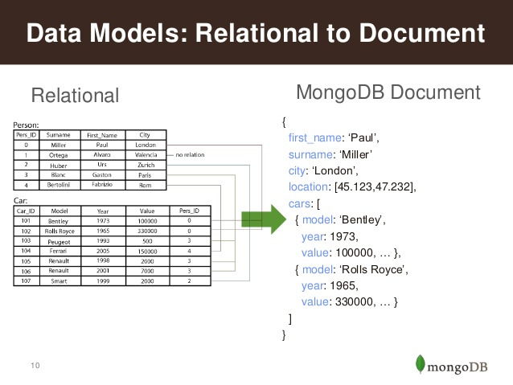

관계형 데이터베이스(RDBMS)는 데이터를 테이블 형태로 구성하는 반면, MongoDB는 JSON 형태의 도큐먼트로 데이터를 표현합니다. 이 도큐먼트는 배열을 포함하거나 다른 도큐먼트를 중첩하여 표현할 수 있어, 데이터 구조를 더 직관적으로 시각화할 수 있습니다.

장단점을 정리해보면 아래와 같습니다.

* 장점
  + 데이터 접근성과 가시성이 좋다.
  + 테이블 간에 Join 없이 조회가 가능하여 응답 속도가 일반적으로 빠르다.
  + 스키마 변경에 공수가 적다.
  + 스키마가 유연해서 데이터 모델을 App의 요구사항에 맞게 데이터를 수용할 수 있다.
  + HA와 Sharding에 대한 솔루션을 자체적으로 지원하고 있어 Scale Out이 간편하다.
  + 확장 시, Application의 변경사항이 없다.
* 단점
  + 데이터의 중복이 발생한다.
  + 스키마가 자유롭지만, 스키마 설계를 잘해야 성능 저하를 피할 수 있다.

### MongoDB 구조

---

#### Terminology

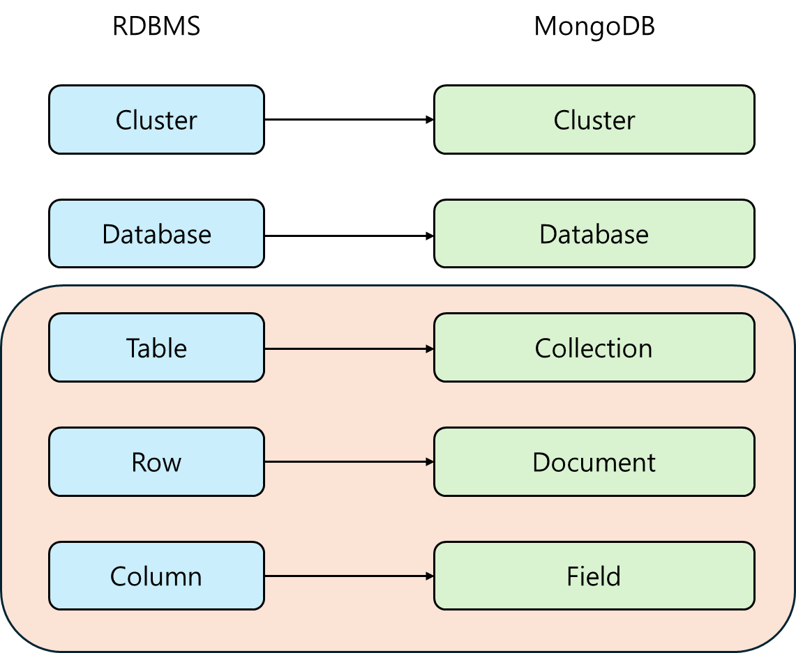

RDBMS와 비교하였을 때, Cluster, Database는 동일하게 불리고 Table, Row, Column은 Collection, Document, field로 용어가 다르게 불리고 있습니다.

---

#### Database

| **Database** | **Description** |
| --- | --- |
| **admin** | - 인증과 권한 부여 역할 - 일부 관리 작업을 하려면 admin Database에 접근 필요 |
| **local** | - 모든 mongoDB instance는 로컬 데이터베이스로 소유한다. - oplog와 같은 replication 절차에 필요한 정보를 저장한다. - startup\_log와 같은 instance 진단 정보를 저장한다. |
| **config** | - shared cluster에서 각 shard의 정보를 저장한다. |

---

#### Collection

특징

* **스키마 유연성**: 컬렉션은 동적 스키마를 가지고 있어, 필드 값을 추가, 수정, 또는 삭제하여 스키마를 수정할 수 있습니다.
* **도큐먼트 지향**: 데이터는 JSON 형태의 도큐먼트로 저장되며, 중첩 도큐먼트와 배열을 지원합니다.
* **인덱스 생성 가능**: 컬렉션 단위로 인덱스를 생성하여 쿼리 성능을 향상시킬 수 있습니다.
* **샤딩 지원**: 컬렉션 단위로 샤드를 나누어 수평적 확장성을 확보할 수 있습니다.
* **수평적 확장성**: 샤딩을 통해 데이터를 여러 서버에 분산 저장할 수 있어 확장성이 뛰어납니다.

유의사항

* **일관된 데이터 구조 유지**: 관련된 데이터를 같은 도큐먼트에 저장하고, 중구난방한 구조를 피하여 관리와 조회의 용이성을 높입니다.
* **스키마 정의 및 데이터 타입 관리**: 개별 필드와 데이터 타입에 대한 일관된 기준을 마련하여 데이터 무결성을 유지합니다.
* **인덱스 및 성능 최적화**: 필요한 필드에 인덱스를 생성하되, 불필요한 인덱스는 피하고 쿼리 성능을 지속적으로 모니터링합니다.
* **샤드 키 선정**: 샤딩을 사용할 경우, 적절한 샤드 키를 선택하여 데이터의 균형을 맞추고 성능을 최적화합니다.
* **정기적인 백업 및 복구 계획 수립**: 데이터 손실을 방지하기 위해 정기적인 백업을 수행하고, 복구 절차를 마련해 둡니다.

---

#### Document

특징

1. **유연한 구조**: 도큐먼트는 동적 스키마를 가지고 있어, 각 도큐먼트마다 서로 다른 필드와 데이터 타입을 가질 수 있습니다. 필드 값을 추가, 수정, 또는 삭제하여 스키마를 쉽게 변경할 수 있습니다.
2. **JSON 형태**: 도큐먼트는 BSON(Binary JSON) 형태로 저장되며, 직관적으로 읽고 쓸 수 있는 구조를 제공합니다. 중첩 도큐먼트와 배열을 지원하여 복잡한 데이터 구조를 쉽게 표현할 수 있습니다.
3. **키-값 쌍**: 도큐먼트는 키-값 쌍으로 구성되며, 각 키는 문자열 형태로 정의되고, 값은 다양한 데이터 타입(문자열, 숫자, 배열, 객체 등)을 가질 수 있습니다.
4. **고유한 \_id 필드**: 모든 도큐먼트에는 \_id 필드가 있으며, 이 필드가 없으면 MongoDB가 자동으로 ObjectId 타입의 고유한 값을 생성합니다.
5. **도큐먼트 크기 제한**: 각 도큐먼트의 최대 크기는 16MB로 제한됩니다.
6. **컬렉션 내의 독립성**: 같은 컬렉션 내의 도큐먼트는 서로 독립적이므로, 각 도큐먼트의 구조가 달라도 문제 없습니다.

유의사항

1. **일관된 데이터 구조 유지**: 동적 스키마 특성에도 불구하고, 관련된 데이터를 같은 도큐먼트에 저장하고 일관된 구조를 유지해야 관리와 조회의 효율성이 높아집니다.
2. **데이터 무결성**: 필드 값의 유효성을 검증하여 잘못된 데이터가 저장되지 않도록 주의해야 합니다. 스키마 규칙을 정의하거나 애플리케이션 수준에서 검증 로직을 추가할 수 있습니다.
3. **도큐먼트 크기 제한**: 한 도큐먼트의 크기는 최대 **16MB**로 제한되므로, 너무 큰 데이터를 한 도큐먼트에 저장하지 않도록 해야 합니다.
4. **인덱스 사용**: 자주 조회되는 필드에 인덱스를 생성하여 쿼리 성능을 향상시킬 수 있으나, 인덱스 생성이 쓰기 성능에 영향을 줄 수 있으므로 신중해야 합니다.
5. **중복 데이터 피하기**: 중복된 데이터를 피하고, 데이터의 일관성을 유지하기 위해 필요한 경우 적절한 구조를 고민해야 합니다.
6. **정기적인 백업**: 도큐먼트 데이터 손실을 방지하기 위해 정기적인 백업을 수행하고, 데이터 복구 절차를 마련해야 합니다.

---

#### 정리

* Database → Collection → Document → Field 순으로 구조가 형성되어 있다.
* admin, config, local database는 MongoDB를 관리하는데 사용된다.
* Collection은 동적 스키마를 갖는다.
* Document는 JSON 형태로 표현되고 BSON 형태로 저장된다.
* Document는 고유한 '\_id' 피를 항상 갖고 있다.
* Document는 최대 크기 16MB로 고정되어 있다.

### MongDO 배포 형태

---

MongoDB를 어떻게 구축하고 설치할 것인지, 서버 아키텍처를 어떻게 구성할 것인지에 대해 이야기해보려고 합니다. 배포 형태는 MongoDB뿐만 아니라 다른 데이터베이스에서도 유사하게 적용됩니다. 모든 데이터베이스가 비슷한 목적을 가지고 있기 때문입니다.

MongoDB의 배포 형태는 3가지로 볼 수 있습니다.

#### **Standalone**

**구조**

* **Standalone MongoDB**는 단일 MongoDB 인스턴스로 구성됩니다. 하나의 서버에 데이터베이스를 설치하고, 이 인스턴스가 모든 데이터 저장 및 읽기/쓰기 작업을 처리합니다. 클러스터링이나 복제 없이 단일 노드로 작동하는 가장 간단한 구조입니다.

**장점**

* **간단한 설정**: Standalone MongoDB는 설정 및 운영이 매우 간단합니다. 별도의 복제나 클러스터링 설정이 필요 없으므로, 개발 환경이나 소규모 애플리케이션에서 적합합니다.
* **낮은 비용**: 단일 서버만 사용하기 때문에 초기 구축 비용이 적고, 복잡한 인프라를 유지할 필요가 없습니다.
* **빠른 성능**: 네트워크 통신이나 동기화가 필요 없으므로 단일 노드에서 최대 성능을 발휘할 수 있습니다. 성능 최적화가 비교적 쉬운 구조입니다.

**단점**

* **가용성 부족**: Standalone MongoDB는 단일 장애 지점(Single Point of Failure, SPOF)을 가지므로, 서버나 디스크에 장애가 발생하면 데이터에 접근할 수 없게 됩니다. 서버가 다운되면 복구하기 전까지 데이터베이스를 사용할 수 없습니다.
* **확장성 부족**: 단일 인스턴스이기 때문에 성능 확장이 어렵습니다. 데이터가 증가하거나 트래픽이 증가하면 서버 성능이 한계에 도달할 수 있습니다.
* **백업 및 복구 어려움**: 데이터 손실에 대비해 정기적인 백업이 필요하며, 데이터 복구 작업이 수동으로 이루어져야 합니다.

---

#### [**Replica Set**](https://www.mongodb.com/docs/v6.2/core/replica-set-primary/)

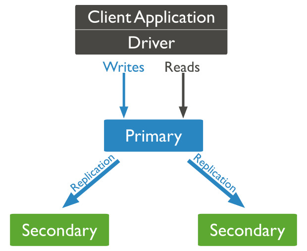

**구조**

**Replica Set**은 하나의 기본(primary) 서버와 하나 이상의 보조(secondary) 서버로 구성된 구조입니다. Primary 서버는 쓰기 작업과 읽기 작업을 처리하며, Secondary 서버는 Primary의 데이터를 복제하여 보관하고, 읽기 전용 작업에 사용되거나 Primary 서버가 다운될 경우 장애 조치(failover) 역할을 합니다.

* **Primary Node**: 모든 쓰기 작업이 이루어지는 곳입니다. 클라이언트가 MongoDB에 데이터를 쓰거나 수정할 때 이 노드가 처리합니다.
* **Secondary Node**: Primary의 데이터를 지속적으로 복제(replication)하는 노드들입니다. Primary가 장애가 발생하면 Secondary 중 하나가 새로운 Primary로 승격될 수 있습니다. Secondary는 읽기 작업에도 사용할 수 있습니다.
* **Arbiter (선택 사항)**: Arbiter는 데이터를 복제하지 않지만, 클러스터에서 투표 역할을 합니다. Primary를 선출하는 데 필요한 투표 수를 맞추기 위해 사용됩니다.

**장점**

* **높은 가용성**: Replica Set은 기본 서버에 문제가 생기면 자동으로 장애 조치(failover)가 이루어져 Secondary 중 하나가 Primary로 승격됩니다. 이로 인해 가용성이 높아지고, 애플리케이션이 중단 없이 운영될 수 있습니다.
* **데이터 보호**: 데이터를 여러 서버에 복제함으로써, 데이터 손실 위험을 최소화할 수 있습니다. Primary 서버에 장애가 생기더라도 Secondary 서버에서 데이터를 복구할 수 있습니다.
* **읽기 성능 향상**: Secondary 서버를 읽기 전용 용도로 사용할 수 있어, 읽기 부하를 분산할 수 있습니다. Primary 서버가 읽기/쓰기 요청 모두를 처리하는 대신, Secondary에서 읽기 요청을 처리할 수 있어 성능을 최적화할 수 있습니다.
* **자동 복구**: Primary 서버가 다운되었을 때, MongoDB가 자동으로 failover 처리를 해 주기 때문에 수동 개입 없이도 서비스가 지속적으로 운영될 수 있습니다.

**단점**

* **복잡한 관리**: Replica Set은 Standalone에 비해 설정과 관리가 복잡합니다. 노드 간 데이터 동기화와 장애 조치 처리 등의 추가적인 관리 작업이 필요합니다.
* **자원 소모**: 데이터를 복제하기 때문에 추가적인 스토리지와 네트워크 자원이 필요하며, 여러 서버를 운영해야 하므로 비용이 증가합니다.
* **복제 지연**: Secondary 서버가 Primary의 데이터를 실시간으로 복제하긴 하지만, 복제 지연(Lag)이 발생할 수 있습니다. 복제 지연이 클 경우, Secondary에서 읽은 데이터가 최신 상태가 아닐 수 있습니다.
* **트랜잭션 성능 저하**: 분산된 서버 간의 데이터 복제를 위해 더 많은 리소스가 필요하며, 특히 높은 일관성을 요구하는 트랜잭션에서는 성능 저하가 발생할 수 있습니다.

---

#### [**Sharded Cluster**](https://www.mongodb.com/docs/v7.2/core/sharded-cluster-query-router/)

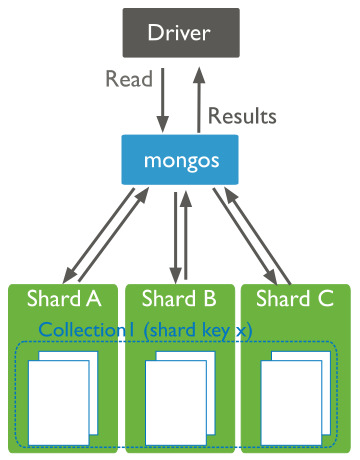

MongoDB의 **Sharded Cluster**는 대규모 데이터베이스 환경에서 수평 확장을 가능하게 해주는 방법입니다. 데이터를 여러 서버에 분산시켜 저장하는 방식으로, 성능과 확장성을 크게 향상시킬 수 있습니다. 각 서버는 데이터를 부분적으로 저장하며, 모든 서버가 함께 클러스터를 구성합니다.

**구조**

* **Shards**: 데이터를 실제로 저장하는 데이터베이스 서버들입니다. 각각의 shard는 MongoDB 인스턴스이며, 특정 데이터의 부분 집합을 저장합니다. **Shard는 Replica Set으로 구성**되어 데이터 가용성과 내결함성을 제공합니다.
* **Query Router (mongos)**: 클라이언트의 쿼리를 받아서 올바른 shard로 요청을 라우팅하는 역할을 합니다. 애플리케이션은 직접 shard와 상호작용하지 않고, mongos를 통해 쿼리를 수행합니다.
* **Config Servers**: 클러스터의 메타데이터를 관리하는 서버들입니다. shard들의 메타데이터와 분할된 데이터에 대한 정보(Shard Key)를 저장하며, 클러스터의 구성과 데이터를 추적합니다.

**장점**

* **수평 확장성**: 데이터를 여러 shard에 나눠서 저장하므로 데이터 저장 용량과 읽기/쓰기 성능을 확장할 수 있습니다. 클러스터의 크기를 자유롭게 확장 가능하며, 이를 통해 성능 저하 없이 더 많은 데이터를 처리할 수 있습니다.
* **높은 가용성**: Sharded Cluster는 각 shard가 Replica Set으로 구성되어 있어, shard 중 하나에 장애가 발생하더라도 다른 노드가 대신 작동하여 데이터를 사용할 수 있습니다.
* **부하 분산**: 여러 shard에 데이터를 분산 저장하므로 특정 shard에 데이터 저장 및 조회가 집중되는 것을 방지하고, 부하를 분산시켜 성능을 최적화할 수 있습니다.
* **유연한 데이터 분할**: 적절한 Shard Key를 선택하여 데이터를 효과적으로 분할할 수 있어, 특정 애플리케이션의 데이터 접근 패턴에 맞춰 성능 최적화를 할 수 있습니다.

**단점**

* **복잡한 관리**: Sharded Cluster는 일반적인 단일 MongoDB 인스턴스에 비해 훨씬 복잡한 구조를 가집니다. 이를 운영하고 관리하기 위해서는 shard key 선택, 데이터 분할, 쿼리 최적화 등 많은 관리 작업이 필요합니다.
* **Shard Key 설계의 중요성**: 부적절한 shard key를 선택하면 데이터가 특정 shard에 몰리는 현상이 발생할 수 있어 성능이 저하될 수 있습니다. 최적의 shard key를 선택하지 않으면 시스템의 성능 향상을 기대하기 어려워집니다.
* **비용**: Sharded Cluster는 여러 서버를 필요로 하기 때문에, 클러스터를 유지하기 위한 하드웨어 및 네트워크 자원, 관리 비용이 증가할 수 있습니다. 또한 많은 shard를 운영하기 위해서는 더 많은 리소스가 필요합니다.
* **복잡한 쿼리 처리**: 데이터가 여러 shard에 분산되어 있으므로, 일부 쿼리는 여러 shard를 조회해야 하며, 이로 인해 쿼리 성능이 저하될 수 있습니다. 클라이언트 쿼리가 효율적으로 shard에 분배되지 않을 경우, 성능 이슈가 발생할 수 있습니다.

Sharded Cluster는 대규모 데이터베이스를 처리할 때 매우 유용하지만, 그만큼 관리와 설계가 중요합니다. 적절한 설계를 통해 성능과 확장성을 극대화할 수 있지만, 그렇지 않을 경우 복잡성과 비용이 증가할 수 있습니다.

---

#### 비교

| 특성 | Standalone | Replica Set | Sharded Cluster |
| --- | --- | --- | --- |
| 구성 | 단일 서버 | Primary와 여러 개의 Secondary | Shards, Config, Query Router |
| 확장성 | 제한적(수직 확장만 가능) | 읽기 성능 확장 가능 | 수평 확장 가능 (데이터 분할로 무한 확장 가능) |
| 가용성 | 낮음(단일 장애 지점) | 높음(자동 장애 조치) | 매우 높음(복제 + 수평 확장) |
| 데이터 보호 | 제한적(백업 필요) | 데이터 복제로 안정성 보장 | 각 Shard가 Replica Set일 경우 매우 강력함 |
| 읽기 성능 | 제한적 | Secondary 노드를 읽기 전용으로 사용 가능 | 모든 Shard에 데이터 분산시켜 성능 향상 |
| 쓰기 성능 | 단일 노드 성능에 의존 | Primary 노드에 집중 | 데이터를 분산하여  여러 Shard에서 쓰기 가능 |
| 장애 조치 | 수동 복구 필요 | 자동 장애 조치(Primary가 다운되면 Secondary가 승격) | 자동 장애 조치 (Shard 단위로 분산된 구조) |
| 관리 복잡성 | 낮음 | 중간(복제 및 장애 관리 필요) | 매우 높음(데이터 분할, Shard Key 설계 등 필요) |
| 데이터 크기 | 제한적(단일 서버 용량에 한정) | 제한적(Primary의 용량에 한정) | 매우 큰 데이터셋 처리 가능 (수평 확장으로 무제한 확장) |
| 백업 및 복구 | 수동 백업 필요 | 복제본이 있어 복구가 쉬움 | Shard 및 Replica SEt을 통해 고가용성 제공 |
| 비용 | 저렴 | 서버 여러 대 필요로 비용 증가 | Shard, Config, Query Router 등 많은 리소스 필요로 인한 비용이 많이 듬 |

* **Standalone**은 단순하고 저렴하지만, 가용성과 확장성 측면에서 한계가 있습니다.
* **Replica Set**은 데이터 보호와 가용성이 중요한 경우에 적합하며, 관리가 조금 더 복잡합니다.
* **Sharded Cluster**는 대규모 데이터와 트래픽을 처리하는 환경에 적합하며, 확장성과 성능이 뛰어나지만 관리와 운영 비용이 가장 많이 듭니다.

### Replica Set Members

---

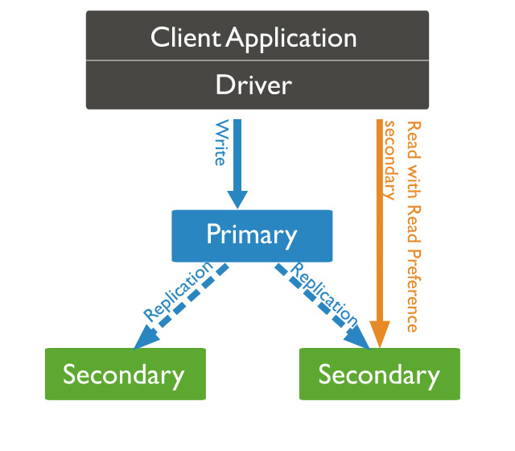

**MongoDB Replica Set**은 **하나 이상의 MongoDB 인스턴스**가 **Primary와 Secondary**로 나뉘어 **데이터를 복제하고 고가용성을 제공**하는 구조입니다. Replica Set은 데이터를 자동으로 복제하여 여러 노드에 저장함으로써 장애 발생 시에도 서비스가 중단되지 않고 지속될 수 있게 합니다.

#### **언제 사용하는 것이 좋은가?**

* **고가용성(High Availability)**이 필요할 때: 서비스가 중단 없이 지속적으로 운영되어야 하는 환경.
* **자동 복구 및 데이터 안전성**이 중요한 경우: Primary 노드에 장애가 발생해도 자동으로 Secondary 노드 중 하나가 Primary로 승격되어 서비스 중단을 최소화하고, 데이터 손실을 방지.
* **읽기 성능을 최적화**하고 싶을 때: Secondary 노드를 사용해 읽기 요청을 분산시키면 성능이 향상됩니다.
* **백업, 장애 복구, 데이터 분산**이 필요한 경우.

#### **Replica Set 주요 멤버**

**Primary**

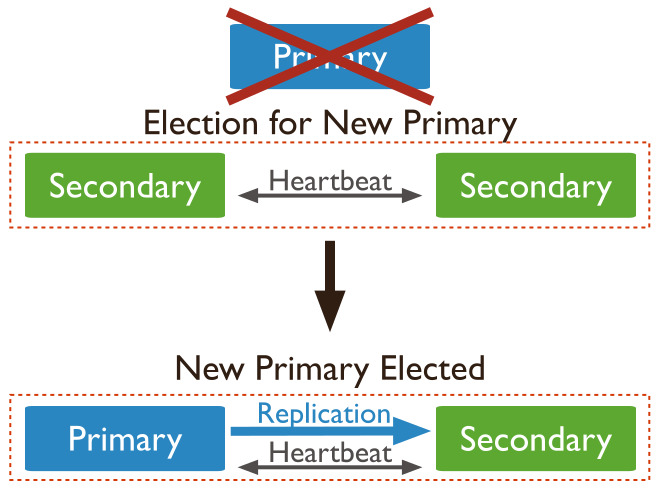

* **역할**: Primary는 쓰기 작업을 처리하는 유일한 멤버입니다. 모든 쓰기 작업이 Primary에서 이루어지고, 이후 데이터는 Secondary로 복제됩니다.
* **특징**: Primary는 하나만 존재하며, 장애 발생 시 투표 절차에 따라 새로운 Primary가 선출됩니다. Primary는 기본적으로 읽기 및 쓰기 작업을 모두 처리할 수 있습니다.
* **장애 시 처리**: Primary가 장애를 겪으면, 투표를 통해 Secondary 중 하나가 새로운 Primary로 자동 승격됩니다.

**Secondary**

* **역할**: Primary 노드에서 복제된 **데이터를 저장**하고 유지하는 노드. 여러 Secondary 노드가 있을 수 있음.
* **특징**: 기본적으로 읽기 전용 노드이며, 읽기 부하 분산을 위해 클라이언트 요청을 처리하도록 설정할 수 있음. Primary 장애 시, 투표에 따라 새로운 Primary가 될 수 있음.
* **복제 지연**: Secondary 노드는 Primary에서 복제된 데이터를 처리하므로 약간의 복제 지연이 있을 수 있음.

**Arbiter** (선택 사항)

* **역할**: **투표에만 참여**하는 노드로, 데이터 복제는 하지 않음. 프라이어미가 살아있음을 보장하기 위한 용
* **특징**: Primary가 장애를 겪었을 때 투표 절차에서 Primary 선출을 돕기 위해 사용. Arbiter는 하드웨어 자원이 적게 필요하지만, 데이터를 복제하지 않기 때문에 고가용성을 위해 Secondary 노드로 대체하는 것이 더 바람직함.

[참고] 투표 방식

더보기

MongoDB **Replica Set의 투표 방식**은 **Primary** 노드가 장애로 인해 더 이상 사용할 수 없을 때, **Secondary** 노드 중 하나가 새로운 Primary로 **자동으로 승격**되는 과정에서 사용됩니다. 이 과정에서 **투표 절차**가 진행되며, 다수의 동의를 얻은 노드가 새로운 Primary가 됩니다. 이를 **선출 절차**라고 합니다.

**투표 방식의 주요 개념**

1. **Majority(과반수) 투표**:
   * **Replica Set**은 멤버의 과반수가 참여해야 투표가 유효합니다. 과반수는 멤버 수의 절반 이상이 참여하고 찬성해야 하므로, 멤버가 3명일 경우 최소 2명이 투표해야 합니다.
   * 과반수 투표에 성공한 **Secondary** 노드가 **Primary로 승격**됩니다.
2. **Primary 선출 절차**:
   * **Primary 장애** 시, 남아 있는 **Secondary** 노드들 간에 **자동으로 투표**가 시작됩니다.
   * 복제 지연이 적고, 가장 최근의 데이터를 가진 **Secondary**가 우선적으로 선출됩니다.
   * 모든 Secondary와 **Arbiter**(있는 경우)가 투표에 참여할 수 있으며, **과반수의 찬성**을 얻은 노드가 새로운 Primary로 승격됩니다.
3. **Arbiter의 역할**:
   * **Arbiter**는 **데이터 복제는 하지 않지만, 투표에만 참여**합니다.
   * 멤버 수가 **짝수**일 경우 투표가 교착 상태에 빠지는 것을 방지하기 위해 Arbiter가 추가되어 **홀수 투표 구조**를 만듭니다. Arbiter는 데이터를 복제하지 않기 때문에 자원이 적게 들지만, Primary 선출을 위한 투표에는 참여해 투표 절차를 원활하게 돕습니다.

**투표의 진행 과정**

1. **Primary가 장애**로 인해 더 이상 사용 불가능한 상태가 되면, **Heartbeat**(서버 상태 확인 신호)를 통해 다른 노드들이 이를 감지합니다.
2. **남아 있는 Secondary 노드들**이 **투표 절차**를 시작하고, **최소 과반수의 투표**를 받아 새로운 Primary를 선출합니다.
3. 새로운 **Primary는 복제 지연이 적고 최신 데이터를 가진 Secondary**가 우선적으로 선택됩니다.
4. 새로운 **Primary가 선출되면**, 클라이언트는 해당 Primary로 연결되어 계속해서 쓰기 작업을 처리할 수 있게 됩니다.

**투표 조건**

* Replica Set 내의 **멤버 수가 홀수**이면 투표가 비교적 원활하게 이루어지지만, **짝수일 경우** 투표가 교착 상태에 빠질 수 있으므로 **Arbiter**를 추가하는 것이 권장됩니다.

투표 절차 덕분에 MongoDB Replica Set은 장애 발생 시에도 서비스의 **고가용성**을 유지하고, **데이터 무결성**을 보장하면서 시스템을 자동으로 복구할 수 있습니다.

#### **Replica Set Arbiter**

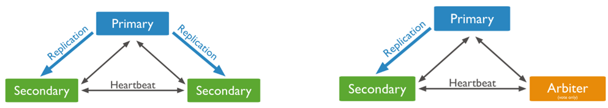

MongoDB Replica Set에서 **Arbiter**의 역할과 관련된 **PSS (Primary-Secondary-Secondary)** 및 **PAS (Primary-Arbiter-Secondary)** 구성 방식에 대해 설명하겠습니다. 이 두 가지 구성 방식은 Replica Set의 고가용성과 부하 관리에 중요한 역할을 합니다.

1. **PSS (Primary-Secondary-Secondary) 구성**

* **구성**: 이 구성에서는 Primary와 두 개의 Secondary가 포함됩니다. Arbiter는 사용되지 않습니다.
* **역할**:
  + **Primary**: 모든 쓰기 작업을 처리하며 데이터를 관리합니다.
  + **Secondary**: Primary의 데이터를 복제하고, 읽기 요청을 처리할 수 있습니다. 두 개의 Secondary가 있으므로 부하를 더 효과적으로 분산시킬 수 있습니다.
* **부하 측면**
  + **쓰기 부하**: Primary에 모든 쓰기 작업이 집중되기 때문에, Primary에 부하가 발생할 수 있습니다.
  + **읽기 부하**: 두 개의 Secondary가 읽기 요청을 처리하므로, 읽기 부하가 효과적으로 분산되어 성능 향상에 기여합니다. Primary는 읽기 작업을 최소화할 수 있어 더 안정적인 성능을 유지할 수 있습니다.

2. **PAS (Primary-Arbiter-Secondary) 구성**

* **구성**: 이 구성은 Primary, Arbiter, Secondary로 구성됩니다. Arbiter는 Primary와 Secondary 간의 투표에만 참여합니다.
* **역할**:
  + **Primary**: 모든 쓰기 작업을 처리합니다.
  + **Arbiter**: 데이터 복제를 하지 않고, 오직 투표에 참여하여 Primary를 선출하는 역할을 합니다.
  + **Secondary**: Primary의 데이터를 복제하고 읽기 요청을 처리할 수 있습니다.
* **부하 측면**
  + **쓰기 부하**: 모든 쓰기 작업이 Primary에 집중되므로, 높은 쓰기 트래픽이 발생할 경우 Primary의 성능이 저하될 수 있습니다. Arbiter는 데이터 작업을 하지 않기 때문에 부하를 추가하지 않습니다.
  + **읽기 부하**: Secondary가 읽기 요청을 처리할 수 있으므로, Primary의 부하를 줄이는 데 도움이 됩니다. 그러나 Secondary는 한 개만 존재하기 때문에 읽기 부하 분산 효과는 제한적입니다.

**부하 관리와 고려 사항**

* **부하 균형**: PSS 구성은 두 개의 Secondary가 존재하므로 읽기 작업을 더욱 효과적으로 분산할 수 있어, 성능 향상에 유리합니다. 그러나 PAS 구성은 Arbiter를 사용하므로 하드웨어 자원을 절약할 수 있지만, 읽기 부하 분산에는 한계가 있습니다.
* **Primary 부하**: 두 구성 모두 쓰기 작업은 Primary에 집중되기 때문에, 높은 쓰기 트래픽이 발생할 경우 Primary의 성능이 저하될 수 있습니다. 따라서 적절한 모니터링과 성능 관리를 통해 부하를 조절해야 합니다.

**어떤 방식을 선택할까?**

* **PSS 방식**: 일반적으로 PSS 구성이 더 효율적이며, 높은 읽기 부하를 처리하는 데 적합합니다.
* **PAS 방식**: 비용 절감과 하드웨어 자원 절약이 중요한 경우 사용할 수 있지만, 읽기 부하 분산이 제한적이므로 주의가 필요합니다.

PSS와 PAS 구성 모두 Replica Set의 고가용성과 성능을 유지하는 데 중요하지만, 각각의 부하 관리 방식과 특성을 고려하여 환경에 맞는 최적의 구성을 선택하는 것이 중요합니다.

---

#### **Replica Set 배치 방식**

Replica Set의 멤버들은 **같은 서버**에 위치할 수도 있고, **다른 서버**에 분산될 수도 있습니다. 각각의 방식에는 장단점이 있으며, 운영 환경에 따라 적절한 배치를 선택해야 합니다.

**1. 같은 서버에 위치한 Replica Set 멤버들**

* **구성** : Primary, Secondary, Arbiter가 **모두 같은 물리적 서버나 가상 서버**에 위치.
* **장점**:
  + **비용 절감**: 하나의 서버만 사용하므로 인프라 비용이 저렴.
  + **설정의 간편성**: 복잡한 네트워크 설정이 불필요.
* **단점**:
  + **단일 장애 지점(Single Point of Failure)**: 서버 자체에 장애가 발생하면 모든 노드가 동시에 영향을 받아 서비스가 중단됨.
  + **성능 저하**: I/O 및 네트워크 자원이 공유되므로 성능이 저하될 가능성이 있음.

**2. 다른 서버에 위치한 Replica Set 멤버들**

* **구성** : Primary, Secondary, Arbiter가 **각각 다른 물리적 서버**나 **다른 데이터 센터**에 위치. 지리적 분산이 가능.
* **장점**:
  + **고가용성**: 한 서버에 장애가 발생해도 다른 서버에서 운영이 지속되므로 높은 가용성을 보장합니다.
  + **성능 향상**: 읽기 작업을 Secondary로 분산시켜 성능을 최적화할 수 있으며, 클라이언트의 지리적 위치에 따라 응답 속도가 개선됩니다.
* **단점**:
  + **비용 증가**: 여러 서버나 데이터 센터에 멤버를 분산 배치하므로 인프라 및 네트워크 비용이 증가.
  + **관리 복잡성**: 네트워크 설정과 복제 지연을 관리해야 하고, 복제가 실시간으로 이루어지지 않을 가능성.

**3. 어떻게 배치하는 것이 좋은가?**

* **같은 서버에 배치**하는 것은 개발, 테스트, 또는 **비용을 줄여야 하는 소규모 프로젝트**에 적합하지만, 장애 시 고가용성이 보장되지 않기 때문에 **운영 환경에는 적합하지 않습니다**.
* **다른 서버에 분산 배치**하는 것이 더 안전하며, **프로덕션 환경**에서는 **다른 물리적 서버** 또는 **다른 데이터 센터**에 배치하는 것이 권장됩니다. 이를 통해 고가용성과 성능 최적화를 동시에 달성할 수 있습니다.

**정리**

* **Primary**는 쓰기 작업을 담당하고, **Secondary**는 이를 복제하여 고가용성을 보장합니다. **Arbiter**는 투표에만 참여해 장애 시 새로운 Primary를 선출하는 데 도움을 줍니다.
* **같은 서버**에 배치하면 비용이 절감되고 설정이 간편하지만, 고가용성은 떨어집니다. **다른 서버**에 분산하면 높은 가용성과 성능을 보장하지만, 비용과 관리 복잡성이 증가합니다.

---

#### [**Replica Set Oplog**](https://www.interviewbit.com/mongodb-interview-questions/)

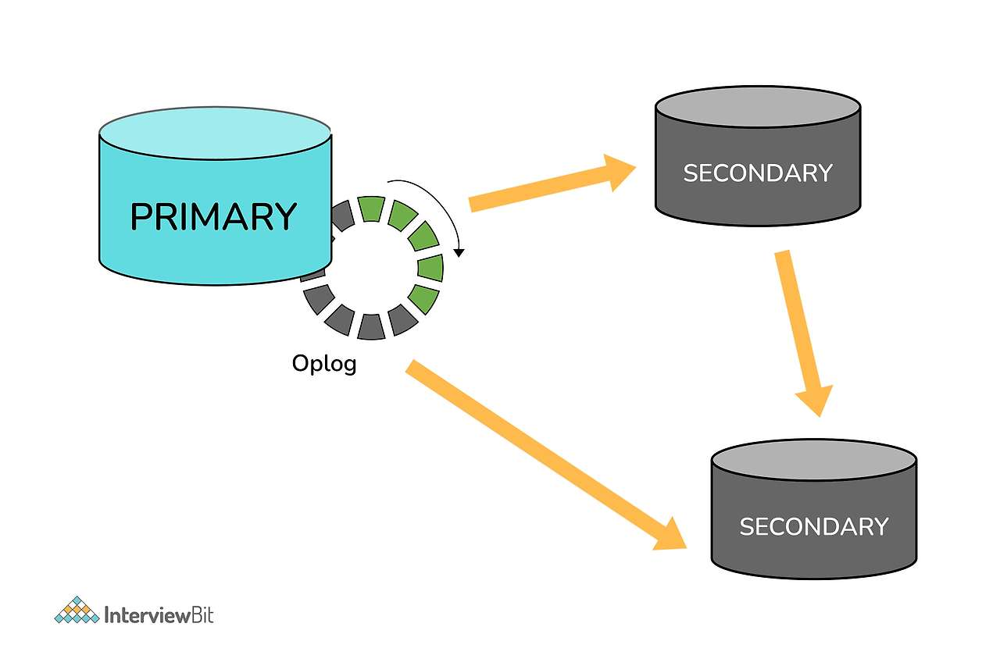

MongoDB Oplog (Operation Log)는 Replica Set에서 데이터 복제를 관리하는 중요한 구성 요소입니다. Oplog는 Primary 노드에서 발생하는 모든 데이터 변경 작업을 기록하며, Secondary 노드가 이 로그를 참조하여 Primary의 상태를 동기화합니다. 

**개념**

* **역할**: Oplog는 Primary 노드에서 실행되는 모든 쓰기 작업(삽입, 업데이트, 삭제 등)의 기록을 보관합니다. Secondary 노드는 이 Oplog를 통해 Primary의 변경 사항을 따라가며 데이터를 동기화합니다. Primary 에서만 Oplog를 복사해 오는 것이 아니라 자신보다 앞서 있는 Secondary에서도 Oplog를 복제할 수 있습니다.
* **구성**: Oplog는 MongoDB의 특별한 컬렉션으로, 이름은 local.oplog.rs입니다. 이 컬렉션은 Replica Set의 각 Primary 노드에만 존재하며, 해당 노드에서 발생한 모든 변경 사항을 순차적으로 기록합니다.

**작동 원리**

1. **쓰기 작업 기록**: 클라이언트가 Primary 노드에 쓰기 작업을 요청하면, 해당 작업이 Oplog에 기록됩니다.
2. **복제**: Secondary 노드는 Oplog를 주기적으로 폴링하여 새로운 변경 사항을 확인합니다. Primary의 Oplog에 새로운 엔트리가 추가되면, Secondary는 이 정보를 가져와서 해당 변경 작업을 수행합니다.
3. **동기화**: Secondary 노드는 Oplog를 통해 Primary와의 데이터 동기화를 유지합니다. 이 과정에서 Primary의 Oplog에서 최신 상태를 읽고, 해당 작업을 실행하여 데이터를 업데이트합니다.

**구성 요소**

* **Timestamp**: 각 Oplog 엔트리는 타임스탬프를 포함하여 작업의 발생 시간을 기록합니다. 이를 통해 복제 순서를 확인할 수 있습니다.
* **Operation Type**: Oplog 엔트리는 수행된 작업의 유형(삽입, 업데이트, 삭제 등)을 기록합니다.
* **Namespace**: 어떤 데이터베이스와 컬렉션에서 작업이 수행되었는지를 나타내는 정보입니다.
* **Document Key**: 수정된 문서의 고유 식별자입니다. 이를 통해 어떤 데이터를 변경했는지 추적할 수 있습니다.

**기능**

* **장애 조치**: Primary 노드가 장애가 발생할 경우, Oplog를 사용하여 가장 최근의 Secondary 노드를 새로운 Primary로 승격시킬 수 있습니다. 이를 통해 데이터 손실을 최소화합니다.
* **복제 지연 관리**: Oplog의 타임스탬프를 사용하여 Secondary 노드의 복제 지연 상태를 모니터링할 수 있습니다. 이를 통해 성능 및 데이터 일관성을 관리할 수 있습니다.
* **데이터 복원**: Oplog를 통해 특정 시점으로 데이터를 복원하는 것이 가능합니다. Oplog의 내용을 활용하여 이전 상태로 되돌릴 수 있습니다.

**용량 및 관리**

* **용량 제한**: Oplog는 고정된 크기를 가지며, 기본적으로 5%의 데이터베이스 크기를 할당합니다. 이 크기를 초과하면 오래된 Oplog 엔트리가 삭제됩니다. 따라서 충분한 크기의 Oplog를 유지하는 것이 중요합니다.
* **모니터링**: Oplog의 크기와 상태를 모니터링하여 복제 성능을 최적화하고, 복제 지연을 방지해야 합니다.

**MongoDB Oplog**는 Replica Set의 데이터 복제를 효과적으로 관리하는 데 필수적인 구성 요소입니다. Primary에서의 모든 데이터 변경 작업을 기록하고, Secondary 노드와의 동기화를 통해 데이터의 일관성과 가용성을 보장합니다. Oplog의 작동 원리를 이해하고 적절히 관리하는 것은 MongoDB Replica Set의 성능과 안정성을 유지하는 데 중요한 요소입니다.

### Sharded Cluster

---

#### 개념

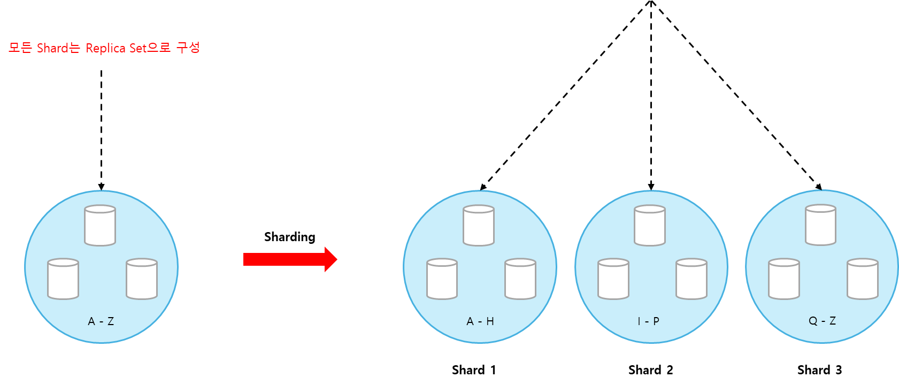

개념을 이해하기 쉽게 예시를 통해 알아보려고 합니다.

좌측에는 A-Z까지 알파벳이라는 컬렉션을 가지고 있는 Replica Set이 있습니다. Replica Set이 더 이상 감당할 수 없을 정도로 많은 데이터가 유입되면서 오른쪽과 같이 Sharded Cluster 형태로 배포하기로 합니다. 

우측의 알파벳 컬렉션이 알파벳이라는 필드를 Shard Key로 Sharding 되어 3개의 Shard로 분산되었고, 각 Shard는 Replica Set으로 관리됩니다.

복제와 Sharding이 혼동될 수 있는데, 복제는 H를 위한 솔루션이고, Sharding은 분산 처리 즉 Scale Out을 위한 솔루션이다.

**[참고] Sharding, **Shard**, Shard Key 용어 정리**

더보기

**Sharding**

* **정의**: Sharding은 대량의 데이터를 여러 서버에 분산 저장하여 데이터베이스의 성능과 용량을 확장하는 방법입니다. 이를 통해 데이터베이스가 더 많은 트래픽을 처리하고, 데이터 용량을 증가시킬 수 있습니다.
* **기능**:
  + **수평 확장**: Sharding을 통해 데이터베이스의 용량을 증가시킬 수 있으며, 각 서버(Shard)는 데이터의 일부를 저장합니다.
  + **부하 분산**: 클라이언트 요청을 여러 Shard에 분산시켜 데이터베이스의 부하를 고르게 나누어 처리합니다.
  + **고가용성**: Sharding은 데이터의 복제를 지원하여 장애 발생 시 데이터의 가용성을 높입니다.
* **작동 원리**:
  1. **Shard Key**: 데이터를 분할하는 기준으로 사용되는 키입니다. 이 키를 기준으로 데이터를 여러 Shard에 분산합니다.
  2. **Chunk**: Shard Key를 기준으로 나뉜 데이터의 단위입니다. 각 Shard는 여러 개의 Chunk를 저장하며, Chunk는 특정 범위의 데이터를 포함합니다.
  3. **MongoDB Router (mongos)**: 클라이언트 요청을 적절한 Shard로 라우팅하는 역할을 합니다. 클라이언트는 mongos에 연결하여 데이터를 요청하고, mongos는 요청을 해당 Shard로 전달합니다.

**Shard**

* **정의**: Shard는 Sharding된 데이터의 실제 저장소입니다. 각 Shard는 데이터베이스의 일부 데이터를 저장하고 있으며, 독립적인 MongoDB 인스턴스입니다.
* **특징**:
  + **독립성**: 각 Shard는 독립적으로 운영되며, 다른 Shard와 상호작용할 수 있습니다. 각 Shard는 데이터를 가지고 있으며, 쓰기 및 읽기 작업을 처리합니다.
  + **복제**: 각 Shard는 Replica Set으로 구성되어, 데이터의 가용성과 안정성을 보장합니다. 이를 통해 Shard 내의 데이터가 복제되고, 장애 발생 시에도 데이터 손실을 방지할 수 있습니다.
  + **수용 용량**: Shard는 특정 데이터 범위를 저장하고 있으며, 데이터가 증가함에 따라 Shard의 수를 늘려 수용 용량을 확장할 수 있습니다.

**Shard Key**

* **정의**: Shard Key는 MongoDB의 Sharding에서 데이터를 분산 저장하기 위해 사용하는 필드 또는 필드 조합입니다. 이 키는 각 문서의 데이터를 Shard에 매핑하는 데 사용됩니다.
* **역할**: Shard Key는 MongoDB가 어떤 Shard에 데이터를 저장할지를 결정하고, 클라이언트의 요청을 적절한 Shard로 라우팅하는 데 도움을 줍니다.
* **선택 기준**
  + **균형 잡힌 분산**: 선택한 Shard Key는 데이터가 여러 Shard에 고르게 분산되도록 해야 합니다. 특정 Shard에 데이터가 몰리지 않도록 하는 것이 중요합니다.
  + **쿼리 성능**: Shard Key는 자주 쿼리되는 필드여야 하며, 이를 통해 데이터 접근 성능을 최적화할 수 있습니다.
  + **변경 빈도**: Shard Key로 설정된 필드는 자주 변경되지 않아야 합니다. 자주 변경되는 필드는 데이터 이동이 발생해 성능 저하를 초래할 수 있습니다.
  + **선택성**: Shard Key는 가능한 한 많은 고유 값을 가져야 하며, 이를 통해 각 Shard에 데이터가 고르게 분포될 수 있습니다.
* **작동 원리**
  + **Chunk 분할**: Shard Key를 기준으로 데이터가 Chunk로 분할됩니다. 각 Chunk는 특정 범위의 Shard Key 값을 가지며, 해당 범위의 데이터를 포함합니다.
  + **데이터 분배**: 각 Chunk는 MongoDB 클러스터의 여러 Shard에 분산되어 저장됩니다. MongoDB는 Shard Key의 값을 기반으로 데이터를 적절한 Shard에 할당합니다.
  + **라우팅**: 클라이언트가 데이터 요청을 하면, MongoDB Router(mongos)는 Shard Key 값을 사용하여 요청을 해당 Shard로 라우팅합니다.
* **장점**
  + **성능 향상**: 적절한 Shard Key를 선택하면 쿼리 성능을 개선하고, 데이터의 접근 속도를 높일 수 있습니다.
  + **부하 분산**: Shard Key를 통해 데이터가 고르게 분산되면, 데이터베이스의 부하를 효율적으로 분산시킬 수 있습니다.
  + **확장성**: Shard Key를 사용하면 데이터베이스가 수평으로 확장 가능하게 되어, 데이터 용량과 트래픽이 증가할 때도 시스템 성능을 유지할 수 있습니다.
* **단점**
  + **불균형 문제**: 부적절한 Shard Key를 선택하면 데이터가 특정 Shard에 몰리게 되어, 부하가 집중되고 성능 저하를 초래할 수 있습니다.
  + **변경의 복잡성**: 이미 설정된 Shard Key는 변경하기가 복잡하고, 데이터 이동이 필요할 수 있으며, 이로 인해 성능 저하가 발생할 수 있습니다.
  + **쿼리 제약**: Shard Key가 쿼리에서 사용되지 않으면 성능이 저하되거나, 쿼리가 모든 Shard를 스캔하게 되어 비효율적일 수 있습니다.

**장점**

1. **수평 확장**: Sharded Cluster는 데이터베이스의 용량과 성능을 수평으로 확장할 수 있어, 데이터가 증가하더라도 시스템을 유지할 수 있습니다.
2. **부하 분산**: 클라이언트 요청이 여러 Shard에 분산되므로, 데이터베이스의 부하가 고르게 분산되어 성능이 향상됩니다.
3. **고가용성**: 각 Shard는 Replica Set으로 구성될 수 있어, 장애가 발생하더라도 데이터의 가용성을 높입니다.
4. **성능 최적화**: Shard Key를 통해 특정 쿼리의 성능을 최적화할 수 있으며, 필요한 데이터만 로드하여 처리 속도를 높일 수 있습니다.
5. **확장성**: 데이터베이스가 필요할 때 새로운 Shard를 추가할 수 있어, 성장하는 데이터베이스에 유연하게 대응할 수 있습니다.

**단점**

1. **관리 복잡성**: Sharded Cluster의 구성과 관리가 복잡하며, 여러 Shard와 Replica Set을 설정하고 모니터링해야 합니다.
2. **비용 증가**: 여러 서버를 운영해야 하므로, 인프라 비용이 증가합니다. 특히, 데이터 전송과 네트워크 비용이 발생할 수 있습니다.
3. **데이터 불균형**: 부적절한 Shard Key 선택으로 인해 데이터가 특정 Shard에 몰리는 경우가 발생할 수 있으며, 이로 인해 성능이 저하될 수 있습니다.
4. **쿼리 제약**: Shard Key를 사용하지 않는 쿼리는 모든 Shard를 스캔해야 하므로 성능 저하를 초래할 수 있습니다.
5. **복잡한 문제 해결**: 장애 발생 시 문제 해결이 복잡할 수 있으며, 데이터 복제와 동기화 문제가 발생할 수 있습니다.

**Sharded Cluster**는 대량의 데이터를 저장하고 쓰기 작업에 대한 부하가 클 때 적합한 솔루션입니다. **Replica Set**에서는 세컨더리 멤버를 추가하여 읽기 작업을 분산할 수 있지만, 쓰기 작업은 단 하나의 프라이머리에서만 처리되므로 쓰기에 대한 부하가 클 경우 성능 저하가 발생할 수 있습니다. 이러한 상황에서는 Sharded Cluster를 활용해 데이터와 부하를 효과적으로 분산시키는 것이 필요합니다.

#### **용어 정리**

**1. Sharding과 Partitioning 비교**

**Sharding**과 **Partitioning**은 데이터베이스에서 데이터를 분산 저장하는 방법이지만, 그 목적과 구현 방식에서 차이가 있습니다.

|  | **Sharding** | **Partitioning** |
| --- | --- | --- |
| **정의** | **Sharding**은 대규모 데이터베이스에서 데이터를 **여러 서버에 수평으로 분산 저장하는 기술**입니다.   각 Shard는 데이터의 일부분을 포함하고 있으며, 데이터베이스가 필요에 따라 Shard를 추가할 수 있습니다. | **Partitioning**은 **하나의 큰 데이터를 여러 서비셋으로 나누어 하나의 인스턴스의 여러 테이블로 나누어 저장하는 기술**입니다. 이는 일반적으로 동일한 데이터베이스 인스턴스 내에서 이루어집니다. |
| **특징** | * 각 Shard는 독립적으로 운영되며, 데이터의 샤드를 결정하는 Shard Key를 사용합니다. * Sharding은 읽기 및 쓰기 성능을 개선하고, 수평적 확장을 가능하게 합니다. * MongoDB와 같은 NoSQL 데이터베이스에서 주로 사용됩니다. | * 각 Partition은 동일한 테이블의 일부 데이터를 포함하며, 테이블의 논리적 구성을 기반으로 합니다. * Partitioning은 주로 성능 개선, 관리 용이성, 데이터 유지 관리에 도움을 주며, 데이터를 수직 또는 수평으로 나눌 수 있습니다. * 관계형 데이터베이스에서 자주 사용됩니다. |

**2. Replica Set과 Sharded Cluster 비교**

**Replica Set**과 **Sharded Cluster**는 데이터베이스의 가용성 및 확장성을 제공하지만, 그 구조와 용도에서 다릅니다.

|  | **Replica Set** | **Sharded Cluster** |
| --- | --- | --- |
| **정의** | Replica Set은 MongoDB의 고가용성을 위한 구조로, 여러 인스턴스가 데이터를 복제하여 같은 데이터 셋을 갖고, 데이터 손실을 방지합니다. | Sharded Cluster는 대규모 데이터베이스에서 데이터를 여러 서버에 수평으로 분산 저장하는 구조로, 성능과 확장성을 제공하기 위해 설계되었습니다. |
| **구성 요소** | * **Primary**: 쓰기 작업을 처리하며, 모든 클라이언트의 쓰기 요청이 이 노드로 전송됩니다. * **Secondary**: Primary의 데이터를 복제하며, 기본적으로 읽기 전용입니다. * **Arbiter**: 데이터 복제 없이 투표에만 참여하여 Primary 선출에 도움을 줍니다. | * **Shard**: 데이터를 저장하는 개별 서버로, 각각이 Replica Set으로 구성될 수 있습니다. * **Config Server**: Shard의 메타데이터 및 샤딩 정보를 저장합니다. * **MongoS**: 클라이언트 요청을 적절한 Shard로 라우팅하는 역할을 합니다. |
| **특징** | * 장애 발생 시 자동으로 새로운 Primary를 선출하여 가용성을 유지합니다. * 읽기 작업을 Secondary 노드로 분산할 수 있지만, 쓰기 작업은 Primary에 한정됩니다. | * 데이터와 부하를 분산하여 읽기 및 쓰기 성능을 모두 향상시킵니다. * Shard Key를 사용하여 데이터를 분산시키며, 필요에 따라 Shard를 추가하여 수평 확장을 지원합니다. |

정리

* **Sharding**은 대규모 데이터베이스에서 데이터를 수평적으로 분산 저장하는 기술이며, **Partitioning**은 동일한 데이터베이스 인스턴스 내에서 데이터를 나누는 방법입니다.
* **Replica Set**은 고가용성을 위해 데이터를 복제하는 구조인 반면, **Sharded Cluster**는 성능과 확장성을 위해 데이터를 여러 서버에 분산 저장합니다.

---

#### [**Architecture**](https://www.interviewbit.com/mongodb-interview-questions/)

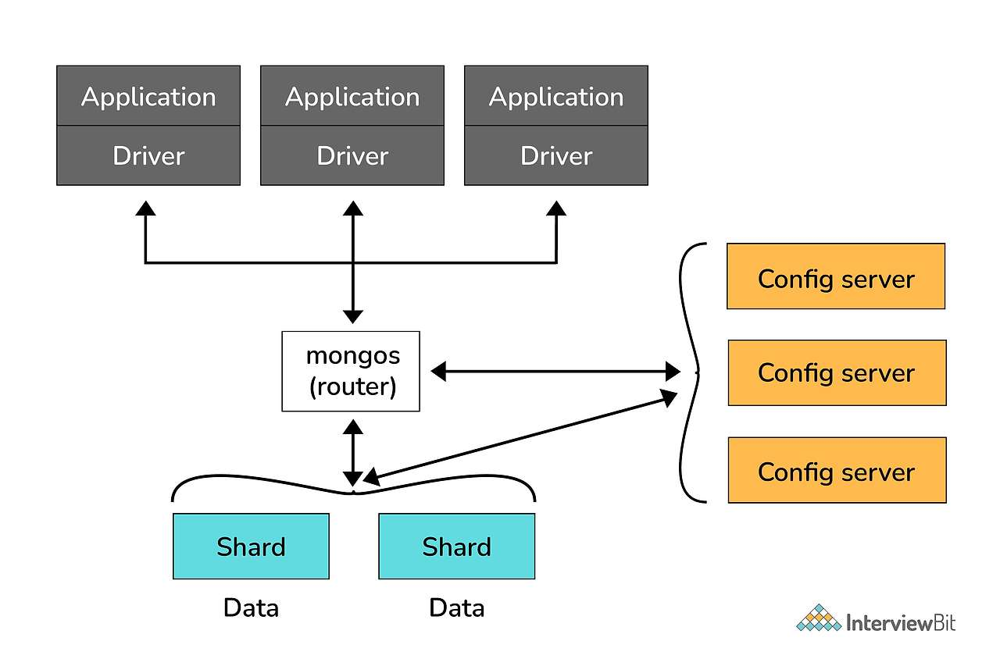

**컴포넌트의 역할**

* **Shard**
  + 각 Shard는 데이터를 저장하는 독립적인 MongoDB 인스턴스입니다.
  + Shard는 Replica Set으로 구성될 수 있으며, 각 Shard는 데이터의 일부분을 담당합니다.
  + Sharding을 통해 데이터베이스의 부하를 분산시키고, 필요에 따라 Shard를 추가하여 수평 확장을 지원합니다.
* **Router(=MongoS)**
  + Router는 클라이언트와 Sharded Cluster 간의 인터페이스 역할을 하는 프로세스로 클라이언트의 요청(쿼리)을 Shard로 전달하고 결과를 다시 Merge해서 클라이언트에게 반환해준다.
  + Router는 Config Server에서 메타데이터를 조회하여 요청을 처리하며, 클라이언트는 Router를 통해 Sharded Cluster와 상호작용합니다.
* **Config Server**
  + Config Server는 Sharded Cluster의 메타데이터와 설정 정보를 저장합니다. 이 정보에는 Shard의 위치, 데이터의 샤딩 정보, 그리고 클러스터의 상태 등이 포함됩니다.
  + Config Server는 Replica Set(반드시 3개 이상)으로 구성되어 고가용성을 보장하며, 읽기 및 쓰기 작업은 항상 Config Server에 접근하여 수행됩니다.

**Shared Cluster 흐름**

1. **클라이언트 요청**: 클라이언트 애플리케이션이 MongoDB에 쿼리 요청을 보냅니다. 이 요청은 CRUD 작업(생성, 읽기, 업데이트, 삭제)일 수 있습니다.
2. **MongoS 라우팅**: 클라이언트 요청은 MongoS 프로세스로 전달됩니다. MongoS는 Sharded Cluster의 중개자 역할을 하며, 클라이언트의 요청을 적절한 Shard로 라우팅합니다.
3. **Config Server 조회**: MongoS는 Config Server에서 메타데이터를 조회하여 데이터가 어떤 Shard에 위치하는지 확인합니다. 이 정보에는 Shard Key와 관련된 Chunk 정보가 포함됩니다.
4. **Shard로 요청 전송**: MongoS가 적절한 Shard를 찾으면, 해당 Shard에 쿼리를 전송합니다. 이 단계에서 MongoS는 요청의 타입(읽기 또는 쓰기)에 따라 필요한 처리 작업을 수행합니다.
5. **Shard에서 데이터 처리**: Shard는 요청을 수신하고, 해당 Shard에 저장된 데이터를 기반으로 쿼리를 실행합니다. 필요한 경우, Shard 내의 Replica Set을 통해 읽기 또는 쓰기 작업을 처리합니다.
6. **결과 반환**: Shard가 쿼리 결과를 생성하면, 해당 결과를 MongoS로 반환합니다. MongoS는 여러 Shard에서의 요청 결과를 수집할 수도 있습니다.
7. **클라이언트에게 응답**: 최종적으로, MongoS는 Shard로부터 받은 결과를 클라이언트에게 반환합니다. 클라이언트는 이 결과를 기반으로 애플리케이션 로직을 처리합니다.

**데이터 재분배 및 관리**

* **Chunk 관리**: 데이터가 증가함에 따라 MongoDB는 Chunk의 크기와 개수를 모니터링합니다. Chunk가 특정 크기 이상으로 증가하면 자동으로 새 Chunk를 생성하고, 이를 다른 Shard로 이동시켜 부하를 분산합니다.
* **Shard 추가**: 필요에 따라 새로운 Shard를 추가하여 성능과 용량을 확장할 수 있습니다. 이 과정은 MongoS와 Config Server에 의해 자동으로 관리됩니다.

---

#### **Sharding Collections**

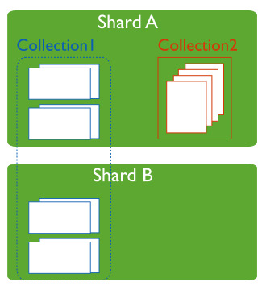

**Sharding**은 데이터베이스의 특정 컬렉션을 여러 샤드(Shard)에 분산하여 저장하는 방식입니다. 각 샤드는 독립적인 MongoDB 서버 인스턴스로, 전체 데이터베이스의 일부를 저장하고 관리합니다. 이로 인해 데이터의 읽기 및 쓰기 성능이 향상되고, 수평적으로 확장이 가능합니다.

**작동 원리**

* **데이터 분할**: MongoDB는 샤딩 키를 기반으로 데이터를 Chunk 단위로 나눕니다. 각 Chunk는 특정 범위의 데이터를 포함하며, 샤드에 분산됩니다.
* **Chunk의 배분**: 각 Chunk는 자동으로 샤드에 배분되며, MongoDB는 Chunk의 크기와 분포를 모니터링합니다.
* **쿼리 처리**: 클라이언트가 데이터를 요청하면 메타데이터 서버가 요청을 적절한 샤드로 라우팅합니다. 필요한 Chunk에 대해 쿼리가 실행되어 효율적으로 데이터를 검색합니다.
* **자동 균형 조정**: MongoDB는 각 샤드의 Chunk를 모니터링하여 데이터의 균형을 유지합니다. 특정 샤드에 Chunk가 과도하게 쌓이면, 자동으로 Chunk를 다른 샤드로 이동시켜 부하를 조절합니다.

[참고] Chunk : 샤딩 키에 따라 데이터를 나눈 데이터 단위입니다. 기본적으로 Chunk의 크기는 64MB로 설정되어 있습니다.

**Sharding을 적용할 때 고려사항**

Sharding은 모든 컬렉션에 적용하는 것은 효율적이지 않기 때문에, Sharding을 적용할지 여부를 고려해야합니다.

* **Sharding을 적용하는 경우**
  1. **대규모 데이터**: 데이터 양이 많아져서 단일 서버로는 처리하기 어려운 경우. 샤딩은 데이터를 여러 샤드에 분산시켜 성능을 향상시킵니다.
  2. **읽기/쓰기 성능 향상 필요**: 높은 트래픽이나 자주 업데이트되는 데이터에 대해 성능을 개선하고자 할 때 유용합니다.
* **Sharding하지 않는 경우**
  1. **적은 데이터 양**: 데이터가 상대적으로 적은 경우, 샤딩을 적용해도 성능 향상 효과가 미미할 수 있으며, 오히려 관리 오버헤드가 증가할 수 있습니다.
  2. **자주 조회되는 컬렉션**: 읽기 성능이 중요한 컬렉션에서는 샤딩이 복잡성을 증가시킬 수 있으며, 불필요한 오버헤드를 초래할 수 있습니다.
  3. **복잡한 관리**: 샤딩은 데이터베이스 관리 및 쿼리 최적화를 복잡하게 만들 수 있으므로, 관리 부담을 감수할 준비가 되어 있어야 합니다.

---

#### [**Sharding 전략**](https://www.mongodb.com/docs/v7.2/core/sharding-choose-a-shard-key/)

MongoDB의 Sharding 전략은 주로 세 가지가 있습니다. **Range Sharding**, **Hash Sharding**, 그리고 **Zone Sharding**입니다. 각각의 전략은 데이터 분산 방식을 다르게 설정하여 샤딩 키에 따른 데이터 분배를 최적화합니다.

**Range Sharding**

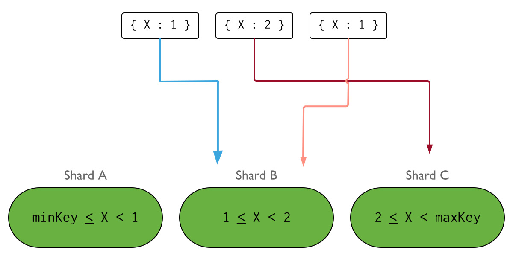

Range Sharding은 샤딩 키의 값을 기준으로 데이터를 범위에 따라 분할합니다. 예를 들어, 날짜, 숫자, 알파벳 순서 등의 연속적인 값을 샤딩 키로 사용할 수 있습니다. 각 Chunk는 특정 값 범위를 포함합니다.

* **작동 방식**:
  + 데이터가 추가되면, 해당 데이터의 샤딩 키 값이 어느 Chunk에 속하는지를 결정합니다.
  + 데이터가 정렬되어 있어 특정 범위의 데이터를 쉽게 조회할 수 있습니다.
* **장점**:
  + 범위 쿼리에 최적화되어 있어, 예를 들어 특정 날짜 범위의 데이터를 쉽게 조회할 수 있습니다.
  + 데이터가 정렬된 형태로 저장되어 있어 인덱스 활용이 효과적입니다.
* **단점**:
  + 데이터가 한쪽으로 치우칠 경우(예: 특정 날짜에 집중된 데이터) 특정 샤드에 데이터가 몰리게 되어 성능 저하가 발생할 수 있습니다.
  + 새로운 데이터가 추가될 때마다 Chunk를 분할해야 하므로 관리가 복잡할 수 있습니다.

**Hash Sharding**

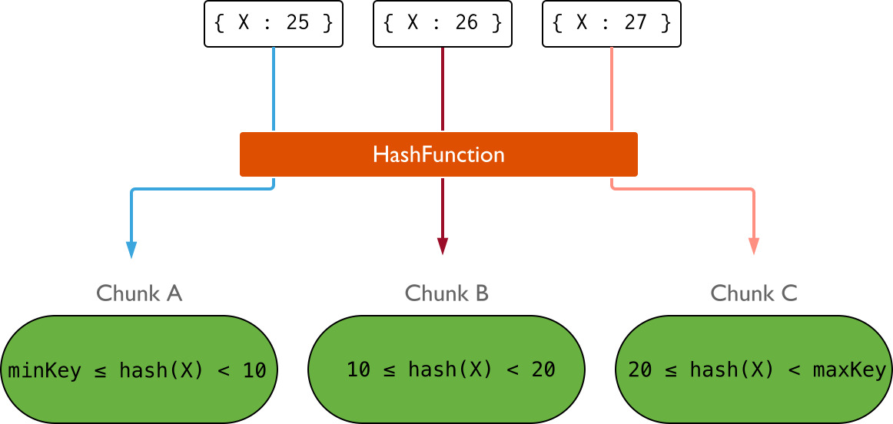

Hash Sharding은 샤딩 키의 해시 값을 계산하여 데이터를 분할합니다. 해시 함수를 통해 샤딩 키의 값을 랜덤하게 변환하여 Chunk를 생성합니다.

* **작동 방식**:
  + 각 Chunk는 해시 값의 범위에 따라 데이터가 배분됩니다. 이렇게 하면 데이터가 고르게 분산됩니다.
  + 데이터가 추가될 때마다 해시 값을 기반으로 적절한 Chunk에 배분됩니다.
* **장점**:
  + 데이터가 고르게 분산되므로 특정 샤드에 데이터가 몰리는 현상을 방지할 수 있습니다.
  + 읽기 및 쓰기 성능이 일관되게 유지되며, 샤드 간의 부하가 균형을 이루어 성능 향상에 기여합니다.
* **단점**:
  + 범위 쿼리 성능이 떨어질 수 있습니다. 예를 들어, 특정 범위의 데이터를 조회하는 것이 어려워집니다.
  + 데이터의 순서가 유지되지 않으므로 정렬된 데이터 접근이 필요할 때 불리합니다.

**Zone Sharding**

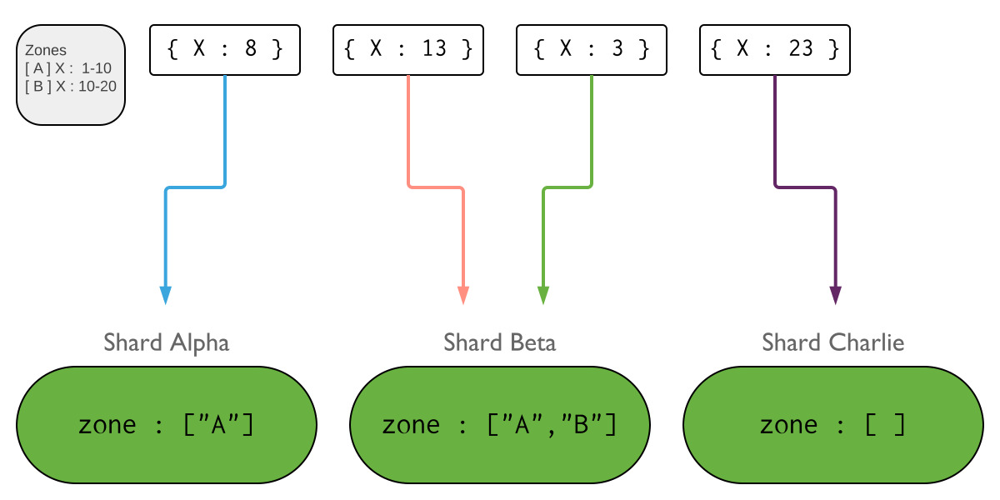

**Zone Sharding**은 특정 범위의 샤딩 키를 정의하여 데이터를 분할하는 방법입니다. 이 방법은 지리적 또는 논리적 요구 사항에 따라 데이터를 특정 샤드에 할당할 수 있도록 합니다.

* **작동 방식**  
  + **범위 정의**: Zone Sharding에서는 특정 범위의 샤딩 키에 대해 존(Zone)을 정의합니다. 예를 들어, 특정 지역의 사용자 데이터를 관리할 때, 각 지역별로 존을 만들고 해당 지역의 데이터를 특정 샤드에 저장합니다.
  + **결합 사용**: Zone Sharding은 종종 Range Sharding과 결합하여 사용됩니다. 예를 들어, 특정 연속적인 값의 범위를 지정하고, 그 범위 내의 데이터를 특정 샤드에 할당하는 방식입니다. 이 때, 각 존 내의 데이터 분포는 Hash Sharding을 통해 고르게 분산될 수 있습니다.
* **장점**
  + **지리적 데이터 관리**: 특정 지역 또는 사용자 그룹의 데이터를 특정 샤드에 저장함으로써 지역적 접근성을 개선할 수 있습니다.
  + **데이터 접근 최적화**: 범위 쿼리와 해시 기반의 균형 잡힌 데이터 분포를 통해 성능을 최적화할 수 있습니다.
* **단점**
  + **복잡성**: 존을 설정하는 과정이 복잡할 수 있으며, 잘못된 설정으로 인해 데이터가 불균형하게 분배될 위험이 있습니다.
  + **관리 어려움**: 존 간의 데이터 이동이 필요할 경우 관리가 복잡해질 수 있습니다.

### Replica Set vs Sharded Cluster 어떻게 배포할 것인가?

---

#### 배포 방식 선택 시 고려사항

배포 방식을 선택할 때는 두 가지 주요 요소를 고려해야 합니다:

1. **서비스 요구 사항 파악**:
   * 하루에 쌓이는 데이터 양, 데이터 보관 기간, 읽기와 쓰기 비율 등.
   * 예시: 하루 1GB의 데이터가 쌓이고 3년간 보관할 경우, 총 데이터는 약 1TB입니다. 인덱스를 포함하면 약 1.3TB가 필요하며, 로컬 백업과 oplog를 고려하여 최종적으로 약 2.7TB의 스토리지가 필요합니다. 여기에 안전 여유분 35%를 고려하면, 총 5TB의 스토리지가 필요합니다.
2. **서버 환경 확인**:
   * 준비할 수 있는 서버 스펙을 확인합니다.
   * 예시:
     + **서버가 2TB인 경우**: 필요한 스토리지를 감당할 수 없으므로 샤딩된 클러스터로 배포하여 분산 처리를 해야 합니다.
     + **서버가 10TB인 경우**: 모든 데이터를 통합하여 레플리카 셋으로 배포할 수 있습니다.

**예시 1) 서버 환경에 따라 다르다**

**요구사항**

1. **매일 1GB씩 데이터가 증가하고 3년간 보관**
2. **메일 로컬 서버에 백업하여 보관하기로 정책 결정**

| **Storage** | **Value** |
| --- | --- |
| **Data** | **1GB \* 365(day) \* 3(year) = 1TB** |
| **Index** | **1TB \* 0.3 = 0.3TB** |
| **local Backup** | **1.3TB** |
| **Oplog** | **0.1TB** |
| **Total** | **2.7TB** |

우리가 선정할 수 있는 사이즈가 단순하게 이제 데이터만 본다면 3년에 1TB 정도이고 인덱스가 한 1/3정도 들어가면 0.3TB, 로컬에다가 백업을 1일치 보관하기 위해 로컬에 백업을 데이터 + 인덱스를 합친 1.3TB를 추가하고 변경작업이 많아서 이제 oplog를 유지하기 위해서 이제 넉넉잡아 100gb를 사용하면 압축률을 제외하고 단순하게 데이터만 봐서 총 2.7TB의 스토리지를 차지하고 있다.

안전 수치 35%정도를 남겨두면 우리가 필요한 서버의 스펙은 대략 5TB의 스토리지가 필요하다.

우리가 선택할 수 있는 사이즈를 단순히 데이터만 기준으로 본다면, 3년 동안 약 **1TB**의 데이터가 쌓입니다. 여기에 인덱스 크기를 약 **1/3**로 계산하면, **0.3TB**의 추가 용량이 필요합니다.

또한, **로컬 백업**을 하루치 보관하기 위해 데이터와 인덱스를 합친 **1.3TB**의 용량이 추가되고, 변경 작업이 많아 **oplog**를 유지하려면 넉넉하게 **100GB**를 더 사용해야 합니다. 이 모든 것을 고려했을 때, **압축을 제외하고 총 2.7TB**의 스토리지가 필요합니다.

여기에 **안전 여유분 35%**를 추가로 남기면, 최종적으로 필요한 서버 스펙은 **약 5TB**의 스토리지가 됩니다.

서비스의 크기를 통해 요구사항을 파악한 후, 이제 확인해야 할 것은 사용할 수 있는 서버의 스펙입니다.

1. 준비할 수 있는 서버의 크기가 2TB인 경우  
   서버 수를 늘려서 **샤디드 클러스터**로 데이터를 분산 처리해야 합니다. 필요한 총 스토리지가 **5TB**인데, 각 서버가 **2TB**밖에 감당할 수 없다면, **분산 처리는 필수**가 됩니다.
2. 준비할 수 있는 서버의 크기가 10TB인 경우  
   모든 데이터를 하나의 서버에 저장할 수 있으므로 **레플리카 셋**으로 배포하는 것이 가능합니다.

이처럼 **서비스의 요구사항**과 **배포 환경**을 종합적으로 고려해 배포 방식을 선택할 수 있습니다. 단순히 용량만 고려한다면 비교적 쉬울 수 있지만, 서비스 요구사항은 용량 외에도 매우 다양할 수 있습니다.

**예시 2) **샤디드 클러스터****

요구사항

* 1번 예시와 동일한 스펙
* 쓰기 요청이 압도적으로 많은 서비스

이런 경우에는 데이터가 작다고 하더라도 샤디드 클러스터로 배포해서 라이트에 대한 요청을 처리할 수 있도록 배포를 해야 된다. 예를 들어, **증권 어플리케이션**의 경우, 주가 변동과 거래가 수시로 이루어져 **쓰기 요청**이 읽기 요청보다 훨씬 많다고 가정해보겠습니다. **Replica Set**을 사용할 경우, **쓰기 작업**은 오직 프라이머리 멤버가 처리해야 하기 때문에 과부하 위험이 커집니다. 이런 상황에서는 데이터 양이 적더라도 **샤디드 클러스터**로 배포해 **쓰기 요청을 분산 처리**하는 것이 필요합니다.

**예시 3) 여러 Replica Set 분리**

| **Storage** | **Value** |
| --- | --- |
| **Data** | **permanently 1GB per day** |
| **Index** | **1TB \* 0.3 = 0.3TB** |
| **local Backup** | **1.3TB** |
| **Oplog** | **0.1TB** |
| **Total** | ****permanently** 2.7TB per 3 years** |

요구사항

* 1번 예시와 동일한 스펙
* 3년 보관 -> 영구적으로 보관으로 변경됨
* 논리적인 데이터베이스가 많은 경우

데이터를 **영구적으로 보관**해야 하고, **데이터 양이 지속적으로 증가**하는 상황이라면, **샤디드 클러스터**를 사용해 분산 처리하는 방식을 고려할 수 있습니다. 이 서비스는 대용량 데이터를 **논리적으로 분리**해 하나의 MongoDB 클러스터에서 여러 데이터베이스를 사용하는 구조입니다. 하지만, 물리적으로 **하나의 MongoDB 클러스터**만 사용할 경우, 특정 부분에서 장애가 발생해도 **서비스 전체가 마비**되는 치명적인 문제가 생길 수 있습니다.

이럴 때는 논리적인 데이터베이스를 각각 **MongoDB 레플리카 셋**으로 분리하여 배포하는 것이 좋습니다. 이렇게 하면 장애가 발생하더라도 **해당 부분**에만 영향을 미치고, **샤디드 클러스터**보다 복구가 쉬운 **레플리카 셋**을 사용해 부담을 분산할 수 있습니다. 이는 **MSA(Microservices Architecture)**와 유사한 아키텍처링 방식 배포하게 될 것입니다.

#### **정리**

| 배포 형태 | 장점 | 단점 |
| --- | --- | --- |
| Replica Set | - 운영이 쉽다. - 장애 발생 시 문제 해결 복구가 쉽다. - 서버 비용이 적게 든다. - 성능이 좋다. - 개발 시 설계가 용이하다. | - Read 에 대한 분산이 가능하지만, Write에 분산은 불가능하다. |
| Sharded Cluster | - Scale-Out이 가능하다. - Write에 대한 분산이 가능하다. | - Replica Set의 모든 장점이 상대적으로 단점이 된다. |

### MongoDB Storage Engine

---

#### **What is Storage Engine?**

* 데이터가 메모리와 디스크에 어떻게 저장하고 읽을지 관리하는 컴포넌트이다.
* MySQL와 동일하게 Plugin형태로 되어 있어 MongoDB도 다양한 Storage Engine을 사용할 수 있다.
* MongoDB 3.2부터 MongoDB의 기본 Storage Engine은 WiredTiger이다.(기존에는 MMAPv1 사용)
* WritedTiger가 도입되면서 MongoDB의 성능은 큰 폭으로 좋아졌다.

#### **WiredTiger Storage Engine 개선사항**

| **항목** | MMAPv1 | WiredTiger |
| --- | --- | --- |
| **MongoDB 기본 엔진 버전** | 3.0 이하 기본엔진 | 3.2 버전부터 기본 엔진 |
| **데이터 저장 방식** | 메모리 맵 파일 기반 | 페이지 기반, 압축 지원 |
| **동시성 제어** | 글로벌 Writer 전략(Locking 제한적) | Multi-Version Concurreny Control(MVCC) |
| **쓰기 성능** | 낮음(글로벌 락으로 인해 병목 발생) | 높음(데이터 압축 및 효율적인 페이지 처리) |
| **읽기 성능** | 낮음(락 기반 처리로 동시성 제한) | 높음(MVCC로 동시 다중 읽기 가능) |
| **Lock** | 버전에 따라 Database 혹은 Collection 레벨의 Lock | Document 레벨의 Lock |
| **데이터 압축** | 지원 X | 지원(데이터와 인덱스 모두 압축 가능) |
| **트랜잭션 지원** | 트랜잭션 지원 불가 | 지원(단일 및 분산 트랜잭션 모두 가능) |
| **복구 성능** | 저널링을 통한 복구 가능하지만 느림 | 저널링을 통한 빠른 복구 |
| **메모리 사용** | 비효율적(전체 파일을 메모리에 매핑) | 효율적(필요한 페이지만 메모리에 로드0 |
| **대용량 데이터 처리** | 제한적(대용량 데이터 처리에 성능 저하) | 뛰어남(데이터 압축 및 효율적 관리 가능) |
| **인덱스 관리** | 인덱스 락 발생, 압축 지원 없음 | 인덱스에 대한 동시성 보장 및 압축 지원 |
