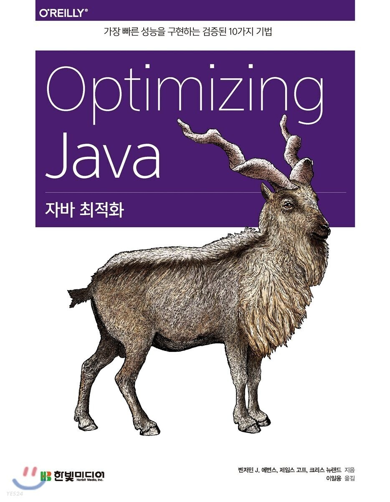

## 하드웨어와 운영체제

> 자바 개발자가 왜 하드웨어에 관심을 가져야 할까요?  
> 

오랫동안 컴퓨터 업계는 무어의 법칙(인텔 공동 설립자인 **고든 무어, Gordon Moore** 가 프로세서 능력의 장기적 추이를 전망한 가설)대로 흘러갔습니다. (사실상 관찰이나 추정이라 해야 할)이 법칙은 여러 가지 방법으로 나타낼 수 있지만, 가장 일반적인 표현은 다음과 같습니다.


시간이 흐르면서 컴퓨터 파워가 기하급수적으로 증가하는 현상을 나타낸 말입니다. 1965년 이래 정말 무어의 법칙대로 인류 진보 역사를 통틀어 거의 전무후무한, 놀라운 발전을 이룩했고 요즘 세상의 (대부분은 아닐지라도) 많은 분야가 변화했습니다.

> **NOTE\_** 무어의 법칙은 이미 수십 년 동안 사망했다고 볼 수 있습니다. 칩 기술의 혁명적인 진보는 (마침내) 종말을 고했다고 할 수 있는 뚜렷한 근거가 많습니다. [참고 - [Interesting Engine](https://interestingengineering.com/innovation/transistors-moores-law)]

하드웨어는 최신 컴퓨터의 저렴해진 '트랜지스터 가격' 이점을 극대화하기 위해 점점 더 복잡해졌고, 그 위에서 작동하는 소프트웨어 역시 새로운 기능을 발전시키는 과정에서 복잡도를 더했습니다. 그 결과, 소프트웨어는 강력한 파워를 자유자재로 구사할 수 있을 정도로 발전했지만, 성능 향상을 꾀하려면 복잡한 기반 기술에 의지해야 할 수밖에 없게 되었습니다.  

엄청난 성능 개선의 혜택을 일반 애플리케이션 개발자도 누릴 수 있었지만, 그 결과 복잡한 소프트웨어가 어지러이 자리 잡게 되었습니다. 소프트웨어 애플리케이션은 이제 글로벌 사회의 모든 부문을 깊숙이 차지하고 있습니다.


자바  언어는 컴퓨팅 파워가 향상되면서 여러모로 많은 혜택을 받았습니다. 언어 및 런타임 설계가 프로세서가 강력해지는 시류와 잘 맞아떨어졌습니다. 하지만 성능을 진지하게 고민하는 자바 프로그래머는 가용 리소스를 최대한 활용할 수 있도록 자바 플랫폼의 근간 원리와 기술을 잘 알고 있어야 합니다.

### 최신 하드웨어 소개

---

아직도 많은 대학교의 하드웨어 아키텍처 수업 시간에는 너무 간단하고 고전적인 하드웨어 내용을 강의하는 경우가 허다합니다. 하드웨어를 레지스터 기반으로 산술, 로직, 스토어 연산을 수행하는 '지극히 뻔한' 머신으로 바라보는 거죠. 그러다 보니 학계는 CPU에게 실제로 일을 시키는 C프로그래밍이야말로 진리의 원친인 양 지나치게 강조하는 편이지만 요즘은 이런 생각이 맞지 않습니다.  

1990년 대 이후, 애플리케이션 개발자 세상은 대부분 인텔 x86/x64 아키텍처 위주로 돌아갔습니다. 인텔 x86/x64 아키텍처는 근본적으로 많은 변화를 겪은 분야이고, 이후에 등장한 수많은 고급 기능들이 핵심부를 형상하고 있습니다. 이제 프로세서 작동 원리를 단순화한 멘탈 모델(정신 모형)은 맞지 않고 그런 모델을 토대로 직관적인 추론을 하면 완전히 쌩뚱맞은 결론을 내리기 쉽습니다.  


### 메모리

---

무어의 법칙에 따라 개수가 급증한 트랜지스터는 처음에 클록 속도(clock speed)를 높이는 데 쓰였습니다. 클록  속도가 증가하면 초당 더 많은 명령어를 처리할 수 있으니까요. 프로세서 속도는 놀라울 만큼 빨라졌는데, 4.77MHz로 작동했던 최초의 IBM IP 칩에 비하면 요즘 4 GHz가 넘는 프로세서는 수백 배 더 빨라진 것입니다.  

하지만 클록 속도가 증가하니 다른 문제가 생겼습니다. 칩이 빨라질수록 데이터는 더 빨리 움직여야 하는데, 시간이 갈수록 프로세서 코어의 데이터 수요를 메인 메모리가 맞추기 어려워졌습니다.

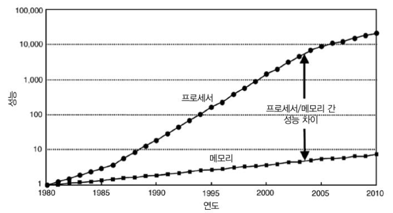

[그림 3-1] 메모리 속도와 트랜지스터 개수(출처: 헤네시와 패티슨 2011년)


결국, 클록 속도가 올라가도 데이터가 도착할 때까지 CPU는 놀면서 기다려야 하니 아무 소용 없게 되었습니다.  


#### 메모리 캐시

프로세서와 메모리 간 성능 차이로 인해 CPU의 낭비되는 시간을 해결하기 위해 CPU 캐시가 만들어지게 되었습니다. 레지스터보다는 느리지만 메인 메모리보다는 훨씬 빠릅니다. 자주 액세스하는 메모리 위치는 CPU가 메인 메모리를 재참조하지 않게 사본을 떠서 CPU 캐시에 보관하자는 아이디어입니다.  

요즘 CPU에는 액세스 빈도가 높은 캐시일수록 프로세스 코어와 더 까이이 위치하는 식으로 여러 캐시 계층이 있습니다. CPU와 가장 가까운 캐시가 L1(레벨 1 캐시), 그다음 캐시가 L2 식으로 명명합니다. 프로세서 아키텍처에 따라 캐시 개수 및 설정 상태는 제각각이지만, 일반적으로 각 실행 코어에 전용 프라이빗 캐시 L1, L2를 두고, 일부 또는 전체 코어가 공유하는 L3 캐시를 둡니다. [그림 3-2]는 캐시를 쓰면 액세스 시간이 얼마나 빨라지는지 비교한 자료입니다.

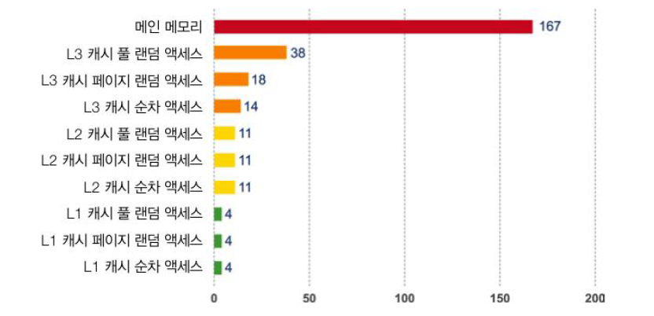

그림 3-2. 다양한 메모리 종류별 액세스 시간

이렇게 캐시 아키텍처를 이용해 액세스 시간을 줄이고 코어가 처리할 데이터를 계속 채워 넣습니다. 클록 속도와 액세스 시간의 차이 때문에 최신 CPU는 더 많은 예산을 캐시에 투자합니다.  

[그림 3-3]은 그 결과 완성된 설계도입니다. CPU 코어마다 전용 L1, L2 캐시가 있고 모든 코어가 공유하는 L3 캐시가 있습니다. 메인 메모리는 **노스브리지(Northbride)** 컴포넌트를 거쳐 액세스하고 이 버스를 관통함으로써 메인 메모리 액세스 시간이 확 줄어듭니다.

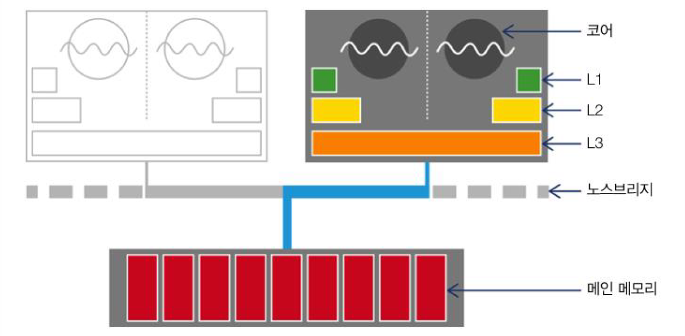

그림 3-3. 전체 CPU 및 메모리 아키텍처

이렇게 캐시 아키텍처를 추가한 덕분에 프로세스 처리율은 현저히 개선되었지만, 또 다른 새로운 고민거리가 시작되었습니다. 메모리에 있는 데이터를 어떻게 캐시로 가져오고 캐시한 데이터를 어떻게 메모리에 다시 써야 할지 결정해야 합니다. 이 문제는 보통 **캐시 일관성 프로토콜(Cache consistency Protocol)**이라는 방법으로 해결합니다.

> **NOTE\_** 병렬 처리 환경에서 이런 식으로 캐싱하면 또 다른 문제가 발생합니다.

프로세서의 가장 저수준에서 **MESI**(및 그 변종, Variants)라는 프로토콜이 자주 눈에 띕니다.  
 MESI 프로토콜은 캐시 라인(보통 64 바이트) 상태를 다음 네 가지로 정의합니다.

* **Modified**(**수정**) : 데이터가 수정된 상태
* **Exclusive**(**배타**) : 캐시에만 존재하고 메인 메모리 내용과 동일한 상태
* **Shared**(**공유**) : 둘 이상의 캐시에 데이터가 들어 있고 메모리 내용과 동일한 상태
* **Invalid**(**무효**) : 다른 프로세스가 데이터를 수정하여 무효한 상태

정리하면 멀티 프로세서가 동시에 공유 상태에 있을 수 있다는 것입니다. 하지만, 어느 한 프로세서가 배타나 수정 상태로 바뀌면 다른 프로세서는 모두 강제로 **무효 상태**가 됩니다.(참고 표 3-1)  


|  | **M** | **E** | **S** | **I** |
| --- | --- | --- | --- | --- |
| **M** | - | - | - | Y |
| **E** | - | - | - | Y |
| **S** | - | - | Y | Y |
| **I** | Y | Y | Y | Y |

이 프로토콜에서는 프로세서가 상태를 바꾸겠다는 의사를 브로드캐스팅(방송)합니다. 공유 메모리 버스를 통해 전기 신호를 보내면 다른 프로세서가 이를 알아차립니다. [그림 3-4]는 **전체 상태 변이(State Transaction) 흐름**을 정리한 것입니다.

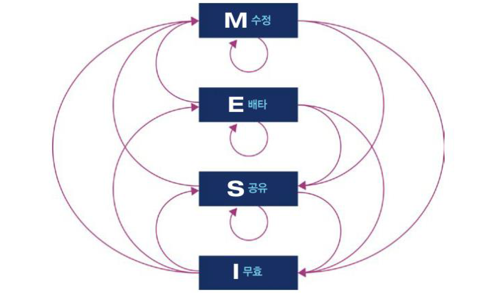

그림 3-4. MESI 상태 변이 다이어그램

프로세서가 처음 나왔을 당시에는 매번 캐시 연산 결과를 바로 메모리에 기록했습니다. 이를 **동시 기록(write-through, 라이트 스루)**이라고 하며, 메모리 대역폭을 너무 많이 소모하는 등 효율이 낮아 요즘은 거의 사용하지 않습니다. 나중에 출시된 프로세서는 **후기록(write-back, 라이브-백)** 방식을 채택하여 캐시 블록을 교체해도 프로세서가 변경된(더티, dirty) 캐시 블록만 메모리에 기록하므로 메인 메모리로 되돌아가는 트래픽이 뚝 떨어집니다.  

캐시 기술 덕분에 데이터를 신속하게 메모리에서 쓰고 읽을 수 있게 되었습니다. 메모리 대역폭 측면에서 그 효과를 나타낼 수 있습니다. 이론적으로 가능한 **최대 전송률(Burst rate)**은 다음 인자에 따라 달라집니다.

* **메모리 클록 주파수**
* **메모리 버스 폭(보통 64비트)**
* **인터페이스 개수**

**DDR RAM**(**DDR**은 **Double Data Rate** 이중 데이터 전송율의 약자로, 클록 신호 양단에서 통신합니다)은 최대 전송률이 2배입니다. 2015년도 상용 하드웨어에 이 공식을 적용하면 이론적인 최대 쓰기 속도는 8~12 GB/s에 달합니다. 물론 실제로는 다른 시스템 요소 때문에 제약을 받겠지만 이 값 하나만 보더라도 하드웨어, 소프트웨어가 얼마나 밀접한 연관이 있는지 알 수 있습니다.  

캐시 하드웨어의 작동 원리를 나타낸 간단한 코드를 살펴봅시다(예제 3-1)  

예제 3-1. 캐싱 예제

```java
public class Caching {
   private final int ARR_SIZE = 2 * 1024 * 1024;
   private final int[] testData = new int[ARR_SIZE];

   pivate void run() {
       System.out.println("Start: " + System.currentTimeMillis());
       for(int i=0; i < 15_000; i++) {
           touchEveryLine();
           touchEveryItem();
       }

       System.out.println("Warmup Finished: " + System.currentTimeMillis());

       System.out.println("Item Line");
       for(int i=0; i<100; i++) {
          long t0 = System.nanoTime();
          touchEveryLine();
          long t1 = System.nanoTime();
          touchEveryItem();
          long t2 = System.nanoTime();

          long elItem = t2 - t1;
          long elLine = t1 - t0;

          double diff = elItem - elLine;
          System.out.println(elItem + " " + elLine + " " + (100 * diff / elLine));
       }
   }

   pivate void touchEveryItem() {
       for(int i=0; i < testData.length; i++) {
           testData[i]++;
       }
   }

   private void touchEveryLine() {
       for(int i=0; i < testData.length; i++) {
           testData[i]++;
       }
   }

   public static void main(String[] args) {
       Caching c = new Caching();
       c.run();
   }
}
```


소스 코드만 보면 당연히 touchEveryItem() 메서드가 touchEveryLine() 메서드보다 16배 더 많은 일(데이터 업데이트)을 할 것 같습니다. 하지만 여기서 포인트는, 섣부른 직감만으로 JVM 성능 문제를 잘못 판단하기 쉽다는 사실입니다. [그림 3-5]는 이 클래스를 실행한 샘플 결과 자료입니다.

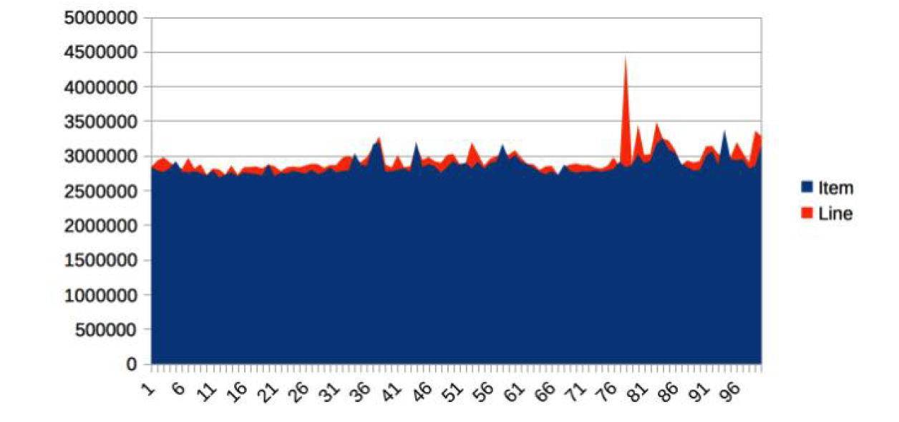

그림 3-5. 캐싱 예제의 소요 시간

이 그래프는 각 함수를 100회 실행한 결과입니다. 시간 경과에 따른 패턴이 서로 비슷합니다. '16배 더 일을 많이 하리라'는 예상은 보기 좋게 빗나갑니다.  

외려 가장 지배적인 영향을 미치는 곳은 메모리 버스를 예열시키는 부분입니다. touchEveryItem(), touchEveryLine() 두 메서드를 이용해 배열 콘텐츠를 메인 메모리에서 캐시로 퍼 나르는 코드입니다.  

통계 수치상으로 보면 거의 일정한 모습을 보이다가 간혹 중앙값(median value)에서 30~35%나 벗어난 특이점이  간혹 나옵니다.  

대략 100메가 바이트짜리 메모리 덩이를 나르는 단순 메모리 연산을 1회 수행할 때마다 약 3밀리 초(평균 2.86밀리 초) 소요된 것입니다. 실제 메모리 대역폭은 이론적 최대치인 3.5 GB/s에 조금 못 미치지만, 그런대로 나쁘지 않은 수치입니다.

> NOTE\_ 최신 CPU에는 예측 가능한 (대부분 데이터 사이를 듬성듬성 활보(stride)하는) 데이터 액세스 패턴을 감지하는 하드웨어 프리패처(미리 읽는 장치)가 있습니다. 이 예제는 현실적으로 가능한 최대 메모리 액세스 대역폭에 가깝게 맞추려고 하드웨어 프리페처를 십분 활용했습니다.

자바 성능을 논할 때는 객체 할당률에 대한 애플리케이션 민감도가 아주 중요합니다.  


### 최신 프로세서의 특성

---

하드웨어 엔지니어들은 신기능이 무어의 법칙에 따라 '트랜지스터 예산을 쏟아부은' 결과라고 합니다. 메모리 캐시는 점점 증가한 트랜지스터를 가장 확실하게 활용하는 분야지만, 지난 수년간 여러 가지 다른 기술도 등장했습니다.

#### 변환 색인 버퍼(TLB)

**변환 색인 버퍼(Translation Lookaside Buffer)**는 여러 캐시에서 아주 긴요하게 쓰이는 장치입니다. 가상 메모리 주소를 물리 메모리 주소로 매핑하는 페이지 테이블의 캐시 역할을 수행합니다. 덕분에 가상 주소를 참조해 물리 주소에 액세스 하는 빈번한 작업 속도가 매우 빨라집니다.

> NOTE\_ JVM에도 똑같이 TLB라고 약칭하는 메모리 관련 기능이 있습니다. TLB라는 용어가 나오면 어느 쪽을 가리키는 말인지 꼭 확인해주세요.

TLB가 없으면 L1 캐시에 페이지 테이블이 있어도 가상 주소 룩업에 16 사이클이나 걸리기 때문에 성능이 제대로 나오지 않습니다. 모든 최신 칩에서는 TLB는 사실상 필연입니다.  


#### 분기 예측과 추측 실행

분기 예측(branch prediction)은 최신 프로세서의 고급 기법 중 하나로, 프로세서가 조건 분기하는 기준값을 평가하느라 대기하는 현상을 방지합니다. 요즘 나온 프로세서는 다단계 명령 파이프라인을 이용해 CPU 1 사이클도 여러 개별 단계로 나누어 실행하므로 (각기 다른 실행 단계에서) 여러 명령이 동시 실행 중일 수도 있습니다.  

이런 모델에서는 조건문을 다 평가하기 전까지 분기 이후 다른 명령을 알 수 없는 게 문제입니다. 그 결과, 분기문 뒤에 나오는 다단계 파이프라인을 비우는 동안 프로세서는 여러 사이클 (실제로는 최대 20회) 동안 멎게 됩니다.

> **NOTE\_ 추측 실행(speculative execution)**은 불명예스럽게도 2018년 초반 아주 많은 CPU에 영향을 끼친 주요 보안 문제의 근원입니다.

이런 일이 없도록 프로세서는 트랜지스터를 아낌없이 활용해 가장 발생 가능성이 큰 브랜치를 미리 결정하는 휴리스틱을 형성합니다. 마치 도박이라도 하듯 미리 추측한 결과를 바탕으로 파이프라인을 채우는 것입니다. 운 좋게 추측이 맞아떨어지면 아무 일도 없었던 것처럼 CPU는 다음 작업을 진행하고, 틀리면 부분적으로 실행한 명령을 모두 폐기한 후 파이프라인을 비우는 대가를 치릅니다.  


#### 하드웨어 메모리 모델

"어떻게 하면 서로 다른 여러 CPU가 일관되게 동일한 메모리 주소를 액세스 할 수 있을까" 멀티코어 시스템에서 메모리에 관한 가장 근본적인 질문입니다.  

이 질문이 해답은 하드웨어 따라 다르겠지만, JIT 컴파일러인 javac와 CPU는 일반적으로 코드 실행 순서를 바꿀 수 있습니다. 물론 코드 실행 순서를 바꿔도 현재 스레드가 바라보는 결과는 아무런 영향이 없다는 전제가 필요합니다.  

예를 들어, 다음 코드 조각을 봅시다.

```java
myInt = otherInt;
intChanged = true;
```

두 할당문 사이에 다른 코드는 없으니 실행 스레드 입장에서 이들이 어떤 순서로 오든 상관없습니다. 그래서 실행 환경은 명령 순서를 자유롭게 바꿀 수 있습니다.  

그러나 이 변수들을 바라보는 다른 스레드 입장에서 실행 순서가 달라지면 intChanged는 true로 보여도 myInt는 옛날 값을 읽을 가능성이 있습니다. 이런 종류의 순서 바꾸기(reordering) 방식 (스토어 → 스토어)은 x86 칩에서는 불가능하지만, CPU 아키텍처에 따라 조금씩 차이가 있습니다(참고 표 3-2).

|  | **ARMv7** | **POWER** | **SPARC** | **x86** | **AMD64** | **zSeries** |
| --- | --- | --- | --- | --- | --- | --- |
| **로드 → 로드** **(loads moved after loads)** | **Y** | **Y** | **-** | **-** | **-** | **-** |
| **스토어 → 로드** **(loads moved after stores)** | **Y** | **Y** | **-** | **-** | **-** | **-** |
| **스토어 → 스토어** **(stores moved after stores)** | **Y** | **Y** | **-** | **-** | **-** | **-** |
| **로드 → 스토어****(stores moved after loads)** | **Y** | **Y** | **Y** | **Y** | **Y** | **Y** |
| **아토믹 로드** **(atomic moved with loads)** | **Y** | **Y** | **-** | **-** | **-** | **-** |
| **아토믹 스토어** **(atomic moved with stores)** | **Y** | **Y** | **-** | **-** | **-** | **-** |
| **모순 명령** **(incoherent instructions)** | **Y** | **Y** | **Y** | **Y** | **-** | **Y** |

JMM은 프로세서 타입별로 상이한 메모리 액세스 일관성을 고려하여 명시적으로 **약한 모델(Weak Model)**로 설계되었습니다. 따라서 멀티스레드 코드가 제대로 작동하게 하려면 락과 volatile을 정확히 알고 사용해야 합니다.  

최근 수년간 소프트웨어 개발자들은 더 나은 성능을 얻기 위해 하드웨어 작동 원리를 깊이 이해하려고 노력하는 편입니다. 마팀 톤슨(Martin Thompson) 등의 사람들은 이러한 움직임을 기계(mechanical sympathy)이라고 표현합니다. 기계 공감은 특히 저지연, 고성능을 필요로 하는 분야에 많이 적용되었습니다. 최근 락-프리(Lock-Free) 알고리즘 및 자료 구조 관련 연구 결과에도 나오는 내용입니다.  


### 운영체제

---

OS의 주 임무는 여러 실행 프로세스가 공유하는 리소스 액세스를 관장하는 일입니다. 모든 리소스는 한정돼 있고 프로세스는 저마다 리소스를 더 차지하려고 덤벼들기 때문에 리소스 양을 보고 골고루 나누어 줄 중앙 시스템이 있어야 합니다. 한정된 리소스 가운데서도 메모리와 CPU 시간은 가장 중요한 쌍벽입니다.  

**메모리 관리 유닛(Memory Management Unit, MMU)**을 통한 가상 주속 방식(Virtual Addressing)과 페이지 테이블은 메모리 액세스 제어의 핵심으로서, 한 프로세스가 소유한 메모리 영역을 다른 프로세서가 함부로 훼손하지 못하게 합니다.  

앞서 설명한 TLB는 물리 메모리 주소 룩업 시간을 줄이는 하드웨어 기능입니다. 아무래도 버퍼를 사용하면 소프트웨어가 메모리에 액세스 하는 성능이 향상되지만, MMU는 개발자가 세부를 파악해서 직접 손대기엔 너무 저수준 영역이므로 대신 OS 액세스 스케줄러를 자세히 살펴보겠습니다. CPU 액세스를 제어하는 OS 액세스 스케줄러는 유저 입장에서 훨씬 시각적인 OS 커널 요소입니다.  


#### 스케쥴러

프로세스 스케쥴러(process scheduler)는 CPU 액세스를 통제합니다. 이때 실행 큐(run queue, 실행 대상이지만 CPU 차례를 기다려야 하는 스레드 혹은 프로세스 대기 장소)라는 큐를 이용합니다. 최신 시스템은 거의 항상 가능한 수준보다 더 많은 스레드/프로세스로 가득하기 때문에 CPU 경합을 해소할 장치가 절실합니다.  

스케쥴러는 인터럽트에 응답하고 CPU 코어 액세스를 관리합니다. [그림 3-6]은 자브 스레드의 수명주기를 나타낸 그림입니다. 자바 명세서에는 이론적으로 자바 스레드가 굳이 OS 스레드와 일치할 필요 없는 스레딩 모델(그린 스레드, green thread)을 허용한다고 씌어 있지만, 실제로 이런 방식이 유용하지 않다는 사실이 밝혀져 주류 운영 환경에서 배제되었습니다.

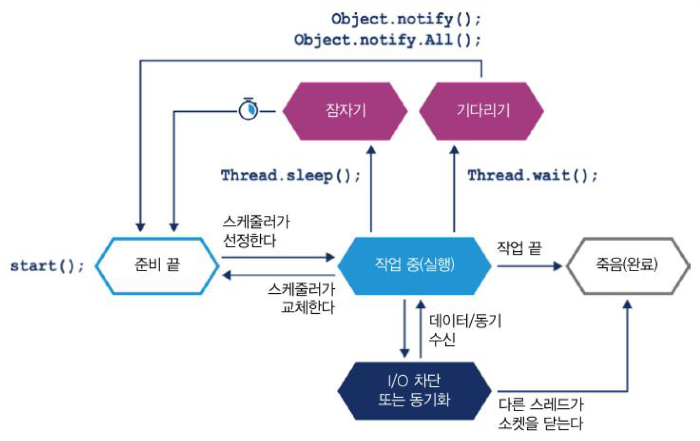

[그림 3-6] 스레드의 수명주기

그림 속의 OS 스케줄러는 스레드를 시스템 단일 코어로 분주히 나릅니다. 스케줄러는 할당 시간(구형 OS는 보통 10~100밀리 초) 끝 무렵에 실행 큐로 스레드를 되돌려서 큐의 맨 앞으로가 다시 실행될 때까지 대기시킵니다.  

스레드가 자신이 할당받은 시간을 자발적으로 포기하려면 sleep() 메서드로 잠들 시간을 설정하거나 wait() 메서드로 대기 조건을 명시합니다. 스레드는 I/O 또는 소프트웨어 락에 걸려 블로킹될 수도 있습니다.  

이 모델을 처음 보는 독자는 실행 코어가 하나뿐인 머신을 머릿속에 그려보세요. 물론, 실제 하드웨어는 훨씬 더 복잡하고, 머신은 거의 멀티코어라서 여러 실행 경로를 정말 동시에 실행할 수 있습니다. 진정한 멀티 프로세싱 환경에서 어떻게 실행될지는 너무 복잡하고 감을 잡기조차 어렵습니다.  

OS는 그 특성상 CPU에서 코드가 실행되지 않는 시간을 유발합니다. 쉽게 간과하기 쉬운 OS의 특징입니다. 자신의 할당 시간을 다 쓴 프로세스는 실행 큐 맨 앞으로 갈 때까지 CPU로 복귀하지 않습니다. CPU가 아껴 써야 할 리소스임을 감안하면 코드가 정작 실행되는 시간보다 기다리는 시간이 더 많다는 뜻입니다.  

그러므로 실제로 관측한 프로세서에서 나온 통계치는 시스템에 있는 다른 프로세서의 동작에도 영향을 받습니다. 이런 지터(Jitter)와 스케줄링 오버헤드는 측정 결과에 노이즈(noise)를 끼게 만드는 주요인입니다. 통계 속성 및 실제 결과를 처리하는 문제는 5장에서 다룹니다.  

스케줄러의 움직임을 확인하는 가장 쉬운 방법은 OS가 스케줄링 과정에서 발생시키는 오버헤드를 관측하는 것입니다. 다음 코드는 1 밀리초씩 총 1,000회 스레드를 재웁니다. 스레드는 한번 잠들 때마다 실행 큐 맨 뒤로 가고 새로 시간을 할당받을 때까지 기다리므로 이 코드의 총 실행 시간을 보면 여느 프로세스에서 스케줄링 오버헤드가 얼마나 될지 짐작할 수 있습니다.

```java
long start = System.currentTimeMillis();

for(int i=0; i < 1000; i++) {
   Thread.sleep(1);
}

long end = System.currentTimeMillis();
System.out.println("Millis elasepd: " + (end - start) / 4000.0));
```

OS 마다 코드 실행 결과는 천차만별입니다. 유닉스는 대략 10~20%가 오버헤드입니다. 윈도우 초기 버전은 형편없는 스케쥴러로 악명 높아서 윈도우 XP의 경우 스케줄링 오버헤드는 180%에 이릅니다(즉, 1밀리 초로 1,000번 잠드는데 2.8초나 걸립니다). 어떤 상용 OS 업체는 벤치마킹 실행을 감지해서 지표를 조작하는 코드를 배포안에 몰래 끼워 넣었다가 발각된 사례도 있습니다.  

타이밍(timing)은 성능 측정, 프로세스 스케줄링, 기타 애플리케이션 스택의 다양한 파트에서 아주 중요합니다. 그럼, 자바 플랫폼은 타이밍을 어떻게 처리하는지 간략히(JVM과 하부 OS가 타이밍을 어떻게 지원하는지 좀 더 자세히) 알아보겠습니다.  


#### 시간문제

POSIX(Portable Operating System Interface, 이식 가능 운영체제 인터페이스) 같은 어계 표준이 있어도 OS는 저마다 다르게 작동합니다. 예시로 os::javaTimeMillis() 함수가 있습니다. OpenJDK에서 이 함수에는 실제로 작업을 수행하고 자바 System.currentTimeMillis() 메서드의 반환값을 공급하는 OS에 특정한 호출이 있습니다.  

2.5절에서 설명했지만 os::javaTimeMillis()는 호스트 OS가 제공하는 기능에 의존하는 함수라서 네이티브 메서드로 구현합니다. 다음은 BSD 유닉스(즉, 맥 OS 운영체제)에서 사용하는 함수입니다.

```cpp
jlong os::javaTimeMillis() {

   to,eva; to,e'
   int status = gettimeofday(&time, NULL);
   assert(status != -1, "bsd error");
   return jlong(time.tv_sec) * 1000 + jlong(time.tv_usec / 1000);
}
```

솔라리스, 리눅스, AIX의 구현 코드도 BSD와 거의 같지만, 유독 마이크로소프트 윈도우는 완전히 다릅니다.

```cpp
jlong os::javaTimeMillis() {
   if(UseFakeTimers) {
       return fake_time++;
   } else {
       FiLETIME wt;
       GetSystemTImeAsFileTime(&wt);
       return windows_to_java_time(wt);
   }
}
```

윈도우는 유닉스 timeval 구조체 대신, 64비트 FiLETIME 구조체를 이용해 1601년 이후 경과한 시간을 100나노초 단위로 기록합니다. 또 윈도우는 물리 타이밍 하드웨어에 따라 달리지는 시스템 클록의 '실 정확도(real accuracy)'라는 개념이 있어서 자바에서 타이밍 콜을 해도 그 작동 방식은 윈도우가 위치한 머신에 따라 달라집니다. OS 마다 상이한 것은 타이밍만이 아닙니다.  


#### 컨텍스트 교환

**컨텍스트 교환(context switch)**은 OS 스케쥴러가 현재 실행 중인 스레드/태스크를 없애고 대기 중인 다른 스레드/태스크로 대체하는 프로세스입니다. 종류는 다양하지만 뭉뚱그려 말하면, 컨텍스트 교환은 스레드 실행 명령과 스택 상태를 교체하는 모든 일에 연관되어 있습니다.  

유저 스레드 사이에 발생하든, 유저 모드에서 커널 모드로 바뀌면서(모드 교환(mode switch)이라고도 합니다.) 일어나든 컨텍스트 교환은 비싼 작업입니다. 특히 후자가 그렇습니다. 유저 스레드 타임 슬라이드(time slice) 도중 커널 모드로 바꾸어 어떤 기능을 실행해야 할 때가 있습니다. 하지만 유저 공간에 있는 코드가 액세스 하는 메모리 영역은 커널 코드와 거의 공유할 부분이 없기 때문에 모드가 바뀌면 명령어와 다른 캐시를 어쩔 수 없이 강제로 비워야 합니다.  

커널 모드로 컨텍스트가 교환되면 TLB를 비롯한 다른 캐시까지도 무효화됩니다. 이들 캐시는 시스템 콜 반환 시 다시 채워야 하므로 커널 모드 교환의 여파는 유저 공간으로 다시 제어권이 넘어간 후에도 당분간 이어집니다. 그래서 [그림 3-7]에서 나타낸 시스템 콜의 진짜 비용이 가려지게 됩니다.

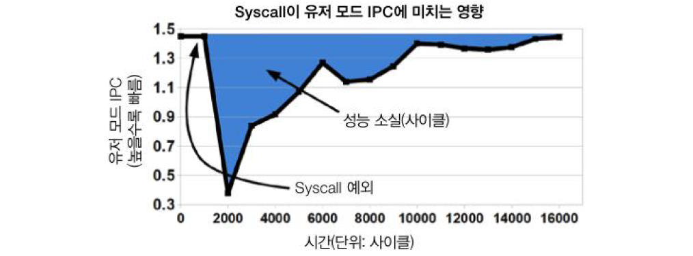

그림 3-7. 시스템 콜이 미치는 영향(출처. 소아레스와 스텀, 2010)

리눅스는 이를 최대한 만회하려고 가상 동적 공유 객체(Virtual Dynamically Shared Object, vDSO)라는 장치를 제공합니다. vDSO는 굳이 커널 프리빌리드(Kernel privilege, 특권)이 필요 없는 시스템 콜의 속도를 높이려고 쓰는 유저 공간의 메모리 영역입니다. 커널 모드로 컨텍스트를 교환하지 않으므로 그만큼 속도가 빠릅니다. 실제로 어떻게 작동하는 예를 들어 설명하겠습니다.  

gettimeofday()는 유닉스 시스템에서 아주 흔히 쓰는 시스템 콜입니다. OS가 인지한 `벽시계 시간(wallclock time)`을 반환합니다. 물밑에서 커널 자료 구조를 읽어 시스템 클록 시간을 얻습니다. 부수 효과(side effect)를 일으키지 않으므로 실제로 프리빌리지드 액세스(privileged access)는 필요 없습니다.  

이 자료 구조를 vDSO로 유저 프로세스의 주소 공간에 매핑시킬 수 있다면 커널 모드로 바꿀 필요가 전혀 없습니다. [그림 3-7]에서 색칠한 부분의 손실을 감내할 이유도 전무하게 됩니다.  

타이밍 자료를 빈번하게 액세스 하는 자바 애플리케이션에서는 이런 식으로 성능을 끌어올릴 수 있습니다. 비록 리눅스에서만 사용할 수 있지만 vDSO는 필자가 예시한 사례를 좀 더 일반화한, 유용한 기법입니다.  


### 단순 시스템 모델

단순 시스템 모델을 예로 들어 성능 문제를 일으키는 근원을 알아봅시다. 이 모델은 근본 서브시스템의 OS 측정값으로 나타낼 수 있고, 표준 유닉스 명령줄 툴의 출력 결과와 직접 연관 지을 수도 있습니다.  

이 시스템의 모델의 근본은 유닉스 계열 OS에서 작동하는 자바 애플리케이션의 단순한 개념으로, 다음 기본 컴포넌트로 구성됩니다(그림 3-8).

* 애플리케이션이 실행되는 하드웨어와 OS
* 애플리케이션이 실행되는 JVM/컨테이너
* 애플리케이션 코드 자체
* 애플리케이션이 호출하는 외부 시스템
* 애플리케이션으로 유입되는 트래픽

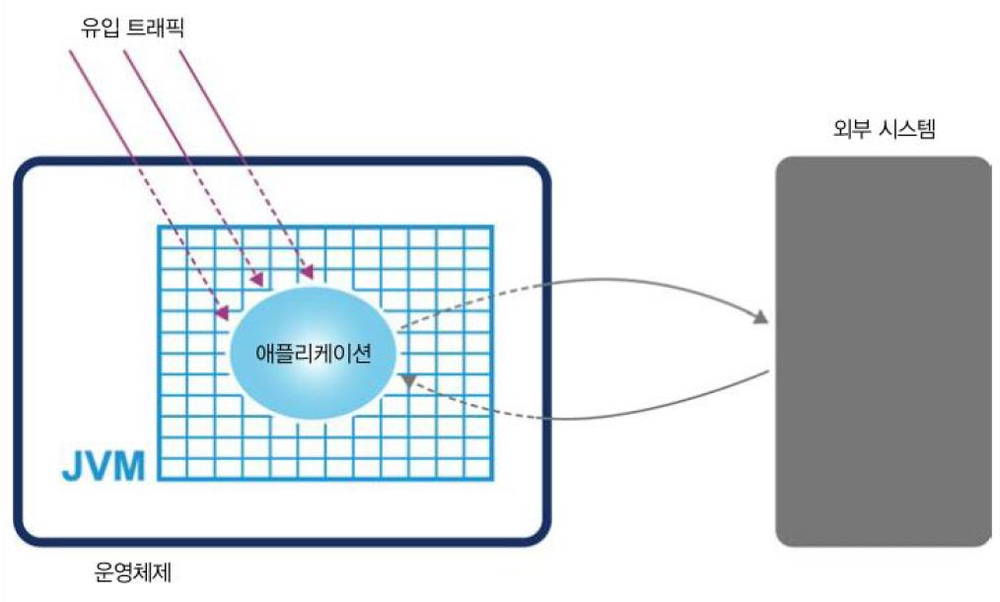

그림 3-8. 단순 시스템 모델


이들 중 누구라도 성능 문제를 일으킬 수 있습니다. 다음 절에서는 시스템의 특정 부위를 좁혀가거나 격리하는 방법으로 누가 진법인지 밝혀내는 단순한 진단 기법들을 알아보겠습니다.  


### 기본 감지 전략

---

애플리케이션이 잘 돌아간다는 건 CPU 사용량, 메모리, 네트워크, I/O 대역폭 등 시스템 리소스를 효율적으로 잘 이용하고 있다는 의미입니다.

> **TIP\_** 애플리케이션이 하나 이상의 리소스를 소진하면 곧바로 성능 문제가 불거질 수 있습니다.

성능 진단의 첫 단추는 어느 리소스가 한계에 다다랐는지 밝히는 일입니다. 부족한 리소스가 뭔지 몰라서는 성능 지표를 제대로 (가용 리소스를 늘리든, 이용 효율을 높이든) 튜닝할 수 없습니다.  

그렇다고 OS 자체가 시스템을 가장 지치게 하는 원흉이 되어서도 곤란합니다. SO의 임무는 유저 프로세스 대신 리소스를 관리하는 것이지, 자기 자신이 리소스를 소모하는 것은 아닙니다. 예외적으로, 리소스가 턱없이 부족해 OS가 도저히 유저 요건에 부합할 만큼 리소스를 댈 형편이 아니라면 어쩔 수 없습니다. 요즘 서버급 하드웨어에서는 I/O(또는 간혹 메모리) 요건이 용량을 훨씬 초과하는 경우에나 이런 일이 일어납니다.

#### CPU 사용률

 CPU 사용률은 애플리케이션 성능을 나타내는 핵심 지표입니다. CPU 사이클은 애플리케이션이 가장 갈증을 느끼는 리소스라서 CPU의 효율적 사용은 성능 향상의 지름길입니다. 또 부하가 집중되는 도중에는 사용률이 가능한 한 100%에 가까워야 합니다.

> **TIP\_** 애플리케이션 성능을 분석할 때에는 시스템에 충분한 부하를 가해야 합니다. 놀고 있는 애플리케이션은 성능 작업에 전혀 도움이 안 됩니다.

모름지기 성능 엔지니어라면 기본 툴 두 가지(vmstat, iostat) 정도는 쓸 줄 알아야 합니다. 유닉스 계열 OS 명령줄에 툴 명령어를 실행하면 각각 현재 가상 메모리 및 I/O 서브 시스템 상태에 관한 유용한 데이터를 신속히 제공합니다. 물론, 전체 호스트 수준의 수치만 나오지만, 더 자세히 진단하기 전에 이 정도면 충분합니다. 먼저 vmstat 사용법입니다.

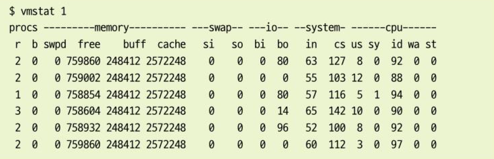

vmstat 1은 스냅샷을 한 번만 찍는 게 아니라 1초마다 (Ctrl + C를 눌러 멈출 때까지) 한 번씩 찍어 다음 줄에 결과를 표시합니다. 덕분에 성능 엔지니어는 초기 성능 테스트를 수행하는 동시에 결과가 화면에 출력되는 광경을 지켜볼 수 있습니다.  

vmstat 결과는 비교적 이해하기 쉽고 유용한 데이터로 가득합니다. 섹션별로 자세히 살펴봅시다.

1. **proc 섹션**실행 가능한(r) 프로세스, 블로킹된(b) 프로세스 개수를 나타냅니다.
2. **memory 섹션**  
   스왑 메모리(swpd),  미사용 메모리(free), 버퍼로 사용한 메모리(buff), 캐시로 사용한 메모리(cache)가 잇따라 표시됩니다.
3. **swap 섹션**  
   디스크로 교체되어 들어간(스왑 인) 메모리(si), 디스크에서 교체되어 빠져나온(스왑-아웃) 메모리(so) 정보입니다. 최신 서버급 머신은 보통 스왑이 별로 많이 일어나지 않습니다.
4. **io 섹션**  
   블록-인(bi), 블록-아웃(bo) 개수는 각각 블록(I/O) 장치에서 받은 512 바이트 블록, 블록 장치로 보낸 512 바이트 블록 개수입니다.
5. **system 섹션**  
   인터럽트(in) 및 초당 컨텍스트 교환(cs) 횟수입니다.
6. **cpu 섹션**  
   CPU와 직접 연관된 지표를 CPU 사용률(%)로 표기합니다. 좌측부터 차례로 유저 시간(us), 커널 시간(sy, 시스템 타임), 유효 시간(id), 대기 시간(wa), 도둑맞은 시간(st, 가상 머신에 할애된 시간)입니다.

이보다 정교한 툴이 책 나머지 부분에서도 계속 나오지만, 기본 툴이라고 함부로 무시하면 안 됩니다. 복잡한 툴은 유저를 호도할 가능성이 있지만, 이렇게 프로세스와 OS,에 거의 맞닿아 단순한 툴은 시스템의 실제 작동 모습을 거의 그대로 드러냅니다.  

예시로 3.4.3절에서는 컨텍스트 교환의 영향을 설명하면서, [그림 3-7] 에서 커널 공간으로 완전히 컨텍스가 바뀌면 어떤 일이 벌어지는지 설명했습니다. 하지만 유저 스레드끼리든, 커널 공간 내부든 컨텍스트 교환은 CPU 리소스 낭비를 초래합니다.  

튜닝이 잘 된 프로그램은 리소스(특히, CPU)를 최대한 활용합니다. 계산을 많이 하는(CPU에 종속된, CPU-bound) 워크로드는 유저 공간의 CPU 사용률을 100%에 가깝게 유지하는 것이 목표입니다.  

다른 말로 풀이하면, 측정 결과 CPU 사용률이 100%에 근접하지 않았다면 '왜 그럴까?' 따져봐야 합니다. 대체 프로그램이 왜 CPU를 100% 사용하지 않았을까? 락 때문에 본의 아니게 발생한 컨텍스트 교환 때문인가? 아니면 I/O 경합이 일어나블로킹이 발생했나?  

대다수 (특히 리눅스) OS에서 vmstat은 컨텍스트 교환 발생 횟수를 나타내므로 vmstats 1명령을 실행하면 컨텍스트 교환의 실시간 영향도를 지켜볼 수 있습니다. 유저 공간에서 CPU 사용률이 100% 근처도 못 갔는데 어떤 프로세스에서 컨텍스트 교환 비율이 높게 나타나면 I/O에서 블록킹이 일어났거나, 스레드 락 경합(Thread Lock contention) 상황이 벌어졌을 공산이 큽니다.  

그러나 vmstat 출력 결과만 봐서는 여러 가지 경우의 수를 분간하기 어렵습니다. I/O 작업 실태를 있는 그대로 보여주니 I/O 문제를 감지하기엔 좋지만, 스레드 락 경합을 실시간 감지하려면 실행 프로세스의 스레드 상태를 보여주는 툴(예: VisualVM)이 필요합니다. 그와 더불어, 스택을 샘플링해서 블로킹 코드를 보여주는 통계 스레드 프로파일러 툴도 많이 씁니다.  


#### 가비지 수집

6장에서 다룰 내용이지만, 핫스팟 JVM(지금까지 가장 많이 씌여진 JVM)은 시작 시 메모리를 유저 공간에 할당/관리합니다. 그래서 메모리를 할당하느라 (sbrk() 같은) 시스템 콜을 할 필요가 없습니다. 즉, 가비지 수집을 하려고 커널 교환을 할 일이 거의 없습니다.  

따라서 어떤 시스템에서 CPU 사용률이 아주 높게 나타난다면, GC는 대부분의 시간을 소비하는 주범이 아닙니다. GC 자체는 유저 공간의 CPU 사이클을 소비하되 커널 공간의 사용률에는 영향을 미치지 않는 활동입니다.  

반면, 어떤 JVM 프로세스가 유저 공간에서 CPU를 100%(에 가깝게) 사용하고 있다면 GC를 의심해야 합니다. 성능 분석 시(vmstat 같은) 단순 틀에서 CPU 사용률이 100%로 일정하지만 모든 사이클이 유저 공간에서 소비되고 있다면 "이렇게 CPU를 차지한 주인공이 JVM일까, 아니면 유저 코드일까?"라는 생각 해봐야 합니다. JVM에서 유저 공간의 CPU 사용률이 높은 건 거의 대부분 GC 서브시스템 탓입니다. 이런 상황이라면 일단 GC 로그를 확인하고 새 항목이 추가되는 빈도를 알아보는 것이 좋습니다.  

JVM에서 GC 로깅은 거의 공짜나 다름없습니다. 전체 비용을 최대한 정밀하게 산정한다고 해도 주변의 랜덤한 노이즈와 확실히 구분하기 어렵습니다. GC 로깅을 분석용 데이터의 원친으로서도 가치가 높기 때문에 JVM 프로세스는 예외 없이, 특히 운영 환경에서는 GC 로그를 꼭 남겨야 합니다.  


#### 입출력

파일 I/O는 예로부터 전체 시스템 성능에 암적인 조재였습니다. 엔지니어들이 `스피닝 러스터(Spinning Rust)`라고 빈정대는 골치 아픈 물리적 하드웨어와 밀접한 연관이 있기도 하지만, I/O는 다른 OS 파트처럼 분명하게 추상화되어 있지 않기 때문입니다.  

가령, 메모리 분야는 가상 메모리라는 우아한 격리 장치가 있지만, I/O는 그에 상응하여, 애플리케이션 개발자가 적절히 추상화할 장치가 없습니다.  

다행히 자바 프로그램은 대부분 단순히 I/O만 처리하여 I/O 서비시스템을 심하게 가동하는 애플리케이션 클래스도 비교적 적은 편입니다. 또 CPU, 메모리 어느 한쪽과 I/O를 동시에 고갈시크는 애플리케이션은 거의 없습니다.  

그뿐만 아니라, 업무 체계가 잘 잡힌 운영 조직에서는 이미 I/O 한계를 잘 아는 담당 엔지니어가 I/O를 많이 쓰는 프로세스를 활발하게 모니터링하는 문화가 정착되어 있습니다.  

성능 분석자/엔지니어는 애플리케이션에 I/O가 어떻게 일어나는지 인지하는 것만으로도 충분합니다. 특히 호스트당 I/O가 집중되는 애플리케이션이 하나만 있을 경우, isostat(또는 vmstat) 같은 툴이 제공하는 기본 카운터(예: 블록-인, 블록-아웃) 기능만 있어도 기초 진단용으로 활용하기에 더할 나위 없습니다.  

끝으로, I/O뿐만 아니라 성능 기준이 애플리케이션에 따라 달라지는 자바 애플리케이션 클래스에서 점점 더 많이 사용하는 또 다른 I/O를 언급하겠습니다.  


**커널 바이패스 I/O**

커널을 이용해 (이를테면, 네트워크 카드의 버퍼에 있는) 데이터를 복사해 유저 공간에 넣는 작업이 상당히 비싼 고성능 애플리케이션이 있습니다. 그래서 커널 대신 직접 네트워크 카드에서 유저가 접근 가능한 영역으로 데이터를 매핑하는 전용 하드웨어/소프트웨어를 씁니다. 이렇게 하면 커널 공간과 유저 공간 사이를 넘나드는 행위 및 '이중 복사'를 막을 수 있습니다.(그림 3-9)  

그러나 자바는 기본적으로 이와 관련된 구현체를 제공하지 않으므로 필요한 기능을 구현하려면 커스텀(네이티브) 라이브러리를 써야 합니다. 아주 유용한 패턴이므로 초고성능 I/O가 필요한 시스템에서 차츰 더 일반적으로 구현하고 있습니다.

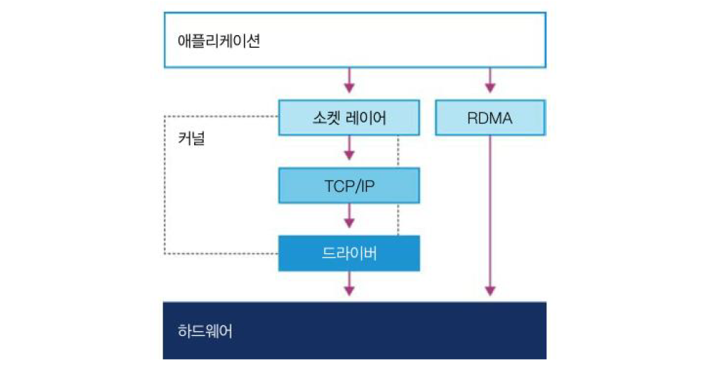

그림 3-9, 커널 바이패스 I/O

> **NOTE\_** 어떤 면에서 커널 바이패스 I/O는 자바 NIONew I/O API를 연상시킵니다. 자바 I/O로 하여금 자바 힙을 통과시켜 네이티브 메모리 및 하부 I/O와 직접 통신하게 만든 것과 비슷합니다.

지금까지 `베어 메탈(Bear Metal)` 위에서 동작하는 OS를 다루었지만, 요즘은 점점 시스템을 가상 환경에서 운용하는 사례가 늘고 있습니다. 그래서 이 장은 가상화 기술의 등장으로 자바 애플리케이션의 성능을 바라보는 엔지니어의 시각이 어떻게 근본적으로 달라질 수 있는지 알아보면서 마무리하겠습니다.  


#### 기계 공감

기계 공감은 성능을 조금이라도 쥐어짜 내야 하는 상황에서 하드웨어를 폭넓게 이해하고 공감할 수 있는 능력이 무엇보다 중요하다는 생각입니다.  


> 자동차 경주 성수가 되려고 엔지니어가 될 필요는 없지만,  
> 기게를 공감할 줄은 알아야 합니다.  
>   
> - 재키 스튜어트 -

마틴 톰슨은 재키 스튜어트와 그의 경주용 자동차를 직접 가리키며 기계 공감이란 말을 처음 사용했습니다. 하지만 꼭 극단적인 사례뿐만 아니라 제품과 관련된 갖가지 문제에 봉착해서 애플리케이션의 전반의 성능 향상 방안을 모색할 경우, 이장에서 훑어본 내용을 배경지식으로 알아두면 큰 도움이 될 것입니다.  

기계 공감은 자바 개발자가 무시하기 쉬운 관심사입니다. JVM이 하드웨어를 추상화했는데 굳이 개발자가 성능 관련 내용을 일일이 파악할 필요는 없습니다. 하지만 고성능, 저지연이 필수인 분야에서 개발자가 자바/JVM을 효과적으로 활용하려면 JVMd리나 무엇이고, 하드웨어와는 어떻게 상호작용하는지 이해해야 합니다. 또 실제로 JVM은 여러분보다 훨씬 더 성능을 추정하고 기계 공감을 한다는 사실을 잊지 마세요. 고성능 로깅 및 메시지 시스템의 작동 방식과 기계 공감의 참모습에 대해서는 14장에서 다룹니다.  

캐시 라인 동작을 예로 들어봅시다.  

프로세스 캐시가 얼마나 효과적인지는 이미 설명했습니다. 캐시 라인을 쓰면 메모리 블록을 미리 가져올 수 있지만, 멀티스레드 환경에서 두 스레드가 동일한 캐시 라인에 있는 변수를 읽거나 쓰려고 하면 문제가 됩니다. 두 스레드가 동일한 캐시 라인에 있는 변수를 읽거나 쓰려고 하면 문제가 됩니다.  

두 스레드가 동일한 캐시 라인을 수정하려고 덤벼들면 실제로 경합이 발생합니다. 첫 번째 스레드가 두 번째 스레드에 있는 캐시 라인을 무효화하면 메모리에서 다시 읽어 들여야 합니다. 두 번째 스레드가 작업을 마치면 마찬가지로 첫 번째 스레드의 캐시 라인을 무효화합니다. 이렇게 주거니 받거니 하면서 잘못된 공유(false sharing)를 하고 결국 성능 급락으로 귀결됩니다. 어떻게 해결할 수 있을까요?  

기계 공감 사상에 따르면 먼저 이런 일이 발생할 수 있음을 이해하고 있어야 해결 방법을 찾을 수 있습니다. 자바 객체는 필드 배치가 고정돼 있지 않기 때문에 캐시 라인을 공유한 변수를 쉽게 찾을 수 있습니다. 따라서 변수 주변에 패딩(padding)을 넣어 강제로 다른 캐시 라인으로 보내는 것도 한 가지 방법입니다. 아그로나 프로젝트의 저수준 큐를 이용해 패딩을 추가하는 방법은 14.3.1.3절에서 소개합니다.  


### 가상화

---

가상화는 다양한 종류가 있지만 이미 실행 중인 다른 OS(호스트 OS) 위에서 OS 사본(게스트 SO)을 하나의 프로세스로 실행시키는 모양새가 보통입니다(그림 3-1). 가상화 환경이 베어 메탈에서 실행되는 비가상(실) OS 안에서 일개 프로세스로 작동하는 것입니다.  

이 책에서 가상화 관련 이론 및 애플리케이션 성능 튜닝까지 모든 내용을 다루지는 않습니다. 하지만 가상화를 하면 뭐가 달라지는지 몇 가지 짚고 넘어가는 게 좋겠습니다. 요즘은 가상 환경 또는 클라우드 환경에서 애플리케이션을 작동시키는 일이 점점 대세로 굳혀지고 있으니까요.

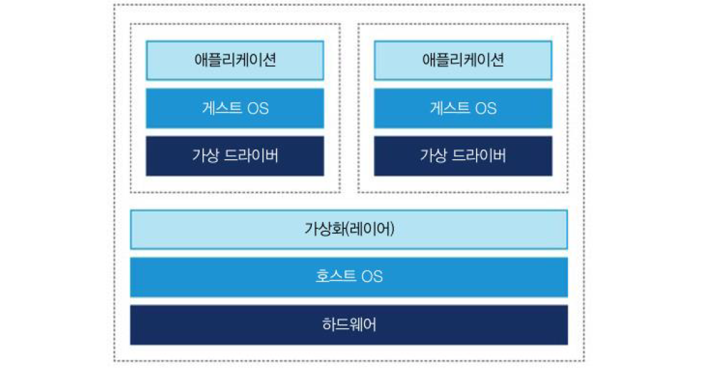

그림 3-10. 운영체제 가상화

가상화는 1970년대 초 IBM 메인프레임 환경에서 최초로 개발되었지만, 근래 들어 x86 아키텍처가 '진정한' 가상화를 지원하기 전까지는 가상화라고 볼 수 없었습니다. 가상황의 특징은 다음 세 가지로 요약할 수 있습니다.

* 가상화 OS에서 실행하는 프로그램은 베어 메탈(즉, 비가상화 OS)에서 실행할 때와 동일하게 작동해야 한다.
* 하이퍼바이저(Hypervisor)는 모든 하드웨어 리소스 액세스를 조정해야 한다.
* 가상화 오버헤드는 가급적 작아야 하며 실행 시간의 상당 부분을 차지해서는 안된다.

일반 비가상화 시스템에서 SO 커널은 프리빌리지드 모드로 동작하므로(당연히 커널 모드로 바꿔야 합니다) 하드웨어를 직접 건드릴 수 있지만, 가상화 시스템에서는 게스트 OS가 하드웨어에 액세스 할 수 없습니다.  

따라서 대기 프리빌리지드 명령어를 언프리빌리즈드(Unprivilieged, 비특권) 명령어로 고쳐 씁니다. 또 컨텍스트 교환이 발생하는 동안 지나친 캐시 플러시(cache flush) 즉 TLB가 일어나지 않도록 일부 OS 커널의 자료 구조 섀도(Shadow) 해야 합니다.   

요즘 인텔 호환 CPU는 가상화 OS 성능을 노피은 하드웨어 기능이 탑재된 경우도 있지만, 설령 하드웨어가 받쳐준다 해도 가상 환경 내에서 프로그램을 실행하는 것 자체가 성능 분석 및 튜닝을 한층 더 복잡하게 만듭니다.  


### JVM과 운영체제

JVM은 자바 코드에 공용 인터페이스(Common Interface)를 제공하여 OS에 독립적인 휴대용 실행 환경을 제공합니다. 하지만 스레드 스케줄링(또는 시스템 클록에서 시간 정보를 얻는 뻔한 작업) 같은 아주 기본적인 서비스조차도 하부 OS에 반드시 액세스해야 한다.  

이런 기능은 native 키워드를 붙인 네이티브 메서드로 구현합니다. 네이티브 메서드는 C 언어로 작성하지만, 어느 자바 메서드처럼 액세스 할 수있습니다. 이 작업을 대행하는 공통 인터페이스를 자바 네이티브 인터페이스(Java Native Interface, JNI)라고 합니다. 예들 들어, Java.lang.Object 클래스에는 다음과 같이 논프라이빗(Non-priavate) 네이티브 메서드가 선언되어 있습니다.

```cpp
public Final native Class<?> getClass();
public native int hasgCode();
protected native Object clone() throws CloneNotSupportedException;
public Final native void notify();
public Final native void notifyAll();
public Final native void wait(long timeout) throws InterruptedException;
```

이들 메서드는 비교적 저수준의 플랫폼 관심사를 처리합니다. 편의상 시스템 시간을 조회하는 쉬운 예를 들어보겠습니다.  

(시스템에 특정한) os::javaTimeMillis() 함수는 자바 정적 메서드 System.currentTimeMillis()에 구현된 로직을 처리합니다. 실제 코드는 C++로 작성됐지만 자바에서 C 코드 '브리지, bridge'를 통해 액세스할 수 있습니다. 그런데 핫스팟에서 이 코드는 실제로 어떻게 호출될까요?   

네이티브 메서드 System.currentTimeMillis()는 JVM\_CurrentTimeMillis()라는 JVM 엔트리 포인트 메서드에 매핑됩니다(그림 3-11). java/lang/System.c 파일에 포함된 JNI Java\_java\_lang\_System\_registerNatives()에 이러한 매핑 관계가 설정돼 있습니다.

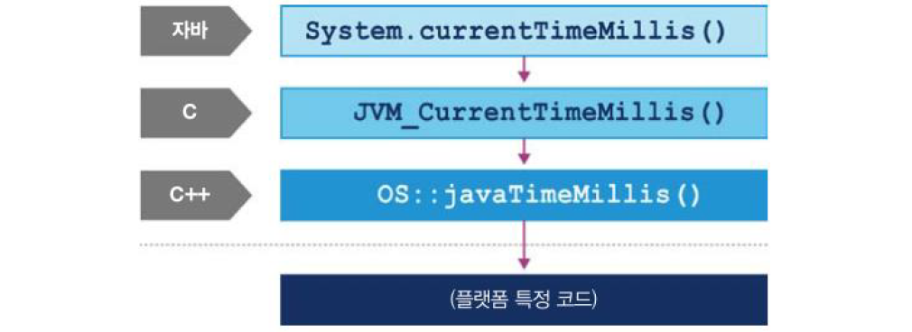

그림 3-11. 핫스팟 호출 스택

JVM\_CurrentTImeMillis()는 VM 진입점에 해당하는 메서드를 호출합니다. 모양은 C 함수지만 본모습은 C 호출 관례에 따라 익스포트 된 C++ 함수입니다. 결국 OpenJDK 매크로 2개로 감싼 os::javaTimeMillis()를 호출하는 구조입니다.  

이 메서드는 os 이름공간에 정의도어 있고 당연히 OS에 의존합니다. OpenJDK 코드베이스를 뒤져보면 OS별 서브디렉터리 어딘가에 소스 코드가 있습니다. 플랫폼에 독립적인 자바 요소가 하부 OS 및 하드웨어가 제공하는 서비스를 어떻게 호출하는지 간단히 살펴봤습니다.  


### 정리

---

지난 20년 간 프로세서 설계 및 최신 하드웨어는 놀라울 정도로 변화했습니다. 무어의 법칙에 따라, 그리고 엔지니어링 한계(뭐니 뭐니 해도 상대적으로 느린 메서드 속도)에 봉착해 프로세서 설계 분야에서 진보를 거듭했습니다. 캐시 미스율(miss rate)은 애플리케이션 성능을 가늠하는 가장 호락한 잣대가 되었습니다.  

자바 세성에서는 JVM 설계 사상 덕분에 단일 스레드 애플리케이션 코드도 부가적인 프로세서를 활용할 길이 열렸습니다. 자바 애플리케이션은 다른 환경에 비해 하드웨어 동향에 충실한 성능 혜택을 상당히 누렸습니다.  

무어의 법칙이 사그라들며 사람들의 관심은 다시 소프트웨어의 상대적 성능으로 향했습니다. 성능을 중시하는 엔지니어는 적어도 최신 하드웨어와 OS의 기본 지식을 갖추어야 하드웨어와 씨름하지 않고 적절히 잘 활용할 수 있습니다.  

다음 장에서는 성능 테스트의 핵심 방법론을 소개합니다. 성능 테스트의 주요 유형과 수행해야 할 태스크, 성능 작업의 전체 수명주기를 집중적으로 다룹니다. 또 성능 분야에서 일반적인 베스트 프랙티스(모범 사례) 및 안티패턴도 목록화하여 설명합니다.  


### 용어 정리

---

* **노스브리지(Northbride)**   
  노브브리지는 일반적으로 CPU, 램, 바이오스 롬, PCI 익스프레스(또는 AGP) 그래픽 카드 사이의 통신을, 사우스브리리지(southbridge)는 IDE 컨트롤러 등의 주변 장치와의 입출력을 담당한다.
* **캐시 일관성 프로토콜(Cache consistency Protocol)**  
  **캐시 일관성 프로토콜**은 다중 처리기 시스템에서 캐시 메모리를 효과적으로 사용하기 위한 프로토콜로 캐시 메모리 간 데이터의 일관성을 유지하여 여러 개의 캐시가 동일한 데이터를 보장하는 것을 목표합니다.  

  다중 처리기 시스템에서 여러 개의 프로세서가 공유 메모리에 접근할 때 발생하는 문제를 해결하기 위해 고안되었습니다. 캐시는 프로세서의 성능을 향상하기 위해 사용되는데, 한 프로세서가 공유 메모리의 데이터를 읽거나 쓰면 해당 데이터는 캐시에 복사됩니다. 그러나 다른 프로세서가 동일한 데이터에 접근하여 값을 변경하면 캐시 간의 일관성이 깨질 수 있습니다.   

  이러한 일관성 문제를 해결하기 위해 캐시 간의 통신 규약을 정의합니다. 대표적인 캐시 일관성 프로토콜로는 **MESI**(Modified, Exclusive, Shared, Invalid) **프로토콜**이 있습니다. **MESI 프로토콜**은 각 캐시 라인이 네 가지 상태 중 하나에 속하며, 데이터의 일관성을 유지하기 위해 상태 전이 규칙을 따릅니다.   

  **캐시 일관성 프로토콜**은 캐시 간의 데이터 일관성을 유지하고, 공유 데이터에 대한 동시 접근을 조율하여 프로세서 간의 동기화 문제를 해결하는 중요한 기술입니다. 이를 통해 다중 처리기 시스템에서 안정적이고 정확한 연산이 가능해지며, 프로그래머가 복잡한 동기화 문제를 직접 다룰 필요 없이 공유 메모리를 안전하게 사용할 수 있습니다.
* **약한 모델(Weak Model)**약한, 강한 이라는 말은 메모리 모델(memory model)이라기보다 메모리 정렬(memory ordering)에 관한 수식어입니다.  
  [참고 - [Weak vs Strong Memory Model](https://preshing.com/20120930/weak-vs-strong-memory-models/)]
* **락 프리(Lock-Free)**  
  기존 락을 걸어 동기화하던 코드에서 락을 없앤 것.
* **지터(jitter)**  
  원하는 신호와 실제 발생하는 신호 간에 발생하는 '불안정한 신호의 차이들'
* **timeval 구조체**형식은 다음과 같고 1970년 1월 1일 자정(UTC)을 기준으로 1초씩 흐른 시간을 4바이트로 나타냅니다.  

  struct timeval {  
      time\_t tv\_sec;               // 초  
      useconds\_t tv\_usec;    // 마이크로 초  
  }
* **타임 슬라이스**선취((preemption, 프리엠프션)라고 표현할 때가 더 많습니다. OS가 멀티태스킹을 구현하기 우해 프로세스의 동의 없이 임의로 인터럽트를 걸고 나중에 다시 프로세스를 재개하는 것입니다.
* [그림 3-7]  
  `Flexible System Call Scheduling with Exception-Less System Calls(FlexSC: 예외가 없는 시스템 콜을 이용한 유연한 시스템 콜 스케쥴링)` OSID10.9회 USENIX 콘퍼런스 행사에서 OS 설계 및 구현에 관한 연설문
* **벽시계 시간(wallclock time)**  
  CPU 프로세서의 클록 사이클을 기준으로 측정한 현재 시각 또는 태스크를 수행하기 전후로 경과된 시간. 벽시간(walll clock), 실제 시간(real time), 실제 경과 시간(elapsed real time) 같은 용어도 동일한 의미입니다.
* **스피닝 러스트(Sprinning Rust)**  
  직역하면 '회전하는 녹덩어리'정도, 플래터(platter)를 여러 장 붙여 모터로 구동하는 전통적인 하드 디스크 드라이브를 빗대어 표현할 말
* **베어 메탈(bear meta)**  
  소프트웨어가 아무것도 설치되어 있지 않은, 좀 더 구체적으로는 OS 조차 설치 안 된 빈 깡통 상태의 하드웨어
* **패딩**  
  [참고 - [Avoiding and Identifying False Sharing Among Threads](https://www.codeproject.com/Articles/85356/Avoiding-and-Identifying-False-Sharing-Among-Threa)]
