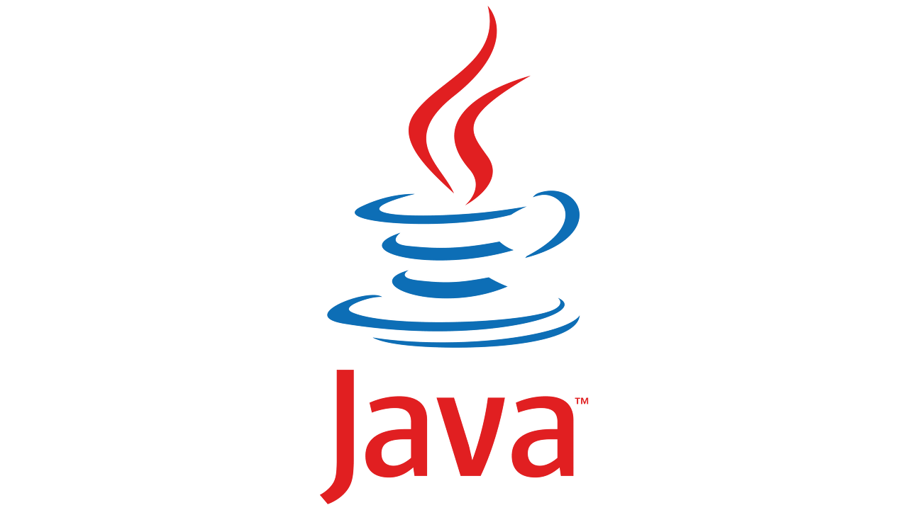

## Java Dispatch

---

자바의 디스패치에 대해 알아봅시다.

> 자바에서 디스패치(dispatch)란 메소드 호출을 처리하는 방법을 의미합니다.   
> 특히, 다형성을 기반으로 메소드를 동적으로 선택하는 과정을 말합니다.

자바에서는 오버로딩(Overloading)이라는 개념을 통해 같은 이름의 메소드를 여러 개 정의할 수 있습니다. 이 때, 메소드를 호출할 때 전달되는 인자의 타입과 개수에 따라 적합한 메소드가 선택되어 실행됩니다. 이런 선택 과정을**디스패치**라고 합니다.   

자바에서는 디스패치를 **정적 디스패치(static dispatch)**와 **동적 디스패치(dynamic dispatch)**로 나눌 수 있습니다.

### 정적 디스패치(static dispatch)

**정적 디스패치**는 컴파일 시점에 메소드를 선택하는 방식입니다.

컴파일러는 메소드 호출 시 **메소드 이름**과 **인자의 타입**을 보고 컴파일 시에 어떤 메소드를 호출할지 결정합니다. 이 방식은 오버로딩된 메소드 중에서 정적으로 선택되기 때문에 **정적 바인딩(static binding)**이라고도 부릅니다.

### 동적 바인딩(Dynamic dispatch)

**동적 디스패치**는 런타임 시점에 메소드를 선택하는 방식입니다.

동적 디스패치는 **다형성(polymorphism)**을 기반으로 합니다. 메소드 호출 시 실제 객체의 타입을 보고 해당 객체에 정의된 메소드를 실행합니다. 이 방식은 **가상 메소드(virtual method) 호출**이라고도 부릅니다. **동적 디스패치**는 객체지향 프로그래밍의 핵심 원리 중 하나로, 상속과 인터페이스를 통해 다형성을 구현할 수 있게 해줍니다.

### **비교**

**정적 디스패치**는 **컴파일 시점**에 메소드가 선택되기 때문에 실행 속도가 더 빠르지만, 

**동적 디스패치**는 **런타임 시점**에 메소드가 선택되기 때문에 **유연성**과 **확장성이**높습니다. 

자바에서는 **동적 디스패치**를 위해 **가상 메소드 테이블(virtual method table)**과 관련된 개념들을 사용하여 다형성을 구현합니다.

### **참고**

* [**가상 메소드 테이블이란?**](tistory-414.html)
