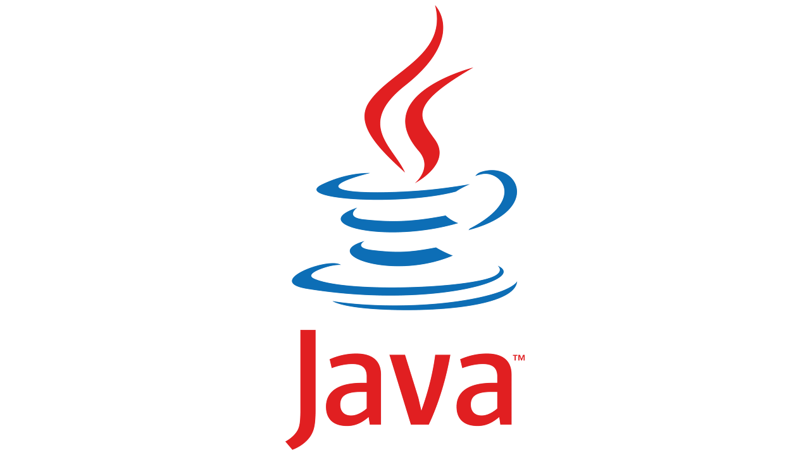

## 가상 메소드 테이블(Virtual Method Table)

---

**가상 메소드 테이블(Virtual Method Table)**은 자바에서 **동적 디스패치(dynamic dispatch)**를 구현하기 위한 메커니즘 중 하나입니다. **가상 메소드 테이블**은 **객체지향 프로그래밍**에서 **다형성(polymorphism)**을**지원**하고**, 상속 관계에 있는 클래스들 간의 메소드 호출을 가능하게 합니다.**

**가상 메소드 테이블**은 **각 클래스의 인스턴스마다 생성**되며, **클래스와 클래스**를 **상속받은 모든 클래스의 가상 메소드들에 대한 정보를 담고 있는 테이블**입니다. 각 클래스는 자신의 가상 메소드 테이블을 가리키는 **가상 메소드 테이블 포인터(virtual method table pointer)**를 가지고 있습니다.

**가상 메소드 테이블은 클래스의 메소드들을 메소드 식별자와 메소드 주소로 매핑하여 저장**합니다. 이렇게 저장된 메소드 주소는 실제로 호출될 때 실행됩니다. 자바에서는 가상 메소드 테이블을 사용하여 메소드 호출 시 실제 객체의 타입을 확인하고 해당하는 메소드를 호출합니다.

다음은 가상 메소드 테이블의 동작 방식을 간단한 예제를 통해 설명하겠습니다.

```java
class Animal {
    public void makeSound() {
        System.out.println("Animal makes a sound");
    }
}

class Dog extends Animal {
    @Override
    public void makeSound() {
        System.out.println("Dog barks");
    }
}

class Cat extends Animal {
    @Override
    public void makeSound() {
        System.out.println("Cat meows");
    }
}

public class Main {
    public static void main(String[] args) {
        Animal animal1 = new Dog();
        Animal animal2 = new Cat();

        animal1.makeSound();  // "Dog barks"
        animal2.makeSound();  // "Cat meows"
    }
}
```

위 예제에서 **Animal**클래스와 이를 상속받은 **Dog**와 **Cat**클래스가 있습니다. **makeSound**() 메소드는 각 클래스에서 **오버라이딩**되었습니다.   

**main**메소드에서 **Animal**타입의 변수 **animal1**과 **animal2**를 생성하고, 각각 **Dog**와 **Cat**객체를 할당합니다. 이때, 변수의 타입은 **Animal**이지만 객체의 실제 타입은 **Dog**와 **Cat**입니다.   

**animal1.makeSound()**와 **animal2.makeSound()**를 호출하면 각 객체의 실제 타입에 맞는 makeSound() 메소드가 실행됩니다. 이때, 가상 메소드 테이블을 사용하여 Dog 객체의 경우에는 Dog 클래스에 오버라이딩된 메소드가 호출되고, Cat 객체의 경우에는 Cat 클래스에 오버라이딩된 메소드가 호출됩니다.   

이처럼 자바는 가상 메소드 테이블을 활용하여 동적 디스패치를 구현하여 다형성을 지원합니다.
