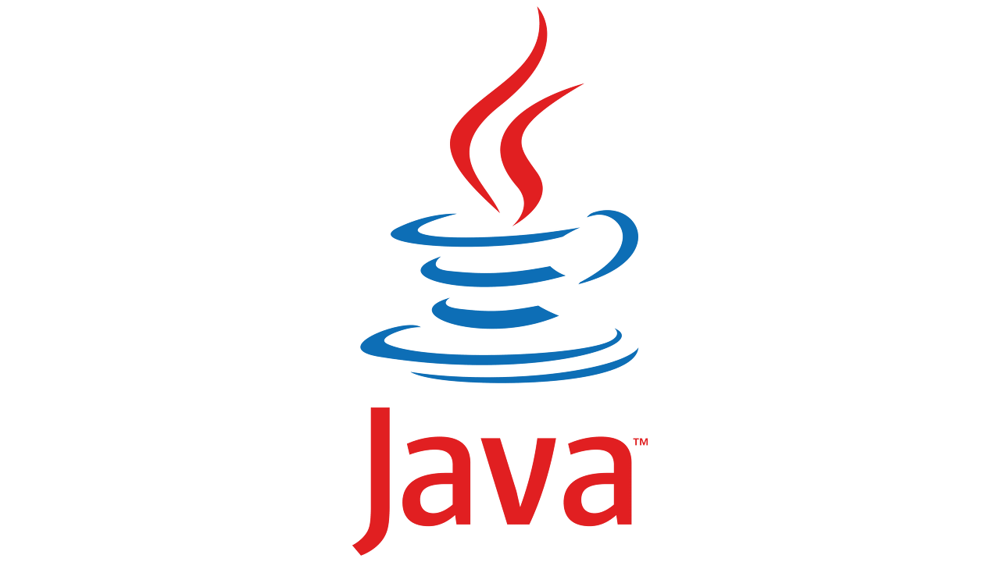

## **JVM(Java Virtual Machine)**

---

자바 버전마다 **Java Virtual Machine (JVM)**에는 새로운 기능과 개선 사항이 도입되었습니다. 이는 자바 언어와 라이브러리의 발전과 함께 JVM의 성능, 보안, 개발자 경험 등을 향상시키는 목적으로 이루어진 변화입니다. 아래에는 주요 자바 버전별로 JVM의 변화를 간단히 설명해드리겠습니다.

### Java 7

---

자바 7의 중요한 포인트는 **HotSpot JVM**이과 **포크 조인 프레임워크**입니다.

#### HotSpot JVM의 개선

G1(Garbage First) 가비지 컬렉터의 도입으로 가비지 수집의 성능이 향상되었습니다. G1 가비지 컬렉터는 대규모 메모리 힙에서 효율적으로 가비지를 수집할 수 있는 기능을 제공합니다.

> **※ HotSpot JVM이란?**HotSpot JVM은 오라클(Oracle)에서 개발한 자바 가상 머신(Java Virtual Machine)의 구현체 중 하나입니다. HotSpot은 현재 가장 널리 사용되는 JVM 중 하나로, 자바 애플리케이션의 실행 및 최적화를 담당합니다. 다음은 HotSpot JVM에 대한 몇 가지 주요 특징과 기능입니다:  
>   
> 1. **동적 컴파일(Just-In-Time Compilation, JIT)**HotSpot JVM은 동적 컴파일 기술을 사용하여 **실행 시점**에서 **자바 바이트코드**를 **기계어로 변환**합니다. 초기에는 인터프리터를 통해 바이트코드를 실행하다가, 반복적으로 실행되는 코드는 동적 컴파일러를 통해 기계어로 변환하여 성능을 향상시킵니다.  
>   
> 2. **가비지 컬렉션(Garbage Collection)**  
> **HotSpot JVM**은 다양한 가비지 컬렉션 알고리즘을 지원하여 **메모리 관리를 수행**합니다. G1(Garbage First) 가비지 컬렉터를 비롯한 다양한 컬렉션 알고리즘을 선택할 수 있으며, 이를 통해 힙 메모리의 효율적인 관리와 가비지 수집을 수행합니다.  
>   
> 3. **프로파일링(Profiling)과 최적화**  
> **HotSpot JVM**은 실**행 중인 애플리케이션을 프로파일링하여 실행 패턴과 성능 특성을 분석**합니다. 이 정보를 기반으로 자바 바이트코드를 효율적으로 최적화하고, 인라이닝(Inlining) 및 루프 최적화 등의 최적화 기법을 적용하여 더 빠른 실행 속도를 제공합니다.  
>   
> 4. **클래스 로딩과 메모리 관리**HotSpot JVM은 **클래스 로딩과 메모리 할당, 해제 등의 작업**을 **수행**합니다. 클래스 로딩은 클래스 파일을 JVM의 메모리에 로드하고 초기화하는 과정을 의미하며, HotSpot은 클래스 로딩과 관련된 성능 향상을 위한 기법을 적용합니다. 또한, 힙 메모리의 관리와 가비지 수집을 통해 자동으로 메모리를 해제하여 개발자가 명시적으로 관리하지 않아도 됩니다.  
>   
> 5. **다양한 운영 체제 지원**  
> HotSpot JVM은 **여러 운영 체제에서 실행될 수 있도록 다양한 플랫폼을 지원**합니다. Windows, macOS, Linux 등 다양한 운영 체제에서 자바 애플리케이션을 실행할 수 있으며, 플랫폼 간 이식성을 제공합니다.

#### **포크-조인 프레임워크(Fork-Join Framework)**

JVM이 멀티코어 프로세서를 더 효율적으로 활용할 수 있도록 포크-조인 프레임워크가 추가되었습니다. 이를 통해 병렬 작업의 분할과 조인을 쉽게 구현할 수 있습니다.

> **※ 포크-조인 프레임워크(Fork-Join Framework)**  
> 자바의 포크-조인 프레임워크(Fork-Join Framework)는 병렬 처리를 위한 프레임워크로, 자바 7부터 도입되었습니다. 이 프레임워크는 병렬 작업을 작은 작업 단위로 분할하여 실행하고, 그 결과를 조합하는 방식으로 동작합니다.  
>   
> **포크-조인 프레임워크**는 다음과 같은 구성 요소로 이루어져 있습니다.  
>   
> 1. **포크(Fork)** - 원래 작업을 작은 작업 단위로 분할합니다. 이 작은 작업들은 독립적으로 실행될 수 있습니다.   
>   
> 2. **조인(Join)** - 작은 작업들의 결과를 모아서 최종 결과를 생성합니다. 작업들이 독립적으로 실행되다가 모두 완료되면 결과를 조합합니다.  
>   
> 3. **임계 구역(Critical Section)** - 공유 자원에 대한 동시 접근을 제어하기 위한 임계 구역을 설정할 수 있습니다. 임계 구역은 여러 스레드가 동시에 접근하지 못하도록 보호됩니다.   
>   
> 포크-조인 프레임워크를 사용하면 병렬 작업을 쉽게 구현할 수 있습니다. 작업을 작은 작업 단위로 나누어 여러 스레드에서 병렬로 실행하므로, 다중 코어 프로세서에서 성능을 향상시킬 수 있습니다. 프레임워크가 자동으로 작업을 분할하고 조합하기 때문에 개발자는 작업 분할과 조합에 집중할 필요가 없습니다.  
>   
> 포크-조인 프레임워크는 자바의 java.util.concurrent 패키지에 포함되어 제공됩니다. RecursiveTask와 RecursiveAction 클래스를 사용하여 작업을 정의하고, ForkJoinPool을 사용하여 작업을 실행합니다. ForkJoinPool은 작업을 실행할 스레드 풀을 관리하며, 작업 큐를 통해 작업들을 관리합니다.   
>   
> 포크-조인 프레임워크는 병렬 프로그래밍을 간단하고 효율적으로 구현할 수 있는 강력한 도구입니다. 주로 병렬 처리가 필요한 재귀적인 작업이나 분할 정복 알고리즘 등에 사용됩니다.

### Java 8

---

#### Lambda 표현식과 스트림 API

JVM은 Lambda 표현식과 스트림 API를 지원하여 함수형 프로그래밍 패러다임을 채택했습니다. 이로써 더 간결하고 효율적인 코드 작성이 가능해졌습니다.

#### PermGen 제거 및 Metaspace 도입

이전 버전에서는 **클래스 메타데이터**와 **클래스 인스턴스**가 **PermGen 메모리 영역**에 저장되었습니다. **Java 8**에서는 PermGen 영역이 제거되고 **Metaspace**로 대체되었습니다. **Metaspace**는 힙 영역에 할당되며, 클래스와 메타데이터의 관리가 향상되었습니다.

Java 8 이전의 버전에서는 **PermGen(Permanent Generation)**이라는 특별한 메모리 영역이 있었습니다. **PermGen**은 **JVM**의 메모리 영역 중 하나로, 클래스 메타데이터와 클래스 인스턴스의 정보를 저장하는 공간이었습니다. 그러나 **Java 8**부터 **PermGen**이 **Metaspace**로 대체되었습니다.

**PermGen**의 한계는 다음과 같은 문제를 발생시킬 수 있었습니다:

1. **고정된 크기**  
   PermGen은 JVM 시작 시에 할당된 고정된 크기의 메모리였습니다. 이 크기는 미리 정의되어 있어서 유연한 메모리 할당이 어렵거나, 메모리 부족 문제를 일으킬 수 있었습니다.
2. **Out of Memory 오류**  
   PermGen은 클래스 로딩 및 언로딩에 따라 메모리 사용량이 동적으로 변동합니다. 일부 애플리케이션에서는 클래스 로딩과 언로딩이 빈번하게 발생하며, 이로 인해 PermGen 영역이 부족해지고 Out of Memory 오류가 발생할 수 있었습니다.

Java 8에서는 PermGen의 대안으로 Metaspace가 도입되었습니다. Metaspace는 기존 PermGen과는 다른 특징을 가지며, 다음과 같은 이점을 제공합니다:

1. **동적 크기 조정**  
   Metaspace는 힙 영역에 할당되므로 동적으로 메모리를 확장할 수 있습니다. 따라서 PermGen에서 발생했던 메모리 부족 문제를 완화시킬 수 있습니다.
2. **자동 GC 처리**Metaspace는 가비지 컬렉션(Garbage Collection)의 대상이 됩니다. 더 이상 메모리 부족으로 인한 Out of Memory 오류가 발생하지 않습니다.
3. **네이티브 메모리 사용  
   Metaspace**는 **힙 메모리 대신**에 **네이티브 메모리**를 사용하므로, 힙 영역의 메모리 한계에 구애받지 않습니다. 따라서 Metaspace는 더 많은 클래스와 메타데이터를 저장할 수 있습니다.

**Metaspace**는 JVM의 구성 설정을 통해 크기를 제한하거나 메모리 사용량을 조정할 수 있습니다. 이를 통해 메모리 관리를 더욱 유연하게 조정할 수 있습니다.   

Java 8 이후의 버전에서는 PermGen 옵션을 사용할 필요가 없으며, 기본적으로 **Metaspace**가 사용됩니다. **PermGen**과 **Metaspace**의 변화는 클래스 메타데이터 관리 및 메모리 할당에 있어서 자바 애플리케이션의 성능과 안정성을 향상시켰습니다.

### Java 9

---

#### 모듈 시스템

Java 9에서는 가장 큰 변화 중 하나로 모듈 시스템이 도입되었습니다. 이를 개발하기 위해**Jigsaw 프로젝트**가 시작되었습니다. **모듈 시스템**은 **자바 플랫폼을 모듈 단위로 구성**하고, **각 모듈 간의 의존성과 가시성을 명확하게 정의하는 기능**을 제공합니다.

**모듈은 관련된 코드, 리소스 및 설정 파일들을 논리적으로 그룹화**하는 것입니다. **모듈은**다른 모듈에 대한 **공개된 API를 정의하고**, **내부의 구현 세부사항**은 외부로부터 숨기는 **캡슐화**를 제공합니다. 이를 통해 모듈 간의 강력한 의존성 관리와 충돌 방지, 더 작고 유연한 애플리케이션 구조를 구축할 수 있습니다.

Jigsaw 프로젝트는 모듈 시스템을 구현하고 Java 플랫폼에 통합하기 위한 작업을 수행했습니다. 이 프로젝트는 다음과 같은 목표를 가지고 진행되었습니다.

* **모듈 시스템 정의**Java 플랫폼의 모듈 시스템을 설계하고 명세화하는 것이었습니다. 이를 통해 모듈 경로, 모듈 정의, 모듈 간의 의존성 관리 등을 구현했습니다.
* **컴파일러 및 런타임 지원**Java 컴파일러와 런타임 시스템을 모듈 시스템과 통합하기 위한 변경 작업을 수행했습니다. 컴파일러는 모듈 경로를 사용하여 모듈화된 코드를 컴파일하고, 런타임은 모듈 시스템을 기반으로 모듈들을 로드하고 실행합니다.
* **표준 모듈 정의** Jigsaw 프로젝트는 JDK 자체를 모듈화하는 작업을 진행했습니다. 이를 통해 JDK의 내부 구현 세부사항을 캡슐화하고 모듈 간의 명확한 경계를 설정했습니다. 또한, 표준 모듈로 JDK 모듈을 정의하여 재사용성을 높이고 애플리케이션의 모듈화를 지원했습니다.

모듈 시스템은 애플리케이션 개발에서 다음과 같은 이점을 제공합니다:

* **의존성 관리**  
  모듈 시스템을 사용하면 애플리케이션의 의존성을 명확히 정의할 수 있습니다. 필요한 모듈만 가져와 사용하므로 불필요한 의존성을 제거하고 충돌을 방지할 수 있습니다.
* **캡슐화**모듈은 내부 구현 세부사항을 캡슐화하여 외부로부터 보호합니다. 이를 통해 모듈 간의 강력한 의존성 관리와 모듈의 독립성을 유지할 수 있습니다.
* **보안 강화**모듈 시스템은 모듈 간의 가시성을 명확히 정의하므로, 외부 모듈에서 내부 모듈의 비공개 API에 접근하는 것을 방지할 수 있습니다.
* **성능 개선**모듈 시스템은 필요한 모듈만 로드하여 애플리케이션의 시작 시간을 단축시킬 수 있습니다. 또한, 모듈 경로를 사용하여 클래스 경로보다 효율적인 클래스 로딩을 수행합니다.

Java 9의 모듈 시스템과 Jigsaw 프로젝트는 자바 애플리케이션의 구조와 의존성 관리를 개선하여 코드의 유연성과 안정성을 높이는데 기여하였습니다.

#### JShell

JShell은 Java 9에서 도입된 인터랙티브한 Java 개발 도구입니다. 이는 명령줄 환경에서 코드를 입력하고 즉시 실행하여 결과를 확인할 수 있는**REPL(Read-Eval-Print Loop) 도구**입니다. **JShell**은 개발자에게 빠른 실험, 프로토타이핑, 디버깅 등의 기능을 제공하여 개발 생산성을 향상시킵니다.   

JShell의 주요 기능과 특징은 다음과 같습니다.

1. **실시간 코드 실행**  
   **JShell**은 코드 조각을 입력하고 즉시 실행하여 결과를 바로 확인할 수 있습니다. 이를 통해 코드를 작성하고 테스트하는 과정을 빠르게 반복할 수 있습니다.
2. **표현식 및 문장 입력**JShell에서는 단순한 표현식부터 복잡한 문장까지 다양한 코드를 입력할 수 있습니다. 변수 선언, 메소드 호출, 제어문 등을 자유롭게 작성할 수 있습니다.
3. **자동 완성 기능**JShell은 코드 작성 시 자동 완성 기능을 제공하여 개발자가 사용 가능한 메소드, 변수, 클래스 등을 쉽게 확인하고 활용할 수 있습니다.
4. **코드 수정 및 재실행**JShell에서는 이전에 입력한 코드를 수정하고 다시 실행할 수 있습니다. 이를 통해 실시간으로 코드를 수정하고 결과를 확인할 수 있습니다.
5. **변수 추적 및 히스토리 기록**JShell은 이전에 선언한 변수의 값을 추적하고 히스토리를 기록합니다. 이를 통해 코드 실행 도중 변수의 값 변화를 모니터링하고 디버깅하는 데 유용합니다.
6. **외부 라이브러리 사용**JShell은 외부 라이브러리를 사용할 수 있습니다. 필요한 라이브러리를 로드하고 직접 코드에서 활용할 수 있습니다.

JShell은 Java 개발자에게 코드 작성과 테스트를 보다 쉽고 빠르게 수행할 수 있는 환경을 제공합니다. **REPL** 환경에서 코드를 직접 입력하고 실행하면서 코드 동작을 즉시 확인할 수 있어 개발자의 실험과 프로토타이핑을 용이하게 해줍니다.

### Java 10

---

#### 로컬 변수 형식 추론(Local Variable Type Inference)

로컬 변수 형식 추론은 Java 10에서 도입된 기능으로, 코드의 가독성을 향상시키기 위해 변수 선언 시 타입을 명시하지 않고도 컴파일러가 변수의 타입을 추론할 수 있게 합니다. 이는 **var**키워드를 사용하여 변수를 선언할 때 사용됩니다.   

로컬 변수 형식 추론의 장점은 다음과 같습니다:

* **코드의 간결성**  
  변수 선언 시 타입을 명시하지 않아도 되므로 코드가 더욱 간결해집니다. 특히, 긴 제네릭 타입이나 복잡한 타입의 변수를 선언할 때 유용합니다.
* **가독성 향상**  
  코드의 가독성을 개선할 수 있습니다. 변수의 이름과 초기화식을 통해 변수의 용도와 의도를 명확히 표현할 수 있습니다.
* **타입 변경 용이성**  
  타입 추론을 통해 변수의 타입을 추론하므로, 변수의 타입을 변경해야 할 경우 변수 선언 부분만 수정하면 됩니다.

로컬 변수 형식 추론은 주의해야 할 점도 있습니다:

* **의도적인 가독성**  
  가독성을 향상시키기 위해 타입을 생략하더라도 변수의 의도를 명확히 전달하기 위해 변수명을 신중하게 선택해야 합니다.
* **너무 복잡한 표현식**추론된 타입이 코드의 이해를 어렵게 할 수 있으므로, 너무 복잡한 표현식에서는 명시적인 타입 선언이 가독성을 높일 수 있습니다.

#### G1 가비지 컬렉터의 기본 설정

### Java 11

---

#### Epsilon 가비지 컬렉터

Epsilon 가비지 컬렉터는 Java 11에서 도입된 실험적인 가비지 컬렉터입니다. 이 가비지 컬렉터는 실제로 가비지 수집을 수행하지 않고, 힙 메모리를 고정된 크기로 유지합니다. 이를 통해 메모리 할당 및 해제에 대한 오버헤드를 제거하고, 가비지 컬렉션에 소비되는 시간을 없앨 수 있습니다.

Epsilon 가비지 컬렉터의 주요 특징과 사용 사례는 다음과 같습니다.

* **최대 성능**  
  Epsilon 가비지 컬렉터는 메모리 할당과 해제에 대한 추가적인 작업이 필요 없으므로, 최대의 성능을 제공할 수 있습니다. 이는 특히 임시 객체를 많이 생성하거나, 짧은 생명주기를 가지는 객체를 다룰 때 유용합니다.
* **테스트 및 벤치마킹**  
  Epsilon 가비지 컬렉터는 애플리케이션의 가비지 컬렉션 동작을 테스트하거나 벤치마크를 수행할 때 유용합니다. 가비지 컬렉션에 대한 성능 분석이나 메모리 사용량 테스트 등을 수행할 때 Epsilon 가비지 컬렉터를 활용할 수 있습니다.
* **메모리 누수**  
  Epsilon 가비지 컬렉터는 가비지 컬렉션을 수행하지 않으므로 메모리 누수가 발생할 수 있습니다. 따라서 실제 운영 환경에서는 권장되지 않습니다. Epsilon 가비지 컬렉터는 주로 실험 및 테스트 목적으로 사용되는 것이 일반적입니다.

#### **HTTP/2 클라이언트**

Java 11에서는 새로운 HTTP/2 클라이언트 API가 도입되었습니다. 이 API는 기존의 HttpURLConnection보다 강력하고 효율적인 HTTP 통신을 제공합니다. HTTP/2는 이전 버전인 HTTP/1.1보다 더 효율적이고 성능이 우수한 프로토콜입니다.

Java 11의 HTTP/2 클라이언트 API의 주요 특징은 다음과 같습니다.

* **비동기 및 병렬 처리**HTTP/2 클라이언트 API는 비동기 및 병렬 처리를 지원합니다. 이를 통해 여러 개의 요청을 동시에 보내고, 응답을 비동기적으로 처리할 수 있습니다. 이는 높은 성능과 효율성을 제공합니다.
* **멀티파트 요청 및 응답**HTTP/2 클라이언트 API는 멀티파트 요청 및 응답을 지원합니다. 이를 통해 여러 개의 데이터 조각을 하나의 요청이나 응답으로 처리할 수 있습니다. 이는 파일 업로드, 다운로드 등과 같은 기능을 구현할 때 유용합니다.
* **헤더 커스터마이징**HTTP/2 클라이언트 API를 사용하면 HTTP 요청 및 응답의 헤더를 직접 커스터마이징할 수 있습니다. 이는 인증, 쿠키 처리 등과 같은 고급 기능을 구현할 때 유용합니다.

Java 11의 HTTP/2 클라이언트 API는 이전의 HttpURLConnection과 비교하여 더욱 효율적이고 성능이 우수한 HTTP 통신을 제공합니다. 이를 통해 개발자는 더욱 강력하고 효율적인 네트워크 기능을 구현할 수 있습니다.

### Java 12, 13, 14

---

#### Java 12

**Switch 표현식 (JEP 325)**

Switch 표현식은 기존의 switch 문을 보다 간결하고 효율적으로 작성할 수 있도록 도와줍니다. 다음은 Switch 표현식의 예시 코드입니다.

```java
int dayOfWeek = 3;
String dayType = switch (dayOfWeek) {
    case 1, 2, 3, 4, 5 -> "Weekday";
    case 6, 7 -> "Weekend";
    default -> throw new IllegalArgumentException("Invalid day of week: " + dayOfWeek);
};

System.out.println("Day type: " + dayType);
```

Switch 표현식은 switch 문의 결과를 직접 반환하며, 화살표(->)를 사용하여 각 분기의 결과를 정의합니다. 이를 통해 여러 분기를 한 줄로 간결하게 작성할 수 있습니다.

**Shenandoah 가비지 컬렉터**

Shenandoah는 Java 12에서 도입된 가비지 컬렉터로, 가비지 컬렉션의 일시 중단 시간을 최소화하여 애플리케이션의 응답성을 향상시킵니다. 다음은 Shenandoah 가비지 컬렉터의 예시 코드입니다:

```java
// Shenandoah 가비지 컬렉터 활성화
java -XX:+UseShenandoahGC Main

public class Main {
    public static void main(String[] args) {
        List<String> strings = new ArrayList<>();

        // 많은 양의 객체를 생성하고 사용
        for (int i = 0; i < 1000000; i++) {
            strings.add("String" + i);
        }

        // 가비지 컬렉션 실행
        System.gc();
    }
}
```

Shenandoah 가비지 컬렉터는 일시 중단 시간을 최소화하여 가비지 컬렉션의 부담을 줄입니다. 애플리케이션의 메모리 사용량이 많아지거나 가비지 컬렉션에 의한 일시 중단 시간을 최소화해야 할 때 Shenandoah 가비지 컬렉터를 활성화할 수 있습니다.   

이렇게 Switch 표현식과 Shenandoah 가비지 컬렉터는 Java 12에서 도입된 주요 기능들입니다. Switch 표현식은 switch 문을 간결하고 가독성 있게 작성할 수 있게 해주며, Shenandoah 가비지 컬렉터는 애플리케이션의 응답성을 향상시키는 가비지 컬렉션 기술입니다.

#### Java 13

**텍스트 블록 (Text Blocks, JEP 355)**

텍스트 블록은 Java에서 여러 줄의 문자열을 보다 간편하게 작성할 수 있는 기능입니다. 이를 통해 HTML, SQL, JSON 등과 같은 구조화된 데이터를 포함한 여러 줄의 문자열을 작성할 때 가독성과 유지보수성을 향상시킬 수 있습니다. 기존의 문자열 리터럴 작성 방식보다 더 직관적이고 가독성 있는 코드를 작성할 수 있습니다.

```java
String html = """
    <html>
        <body>
            <h1>Welcome to Java</h1>
            <p>This is a text block in Java 13.</p>
        </body>
    </html>
""";

System.out.println(html);
```

위의 예시에서는 """ 사이에 여러 줄의 HTML 코드를 작성하였습니다. 이를 통해 기존의 문자열 조합 방식에 비해 가독성이 향상되고 여러 줄의 코드를 보다 쉽게 작성할 수 있습니다.

**동적 CDS 아카이브 (Dynamic CDS Archives, JEP 350)**

동적 CDS 아카이브는 Java의 클래스 데이터 공유 (CDS) 기능을 동적으로 활성화하여 런타임 중에 클래스를 아카이브하고 동적으로 로드할 수 있도록 합니다. 이를 통해 응용 프로그램의 시작 시간과 메모리 사용량을 줄일 수 있습니다.

기존의 CDS는 클래스 로딩 시 클래스 데이터를 아카이브하여 재사용하는 기능이었습니다. 그러나 동적 CDS 아카이브는 응용 프로그램이 실행 중에 클래스를 동적으로 로드할 수 있도록 하여 유연성을 제공합니다.   

동적 CDS 아카이브를 활성화하기 위해서는 다음과 같은 명령을 사용할 수 있습니다:

```bash
java -XX:ArchiveClassesAtExit=app-cds.jsa MyApp
```

위의 예시에서는 app-cds.jsa 라는 아카이브 파일에 클래스를 아카이브하고, MyApp을 실행하는 명령입니다.

동적 CDS 아카이브는 응용 프로그램의 시작 시간과 메모리 사용량을 줄여주는 효과적인 기능입니다.

이러한 텍스트 블록과 동적 CDS 아카이브는 Java 13에서 도입된 주요 기능들입니다. 텍스트 블록은 여러 줄의 문자열 작성을 간편하게 만들어주고, 동적 CDS 아카이브는 런타임 중에 클래스 데이터를 아카이브하여 응용 프로그램의 성능을 향상시킵니다.

#### Java 14

InstanceOf 패턴 매칭(Pattern Matching for instanceof)

instanceof 패턴 매칭은 instanceof 연산자와 함께 사용되어 객체의 타입 체크와 형변환을 보다 간결하고 효율적으로 처리할 수 있는 기능입니다. 이를 통해 코드를 더욱 가독성 있고 간결하게 작성할 수 있습니다.

다음은 instanceof 패턴 매칭을 사용한 예시 코드입니다

```java
public static void processAnimal(Animal animal) {
    if (animal instanceof Dog dog) {
        dog.bark();
    } else if (animal instanceof Cat cat) {
        cat.meow();
    } else if (animal instanceof Bird bird) {
        bird.sing();
    }
}
```

위의 예시에서는 instanceof 패턴 매칭을 사용하여 animal 객체의 타입을 체크하고, 해당 타입에 맞는 동작을 수행합니다. 이를 통해 형변환 없이 객체의 메소드를 호출할 수 있습니다.

**레코드 (Records)**

레코드는 데이터를 저장하고 접근하기 위한 목적으로 사용되는 간단한 데이터 컨테이너 클래스입니다. 레코드를 사용하면 불변성(immutability)과 자동으로 생성되는 메소드를 갖는 클래스를 간편하게 정의할 수 있습니다.

다음은 레코드를 사용한 예시 코드입니다:

```java
public record Person(String name, int age) {
    // 추가적인 메소드나 필드 정의 없음
}

// 레코드 객체 생성 및 사용
Person person = new Person("John", 30);
System.out.println(person.name());
System.out.println(person.age());
```

위의 예시에서는 Person이라는 레코드 클래스를 정의하고, name과 age라는 필드를 포함합니다. 레코드 클래스는 자동으로 필드를 읽을 수 있는 접근자 메소드를 생성하며, 불변성을 보장합니다.   

레코드는 데이터 객체를 간결하게 표현할 수 있고, equals(), hashCode(), toString() 등의 메소드를 자동으로 생성해주어 개발자의 생산성을 향상시킵니다.   

이러한 instanceof 패턴 매칭과 레코드는 Java 14에서 도입된 주요 기능들입니다. instanceof 패턴 매칭은 instanceof 연산자를 더욱 유연하고 간결하게 사용할 수 있게 해주며, 레코드는 데이터 컨테이너 클래스를 간편하게 정의하고 자동으로 생성되는 메소드를 제공합니다.

#### 정리

---

이외에도 자바 버전에 따른 특징들이 많지만, 주요 핵심 변화는 위에 설명드린 것입니다.

Java의 다양한 버전을 사용할 때마다 새로운 기능을 경험하면서 Java 8에서 있었나? Java 11버전에는 있나? 하면서 없다면 상위 버전의 기능들을 유사하게 구현하여 사용하면 이해를 높일 수 있고 더 많은 경험을 해보실 수 있습니다.
